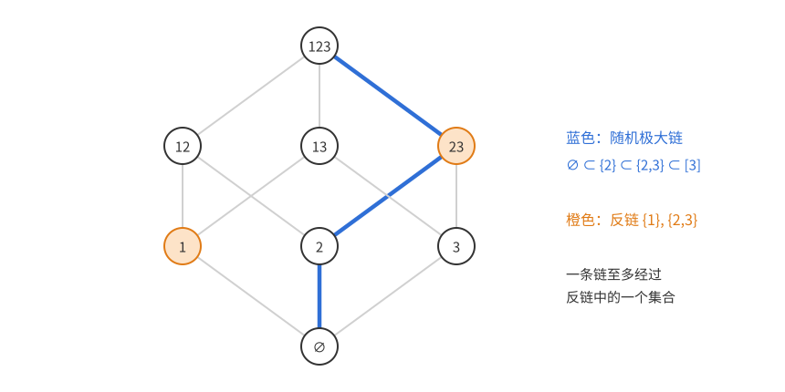
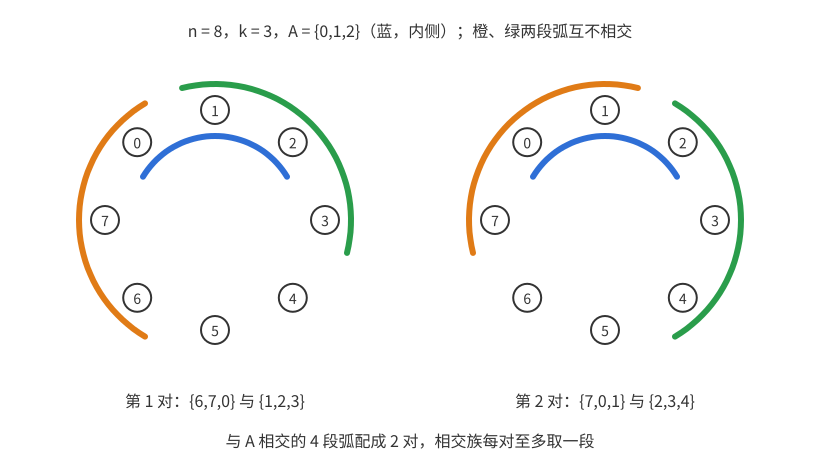
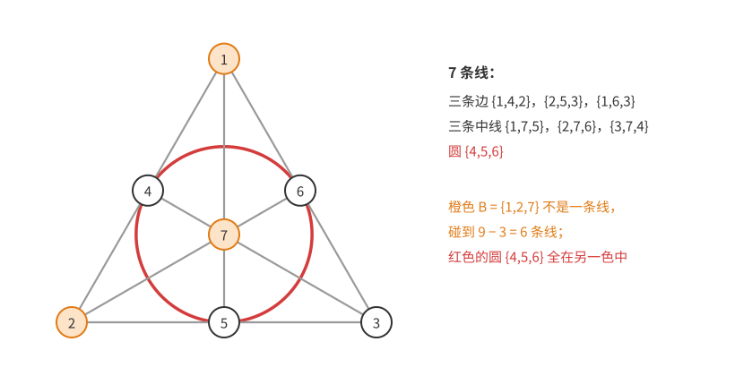
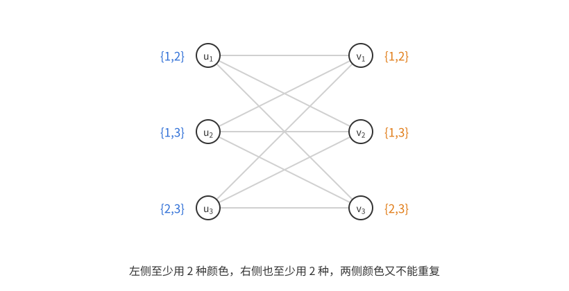
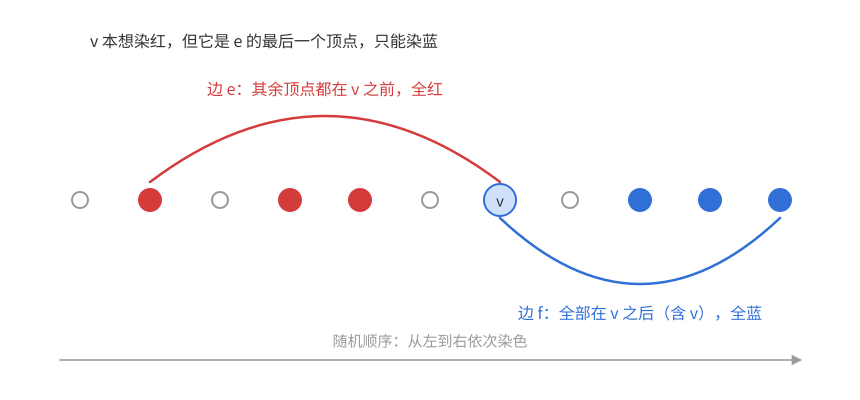

# 概率方法（一）：引论

上一篇：无（[目录与记号](概率方法讲义——目录与记号.md)）　下一篇：[第 2 章 期望的线性性](概率方法02——期望的线性性.md)

本章用一串例子展示概率方法的基本思路：想证明某种组合对象**存在**，就设计一个随机对象，算出它以正概率满足要求。这里用到的概率工具只有两件——**并集上界**和**期望的线性性**，再加一个“随机顺序”的技巧。后面各章的工具（删除法、二阶矩、局部引理、集中不等式……）在这里都会先露个面。

**本章读法。**

- 首读主线：1.0 节的三个要素；定理 1.1（并集上界）和定理 1.2（删除法）；LYM 不等式和 EKR 定理的 Katona 圆排列证明；定理 1.10、1.11；定理 1.12、1.13。
- 可以二读：[方法三](#方法三lovász-局部引理)（定理 1.3 只陈述、不证明）和表格后关于指数的分析；两族定理（定理 1.7、1.8）；$m(3)\ge7$ 的补证。标有“研究背景”的段落首读可以跳过。
- 与后续章节的联系：第 2 章从定理 1.0 的期望论证讲起；[第 3 章](概率方法03——删除法.md)推广定理 1.2 的删除法，并在 3.5 节借[习题 10](#习题-10不可二染色超图中恰交于一点的边对)的随机贪心染色改进定理 1.10；第 4 章说明定理 1.1 背后的团数估计在两个方向上都是精确的；[第 6 章](<概率方法06——Lovász 局部引理.md>)证明定理 1.3，并给出定理 1.10 的局部条件版本；1.4 节末尾提到的容器方法是[第 11 章](概率方法11——容器方法.md)的主题。

## 1.0 第一个例子：大的二部子图

**定理 1.0**　每个有 $m$ 条边的图都有一个至少含 $m/2$ 条边的二部子图。

先想目标：二部子图就是把顶点分成两组，只保留跨组的边。要证明存在一种分法，使跨组边至少占一半。

这个定理用局部调整也能证明：若某个点在本组的邻点多于在对组的邻点，就把它移到对组，跨组边严格增加；调整不能无限进行，停下时每个点至少一半的边跨组，求和即得。见过的读者不妨回忆一下。

这里换一个角度，展示一种以后会反复使用的思路：不去找“好的”分法，而是**随便**分——每个顶点独立地抛硬币，正面放左组，反面放右组。对一条固定的边 $uv$，它跨组当且仅当两端的硬币不同，概率恰为 $\frac12$。设 $X$ 为跨组边数，则 $X$ 是 $m$ 个示性变量之和（边 $uv$ 的示性变量在 $uv$ 跨组时取 1，否则取 0，其期望就是 $uv$ 跨组的概率），由期望的线性性
$$\mathbb E[X]=\sum_{uv\in E}\mathbb P(uv\text{ 跨组})=\frac m2.$$
一个随机变量不可能总是严格小于它的期望，所以某次抛硬币的结果使 $X\ge m/2$。这个分法给出所求的二部子图。$\square$

两种证明对比：调整法要用到这个问题的特殊结构（移动一个点只改变它自己那些边的状态），随机法几乎不用想，只算了一条边的概率。

这个证明有概率方法的全部要素：

1. **随机对象**：顶点的随机二分。
2. **局部计算**：每条边的概率只涉及两个顶点，好算。
3. **由平均推存在**：期望达到 $m/2$，所以某个结果至少是 $m/2$。

后面大多数证明都有这三步的影子（第 3 步有时不是“由平均推存在”，而是由“互不相容事件的概率之和不超过 1”推出上界，如 1.2 节），难处在于第 1 步怎样设计随机对象，以及第 3 步怎样从概率信息过渡到存在性或不存在性。

## 1.1 拉姆塞数的下界

### 问题与已知结果

**定义**　$R(k,\ell)$ 是满足下述条件的最小 $n$：把 $K_n$ 的每条边染红或蓝，无论怎样染，总有红色 $K_k$ 或蓝色 $K_\ell$。$R(k,k)$ 称为对角拉姆塞数。

小例子：$R(3,3)=6$。在 $K_6$ 中，任取一点，它的 5 条边中必有 3 条同色，设为红色连向 $a,b,c$；若 $a,b,c$ 之间有一条红边，就和该点构成红三角形；否则 $a,b,c$ 构成蓝三角形。另一方面，$K_5$ 中把五边形的边染红、五角星的边染蓝，没有单色三角形。

**上界**（Erdős–Szekeres，1935）　$R(k,\ell)\le R(k-1,\ell)+R(k,\ell-1)$。证明：取 $n=R(k-1,\ell)+R(k,\ell-1)$ 个点，任取一点 $v$，其余 $n-1$ 个点中，与 $v$ 红边相连的至少 $R(k-1,\ell)$ 个，或蓝边相连的至少 $R(k,\ell-1)$ 个。前一种情形，这些点中有蓝 $K_\ell$，或有红 $K_{k-1}$，加上 $v$ 成为红 $K_k$；后一种情形同理。由这个递推和 $R(k,2)=k$ 归纳可得
$$R(k,\ell)\le\binom{k+\ell-2}{k-1},\qquad R(k,k)\le\binom{2k-2}{k-1}<4^{k}.$$
（研究背景，首读可跳过。）这个 $4^k$ 保持了近九十年，直到 2023 年 Campos、Griffiths、Morris、Sahasrabudhe 证明了存在常数 $c>0$ 使 $R(k,k)\le(4-c)^k$；后续工作把底数改进到约 $3.8$（Gupta、Ndiaye、Norin、Wei 2024）。（2026 年 9 月有预印本声称把底数改进到 $3.695$，尚未经同行评审。）

**下界**要证明的是：存在一种 $K_n$ 的染色**没有**单色 $K_k$。最自然的想法是明确构造。例如把 $(k-1)^2$ 个点分成 $k-1$ 组、每组 $k-1$ 个点，组内连红边、组间连蓝边：红团只能在一组内，至多 $k-1$ 个点；蓝团每组至多取一点，也至多 $k-1$ 个点。这样只得到 $R(k,k)>(k-1)^2$，是多项式级的。要得到指数级，需要一种“处处没有规律”的染色——而这正是随机染色的特点。

### 方法一：并集上界（Erdős 1947）

**定理 1.1**　若 $\binom nk2^{1-\binom k2}<1$，则 $R(k,k)>n$。

*证明*　$K_n$ 的每条边独立地以 $\frac12$ 概率染红或蓝。对每个 $k$ 元点集 $S$，设 $A_S$ 为“$S$ 内 $\binom k2$ 条边同色”这一**坏事件**，$\mathbb P(A_S)=2\cdot2^{-\binom k2}$。由并集上界
$$\mathbb P\Big(\bigcup_S A_S\Big)\le\sum_S\mathbb P(A_S)=\binom nk2^{1-\binom k2}<1,$$
所以以正概率没有坏事件发生，即存在没有单色 $K_k$ 的染色。$\square$

数值上，取 $n=\lfloor2^{k/2}\rfloor$（$k\ge3$）：$\binom nk<\frac{n^k}{k!}\le\frac{2^{k^2/2}}{k!}$，于是 $\binom nk2^{1-\binom k2}<\frac{2^{1+k/2}}{k!}<1$。所以
$$R(k,k)>2^{k/2}\quad(k\ge3).$$
更精细地用 Stirling 公式 $k!\sim\sqrt{2\pi k}\,(k/e)^k$ 求出使条件成立的最大 $n$，得到
$$R(k,k)>\Big(\frac{1}{e\sqrt2}+o(1)\Big)k\,2^{k/2}$$
（见习题 1(a)）。

**两点说明。**

- *这其实是计数。* 所有 $2^{\binom n2}$ 种染色中，含单色 $K_k$ 的染色个数不超过 $\binom nk\cdot2\cdot2^{\binom n2-\binom k2}$，若它小于总数，就有好染色。Erdős 1947 年的原文正是这样写的。有限概率空间上的论证原则上都能改写成计数，但后面更复杂的论证若不用概率语言，几乎无法组织。
- *存在不等于能找到。* 当 $n=2^{k/2}$ 时，几乎所有染色都是好的，但我们不知道怎样在多项式时间内**写出并验证**一个：逐一检查所有 $k$ 元子集（$k\approx2\log_2 n$）来验证一个具体染色，要查 $\binom nk=n^{\Theta(\log n)}$ 个子集，不是多项式时间；而更高效的认证办法，目前也没有人知道。“草堆里找干草”——干草遍地都是，却拿不出一根来证明它是干草。给出指数级的显式构造至今是公开问题；近年来借助理论计算机科学中“随机性提取器”的研究有过重要进展，但离 $2^{k/2}$ 还很远。

综合上下界，$\sqrt2^{\,k}\lesssim R(k,k)\lesssim 3.8^k$，底数的真实值是什么，是组合学最著名的问题之一。

### 方法二：删除法

方法一要求坏事件的期望个数小于 1，太苛刻了：只要允许少量坏 $K_k$，$n$ 就可以取得更大，再把它们**修掉**。

**定理 1.2**　对任意 $k,n$，$R(k,k)>n-\binom nk2^{1-\binom k2}$。

*证明*　第一步，随机染 $K_n$；第二步，从每个单色 $K_k$ 中删去一个顶点。剩下的点集上没有单色 $K_k$（每个单色团都被破坏了，删点不会产生新团）。设 $X$ 为第一步中单色 $K_k$ 的个数，删去的点不超过 $X$ 个，剩余点数至少 $n-X$，其期望为 $n-\binom nk2^{1-\binom k2}$。所以某次染色剩下至少这么多点，且没有单色 $K_k$。$\square$

为什么这样更好？方法一要求 $\mathbb E X<1$；现在只要求 $\mathbb E X$ 比 $n$ 小一个比例，例如 $\mathbb E X\le n/k$，这允许 $n$ 再放大一个常数倍。

这个常数倍恰好是 $\sqrt2$，原因如下。设 $n=\lambda k2^{k/2}$，习题 1 的估计给出 $\mathbb EX=\binom nk2^{1-\binom k2}=(\lambda e\sqrt2)^k$ 乘一个多项式因子。方法一要求 $\mathbb EX<1$，开 $k$ 次方后多项式因子趋于 1，条件是底数 $\lambda e\sqrt2\le1$。删除法允许 $\mathbb EX$ 达到 $n$ 的一个比例，而 $n=\lambda k2^{k/2}$ 本身是 $(\sqrt2)^k$ 乘多项式因子：坏事件的额度从 1 放宽到约 $(\sqrt2)^k$。开 $k$ 次方，条件变成 $\lambda e\sqrt2\le\sqrt2$，即 $\lambda\le\frac1e$。对 $n$ 严格优化（习题 1(b)）得到
$$R(k,k)>\Big(\frac1e+o(1)\Big)k\,2^{k/2},$$
比方法一多出因子 $\sqrt2$。“先随机，再修补”就是[第 3 章](概率方法03——删除法.md)的主题。

### 方法三：Lovász 局部引理

想避免一族坏事件 $E_1,\dots,E_m$，有两种极端情形：

- 若 $\sum\mathbb P(E_i)<1$，并集上界直接给出 $\mathbb P(\text{都不发生})>0$；
- 若各 $E_i$ 相互独立且每个概率都小于 1，则 $\mathbb P(\text{都不发生})=\prod(1-\mathbb P(E_i))>0$，**无论有多少个事件**。

拉姆塞问题介于两者之间：坏事件数量 $\binom nk$ 极多，使总和远大于 1；但两个 $k$ 元集若至多共用一个顶点，它们没有公共边，相应的坏事件独立。每个事件只与少数事件相关。局部引理处理的正是这种“依赖稀疏”的情形。

**定理 1.3（局部引理，随机变量形式）**　设 $x_1,\dots,x_N$ 是相互独立的随机变量，$B_1,\dots,B_m\subseteq[N]$，事件 $E_i$ 只由 $\{x_j:j\in B_i\}$ 决定。若每个 $B_i$ 至多与 $d$ 个其他的 $B_j$ 相交，且对每个 $i$
$$\mathbb P(E_i)\le\frac{1}{e(d+1)},$$
则以正概率所有 $E_i$ 都不发生。

证明留到[第 6 章 6.1 节](<概率方法06——Lovász 局部引理.md#61-局部引理的陈述与证明>)。条件中的常数 $e$ 不能再改进。

**定理 1.4（Spencer 1977）**　若 $e\Big(\binom k2\binom n{k-2}+1\Big)2^{1-\binom k2}<1$，则 $R(k,k)>n$。

*证明*　每条边的颜色是一个独立变量，$E_S$ 只依赖于 $S$ 内的边。$S$ 与 $S'$ 有公共边当且仅当 $|S\cap S'|\ge2$；这样的 $S'$ 可以先选两个公共顶点（$\binom k2$ 种）、再选其余 $k-2$ 个点（至多 $\binom n{k-2}$ 种），所以 $d\le\binom k2\binom n{k-2}$。条件正是 $\mathbb P(E_S)\le\frac1{e(d+1)}$，由局部引理得证。$\square$

优化 $n$（习题 1(c)）得到
$$R(k,k)>\Big(\frac{\sqrt2}{e}+o(1)\Big)k\,2^{k/2},$$
又多出因子 $\sqrt2$。这是迄今已知最好的下界。

用同样的账来看这个 $\sqrt2$。由 $\binom n{k-2}\big/\binom nk=\frac{k(k-1)}{(n-k+2)(n-k+1)}\approx\frac{k^2}{n^2}$，依赖数 $d\approx\binom k2\binom n{k-2}\approx\frac{k^4}{2n^2}\binom nk$，所以定理 1.4 的条件 $e\,d\cdot2^{1-\binom k2}<1$ 大致是
$$\mathbb EX=\binom nk2^{1-\binom k2}\lesssim\frac{n^2}{k^4}.$$
坏事件的额度放宽到约 $n^2$，即 $(\sqrt2)^{2k}$ 乘多项式因子。开 $k$ 次方，条件变为 $\lambda e\sqrt2\le2$，即 $\lambda\le\frac{\sqrt2}e$。

| 方法 | 允许的坏事件 | 得到的常数 $c$（$R(k,k)>(c+o(1))k2^{k/2}$） |
|---|---|---|
| 并集上界 | 期望个数 $<1$ | $\frac1{e\sqrt2}\approx0.26$ |
| 删除法 | 期望个数 $\ll n$，事后修掉 | $\frac1e\approx0.37$ |
| 局部引理 | 每个事件概率小，依赖稀疏 | $\frac{\sqrt2}e\approx0.52$ |

三种方法对“坏事件能容忍到什么程度”的要求逐级放宽，指数 $2^{k/2}$ 却纹丝不动。

机制是统一的：忽略多项式因子，三种方法允许的坏事件期望个数依次约为 $1$、$n$、$n^2$，而 $n^{1/k}\to\sqrt2$，所以额度每多一个因子 $n$，开 $k$ 次方后只换来常数因子 $\sqrt2$。要动指数，额度得放宽到 $n^{\Theta(k)}$ 的量级（$n=b^k$ 时 $\mathbb EX$ 约为 $(b^2/2)^{k^2/2}$），这几种方法都远远做不到：随机染色本身决定了指数，方法只改进常数。

## 1.2 集族

**集族**（或集系）$\mathcal F$ 是某个基础集合（通常是 $[n]$）的若干子集组成的族。极值集合论问：满足某种性质的集族最多有多少个成员？下面三个经典结果都有极短的概率证明，共同的技巧是**随机顺序**：随机排列基础集合，把关于集族的条件转化为一族**互不相容**的事件，再利用“互不相容事件的概率之和不超过 1”。

### Sperner 定理与 LYM 不等式

**反链**：$\mathcal F$ 中任两个成员互不包含。

$[n]$ 的全部 $k$ 元子集构成反链，大小 $\binom nk$，在 $k=\lfloor n/2\rfloor$ 时最大。能否混合不同层的集合做得更好？

**定理 1.5（Sperner 1928）**　$[n]$ 的反链至多有 $\binom n{\lfloor n/2\rfloor}$ 个成员。

**从目标找证法。** 要证明的上界正好是最大的一层，暗示每个集合 $A$ 应该“占用”$\binom{n}{|A|}^{-1}$ 份额度，总额度为 1。什么随机结构会以概率 $\binom n{|A|}^{-1}$ 恰好“碰到”$A$？

考虑一条**随机极大链**：随机排列 $\sigma$，令
$$\varnothing\subset\{\sigma(1)\}\subset\{\sigma(1),\sigma(2)\}\subset\cdots\subset[n].$$
$A$ 出现在链上，当且仅当排列先排完 $A$ 的元素、再排其余元素，概率为 $\frac{|A|!\,(n-|A|)!}{n!}=\binom n{|A|}^{-1}$。而一条链上的集合两两可比，**至多经过反链中的一个集合**。

**定理 1.6（LYM 不等式）**　若 $\mathcal F$ 是 $[n]$ 的反链，则
$$\sum_{A\in\mathcal F}\binom n{|A|}^{-1}\le1.$$

*证明*　记 $E_A$ 为“$A$ 出现在随机极大链上”。由反链性质，对不同的 $A,B\in\mathcal F$，$E_A$ 与 $E_B$ 不能同时发生，所以这些事件互不相容，$\sum_{A\in\mathcal F}\mathbb P(E_A)\le1$。代入 $\mathbb P(E_A)=\binom n{|A|}^{-1}$ 即得。$\square$

由于 $\binom n{|A|}\le\binom n{\lfloor n/2\rfloor}$，LYM 不等式立即推出 Sperner 定理。用期望语言说：随机链与 $\mathcal F$ 的交点个数的期望等于 LYM 和，而交点个数总不超过 1。

### Bollobás 两族定理

**定理 1.7（Bollobás 1965，一致版本）**　设 $A_1,\dots,A_m$ 是 $r$ 元集，$B_1,\dots,B_m$ 是 $s$ 元集，满足

- $A_i\cap B_i=\varnothing$ 对每个 $i$；
- $A_i\cap B_j\ne\varnothing$ 对每对 $i\ne j$。

则 $m\le\binom{r+s}r$。

等号可以取到：令 $A_i$ 取遍 $[r+s]$ 的全部 $r$ 元子集，$B_i=[r+s]\setminus A_i$。

**一个应用：横贯数。** 称 $T$ 是集族 $\mathcal F$ 的**横贯**，若 $T$ 与 $\mathcal F$ 的每个成员都相交；最小横贯的大小记为 $\tau(\mathcal F)$。称 $\mathcal F$ 是 **$\tau$-临界**的，若去掉任一成员都会使 $\tau$ 变小。问：$\tau=s+1$ 的 $\tau$-临界 $r$ 一致集族最多有多少个成员？

*上界。* 设 $\mathcal F=\{A_1,\dots,A_m\}$。由临界性，$\mathcal F\setminus\{A_i\}$ 有大小为 $s$ 的横贯 $B_i$（可以补足到恰好 $s$ 个元素）。$B_i$ 不能与 $A_i$ 相交（否则 $B_i$ 是整个 $\mathcal F$ 的横贯，与 $\tau=s+1$ 矛盾），但与每个 $A_j$（$j\ne i$）相交。这正是两族定理的条件，所以 $m\le\binom{r+s}r$。

*等号构造。* $[r+s]$ 的全部 $r$ 元子集构成的族达到这个数，要验证三件事：

- $\tau\ge s+1$：任意 $s$ 个元素的补集是一个 $r$ 元集，它是族的成员，却没被这 $s$ 个元素横贯。
- $\tau=s+1$：任意 $s+1$ 个元素的补集只有 $r-1$ 个元素，装不下任何成员，所以每个成员都与这 $s+1$ 个元素相交。
- 临界性：去掉成员 $A$ 后，$A$ 的补集（$s$ 个元素）与其余每个 $r$ 元集都相交，所以 $\tau$ 降为 $s$。

两族定理有不要求一致大小的版本，它同时推广了 LYM 不等式：

**定理 1.8（Bollobás 两族定理）**　设有限集 $A_1,\dots,A_m$ 和 $B_1,\dots,B_m$ 满足 $A_i\cap B_i=\varnothing$，且 $i\ne j$ 时 $A_i\cap B_j\ne\varnothing$。则
$$\sum_{i=1}^m\binom{|A_i|+|B_i|}{|A_i|}^{-1}\le1.$$

$|A_i|=r$、$|B_i|=s$ 时，每一项都是 $\binom{r+s}r^{-1}$，所以定理 1.7 是它的特例，下面只需证明定理 1.8。另一方面，取 $B_i=[n]\setminus A_i$ 就回到 LYM 不等式（反链条件恰好保证 $A_i\not\subseteq A_j$，即 $A_i\cap B_j\ne\varnothing$）。

**怎样想到证明。** LYM 的证明里，随机链“经过 $A$”等价于“$A$ 的元素全排在补集元素之前”。现在没有补集，但有 $B_i$ 扮演补集的角色：把条件换成“$A_i$ 的元素全排在 $B_i$ 的元素之前”。

*证明*　把全部 $A_i$、$B_i$ 的并集随机排列。设 $E_i$ 为“$A_i$ 的每个元素都排在 $B_i$ 的每个元素之前”。只看 $A_i\cup B_i$ 这 $|A_i|+|B_i|$ 个元素的相对顺序，它是均匀随机的，所以
$$\mathbb P(E_i)=\binom{|A_i|+|B_i|}{|A_i|}^{-1}.$$
断言 $E_i$ 两两互不相容。若 $E_i,E_j$ 同时发生（$i\ne j$），设 $a_i$ 为 $A_i$ 中最后一个元素的位置、$b_i$ 为 $B_i$ 中第一个元素的位置，则 $a_i<b_i$，同理 $a_j<b_j$。不妨设 $a_i\le a_j$，则 $A_i$ 的所有元素都在位置 $\le a_i\le a_j<b_j$ 处，而 $B_j$ 的所有元素都在位置 $\ge b_j$ 处，故 $A_i\cap B_j=\varnothing$，矛盾。于是 $\sum\mathbb P(E_i)\le1$。$\square$

注意证明只推出了“$A_i\cap B_j$ 与 $A_j\cap B_i$ 中有一个为空”，所以它真正用到的是假设的完整形式：对每对 $i\ne j$，**两个方向都非空**。如果只假设“至少一个方向非空”，这个证明就失效了，见习题 9。

（研究背景，首读可跳过。）两族定理还有优美的线性代数证明，可以处理只要求 $i<j$ 时 $A_i\cap B_j\ne\varnothing$ 的“斜”版本，结论仍是 $m\le\binom{r+s}r$。

### 相交族：Erdős–Ko–Rado 定理

称 $\mathcal F$ 是**相交族**，若其中任两个成员都相交。

**热身：不限大小。** 包含元素 1 的所有子集构成相交族，共 $2^{n-1}$ 个。不能更多：把 $2^n$ 个子集按“$A$ 与其补集”配成 $2^{n-1}$ 对，每对至多有一个在相交族里。（达到 $2^{n-1}$ 的相交族不止这一种，例如 $n$ 为奇数时，所有大于 $n/2$ 元的子集。）

**$k$ 一致的情形。** 包含元素 1 的全部 $k$ 元子集构成相交族，大小 $\binom{n-1}{k-1}$，称为**星**。若 $n<2k$，任意两个 $k$ 元子集必相交，全部 $\binom nk$ 个都可以取，问题平凡；所以假设 $n\ge2k$。

**定理 1.9（Erdős–Ko–Rado）**　若 $n\ge2k$，则 $[n]$ 的 $k$ 元相交族至多有 $\binom{n-1}{k-1}$ 个成员。

**怎样想到证明（Katona 的圆排列）。** 仿照 LYM，希望找一个随机结构，使得“每个 $k$ 元集被碰到的概率相同”，而“相交族被碰到的次数有上界”。目标是 $\binom{n-1}{k-1}=\frac kn\binom nk$，所以希望找到的结构恰好碰到 $n$ 个 $k$ 元集、其中相交族至多占 $k$ 个。随机链碰到的集合大小各异，不合适；把 $[n]$ 排在一个**圆周**上，圆周上连续的 $k$ 个位置（**弧**）恰好有 $n$ 段，正好合适。

**引理**　$n\ge2k$ 时，圆周上的 $n$ 段长为 $k$ 的弧中，两两相交的弧至多 $k$ 段。

*证明*　设 $A$ 是其中一段弧，占据位置 $0,1,\dots,k-1$。与 $A$ 相交的其他弧，是以 $1,\dots,k-1$ 开头的 $k-1$ 段，以及以 $0,\dots,k-2$ 结尾的 $k-1$ 段（因 $n\ge2k$，这 $2(k-1)$ 段两两不同）。把“以 $i$ 开头”与“以 $i-1$ 结尾”的两段弧配对（$i=1,\dots,k-1$）：它们首尾相接，总长 $2k\le n$，所以互不相交。两两相交的弧族在每对中至多取一段，加上 $A$ 本身，至多 $1+(k-1)=k$ 段。$\square$

*定理的证明*　把 $1,\dots,n$ 随机排在圆周的 $n$ 个位置上。对固定的 $k$ 元集 $A$，它恰好占据某段弧的概率为 $\frac{n\cdot k!\,(n-k)!}{n!}=n\binom nk^{-1}$（$n$ 段弧中选一段，$A$ 在弧内与弧外的排列数）。由期望的线性性，$\mathcal F$ 中成为弧的成员个数的期望为 $|\mathcal F|\cdot n\binom nk^{-1}$。另一方面，由引理，对每一种圆排列，这个个数都至多是 $k$。所以
$$|\mathcal F|\cdot\frac{n}{\binom nk}\le k,\qquad|\mathcal F|\le\frac kn\binom nk=\binom{n-1}{k-1}.\qquad\square$$

$n\ge2k$ 在引理中起作用：$n<2k$ 时配对的两段弧会重叠，界就失效了——这与前面“$n<2k$ 时问题平凡”是一致的。

## 1.3 超图的二染色

**$k$ 一致超图**是一对 $H=(V,E)$，其中 $E$ 是 $V$ 的若干 $k$ 元子集（称为**边**）。超图和集族是同一个概念，只是说法不同。称 $H$ 是 **$r$ 可染色**的，若可以用 $r$ 种颜色给顶点染色，使没有一条边是单色的。二可染色在文献中也叫**性质 B**。

记 $m(k)$ 为**不可二染色**的 $k$ 一致超图最少需要的边数。

- $m(2)=3$：普通图不可二染色当且仅当含奇圈，最小的是三角形。
- $m(3)=7$：Fano 平面不可二染色（见下）；反过来，6 条边的 3 一致超图都可以二染色（即 $m(3)\ge7$），这不必穷举，见定理 1.10 之后的论证。
- $m(4)=23$，由计算机穷举得到（Östergård 2014）。$k\ge5$ 时 $m(k)$ 的精确值未知。

**Fano 平面**有 7 个点、7 条线，每条线 3 个点，任两点恰在一条线上，任两线恰交于一点，每个点在 3 条线上。标准画法是一个三角形：三个顶点、三边中点和中心共 7 个点，三条边、三条中线各是一条线，第 7 条线是过三个中点的圆。图中橙色的 $B=\{1,2,7\}$ 不是一条线，它碰到 6 条线，剩下的圆 $\{4,5,6\}$ 全落在另一种颜色里。

*Fano 平面不可二染色。* 设有一种二染色没有单色线，较少的颜色类 $B$ 至多 3 个点。数一数与 $B$ 相交的线：

- $|B|\le2$：每个点在 3 条线上，与 $B$ 相交的线至多 $3|B|\le6$ 条。
- $|B|=3$ 且 $B$ 不是一条线：三个点各在 3 条线上，共计 9 次；但三个点两两决定的 3 条线（互不相同，因为 $B$ 不是一条线）各被计了两次，所以与 $B$ 相交的线恰好 $9-3=6$ 条。
- $|B|=3$ 且 $B$ 是一条线：这条线本身就是单色的，矛盾。

前两种情形中，7 条线里至少有一条不碰 $B$，它完全落在另一种颜色里，也矛盾。

### 下界：$m(k)\ge2^{k-1}$

**定理 1.10（Erdős）**　边数少于 $2^{k-1}$ 的 $k$ 一致超图都可以二染色。

*证明*　随机二染色，每条边单色的概率为 $2\cdot2^{-k}=2^{1-k}$。边数 $m<2^{k-1}$ 时，由并集上界，出现单色边的概率至多 $m\,2^{1-k}<1$。$\square$

**补证 $m(3)\ge7$：怎样想到。** 这一段和下面的证明是进阶内容，首读可以只记结论 $m(3)=7$。定理 1.10 在 $k=3$ 时只给出 $m(3)\ge4$：6 条边、每条单色的概率 $\frac14$，并集上界是 $\frac32$，离 1 还远。要压到 1 以下，得让每条边单色的概率小于 $\frac16$。均匀随机染色把不少概率花在颜色很不平衡的染色上（全红时每条边都单色），所以改为只在**平衡**染色中随机取：两种颜色各占一半，三个点同色就难得多。

但平衡染色的好处取决于顶点数 $v$：$v\le4$ 时每种颜色至多 2 个点，三点同色根本不可能；$v$ 很大时平衡染色与均匀染色差不多，单色概率回到约 $\frac14$。所以还要控制顶点数，这由**极小反例**提供：度为 1 的顶点可以最后补染，极小反例里每个顶点的度至少为 2，而 6 条边的度数总和只有 18。

*证明*　分三步：取极小反例，说明每个顶点的度至少为 2，从而顶点数 $v\le9$；在平衡染色下算出一条边单色的概率；$v\le8$ 时直接用并集上界，$v=9$ 时把并集上界改进一点。

假设存在边数至多 6 的不可二染色 3 一致超图，取边数最少的一个 $H=(V,E)$，并去掉不在任何边上的顶点，记 $v=|V|$，$m=|E|\le6$。

*每个顶点的度至少为 2。* 若顶点 $x$ 只在一条边 $e=\{x,y,z\}$ 上，删去 $x$ 和 $e$，由极小性，剩下的超图可以二染色（$y,z$ 若因此不在任何边上，随意染色）。再给 $x$ 染色：$y,z$ 同色时 $x$ 染另一色，否则随意。这样 $e$ 不单色，其余边不含 $x$，$H$ 可以二染色，矛盾。

于是 $2v\le\sum_x\deg x=3m\le18$，$v\le9$。在 $V$ 中均匀随机取 $\lfloor v/2\rfloor$ 个顶点染红，其余染蓝。一条固定的边单色的概率为
$$q_v=\frac{\binom{\lfloor v/2\rfloor}3+\binom{\lceil v/2\rceil}3}{\binom v3},$$
$v=3,4,\dots,9$ 时依次为 $0,0,\frac1{10},\frac1{10},\frac17,\frac17,\frac16$。

- $v\le8$：由并集上界，出现单色边的概率至多 $6\cdot\frac17<1$。
- $v=9$：此时 $3m\ge2v=18$，所以 $m=6$，并集上界恰为 $6\cdot\frac16=1$，需要严格不等号。两色各有 4、5 个点。任取两条不同的边 $e,f$：若不交，让 $e$ 全红、$f$ 全蓝；若相交，$|e\cup f|\le5$，让 $e\cup f$ 全蓝。两种情形都说明 $A_e\cap A_f$（$A_e$ 指 $e$ 单色）有正概率，于是
$$\mathbb P\Big(\bigcup_{g\in E}A_g\Big)\le\mathbb P(A_e)+\mathbb P(A_f)-\mathbb P(A_e\cap A_f)+\sum_{g\ne e,f}\mathbb P(A_g)<6\cdot\tfrac16=1.$$

两种情形都以正概率没有单色边，与 $H$ 不可二染色矛盾。所以 $m(3)\ge7$，结合 Fano 平面得 $m(3)=7$。$\square$

### 上界：$m(k)=O(k^22^k)$

现在反过来，要**构造**一个边数不多、却无论怎样染色都有单色边的超图。令人意外的是，已知最好的构造仍然是随机的。

**设计思路。** 取 $n$ 个顶点，随机选 $m$ 条边。要击败所有 $2^n$ 种染色。对每种**固定**的染色 $\chi$，一条随机边单色的概率设为 $q_\chi$，$m$ 条独立边全都不单色的概率是 $(1-q_\chi)^m\le e^{-q_\chi m}$。对所有染色用并集上界，只需要
$$2^n e^{-qm}<1,\qquad q=\min_\chi q_\chi,$$
即 $m>n\ln2/q$。

$q$ 有多大？最难击败的染色是两色各占一半的染色，此时一条随机 $k$ 元集单色的概率约为 $2\cdot2^{-k}$，但有个修正：抽到第一个红点后，剩下的红点比例略低于一半。修正因子约为 $\prod_{i<k}(1-\frac in)\approx e^{-k^2/(2n)}$。于是 $q\approx2^{1-k}e^{-k^2/(2n)}$，所需的边数约为
$$m\approx\frac{n\ln2}{q}=\ln2\cdot2^{k-1}\cdot n\,e^{k^2/(2n)}.$$
$n$ 太小时指数因子 $e^{k^2/(2n)}$ 爆炸，$n$ 太大时线性因子 $n$ 变大。对 $n$ 求导，$n\,e^{k^2/(2n)}$ 在 $n=k^2/2$ 处取最小值 $\frac e2k^2$，得到 $m\approx\frac{e\ln2}4k^22^k$。这就是 $n\approx k^2$ 的来源；下面的证明取 $n=2k^2$，只是为了让常数好算。

**定理 1.11（Erdős）**　$m(k)=O(k^2 2^k)$。

*证明*　按上面的设计思路：先对固定的染色给出一条随机边单色的概率的下界，再对全部 $2^n$ 种染色用并集上界。取 $|V|=n=2k^2$。独立地、可重复地从 $\binom Vk$ 中均匀随机选出 $m$ 条边 $S_1,\dots,S_m$，得到超图 $H$（重复的边只会让边数变少，不影响结论）。

固定一个染色 $\chi$，设它把 $a$ 个点染红、$b=n-a$ 个点染蓝。由于 $\binom{x+1}k-\binom xk=\binom x{k-1}$ 随 $x$ 不减，函数 $a\mapsto\binom ak+\binom{n-a}k$ 在整数上是凸的、且关于 $n/2$ 对称，故在 $a=n/2=k^2$ 处取最小值。所以
$$\mathbb P(S_1\text{ 单色})=\frac{\binom ak+\binom bk}{\binom nk}\ge\frac{2\binom{k^2}k}{\binom{2k^2}k}=2\prod_{i=0}^{k-1}\frac{k^2-i}{2k^2-i}.$$
每个因子 $\frac{k^2-i}{2k^2-i}=\frac12\big(1-\frac{i}{2k^2-i}\big)\ge\frac12\big(1-\frac1{2k}\big)$（$i\le k-1$），于是
$$\mathbb P(S_1\text{ 单色})\ge2^{1-k}\Big(1-\frac1{2k}\Big)^k\ge2^{1-k}\cdot\frac12=2^{-k},$$
最后一步用了 Bernoulli 不等式 $(1-x)^k\ge1-kx$。各边独立，所以
$$\mathbb P(\chi\text{ 使 }H\text{ 无单色边})\le(1-2^{-k})^m\le e^{-m2^{-k}}.$$
对 $2^n$ 种染色求和，
$$\mathbb P(H\text{ 可二染色})\le2^ne^{-m2^{-k}}<1\quad\text{只要}\quad m>2^k n\ln2=2\ln2\cdot k^22^k.$$
所以存在这样的 $m=O(k^22^k)$ 条边的超图不可二染色。$\square$

目前已知
$$\sqrt{\frac{k}{\ln k}}\,2^k\lesssim m(k)\lesssim k^2 2^k,$$
下界的改进用到随机贪心染色，在[第 3 章 3.5 节](概率方法03——删除法.md#35-随机贪心染色)给出。两者之间的差距仍是公开问题。

## 1.4 $K_{n,n}$ 的列表染色数

$\chi(G)$ 是图 $G$ 的**色数**：使相邻顶点异色所需的最少颜色数。

**列表染色**：给每个顶点 $v$ 指定一个允许颜色的列表 $L(v)$，要求从各自的列表中选色，使相邻顶点异色。若无论怎样给每个顶点指定 $k$ 种颜色的列表，都能这样染色，就称 $G$ 是 **$k$ 可选**的。最小的这样的 $k$ 记为 $\operatorname{ch}(G)$，称为**列表染色数**（也叫选择数）。

所有顶点都给同一个列表，就回到普通染色，所以 $\chi(G)\le\operatorname{ch}(G)$。不等号可以是严格的，而且差距可以任意大。

**例：$K_{3,3}$ 不是 2 可选的。** 两侧的三个顶点都分别给列表 $\{1,2\},\{1,3\},\{2,3\}$。左侧从三个列表中各选一色，选出的颜色集合要与三个二元集都相交，至少含 2 种颜色；右侧也是。但完全二部图要求两侧的颜色集合不相交，而 $\{1,2,3\}$ 中放不下两个不相交的二元集。

另一方面，下面的定理 1.12 取 $n=3,k=3$（$3<2^2$）说明 $K_{3,3}$ 是 3 可选的，所以 $\operatorname{ch}(K_{3,3})=3$，而 $\chi(K_{3,3})=2$。

**问题：** $\operatorname{ch}(K_{n,n})$ 随 $n$ 怎样增长？

### 上界

**思路。** 在 $K_{n,n}$ 中，冲突只发生在左右两侧之间。如果每种颜色事先**指定**只能给左侧用或只能给右侧用，那么各顶点随便从自己可用的颜色里挑一种，都不会冲突。唯一的风险是某个顶点的列表里所有颜色都被指定给了另一侧——随机指定时，这个概率是 $2^{-k}$。

**定理 1.12**　若 $n<2^{k-1}$，则 $K_{n,n}$ 是 $k$ 可选的。从而 $\operatorname{ch}(K_{n,n})\le\log_2n+2$。

*证明*　对每种颜色独立地以 $\frac12$ 概率标记为“左”或“右”。左侧顶点只用标“左”的颜色，右侧顶点只用标“右”的颜色。一个顶点无色可用，当且仅当它列表中的 $k$ 种颜色都标了另一侧，概率 $2^{-k}$。$2n$ 个顶点用并集上界，出问题的概率至多 $2n\cdot2^{-k}<1$。所以存在一种标记，使每个顶点都有可用色，各选一种即可：左右两侧用的颜色标记不同，必然不同色。取 $k=\lfloor\log_2n\rfloor+2$ 即满足 $2^{k-1}>n$。$\square$

### 下界

下界要构造一组坏列表。$K_{3,3}$ 的例子提示：让左右两侧用**同一组**列表，那么左侧选出的颜色集合 $L$ 必须与每个列表相交，右侧选出的颜色集合 $R$ 也是，同时 $L\cap R=\varnothing$。把颜色看成顶点、列表看成边，这恰好说“把 $L$ 染红、其余染蓝”给出超图的一个二染色！

**定理 1.13**　若存在 $n$ 条边的不可二染色 $k$ 一致超图，则 $K_{n,n}$ 不是 $k$ 可选的。

*证明*　设 $H$ 的边为 $S_1,\dots,S_n$，把 $H$ 的顶点看作颜色。给 $K_{n,n}$ 左侧第 $i$ 个顶点和右侧第 $i$ 个顶点都指定列表 $S_i$。若存在合法的列表染色，设左侧用到的颜色集合为 $L$、右侧为 $R$，由于左右两两相邻，$L\cap R=\varnothing$。把 $H$ 中属于 $L$ 的顶点染红、其余染蓝。每条边 $S_i$ 含有左侧第 $i$ 个顶点的颜色（属于 $L$，红）和右侧第 $i$ 个顶点的颜色（属于 $R$，不属于 $L$，蓝），所以不单色。这与 $H$ 不可二染色矛盾。$\square$

由定理 1.11，存在常数 $C$ 使 $m(k)\le Ck^22^k$。给定 $n$，取最大的 $k$ 使 $Ck^22^k\le n$，则 $k\ge\log_2n-2\log_2\log_2n-O(1)$，且由定理 1.13，$K_{n,n}$ 不是 $k$ 可选的，即 $\operatorname{ch}(K_{n,n})>k$。结合定理 1.12 的上界 $\log_2n+2$，上下界都是 $(1+o(1))\log_2n$：

**推论 1.14**　$\operatorname{ch}(K_{n,n})=(1+o(1))\log_2n$。

**比较。** 二部图的色数总是 2，列表染色数却可以任意大。（研究背景，首读可跳过。）更一般地，列表染色数总是随平均度增长：Saxton 和 Thomason（2015）用超图容器方法证明，平均度为 $d$ 的图满足 $\operatorname{ch}(G)\ge(1+o(1))\log_2d$，由 $K_{n,n}$ 可知常数 1 是最优的（Alon 在 2000 年先得到了差一个因子 2 的结果）。容器方法见[第 11 章](概率方法11——容器方法.md)。

## 本章小结

| 技巧 | 本章中的例子 |
|---|---|
| 期望 + 平均值原理 | 大二部子图 |
| 并集上界（坏事件总概率 $<1$） | 拉姆塞下界、$m(k)\ge2^{k-1}$、$K_{n,n}$ 的列表染色上界 |
| 先随机再修补（删除法） | 拉姆塞下界的 $1/e$ |
| 局部引理（依赖稀疏） | 拉姆塞下界的 $\sqrt2/e$ |
| 随机顺序 + 互不相容事件 | LYM、两族定理、EKR |
| 换一个随机空间（只在平衡染色中取样）+ 极小反例 | $m(3)\ge7$ |
| 随机构造 + 对所有候选对象取并集上界 | $m(k)=O(k^22^k)$ |
| 把一个问题的反例转化成另一个问题的反例 | 不可二染色超图 → $K_{n,n}$ 的坏列表 |

## 习题与解答

下面渐近记号的约定见[目录与记号](概率方法讲义——目录与记号.md)。

### 习题 1　拉姆塞下界中的渐近计算

**题意**　验证：

(a) 满足 $\binom nk2^{1-\binom k2}<1$ 的最大 $n$ 是 $\big(\frac1{e\sqrt2}+o(1)\big)k2^{k/2}$；

(b) $n-\binom nk2^{1-\binom k2}$ 在正整数 $n$ 上的最大值是 $\big(\frac1e+o(1)\big)k2^{k/2}$；

(c) 满足 $e\big(\binom k2\binom n{k-2}+1\big)2^{1-\binom k2}<1$ 的最大 $n$ 是 $\big(\frac{\sqrt2}e+o(1)\big)k2^{k/2}$。

**思路**　三问的 $n$ 都是 $k2^{k/2}$ 的常数倍。设 $n=\lambda k2^{k/2}$，把各式化成 $(\text{某个关于 }\lambda\text{ 的量})^k$ 乘一个多项式因子；底数小于 1 时整个式子趋于 0，大于 1 时趋于无穷，临界的 $\lambda$ 就是答案。关键是一个二项式系数的估计。

**引理**　若 $k^2\le n/2$，则 $\binom nk=\big(\frac{en}k\big)^k\cdot\Theta(k^{-1/2})$，其中 $\Theta$ 中的常数是绝对常数。

*证明*　$\frac{(n-k)^k}{k!}\le\binom nk\le\frac{n^k}{k!}$，且 $(n-k)^k=n^k(1-\frac kn)^k\ge n^k(1-\frac{k^2}n)\ge\frac12n^k$。再由 Stirling 公式 $k!=\Theta(\sqrt k)(k/e)^k$ 即得。$\square$

*(a)*　设 $n=\lambda k2^{k/2}$，$\lambda$ 在某个固定区间 $[a,b]$（$a>0$）中。$k$ 充分大时 $k^2\le n/2$，由引理
$$\binom nk2^{1-\binom k2}=\big(\lambda e2^{k/2}\big)^k\cdot2^{1-\frac{k^2}2+\frac k2}\cdot\Theta(k^{-1/2})=\big(\lambda e\sqrt2\big)^k\cdot\Theta(k^{-1/2}).$$
任给 $\varepsilon>0$：若 $\lambda=\frac1{e\sqrt2}-\varepsilon$，底数小于 1，式子趋于 0，条件成立；若 $\lambda=\frac1{e\sqrt2}+\varepsilon$，底数大于 1，式子趋于无穷，条件不成立。左边关于 $n$ 单调递增，所以当 $k$ 充分大时，最大的 $n$ 落在 $\big(\frac1{e\sqrt2}\pm\varepsilon\big)k2^{k/2}$ 之间。由 $\varepsilon$ 任意，结论成立。

*(b)*　记 $g(n)=\binom nk2^{1-\binom k2}$，$f(n)=n-g(n)$。若 $f$ 在 $n$ 处取最大值，粗略地有 $g'(n)\approx1$，而 $g'(n)\approx kg(n)/n$，所以 $g(n)\approx n/k$——坏团的期望个数约为点数的 $1/k$，于是 $f(n)\approx n$。下面严格证明。同 (a)，$n=\lambda k2^{k/2}$ 时
$$\frac{g(n)}n=\frac{(\lambda e\sqrt2)^k\,\Theta(k^{-1/2})}{\lambda k\,2^{k/2}}=(\lambda e)^k\cdot\Theta(k^{-3/2}).$$
任给 $0<\varepsilon<1/e$。

- *上界*：令 $n_1=\lceil(\frac1e+\varepsilon)k2^{k/2}\rceil$。$\frac{g(n)}n$ 正比于 $\frac1n\binom nk=\frac1k\binom{n-1}{k-1}$，随 $n$ 递增。而 $\frac{g(n_1)}{n_1}=(1+e\varepsilon)^k\Theta(k^{-3/2})\to\infty$，所以 $k$ 充分大时，对一切 $n\ge n_1$ 有 $g(n)>n$，即 $f(n)<0$。对 $n<n_1$，$f(n)\le n<n_1$。故 $\max f\le n_1$。
- *下界*：令 $n_2=\lfloor(\frac1e-\varepsilon)k2^{k/2}\rfloor$，则 $\frac{g(n_2)}{n_2}=(1-e\varepsilon)^k\Theta(k^{-3/2})\to0$，所以 $f(n_2)=n_2(1-o(1))$。

由 $\varepsilon$ 任意，$\max_nf(n)=\big(\frac1e+o(1)\big)k2^{k/2}$。

*(c)*　仍设 $n=\lambda k2^{k/2}$。对 $\binom n{k-2}$ 用引理（把 $k$ 换成 $k-2$），并注意 $\big(\frac k{k-2}\big)^{k-2}\to e^2$ 有界：
$$\binom n{k-2}=\Big(\frac{en}{k}\Big)^{k-2}\cdot\Theta(k^{-1/2})=\big(\lambda e2^{k/2}\big)^{k-2}\cdot\Theta(k^{-1/2}).$$
于是
$$e\Big(\binom k2\binom n{k-2}+1\Big)2^{1-\binom k2}=(\lambda e)^{k-2}\,2^{\frac{k(k-2)}2}\cdot2^{-\frac{k^2}2+\frac k2}\cdot\Theta(k^{3/2})=\Big(\frac{\lambda e}{\sqrt2}\Big)^k\cdot\Theta(k^{3/2}).$$
（$+1$ 相对于 $\binom k2\binom n{k-2}$ 可以忽略。）临界值为 $\lambda=\frac{\sqrt2}e$，其余同 (a)。$\square$

### 习题 2　非对角拉姆塞数 $R(4,t)$

**题意**　证明：若存在 $p\in[0,1]$ 使
$$\binom nk p^{\binom k2}+\binom nt(1-p)^{\binom t2}<1,$$
则 $R(k,t)>n$。由此证明存在常数 $c>0$ 使 $R(4,t)\ge c\,(t/\log t)^{3/2}$。

**思路**　对角情形用公平硬币；非对角情形红团和蓝团的“难度”不同，应该用**偏**硬币：每条边以概率 $p$ 染红。$K_4$ 只有 6 条边，红 $K_4$ 很容易出现，所以 $p$ 要小；但 $p$ 太小，大的蓝 $K_t$ 又会出现。要在两者之间平衡。

*第一问*　每条边独立地以概率 $p$ 染红、$1-p$ 染蓝。某 $k$ 元集全红的概率为 $p^{\binom k2}$，某 $t$ 元集全蓝的概率为 $(1-p)^{\binom t2}$。由并集上界，出现红 $K_k$ 或蓝 $K_t$ 的概率至多为题中左式 $<1$，所以存在没有红 $K_k$、也没有蓝 $K_t$ 的染色，$R(k,t)>n$。

*第二问*　**怎样定参数。** 第一项是 $\binom n4p^6\approx n^4p^6$，要它小于 $\frac12$，$p$ 最大取到 $n^{-2/3}$ 的量级。第二项 $\binom nt(1-p)^{\binom t2}\le\exp\big(t(\ln n-\frac{p(t-1)}2)\big)$，要它小，需要 $pt\gtrsim\ln n$，即 $n^{-2/3}t\gtrsim\ln t$，也就是 $n\lesssim(t/\ln t)^{3/2}$。

*证明*　设 $t\ge2$，取 $c=32^{-3/2}$，$n=\lfloor c(t/\ln t)^{3/2}\rfloor$；若 $n<4$，由 $R(4,t)\ge4>n$，结论平凡成立，下设 $n\ge4$。取 $p=\frac12n^{-2/3}\le1$。

- 第一项：$\binom n4p^6\le\frac{n^4}{24}\cdot\frac{n^{-4}}{64}<\frac12$。
- 第二项：由 $n\le c(t/\ln t)^{3/2}$ 得 $n^{-2/3}\ge c^{-2/3}\frac{\ln t}t=32\frac{\ln t}t$，所以 $\frac{p(t-1)}2\ge8\ln t\cdot\frac{t-1}t\ge4\ln t$。又 $c<1$ 时 $\ln n\le\frac32\ln t$。于是
$$\binom nt(1-p)^{\binom t2}\le n^te^{-p\binom t2}=\exp\Big(t\Big(\ln n-\frac{p(t-1)}2\Big)\Big)\le\exp\Big(-\frac52t\ln t\Big)<\frac12.$$

两项之和小于 1，所以 $R(4,t)>n\ge c(t/\ln t)^{3/2}-1$，调整常数即得结论（$t$ 较小时把 $c$ 缩小即可覆盖）。$\square$

**评注**　这个界并不精确。用删除法可得 $(t/\log t)^2$，用局部引理可得 $(t/\log t)^{5/2}$。Mattheus 和 Verstraete（2023）用代数构造证明了 $R(4,t)\ge c\,t^3/\log^4t$，与已知上界 $O(t^3/\log^2t)$ 只差对数因子。

### 习题 3　用 $G$ 的拷贝覆盖 $K_n$

**题意**　$G$ 有 $n$ 个顶点、$m\ge1$ 条边。证明 $K_n$ 可以写成 $O(n^2\log n/m)$ 个与 $G$ 同构的子图之并（不要求边不交）。

**思路**　每个拷贝覆盖 $m$ 条边，至少需要 $\binom n2/m$ 个拷贝。随机放置拷贝时，这就像“集卡问题”：每张随机卡覆盖 $m/\binom n2$ 比例的边，要集齐所有边，需要多付出一个 $\log$ 因子。

*证明*　一个**随机拷贝**是指：取 $V(G)\to[n]$ 的均匀随机双射 $\pi$，把 $G$ 的边映过去。由对称性，$K_n$ 的每对顶点被这个拷贝覆盖的概率相同；而拷贝恰有 $m$ 条边，所以每对顶点被覆盖的概率都是 $m/\binom n2$。

独立取 $N$ 个随机拷贝。固定的一对顶点始终没被覆盖的概率为
$$\Big(1-\frac m{\binom n2}\Big)^N\le\exp\Big(-\frac{Nm}{\binom n2}\Big).$$
对 $\binom n2$ 对顶点用并集上界，只要 $\binom n2\exp(-Nm/\binom n2)<1$，即
$$N>\frac{\binom n2\ln\binom n2}{m},$$
就存在 $N$ 个拷贝覆盖 $K_n$。取 $N=\big\lfloor\binom n2\ln\binom n2/m\big\rfloor+1\le\frac{n^2\ln n}m+1=O\big(\frac{n^2\log n}m\big)$（不等号用了 $\binom n2\le\frac{n^2}2$ 和 $\ln\binom n2\le2\ln n$；末尾的 $+1$ 可以并入 $O$，因为 $m\le\binom n2$ 且 $n\ge2$ 时 $\frac{n^2\ln n}{m}\ge1$）。$\square$

### 习题 4　重排行使每列没有长上升子列

**题意**　证明存在绝对常数 $C$，使得对任意元素互不相同的 $n\times n$ 实矩阵，都能重排它的行，使得每一列都没有长度 $\ge C\sqrt n$ 的上升子列（子列不必连续）。

**思路**　随机重排行。对每一列，它的 $n$ 个元素就被随机排列了。随机排列的最长上升子列约为 $2\sqrt n$，超过 $C\sqrt n$ 的概率应该极小——小到足以对 $n$ 列取并集上界。

*证明*　随机均匀地重排行。因为同一列的元素互不相同，重排后每一列都是其 $n$ 个元素的均匀随机排列。

固定一列和长度 $L$。在 $n$ 个位置中任取 $L$ 个，它们上的元素是 $L$ 个不同的数的随机排列，递增的概率为 $1/L!$。所以该列含长度为 $L$ 的上升子列的概率不超过这种子列的期望个数
$$\binom nL\frac1{L!}\le\Big(\frac{en}L\Big)^L\Big(\frac eL\Big)^L=\Big(\frac{e^2n}{L^2}\Big)^L,$$
这里用了 $\binom nL\le(en/L)^L$ 和 $L!\ge(L/e)^L$。

取 $C=e^2$，$L=\lceil e^2\sqrt n\rceil$（若 $L>n$，不可能有这么长的子列，无需证明）。则 $\frac{e^2n}{L^2}\le e^{-2}$，上述概率至多 $e^{-2L}\le e^{-2e^2\sqrt n}$。对 $n$ 列取并集上界：
$$n\,e^{-2e^2\sqrt n}<1,$$
因为 $\ln n<\sqrt n<2e^2\sqrt n$ 对一切 $n\ge1$ 成立。所以存在一种重排，使每列都没有长度 $\ge C\sqrt n$ 的上升子列。$\square$

**评注**　$\sqrt n$ 的量级不能改进。令第二列与第一列的大小顺序完全相反（例如第二列取第一列的相反数，再加常数使所有元素不同）。由 Erdős–Szekeres 定理（任意 $n$ 个互不相同的实数排成的序列都有长度 $\ge\sqrt n$ 的单调子列），无论怎样重排，第一列都有长度 $\ge\sqrt n$ 的单调子列；若它是下降的，第二列在相同位置上就是上升的。（这个定理与 1.1 节的拉姆塞上界出自同一篇论文，不要混淆。）

### 习题 5　Sperner 定理的推广（Erdős）

**题意**　若 $[n]$ 的子集族 $\mathcal F$ 中不存在 $k+1$ 个成员构成的链 $A_1\subsetneq\cdots\subsetneq A_{k+1}$，则 $|\mathcal F|$ 不超过布尔格中最靠近中间的 $k$ 层的大小之和。

**思路**　照搬 LYM：随机极大链现在至多经过 $\mathcal F$ 的 $k$ 个成员（链上的成员两两可比，构成链），所以 LYM 和至多为 $k$。剩下的是一个优化问题：在“每层占比之和 $\le k$”的约束下，总个数最多是多少？显然应该把占比全给最大的 $k$ 层。

*证明*　随机极大链 $\mathcal C$ 与 $\mathcal F$ 的交是 $\mathcal F$ 中的一条链，故 $|\mathcal C\cap\mathcal F|\le k$。取期望：
$$\sum_{A\in\mathcal F}\binom n{|A|}^{-1}=\mathbb E\,|\mathcal C\cap\mathcal F|\le k.$$
记 $f_i$ 为 $\mathcal F$ 中 $i$ 元集的个数，$a_i=\binom ni$，$x_i=f_i/a_i\in[0,1]$，则 $\sum_ix_i\le k$，而 $|\mathcal F|=\sum_ix_ia_i$。

设 $a_{(1)}\ge a_{(2)}\ge\cdots$ 是 $a_i$ 从大到小的排列，$T$ 是最大的 $k$ 个值对应的下标集合，$a^*=a_{(k)}$。则
$$\sum_ix_ia_i=\sum_ix_i(a_i-a^*)+a^*\sum_ix_i\le\sum_{i\in T}(a_i-a^*)+ka^*=\sum_{i\in T}a_i,$$
这里第一项中，$i\in T$ 时 $a_i-a^*\ge0$ 且 $x_i\le1$，$i\notin T$ 时 $a_i-a^*\le0$；第二项用了 $\sum x_i\le k$。

二项式系数从中间向两边递减，所以最大的 $k$ 个 $\binom ni$ 正是最靠近中间的 $k$ 层。反过来，这 $k$ 层的并确实满足条件：链中的集合大小两两不同，从 $k$ 层中至多取 $k$ 个。$\square$

### 习题 6　$K_{10}$ 饱和图的边数

**题意**　$G$ 有 $n\ge10$ 个顶点，且添加任何一条新边都会产生一个新的 $K_{10}$。证明 $G$ 至少有 $8n-36$ 条边。（提示：两族定理。）

**思路**　要证边多，等价于证明**非边**少：$\binom n2-(8n-36)=\binom{n-8}2$，形状正好是 $\binom{r+s}r$ 且 $r=2$、$r+s=n-8$。所以应该给每条非边 $e_i$ 配一个 $A_i$（2 元）和 $B_i$（$n-10$ 元）。$A_i$ 自然取 $e_i$ 本身；$n-10$ 是添加 $e_i$ 后出现的 $K_{10}$ 之外的顶点数。

*证明*　设 $G$ 的非边为 $e_1,\dots,e_m$。添加 $e_i$ 会产生一个含 $e_i$ 的 $K_{10}$，设其顶点集为 $Q_i$（$|Q_i|=10$，$e_i\subseteq Q_i$，且 $Q_i$ 内除 $e_i$ 外的点对都是 $G$ 的边）。令
$$A_i=e_i\ (|A_i|=2),\qquad B_i=V\setminus Q_i\ (|B_i|=n-10).$$
显然 $A_i\cap B_i=\varnothing$。对 $i\ne j$，若 $A_i\cap B_j=\varnothing$，则 $e_i\subseteq Q_j$；但 $Q_j$ 内除 $e_j$ 外都是 $G$ 的边，而 $e_i\ne e_j$ 是非边，矛盾。所以 $A_i\cap B_j\ne\varnothing$。由两族定理（$r=2$，$s=n-10$）
$$m\le\binom{n-8}2,\qquad e(G)\ge\binom n2-\binom{n-8}2=8n-36.\qquad\square$$

**评注**　界是紧的：取 $K_8$，再加 $n-8$ 个互不相邻、且都与 $K_8$ 全部相连的点，边数 $\binom82+8(n-8)=8n-36$，连接任意两个外部点都产生 $K_{10}$。一般地，$K_s$ 饱和图至少有 $(s-2)(n-s+2)+\binom{s-2}2$ 条边（Erdős–Hajnal–Moon），证明完全相同。

### 习题 7　四染色使每条边四色俱全

**题意**　$k\ge4$，$H$ 是 $k$ 一致超图，至多 $4^{k-1}/3^k$ 条边。证明可以用四种颜色给顶点染色，使每条边中四种颜色都出现。

**思路**　随机四染色，一条边“缺某种颜色”的概率约为 $4\cdot(3/4)^k$，题中边数恰好让并集上界等于 1——差一点。需要注意到“缺颜色 $a$”和“缺颜色 $b$”这两个事件有重叠，所以并集上界在单条边上不是等式。

*证明*　每个顶点独立地均匀选四种颜色之一。对一条边 $S$，设 $M_a$ 为“$S$ 中没有颜色 $a$”，$\mathbb P(M_a)=(3/4)^k$。由容斥原理
$$\mathbb P\Big(\bigcup_aM_a\Big)=4\Big(\frac34\Big)^k-6\Big(\frac12\Big)^k+4\Big(\frac14\Big)^k<4\Big(\frac34\Big)^k,$$
因为 $6\cdot2^{-k}>4\cdot4^{-k}$。若 $H$ 没有边，结论平凡；否则对所有边取并集上界，坏的概率
$$<|E|\cdot4\Big(\frac34\Big)^k\le\frac{4^{k-1}}{3^k}\cdot\frac{4\cdot3^k}{4^k}=1.$$
所以存在满足要求的染色。（$k\ge4$ 保证一条边至少有四个顶点，题目才有意义。）$\square$

### 习题 8　打散所有 $k$ 元集的小集族

**题意**　对 $A\subseteq[n]$，记 $\mathcal F|_A=\{S\cap A:S\in\mathcal F\}$。证明存在 $|\mathcal F|=O(k2^k\log n)$ 的集族，使对每个 $k$ 元集 $A$，$\mathcal F|_A$ 包含 $A$ 的全部 $2^k$ 个子集。

**思路**　又是集卡问题。一个随机子集在 $A$ 上的投影是 $A$ 的均匀随机子集；要集齐 $\binom nk$ 个 $A$ 的各 $2^k$ 种“卡片”，需要约 $2^k\cdot\ln(\binom nk2^k)\approx2^k\cdot k\ln n$ 张。

*证明*　独立取 $N$ 个 $[n]$ 的均匀随机子集 $S_1,\dots,S_N$（每个元素独立以 $\frac12$ 概率入选）。固定 $k$ 元集 $A$ 和 $T\subseteq A$，$\mathbb P(S_j\cap A=T)=2^{-k}$，所以 $T$ 不在 $\mathcal F|_A$ 中的概率为
$$(1-2^{-k})^N\le e^{-N2^{-k}}.$$
对所有 $\binom nk2^k\le(2n)^k$ 个二元组 $(A,T)$ 取并集上界，只要 $(2n)^ke^{-N2^{-k}}<1$，即
$$N>2^kk\ln(2n),$$
就有满足要求的集族。取 $N=\lfloor2^kk\ln(2n)\rfloor+1=O(k2^k\log n)$（$n\ge2$）。$\square$

### 习题 9　两族定理的弱化条件

**题意**　$A_1,\dots,A_m$ 是 $r$ 元集，$B_1,\dots,B_m$ 是 $s$ 元集，$A_i\cap B_i=\varnothing$，且对每对 $i\ne j$，$A_i\cap B_j$ 与 $A_j\cap B_i$ **至少有一个**非空。证明
$$m\le\frac{(r+s)^{r+s}}{r^rs^s}.$$

**思路**　先看两族定理的随机排列证明为什么失效：它只推出“$A_i\cap B_j$ 与 $A_j\cap B_i$ 中有一个为空”，在新条件下不构成矛盾。我们需要一个随机结构，使得事件 $E_i,E_j$ 同时发生时，**两个方向都**被迫为空。

随机排列里，$E_i$ 说的是“$A_i$ 在 $B_i$ 之前”，这只是一种相对位置。换成更硬的条件：把基础集随机**分成两半** $X$ 与 $Y$，$E_i$ 为“$A_i\subseteq X$ 且 $B_i\subseteq Y$”。若 $E_i,E_j$ 同时发生，则 $A_i\subseteq X$、$B_j\subseteq Y$，所以 $A_i\cap B_j=\varnothing$；同理 $A_j\cap B_i=\varnothing$。两个方向都为空，与条件矛盾。代价是 $\mathbb P(E_i)$ 变小了。

*证明*　每个元素独立地以概率 $p$ 放入 $X$，否则放入 $Y$。由上面的论证，事件 $E_i$ 两两互不相容，而 $\mathbb P(E_i)=p^r(1-p)^s$。所以
$$m\,p^r(1-p)^s\le1.$$
取使 $p^r(1-p)^s$ 最大的 $p=\frac r{r+s}$（对 $r\ln p+s\ln(1-p)$ 求导），得
$$m\le\frac{(r+s)^r(r+s)^s}{r^rs^s}=\frac{(r+s)^{r+s}}{r^rs^s}.\qquad\square$$

**评注**　由 Stirling 公式，$\frac{(r+s)^{r+s}}{r^rs^s}\approx\binom{r+s}r\sqrt{2\pi rs/(r+s)}$，比两族定理的界只多一个多项式因子。随机排列给出精确界，随机二分只给出指数级正确的界：前者利用了更多的结构信息。

### 习题 10★　不可二染色超图中恰交于一点的边对

**题意**　设 $n\ge2$。证明：每个不可二染色的 $n$ 一致超图中，至少有 $\frac n2\binom{2n-1}n$ 个无序边对，每对恰好交于一个顶点。

**思路**　先问一个定性问题：不可二染色超图里为什么一定有两条边恰交于一点？试着用一种贪心方式染色，看它在哪里失败。按某个顺序逐个处理顶点，**尽量染红**：只有当染红会使某条边全红时才染蓝。这样永远不会有全红的边。若最终有一条边 $f$ 全蓝，看 $f$ 中**最早**处理的顶点 $v$：它被染蓝，说明 $v$ 是某条边 $e$ 的最后一个顶点，而 $e$ 的其余顶点都已染红。于是 $e\cap f=\{v\}$：$v$ 是公共点，$e$ 的其余顶点红、$f$ 的顶点全蓝，不可能有别的公共点。这里用到 $n\ge2$：$e$ 中还有红色顶点，$f$ 中没有，所以 $e\ne f$。（$n=1$ 时结论不成立：只有一条边 $\{v\}$ 的超图不可二染色，却没有任何边对。）

这样每个顺序都“产出”一对恰交于一点的边，而且这对边在顺序中有非常特殊的形态：$v$ 是 $e$ 的最后一个顶点、$f$ 的第一个顶点。若顺序是随机的，一对**固定**的边呈现这种形态的概率很小，而每个顺序都至少产出一对，所以这样的边对必须很多。这就是计数界的来源。

*证明*　设 $H$ 不可二染色。对顶点的一个线性顺序，按上面的贪心规则染色。由于 $H$ 不可二染色，必有单色边，而贪心规则保证不会有全红的边，所以有全蓝的边 $f$。如上所述，得到边 $e$（因 $n\ge2$，$e\ne f$），使 $e\cap f=\{v\}$，且在顺序中 $e\setminus\{v\}$ 全在 $v$ 之前、$f\setminus\{v\}$ 全在 $v$ 之后。称有序对 $(e,f)$ 被这个顺序**实现**。

于是：对每个顺序，至少有一个有序对 $(e,f)$ 被实现，其中 $|e\cap f|=1$。

现在取均匀随机顺序。固定一对恰交于一点 $v$ 的边 $e,f$，$e\cup f$ 有 $2n-1$ 个顶点，它们的相对顺序是均匀随机的。$(e,f)$ 被实现，当且仅当 $e$ 的另外 $n-1$ 个顶点排在最前、$v$ 排第 $n$、$f$ 的另外 $n-1$ 个顶点排在最后，概率为
$$\frac{(n-1)!\,(n-1)!}{(2n-1)!}.$$
无序对 $\{e,f\}$ 有两个方向，被实现（某个方向）的概率至多为这个数的 2 倍。设恰交于一点的无序边对共 $P$ 个。由于每个顺序至少实现一个，
$$1\le\mathbb E[\text{被实现的有序对个数}]\le P\cdot\frac{2\,(n-1)!^2}{(2n-1)!},$$
所以
$$P\ge\frac{(2n-1)!}{2\,(n-1)!^2}=\frac n2\cdot\frac{(2n-1)!}{n!\,(n-1)!}=\frac n2\binom{2n-1}n.\qquad\square$$

**评注**　这个“随机顺序 + 贪心染色”的分析正是[第 3 章 3.5 节](概率方法03——删除法.md#35-随机贪心染色)改进 $m(k)$ 下界的核心想法（Cherkashin–Kozik 的证明）：在那里，要估计的是“$v$ 同时是一条边的末点和另一条边的首点”这种坏形态出现的概率。
