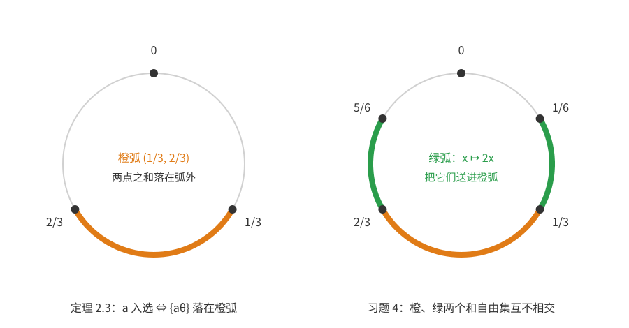
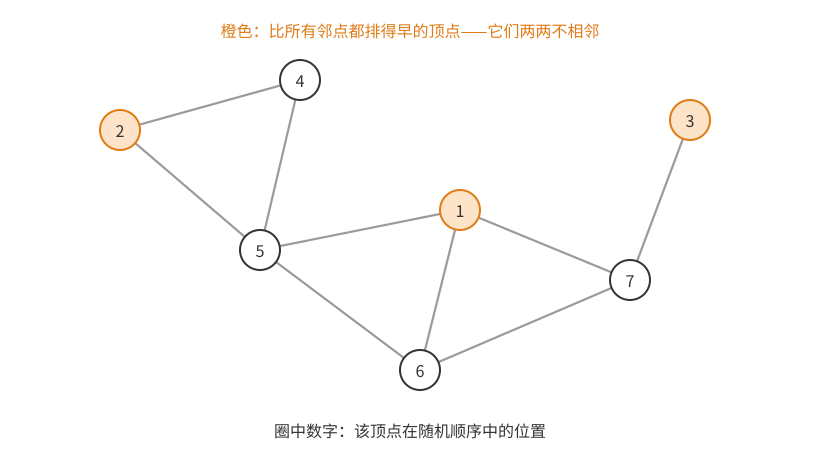
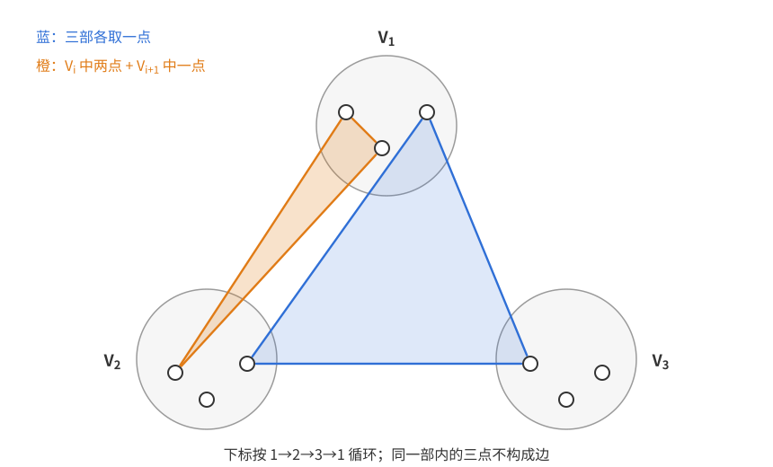
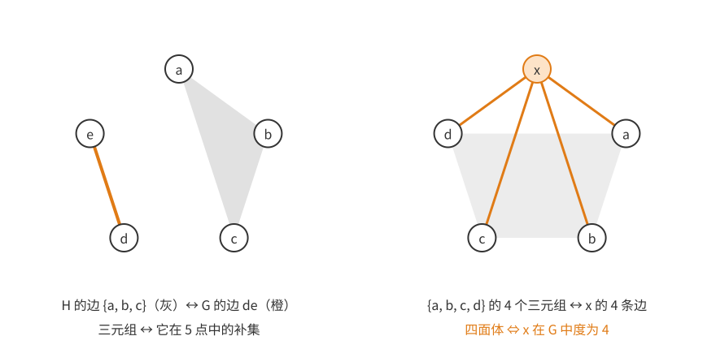
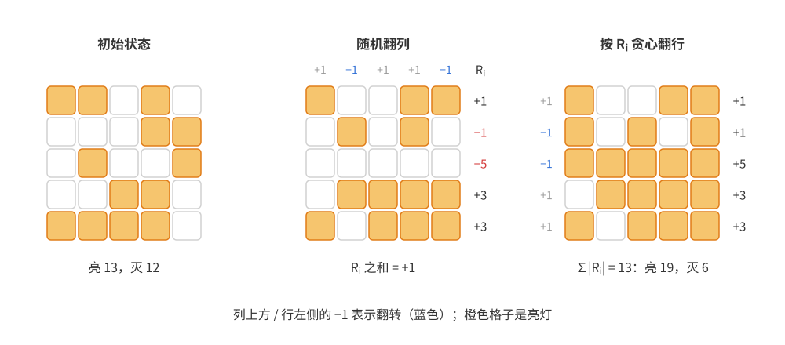
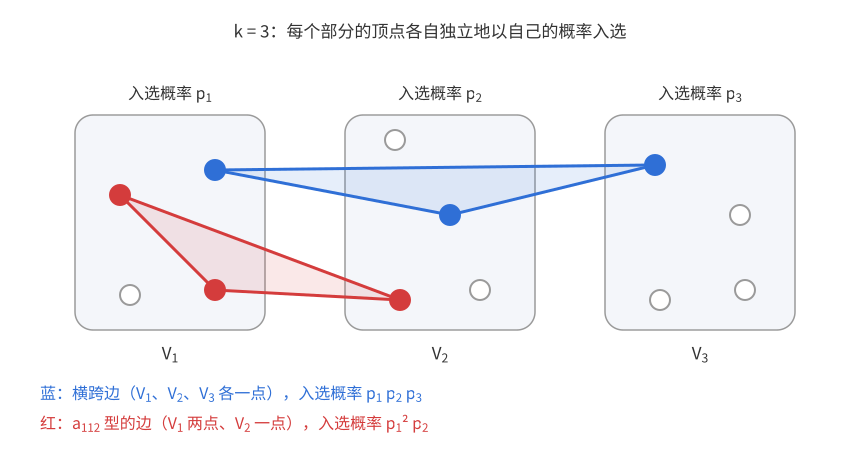
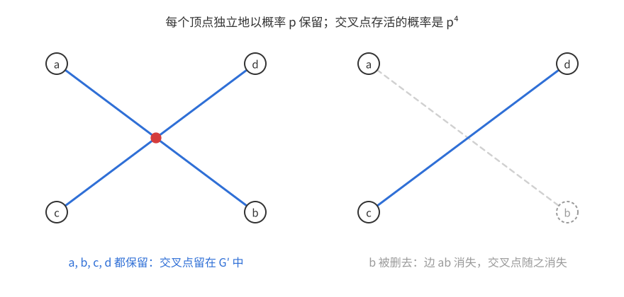
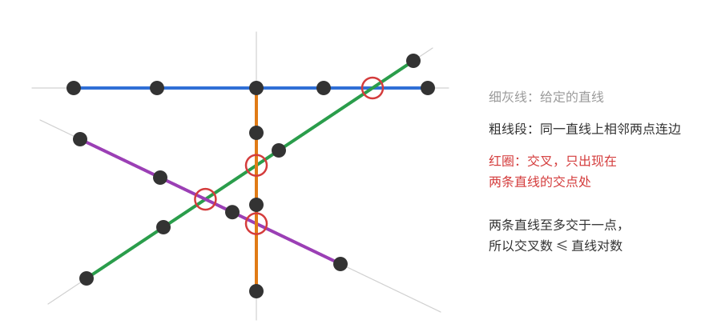
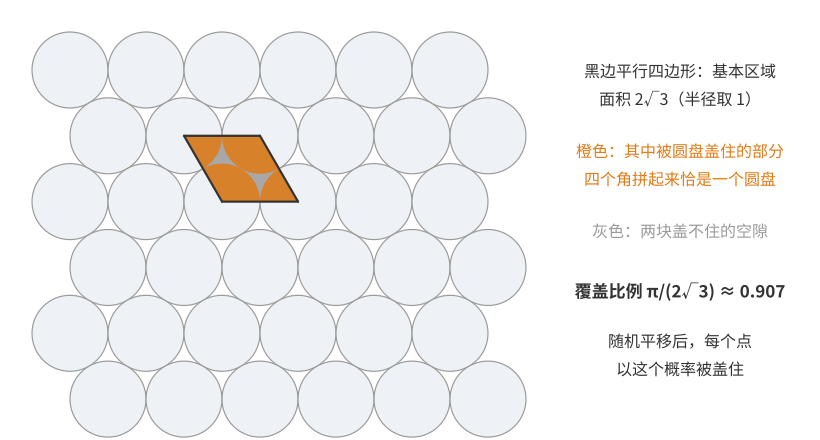
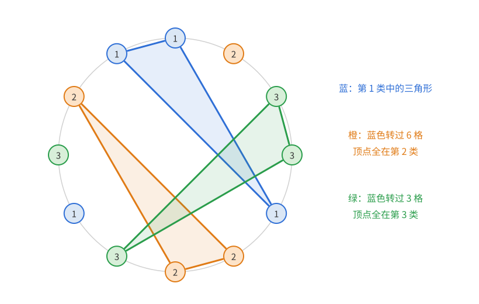

# 概率方法（二）：期望的线性性

上一篇：[第 1 章 引论](概率方法01——引论.md)　下一篇：[第 3 章 删除法](概率方法03——删除法.md)

本章只用一件工具：**期望的线性性**。对任意期望有限的随机变量 $X_1,\dots,X_n$ 和常数 $c_1,\dots,c_n$，
$$\mathbb E[c_1X_1+\cdots+c_nX_n]=c_1\mathbb E[X_1]+\cdots+c_n\mathbb E[X_n].$$
它**不需要任何独立性**——这正是它的威力所在：我们关心的量（独立集大小、哈密顿路条数、交叉点个数……）通常是许多**高度相关**的示性变量之和，相关性让分布难以计算，却丝毫不影响期望。与之对照，乘积没有这样的好性质：一般 $\mathbb E[XY]\ne\mathbb E[X]\,\mathbb E[Y]$；等号成立的常见充分条件是 $X,Y$ 独立。

第 1 章的并集上界要求坏事件的概率之和小于 1，只能证明“什么都不坏”的对象存在；本章的论证要的是**数量**：算出某个量的期望，再由
$$\text{以正概率 }X\ge\mathbb E[X]\qquad(\text{同样，以正概率 }X\le\mathbb E[X])$$
得到一个至少（或至多）这么大的实例。本章后半还会看到两个更精巧的用法：**抽样**（随机看一小块，再把小块上的廉价界“放大”成整体的界）和**部分随机**（一部分随机选，另一部分根据已经发生的事贪心地选）。

**本章读法。**

- 首读主线：[2.0](#20-热身随机排列的不动点)–[2.3 节](#23-turán-定理与独立集)（不动点、Szele 的哈密顿路、和自由子集的定理 2.3、Caro–Wei 不等式与 Turán 定理的弱形式定理 2.7），[2.4 节](#24-抽样)的命题 2.9–2.11（抽样），[2.5 节](#25-让灯不平衡)的灯阵与定理 2.14（部分随机），以及 [2.6 节](#26-交叉数不等式)的交叉数不等式（定理 2.17）和它对 Szemerédi–Trotter 定理的应用。
- 可以二读：定理 2.8（Turán 定理的完整形式）的整数调整证明；引理 2.13 的精确计算（首读只需记住 $\mathbb E|S_n|\approx\sqrt{2n/\pi}$）；[参数待定的随机构造](#参数待定的随机构造)中引理 2.16 的紧性证明（紧随其后的构造性证明更初等）。各节中介绍最新进展的段落是研究背景，正文已标明，首读可以跳过。
- 与其他章的联系：Caro–Wei 不等式在 [第 3 章 3.4 节](概率方法03——删除法.md#34-大围长与大色数)、[第 4 章习题 10](概率方法04——二阶矩方法.md#习题-10边不交的三角形) 和 [第 9 章](概率方法09——测度集中.md#再看团数小团数的指数小概率)中用来给独立数找下界；交叉数不等式“廉价的界 + 抽样放大”的想法在 [第 8 章](<概率方法08——Janson 不等式.md>)的 Janson 不等式 II 中再次出现；Szele 的下界在 [第 10 章](概率方法10——熵方法.md#锦标赛中的哈密顿路)与 Alon 的上界配成一对；灯阵问题中“上下界只差常数倍”的另一半在 [第 5 章习题 2](<概率方法05——Chernoff 界.md#习题-2难以平衡的灯阵>)中证明。

## 2.0 热身：随机排列的不动点

**问题**　$[n]$ 的均匀随机排列平均有几个不动点？

直接数“恰有 $j$ 个不动点的排列个数”需要错排公式和容斥。用线性性则一行解决：设 $X_i$ 为“$i$ 是不动点”的示性变量，$\mathbb E[X_i]=\mathbb P(\sigma(i)=i)=\frac1n$，所以
$$\mathbb E[X_1+\cdots+X_n]=n\cdot\frac1n=1.$$
注意 $X_i$ 之间并不独立（例如 $n-1$ 个点都不动时第 $n$ 个点必然不动），但这无关紧要。

这个例子已经有了本章的基本套路：**把要数的量拆成示性变量之和，每个示性变量只涉及局部，局部的概率好算。**

## 2.1 锦标赛中的哈密顿路

**锦标赛**是给完全图的每条边定一个方向得到的有向图（可以想成 $n$ 名选手两两比赛、箭头从胜者指向负者）。有向图中的**哈密顿路**是经过每个顶点恰好一次的有向路。

**问题**　$n$ 个顶点的锦标赛最少、最多有多少条哈密顿路？

**最少：恰好 1 条。** 一方面，**传递锦标赛**（顶点编号 $1,\dots,n$，$i\to j$ 当且仅当 $i<j$）中，有向路上的编号只能递增，所以哈密顿路只有 $1\to2\to\cdots\to n$ 一条。另一方面有：

**定理 2.1**　每个锦标赛都有哈密顿路。

*证明*　取一条最长的有向路 $P=v_1\to v_2\to\cdots\to v_k$。若有顶点 $w$ 不在 $P$ 上：若 $w\to v_1$，把 $w$ 接在最前面；若 $v_k\to w$，接在最后面；两者都不成立时 $v_1\to w$ 且 $w\to v_k$。设 $j$ 是满足 $w\to v_j$ 的最小下标，则 $j\ge2$ 且 $v_{j-1}\to w$，于是 $v_1\to\cdots\to v_{j-1}\to w\to v_j\to\cdots\to v_k$ 更长。三种情形都与 $P$ 最长矛盾，所以 $P$ 经过所有顶点。$\square$

**最多：** 这才是有趣的问题。要构造哈密顿路很多的锦标赛，直觉是让它“尽量不传递”，没有明显的强弱顺序。最不讲规律的锦标赛就是随机锦标赛。

**定理 2.2（Szele 1943）**　存在 $n$ 个顶点的锦标赛，至少有 $n!\,2^{-(n-1)}$ 条哈密顿路。

*证明*　每条边独立地以 $\frac12$ 的概率取两个方向之一。顶点的 $n!$ 个排列 $(v_1,\dots,v_n)$ 各自成为有向路，当且仅当 $n-1$ 条边 $v_iv_{i+1}$ 都朝前，概率为 $2^{-(n-1)}$。由线性性，哈密顿路条数的期望为 $n!\,2^{-(n-1)}$，所以某个锦标赛至少有这么多条。$\square$

这常被看作概率方法的第一次使用。注意不同排列对应的事件是相关的（共用边），但求期望时完全不用管。Szele 猜想最大值为 $n!/(2-o(1))^n$，即随机构造在指数意义下已是最优；Alon（1990）用积和式的 Brégman–Minc 不等式证明了这一点。第 10 章会先用熵证明 Brégman–Minc 不等式（[定理 10.7](概率方法10——熵方法.md#brégman-定理)），再由它推出 Alon 的上界（[定理 10.10](概率方法10——熵方法.md#锦标赛中的哈密顿路)）。

## 2.2 和自由子集

阿贝尔群中的子集 $A$ 称为**和自由**的，若不存在 $a,b,c\in A$（可以相同）使 $a+b=c$。例如奇数集合是和自由的。

**问题**　任意 $n$ 个非零整数中，一定能挑出多大的和自由子集？

**定理 2.3（Erdős 1965）**　任意 $n$ 个非零整数组成的集合 $A$ 都含有至少 $n/3$ 个元素的和自由子集。

**怎样想到证明。** 先找一个“容易的”和自由集合当模板。在整数里，$(N/3,2N/3]$ 中任两数之和超过 $2N/3$，所以它是和自由的——但对一般的 $A$，这个区间可能一个元素都不含。更好的模板在圆周 $\mathbb R/\mathbb Z$ 上：开弧 $I=(\frac13,\frac23)$ 是和自由的，因为 $x,y\in I$ 时 $x+y\in(\frac23,\frac43)$，模 1 后落在 $(\frac23,1)\cup[0,\frac13)$，与 $I$ 不相交。$I$ 占圆周的三分之一。

现在要把 $A$ 搬到圆周上，同时保持加法关系：映射 $a\mapsto\{a\theta\}$（$\{\cdot\}$ 表示小数部分）对任意实数 $\theta$ 都满足 $\{a\theta\}+\{b\theta\}\equiv\{(a+b)\theta\}\pmod 1$。所以 $A$ 中落进 $I$ 的元素仍构成和自由集。剩下的问题是：怎样保证落进去的元素多？固定的 $\theta$ 可能运气不好，随机的 $\theta$ 把 $A$ 的每个元素均匀地撒在圆周上，平均有三分之一落进 $I$。

左图：橙色开弧 $(\frac13,\frac23)$ 是本定理用的模板；右图的绿色弧在习题 4 中用到。

*证明*　取 $\theta$ 在 $[0,1)$ 上均匀分布，令
$$A_\theta=\{a\in A:\{a\theta\}\in(\tfrac13,\tfrac23)\}.$$
由上面的讨论，$A_\theta$ 总是和自由的：若 $a,b,c\in A_\theta$ 且 $a+b=c$，则 $\{a\theta\}+\{b\theta\}\equiv\{c\theta\}\pmod1$，与 $I$ 和自由矛盾。

对固定的非零整数 $a$，$\theta\mapsto\{a\theta\}$ 把 $[0,1)$ 分成 $|a|$ 段，每段线性地铺满 $[0,1)$ 一次，所以 $\{a\theta\}$ 也是 $[0,1)$ 上的均匀分布，$\mathbb P(a\in A_\theta)=\frac13$。由线性性 $\mathbb E|A_\theta|=\frac n3$，于是某个 $\theta$ 使 $|A_\theta|\ge\frac n3$。$\square$

这里 $a\ne0$ 必不可少：$0$ 自己满足 $0+0=0$，不可能放进任何和自由集。

### 进一步的结果

**定理 2.4（Alon–Kleitman 1990）**　上述定理中的 $n/3$ 可以改进为 $(n+1)/3$。

*证明*　设 $M=\max_{a\in A}|a|$。当 $0<\theta<\frac1{3M}$ 时，对 $a>0$ 有 $\{a\theta\}=a\theta<\frac13$；对 $a<0$ 有 $\{a\theta\}=1+a\theta>\frac23$。所以在这个长度为正的区间上 $|A_\theta|=0<\frac n3$。若 $|A_\theta|\le\frac n3$ 对几乎所有 $\theta$ 成立，那么期望会严格小于 $\frac n3$，矛盾。所以存在 $\theta$ 使 $|A_\theta|>\frac n3$；$|A_\theta|$ 是整数，故 $|A_\theta|\ge\frac{n+1}3$。$\square$

这个小技巧以后会反复出现：**若随机变量以正概率严格小于期望，它就以正概率严格大于期望。**

这一段是研究背景，首读可跳过。Bourgain（1997）用困难的傅里叶分析把界改进到 $(n+2)/3$。能否证明 $(n+f(n))/3$（某个 $f(n)\to\infty$）曾长期是公开问题；Bedert（2025）证明了 $n/3+c\log\log n$，解决了这个问题。另一方向，Eberhard、Green、Manners（2014）构造了 $n$ 元整数集，其最大和自由子集只有 $(\frac13+o(1))n$ 个元素，所以常数 $\frac13$ 不能改进。

## 2.3 Turán 定理与独立集

**问题（Turán 问题）**　$n$ 个顶点、不含 $K_{r+1}$ 的图最多有多少条边？

把图取补，团变成独立集，边多变成边少。所以问题等价于：边很少（度很小）的图里，独立集至少有多大？

### Caro–Wei 不等式

**定理 2.5（Caro 1979，Wei 1981）**　每个图 $G$ 都有大小至少为
$$\sum_{v\in V(G)}\frac1{d_v+1}$$
的独立集，其中 $d_v$ 是 $v$ 的度数。

**怎样想到。** 先想一个贪心的做法：把一个点 $v$ 放进独立集，就要牺牲它的闭邻域 $\{v\}\cup N(v)$，共 $d_v+1$ 个点。若让这 $d_v+1$ 个点平摊 $v$ 占用的 1 个名额，每个点分得 $\frac1{d_v+1}$；度小的点牺牲少，应该优先选。这就是目标中权重 $\frac1{d_v+1}$ 的含义，也是下文最小度贪心算法的来历。

但“平摊”只是记账的想法，要让每个点**恰好**贡献 $\frac1{d_v+1}$，换成概率来做更干净：$\frac1{d_v+1}$ 恰好是“$v$ 在它的闭邻域 $\{v\}\cup N(v)$（共 $d_v+1$ 个点）中排第一”的概率。这提示我们把顶点随机排序。

再问：什么样的顶点集合一定是独立的，又能由“在闭邻域中排第一”来刻画？若 $u,v$ 相邻且都比各自的所有邻点排得早，那么 $u$ 比 $v$ 早、$v$ 又比 $u$ 早，矛盾。所以这些“局部最早”的顶点自动两两不相邻。

*证明*　把顶点均匀随机排序，令 $I$ 为排在自己所有邻点之前的顶点组成的集合。由上面的讨论 $I$ 是独立集。$v\in I$ 当且仅当 $v$ 在 $\{v\}\cup N(v)$ 这 $d_v+1$ 个点中排第一，由对称性概率为 $\frac1{d_v+1}$。由线性性
$$\mathbb E|I|=\sum_v\frac1{d_v+1},$$
所以某个顺序给出至少这么大的独立集。$\square$

图中圈内数字是该顶点在随机顺序中的位置，橙色顶点比所有邻点都排得早，构成独立集。

**等号情形。** $G$ 是若干个团的不交并时等号成立：每个 $K_t$ 中 $t$ 个顶点各贡献 $\frac1t$，合计 1，而独立集在每个团中恰取一点。

**去随机化。** 同样的界也能用一个确定性的贪心算法得到，它正是上面“平摊名额”想法的直接实现：

> 每次取当前图中度数最小的顶点 $v$ 放进独立集，删去 $v$ 及其所有邻点，重复到图为空。

*为什么得到同样的界*　对顶点数归纳。设当前最小度为 $\delta=d_v$，删去的 $\delta+1$ 个点 $u\in\{v\}\cup N(v)$ 都满足 $d_u\ge\delta$，所以它们的权重之和 $\sum\frac1{d_u+1}\le(\delta+1)\cdot\frac1{\delta+1}=1$。剩下的图 $G'$ 中每个点的度数只会变小，所以 $\sum_{u\in G'}\frac1{d'_u+1}\ge\sum_{u\in G'}\frac1{d_u+1}$。由归纳，$G'$ 中贪心得到的独立集至少有 $\sum_{u\in G'}\frac1{d_u+1}$ 个点，加上 $v$，总数至少是 $1+\sum_{u\in G'}\frac1{d_u+1}\ge\sum_{u\in G}\frac1{d_u+1}$。$\square$

这个贪心算法是另找的论证，不是从随机顺序证明机械地翻译过来的。

一般的去随机化工具是**条件期望法**。所谓**条件期望**，指已经固定了前几个随机选择、其余选择仍然随机时，目标量的平均值。条件期望法把随机选择一个一个地确定下来，每一步都选使条件期望不变坏的那个值；最后所有选择都定了，条件期望就是结果本身，所以得到的确定结果至少和最初的期望一样好。例如对[定理 1.0](概率方法01——引论.md#10-第一个例子大的二部子图)，逐个放置顶点，每个点放到已放好的邻点较少的一侧；这样每个点与已放邻点之间的边至少一半跨组，总共至少 $m/2$ 条跨组边。

不少基于期望线性性的证明都能这样去随机化成高效算法；但第 1 章的拉姆塞下界那样的证明，至今不知道如何在多项式时间内去随机化：对它用条件期望法，每一步要跟踪 $\binom nk=n^{\Theta(\log n)}$ 个坏事件（$k\approx2\log_2n$），不是多项式时间。

### Turán 定理

对补图用 Caro–Wei：补图中 $v$ 的度数是 $n-1-d_v$，补图的独立集是原图的团。

**推论 2.6**　每个 $n$ 个顶点的图 $G$ 都有大小至少为 $\displaystyle\sum_{v}\frac1{n-d_v}$ 的团。

$G$ 是完全多部图时等号成立（它的补图是团的不交并）。

**Turán 图** $T_{n,r}$ 是把 $n$ 个顶点分成 $r$ 个尽量平均（大小相差至多 1）的部分得到的完全 $r$ 部图，例如 $T_{10,3}=K_{3,3,4}$。$T_{n,r}$ 不含 $K_{r+1}$：$r+1$ 个点中必有两个在同一部分，它们不相邻。

**定理 2.7（Turán 1941，弱形式）**　$n$ 个顶点、不含 $K_{r+1}$ 的图至多有 $\big(1-\frac1r\big)\frac{n^2}2$ 条边。

*证明*　设有 $m$ 条边，团数 $\omega(G)\le r$。由推论 2.6 和函数 $x\mapsto\frac1x$ 的凸性（Jensen 不等式，或 Cauchy–Schwarz），
$$r\ge\omega(G)\ge\sum_v\frac1{n-d_v}\ge\frac{n}{\frac1n\sum_v(n-d_v)}=\frac n{n-2m/n}.$$
第三个不等号就是 $\frac1n\sum_v\frac1{x_v}\ge\frac1{\bar x}$（$x_v=n-d_v$，$\bar x$ 是它们的平均值）；最后一步用到 $\sum_vd_v=2m$。整理：$r\ge\frac{n^2}{n^2-2m}$，即 $n^2-2m\ge\frac{n^2}r$，也就是 $m\le\big(1-\frac1r\big)\frac{n^2}2$。$\square$

$r\mid n$ 时 $T_{n,r}$ 的边数恰为 $\big(1-\frac1r\big)\frac{n^2}2$，所以界是精确的；对固定的 $r$，$T_{n,r}$ 总有 $\big(1-\frac1r-o(1)\big)\frac{n^2}2$ 条边，所以界在渐近意义下总是精确的。把上面 Jensen 那一步换成整数上的精细比较，就能得到 Turán 定理的完整形式（下面的证明是进阶内容，首读可跳过）：

**定理 2.8（Turán 定理）**　$n$ 个顶点、不含 $K_{r+1}$ 的图中，$T_{n,r}$ 的边数最多。

*证明*　令 $x_v=n-d_v$，它们是正整数，$\sum_vx_v=n^2-2m$。证明分三步：先说明总和固定时 $\sum1/x_v$ 在“尽量平均”时最小，再说明这个最小值随总和增大而严格减小，最后与 $T_{n,r}$ 比较。

*第一步：和固定时，$\sum1/x_v$ 在 $x_v$ 尽量平均时最小。* 若 $x_u\ge x_v+2$，把它们换成 $x_u-1,x_v+1$，和不变，而
$$\frac1{x_v}-\frac1{x_v+1}=\frac1{x_v(x_v+1)}>\frac1{(x_u-1)x_u}=\frac1{x_u-1}-\frac1{x_u},$$
所以 $\sum1/x_v$ 严格变小。反复调整直到任两个 $x_v$ 相差至多 1；给定个数与总和，这样的取值（作为多重集）是唯一的。记总和为 $S$ 时的最小值为 $g(S)$。

*第二步：$g$ 严格递减。* 取总和为 $S$ 的平均取值，把其中一个最小的 $x_v$ 加 1，得到总和 $S+1$、倒数和更小的一组数，所以 $g(S+1)<g(S)$。

*第三步：比较。* 在 $T_{n,r}$ 中，大小为 $n_j$ 的部分里的顶点有 $x_v=n_j$，而各 $n_j$ 相差至多 1，所以这组 $x_v$ 正是总和 $S_T=\sum_jn_j^2=n^2-2e(T_{n,r})$ 时的平均取值，$g(S_T)=\sum_jn_j\cdot\frac1{n_j}=r$。若 $m>e(T_{n,r})$，则 $\sum x_v=n^2-2m<S_T$，由推论 2.6，
$$\omega(G)\ge\sum_v\frac1{x_v}\ge g(n^2-2m)>g(S_T)=r,$$
即 $G$ 含 $K_{r+1}$。$\square$

更多内容见 Zhao 的教材 *Graph Theory and Additive Combinatorics* 第 1 章。

## 2.4 抽样

### 超图的 Turán 问题

$r=2$ 时 Turán 定理就是 **Mantel 定理**：$n$ 个顶点的无三角形图至多有 $\lfloor n^2/4\rfloor$ 条边。很自然要问超图的类比。

**四面体** $K_4^{(3)}$ 是 4 个顶点上的完全 3 一致超图（3 一致超图也简称 **3-图**），4 个顶点、4 条边，可以想成普通四面体的 4 个面。

**问题**　$n$ 个顶点、不含四面体的 3-图最多有多少条边？

这是极值组合中著名的难题，至今没有解决。Turán 猜想答案是
$$\Big(\frac59+o(1)\Big)\binom n3,$$
并给出了达到它的构造：把顶点分成大小尽量相等的三部分 $V_1,V_2,V_3$，边有两类——

1. 三部分各取一个顶点；
2. 在 $V_i$ 中取两个顶点、在 $V_{i+1}$ 中取一个顶点（下标模 3，即 $V_3$ 的下一部分是 $V_1$）。

图中蓝色三角形是第 1 类边，橙色三角形是第 2 类边（$V_1$ 中两点 + $V_2$ 中一点）。

*为什么不含四面体*　任取 4 个顶点，看它们在三部分中怎样分布（只看各部分的点数）：

- $4$ 或 $3+1$：有 3 个点在同一部分，这三点不是边。
- $2+2$，在 $V_i$ 与 $V_j$ 中：四点中的边只能是“$V_i$ 两点 + $V_j$ 一点”与“$V_j$ 两点 + $V_i$ 一点”，前者要求 $j=i+1$，后者要求 $i=j+1$，两者不能同时成立。
- $2+1+1$，两点在 $V_i$：含这两点的三元组有两个，分别配上另外两部分的点，但只有配 $V_{i+1}$ 中那一点的是边。

所以任何 4 点中都至少缺一条边。

*边数*　$|V_i|=n/3$ 时，第 1 类边有 $(n/3)^3=n^3/27$ 条，第 2 类边有 $3\binom{n/3}2\frac n3\approx n^3/18$ 条，合计约 $\frac{5n^3}{54}=\frac59\cdot\frac{n^3}6\approx\frac59\binom n3$。

这个问题难的一个迹象是：Brown、Kostochka 等人发现了大量互不同构的构造，都恰好达到 $\frac59$，极值结构不唯一，很难用“调整到唯一最优结构”的思路去证明。

下面的目标不是解决它，而是用它说明一个简单而重要的技巧：**用抽样得到上界**。

### 抽样四个点

**命题 2.9**　$n\ge4$ 个顶点、不含四面体的 3-图至多有 $\frac34\binom n3$ 条边。

**怎样想到。** 局部的情况一目了然：4 个顶点上，不含四面体就是 4 条可能的边至少缺一条，至多 3 条，即**密度**（边数占所有三元组的比例）至多 $\frac34$。如果整体密度是 $p$，随便看 4 个点，平均看到的密度也应该是 $p$——抽样不改变平均密度。于是整体密度不超过局部能达到的最大密度。

*证明*　设 3-图 $H$ 有 $p\binom n3$ 条边。均匀随机取 4 元点集 $S$，记 $e(S)$ 为 $S$ 内的边数。对固定的边 $T$（一个三元组），$T\subseteq S$ 当且仅当 $S$ 由 $T$ 加上另外某一点组成，所以
$$\mathbb P(T\subseteq S)=\frac{n-3}{\binom n4}=\frac{4}{\binom n3}.$$
由线性性，$\mathbb E[e(S)]=p\binom n3\cdot\frac4{\binom n3}=4p$。另一方面，$H$ 不含四面体，所以 $e(S)\le3$ 总成立。于是 $4p\le3$，即边数 $p\binom n3\le\frac34\binom n3$。$\square$

更一般地，同样的计算（$T\subseteq S$ 的概率为 $\binom{n-3}{s-3}/\binom ns=\binom s3/\binom n3$）说明：**随机 $s$ 元子集的期望密度等于整体密度**，
$$\mathbb E\bigg[\frac{e(S)}{\binom s3}\bigg]=\frac{e(H)}{\binom n3}.$$

### 抽样五个点

为什么只抽 4 个点？抽 5 个点时，若能知道 5 个顶点上不含四面体的 3-图最多有几条边，同样的论证就给出新的界。

**引理 2.10**　5 个顶点、不含四面体的 3-图至多有 7 条边（而 5 个点上共有 $\binom53=10$ 个三元组）。

**怎样想到。** 5 个点时，三元组与它的补集（二元组）一一对应，3-图可以转成**普通图**，而普通图的问题我们熟悉。关键是看清“四面体”变成了什么。

*证明*　设 $H$ 是 5 点集 $V$ 上的 3-图。把 $H$ 的每条边 $T$ 换成它的补集 $V\setminus T$（一个二元组），得到 $V$ 上的普通图 $G$，$e(G)=e(H)$。

$V$ 中的 4 元集都形如 $V\setminus\{x\}$。$V\setminus\{x\}$ 中的 4 个三元组，补集恰好是 4 个含 $x$ 的二元组 $\{x,y\}$。所以

$$V\setminus\{x\}\text{ 在 }H\text{ 中是四面体}\iff x\text{ 在 }G\text{ 中度数为 }4.$$

于是 $H$ 不含四面体当且仅当 $G$ 的最大度至多 3，此时 $e(G)\le\lfloor\frac{3\cdot5}2\rfloor=7$。$\square$

左图：灰色三角形表示 $H$ 的一条边 $\{a,b,c\}$，它对应 $G$ 中的橙色边 $de$。右图：$x$ 之外 4 点的 4 个三元组对应 $G$ 中以 $x$ 为端点的 4 条边，所以四面体恰好对应 $G$ 中度为 4 的点。

7 条可以取到：$G$ 取五边形 $12345$ 再加两条对角线 $13,24$，度数为 $3,3,3,3,2$，对应的 $H$ 有 7 条边且不含四面体。

**命题 2.11**　$n\ge5$ 个顶点、不含四面体的 3-图至多有 $\frac7{10}\binom n3$ 条边。

*证明*　同命题 2.9，均匀随机取 5 元点集 $S$。若 $H$ 的密度为 $p$，则 $\mathbb E[e(S)]=p\binom53=10p$；由引理 2.10，$e(S)\le7$ 总成立。所以 $p\le\frac7{10}$。$\square$

这里需要 $n\ge5$：$n=4$ 时 3 条边的 3-图不含四面体，密度为 $\frac34>\frac7{10}$。

### 抽样的极限

继续加大 $s$：用计算机穷举求出 $s$ 个顶点上的最大边数 $\operatorname{ex}(s)$，就得到 $\operatorname{ex}(n)\le\frac{\operatorname{ex}(s)}{\binom s3}\binom n3$（$n\ge s$）。原则上这能任意接近真实答案，原因如下。

**命题 2.12（Katona–Nemetz–Simonovits 1964）**　记 $\pi_n=\operatorname{ex}(n)/\binom n3$ 为 $n$ 个顶点上不含四面体的 3-图的最大密度。则 $\pi_n$ 关于 $n$ 单调不增，从而极限 $\pi=\lim_{n\to\infty}\pi_n$ 存在。

*证明*　取 $n$ 个顶点上达到 $\operatorname{ex}(n)$ 的 3-图，对它随机取 $n-1$ 个点。子图仍不含四面体，密度至多 $\pi_{n-1}$；而由上面的“随机 $s$ 元子集的期望密度等于整体密度”（取 $s=n-1$），子图密度的期望恰为 $\pi_n$，所以 $\pi_n\le\pi_{n-1}$。又 $\pi_n\ge0$，单调有界数列收敛。$\square$

$\pi$ 称为四面体的 **Turán 密度**。由单调性，每个 $\pi_s$ 都是 $\pi$ 的上界，且 $\pi_s\to\pi$，所以对任意 $\varepsilon>0$，只要 $s$ 足够大，抽样 $s$ 个点的论证就给出 $\pi+\varepsilon$ 的上界——这就是“原则上可以任意接近”的含义。问题在于穷举 $s$ 个点上的所有 3-图需要 $2^{\binom s3}$ 量级的计算，$s$ 稍大就不可行。

下面的表格和随后关于旗代数的一段是研究背景，首读可跳过。已知的结果：

| 方法 | 上界 $\pi\le$ |
|---|---|
| 抽样 4 点 | $0.75$ |
| 抽样 5 点 | $0.7$ |
| Razborov 的旗代数（计算机辅助，平方和方法） | $0.5617\cdots$ |
| Baber（2012）更大规模的旗代数计算 | $0.5615$ |
| 猜想的真实值（Turán 构造） | $\frac59\approx0.5556$ |

表中是 2024 年的状况。（2026 年 9 月有预印本声称把上界降到 $0.5578$ 以下，尚未经同行评审。）

旗代数可以看作把抽样论证系统化：不只用“局部密度至多多少”，还利用不同局部结构的密度之间的不等式（来自平方和非负），由计算机求解半定规划。更多关于超图 Turán 问题的内容见 Keevash 的综述（2011）。

**本节的技巧**：要给一个全局量找上界，先在**小**规模上得到一个廉价的（甚至穷举得到的）界，再用随机抽样把它“放大”到全局。线性性保证抽样不改变平均密度。2.6 节会看到这个想法的一个更灵活的版本：抽样的比例不再事先固定，而是按输入图的稠密程度来选。

## 2.5 让灯不平衡

### 灯阵问题

$n\times n$ 的灯阵，一开始任意一部分灯亮着。每次操作可以把**一整行**或**一整列**的灯全部切换（亮变灭、灭变亮）。无论初始状态如何，我们能保证让多少盏灯亮？

用 $\pm1$ 编码最方便：$a_{ij}=1$ 表示灯 $(i,j)$ 初始亮，$-1$ 表示灭；$x_i=-1$ 表示切换第 $i$ 行，$y_j=-1$ 表示切换第 $j$ 列（取 $+1$ 表示不切换）。操作后灯 $(i,j)$ 的状态是 $a_{ij}x_iy_j$，所以
$$\#\{\text{亮}\}-\#\{\text{灭}\}=\sum_{i,j=1}^na_{ij}x_iy_j.$$
目标是让这个和尽量大。

**全随机的尝试。** 每行、每列独立地以 $\frac12$ 概率切换，每个 $a_{ij}x_iy_j$ 的期望都是 0，所以期望恰好一半灯亮。这只说明能做到 $\ge0$，什么也没赚到。

**问题在哪里。** 全随机浪费了一个结构：**列定下之后，各行的选择互不影响**，而且每一行的最优选择一眼就能看出——如果这一行亮的少，就把它翻过来。所以不必让每一步都随机：先随机翻列，再根据结果**贪心地**翻行。随机只用来让每一行“不太平衡”，贪心再把这种不平衡全部转成收益。

图中橙色格子表示亮灯。中图是随机翻转某些列（列上方标 $-1$）之后的状态，右边的数是各行的 $R_i=\#\text{亮}-\#\text{灭}$；右图把 $R_i<0$ 的行翻过来，每行都变成亮多灭少，亮减灭的总数等于 $\sum_i|R_i|$。

### 随机游走的平均距离

收益的大小取决于 $|R_i|$ 的期望，也就是“$n$ 次独立抛 $\pm1$ 硬币之和离 0 多远”。

**引理 2.13**　设 $\varepsilon_1,\dots,\varepsilon_n$ 独立且在 $\{-1,1\}$ 上均匀分布，$S_n=\varepsilon_1+\cdots+\varepsilon_n$，则
$$\mathbb E|S_n|=n\,2^{1-n}\binom{n-1}{\lfloor(n-1)/2\rfloor}=\Big(\sqrt{\frac2\pi}+o(1)\Big)\sqrt n.$$

**直观。** $S_n$ 的均值为 0，方差是 $\mathbb E[S_n^2]=\sum_i\mathbb E[\varepsilon_i^2]+\sum_{i\ne j}\mathbb E[\varepsilon_i\varepsilon_j]=n$（交叉项的期望为 0），标准差是 $\sqrt n$。**中心极限定理**说：许多独立小量之和，减去均值、再除以标准差后，分布近似于**标准正态分布** $N(0,1)$，即密度为 $\frac1{\sqrt{2\pi}}e^{-x^2/2}$ 的分布。所以 $S_n/\sqrt n$ 近似服从 $N(0,1)$，而
$$\mathbb E|N(0,1)|=\frac2{\sqrt{2\pi}}\int_0^\infty xe^{-x^2/2}\,dx=\sqrt{\frac2\pi}\approx0.80.$$
（严格地说，分布收敛不能直接推出期望收敛，还要一致可积性，例如 $\mathbb E[S_n^2/n]=1$ 有界就够了。）下面给出一个不依赖中心极限定理的精确计算；首读只需记住结论 $\mathbb E|S_n|\approx\sqrt{2n/\pi}$，证明可以二读。

*证明*　思路是把 $\mathbb E|S_n|$ 写成二项式系数的和，再让它逐项相消。$S_n=2B-n$，其中 $B$ 是正面个数，$\mathbb P(B=k)=\binom nk2^{-n}$。由 $k\binom nk=n\binom{n-1}{k-1}$ 和 $(n-k)\binom nk=n\binom{n-1}k$，
$$(2k-n)\binom nk=n\Big[\binom{n-1}{k-1}-\binom{n-1}k\Big].$$
对 $k>n/2$ 求和，右边逐项相消，只剩第一项：记 $m=\lfloor n/2\rfloor$，
$$\sum_{k>n/2}(2k-n)\binom nk=n\binom{n-1}{m}.$$
由对称性（$k\leftrightarrow n-k$），$k<n/2$ 的部分与之相等，而 $k=n/2$ 的项为 0，所以 $\mathbb E|S_n|=2\cdot2^{-n}\cdot n\binom{n-1}m$；又 $\binom{n-1}m=\binom{n-1}{n-1-m}=\binom{n-1}{\lfloor(n-1)/2\rfloor}$，得到精确公式。

渐近式由中心二项式系数的估计 $\binom{2j}j\sim\frac{4^j}{\sqrt{\pi j}}$ 得到：$n-1=2j$ 时 $\binom{n-1}j\sim2^{n-1}\sqrt{\frac2{\pi(n-1)}}$；$n-1=2j+1$ 时 $\binom{2j+1}j=\frac12\binom{2j+2}{j+1}\sim2^{n-1}\sqrt{\frac2{\pi n}}$。两种情形都给出 $\mathbb E|S_n|\sim n\cdot2^{1-n}\cdot2^{n-1}\sqrt{\frac2{\pi n}}=\sqrt{\frac{2n}\pi}$。$\square$

### 部分随机

**定理 2.14**　设 $a_{ij}\in\{-1,1\}$（$i,j\in[n]$）。存在 $x_i,y_j\in\{-1,1\}$ 使
$$\sum_{i,j=1}^na_{ij}x_iy_j\ge\Big(\sqrt{\frac2\pi}+o(1)\Big)n^{3/2}.$$

*证明*　$y_1,\dots,y_n$ 独立、均匀地取 $\pm1$。对每个 $i$ 令
$$R_i=\sum_{j=1}^na_{ij}y_j,$$
再取 $x_i$ 为 $R_i$ 的符号（$R_i=0$ 时任取）。则
$$\sum_{i,j}a_{ij}x_iy_j=\sum_ix_iR_i=\sum_i|R_i|.$$
固定 $i$，$a_{ij}$ 是固定的符号，$y_j$ 是独立的均匀 $\pm1$，所以 $a_{i1}y_1,\dots,a_{in}y_n$ 也独立且均匀地取 $\pm1$，$R_i$ 与 $S_n$ 同分布。（不同的 $R_i$ 共用同一组 $y_j$，并不独立，但线性性不需要独立。）由引理 2.13，
$$\mathbb E\Big[\sum_i|R_i|\Big]=n\,\mathbb E|S_n|=\Big(\sqrt{\frac2\pi}+o(1)\Big)n^{3/2},$$
所以某组 $y$（连同相应的 $x$）达到这个值。$\square$

换回灯的语言：亮灯数等于 $\frac12\big(n^2+\sum_{i,j}a_{ij}x_iy_j\big)$，所以可以让亮灯数至少为 $\frac{n^2}2+\big(\frac1{\sqrt{2\pi}}+o(1)\big)n^{3/2}$。

**评注：$n^{3/2}$ 的量级是对的。** 这个问题叫 Gale–Berlekamp 开关游戏。下面的反方向论证要用到第 5 章的工具，首读可先跳过，完整证明见 [第 5 章习题 2](<概率方法05——Chernoff 界.md#习题-2难以平衡的灯阵>)。反过来，存在初始状态使得无论怎样操作，$\sum a_{ij}x_iy_j\le Cn^{3/2}$：随机取 $a_{ij}$，对每组固定的 $(x,y)$，$\sum a_{ij}x_iy_j$ 是 $n^2$ 个独立 $\pm1$ 之和，超过 $cn^{3/2}$ 的概率至多 $e^{-c^2n/2}$（第 5 章的 Chernoff 界，[定理 5.1](<概率方法05——Chernoff 界.md#定理与证明>)）；对 $4^n$ 组 $(x,y)$ 用并集上界，$c>2\sqrt{\ln2}$ 时总概率小于 1。所以上下界只差常数倍。

### 参数待定的随机构造

灯阵问题要找一组翻转，使 $\pm1$ 之和远离 0；下面的问题同样要找一个子集，使蓝边数与红边数之差远离 0，只是能用的随机性更受限。它也更巧妙：随机过程里的参数并不明确给出，而是用一个**紧性**论证说明好的参数存在。

**定理 2.15**　设 $k\ge2$，$V=V_1\cup\cdots\cup V_k$，各 $V_i$ 两两不交且 $|V_i|=n$。把 $V$ 上完全 $k$ 一致超图的每条边染红或蓝，并假设每条**横跨**的边（$V_1,\dots,V_k$ 中各取一个顶点）都是蓝色。则存在 $S\subseteq V$，使 $S$ 内蓝边数与红边数之差的绝对值大于 $c_kn^k$，其中 $c_k>0$ 是只依赖于 $k$ 的常数。

**怎样想到。** 记 $D(S)=\#\{S\text{ 内蓝边}\}-\#\{S\text{ 内红边}\}$。我们知道的只有一点：横跨的 $n^k$ 条边全是蓝的。可是其他类型的边颜色任意，可能把它们抵消掉——例如 $D(V)$ 可能恰好是 0。我们不知道该取哪个 $S$。

那就让 $S$ 随机，并且**给每个部分各自的入选概率** $p_1,\dots,p_k$。一条边被选中的概率只取决于它的顶点落在哪些部分里，所以 $\mathbb E[D(S)]$ 是 $p_1,\dots,p_k$ 的多项式，而横跨边贡献的单项式 $p_1p_2\cdots p_k$ 的系数恰为 $n^k$。若所有 $p_i$ 取同一个值 $p$，多项式会退化成 $(\text{所有系数之和})\cdot p^k$，可能恒为 0；分开设参数，单项式 $p_1\cdots p_k$ 就不会和其他项混在一起。于是问题变成一个与组合无关的分析问题：**一个含有单项式 $p_1\cdots p_k$（系数 1）、其他系数也不太大的多项式，不可能在整个单位立方体上都很小。**

*证明*　为记号简单写 $k=3$，一般情形完全相同。每个 $V_i$ 中的顶点独立地以概率 $p_i$ 放入 $S$。对 $1\le i\le j\le l\le3$，记
$$a_{ijl}=\#\{\text{顶点分别落在 }V_i,V_j,V_l\text{ 的蓝边}\}-\#\{\text{同类型的红边}\}$$
（例如 $a_{112}$ 对应 $V_1$ 中两点、$V_2$ 中一点的边）。

下图中蓝色是一条横跨边，红色是一条 $a_{112}$ 型的边；每个部分旁标出该部分顶点的入选概率，一条边入选的概率等于它三个顶点所在部分的入选概率之积，只由边的类型决定。

一条顶点分别落在 $V_i,V_j,V_l$ 的边，三个顶点互不相同、各自独立入选，所以三点同时入选的概率为 $p_ip_jp_l$。由线性性
$$\mathbb E[D(S)]=f(p_1,p_2,p_3)=\sum_{i\le j\le l}a_{ijl}\,p_ip_jp_l=n^3p_1p_2p_3+a_{111}p_1^3+a_{112}p_1^2p_2+\cdots,$$
其中 $a_{123}=n^3$ 由假设得到，而每类边至多 $n^3$ 条，所以 $|a_{ijl}|\le n^3$。于是 $g=f/n^3$ 是一个系数绝对值不超过 1、$p_1p_2p_3$ 的系数为 1 的多项式。由下面的引理 2.16，存在 $p\in[0,1]^3$ 使 $|g(p)|\ge c$，即 $|\mathbb E[D(S)]|\ge cn^3$。若 $\mathbb E[D(S)]\ge cn^3$，某个 $S$ 使 $D(S)\ge\mathbb E[D(S)]$；若 $\mathbb E[D(S)]\le-cn^3$，某个 $S$ 使 $D(S)\le\mathbb E[D(S)]$。总之某个 $S$ 使 $|D(S)|\ge cn^3>\frac c2n^3$。取 $c_3=c/2$ 即可。$\square$

**引理 2.16**　记 $P_k$ 为 $k$ 元、次数不超过 $k$、各系数绝对值不超过 1、且 $p_1p_2\cdots p_k$ 的系数为 1 的实系数多项式的全体。存在常数 $c_k>0$，使对每个 $g\in P_k$，都有 $p_1,\dots,p_k\in[0,1]$ 满足 $|g(p_1,\dots,p_k)|\ge c_k$。

下面的紧性证明是进阶内容，首读可以直接跳到其后的“构造性的证明”，那里的论证只用容斥原理。这里的**紧集**可以理解为有限维空间 $\mathbb R^N$ 中的**有界闭集**；要用的只有一条事实：有界闭集上的连续函数一定取得最大值和最小值（这是闭区间上连续函数最值定理的高维版本）。

*证明（紧性）*　令 $M(g)=\max_{p\in[0,1]^k}|g(p)|$（立方体 $[0,1]^k$ 是有界闭集，连续函数在上面取得最大值）。证明分两步：先说明每个 $M(g)$ 都是正数，再说明 $M$ 在整个 $P_k$ 上有正的最小值。

- $M(g)>0$：$g$ 不是零多项式，而在 $[0,1]^k$ 上恒为零的多项式必是零多项式（对变量个数归纳：把 $g$ 看成 $p_k$ 的多项式，系数是其余变量的多项式；固定其余变量于 $[0,1]^{k-1}$ 中，这个一元多项式有无穷多个根，所以各系数在 $[0,1]^{k-1}$ 上恒为零，由归纳假设它们是零多项式）。
- 把 $g$ 等同于它的系数向量，$P_k$ 是有限维空间中一个有界闭集（若干坐标在 $[-1,1]$ 中，一个坐标固定为 1），所以是紧集。$M$ 是连续的：$|M(g)-M(h)|\le\max_{[0,1]^k}|g-h|\le$ 两者系数之差的绝对值之和。

连续函数在紧集上取得最小值，所以 $c_k=\min_{g\in P_k}M(g)$ 存在，且等于某个 $M(g)>0$。$\square$

紧性只告诉我们 $c_k$ 存在，没有给出它的值，也没有说哪组 $p$ 好——这是这个证明“非构造”的地方。

**评注：一个构造性的证明。** 对这个具体的引理，可以在立方体的**顶点**上取值得到显式常数。对 $I\subseteq[k]$，记 $1_I$ 为 $I$ 中坐标取 1、其余取 0 的点。在 $1_I$ 处，单项式 $p_1^{e_1}\cdots p_k^{e_k}$ 的值为 1 当且仅当它用到的变量都在 $I$ 中。由容斥原理，
$$\sum_{I\subseteq[k]}(-1)^{k-|I|}g(1_I)=\text{用到全部 }k\text{ 个变量的单项式的系数之和}.$$
次数不超过 $k$ 又用到全部 $k$ 个变量的单项式只有 $p_1\cdots p_k$，所以右边等于 1，于是 $2^k$ 个值 $|g(1_I)|$ 中有一个至少是 $2^{-k}$。（这个论证甚至不需要“其他系数绝对值不超过 1”。）回到定理 2.15，$p\in\{0,1\}^k$ 意味着 $S$ 取为若干个 $V_i$ 的并，所以 $c_k=2^{-k-1}$ 就可以，$S$ 也能明确找到。

既然有显式常数，正文为什么还要用紧性？因为紧性论证不依赖多项式的具体形状；在顶点上取值的技巧却依赖这个引理的特殊结构（用到全部 $k$ 个变量的单项式只有一个），换一个问题就未必可用。紧性论证的一般形式是：只要把期望归一化后，所有可能出现的函数构成一个在一致范数下紧、且不含恒零函数的函数族，就能得到一个与具体输入无关的常数（**一致范数**指 $\lVert f\rVert=\max_p|f(p)|$，相应地两个函数 $f,h$ 的距离是 $\max_p|f(p)-h(p)|$）。

只说“每个函数连续且不恒为零”是不够的：$f_j(p)=p/j$（$j=1,2,\dots$）各自连续且不恒为零，最大值 $1/j$ 却趋于 0。引理 2.16 中，紧性来自系数有界，不含零函数来自 $p_1\cdots p_k$ 的系数固定为 1。

## 2.6 交叉数不等式

### 定义与问题

把图画在平面上：顶点画成不同的点，边画成连接两端点的连续曲线。图 $G$ 的**交叉数** $\operatorname{cr}(G)$ 是所有画法中边与边交叉次数的最小值。$\operatorname{cr}(G)=0$ 的图称为**平面图**。

$K_5$ 和 $K_{3,3}$ 不是平面图（Kuratowski 定理说它们本质上是唯一的障碍：图是平面图当且仅当它不含 $K_5$ 或 $K_{3,3}$ 的细分）。后面用不到这个定理。

**问题**　边很多的图，是否无论怎样画都有很多交叉？具体地，下面这些图的交叉数是多少？（前两条是研究背景，首读只需知道精确值很难求；第三条是本节要证明的。）

- $K_n$：**Hill 猜想** $\operatorname{cr}(K_n)=\frac14\lfloor\frac n2\rfloor\lfloor\frac{n-1}2\rfloor\lfloor\frac{n-2}2\rfloor\lfloor\frac{n-3}2\rfloor$，右边由一种具体画法达到。到 2024 年，下界只对 $n\le12$ 得到证明（Guy 证到 $n\le10$，Pan–Richter 2007 得到 $n=11,12$）。
- $K_{m,n}$：**Zarankiewicz 猜想**（起源于 Turán 的“砖厂问题”）$\operatorname{cr}(K_{m,n})=\lfloor\frac m2\rfloor\lfloor\frac{m-1}2\rfloor\lfloor\frac n2\rfloor\lfloor\frac{n-1}2\rfloor$，右边同样由具体画法达到。到 2024 年，下界只对 $\min(m,n)\le6$（Kleitman 1970）和少数小情形得到证明。
- 任意一个 $n$ 个顶点、$n^2/100$ 条边的图：下面的定理说明交叉数至少是 $n^4$ 的常数倍。

（2026 年有两份未经同行评审的手稿声称分别对一般情形证明了 Hill 猜想和 Zarankiewicz 猜想。）

**事实（好的画法）**　存在达到 $\operatorname{cr}(G)$ 的画法，其中每个交叉点恰是两条边的交点，这两条边没有公共端点，且任两条边至多交叉一次。

理由是交叉数最少的画法可以局部修改：若两条有公共端点 $v$ 的边交于点 $X$，交换两条曲线从 $v$ 到 $X$ 的两段，交叉点 $X$ 就消失了，而其他交叉不会增加（再稍微挪开 $X$ 附近即可）；两条边交叉两次时，交换两个交点之间的两段同理。以下总取这样的画法。

**定理 2.17（交叉数不等式；Ajtai–Chvátal–Newborn–Szemerédi 1982，Leighton 1984）**　若图 $G=(V,E)$ 满足 $|E|\ge4|V|$，则
$$\operatorname{cr}(G)\ge\frac{|E|^3}{64|V|^2}.$$

**推论 2.18**　若 $|E|\ge c|V|^2$（$c>0$ 为常数）且 $|V|\ge4/c$，则 $\operatorname{cr}(G)\ge\frac{c^3}{64}|V|^4$。特别地，$n$ 个顶点、$n^2/100$ 条边的图（$n\ge400$）的交叉数至少是 $n^4/(64\times10^6)$。

量级 $n^4$ 是对的：把 $K_n$ 的顶点画在凸位置上（例如正 $n$ 边形的顶点），边画成线段，每 4 个顶点恰好产生一个交叉（凸四边形的两条对角线），所以 $\operatorname{cr}(K_n)\le\binom n4$。

### 证明：从一个交叉到大量交叉

证明分三步。前两步只得到一个廉价的界，第三步用抽样把它放大。

**第一步：从零到一。** 先回忆平面图的边数上界。

**引理 2.19**　$|V|\ge3$ 的平面图满足 $|E|\le3|V|-6$；从而每个平面图都满足 $|E|\le3|V|$。

*证明*　可以设图连通：画在平面上的各连通分支之间可以添加边连起来，仍是平面图，边数只增不减。

设平面画法有 $f$ 个面（平面去掉图后的连通区域，包括外部的无界区域），**Euler 公式**给出 $|V|-|E|+f=2$。下面用“每个面至少由 3 条边围成”给 $f$ 一个上界。

沿每个面的边界走一圈，得到一条闭途径，其长度至少为 3：长度 1 需要自环，长度 2 需要重边，或者整个图只是一条边，而简单连通图在 $|V|\ge3$ 时都不会出现这些情形。每条边恰好被这些闭途径经过两次（边的两侧各一次）。把所有面的边界长度相加，得 $3f\le2|E|$。

代入 Euler 公式，$2=|V|-|E|+f\le|V|-|E|+\frac23|E|$，即 $|E|\le3|V|-6$。$|V|\le2$ 时 $|E|\le1\le3|V|$。$\square$

所以 $|E|>3|V|$ 时 $\operatorname{cr}(G)>0$。

**第二步：从一到多（廉价的界）。** 在最优画法中，对每个交叉点删去参与交叉的一条边，剩下的是平面图，删去的边不超过 $\operatorname{cr}(G)$ 条。由引理 2.19，$|E|-\operatorname{cr}(G)\le3|V|$，即
$$\operatorname{cr}(G)\ge|E|-3|V|.\tag{$*$}$$

这个界有多好？$|E|$ 刚超过 $3|V|$ 时它差不多是对的。但对 $|E|=\Theta(n^2)$ 的稠密图，它只给出 $\operatorname{cr}(G)\gtrsim n^2$，远小于真实的 $n^4$。浪费在哪里？稠密图中一条边往往参与大量交叉，“每个交叉删一条边”却只用到“删掉 $\operatorname{cr}(G)$ 条边足够”，把一条边可能消掉许多交叉的事实丢掉了。

**第三步：抽样放大。** 既然 $(*)$ 在稀疏图上是好的，那就**先把图变稀疏，在稀疏的图上用 $(*)$，再换算回来**。办法是随机保留一部分顶点。关键在于三个量缩小的速度不同：每个顶点以概率 $p$ 保留时，

- 顶点数按 $p$ 缩小；
- 边要两个端点都保留，按 $p^2$ 缩小；
- 交叉点要四个端点都保留，按 $p^4$ 缩小。

交叉数缩小得最快，所以子图上一个不起眼的下界，换算回原图时要乘以 $p^{-4}$，被大大放大。

*定理 2.17 的证明*　取 $G$ 的一个最优的好画法。设 $p\in(0,1]$ 待定，每个顶点独立地以概率 $p$ 保留，得到导出子图 $G'=(V',E')$，沿用原画法中的曲线。对 $G'$ 用 $(*)$：
$$\operatorname{cr}(G')\ge|E'|-3|V'|.$$
这对每个结果都成立，所以对期望也成立：由线性性，$\mathbb E[\operatorname{cr}(G')]\ge\mathbb E|E'|-3\,\mathbb E|V'|$。逐项计算：

- $\mathbb E|V'|=p|V|$；
- 每条边以概率 $p^2$ 保留，$\mathbb E|E'|=p^2|E|$；
- $G'$ 的画法中的交叉点，正是原画法中四个端点都保留的交叉点。因为好画法中每个交叉点的两条边有四个不同端点，它保留的概率是 $p^4$。$\operatorname{cr}(G')$ 是 $G'$ 所有画法中交叉数的最小值，不超过继承来的这个画法的交叉数，所以 $\mathbb E[\operatorname{cr}(G')]\le\mathbb E[G'\text{ 这个画法的交叉数}]=p^4\operatorname{cr}(G)$。

于是
$$p^4\operatorname{cr}(G)\ge p^2|E|-3p|V|,\qquad\operatorname{cr}(G)\ge\frac{|E|}{p^2}-\frac{3|V|}{p^3}.$$

**怎样取 $p$。** 右边第一项随 $p$ 变小而增大，但第二项增大得更快。直观上，应该让抽样后的图“刚好稠密到 $(*)$ 起作用”，即 $\mathbb E|E'|$ 是 $\mathbb E|V'|$ 的一个略大于 3 的常数倍。取 $p^2|E|=4p|V|$，即
$$p=\frac{4|V|}{|E|}\in(0,1]$$
（这里用到 $|E|\ge4|V|$）。此时 $\frac{3|V|}{p^3}=\frac34\cdot\frac{|E|}{p^2}$，所以
$$\operatorname{cr}(G)\ge\frac14\cdot\frac{|E|}{p^2}=\frac14\cdot\frac{|E|^3}{16|V|^2}=\frac{|E|^3}{64|V|^2}.\qquad\square$$

推论 2.18 直接代入：$|E|\ge c|V|^2\ge4|V|$，$\operatorname{cr}(G)\ge\frac{c^3|V|^6}{64|V|^2}$。

### 几点说明

**常数 4 可以换成任何大于 3 的常数。** 若 $|E|\ge a|V|$（$a>3$），取 $p=a|V|/|E|$，同样的计算给出 $\operatorname{cr}(G)\ge\frac{a-3}{a^3}\cdot\frac{|E|^3}{|V|^2}$。但 3 本身不行：很大的三角形网格是平面图，平均度可以任意接近 6，即 $|E|$ 任意接近 $3|V|$，交叉数却是 0。

**定理在常数倍意义下是最优的。** 设 $|E|\ge4|V|$，取 $|V|/k$ 个互不相交的 $K_k$，$k\approx2|E|/|V|$，边数约 $\frac{|V|}k\cdot\frac{k^2}2\approx|E|$。把每个 $K_k$ 的顶点画在凸位置上，每 4 个顶点恰好产生一个交叉（凸四边形的两条对角线），交叉数为 $\binom k4$。总交叉数至多 $\frac{|V|}k\cdot\frac{k^4}{24}=\frac{|V|k^3}{24}\approx\frac{|E|^3}{3|V|^2}$。

**为什么抽顶点而不是抽边。** 若改为每条边独立地以概率 $q$ 保留，则顶点数不变，边数按 $q$ 缩小，交叉按 $q^2$ 缩小，得到 $q^2\operatorname{cr}(G)\ge q|E|-3|V|$。优化 $q$：当 $|E|\ge6|V|$ 时取 $q=6|V|/|E|\le1$，只能得到 $\operatorname{cr}(G)\ge\frac{|E|^2}{12|V|}$（$|E|<6|V|$ 时最优的合法选择是 $q=1$，什么也没放大），对稠密图是 $n^3$ 而不是 $n^4$。抽边时顶点数不缩小，三个量缩小速度的差距变小了，放大的效果也就差了。

**与 2.4 节的比较。** 两处用的是同一个想法：**在小的随机样本上用廉价的界，再借线性性放大回整体**。2.4 节样本只有 4 或 5 个点（常数大小），廉价的界靠穷举；这里样本大小 $p|V|=4|V|^2/|E|$ 不是事先固定的，而是根据廉价的界“恰好开始起作用”的位置来定的，因此由图的稠密程度决定：稠密图中它是常数（$|E|=c|V|^2$ 时恰为 $4/c$），图越稀疏样本越大，$|E|$ 接近 $4|V|$ 时几乎取整个图。

### 一个应用：Szemerédi–Trotter 定理

交叉数不等式最著名的应用之一，是 Székely（1997）对点线关联定理的简短证明。平面上一个点在一条直线上，称为一次**关联**。

**定理 2.20（Szemerédi–Trotter 1983）**　平面上 $m$ 个点与 $n$ 条直线之间的关联数至多为 $4m^{2/3}n^{2/3}+4m+n$。

**怎样想到。** 交叉数不等式说：边多的图一定交叉多。所以要把点线结构变成一个画在平面上的图，让关联多变成边多，同时让交叉少。这个图要满足三个要求：

1. **边数约等于关联数**，关联多才能推出边多；
2. **没有重边**，交叉数不等式是对简单图说的；
3. **交叉数被直线对数控制**，这样交叉数有一个与点无关的上界 $\binom n2$。

“同一条直线上相邻的点连边”同时满足这三条：含 $k$ 个点的直线贡献 $k-1$ 条边，只比关联数少 1（要求 1）；两点只决定一条直线，所以没有重边（要求 2）；边都是直线上的线段，同一条直线上的边互不交叉，不同直线上的两条边只能在这两条直线的交点处交叉，而两条直线至多交于一点（要求 3）。若改成同一直线上任两点都连边，边数会变成 $\binom k2$，但同一条直线上的线段会互相重叠，画法就不合法了。

还有一个细节：交叉数不等式要求 $|E|\ge4m$。若 $|E|<4m$，它用不上，但此时边本来就少，关联数直接被 $|E|+n<4m+n$ 控制。这就是界里 $4m$ 一项的来源。

下图画了 4 条直线和其上的点，相邻的点之间连边（粗线段）；交叉只可能出现在两条直线的交点处（红圈）。

*证明*　设关联数为 $I$。构造图 $G$：顶点是这 $m$ 个点；对每条直线，把它上面的点按顺序排好，相邻两点之间连一条边（就画成直线段）。含 $k$ 个点的直线贡献 $k-1$ 条边（$k\ge1$），所以 $|E|\ge I-n$。两点只决定一条直线，所以 $G$ 没有重边。在这个画法中，两条边只有落在不同直线上才可能交叉，而两条直线至多交于一点，所以
$$\operatorname{cr}(G)\le\binom n2<\frac{n^2}2.$$
若 $|E|\ge4m$，由定理 2.17，$\frac{|E|^3}{64m^2}\le\operatorname{cr}(G)<\frac{n^2}2$，故 $|E|<32^{1/3}m^{2/3}n^{2/3}<4m^{2/3}n^{2/3}$；否则 $|E|<4m$。两种情形都有 $I\le|E|+n\le4m^{2/3}n^{2/3}+4m+n$。$\square$

界在常数倍意义下是最优的（取网格点和适当斜率的直线族），而原始证明要复杂得多。

## 本章小结

| 技巧 | 本章中的例子 |
|---|---|
| 拆成示性变量之和，线性性不需要独立 | 不动点个数、锦标赛的哈密顿路（Szele） |
| 随机变换把对象搬进一个“好模板”，平均落进一定比例 | 和自由子集（随机伸缩 $\theta$，中间三分之一弧） |
| 以正概率严格小于期望 ⇒ 以正概率严格大于期望 | 和自由子集的 $(n+1)/3$（Alon–Kleitman） |
| 随机顺序 + 局部最早 | Caro–Wei 不等式，从而 Turán 定理 |
| 期望论证的去随机化（按权重贪心；条件期望法） | Caro–Wei 的最小度贪心算法；定理 1.0 的逐点放置 |
| 抽样：小样本上的廉价界 + 期望密度不变 | 四面体 Turán 问题的 $\frac34$、$\frac7{10}$，Turán 密度的存在 |
| 部分随机：一部分随机，其余贪心 | 灯阵（Gale–Berlekamp）的 $\sqrt{2/\pi}\,n^{3/2}$ |
| 带参数的随机构造 + 紧性（或在极端点取值） | 横跨边全蓝的超图中的不平衡子集 |
| 抽样放大：让各量按不同幂次缩小 | 交叉数不等式，Szemerédi–Trotter 定理 |

## 习题与解答

下面渐近记号的约定见[目录与记号](概率方法讲义——目录与记号.md)。

### 习题 1　球面上没有正交点对的集合

**题意**　$A$ 是 $\mathbb R^3$ 中单位球面 $S^2$（球心在原点）的可测子集（即能谈论面积的子集，可以想成任何合理的区域），$A$ 中任意两点作为向量都不正交。记 $\mu$ 为归一化的面积测度（整个球面的测度为 1）。

(a) 证明 $\mu(A)\le\frac13$。

(b)★ 给出一个严格小于 $\frac13$ 的上界，越小越好。

**思路**　要证的是一个“密度”上界，而 $A$ 是任意的可测集，无法逐点分析。第 1 章证明 [Erdős–Ko–Rado 定理](概率方法01——引论.md#相交族erdőskorado-定理)时用过的办法（Katona 的圆排列）是：拿一个结构清楚的小对象，随机地放进大空间里，数它和要估计的集合的交。这里的小对象应该是一组两两正交关系清楚的单位向量，“随机放”就是随机旋转。旋转后每个向量都在球面上均匀分布，落进 $A$ 的概率恰是 $\mu(A)$；而落进 $A$ 的那几个向量之间不能有正交的。

- 最简单的小对象是一个正交标架 $e_1,e_2,e_3$：三个向量两两正交，至多一个落进 $A$。这给出 (a)。
- 想要更好的界，就要换一个更大的向量组，使得“两两不正交的子组”在整个组里所占的比例小于 $\frac13$。(b) 的工作就是找这样的向量组，并且允许给向量加权。

先把随机旋转这一步说清楚。$SO(3)$ 指三维空间中绕原点的全体旋转；其上的**均匀分布**（称为 Haar 测度）是唯一一个“再复合任何固定旋转后分布不变”的概率分布。直观上可以这样取一个均匀随机旋转 $R$：先让 $Re_1$ 在球面上均匀分布，再让 $Re_2$ 在与 $Re_1$ 垂直的大圆上均匀分布，最后 $Re_3=Re_1\times Re_2$。设 $R$ 是这样一个随机旋转。对固定的单位向量 $v$，$Rv$ 的分布在任何旋转下不变，而球面上旋转不变的概率测度只有归一化面积测度，所以 $Rv$ 在球面上均匀分布，$\mathbb P(Rv\in A)=\mu(A)$。旋转保持内积，所以 $v\perp v'$ 当且仅当 $Rv\perp Rv'$。

*(a)*　令 $X$ 为 $Re_1,Re_2,Re_3$ 中落在 $A$ 里的个数。由线性性 $\mathbb EX=3\mu(A)$。另一方面 $Re_1,Re_2,Re_3$ 两两正交，$A$ 中没有正交点对，所以 $X\le1$ 恒成立。于是 $3\mu(A)\le1$。$\square$

*(b)*　**一般框架。** 设 $v_1,\dots,v_N$ 是单位向量，权重 $w_j>0$。把它们看成图 $G$ 的顶点，正交的两个向量之间连边（**正交图**）。

**引理**　$\mu(A)\le\dfrac{\max_I w(I)}{w(V)}$，其中 $w(V)=\sum_jw_j$，$\max$ 取遍 $G$ 的独立集 $I$，$w(I)=\sum_{j\in I}w_j$。

*证明*　令 $X=\sum_jw_j\,\mathbf 1[Rv_j\in A]$。落进 $A$ 的那些 $j$ 两两不正交，构成 $G$ 的独立集，所以 $X\le\max_Iw(I)$；而 $\mathbb EX=\mu(A)\,w(V)$。$\square$

(a) 就是 $G=K_3$、权重全为 1 的情形。现在要找比值小于 $\frac13$ 的向量组。

**选哪些向量。** 最自然的候选是坐标都在 $\{-1,0,1\}$ 中的方向（$v$ 与 $-v$ 算一个），共 13 个：

- 3 个**轴向量** $e_1,e_2,e_3$；
- 6 个**面对角线** $e_i\pm e_j$（$i<j$）；
- 4 个**体对角线** $(s_1,s_2,s_3)$，$s_i=\pm1$（整体变号视为同一个）。

它们的正交关系如下（直接算内积即可验证；其余各对内积为 $\pm1,\pm2$ 或 $\pm3$，都不为 0）：

1. 三个轴向量两两正交。
2. 轴向量 $e_k$ 与它所垂直的平面里的两条面对角线 $e_i\pm e_j$（$\{i,j,k\}=\{1,2,3\}$）正交。
3. 同一平面的两条面对角线 $e_i+e_j$ 与 $e_i-e_j$ 正交；不同平面的面对角线不正交。
4. $e_i+e_j$ 与体对角线 $(s_1,s_2,s_3)$ 正交 $\iff s_i=-s_j$；$e_i-e_j$ 与它正交 $\iff s_i=s_j$。体对角线之间、体对角线与轴向量之间都不正交。

**为什么要加权。** 若权重全为 1，独立集 $\{e_1\}\cup\{\text{4 条体对角线}\}$ 有 5 个元素，比值 $\frac5{13}>\frac13$，反而更差。原因是体对角线只和 3 个向量正交，比其他向量“自由”，很容易一起进入独立集。所以应当压低体对角线的权重。

**怎样定权重。** 设轴向量、面对角线的权重都是 $x$（两者都与 4 个向量正交，地位相近），体对角线的权重是 $y$，总权重 $9x+4y$。由上面的关系 1–4 可以看出，有三类独立集最危险：

- 三条不同平面的面对角线加一条体对角线，权重 $3x+y$；
- 一个轴向量、两条面对角线加一条体对角线，权重 $3x+y$；
- 一个轴向量加四条体对角线，权重 $x+4y$。

比值由其中最大的一类决定。记 $t=y/x$：$\frac{3+t}{9+4t}$ 随 $t$ 递减，$\frac{1+4t}{9+4t}$ 随 $t$ 递增，所以两者相等时比值最小，即 $3x+y=x+4y$，$x:y=3:2$。取轴向量和面对角线各 3、体对角线 2，总权重 $w(V)=9+18+8=35$，预期的比值是 $\frac{11}{35}$。下面的断言验证其他独立集都不超过这个权重。

**断言**　$G$ 的每个独立集 $I$ 都满足 $w(I)\le11$。

*证明*　设 $I$ 含 $a$ 个轴向量、$f$ 条面对角线、$b$ 条体对角线，$w(I)=3a+3f+2b$。由关系 1，$a\le1$；由关系 3，每个平面至多选一条面对角线，$f\le3$；若 $a=1$，比如选了 $e_k$，由关系 2，垂直于 $e_k$ 的平面里的面对角线都不能选，所以 $f\le2$。

剩下要看面对角线怎样限制体对角线。对体对角线 $(s_1,s_2,s_3)$，记录三对坐标 $\{1,2\},\{1,3\},\{2,3\}$ 上是“同号”还是“异号”（整体变号不改变这个记录）：
$$(+,+,+):\text{同同同},\quad(+,+,-):\text{同异异},\quad(+,-,+):\text{异同异},\quad(-,+,+):\text{异异同}.$$
由关系 4，选了 $e_i+e_j$ 之后，只有在 $\{i,j\}$ 上同号的体对角线还能选；选了 $e_i-e_j$ 之后，只有异号的还能选。观察上表：任取两列，四条体对角线在这两列上恰好取遍“同同、同异、异同、异异”四种组合；单看一列，同号、异号各两条。因此：

- 选了一条面对角线，至多剩 2 条体对角线可选；
- 选了两个不同平面的面对角线，至多剩 1 条。

逐个情形：

- $f=3$：$a=0$，$b\le1$，$w(I)\le9+2=11$；
- $f=2$：$b\le1$，$w(I)\le3+6+2=11$；
- $f=1$：$b\le2$，$w(I)\le3+3+4=10$；
- $f=0$：$w(I)\le3+8=11$。$\square$

由引理，
$$\mu(A)\le\frac{11}{35}\approx0.3143<\frac13.$$

等号情形的独立集确实存在，例如 $\{e_3,\ e_1+e_3,\ e_2+e_3,\ (1,1,1)\}$，权重 $3+3+3+2=11$，所以这组向量配这组权重最多只能给出 $\frac{11}{35}$。

**评注**　用更多的向量可以继续改进。例如取坐标在 $\{-2,\dots,2\}$ 中的全部 49 个方向，用计算机解对应的线性规划，可得 $\mu(A)\le\frac4{13}\approx0.3077$（这一结果只经过计算机数值求解，未给出手工证明）。这个问题由 Witsenhausen（1974）提出，他证明了 $S^{n-1}$ 中不含正交点对的集合测度至多 $\frac1n$（$n=3$ 时就是本题的 $\frac13$）。最好的候选构造是：取以南、北极为中心、角半径 $45^\circ$ 的两个开球冠，它们的并不含正交点对，测度为 $1-\frac1{\sqrt2}\approx0.2929$。Kalai 猜想这就是最大值（“双球冠猜想”），到 2024 年仍未证明。（2026 年 10 月有预印本声称对所有 $n\ge3$ 证明了它，尚未经同行评审。）

### 习题 2★　用互不相交的单位圆盖住平面上的 10 个点

**题意**　证明：平面上任意 10 个点，都能被若干个两两不相交的单位圆盘（半径为 1 的闭圆盘）的并盖住。

**思路**　给定的点可能排得很刁钻，逐个摆圆盘很难控制“互不相交”。反过来想：先固定一种两两不相交的圆盘排布，再把它**随机平移**。每个点被盖住的概率等于这种排布在平面上所占的比例（密度）$\delta$；由线性性，没盖住的点的期望个数是 $10(1-\delta)$。只要 $10(1-\delta)<1$，就存在一次平移把 10 个点全盖住。

所以要找密度大于 $0.9$ 的不交单位圆排布。正方形排列（圆心在 $2\mathbb Z^2$）的密度只有 $\frac\pi4\approx0.785$，只够盖 4 个点。平面上最密的圆排布是六角排列，密度 $\frac{\pi}{2\sqrt3}\approx0.9069$，恰好超过 $0.9$——题目中的 10 正是由此而来（$11\times(1-0.9069)>1$，这个方法对 11 个点就失效了）。

还有一个小细节：六角排列中相邻的圆盘相切，闭圆盘相切就有公共点，不算“不相交”。把排列稍微放大一点就能解决，密度只损失一点点。

*证明*　取 $\varepsilon=0.001$，令 $u=(2+2\varepsilon)(1,0)$，$v=(2+2\varepsilon)(\frac12,\frac{\sqrt3}2)$，$\Lambda=\{su+tv:s,t\in\mathbb Z\}$。$\Lambda$ 中不同两点的距离至少 $2+2\varepsilon>2$，所以以 $\Lambda$ 中各点为圆心的单位闭圆盘两两不相交。

$\Lambda$ 的基本平行四边形 $P=\{su+tv:0\le s,t<1\}$ 的面积为 $|u\times v|=2\sqrt3(1+\varepsilon)^2$。下图画出了 $\varepsilon=0$ 时的情形。

图中带黑边的平行四边形是一个基本区域。橙色是它里面被圆盘盖住的部分，四个角上的扇形拼起来恰为一个圆盘；剩下两个灰色的曲边三角形是盖不住的空隙。

取 $z$ 在 $P$ 中均匀分布，考虑平移后的圆盘族 $\{D(\lambda+z,1):\lambda\in\Lambda\}$，其中 $D(c,1)$ 表示以 $c$ 为圆心的单位闭圆盘。

固定一个点 $q$。$q$ 被某个圆盘盖住，当且仅当 $q-z\in\Lambda+D(0,1)$。当 $z$ 在 $P$ 中均匀分布时，$q-z$ 模 $\Lambda$ 在环面 $\mathbb R^2/\Lambda$ 上均匀分布（**环面** $\mathbb R^2/\Lambda$ 是把相差 $\Lambda$ 中向量的点视为同一点得到的空间，相当于把 $P$ 的对边粘起来，面积为 $P$ 的面积）；而单位圆盘的直径 $2$ 小于 $\Lambda$ 的最短向量长度，所以 $D(0,1)$ 中没有两点模 $\Lambda$ 同余，它在环面上的像面积仍为 $\pi$。因此
$$\mathbb P(q\text{ 被盖住})=\frac{\pi}{2\sqrt3(1+\varepsilon)^2}>\frac{0.9068}{1.0021}>0.904.$$

设 10 个点中没被盖住的个数为 $Y$，则 $\mathbb EY<10\times0.096=0.96<1$。所以存在 $z$ 使 $Y=0$。在这个平移下，10 个点各自落在某个圆盘里；只保留盖住了点的那（至多 10 个）圆盘，它们两两不相交，盖住全部 10 个点。$\square$

**评注**　这个问题来自 Naoki Inaba 的趣题，上面的论证给出 10。Aloupis、Hearn、Iwasawa、Uehara（2012）把它推进到“任意 12 个点都能盖住”，并构造了 50 个点、无论怎样都盖不住的例子；介于两者之间的准确阈值仍不清楚。

### 习题 3　避开一般线性方程的大子集

**题意**　设 $r=(r_1,\dots,r_k)$ 是非零整数组成的向量，且 $r_1+\cdots+r_k\ne0$。证明存在只依赖于 $r$ 的实数 $c>0$，使得对任意由非零实数组成的有限集 $A$，都有 $B\subseteq A$，$|B|\ge c|A|$，并且 $B$ 中不存在 $b_1,\dots,b_k$（可以重复）满足 $r_1b_1+\cdots+r_kb_k=0$。

**思路**　和自由就是 $r=(1,1,-1)$ 的情形，所以照搬定理 2.3 的证明：把 $A$ 用 $a\mapsto\{a\theta\}$ 随机地撒到圆周 $\mathbb R/\mathbb Z$ 上，只保留落在某段弧 $I$ 里的元素。这个映射保持线性关系：若 $\sum r_ib_i=0$，则 $\sum r_i\{b_i\theta\}\equiv0\pmod1$。所以只需要在圆周上找一段弧 $I$，使得方程 $\sum r_iy_i\equiv0\pmod 1$ 在 $I$ 里**无解**。

怎样找这段弧？先看最难避开的“对角”解 $y_1=\cdots=y_k=y$：此时 $\sum r_iy_i=sy$，其中 $s=\sum r_i$。要它不是整数，$y$ 应该取在 $sy$ 离整数最远的地方，即 $sy_0=\frac12$。（这里用到了 $s\neq0$；若 $s=0$，任何 $b\in B$ 都给出解 $b_1=\cdots=b_k=b$，结论不可能成立。）再让各 $y_i$ 在 $y_0$ 附近小范围晃动：每个 $y_i$ 偏离 $\delta$，$\sum r_iy_i$ 至多偏离 $R\delta$，其中 $R=\sum|r_i|$。只要 $R\delta\le\frac12$，和就到不了整数。于是弧长取 $2\delta=\frac1R$。

对 $r=(1,1,-1)$：$s=1$，$R=3$，$y_0=\frac12$，$\delta=\frac16$，弧正是 $(\frac13,\frac23)$——恰好还原了定理 2.3。

$A$ 由实数组成而非整数，$\{a\theta\}$ 在 $\theta\in[0,1)$ 上不一定均匀分布；让 $\theta$ 在很长的区间 $[0,T]$ 上均匀分布即可，误差随 $T\to\infty$ 消失。

*证明*　记 $s=\sum r_i\ne0$，$R=\sum|r_i|\ge1$，$y_0=\frac1{2s}$，$\delta=\frac1{2R}$，并令 $I\subseteq\mathbb R/\mathbb Z$ 为开弧 $(y_0-\delta,y_0+\delta)$ 模 1 的像，其长度为 $\ell=2\delta=\frac1R\le1$。取 $c=\frac1{2R}$。

**第一步：$I$ 中无解。** 设 $y_1,\dots,y_k\in\mathbb R$ 模 1 都落在 $I$ 中，选代表元使 $|y_i-y_0|<\delta$。则
$$\sum_ir_iy_i=sy_0+\sum_ir_i(y_i-y_0)\in\Big(\frac12-R\delta,\ \frac12+R\delta\Big)=(0,1),$$
不是整数。

**第二步：随机投影。** 取 $T>0$ 使 $|a|T\ge2$ 对所有 $a\in A$ 成立，令 $\theta$ 在 $[0,T]$ 上均匀分布，
$$B=\{a\in A:\{a\theta\}\in I\}.$$
若 $b_1,\dots,b_k\in B$ 且 $\sum r_ib_i=0$，则 $\sum r_i\{b_i\theta\}\equiv\theta\sum r_ib_i=0\pmod 1$，与第一步矛盾。所以 $B$ 总满足要求。

**第三步：期望。** 固定 $a\in A$。当 $\theta$ 跑遍 $[0,T]$ 时，$a\theta$ 匀速跑遍长为 $|a|T$ 的区间，其中至少包含 $\lfloor|a|T\rfloor$ 个完整的单位周期，每个周期里落进 $I$ 的长度为 $\ell$。所以
$$\mathbb P(a\in B)\ge\frac{\lfloor|a|T\rfloor\,\ell}{|a|T}\ge\Big(1-\frac1{|a|T}\Big)\ell\ge\frac\ell2.$$
由线性性 $\mathbb E|B|\ge\frac{\ell}2|A|=c|A|$，于是某个 $\theta$ 使 $|B|\ge c|A|$。$\square$

**评注**　让 $T$ 更大，同样的论证给出任意 $c<\frac1R$。对和自由集，这正是定理 2.3 的 $\frac13$。

### 习题 4　两个不相交的和自由子集

**题意**　证明：任意 $n$ 个非零整数组成的集合 $A$ 中，都有两个不相交的子集 $B_1,B_2$，两者都是和自由的，并且 $|B_1|+|B_2|>\frac{2n}3$。

**思路**　定理 2.3 用一段和自由弧 $I_1=(\frac13,\frac23)$ 抓住了约 $\frac n3$ 个元素。现在要用同一个随机 $\theta$ 再抓 $\frac n3$ 个，就需要圆周上**另一个**与 $I_1$ 不相交、测度也是 $\frac13$ 的和自由集 $I_2$。

怎样造 $I_2$？利用一个一般事实：**同态下和自由集的原像仍是和自由的。** 若 $\varphi$ 是群同态、$S$ 和自由，而 $x+y=z$ 且 $x,y,z\in\varphi^{-1}(S)$，则 $\varphi(x)+\varphi(y)=\varphi(z)$ 且三者都在 $S$ 中，矛盾。圆周上最简单的非平凡同态是加倍映射 $x\mapsto2x$，它把每段弧的原像拆成两段对径的、长度减半的弧，总测度不变。$I_1$ 在加倍映射下的原像是
$$I_2=\Big(\frac16,\frac13\Big)\cup\Big(\frac23,\frac56\Big),$$
测度 $\frac13$，而且恰好与 $I_1$ 不相交。见 2.2 节的图（右半，绿色的弧）。

这样期望恰好是 $\frac{2n}3$。要得到严格不等式，用定理 2.4 的技巧：找一段 $\theta$ 使随机变量严格小于期望。

*证明*　取 $\theta$ 在 $[0,1)$ 上均匀分布，令
$$B_1=\{a\in A:\{a\theta\}\in I_1\},\qquad B_2=\{a\in A:\{a\theta\}\in I_2\}.$$

- *和自由*：$I_1$ 和自由（定理 2.3 的证明），由上面的论证 $I_2$ 也和自由。与定理 2.3 的证明相同，$a\mapsto\{a\theta\}$ 保持加法关系，所以 $B_1,B_2$ 都是和自由的。
- *不相交*：$I_1\cap I_2=\varnothing$，每个 $a$ 只对应一个 $\{a\theta\}$，故 $B_1\cap B_2=\varnothing$。
- *期望*：对非零整数 $a$，$\{a\theta\}$ 在 $[0,1)$ 上均匀分布，所以 $\mathbb P(a\in B_1\cup B_2)=|I_1|+|I_2|=\frac23$，$\mathbb E(|B_1|+|B_2|)=\frac{2n}3$。
- *严格*：设 $M=\max_{a\in A}|a|$。当 $0<\theta<\frac1{6M}$ 时，$a>0$ 给出 $\{a\theta\}=a\theta<\frac16$，$a<0$ 给出 $\{a\theta\}=1+a\theta>\frac56$，都不在 $I_1\cup I_2$ 中，于是 $|B_1|+|B_2|=0$。这段 $\theta$ 的概率为正，随机变量在其上严格小于期望 $\frac{2n}3$，所以它必以正概率严格大于 $\frac{2n}3$。

取这样的 $\theta$ 即可。$\square$

**评注**　$I_1,I_2$ 都是“中间三分之一”弧的原像：$I_1$ 是它在恒等映射下的原像，$I_2$ 是它在加倍映射下的原像。这个办法到两个集合就停下了：对任何 $k\ge3$，中间三分之一弧在 $x\mapsto kx$ 下的原像由间隔 $\frac1k$ 的短弧组成，而 $I_1$ 的长度 $\frac13\ge\frac1k$，必然整段包含其中一段，所以新的原像总和 $I_1$ 相交。

### 习题 5　一对不交且同构的子图

**题意**　$G$ 有 $n$ 个顶点、$pn^2$ 条边，其中 $n\ge10$，$p\ge\frac{10}n$。证明 $G$ 中有两个顶点不相交、彼此同构的子图（不必是导出子图），各自至少有 $cp^2n^2$ 条边，$c>0$ 是绝对常数。

**思路**　“同构”很难直接控制，最省事的办法是让同构**自动成立**：先把顶点配成对 $x_i\leftrightarrow y_i$（$x$ 们和 $y$ 们互不相同），然后只保留“两边同时是边”的位置——若 $x_ix_j$ 和 $y_iy_j$ 都是 $G$ 的边，就把这两条边分别放进 $H_1$ 和 $H_2$。这样 $x_i\mapsto y_i$ 天然是 $H_1$ 到 $H_2$ 的同构，两边的顶点也天然不相交。

剩下的问题是保留下来的边够不够多。配对用随机的：一对位置 $\{i,j\}$ 上 $x_ix_j$、$y_iy_j$ 都是边的概率，大约是“随机一对点是边”的概率 $\frac{pn^2}{\binom n2}\approx2p$ 的平方，即 $4p^2$；位置对约有 $\frac{n^2}8$ 个，期望约 $\frac{p^2n^2}2$。

唯一要小心的是：$x_i,x_j,y_i,y_j$ 是四个**不同**的点，所以真正要数的是两条**不交**的边。共享顶点的边对至多约 $2n\cdot pn^2$ 个，占全部边对 $(pn^2)^2$ 的比例约为 $\frac{2n}{pn^2}$。条件 $p\ge\frac{10}n$ 的作用就是让 $pn^2\ge10n$，这个比例至多约 $\frac15$，只损失一个常数因子。

*证明*　记 $e=pn^2$ 为边数，$m=\lfloor n/2\rfloor$。均匀随机地取一列 $2m$ 个互不相同的顶点 $x_1,\dots,x_m,y_1,\dots,y_m$。令 $H_1$ 是以 $\{x_1,\dots,x_m\}$ 为顶点集、边集为
$$\{x_ix_j:\ x_ix_j\in E(G)\text{ 且 }y_iy_j\in E(G)\}$$
的图，$H_2$ 是把其中每个 $x$ 换成相应的 $y$ 得到的图。$H_1,H_2$ 都是 $G$ 的子图，顶点集不相交，$x_i\mapsto y_i$ 是同构。

对固定的 $i<j$，$(x_i,x_j,y_i,y_j)$ 是均匀随机的有序四元组（四点互异），共 $n(n-1)(n-2)(n-3)<n^4$ 种可能。其中满足 $x_ix_j,\ y_iy_j\in E(G)$ 的四元组个数，等于“有序的、顶点不交的边对”个数的 4 倍（每条边有两个方向）。一条边与至多 $2(n-2)$ 条别的边共享顶点，所以不交的有序边对至少有
$$e\big(e-1-2(n-2)\big)\ge e(e-2n)\ge0.8e^2,$$
最后一步用到 $e=pn^2\ge10n$。于是
$$\mathbb P(x_ix_j\in E,\ y_iy_j\in E)\ge\frac{4\times0.8\,e^2}{n^4}=3.2p^2.$$

位置对的个数为 $\binom m2=\frac{m(m-1)}2\ge\frac{(n-1)(n-3)}8\ge\frac{0.9\times0.7}8n^2=0.07875n^2$（用到 $m\ge\frac{n-1}2$ 和 $n\ge10$）。由线性性
$$\mathbb E\,e(H_1)\ge0.07875n^2\times3.2p^2=0.252p^2n^2>\frac14p^2n^2.$$
取使 $e(H_1)$ 达到期望的那次选择即可，$c=\frac14$。$\square$

**评注**　若不要求 $p\ge\frac{10}n$，结论可能失败：例如 $G$ 是一个星（$n-1$ 条边，$p\approx\frac1n$），任意两个顶点不交的子图中至多一个含中心，另一个没有边，而 $cp^2n^2\approx c>0$。这说明“边对大多不交”这一步是实质性的。

### 习题 6★　各类中的全等三角形

**题意**　证明：对每个正整数 $r$，存在整数 $K$ 具有如下性质。设 $S$ 是圆周上等距分布的 $rk$ 个点，把 $S$ 分成 $r$ 类 $S=S_1\cup\cdots\cup S_r$，每类恰有 $k$ 个点。只要 $k\ge K$，就存在 $r$ 个全等的三角形，第 $i$ 个三角形的三个顶点都在 $S_i$ 中（$1\le i\le r$）。

**思路**　目标是一个三角形 $\Delta$ 和 $r$ 个旋转 $\rho_1,\dots,\rho_r$（都是正 $rk$ 边形的对称），使 $\rho_i(\Delta)\subseteq S_i$——旋转后的三角形自然全等。

直接在“三角形的形状”上计数会碰到困难：每一类单独看都含有大量三角形，但各类含有的形状集合可能各不相同，很难保证有一个形状同时出现在所有类里。

换个方向看同一个条件：$\rho_i(\Delta)\subseteq S_i$ 等价于 $\Delta\subseteq\rho_i^{-1}(S_i)$。也就是说，把第 $i$ 类**往回**转 $\rho_i^{-1}$，问题变成：

> 能否把 $r$ 个类各自旋转一下，使得至少有 3 个点同时属于全部 $r$ 个旋转后的类？

一旦找到这样的 3 个点，它们就是 $\Delta$，再分别转回去就得到 $r$ 个三角形。这个问题现在只涉及“单个点同时落在每一类中”，很适合用线性性：各类独立随机旋转后，一个固定点属于第 $i$ 类的概率是 $\frac kN=\frac1r$，$r$ 类独立，所以属于所有类的概率是 $r^{-r}$。期望的公共点数是 $N\cdot r^{-r}=k\,r^{1-r}$，随 $k$ 线性增长；$k$ 足够大时它超过 2。

下图是 $r=3$、$k=4$ 的一个例子（这里 $k$ 比定理中的 $K$ 小，碰巧仍然成功）。

圈中数字是该点所属的类。蓝色三角形的顶点在第 1 类；把它转过 6 格得到橙色三角形，顶点全在第 2 类；转过 3 格得到绿色三角形，顶点全在第 3 类。

*证明*　令 $N=rk$，把圆周上的点按顺序记为 $P_x$，$x\in\mathbb Z_N$。旋转 $\frac{2\pi t}N$ 把 $P_x$ 映为 $P_{x+t}$。下面把 $S_i$ 看作 $\mathbb Z_N$ 的子集。取 $K=2r^{r-1}+1$，设 $k\ge K$。

独立地取 $t_1,\dots,t_r$，每个都在 $\mathbb Z_N$ 上均匀分布，令
$$X=\{x\in\mathbb Z_N:\ x+t_i\in S_i\ \text{对所有}\ i\}.$$
对固定的 $x$，$x+t_i$ 在 $\mathbb Z_N$ 上均匀分布，落在 $S_i$ 中的概率为 $\frac kN=\frac1r$，且对不同的 $i$ 相互独立，所以 $\mathbb P(x\in X)=r^{-r}$。由线性性
$$\mathbb E|X|=N\cdot r^{-r}=\frac{k}{r^{r-1}}>2.$$
于是存在 $t_1,\dots,t_r$ 使 $|X|\ge3$。取 $X$ 中三个不同的元素 $x,y,z$。圆周上三个不同的点不共线，$\Delta=P_xP_yP_z$ 是真正的三角形。对每个 $i$，把 $\Delta$ 旋转 $\frac{2\pi t_i}N$ 得到三角形 $P_{x+t_i}P_{y+t_i}P_{z+t_i}$，三个顶点都在 $S_i$ 中；这 $r$ 个三角形都是 $\Delta$ 的旋转像，彼此全等。$\square$

**评注**　证明完全没用到“三角形”：把 2 换成 $m-1$，同样的论证说明 $k>(m-1)r^{r-1}$ 时，能在每一类中各找到一个 $m$ 边形，且这 $r$ 个 $m$ 边形彼此全等。

### 习题 7★　把离散方体分成真子方体

**题意**　形如 $A_1\times\cdots\times A_d$、其中每个 $A_i$ 都是 $[n]$ 的非空**真**子集（$A_i\subsetneq[n]$）的集合称为 $[n]^d$ 的**真子方体**。证明：若把 $[n]^d$ 分拆成 $m$ 个真子方体，则 $m\ge2^d$。

（$n=1$ 时 $[1]$ 没有非空真子集，不存在这样的分拆，下面设 $n\ge2$。）

**思路**　$2^d$ 是可以达到的：把 $[n]$ 分成两个非空部分 $U\sqcup U^c$，取全部 $2^d$ 个形如 $U^{\pm}\times\cdots\times U^{\pm}$ 的方体。

下界先看连续的类比：把立方体 $[0,1]^d$ 分成若干个“每个方向都不满”的小长方体。这时有一个漂亮的论证：$2^d$ 个顶点必定落在不同的小长方体里。因为若某个小长方体含有两个在第 $i$ 个坐标上不同的顶点，它在第 $i$ 个方向上就同时含有 0 和 1；它在这个方向上是区间，于是含有整个 $[0,1]$，不是“真”的。

离散情形中 $A_i$ 是任意子集而不是区间，可以同时含有“两端”却不是全集，这个论证就断了。需要一个更稳健的替代品。把顶点论证改写成概率的语言，它的结构是：

1. 有一个检测集合（顶点集）$X$，**至少有一个**子方体“对 $X$ 有反应”；
2. **每个**真子方体有反应的概率至多 $2^{-d}$。

两者合起来，$1\le\mathbb E[\text{有反应的个数}]\le m\cdot2^{-d}$。现在要设计随机的 $X$ 和“反应”的含义。

- 子方体是乘积，取 $X=X_1\times\cdots\times X_d$ 也是乘积，那么 $|B\cap X|=\prod_i|A_i\cap X_i|$，各坐标分离。
- “反应”要能在乘积下分离，又要能从“各子方体的交之和等于 $|X|$”推出“至少一个有反应”。**奇偶性**同时满足两点：乘积是奇数当且仅当每个因子都是奇数；若 $|X|$ 是奇数，则 $\sum_B|B\cap X|=|X|$ 中至少有一项是奇数。
- 所以要求每个 $X_i$ 的元素个数都是奇数，并且对每个真子集 $A$，$|A\cap X_i|$ 为奇数的概率恰为 $\frac12$。

若 $X_i$ 是 $[n]$ 的完全随机子集，任何非空 $A$ 都有 $\mathbb P(|A\cap X_i|\text{ 为奇数})=\frac12$，但 $|X_i|$ 可能是偶数。限定 $X_i$ 为随机的**奇数元**子集后，$A=[n]$ 时这个概率变成 1——而 $A\ne[n]$ 时它仍是 $\frac12$（下面的引理）。“真”这个条件恰好在这里用上。

**引理**　设 $n\ge2$，$X$ 在 $[n]$ 的全体奇数元子集中均匀分布，$A$ 是 $[n]$ 的非空真子集，则 $\mathbb P(|A\cap X|\text{ 为奇数})=\frac12$。

*证明*　取 $u\in A$，$v\notin A$，令 $\varphi(X)=X\triangle\{u,v\}$（对称差，即把 $u,v$ 的“在不在”同时翻转）。$|\varphi(X)|$ 与 $|X|$ 相差 $0$ 或 $\pm2$，奇偶性不变，所以 $\varphi$ 是奇数元子集上的对合（$\varphi\circ\varphi=\mathrm{id}$），从而是双射。$A$ 中只有 $u$ 被翻转，所以 $|\varphi(X)\cap A|=|X\cap A|\pm1$，奇偶性相反。于是 $\varphi$ 把“$|X\cap A|$ 为奇数”的子集与“为偶数”的子集一一对应，两类一样多。$\square$

*证明*　设 $[n]^d=B^1\sqcup\cdots\sqcup B^m$，$B^j=A^j_1\times\cdots\times A^j_d$ 都是真子方体。独立地取 $X_1,\dots,X_d$，每个都在 $[n]$ 的奇数元子集中均匀分布，令 $X=X_1\times\cdots\times X_d$。

- $|X|=\prod_i|X_i|$ 是奇数。各 $B^j$ 分拆 $[n]^d$，所以 $\sum_j|B^j\cap X|=|X|$ 是奇数，至少有一个 $j$ 使 $|B^j\cap X|$ 为奇数。
- 对每个 $j$，$|B^j\cap X|=\prod_i|A^j_i\cap X_i|$ 为奇数当且仅当每个因子都是奇数。由引理和独立性，概率为 $2^{-d}$。

设 $Z$ 为使 $|B^j\cap X|$ 为奇数的 $j$ 的个数。由线性性
$$1\le\mathbb EZ=\sum_{j=1}^m\mathbb P\big(|B^j\cap X|\text{ 为奇数}\big)=m\cdot2^{-d},$$
即 $m\ge2^d$。$\square$

**评注**　这是 Alon、Bohman、Holzman、Kleitman（2002）的定理，回答了 Kearnes 和 Kiss 的问题；上面的奇偶性证明是他们论证的提炼，Bucić、Lidický、Long、Wagner（2019）的文章中有完整记载。论证只用到“每个点被覆盖奇数次”，所以对“奇覆盖”同样成立；Grytczuk、Kisielewicz、Przesławski（2004）进一步研究了恰好用 $2^d$ 个真子方体的分拆长什么样。
