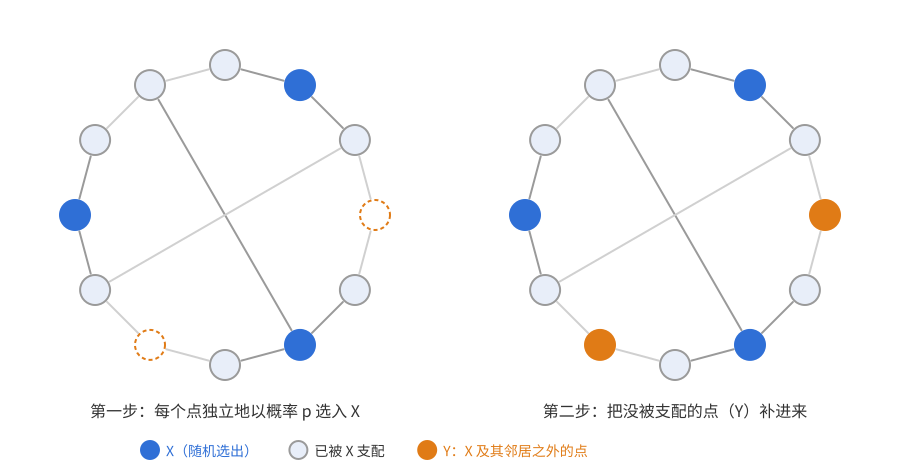
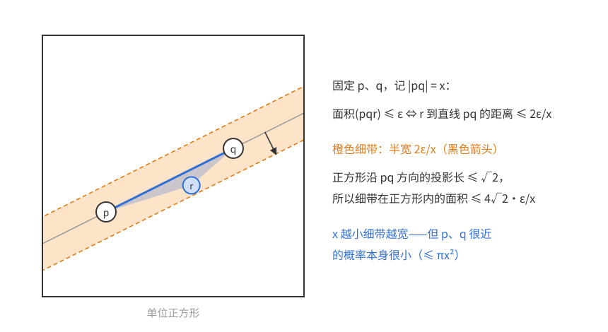
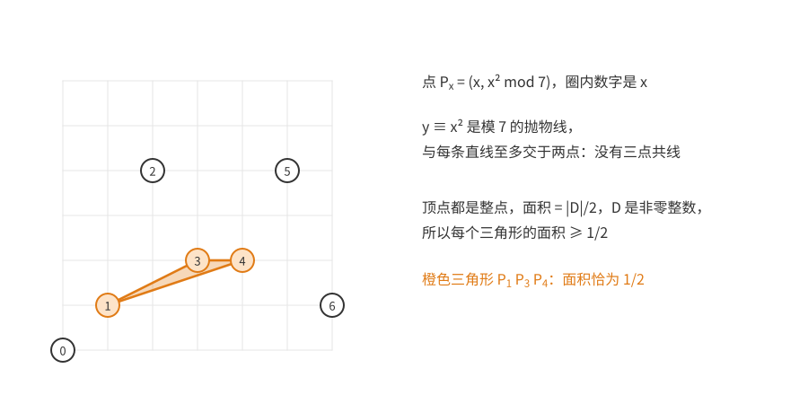
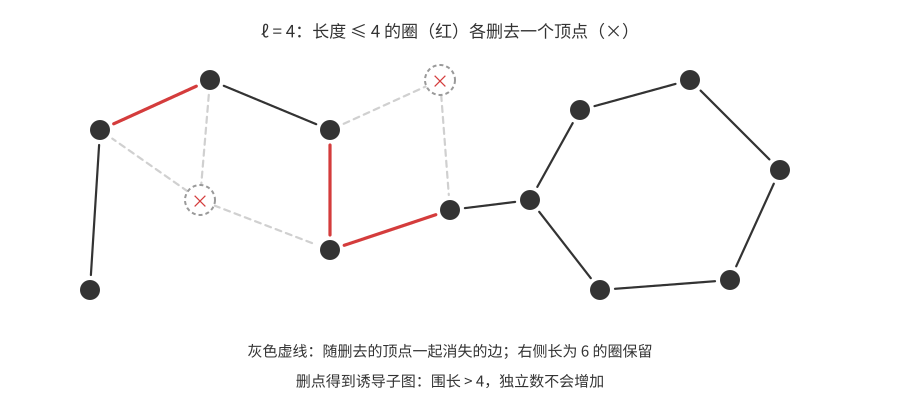
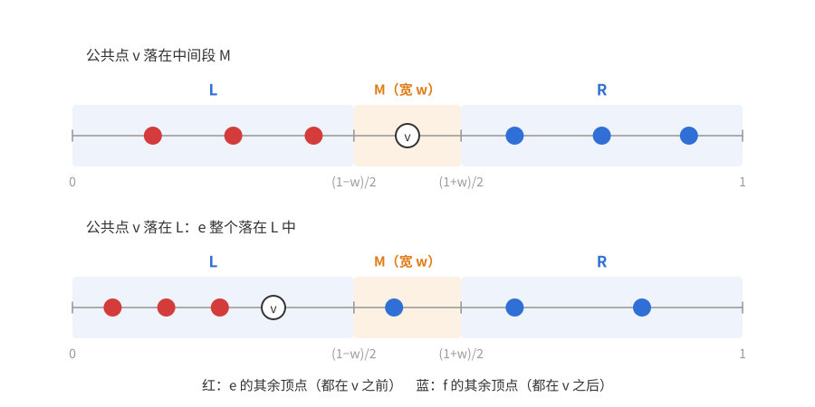
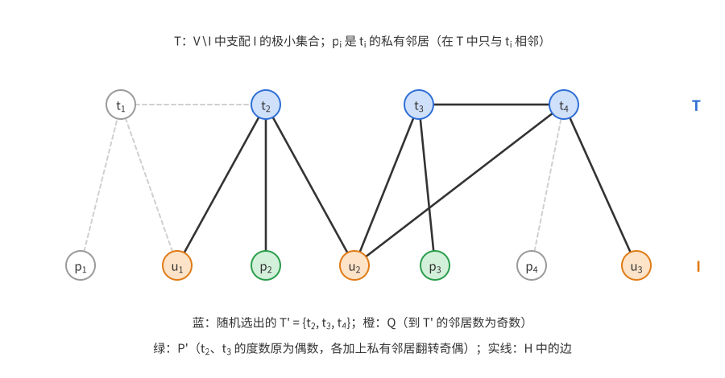

# 概率方法（三）：删除法

上一篇：[第 2 章 期望的线性性](概率方法02——期望的线性性.md)　下一篇：[第 4 章 二阶矩方法](概率方法04——二阶矩方法.md)

前两章的论证有一个共同点：随机对象**本身**就要满足全部要求。用并集上界时，要求坏事件的期望个数小于 1；用期望时，要求某个量的平均值恰好达标。**删除法**（alteration，也译作“修改法”）放宽了这一点：第一步做一个随机构造，允许它有少量缺陷；第二步用确定性的方式把缺陷修掉——删去坏结构里的一个点，或者补上没照顾到的地方。只要缺陷的期望个数比构造的规模小一个量级，修补就只损失一小部分。

第 1 章用这个想法把拉姆塞数下界的常数从 $\frac1{e\sqrt2}$ 提到了 $\frac1e$（[定理 1.2](概率方法01——引论.md#方法二删除法)）。本章再看四个例子：支配集（修补是**添加**）、Heilbronn 三角形问题（修补是**删除**，这次换来的是多项式级的改进）、大围长大色数的图（需要同时满足两个性质，为此引入 Markov 不等式），以及超图二染色的随机贪心算法（先随机排序、再确定性地染色，分析失败时必然留下的痕迹）。

删除法论证的账本都由两项组成，按修补的方向分两种写法：

- 删除型（求最大值）：最终规模 $\ge\mathbb E[\text{随机部分的规模}]-\mathbb E[\text{删去的部分}]$；
- 添加型（求最小值）：最终规模 $\le\mathbb E[\text{随机部分的规模}]+\mathbb E[\text{补上的部分}]$。

随机构造的参数（通常是概率 $p$）在两项之间取平衡。读下面每个证明时，先找出这两项各是什么。

**本章读法。**

- 首读主线：[3.1 节](#31-图的支配集)的定理 3.1（最简单的添加型例子），[3.2 节](#32-heilbronn-三角形问题)的引理 3.2 与定理 3.3（删除型，并看清删除法为什么能换来一个多项式因子），[3.3 节](#33-markov-不等式)的 Markov 不等式，以及[3.4 节](#34-大围长与大色数)的定理 3.6。这是本章的主干。
- 可以二读：3.4 节最后一小节（[定理 3.7](#色数大但要看线性多个点才能发现)）是进阶的定量证明。[3.5 节](#35-随机贪心染色)首读读到[Pluhár 的界](#热身pluhár-的界)（定理 3.10）为止，先把“随机顺序 + 贪心染色 + 失败留下的痕迹”这套想法看明白；从“更细的随机性”开始的定理 3.8 的证明留到二读。Heilbronn 问题的历史和各处评注里的文献是研究背景，首读可以跳过。
- 与其他章的联系：[第 4 章](概率方法04——二阶矩方法.md#一阶矩三角形太少的一侧)用一阶矩判断随机图何时不含某个子图，第 4、5 章再由 Markov 不等式导出 Chebyshev 不等式和 Chernoff 界（见 3.3 节末）。删除法本身在第 4、9 章的个别论证中作为备选做法出现。

## 3.1 图的支配集

**定义**　图 $G=(V,E)$ 中，称 $U\subseteq V$ 是**支配集**，若 $V\setminus U$ 中每个顶点都至少有一个邻点在 $U$ 中。等价地，每个顶点 $v$ 的**闭邻域** $N[v]=\{v\}\cup N(v)$ 都与 $U$ 相交。

**定理 3.1**　$n$ 个顶点、最小度为 $\delta\ge1$ 的图有一个大小不超过
$$\frac{1+\ln(\delta+1)}{\delta+1}\,n$$
的支配集。

### 目标与想法

先看能指望什么。每个顶点至多支配自己和 $\Delta$ 个邻点（$\Delta$ 为最大度），所以支配集至少要 $\frac n{\Delta+1}$ 个点。对正则图，定理说的是：这个平凡下界只需多付一个 $\ln\delta$ 因子就能达到。

**朴素的贪心。** 逐个挑点：第一个点支配 $\delta+1$ 个顶点；但之后挑的点，邻域可能大部分已经被支配过，新支配的点越来越少，很难直接控制总数。

**纯随机。** 每个点独立地以概率 $p$ 选入 $X$。一个顶点 $v$ 没被支配，当且仅当 $N[v]$ 中没有点入选，概率为 $(1-p)^{|N[v]|}\le(1-p)^{\delta+1}\le e^{-p(\delta+1)}$。若要求 $X$ **本身**就是支配集，用并集上界需要 $n\,e^{-p(\delta+1)}<1$，即 $p>\frac{\ln n}{\delta+1}$，于是 $|X|\approx\frac{n\ln n}{\delta+1}$——多出来的是 $\ln n$，而不是 $\ln\delta$。

**障碍在哪里。** 坚持“一个漏网的点都不许有”，就必须把每个点漏网的概率压到 $1/n$ 以下，这正是 $\ln n$ 的来源。但漏网的点并不可怕：把它们直接补进去就行，每个只花一个名额。所以不必让漏网概率小于 $1/n$，只要它与“多选一个点”的代价相当。

图中蓝点是随机选出的 $X$，浅色点已被 $X$ 支配，橙色点（$Y$）是 $X$ 及其邻居之外的点；把 $Y$ 补进来，$X\cup Y$ 就是支配集。

**怎样定 $p$。** 账本是 $\mathbb E|X|+\mathbb E|Y|\le pn+n\,e^{-p(\delta+1)}$。第一项随 $p$ 增加，第二项随 $p$ 减少。对 $p$ 求导令其为零：$1=(\delta+1)e^{-p(\delta+1)}$，即
$$p=\frac{\ln(\delta+1)}{\delta+1}.$$
此时 $\mathbb E|Y|\le\frac n{\delta+1}$——漏网的点恰好和平凡下界一样多，而随机部分花了 $\frac{n\ln(\delta+1)}{\delta+1}$。

### 证明

*证明*　取 $p=\frac{\ln(\delta+1)}{\delta+1}\in[0,1]$（因为 $\ln x\le x$）。每个顶点独立地以概率 $p$ 选入 $X$，令
$$Y=V\setminus\big(X\cup N(X)\big)$$
为既不在 $X$ 中、也没有邻点在 $X$ 中的顶点。$X\cup Y$ 是支配集：不在其中的顶点不属于 $Y$，又不属于 $X$，所以有邻点在 $X$ 中。

$v\in Y$ 当且仅当 $N[v]\cap X=\varnothing$，概率为 $(1-p)^{\deg v+1}\le(1-p)^{\delta+1}\le e^{-p(\delta+1)}$（用了 $1+x\le e^x$）。由期望的线性性
$$\mathbb E|X\cup Y|\le\mathbb E|X|+\mathbb E|Y|\le pn+e^{-p(\delta+1)}n=\frac{\ln(\delta+1)}{\delta+1}n+\frac1{\delta+1}n.$$
所以某次选取使 $|X\cup Y|$ 不超过右边。$\square$

**评注**

- *贪心其实也行，只是要换一种分析。* 设还剩 $u$ 个顶点未被支配。每个未被支配的顶点 $w$ 都在至少 $\delta+1$ 个闭邻域 $N[v]$ 里（$v\in N[w]$），所以 $\sum_v|N[v]\cap\{\text{未被支配}\}|\ge u(\delta+1)$，由平均值原理，某个 $v$ 能新支配至少 $\frac{u(\delta+1)}n$ 个点。每步挑这样的点，未被支配的点数从 $u$ 变成至多 $u\big(1-\frac{\delta+1}n\big)\le u\,e^{-(\delta+1)/n}$。挑 $\big\lceil\frac{n\ln(\delta+1)}{\delta+1}\big\rceil$ 步后 $u\le\frac n{\delta+1}$，剩下的逐个补上，得到几乎同样的界（至多多 1）。

  朴素贪心的问题不在贪心本身，而在于只盯着“新支配的点越来越少”，没有用平均的眼光去看。删除法的随机证明和这个贪心分析本质上是同一件事：前者把“挑点”一次性随机完成。
- 当 $\delta\to\infty$ 时，界 $(1+o(1))\frac{\ln\delta}\delta n$ 中的常数 1 不能改进（Alon 1990，用随机图构造）。
- 支配集是“横贯”的特例：$U$ 支配 $G$，等价于 $U$ 与每个闭邻域相交。习题 3 是这个定理在一致超图上的版本。

## 3.2 Heilbronn 三角形问题

**问题**　在单位正方形里放 $n$ 个点，怎样使它们构成的三角形中，面积最小的那个尽可能大？记
$$\Delta(n)=\sup_{\substack{S\subseteq[0,1]^2\\ |S|=n}}\ \min_{\substack{p,q,r\in S\\ \text{互不相同}}}\operatorname{area}(pqr).$$

**朴素构造都不好。**

- 网格：有三点共线，最小面积为 0。
- 圆周上均匀放 $n$ 个点（半径 $\frac12$）：相邻三点构成的三角形两边长约 $\frac\pi n$，夹角约 $\pi-\frac{2\pi}n$，面积约 $\frac12\big(\frac\pi n\big)^2\sin\frac{2\pi}n=\Theta(n^{-3})$。

**猜想与历史。** 这一段是研究背景，首读可跳过。Heilbronn 猜想 $\Delta(n)=O(n^{-2})$。Komlós、Pintz、Szemerédi（1982）用一个精巧的概率构造否定了它：$\Delta(n)\gtrsim n^{-2}\log n$。上界方面，他们在 1981 年证明了 $\Delta(n)\le n^{-8/7+o(1)}$，这个指数保持了四十多年，直到 Cohen、Pohoata、Zakharov（2023）改进为 $n^{-8/7-c}$（$c>0$ 为某个常数），他们随后（2024 年预印本）又改进到 $n^{-7/6+o(1)}$。（2026 年有一份未经同行评审的手稿声称把下界改进到 $n^{-2+c}$。）

下面用删除法证明 $\Delta(n)\gtrsim n^{-2}$。

### 为什么是 $n^{-2}$

随机撒 $N$ 个点。下面的引理 3.2 会证明：三个随机点的三角形面积 $\le\varepsilon$ 的概率 $\lesssim\varepsilon$。于是小三角形的期望个数 $\asymp N^3\varepsilon$。

- 若坚持一个小三角形都没有（并集上界），需要 $N^3\varepsilon<1$，即 $\varepsilon\approx N^{-3}$——和圆周构造一样差。
- 若允许有小三角形、事后删点，只需小三角形的期望个数不超过点数的一半：$N^3\varepsilon\lesssim N$，即 $\varepsilon\approx N^{-2}$。

所以这里删除法换来的不是常数，而是**整整一个 $n$ 的因子**。原因是坏事件的个数（$N^3$ 量级）远多于对象的规模（$N$）：并集上界要求坏事件总概率小于 1，删除法只要求它小于规模。

### 小三角形的概率

**引理 3.2**　$p,q,r$ 是单位正方形中独立均匀的随机点，则对每个 $\varepsilon>0$，
$$\mathbb P\big(\operatorname{area}(pqr)\le\varepsilon\big)\le8\sqrt{2\pi}\,\varepsilon.$$

**思路。** 先固定 $p,q$，记 $x=|pq|$。三角形面积是 $\frac12x\cdot d(r,pq)$，其中 $d(r,pq)$ 是 $r$ 到直线 $pq$ 的距离。所以面积 $\le\varepsilon$ 当且仅当 $r$ 落在直线 $pq$ 两侧半宽为 $\frac{2\varepsilon}x$ 的细带里。

细带越窄越好，而 $x$ 很小时细带很宽，这似乎是个问题。但 $p,q$ 靠得很近本身就不太可能：$\mathbb P(|pq|<s)\le\pi s^2$。宽度像 $\frac1x$ 那样爆炸，概率像 $x^2$ 那样衰减，两者相抵后积分收敛。

*证明*　固定 $p\ne q$，$x=|pq|$。正方形中到直线 $pq$ 距离不超过 $h=\frac{2\varepsilon}x$ 的点，沿直线方向的坐标落在正方形在该方向上的投影里（长度不超过对角线 $\sqrt2$），垂直方向的坐标落在 $[-h,h]$ 里，所以这个区域含在一个 $\sqrt2\times2h$ 的矩形中，面积至多 $2\sqrt2h$。于是
$$\mathbb P_r\big(\operatorname{area}(pqr)\le\varepsilon\big)\le\frac{4\sqrt2\,\varepsilon}{|pq|}.$$
再对 $p,q$ 取期望，只需估计 $\mathbb E\big[\frac1{|pq|}\big]$。固定 $p$，$|pq|<s$ 要求 $q$ 落在以 $p$ 为心、半径 $s$ 的圆内，概率至多 $\pi s^2$。

下面用到非负随机变量的尾积分公式 $\mathbb EY=\int_0^\infty\mathbb P(Y>t)\,dt$，它是取非负整数值时 $\mathbb EY=\sum_{k\ge1}\mathbb P(Y\ge k)$ 的连续版本。取 $Y=\frac1{|pq|}$，并以 $t=\sqrt\pi$ 为界把积分分成两段（前一段用概率 $\le1$，后一段用 $\le\frac\pi{t^2}$）：
$$\mathbb E\Big[\frac1{|pq|}\Big]=\int_0^\infty\mathbb P\Big(\frac1{|pq|}>t\Big)dt=\int_0^\infty\mathbb P\Big(|pq|<\frac1t\Big)dt\le\int_0^\infty\min\Big(1,\frac\pi{t^2}\Big)dt=\sqrt\pi+\sqrt\pi=2\sqrt\pi.$$
合起来，$\mathbb P(\operatorname{area}\le\varepsilon)\le4\sqrt2\,\varepsilon\cdot2\sqrt\pi=8\sqrt{2\pi}\,\varepsilon$。$\square$

直观地用密度写：$|pq|\approx x$ 的概率约为 $2\pi x\,dx$，乘上细带的宽度 $\frac\varepsilon x$ 后 $x$ 抵消，积分得 $\asymp\varepsilon$；上面的尾积分是这个计算的严格版本。（模拟显示实际比值约为 12，上界中的常数 $8\sqrt{2\pi}\approx20$ 并不紧。）

### 删点

**定理 3.3**　存在绝对常数 $c>0$，使得对每个正整数 $n$，单位正方形中存在 $n$ 个点，其中任意三点构成的三角形面积都至少是 $c\,n^{-2}$。

*证明*　独立均匀地撒 $2n$ 个点（以概率 1 两两不同）。取
$$\varepsilon=\frac{3}{32\sqrt{2\pi}}\cdot\frac1{n^2}，$$
设 $X$ 为面积 $\le\varepsilon$ 的三角形个数（退化的、三点共线的也算在内）。由引理 3.2，
$$\mathbb EX\le\binom{2n}3\cdot8\sqrt{2\pi}\,\varepsilon\le\frac{8n^3}6\cdot8\sqrt{2\pi}\,\varepsilon=n.$$
从每个面积 $\le\varepsilon$ 的三角形中删去一个顶点。剩下的点中任意三点构成的三角形面积都大于 $\varepsilon$：否则它是原来的一个小三角形，应已有顶点被删去。剩下的点数至少 $2n-X$，期望至少 $n$，所以某次撒点后至少剩下 $n$ 个点。从中任取 $n$ 个即可，$c=\frac3{32\sqrt{2\pi}}$。$\square$

### 一个代数构造

$n^{-2}$ 的量级也可以用显式构造达到。

**定理 3.4（Erdős，见 Roth 1951 的附录）**　$\Delta(n)\ge\frac1{8n^2}$。

*证明*　由 Bertrand 公设，取素数 $p$ 满足 $n\le p<2n$。考虑 $p$ 个整点
$$P_x=(x,\ x^2\bmod p),\qquad x=0,1,\dots,p-1，$$
其中 $x^2\bmod p$ 取 $\{0,\dots,p-1\}$ 中的代表元。

任取三点 $P_a,P_b,P_c$（$a,b,c$ 互不相同），三角形面积是整数行列式
$$D=\det\begin{pmatrix}b-a&y_b-y_a\\ c-a&y_c-y_a\end{pmatrix}$$
的绝对值的一半。模 $p$ 时 $y\equiv x^2$，
$$D\equiv(b-a)(c^2-a^2)-(c-a)(b^2-a^2)=(b-a)(c-a)(c-b)\not\equiv0\pmod p,$$
所以 $D$ 是非零整数，面积 $\ge\frac12$。（几何上说：抛物线 $y=x^2$ 在 $\mathbb F_p^2$（两个坐标都取模 $p$ 剩余类的平面）中与每条直线至多交于两点，所以这些点没有三点共线。）把这些点缩小 $p$ 倍放进单位正方形，面积缩小 $p^2$ 倍，变成至少 $\frac1{2p^2}>\frac1{8n^2}$。取其中 $n$ 个点即可。$\square$

下图是 $p=7$ 的情形，圈内数字是 $x$。可以直接看出没有三点共线；而顶点都是整点，所以面积是 $\frac12$ 的整数倍，橙色三角形就取到了最小值 $\frac12$。

代数构造的常数 $\frac18$ 比删除法的 $\frac3{32\sqrt{2\pi}}\approx0.037$ 好。随机构造的价值在于灵活：Komlós–Pintz–Szemerédi 得到 $n^{-2}\log n$ 的构造，就是在随机撒点之上做精细得多的修补。

## 3.3 Markov 不等式

前面的删除法论证只关心**一个**量（剩余点数）的期望。下一节要构造的图必须**同时**满足两个性质，而一个随机变量的期望好，并不保证另一个也好。解决办法是把每个“期望小”转化成“以大概率小”，再对两个失败事件用并集上界。转化的工具是：

**定理 3.5（Markov 不等式）**　若随机变量 $X\ge0$，则对每个 $a>0$，
$$\mathbb P(X\ge a)\le\frac{\mathbb E X}a.$$

*证明*　$X\ge a\cdot1_{X\ge a}$ 处处成立，取期望得 $\mathbb EX\ge a\,\mathbb P(X\ge a)$。$\square$

要点：非负随机变量的期望若很小，它通常也很小。特别地，若 $X$ 取非负整数值且 $\mathbb EX\to0$，则 $\mathbb P(X\ge1)\le\mathbb EX\to0$，即以高概率 $X=0$。这叫**一阶矩方法**，[第 4 章](概率方法04——二阶矩方法.md)还会反复用到。

Markov 不等式本身也是后面许多尾估计的起点：把它用在 $X$ 的某个非负函数上，就能得到更强的不等式。[第 4 章](概率方法04——二阶矩方法.md#方差与-chebyshev-不等式)对 $(X-\mu)^2$ 用它，得到 Chebyshev 不等式；[第 5 章](<概率方法05——Chernoff 界.md#定理与证明>)对 $e^{tX}$ 用它，得到 Chernoff 界。

## 3.4 大围长与大色数

如果图含有 $K_k$，它的色数至少是 $k$——这是一个**局部**的证据：只看 $k$ 个点就能确认色数大。反过来，色数大的图是否总能从某个局部结构上看出来？

答案是否定的，而且相差得很远：存在“局部看起来像树”的图，色数却任意大。图的**围长**是它最短圈的长度（无圈时规定为无穷）。围长大于 $\ell$ 意味着每个半径小于 $\ell/2$ 的邻域都是一棵树，而树是可以二染色的。

**定理 3.6（Erdős 1959）**　对任意 $k,\ell$，存在围长大于 $\ell$、色数大于 $k$ 的图。

### 怎样想到证明

**两个目标互相拉扯。** 没有短圈要求图稀疏；色数大则要求图不能太稀疏：色数大于 $k$ 的图必须含有最小度至少 $k$ 的子图（否则可以反复剥掉度小于 $k$ 的点，再倒序贪心染色，$k$ 种颜色就够）。显式构造很难同时做到（例如 Mycielski 构造每一步让色数加一、仍不含三角形，但只能保证没有三角形）。

所以试试 Erdős–Rényi 随机图 $G(n,p)$：$n$ 个顶点，每对顶点独立地以概率 $p$ 连边。

**怎样证明色数大。** 直接控制色数很难，换成独立数：每个颜色类是独立集，所以
$$\chi(G)\ge\frac{|V(G)|}{\alpha(G)}.$$
只要证明 $\alpha(G)=o(n)$。

**两个约束定出 $p$ 的范围。**

- *短圈要少。* 长为 $i$ 的圈的期望个数约为 $\frac{(np)^i}{2i}$。
- *独立数要小。* 一个 $x$ 元点集是独立集的概率为 $(1-p)^{\binom x2}\approx e^{-px^2/2}$，而 $x$ 元集约有 $n^x$ 个，所以 $p\cdot\frac x2\gtrsim\ln n$ 时没有 $x$ 元独立集，即 $\alpha\lesssim\frac{2\ln n}p$。要让它是 $o(n)$，需要 $np\gg\ln n$。

**障碍：短圈不可能完全没有。** $np\to\infty$ 时，三角形的期望个数 $\approx\frac{(np)^3}6\to\infty$，无法用并集上界保证没有短圈；而若 $np$ 有界，图的平均度有界，由第 2 章的 Caro–Wei 不等式（[定理 2.5](概率方法02——期望的线性性.md#carowei-不等式)，配合 Jensen 不等式），平均度为 $d$ 的图有大小 $\ge\frac n{d+1}$ 的独立集，独立数就是线性的。两个要求不能同时以“零缺陷”的方式满足。

**修补：删去短圈。** 退而求其次，只要短圈的个数是 $o(n)$：要求 $(np)^\ell\ll n$，即 $p\ll n^{1/\ell-1}$。然后从每个短圈中删去一个**顶点**。为什么删点而不删边？删点得到的是诱导子图，独立数不会增加（$G'$ 的独立集也是 $G$ 的独立集）；删边却可能制造新的独立集。

于是 $p$ 只要落在窗口 $\frac{\ln n}n\ll p\ll n^{-1+1/\ell}$ 中即可，例如 $p=\frac{(\ln n)^2}n$。最后，需要**同一个**图既短圈少、又独立数小，用 Markov 不等式把两件事都变成“失败概率小于 $\frac12$”。

### 证明

*证明*　取 $G\sim G(n,p)$，$p=\frac{(\ln n)^2}n$，$n$ 充分大。证明分三步：用 Markov 不等式说明短圈很少的概率接近 1；用并集上界说明独立数小于 $\frac{3n}{\ln n}+1$ 的概率接近 1；取一个同时满足两者的 $G$，删去短圈上的点。

*短圈。* 设 $X$ 为 $G$ 中长度不超过 $\ell$ 的圈的个数。$K_n$ 中长为 $i$ 的圈有 $\binom ni\frac{(i-1)!}2=\frac{n(n-1)\cdots(n-i+1)}{2i}$ 个，每个以概率 $p^i$ 出现，所以
$$\mathbb EX=\sum_{i=3}^{\ell}\frac{n(n-1)\cdots(n-i+1)}{2i}p^i\le\sum_{i=3}^\ell(np)^i\le\ell\,(\ln n)^{2\ell}=o(n)$$
（$\ell$ 是常数）。由 Markov 不等式，$\mathbb P(X\ge\frac n2)\le\frac{2\,\mathbb EX}n=o(1)$。

*独立数。* 令 $x=\big\lceil\frac{3\ln n}p\big\rceil=\big\lceil\frac{3n}{\ln n}\big\rceil$。由并集上界和 $\binom nx\le n^x$，
$$\mathbb P(\alpha(G)\ge x)\le\binom nx(1-p)^{\binom x2}\le n^xe^{-px(x-1)/2}=\big(n\,e^{-p(x-1)/2}\big)^x.$$
由于 $p(x-1)\ge3\ln n-p\ge3\ln n-1$，括号内至多 $e^{1/2}n^{-1/2}<1$（$n\ge3$），所以这个概率趋于 0。

*删点。* 取 $n$ 充分大，使两个失败概率都小于 $\frac12$。于是存在 $G$ 同时满足 $X<\frac n2$ 与 $\alpha(G)<x$。从每个长度 $\le\ell$ 的圈中删去一个顶点，得到 $G'$：

- $|V(G')|>n-\frac n2=\frac n2$；
- $G'$ 没有长度 $\le\ell$ 的圈（$G'$ 的圈也是 $G$ 的圈，而 $G$ 的每个短圈都失去了一个顶点），即围长 $>\ell$；
- $\alpha(G')\le\alpha(G)<x\le\frac{3n}{\ln n}+1$。

所以
$$\chi(G')\ge\frac{|V(G')|}{\alpha(G')}>\frac{n/2}{3n/\ln n+1}\to\infty,$$
$n$ 充分大时大于 $k$。$\square$

下图示意删点这一步（$\ell=4$）：红色是短圈中留下的边，打叉的是删去的顶点，灰色虚线是随之消失的边；长为 6 的圈不受影响。

### 色数大，但要看线性多个点才能发现

这一小节是进阶内容，首读可跳过，后文不依赖它。

定理 3.6 说半径小于 $\ell/2$ 的邻域看不出色数。Erdős（1962）证明了更强的结论：即使看任意 $\varepsilon n$ 个点，也看不出来。

**定理 3.7（Erdős 1962）**　对每个 $k$，存在 $\varepsilon=\varepsilon_k>0$，使得 $n$ 充分大时，存在 $n$ 个顶点的图，其色数大于 $k$，但任意不超过 $\varepsilon n$ 个顶点的子图都可以 3 染色。

可以取 $G\sim G(n,C/n)$（参见 Alon–Spencer 书中的 “Probabilistic Lens: Local coloring”）。下面的证明只用到一阶矩。

**思路。** 稀疏随机图 $G(n,C/n)$ 的平均度约为常数 $C$；只要 $C$ 足够大，独立数就小于 $\frac n{2k}$，色数大于 $2k$。

另一方面，小点集里的边**非常稀疏**：$s$ 个点之间期望只有 $\binom s2\frac Cn\approx\frac{Cs}2\cdot\frac sn$ 条边，$s\ll n$ 时远少于 $s$。

稀疏为什么推出 3 可染色？若每个小点集 $S$ 内的边数都少于 $\frac32|S|$，则 $S$ 诱导的子图平均度小于 3，有一个度不超过 2 的顶点；对它的每个子图同样如此，于是可以逐个剥掉度 $\le2$ 的点，再倒序贪心染色，每次至多 2 个邻点已染色，3 种颜色够用。

*证明*　取 $C=4k(\ln(2ek)+1)$，$p=\frac Cn$，$G\sim G(n,p)$。$C$ 这样取，是为了让 $\frac C{4k}-\ln(2ek)=1$，下式指数中 $x$ 的系数为负。下面先说明以高概率色数大于 $k$，再说明以高概率每个小点集都稀疏，最后把两者合起来。

*色数大。* 令 $x=\lceil\frac n{2k}\rceil$。用 $\binom nx\le(\frac{en}x)^x\le(2ek)^x$，并注意 $\frac{C(x-1)}{2n}\ge\frac C{4k}-\frac C{2n}$：
$$\mathbb P(\alpha(G)\ge x)\le(2ek)^xe^{-Cx(x-1)/(2n)}\le\exp\Big(x\Big(\ln(2ek)-\frac C{4k}+\frac C{2n}\Big)\Big)=\exp\Big(x\Big(-1+\frac C{2n}\Big)\Big)\to0.$$
所以以高概率 $\alpha(G)<\frac n{2k}+1$，$\chi(G)\ge\frac n{\alpha(G)}>k$（$n$ 充分大）。

*小点集稀疏。* 令 $a=e\,(eC/3)^{3/2}$（它就是把下式化成 $(\cdot)^s$ 后底数中的常数），取 $\varepsilon>0$ 使 $a\sqrt\varepsilon\le\frac12$。对 $1\le s\le\varepsilon n$，令 $t=\lceil\frac{3s}2\rceil$。某个 $s$ 元集内至少有 $t$ 条边的概率，至多为“选出其中 $t$ 对都连边”的期望个数：
$$\binom ns\binom{\binom s2}{t}p^{t}\le\Big(\frac{en}s\Big)^s\Big(\frac{e s^2}{2t}\cdot\frac Cn\Big)^{t}\le\Big(\frac{en}s\Big)^s\Big(\frac{eCs}{3n}\Big)^{3s/2}=\Big(a\sqrt{\frac sn}\Big)^s,$$
其中第一步用了 $\binom ab\le\big(\frac{ea}b\big)^b$；第二步用了 $t\ge\frac{3s}2$（于是 $\frac{es^2}{2t}\le\frac{es}3$）和 $\frac{eCs}{3n}<1$（于是把指数 $t$ 换成更小的 $\frac{3s}2$ 只会变大）。后者成立是因为 $s\le\varepsilon n$，而 $a\sqrt\varepsilon\le\frac12$ 蕴含 $\frac{eC\varepsilon}3<1$。对 $s$ 求和：$s\le\sqrt n$ 的部分每项至多 $(a\,n^{-1/4})^s$，和为 $O(n^{-1/4})$；$\sqrt n<s\le\varepsilon n$ 的部分每项至多 $2^{-s}$，和至多 $2^{1-\sqrt n}$。所以以高概率，每个至多 $\varepsilon n$ 个顶点的点集内都少于 $\frac32$ 倍点数条边。

两件事对充分大的 $n$ 同时成立。这时任取至多 $\varepsilon n$ 个顶点的子图 $F$，它的每个子图都有度 $\le2$ 的顶点（边数少于 1.5 倍点数，平均度小于 3），按“思路”中的方式 3 染色。$\square$

## 3.5 随机贪心染色

回忆第 1 章的记号：$m(k)$ 是不可二染色的 $k$ 一致超图最少的边数。第 1 章证明了 $2^{k-1}\le m(k)=O(k^22^k)$（定理 1.10、1.11）。下界 $2^{k-1}$ 来自一次随机二染色加并集上界。本节改进这个下界。

**定理 3.8（Radhakrishnan–Srinivasan 2000）**　存在常数 $c>0$，使得边数不超过 $c\sqrt{\frac k{\ln k}}\,2^k$ 的 $k$ 一致超图（$k\ge2$）都可以二染色。

这是目前已知最好的下界。下面的证明属于 Cherkashin 和 Kozik（2015），它沿用了 Pluhár（2009）的思路，比原证明简单得多。

### 为什么要换一种随机

一次均匀随机二染色，单色边的期望个数是 $m\,2^{1-k}$；$m\ge2^{k-1}$ 时期望已不小于 1，这种分析没有改进余地。要做得更好，必须利用染色之间的调整。这里的办法是：随机的只是**顺序**，染色由确定性的贪心算法完成。

为什么偏向一种颜色？均匀随机染色把“全红”和“全蓝”两类失败对称地交给运气。若改为“能红就红”，全红的边被规则本身排除了，只剩全蓝这一种失败要防；而全蓝的边会在它的第一个顶点处留下痕迹（下面的引理 3.9）。随机性只放在处理顺序上，这样痕迹出现的概率才算得出来。

**贪心规则**（与第 1 章习题 10 一致）　按某个顺序逐个处理顶点：能染红就染红；只有当染红会使某条边全红时（即该点是这条边最后一个被处理的点，且边上其余点都已是红色），才染蓝。

这样得到的染色永远没有全红的边。它失败当且仅当出现全蓝的边。

**分析的困难与出路。** 一个顶点的颜色依赖于整个处理历史，直接分析贪心算法几乎不可能。出路是：找一个**失败必然留下的痕迹**，而这个痕迹只依赖于顺序、与染色过程无关。

**定义**　对顶点的一个顺序，若边 $e$ 的最后一个顶点恰好是边 $f$ 的第一个顶点，称 $(e,f)$ 是一个**冲突对**。此时 $e\setminus\{v\}$ 全在 $v$ 之前、$f\setminus\{v\}$ 全在 $v$ 之后，所以 $e\cap f=\{v\}$。

**引理 3.9**　若贪心染色失败，则这个顺序下存在冲突对。

*证明*　设 $f$ 是全蓝的边，$v$ 是 $f$ 中最先处理的顶点。$v$ 被染蓝，说明染红会使某条边 $e$ 全红：$v$ 是 $e$ 中最后处理的点。于是 $e$ 的最后一个顶点就是 $f$ 的第一个顶点。$\square$

（这正是[第 1 章习题 10](概率方法01——引论.md#习题-10不可二染色超图中恰交于一点的边对)的论证，见那里的配图。）现在问题变成纯粹的概率问题：随机顺序下，出现冲突对的概率有多大？

### 热身：Pluhár 的界

**定理 3.10（Pluhár 2009）**　$k\ge2$ 时，边数 $m\le k^{1/4}2^{k-1}$ 的 $k$ 一致超图都可以二染色。

*证明*　取均匀随机顺序。固定一对恰交于一点 $v$ 的边 $(e,f)$（有序），$e\cup f$ 的 $2k-1$ 个顶点的相对顺序均匀随机；$(e,f)$ 冲突当且仅当 $e\setminus\{v\}$ 排在最前、$v$ 排第 $k$、$f\setminus\{v\}$ 排在最后，概率为
$$\frac{(k-1)!^2}{(2k-1)!}=\frac1{(2k-1)\binom{2k-2}{k-1}}.$$
用 $\binom{2j}j\ge\frac{4^j}{2\sqrt j}$（$j\ge1$）和 $(2k-1)^2\ge4k(k-1)$，得 $(2k-1)\binom{2k-2}{k-1}\ge\frac{(2k-1)4^{k-1}}{2\sqrt{k-1}}\ge\sqrt k\,4^{k-1}$。有序边对少于 $m^2$ 个，所以冲突对的期望个数小于
$$\frac{m^2}{\sqrt k\,4^{k-1}}\le1.$$
因此存在没有冲突对的顺序，由引理 3.9，这个顺序下的贪心染色成功。$\square$

冲突概率 $\asymp k^{-1/2}4^{-k}$ 中的 $k^{-1/2}$ 换来了 $k^{1/4}$ 的改进：边对数 $m^2$ 乘上这个概率要不超过 1，所以 $m$ 可以比 $2^{k-1}$ 多一个 $(k^{1/2})^{1/2}=k^{1/4}$ 因子。

### 更细的随机性：把顺序换成位置

从这里到本节末是定理 3.8 的证明，首读可跳过。

**浪费在哪里。** 给每个顶点一个 $[0,1]$ 中的独立均匀**位置** $x_v$，按位置排序就是均匀随机顺序，但位置还携带了更多信息。对固定的一对边，公共点 $v$ 落在位置 $x$ 附近并且构成冲突的概率密度是
$$x^{k-1}(1-x)^{k-1}\qquad(e\text{ 的其余点在 }x\text{ 之前，}f\text{ 的其余点在 }x\text{ 之后}),$$
它在 $x=\frac12$ 处取最大值 $4^{1-k}$，并集中在 $\frac12$ 附近宽约 $\frac1{\sqrt k}$ 的范围里。

再看公共点**偏离中心**的冲突：若 $v$ 的位置明显小于 $\frac12$，那么 $e$ 的 $k$ 个点全都挤在 $[0,x_v]$ 里。这是一个只关于**一条边**的罕见事件。而以 $e$ 为前一半的冲突对可能有很多（每个与 $e$ 恰交于末点的 $f$ 都算一个），它们都源于同一件事“$e$ 挤在左端”。对边对用并集上界，同一个坏局面被重复计算了许多次。

**修补：按“肇事者”分组。** 把 $[0,1]$ 分成三段（中间一段的宽度 $w$ 待定）
$$L=\Big[0,\frac{1-w}2\Big),\qquad M=\Big[\frac{1-w}2,\frac{1+w}2\Big],\qquad R=\Big(\frac{1+w}2,1\Big].$$
冲突对只有两种来源：

- 公共点在 $L$ 中，则 $e$ 整个落在 $L$ 中；公共点在 $R$ 中，则 $f$ 整个落在 $R$ 中。这类坏局面按**边**计数，每条边一次。
- 公共点在窄窄的 $M$ 中。这类按边对计数，但 $M$ 很窄。

上图中红点是 $e$ 的其余顶点，蓝点是 $f$ 的其余顶点。上一行：公共点 $v$ 在 $M$ 中。下一行：$v$ 在 $L$ 中，$e$ 的全部 $k$ 个点都落进了 $L$。

### 怎样定参数

设 $m=a\,2^{k-1}$，$a$ 待定，看 $a$ 最大能取多少。粗算两类坏局面的概率：

- *某条边整个落在 $L$ 或 $R$ 中*：一条边落在 $L$ 中的概率是 $\big(\frac{1-w}2\big)^k$，对 $m$ 条边和两端求和，约为 $a(1-w)^k\le a\,e^{-wk}$。它要求 $M$ **宽**。
- *公共点落在 $M$ 中的冲突对*：每个有序边对的概率至多 $w\cdot4^{1-k}$（密度的最大值乘以 $M$ 的宽度），边对少于 $m^2$ 个，合计约 $a^2w$。它要求 $M$ **窄**。

对 $w$ 求导，$a e^{-wk}+a^2w$ 在 $e^{-wk}=\frac ak$，即
$$w=\frac{\ln(k/a)}k$$
处取最小值，此时总和为
$$\frac{a^2}k+\frac{a^2\ln(k/a)}k=\frac{a^2}k\Big(1+\ln\frac ka\Big).$$
$1\le a\le\sqrt k$ 时，括号是 $\Theta(\ln k)$，总和的量级是 $\frac{a^2\ln k}k$。要它小于 1，$a$ 最大可取到 $\sqrt{k/\ln k}$ 的量级——这就是定理中的 $\sqrt{k/\ln k}$。证明里取 $a_0=\frac12\sqrt{k/\ln k}$，是为了让总和不超过 $\frac12$。此时 $M$ 的宽度 $w\approx\frac{\ln k}{2k}$，比冲突密度的自然宽度 $\frac1{\sqrt k}$ 窄得多。

### 证明

*定理 3.8 的证明*　取 $c=\frac14$，设 $H$ 有 $m\le\frac14\sqrt{\frac k{\ln k}}\,2^k$ 条边。证明分四步：小的 $k$ 直接由定理 1.10 处理；对 $k\ge9$ 设定随机位置和宽度 $w$；分别估计事件 A、B 的概率；最后说明每个冲突对都导致 A 或 B 发生。

若 $2\le k\le8$，可以验证 $\frac k{\ln k}<4$，于是 $m<2^{k-1}$，由定理 1.10 即可二染色。下设 $k\ge9$。

每个顶点独立地取 $[0,1]$ 中的均匀位置 $x_v$（以概率 1 两两不同），按位置从小到大处理顶点，执行贪心染色。记 $a_0=\frac12\sqrt{\frac k{\ln k}}$，则 $m\le a_02^{k-1}$。取
$$w=\frac{\ln(k/a_0)}k=\frac{\ln\big(2\sqrt{k\ln k}\big)}k,$$
由于 $1<2\sqrt{k\ln k}\le k$（后者等价于 $4\ln k\le k$，对 $k\ge9$ 成立），有 $0<w\le\frac{\ln k}k<1$。

*事件 A：某条边整个落在 $L$ 中或整个落在 $R$ 中。* 一条边落在 $L$ 中的概率为 $\big(\frac{1-w}2\big)^k$，$R$ 同理，所以
$$\mathbb P(A)\le2m\Big(\frac{1-w}2\Big)^k=\frac m{2^{k-1}}(1-w)^k\le a_0e^{-wk}.$$

*事件 B：存在公共点落在 $M$ 中的冲突对。* 固定一对恰交于一点 $v$ 的有序边对 $(e,f)$。对 $x_v$ 取条件，$e\setminus\{v\}$ 全在 $x_v$ 之前、$f\setminus\{v\}$ 全在 $x_v$ 之后的概率是 $x_v^{k-1}(1-x_v)^{k-1}$，所以
$$\mathbb P\big((e,f)\text{ 冲突且 }x_v\in M\big)=\int_M x^{k-1}(1-x)^{k-1}\,dx\le w\cdot4^{1-k},$$
这里用了 $x(1-x)\le\frac14$ 和 $M$ 的长度为 $w$。有序边对少于 $m^2$ 个，所以
$$\mathbb P(B)\le m^2w\,4^{1-k}=\Big(\frac m{2^{k-1}}\Big)^2w\le a_0^2w.$$

*冲突对 ⟹ A 或 B。* 设 $(e,f)$ 冲突，公共点为 $v$。若 $x_v\in L$，$e$ 的其余点都在 $v$ 之前，位置更小，$e$ 整个落在 $L$ 中；若 $x_v\in R$，同理 $f$ 整个落在 $R$ 中；否则 $x_v\in M$，B 发生。

所以出现冲突对的概率至多
$$a_0e^{-wk}+a_0^2w=a_0\cdot\frac{a_0}k+a_0^2\cdot\frac{\ln(k/a_0)}k=\frac{a_0^2}k\Big(1+\ln\frac k{a_0}\Big).$$
代入 $\frac{a_0^2}k=\frac1{4\ln k}$ 和 $\ln\frac k{a_0}=\ln(2\sqrt{k\ln k})\le\ln k$，上式至多 $\frac{1+\ln k}{4\ln k}\le\frac12$。于是以正概率没有冲突对，由引理 3.9，贪心染色成功。$\square$

这里的 $w$ 正是“怎样定参数”中平衡两项得到的值。

**推论 3.11**　$m(k)>\frac14\sqrt{\frac k{\ln k}}\,2^k$（$k\ge2$）。

### 收益从哪里来

算法没有变（仍是同一个贪心染色），冲突对的期望个数也没有变——位置只是顺序的另一种描述。热身中的上界是（有序边对数 $<m^2$）$\times\frac{(k-1)!^2}{(2k-1)!}$；以 $m\approx2^k\sqrt{k/\ln k}$ 为例，它约为 $m^2k^{-1/2}4^{-k}\approx\frac{\sqrt k}{\ln k}\to\infty$，已不能保证存在没有冲突对的顺序。

变的是**计数方式**：公共点偏离中心的冲突，都归到“某条边挤在一端”这个只关于一条边的原因上，按边计数，事件 A 的概率只有 $O(\frac1{\ln k})$；只有公共点落在窄区间 $M$ 中的冲突才按边对计数。这正是“浪费在哪里”一段指出的问题：许多冲突对由同一个原因同时引起，按原因计数比按结果计数便宜得多。

能否进一步改进 $\sqrt{k/\ln k}$，是一个有趣的公开问题。目前
$$\sqrt{\frac k{\ln k}}\,2^k\lesssim m(k)\lesssim k^22^k.$$

## 本章小结

| 技巧 | 本章中的例子 |
|---|---|
| 随机选取，再**补上**漏掉的部分 | 支配集（定理 3.1）、横贯（习题 3）、双侧支配（习题 8） |
| 随机选取，再从每个坏结构中**删去**一个元素 | Heilbronn（定理 3.3）、$R(4,t)$（习题 1）、独立集（习题 2）、Zarankiewicz（习题 4）、集族（习题 5、6） |
| 参数平衡：随机部分的规模 vs 修补代价 | $p=\frac{\ln(\delta+1)}{\delta+1}$；$R(4,t)$ 中 $p=n^{-1/2}$ 而非 $n^{-2/3}$ |
| 删除法可以换来多项式因子 | Heilbronn：$n^{-3}\to n^{-2}$ |
| 条件概率在某处爆炸，但那种情形本身罕见，两者相抵（尾积分） | 小三角形的概率（引理 3.2） |
| Markov 不等式：期望小 ⟹ 以大概率小，从而同时满足多个性质 | 大围长大色数（定理 3.6） |
| 删点而非删边，保持单调量不变坏 | 删去短圈时 $\alpha$ 不增 |
| 一阶矩：小点集的稀疏性 | 局部 3 可染色（定理 3.7） |
| 随机顺序 + 确定性贪心；分析失败留下的、只依赖顺序的痕迹 | 超图二染色（定理 3.8、3.10） |
| 按“肇事者”给坏事件分组，避免并集上界的重复计数 | $L\cup M\cup R$ 论证 |
| 修补的代价牵连到下一步时，加大 $p$ 让第一步的缺陷更少 | 双侧支配集（习题 8） |
| 多次独立随机构造覆盖所有对象（集卡） | 用团覆盖（习题 7） |
| 随机选取 + 用私有邻居逐点修正奇偶 | 奇度诱导子图（习题 9） |

## 习题与解答

下面渐近记号的约定见[目录与记号](概率方法讲义——目录与记号.md)。$\log$ 在需要精确计算时一律取自然对数 $\ln$。

### 习题 1　用删除法证明 $R(4,t)\gtrsim(t/\log t)^2$

**题意**　用删除法证明：存在常数 $c>0$，使 $R(4,t)\ge c\,(t/\log t)^2$。

**思路**　这里的 $t$ 与第 1 章习题 2 相同，是蓝团的大小。第 1 章习题 2 用偏硬币加并集上界得到 $(t/\log t)^{3/2}$。那里的瓶颈是红 $K_4$：要求红 $K_4$ 的期望个数 $\binom n4p^6<1$，迫使 $p\lesssim n^{-2/3}$。删除法只要求红 $K_4$ 的期望个数不超过点数的一小部分：$n^4p^6\lesssim n$，即 $p$ 可以放大到 $n^{-1/2}$。$p$ 越大，大的蓝团越难出现：蓝 $K_t$ 的期望个数 $\le\big(ne^{-p(t-1)/2}\big)^t$，只需 $pt\gtrsim\ln n$，即 $n^{-1/2}t\gtrsim\ln t$，$n\lesssim(t/\ln t)^2$。

*证明*　设 $t\ge4$，令 $n=\Big\lfloor\dfrac{t^2}{64\ln^2t}\Big\rfloor$，并设 $t$ 足够大使 $n\ge3$；取 $p=n^{-1/2}$。$K_n$ 的每条边独立地以概率 $p$ 染红、否则染蓝；然后从每个红 $K_4$ 和每个蓝 $K_t$ 中各删去一个顶点。剩下的点上的染色既没有红 $K_4$ 也没有蓝 $K_t$。

- 红 $K_4$ 的期望个数：$\binom n4p^6\le\frac{n^4}{24}n^{-3}=\frac n{24}$。
- 蓝 $K_t$ 的期望个数：由 $\sqrt n\le\frac t{8\ln t}$ 得 $\frac{p(t-1)}2=\frac{t-1}{2\sqrt n}\ge\frac{4(t-1)\ln t}{t}\ge3\ln t$；又 $n\le t^2$。所以
$$\binom nt(1-p)^{\binom t2}\le n^te^{-pt(t-1)/2}=\big(ne^{-p(t-1)/2}\big)^t\le(t^2\cdot t^{-3})^t<1.$$

剩余点数的期望至少 $n-\frac n{24}-1\ge\frac n2$（$n\ge3$）。所以某次染色后剩下至少 $\frac n2$ 个点，它们上的染色说明 $R(4,t)>\frac n2$。$t$ 充分大时 $\frac n2\ge\frac{t^2}{256\ln^2t}$；较小的 $t$ 用 $R(4,t)\ge t$ 并缩小常数即可覆盖。$\square$

**评注**　用局部引理（[第 6 章](<概率方法06——Lovász 局部引理.md>)）可以得到 $(t/\log t)^{5/2}$。Mattheus 和 Verstraete（2023）用代数构造证明了 $R(4,t)\gtrsim t^3/\log^4t$，与上界 $O(t^3/\log^2t)$ 只差对数因子。

### 习题 2　3 一致超图的独立集

**题意**　3 一致超图有 $n$ 个顶点、$m\ge n$ 条边。证明它有大小至少 $c\,n^{3/2}/\sqrt m$ 的独立集（不包含任何一条边的顶点集），$c>0$ 为常数。

**思路**　随机取点集 $S$（每点概率 $p$），然后从 $S$ 内的每条边中删去一个点。账本：$pn-p^3m$。第一项线性、第二项立方，最优的 $p$ 使两项同阶：$p^2\approx n/m$。条件 $m\ge n$ 正好保证 $p\le1$。

*证明*　取 $p=\sqrt{\frac n{3m}}\le1$。每个顶点独立地以概率 $p$ 选入 $S$，再从每条完全落在 $S$ 中的边里删去一个顶点，得到的集合是独立集。它的大小的期望至少
$$pn-p^3m=pn\Big(1-\frac{p^2m}n\Big)=\frac23pn=\frac2{3\sqrt3}\cdot\frac{n^{3/2}}{\sqrt m}.$$
所以存在大小至少这么多的独立集，$c=\frac2{3\sqrt3}$。$\square$

**评注**　量级是紧的：取 $n/s$ 个互不相交的 $s$ 点完全 3 一致超图，$m\approx\frac{ns^2}6$，而独立集至多在每块中取 2 个点，大小 $\frac{2n}s\asymp\frac{n^{3/2}}{\sqrt m}$。同样的论证对 $k$ 一致超图给出 $\gtrsim_k n\,(n/m)^{1/(k-1)}$。

### 习题 3　一致超图的横贯

**题意**　$k$ 一致超图有 $n$ 个顶点、$m$ 条边。证明它有大小至多 $\frac{n\ln k}k+\frac mk$ 的横贯（与每条边都相交的顶点集）。

**思路**　和定理 3.1 一模一样：随机取 $X$，再从每条没碰到的边里补一个点。账本 $pn+m(1-p)^k\le pn+me^{-pk}$。

*证明*　取 $p=\frac{\ln k}k\in[0,1]$。每个顶点独立地以概率 $p$ 选入 $X$；对每条与 $X$ 不交的边，任取它的一个顶点加入 $Y$。$X\cup Y$ 是横贯。一条边与 $X$ 不交的概率为 $(1-p)^k\le e^{-pk}=\frac1k$，所以
$$\mathbb E|X\cup Y|\le pn+\frac mk=\frac{n\ln k}k+\frac mk.\qquad\square$$

**评注**　定理 3.1 是它的推论：$U$ 是 $G$ 的支配集，当且仅当 $U$ 是闭邻域超图 $\{N[v]:v\in V\}$ 的横贯。这个超图有 $n$ 条边，每条大小 $\ge\delta+1$（不一定一致，但证明只用到“每条边至少 $k$ 个点”），代入 $k=\delta+1$、$m=n$ 即得定理 3.1。

### 习题 4　Zarankiewicz 问题

**题意**　证明：对正整数 $n\ge k\ge2$，存在 $n\times n$ 的 0-1 矩阵，至少有 $\frac12n^{2-2/(k+1)}$ 个 1，且没有全为 1 的 $k\times k$ 子矩阵（任选 $k$ 行 $k$ 列）。

**思路**　随机矩阵，每个元素以概率 $p$ 为 1；然后对每个全 1 的 $k\times k$ 子矩阵，把其中一个 1 改成 0。账本：$pn^2-\binom nk^2p^{k^2}\gtrsim pn^2-n^{2k}p^{k^2}$。让第二项不超过第一项的一部分：$p^{k^2-1}\lesssim n^{2-2k}$，即 $p\approx n^{-2/(k+1)}$。

*证明*　取 $p=n^{-2/(k+1)}$。每个元素独立地以概率 $p$ 取 1。对每个全 1 的 $k\times k$ 子矩阵，任选其中一个元素改为 0。改动只会把 1 变成 0，不会产生新的全 1 子矩阵，而原有的每个都被破坏了。$k\times k$ 子矩阵共 $\binom nk^2$ 个，所以剩下的 1 的个数的期望至少
$$pn^2-\binom nk^2p^{k^2}\ge pn^2-\frac{n^{2k}}{(k!)^2}p^{k^2}=n^{2-\frac2{k+1}}-\frac1{(k!)^2}n^{2k-\frac{2k^2}{k+1}}=\Big(1-\frac1{(k!)^2}\Big)n^{2-\frac2{k+1}}\ge\frac34n^{2-\frac2{k+1}},$$
这里 $2k-\frac{2k^2}{k+1}=\frac{2k}{k+1}=2-\frac2{k+1}$。所以存在满足要求的矩阵。$\square$

**评注**　只用并集上界（要求全 1 子矩阵的期望个数小于 1）只能取 $p<n^{-2/k}$，得到 $n^{2-2/k}$ 个 1，指数更差。另一方面，Kővári–Sós–Turán 定理给出上界 $O(n^{2-1/k})$。$k=2,3$ 时有代数构造达到这个量级；一般的 $k$ 能否达到是著名的公开问题。

### 习题 5　$k$ 独立集族

**题意**　固定 $k$。证明存在常数 $c_k>1$，使得 $n$ 充分大时，存在 $[n]$ 的子集族 $\mathcal F$，$|\mathcal F|\ge c_k^n$，满足：对 $\mathcal F$ 中任意 $k$ 个不同的成员 $F_1,\dots,F_k$，$2^k$ 个交集 $G_1\cap\cdots\cap G_k$（每个 $G_i$ 取 $F_i$ 或 $[n]\setminus F_i$）都非空。

**思路**　取 $N$ 个独立的随机子集。对固定的 $k$ 个下标和固定的一种“取 $F_i$ 或补集”的模式，每个元素以概率 $2^{-k}$ 落入那个交集，所以交集为空的概率是 $(1-2^{-k})^n$，指数小。坏的 $k$ 元下标组的期望个数约 $N^k2^k(1-2^{-k})^n$；删除法要求它不超过 $N/2$，于是 $N$ 可以取到 $(1-2^{-k})^{-n/(k-1)}$，是指数级的。

*证明*　$k=1$ 时，取全部非空真子集即可（$2^n-2\ge1.9^n$，$n$ 充分大）。下设 $k\ge2$，记 $q=1-2^{-k}$，令
$$N=\Big\lfloor\frac14q^{-n/(k-1)}\Big\rfloor.$$
独立取 $[n]$ 的均匀随机子集 $S_1,\dots,S_N$。称下标集 $\{i_1,\dots,i_k\}$ 是**坏的**，若某种模式下的交集为空。对固定的下标集和模式，每个元素落入交集的概率为 $2^{-k}$，各元素独立，所以交集为空的概率为 $q^n$。坏下标集的期望个数至多
$$\binom Nk2^kq^n\le\frac{N^k2^k}{k!}q^n\le N\cdot\frac{2^k}{4^{k-1}k!}\le\frac N2,$$
这里用了 $N^{k-1}\le4^{1-k}q^{-n}$，以及 $\frac{2^k}{4^{k-1}k!}\le\frac12$（$k\ge2$）。从每个坏下标集中删去一个下标，剩余下标个数的期望至少 $\frac N2$。取一次使剩余下标至少 $\frac N2$ 个的结果，剩下的下标中任意 $k$ 个都不是坏的。

剩下的集合两两不同：若剩下的两个下标 $i\ne j$ 满足 $S_i=S_j$，把它们补成剩余下标中的一个 $k$ 元组（$n$ 充分大时剩余下标至少 $k$ 个），模式“$G_i=S_i$，$G_j=[n]\setminus S_j$”的交集为空，这组下标是坏的，矛盾。所以 $\mathcal F=\{S_i:i\text{ 剩下}\}$ 有至少 $\frac N2$ 个不同的成员且满足要求。

最后，$\frac N2\ge\frac18q^{-n/(k-1)}-\frac12$。取 $c_k$ 满足 $1<c_k<q^{-1/(k-1)}=(1-2^{-k})^{-1/(k-1)}$，则 $n$ 充分大时 $\frac N2\ge c_k^n$。$\square$

**评注**　这样的集族叫 **$k$ 独立集族**（Kleitman–Spencer 1973）。把每个成员看成 $[n]$ 上的一个 0-1 坐标，条件等价于：任意 $k$ 个坐标上的投影取遍全部 $2^k$ 种模式。

### 习题 6　$\mathbb R^n$ 中的锐角集

**题意**　证明存在常数 $c>0$，使得对每个 $n$，存在 $[n]$ 的至少 $c(2/\sqrt3)^n$ 个子集组成的集族，其中没有三个不同的成员 $A,B,C$ 满足 $A\cap B\subseteq C\subseteq A\cup B$。由此推出：$\mathbb R^n$ 中存在至少 $c(2/\sqrt3)^n$ 个点，其中任意三点确定的角都是锐角。

**思路**　条件 $A\cap B\subseteq C\subseteq A\cup B$ 可以逐个坐标检查：在 $A,B$ 一致的坐标上，$C$ 也必须与它们一致。对随机集合，每个坐标上这件事的概率是 $\frac12+\frac12\cdot\frac12=\frac34$，所以三元组“坏”的概率是 $(3/4)^n$。坏三元组约 $N^3(3/4)^n$ 个，删除法要求它 $\lesssim N$，即 $N^2\lesssim(4/3)^n$，$N\approx(2/\sqrt3)^n$。

至于几何：把子集看成 0-1 向量，$\angle ACB$ 的余弦符号由 $(\mathbf a-\mathbf c)\cdot(\mathbf b-\mathbf c)$ 决定。每个坐标上这个乘积是 0 或 1，恰好在 $a_i=b_i\ne c_i$ 时为 1。所以内积总是 $\ge0$（角不会是钝角），等于 0（直角）恰好是 $A\cap B\subseteq C\subseteq A\cup B$。

*证明*　令 $N=\lfloor(2/\sqrt3)^n\rfloor\ge1$，独立取 $[n]$ 的均匀随机子集 $S_1,\dots,S_N$。

- 对三个不同的下标 $i,j,l$，事件“$S_i\cap S_j\subseteq S_l\subseteq S_i\cup S_j$”逐坐标独立：在坐标 $x$ 上，若 $S_i,S_j$ 对 $x$ 的归属不同（概率 $\frac12$），没有限制；若相同（概率 $\frac12$），要求 $S_l$ 也相同（概率 $\frac12$）。所以概率为 $(3/4)^n$。这样的（无序对 $\{i,j\}$，$l$）共 $N\binom{N-1}2\le\frac{N^3}2$ 个，期望个数至多 $\frac{N^3}2(3/4)^n\le\frac N2$（因为 $N^2\le(4/3)^n$）。
- 一对下标 $i\ne j$ 满足 $S_i=S_j$ 的概率为 $2^{-n}$，期望对数至多 $\frac{N^2}22^{-n}\le\frac12(2/3)^n\le\frac12$。

从每个坏三元组和每个相等的对中各删去一个下标，剩余下标个数的期望至少 $N-\frac N2-\frac12$。取一次实现，剩下的集合两两不同，且没有三个满足条件。它们的个数至少 $\frac{N-1}2$；当 $(2/\sqrt3)^n\ge4$ 时这至少是 $\frac14(2/\sqrt3)^n$。当 $(2/\sqrt3)^n<4$ 时，单个集合组成的集族就满足要求，而 $1>\frac14(2/\sqrt3)^n$。所以 $c=\frac14$ 对一切 $n$ 成立。

几何部分：把 $A\subseteq[n]$ 对应到示性向量 $\mathbf a\in\{0,1\}^n$，不同集合对应不同点。对三点 $\mathbf a,\mathbf b,\mathbf c$，
$$(\mathbf a-\mathbf c)\cdot(\mathbf b-\mathbf c)=\sum_i(a_i-c_i)(b_i-c_i)=\#\{i:a_i=b_i\ne c_i\}\ge0,$$
因为 $a_i\ne b_i$ 时两个因子中有一个为 0，$a_i=b_i$ 时乘积为 $(a_i-c_i)^2$。内积为 0 当且仅当所有 $a_i=b_i$ 的坐标上 $c_i$ 也相等，即 $A\cap B\subseteq C\subseteq A\cup B$。对上面的集族，这对任意三个不同成员都不成立，所以内积 $\ge1>0$，$\angle ACB$ 是锐角。由于 $C$ 可以是三点中的任意一个，三点确定的所有角都是锐角。$\square$

**评注**　这是 Erdős–Füredi（1983）的构造，它否定了 Danzer–Grünbaum 的猜想（锐角集至多 $2n-1$ 个点）。目前当 $n\ge2$ 时，$\mathbb R^n$ 中锐角集的最大大小已知在 $2^{n-1}+1$ 与 $2^n-1$ 之间（$n=1$ 时最大大小是 2：两点之间没有角，而直线上任意三点中间那点处是平角）：上界来自 Danzer–Grünbaum（1962），下界由 Gerencsér 和 Harangi（2019）用显式构造得到。

### 习题 7★　用团覆盖稀疏图的补图

**题意**

(a) 证明：$n$ 个顶点、最小度为 $n-d$ 的图，其边集可以写成 $O(d^2\log n)$ 个团的并。

(b) 证明：两侧各 $n$ 个顶点、最小度为 $n-d$（$d\ge1$）的二部图，其边集可以写成 $O(d\log n)$ 个完全二部子图的并。

**思路**　两问都是“集卡问题”：设计一个随机团（随机完全二部子图），使每条边被它覆盖的概率至少为 $q$，然后独立取 $O(\frac{\log n}q)$ 个，用并集上界保证每条边都被覆盖。关键是让 $q$ 尽量大。

最小度 $n-d$ 说明每个顶点至多有 $d-1$ 个非邻点（二部图中，至多 $d$ 个另一侧的非邻点）。随机团的自然做法是删除法：随机取点集 $S$，再删去在 $S$ 中有非邻点的顶点，剩下的就是团。

*(a)*　先处理平凡情形：若 $d\ge n$，直接用每条边自身作为团，至多 $\binom n2\le d^2$ 个，结论成立。下设 $d<n$，于是最小度 $\ge1$，没有孤立点，覆盖了所有边也就覆盖了所有顶点。

*构造。* 每个顶点独立地以概率 $p$ 选入 $S$，令
$$T=\{v\in S:\ v\text{ 在 }S\text{ 中没有非邻点}\}.$$
$T$ 中任两点相邻，所以是团。

*一条边被覆盖的概率。* 固定边 $uv$。$u,v\in T$ 当且仅当 $u,v\in S$，且 $u$、$v$ 的非邻点都不在 $S$ 中。$u,v$ 互为邻点，非邻点合计至多 $2(d-1)$ 个，且都不是 $u,v$ 本身，所以
$$\mathbb P(u,v\in T)\ge p^2(1-p)^{2d}.$$
取 $p=\frac1{2d}$，由 $(1-\frac1{2d})^{2d}\ge\frac14$（$d\ge1$），得 $\mathbb P(u,v\in T)\ge\frac1{16d^2}=:q$。

*重复。* 独立取 $N$ 个这样的团 $T_1,\dots,T_N$。固定边未被任何一个覆盖的概率至多 $(1-q)^N\le e^{-qN}$。边数少于 $n^2$，所以只要 $n^2e^{-qN}<1$，即 $N>16d^2\cdot2\ln n$，就存在 $N$ 个团覆盖所有边。取 $N=\lfloor32d^2\ln n\rfloor+1=O(d^2\log n)$。

*(b)*　*构造。* 设两侧为 $U,W$。$U$ 的每个顶点独立地以概率 $p$ 选入 $S$，令
$$T=\{w\in W:\ w\text{ 与 }S\text{ 中每个点都相邻}\}.$$
$S$ 与 $T$ 之间的边构成完全二部子图（$S$ 或 $T$ 为空时它不含边，不影响论证）。

*一条边被覆盖的概率。* 固定边 $uw$（$u\in U$，$w\in W$）。它被覆盖当且仅当 $u\in S$ 且 $w$ 在 $U$ 中的非邻点都不在 $S$ 中。$w$ 在 $U$ 中至多有 $d$ 个非邻点，且不含 $u$，两件事独立，所以
$$\mathbb P(uw\text{ 被覆盖})\ge p(1-p)^d.$$
取 $p=\frac1{d+1}$，由 $(1-\frac1{d+1})^d\ge\frac1e$，得概率至少 $\frac1{e(d+1)}\ge\frac1{2ed}=:q$。

*重复。* 边数至多 $n^2$，同 (a)，取 $N=\lfloor2ed\cdot2\ln n\rfloor+1=O(d\log n)$ 个独立的随机完全二部子图即可覆盖全部边。$\square$

**评注**　为什么 (b) 比 (a) 好一个 $d$ 因子？在 (a) 中，一条边的两个端点都要靠运气进入 $S$，并各自避开自己的非邻点，花费 $p^2$；在 (b) 中，一侧 $T$ 由 $S$ **确定地**决定（取所有可以加入的点），只有一个端点要靠运气，花费 $p$。“随机选一半，另一半由它确定”是一个常用的省钱技巧。(a) 的 $O(d^2\log n)$ 上界由 Alon（1986）证明；Eaton–Rödl（1996）的下界 $\Omega(d^2\log n/\log d)$ 说明，它在相差一个 $\log d$ 因子的意义下是最优的。

### 习题 8★　双侧支配集

**题意**　$G=(V,E)$ 有 $n$ 个顶点，最小度 $\delta\ge2$。证明存在 $A\subseteq V$，$|A|=O\big(\frac{n\log\delta}\delta\big)$，使 $V\setminus A$ 中的每个顶点都至少有一个邻点在 $A$ 中，也至少有一个邻点不在 $A$ 中。

**思路**　前一半要求是支配集，照定理 3.1 做：随机取 $X$，补上没被支配的点 $Y$。但补点可能破坏后一半要求：某个点 $w\notin A$ 的邻点可能全被放进了 $A$。设这样的“坏点”集合为 $W$。

怎么修？把 $W$ 也放进 $A$。担心的是：这会不会让别的点变坏？不会——若 $w\in W$，$w$ 的邻点全在 $A$ 中，所以 $A$ 外没有点与 $w$ 相邻，把 $w$ 移进 $A$ 不影响任何 $A$ 外的点。修补一步到位，不会连锁反应。

剩下的是估计 $|W|$。$w\in W$ 意味着 $w$ 的邻点全在 $X\cup Y$ 中：要么全在 $X$ 中（$\delta$ 个点同时入选，概率极小），要么某个邻点在 $Y$ 中（这个邻点没被支配，也很少见）。后者对每个 $Y$ 中的点要乘上它的度数，所以 $Y$ 中的点要比定理 3.1 更少，需要把 $p$ 加倍。

*证明*　取 $p=\frac{2\ln\delta}\delta$。由于 $\frac{2\ln x}x\le\frac2e<1$，有 $p\in(0,1)$。每个顶点独立地以概率 $p$ 选入 $X$，令
$$Y=\{v\notin X:\ N(v)\cap X=\varnothing\},\qquad W=\{w\notin X\cup Y:\ N(w)\subseteq X\cup Y\},\qquad A=X\cup Y\cup W.$$

*$A$ 满足要求。* 设 $u\notin A$。

- $u\notin X$ 且 $u\notin Y$，所以 $u$ 有邻点在 $X\subseteq A$ 中。
- $u\notin W$ 且 $u\notin X\cup Y$，所以 $u$ 有邻点 $w\notin X\cup Y$。若 $w\in W$，则 $N(w)\subseteq X\cup Y$，但 $u\in N(w)$ 而 $u\notin X\cup Y$，矛盾。所以 $w\notin A$。

*估计 $\mathbb E|A|$。*

- $\mathbb E|X|=pn$。
- $\mathbb P(v\in Y)\le(1-p)^{\deg v+1}\le e^{-p\deg v}$。
- $w\in W$ 蕴含：$N(w)\subseteq X$，或 $N(w)$ 中有点属于 $Y$。所以
$$\mathbb E|W|\le\sum_w p^{\deg w}+\sum_w\sum_{v\in N(w)}\mathbb P(v\in Y)\le np^2+\sum_v\deg v\cdot e^{-p\deg v},$$
其中 $p^{\deg w}\le p^2$ 用了 $\deg w\ge\delta\ge2$。

函数 $t\mapsto te^{-pt}$ 在 $t\ge\frac1p=\frac\delta{2\ln\delta}$ 时递减，而 $\delta\ge\frac\delta{2\ln\delta}$（因为 $2\ln\delta\ge2\ln2>1$），所以对 $\deg v\ge\delta$ 有
$$\deg v\cdot e^{-p\deg v}\le\delta e^{-p\delta}=\delta\cdot\delta^{-2}=\frac1\delta.$$
同理 $e^{-p\deg v}\le\delta^{-2}$。合起来
$$\mathbb E|A|\le pn+\frac n{\delta^2}+np^2+\frac n\delta=n\Big(\frac{2\ln\delta}\delta+\frac1{\delta^2}+\frac{4\ln^2\delta}{\delta^2}+\frac1\delta\Big)=O\Big(\frac{n\log\delta}\delta\Big),$$
最后一步用了 $\frac{\ln\delta}\delta$ 有界、$\ln\delta\ge\ln2$。所以存在满足要求的 $A$。$\square$

**评注**　如果仍取定理 3.1 的 $p\approx\frac{\ln\delta}\delta$，$Y$ 中每个点的“牵连代价”$\deg v\cdot e^{-p\deg v}$ 只能估计到常数，估出的总代价是 $\Theta(n)$，论证就失败了。把 $p$ 加倍只让 $|X|$ 翻倍，却让每个点进入 $Y$ 的概率从 $\frac1\delta$ 降到 $\frac1{\delta^2}$——这是删除法中“修补代价牵连到下一步”时典型的调参方式。$\delta\ge2$ 的条件只是为了让 $\log\delta>0$。

### 习题 9★　奇度诱导子图

**题意**　证明：没有孤立点的图 $G$ 有一个至少 $\alpha(G)/2$ 个顶点的诱导子图 $H$，$H$ 中每个顶点的度数都是奇数。

**思路**　目标是 $\alpha/2$，提示我们从一个最大独立集 $I$ 出发，设法以概率 $\frac12$ 保住 $I$ 中的每个点。

先看 $I$ 中一个点 $v$ 在诱导子图里的度数：$I$ 是独立集，$v$ 的邻点都在 $I$ 外。所以若在 $I$ 外随机选一个点集 $T'$（每点概率 $\frac12$），只要 $v$ 在 $T'$ 的候选范围里有邻点，$v$ 到 $T'$ 的邻点数就以概率恰好 $\frac12$ 为奇数——这是“随机子集的奇偶性是公平硬币”的老技巧。把这样的 $v$ 全放进 $H$，它们的度数就是奇数。

障碍在 $T'$ 一侧：$T'$ 中的点在 $H$ 里的度数（来自 $T'$ 内部和 $I$ 中选入的点）奇偶性不受控制。需要一个**只改变一个点的奇偶性、又不影响其他点**的修补工具。

工具是**私有邻居**：在 $I$ 外取一个支配 $I$ 的**极小**集合 $T$。极小性意味着每个 $t\in T$ 都有一个“私有”的邻点 $p(t)\in I$，它在 $T$ 中只与 $t$ 相邻（否则去掉 $t$ 后 $T$ 仍支配 $I$）。把 $p(t)$ 加入 $H$ 或不加入，恰好翻转 $t$ 的奇偶性；$p(t)$ 自己在 $H$ 中的度数是 1，奇数；其余 $T$ 中的点不受影响。于是可以逐点修正。

图中 $T=\{t_1,\dots,t_4\}$，$p_i=p(t_i)$，$u_j$ 是 $I$ 中其余的点。随机选出 $T'=\{t_2,t_3,t_4\}$ 后，$u_1,u_2,u_3$ 到 $T'$ 的邻点数都是奇数，进入 $H$；此时 $t_2,t_3$ 的度数是偶数，各加上自己的私有邻居；$t_4$ 的度数已是奇数，$p_4$ 不加。

*证明*　设 $I$ 是最大独立集，$|I|=\alpha(G)$。因为没有孤立点、$I$ 是独立集，$I$ 中每个点在 $V\setminus I$ 中有邻点，所以 $V\setminus I$ 支配 $I$。取 $T\subseteq V\setminus I$ 为支配 $I$ 的极小集合（$I$ 中每个点都在 $T$ 中有邻点，且 $T$ 的任何真子集都不满足这一点）。

对每个 $t\in T$，$T\setminus\{t\}$ 不再支配 $I$，所以存在 $p(t)\in I$，它在 $T$ 中的邻点只有 $t$。不同的 $t$ 对应不同的 $p(t)$。记 $P=\{p(t):t\in T\}$，则 $|P|=|T|$，且 $I\setminus P$ 中每个点在 $T$ 中都有邻点。

$T$ 的每个点独立地以概率 $\frac12$ 选入 $T'$。令
$$Q=\{v\in I\setminus P:\ |N(v)\cap T'|\text{ 为奇数}\},$$
$$P'=\{p(t):\ t\in T',\ |N(t)\cap T'|+|N(t)\cap Q|\text{ 为偶数}\},$$
$H=G[T'\cup Q\cup P']$。逐类检查 $H$ 中的度数：

- $v\in Q$：$Q\cup P'\subseteq I$ 是独立集，$v$ 在 $H$ 中的邻点都在 $T'$ 中，度数 $|N(v)\cap T'|$ 为奇数。
- $p(t)\in P'$：它在 $H$ 中的邻点只能在 $T'$ 中，而它在 $T$ 中只与 $t$ 相邻，且 $t\in T'$，度数为 1。
- $t\in T'$：度数为 $|N(t)\cap T'|+|N(t)\cap Q|+|N(t)\cap P'|$。$P'$ 中只有 $p(t)$ 可能与 $t$ 相邻（$p(s)$ 在 $T$ 中只与 $s$ 相邻），所以最后一项是 $1$（若 $p(t)\in P'$）或 $0$。按 $P'$ 的定义，前两项之和为偶数时恰好加上 1，总和总是奇数。

所以 $H$ 的每个顶点度数都是奇数。

最后估计大小。$\mathbb E|T'|=\frac{|T|}2$。对 $v\in I\setminus P$，$v$ 在 $T$ 中至少有一个邻点 $t_0$；以 $T'\setminus\{t_0\}$ 为条件，$t_0$ 是否入选决定 $|N(v)\cap T'|$ 的奇偶性，所以 $\mathbb P(v\in Q)=\frac12$。于是
$$\mathbb E|V(H)|\ge\mathbb E|T'|+\mathbb E|Q|=\frac{|T|}2+\frac{|I\setminus P|}2=\frac{|P|+|I\setminus P|}2=\frac{\alpha(G)}2,$$
这里用了 $|T|=|P|$。所以某次选取使 $|V(H)|\ge\frac{\alpha(G)}2$；由于 $\alpha(G)\ge1$，这样的 $H$ 非空。$\square$

**评注**

- 这个证明的结构正是删除法：先随机（$T'$），再确定性地修补（$P'$）。巧妙之处在于修补工具 $p(t)$ 互不干扰，所以修补不会引起新的问题。
- 与之对照的偶数情形是经典的：Gallai 定理说每个图的顶点集可以分成两部分，各自诱导的子图所有度数都是偶数，所以总有至少 $n/2$ 个顶点的“偶度诱导子图”。奇数情形难得多：Caro 猜想没有孤立点的图总有 $cn$ 个顶点的奇度诱导子图；Scott（1992）证明了 $cn/\log n$，Ferber 和 Krivelevich（2022）最终证明了线性下界（常数约 $10^{-4}$）。
