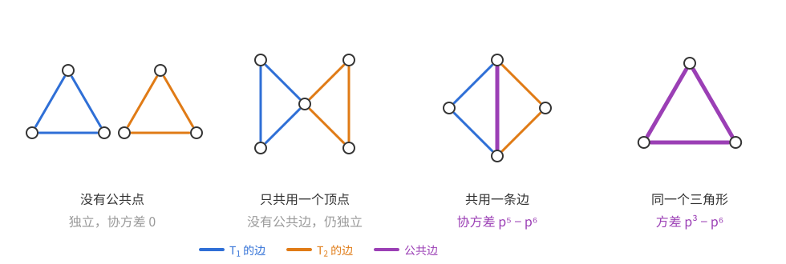
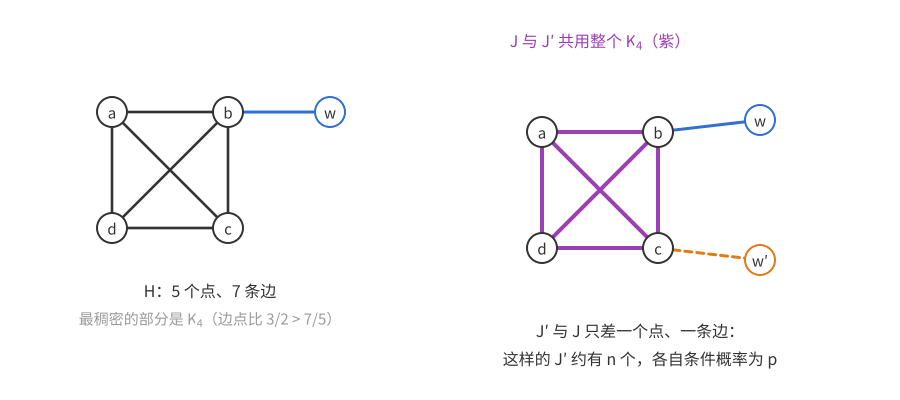
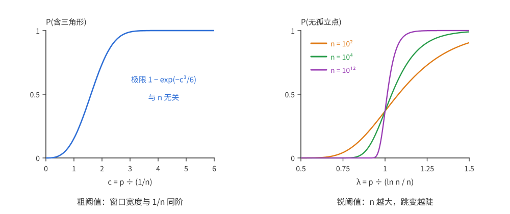
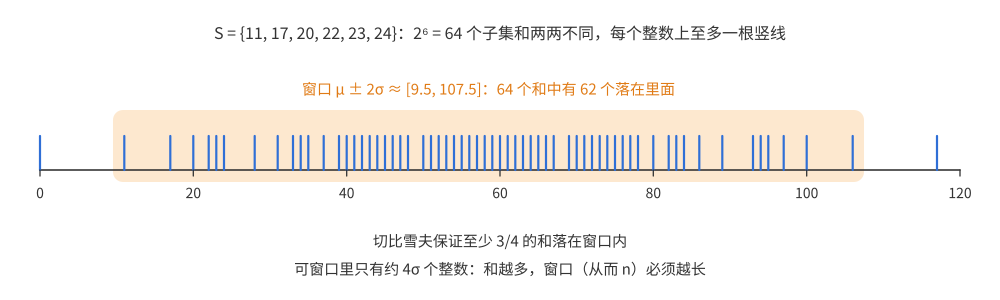
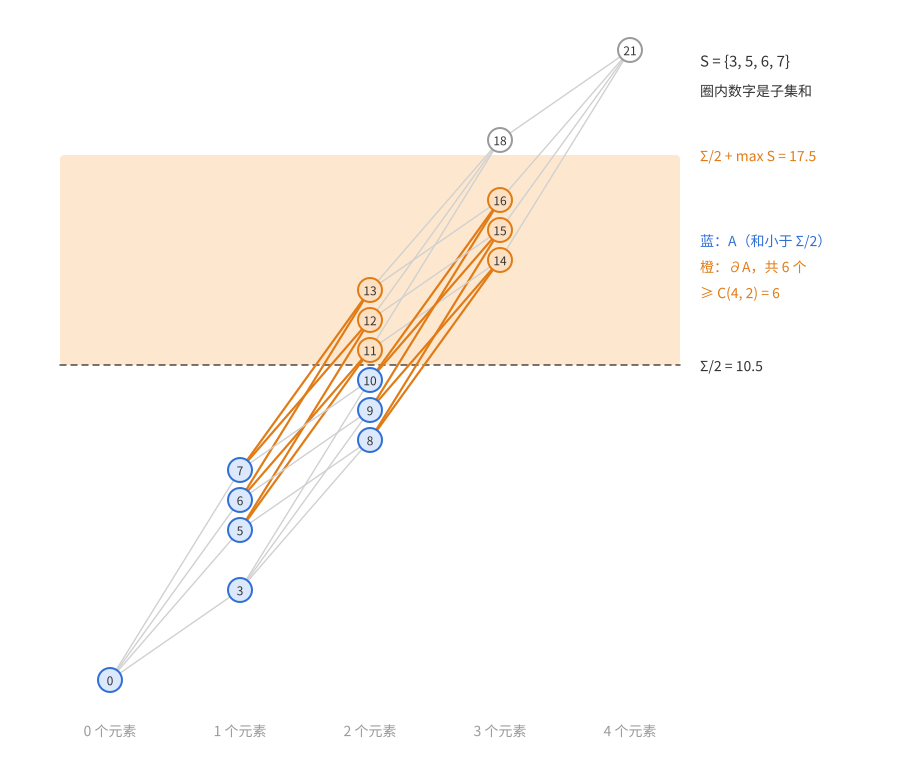
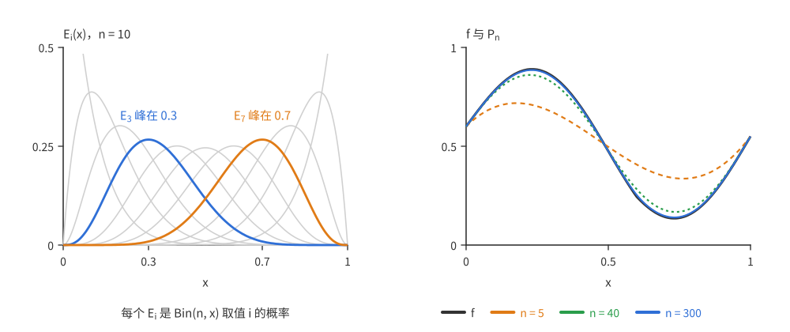
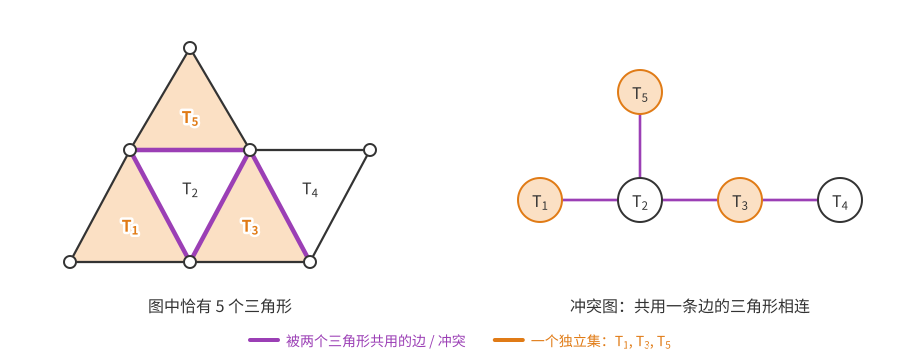
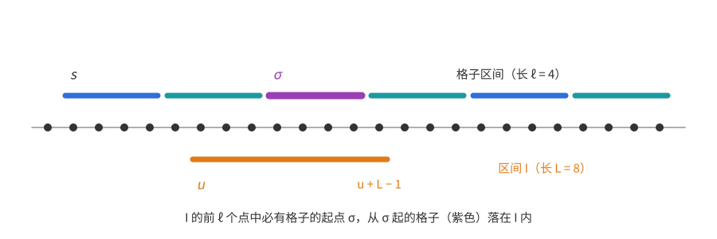
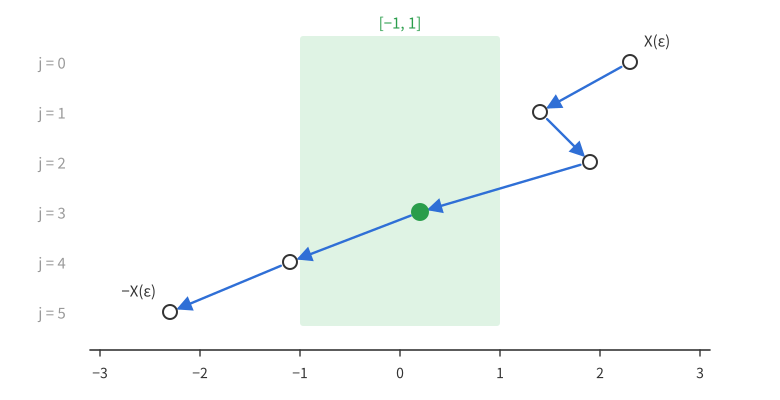

# 概率方法（四）：二阶矩方法

上一篇：[第 3 章 删除法](概率方法03——删除法.md)　下一篇：[第 5 章 Chernoff 界](<概率方法05——Chernoff 界.md>)

前三章的论证都从期望出发：$\mathbb E X\ge a$，所以某个结果使 $X\ge a$。这只说明**存在**一个好结果。很多问题关心的是**典型**结果：随机图**几乎总是**含三角形吗？随机图的团数**通常**是多少？一个随机整数**一般**有几个素因子？回答这类问题，要说明随机变量集中在期望附近，而期望本身做不到这一点——$X$ 可能几乎总是 0，只在极小概率下取一个巨大的值。

本章的工具是**二阶矩方法**：用方差控制随机变量偏离期望的程度，主要手段是 Chebyshev 不等式。它给出的尾概率只按多项式速度衰减，比第 5 章起的指数型集中不等式弱得多，但要求很少：只需要知道**两两**之间的相关性，不需要独立性。这使它成为处理“计数一类子结构”时最顺手的工具。本章用它确定随机图含固定子图的阈值，并顺带讨论阈值的一般理论；然后求随机图的团数，证明 Hardy–Ramanujan 关于素因子个数的定理，改进子集和互不相同问题的下界，最后给出 Weierstrass 逼近定理的概率证明。

**本章读法。**

- 首读主线：4.1、4.2 节的[Chebyshev 不等式](#方差与-chebyshev-不等式)与推论 4.3、4.4，[只算相关对的方差估计](#依赖稀疏时的方差估计)（引理 4.6），以及[最稠密子图决定阈值](#最大边点比)（引理 4.8、定理 4.9）。4.3 节中，[阈值的定义](#单调性质与阈值的定义)和[阈值的存在性](#阈值的存在性)（定理 4.10–4.12）是基础；[团数](#44-随机图的团数)（定理 4.16、4.17）和 Hardy–Ramanujan 定理（定理 4.18）是二阶矩方法的两个标准应用，首读应该看；定理 4.23 和 4.7 节都很短，可以当作 Chebyshev 不等式的练习。
- 可以二读：[锐阈值与粗阈值](#锐阈值与粗阈值)一小节（除定义外多是研究背景）；Erdős–Kac 定理的证明；[用等周不等式改进常数](#用等周不等式得到最好的常数)。
- 与其他章的联系：第 5 章拿 Chebyshev 不等式作比较，并用定理 4.16(a) 的团数上界；第 7 章沿用 4.3 节的单调性质；第 8 章的 Janson 不等式从引理 4.6 中的 $\Delta^*$ 出发，还会用到引理 4.8、定理 4.16 证明中的估计 (I)(II) 以及习题 3、11；第 9 章再次用到 4.4 节团数的计算。

## 4.1 随机图里有没有三角形

**Erdős–Rényi 随机图** $G(n,p)$：$n$ 个顶点，每对顶点独立地以概率 $p$ 连边。$p=p_n$ 可以随 $n$ 变化。

**问题**　$p$ 多大时，$G(n,p)$ 以 $1-o(1)$ 的概率含有三角形？

以 $1-o(1)$ 的概率成立，简称**以高概率**（whp）成立；有的文献也写作 a.a.s.（asymptotically almost surely）。

### 一阶矩：三角形太少的一侧

设 $X$ 为 $G(n,p)$ 中三角形的个数。由期望的线性性，
$$\mathbb E X=\binom n3p^3\asymp n^3p^3.$$

**命题 4.1**　若 $np\to0$，则 $G(n,p)$ 以高概率不含三角形。

*证明*　$X$ 取非负整数值，由 Markov 不等式（[第 3 章定理 3.5](概率方法03——删除法.md#33-markov-不等式)） $\mathbb P(X\ge1)\le\mathbb E X\asymp(np)^3=o(1)$。$\square$

这种“期望趋于 0，所以以高概率不存在”的论证叫**一阶矩方法**。

反方向呢？若 $np\to\infty$，则 $\mathbb E X\to\infty$，但这还不能推出 $\mathbb P(X\ge1)\to1$。例如令 $X$ 以概率 $1-\frac1n$ 取 0、以概率 $\frac1n$ 取 $n^2$，则 $\mathbb E X\approx n\to\infty$，而 $X$ 以高概率为 0。期望大，可能只是因为一个极小概率的事件贡献了巨大的值。

要排除这种情况，就要证明 $X$ **集中**在期望附近——偏离期望太远的概率很小。本书后面各章会介绍许多证明集中性的方法，本章的方法最简单、最容易执行、对随机变量的要求最少，代价是得到的集中性相对较弱（但常常已经够用）：

> **二阶矩方法**：通过估计方差，证明随机变量集中在期望附近。

### 方差与 Chebyshev 不等式

**定义**　随机变量 $X$ 的**方差**与两个（定义在同一概率空间上的）随机变量 $X,Y$ 的**协方差**分别为
$$\operatorname{Var}X=\mathbb E\big[(X-\mathbb EX)^2\big]=\mathbb E[X^2]-(\mathbb EX)^2,$$
$$\operatorname{Cov}[X,Y]=\mathbb E\big[(X-\mathbb EX)(Y-\mathbb EY)\big]=\mathbb E[XY]-\mathbb E[X]\,\mathbb E[Y].$$

第二个等号只需展开：$\mathbb E[(X-\mathbb EX)(Y-\mathbb EY)]=\mathbb E[XY]-\mathbb EX\,\mathbb EY-\mathbb EX\,\mathbb EY+\mathbb EX\,\mathbb EY$，取 $Y=X$ 即得方差的公式。习惯上用 $\mu$ 记均值，$\sigma^2$ 记方差，$\sigma\ge0$ 称为**标准差**。

**定理 4.2（Chebyshev 不等式）**　设 $X$ 的均值为 $\mu$、方差为 $\sigma^2$，则对任意 $t>0$，
$$\mathbb P(|X-\mu|\ge t)\le\frac{\sigma^2}{t^2}.$$
特别地，当 $\sigma>0$ 时取 $t=\lambda\sigma$，得 $\mathbb P(|X-\mu|\ge\lambda\sigma)\le1/\lambda^2$（$\lambda>0$）。

*证明*　对非负随机变量 $(X-\mu)^2$ 用 Markov 不等式：
$$\mathbb P(|X-\mu|\ge t)=\mathbb P\big((X-\mu)^2\ge t^2\big)\le\frac{\mathbb E[(X-\mu)^2]}{t^2}=\frac{\sigma^2}{t^2}.\qquad\square$$

“以标准差为单位”的写法要求 $\sigma>0$：若 $X\equiv1$，则 $\sigma=0$，$\mathbb P(|X-\mu|\ge\lambda\sigma)=\mathbb P(0\ge0)=1$，大于 $1/\lambda^2$（$\lambda>1$ 时）。以 $t$ 为参数的写法没有这个例外，下面都用它。

偏离均值超过给定阈值的概率的上界叫做**尾部界**：$\mathbb P(X\ge\mu+a)$ 是上尾，$\mathbb P(X\le\mu-a)$ 是下尾。Chebyshev 给出的尾部界按偏离量的平方衰减；在独立性等更强的假设下，后面会得到指数衰减的界（[第 5 章](<概率方法05——Chernoff 界.md>)）。

我们最常需要的是 $X$ 取 0 的概率的上界，即“不存在”的概率：

**推论 4.3**　对任意随机变量 $X$（$\mathbb EX\neq0$），
$$\mathbb P(X=0)\le\frac{\operatorname{Var}X}{(\mathbb EX)^2}.$$

*证明*　记 $\mu=\mathbb EX$。$X=0$ 意味着 $|X-\mu|=|\mu|$，由 Chebyshev（取 $t=|\mu|>0$），$\mathbb P(X=0)\le\mathbb P(|X-\mu|\ge|\mu|)\le\operatorname{Var}X/\mu^2$。$\square$

（习题 1 给出一个稍强的版本：对非负的 $X$，分母可以换成 $\mathbb E[X^2]$。）

**推论 4.4**　若 $\mathbb EX>0$ 且 $\operatorname{Var}X=o\big((\mathbb EX)^2\big)$，则以高概率 $X>0$，且 $X\sim\mathbb EX$。

*证明*　对任意固定的 $\delta>0$，由 Chebyshev，$\mathbb P(|X-\mathbb EX|\ge\delta\,\mathbb EX)\le\frac{\operatorname{Var}X}{\delta^2(\mathbb EX)^2}\to0$，这就是 $X\sim\mathbb EX$。取 $\delta=\frac12$ 即得以高概率 $X>\frac12\mathbb EX>0$。（推论 4.3 只排除 $X=0$；这里没有假设 $X\ge0$，负值要这样排除。）$\square$

**关于渐近陈述。** 推论 4.4 说的其实不是一个随机变量，而是一列随机变量 $X_n$：若 $\mathbb EX_n>0$ 且 $\operatorname{Var}X_n=o\big((\mathbb EX_n)^2\big)$，则 $\mathbb P(X_n>0)\to1$，且对每个固定的 $\delta>0$，$\mathbb P(|X_n-\mathbb EX_n|>\delta\,\mathbb EX_n)\to0$。本章所有“以高概率”“$\sim$”都按这种方式理解。

### 怎样算方差

方差是协方差的特例：$\operatorname{Var}X=\operatorname{Cov}[X,X]$。协方差是**双线性**的：对任意随机变量 $X_i,Y_j$ 和常数 $a_i,b_j$（不需要任何独立性假设），
$$\operatorname{Cov}\Big[\sum_ia_iX_i,\sum_jb_jY_j\Big]=\sum_{i,j}a_ib_j\operatorname{Cov}[X_i,Y_j].$$
组合中的 $X$ 通常是某个随机集合的大小，可以写成示性变量之和 $X=X_1+\cdots+X_m$，于是
$$\operatorname{Var}X=\sum_{i,j=1}^m\operatorname{Cov}[X_i,X_j]=\sum_{i=1}^m\operatorname{Var}X_i+2\sum_{i<j}\operatorname{Cov}[X_i,X_j].$$
若 $X_i,X_j$ 独立，则 $\operatorname{Cov}[X_i,X_j]=0$。所以求和时**只需考虑相关的那些对** $(i,j)$——这就是二阶矩方法在组合中好用的原因：相关的对通常很少，而且结构清楚。

**例：独立 Bernoulli 变量之和。** 设 $X=X_1+\cdots+X_n$，$X_i$ 独立，$\mathbb P(X_i=1)=p$，$\mathbb P(X_i=0)=1-p$。则 $\mu=np$；$\operatorname{Var}X_i=p-p^2$，$i\ne j$ 时协方差为 0，所以 $\sigma^2=np(1-p)$。若 $np\to\infty$，则 $\sigma\le\sqrt{np}=o(\mu)$，从而 $X=\mu+o(\mu)$ 以高概率成立。注意这个计算只用到 $X_i$ **两两不相关**，比相互独立弱得多。这里“以高概率”背后的尾概率按偏离量的多项式速度衰减；在真正独立时，第 5 章的 Chernoff 界会给出指数衰减。

### 三角形的阈值

**定理 4.5**　若 $np\to\infty$，则 $G(n,p)$ 以高概率含有三角形。

**思路。** 按推论 4.4，要证明 $\operatorname{Var}X=o\big((\mathbb EX)^2\big)$，其中 $(\mathbb EX)^2\asymp n^6p^6$。把 $X$ 写成 $\binom n3$ 个示性变量之和，方差就是所有三角形对 $(T_1,T_2)$ 的协方差之和。关键的观察：两个三角形是否相关，只取决于它们是否**共用边**——只共用一个顶点的两个三角形涉及的边互不相同，所以独立。

上图中蓝、橙分别是两个三角形 $T_1,T_2$ 的边，紫色是公共边。前两种重叠协方差为 0，只有后两种需要计算。

*证明*　顶点记为 $[n]$。记 $X_{ij}$ 为边 $ij$ 的示性变量，对 3 元集 $T=\{i,j,k\}$ 记 $X_T=X_{ij}X_{ik}X_{jk}$，则 $X=\sum_TX_T$。对两个 3 元集 $T_1,T_2$，把它们看成三角形，记 $e_F$ 为图 $F$ 的边数（下文 $v_F$ 为顶点数），
$$\operatorname{Cov}[X_{T_1},X_{T_2}]=p^{e_{T_1\cup T_2}}-p^{e_{T_1}+e_{T_2}}=\begin{cases}0,&|T_1\cap T_2|\le1,\\ p^5-p^6,&|T_1\cap T_2|=2,\\ p^3-p^6,&T_1=T_2.\end{cases}$$
共用恰好一条边的有序对 $(T_1,T_2)$ 有 $\binom n3\cdot3(n-3)=O(n^4)$ 个，所以
$$\operatorname{Var}X=O(n^3)(p^3-p^6)+O(n^4)(p^5-p^6)\lesssim n^3p^3+n^4p^5.$$
与 $(\mathbb EX)^2\asymp n^6p^6$ 相比：$\frac{n^3p^3}{n^6p^6}=\frac1{(np)^3}\to0$，$\frac{n^4p^5}{n^6p^6}=\frac1{n^2p}\to0$（因为 $np\to\infty$）。由推论 4.4，以高概率 $X>0$。$\square$

两种需要计算的重叠对应两个要求：$T_1=T_2$ 的项要求期望个数 $n^3p^3\to\infty$；共用一条边的项要求：固定一个出现了的三角形后，与它共边的三角形的条件期望个数 $3(n-3)p^2$，远小于三角形的总期望个数 $\binom n3p^3$，即 $n^2p\to\infty$。4.2 节会把这种逐项比较系统化。

**小结。** 对 $p=p_n$，$n\to\infty$：
$$\mathbb P\big(G(n,p)\text{ 含三角形}\big)\to\begin{cases}0,&np\to0,\\1,&np\to\infty.\end{cases}$$
我们说 $1/n$ 是“含三角形”的**阈值**：$p$ 的增长阶高于它（$p\gg1/n$）时性质以高概率成立，低于它（$p\ll1/n$）时以高概率不成立。阈值的定义不计常数因子（说 $2/n$ 是阈值也对）。确定各种性质的阈值是概率组合的中心课题之一，4.3 节会更系统地讨论。

关于含三角形的概率，还能知道更多：

- **Poisson 极限。** 若 $np\to c\in(0,\infty)$，三角形个数依分布收敛到均值为 $c^3/6$ 的 Poisson 分布（习题 6），即对每个非负整数 $t$，三角形恰有 $t$ 个的概率趋于该 Poisson 分布取 $t$ 的概率。方法是逐阶比较矩的**矩方法**，4.5 节的定理 4.21 及其后的说明会正式叙述。
- **渐近正态性。** 若 $np\to\infty$ 且 $n^2(1-p)\to\infty$（$p$ 不能太接近 1），则 $(X-\mathbb EX)/\sqrt{\operatorname{Var}X}$ 依分布收敛到标准正态分布 $N(0,1)$（Ruciński 1988）。第二个条件不能省：取 $p=1-n^{-3}$，则以 $1-O(1/n)$ 的概率一条边都不缺，$X=\binom n3$；而缺一条边就少 $n-2$ 个三角形，算得 $\binom n3-\mathbb EX\approx\frac12$、$\operatorname{Var}X\approx\frac n2$，所以标准化后的值以高概率约为 $1/\sqrt{2n}\to0$，极限是常数 0。习题 7 会用**投影法**（证明 $X$ 与归一化边数之差的方差可以忽略）做 $p=\frac12$ 的情形。
- **更好的尾部界。** 后面会用鞅方法、Azuma–Hoeffding 不等式（[第 9 章](概率方法09——测度集中.md)）和 Janson 不等式（[第 8 章](<概率方法08——Janson 不等式.md>)）得到子图个数更好的尾部界。

## 4.2 固定子图的阈值

**问题**　固定一个图 $H$，$G(n,p)$ 含 $H$（作为子图）的阈值是什么？

也就是要找序列 $q_n$，使得

- **0-陈述**：若 $p_n/q_n\to0$，则 $G(n,p_n)$ 含 $H$ 的概率为 $o(1)$；
- **1-陈述**：若 $p_n/q_n\to\infty$，则 $G(n,p_n)$ 含 $H$ 的概率为 $1-o(1)$。

（阈值为什么一定存在，事先并不清楚；4.3 节会证明单调性质总有阈值。）

### 依赖稀疏时的方差估计

三角形的计算可以整理成一个通用框架。

**设定**　$X=X_1+\cdots+X_m$，$X_i$ 是事件 $A_i$ 的示性变量。若 $i\ne j$ 且 $A_i,A_j$ 不独立，记 $i\sim j$。令
$$\Delta^*=\max_i\sum_{j:\,j\sim i}\mathbb P(A_j\mid A_i).$$

几点说明：

- 很多应用中事件之间有对称性，$\sum_{j\sim i}\mathbb P(A_j\mid A_i)$ 与 $i$ 无关，取最大值只是形式上的。
- 这里的“依赖”只指**两两**不独立。第 6 章的局部引理需要更强的依赖图概念（一个事件与它的非邻居们组成的整体独立），见[第 6 章](<概率方法06——Lovász 局部引理.md>)。
- 这个框架适合“相关的对很少、但每对相关性可能很强”的情形。若有大量弱相关（例如 4.5 节中被不同素数整除的事件），就不适用，需要直接估计协方差。

由于 $\operatorname{Cov}[X_i,X_j]\le\mathbb E[X_iX_j]=\mathbb P(A_iA_j)=\mathbb P(A_i)\mathbb P(A_j\mid A_i)$（$A_iA_j$ 表示两者同时发生），$\operatorname{Var}X_i\le\mathbb EX_i=\mathbb P(A_i)$，且 $i\ne j$、$i\not\sim j$ 时协方差为 0，
$$\operatorname{Var}X=\sum_{i,j}\operatorname{Cov}[X_i,X_j]\le\sum_i\mathbb P(A_i)+\sum_i\mathbb P(A_i)\sum_{j:\,j\sim i}\mathbb P(A_j\mid A_i)\le\mathbb EX+(\mathbb EX)\Delta^*.$$
于是 $\operatorname{Var}X/(\mathbb EX)^2\le\frac1{\mathbb EX}+\frac{\Delta^*}{\mathbb EX}$，结合推论 4.4：

**引理 4.6**　在上述设定下，若 $\mathbb EX\to\infty$ 且 $\Delta^*=o(\mathbb EX)$，则以高概率 $X>0$ 且 $X\sim\mathbb EX$。

两个条件的含义很直观：$\mathbb EX\to\infty$ 是期望个数足够多；$\Delta^*=o(\mathbb EX)$ 是说，**已知一个对象出现后**，与它相关的对象的条件期望个数，仍远少于对象的总期望个数——一个对象的出现不会显著“带动”其他对象。

### $K_4$ 的阈值

**定理 4.7**　含 $K_4$ 的阈值是 $n^{-2/3}$。

*证明*　设 $X$ 为 $G(n,p)$ 中 $K_4$ 的个数，$\mathbb EX=\binom n4p^6\asymp n^4p^6$。

若 $p\ll n^{-2/3}$，则 $\mathbb EX=o(1)$，由 Markov 不等式以高概率 $X=0$。

若 $p\gg n^{-2/3}$，则 $\mathbb EX\to\infty$。对每个 4 元点集 $S$，记 $A_S$ 为“$S$ 是团”。$A_S$ 与 $A_{S'}$ 相关当且仅当它们有公共边，即 $|S\cap S'|\ge2$（且 $S'\ne S$）。

- 与 $S$ 恰共 2 个点的 $S'$ 有 $\binom42\binom{n-4}2=O(n^2)$ 个，对每个这样的 $S'$，$\mathbb P(A_{S'}\mid A_S)=p^5$（$S'$ 的 6 条边中只有 1 条已在 $S$ 中）；
- 与 $S$ 恰共 3 个点的 $S'$ 有 $4(n-4)=O(n)$ 个，$\mathbb P(A_{S'}\mid A_S)=p^3$。

所以
$$\Delta^*\lesssim n^2p^5+np^3.$$
与 $\mathbb EX\asymp n^4p^6$ 相比：$\frac{n^2p^5}{n^4p^6}=\frac1{n^2p}\to0$，$\frac{np^3}{n^4p^6}=\frac1{(np)^3}\to0$（$p\gg n^{-2/3}\gg n^{-1}$）。由引理 4.6，以高概率 $X>0$。$\square$

### 一阶矩并不总能定出阈值

对 $K_3$ 和 $K_4$，只要 $\mathbb EX\to\infty$ 就以高概率有 $X>0$。这总成立吗？

**例**　设 $H$ 是 $K_4$ 加一条悬挂边（共 5 个点、7 条边），$X_H$ 是它的拷贝个数，$\mathbb EX_H\asymp n^5p^7$。一阶矩方法给出：$p\ll n^{-5/7}$ 时以高概率 $X_H=0$。但当
$$n^{-5/7}\ll p\ll n^{-2/3}$$
时，虽然 $\mathbb EX_H\to\infty$，由定理 4.7 却以高概率连 $K_4$ 都没有，自然也没有 $H$。另一方面，$p\gg n^{-2/3}$ 时以高概率有 $K_4$，而给它接一条悬挂边几乎没有成本（下面的定理 4.9 会证明此时以高概率含 $H$）。所以 $H$ 的阈值是 $n^{-2/3}$，而不是一阶矩预测的 $n^{-5/7}$。

二阶矩方法在哪里失效？看上图右侧：两份拷贝 $J,J'$ 可以共用整个 $K_4$（紫色），只在悬挂边上不同。固定 $J$ 后，这样的 $J'$ 有 $\Theta(n)$ 个，每个的条件概率是 $p$（只需再出现一条边），所以 $\Delta^*\gtrsim np$。而当 $p\ll n^{-2/3}$ 时，$np\gg n^5p^7\asymp\mathbb EX_H$（等价于 $n^4p^6\to0$），引理 4.6 的条件不成立。

直观上，$H$ 的出现完全被它**最稠密的部分** $K_4$ 卡住：$H$ 的拷贝即使期望很多，也都“挤”在极少数的 $K_4$ 上——一旦某个 $K_4$ 出现，它就带出约 $np$ 份 $H$；没有 $K_4$，就一份也没有。期望大是因为“少见的 $K_4$ × 每个 $K_4$ 带出的大量 $H$”，正是 4.1 节警告的那种情形。

### 最大边点比

**定义**　图 $H$ 的**边点比** $\rho(H)=e_H/v_H$（即平均度的一半）；$H$ 的子图中最大的边点比记为
$$m(H)=\max_{H'\subseteq H}\rho(H').$$

**例**　对上面的 $H$，$\rho(H)=7/5$，而 $\rho(K_4)=3/2>7/5$。验证 $m(H)=3/2$：设子图 $F$ 有 $v$ 个点。若 $F$ 不含悬挂点 $w$，则 $F\subseteq K_4$，$e_F/v\le\binom v2/v=\frac{v-1}2\le\frac32$。若 $F$ 含 $w$，则 $e_F\le\binom{v-1}2+1$，$v\le5$，逐一检查 $v=2,3,4,5$ 得比值依次至多 $\frac12,\frac23,1,\frac75$。所以最大值 $\frac32$ 在 $K_4$ 取到。

（Goldberg（1984）给出了用网络流在多项式时间内计算 $m(H)$ 的算法。）

阈值由“期望个数是否趋于无穷”决定，但应该看的是**最稠密子图** $H'$ 的期望个数 $n^{v_{H'}}p^{e_{H'}}=(np^{\rho(H')})^{v_{H'}}$，它在 $p=n^{-1/\rho(H')}$ 处由 0 变为 $\infty$。各子图中这个临界值最大的一个说了算，也就是 $\rho$ 最大的那个。

为什么是“最稠密的子图”？回到悬挂边的例子，把那里的计算一般化。固定一份拷贝 $J$，与它恰好在子图 $F$ 上重叠的 $J'$ 约有 $n^{v_H-v_F}$ 个（$F$ 以外的顶点可以随便选），每个的条件概率是 $p^{e_H-e_F}$（$J'$ 只缺 $F$ 以外的边）。这类 $J'$ 对 $\Delta^*$ 的贡献约为 $n^{v_H-v_F}p^{e_H-e_F}$，与 $\mathbb EX_H\asymp n^{v_H}p^{e_H}$ 相比，
$$\frac{n^{v_H-v_F}p^{e_H-e_F}}{n^{v_H}p^{e_H}}=\frac1{n^{v_F}p^{e_F}}.$$
也就是说，**重叠方式 $F$ 的危害，恰好等于 $F$ 的期望拷贝数的倒数**。$F=K_4$ 时这个数是 $n^4p^6$，它有界时方差失控，与上面的分析一致；$F=H$ 对应 $J'=J$，给出方差中的 $1/\mathbb EX_H$ 项。要让所有重叠方式都无害，就要所有子图 $F$ 的期望拷贝数都趋于无穷，于是该看的是其中最小的一个。

下面把这个计算写成严格的不等式。设 $H$ 至少有一条边，记
$$\Phi_H=\Phi_H(n,p)=\min\big\{\,n^{v_F}p^{e_F}:\ F\subseteq H,\ e_F\ge1\,\big\},$$
它是 $H$ 的所有（至少有一条边的）子图中，期望拷贝数的最小量级。

**引理 4.8**　设 $X_H$ 为 $G(n,p)$ 中 $H$ 的拷贝个数（$n\ge2v_H$）。存在只依赖于 $H$ 的常数 $C_H$，使得
$$\frac{\operatorname{Var}X_H}{(\mathbb EX_H)^2}\le\frac{C_H}{\Phi_H(n,p)}.$$

有了上面的计算，证明只剩一件事：核对计数中出现的常数只依赖于 $H$，与 $n,p$ 无关。

*证明*　*第一步：$\mathbb EX_H$ 的下界。* $K_n$ 中 $H$ 的拷贝（与 $H$ 同构的子图）共 $(n)_{v_H}/\operatorname{aut}(H)$ 个，其中 $(n)_v=n(n-1)\cdots(n-v+1)$，$\operatorname{aut}(H)$ 是 $H$ 的自同构个数。由 $n\ge2v_H$ 得 $(n)_{v_H}\ge(n/2)^{v_H}$，所以 $\mathbb EX_H=\frac{(n)_{v_H}}{\operatorname{aut}(H)}p^{e_H}\ge c_Hn^{v_H}p^{e_H}$。

*第二步：估计 $\Delta^*$。* 对每个拷贝 $J$，记 $A_J$ 为“$J$ 的边全部出现”。$A_J$ 与 $A_{J'}$ 相关当且仅当 $J,J'$ 有公共边。固定 $J$，把与之相关的 $J'$ 按**公共边构成的子图** $F=J\cap J'$（顶点为公共边的端点）分类：$F$ 同构于 $H$ 的某个至少有一条边的子图，而 $J'$ 不在 $J$ 中的边恰有 $e_H-e_F$ 条，所以 $\mathbb P(A_{J'}\mid A_J)=p^{e_H-e_F}$。

再数每一类有多少个 $J'$。给定 $F$ 作为 $J$ 的子图，$J'$ 由“$H$ 的哪个子图映到 $F$、怎样映”（至多依赖于 $H$ 的有限种）以及其余 $v_H-v_F$ 个顶点的像（至多 $n^{v_H-v_F}$ 种）决定。$J$ 的子图 $F$ 至多 $2^{e_H}$ 个。所以
$$\Delta^*\le C'_H\max_{F}n^{v_H-v_F}p^{e_H-e_F},\qquad\frac{\Delta^*}{\mathbb EX_H}\le\frac{C'_H}{c_H}\max_F\frac1{n^{v_F}p^{e_F}}=\frac{C'_H}{c_H\,\Phi_H}.$$
另外 $\frac1{\mathbb EX_H}\le\frac1{c_Hn^{v_H}p^{e_H}}\le\frac1{c_H\Phi_H}$（取 $F=H$）。由 $\operatorname{Var}X\le\mathbb EX+(\mathbb EX)\Delta^*$ 即得。$\square$

引理中的常数与 $n,p$ 无关，所以它是一个非渐近的估计；习题 11 会用到这一点。

**定理 4.9（Bollobás 1981）**　设 $H$ 至少有一条边，则 $n^{-1/m(H)}$ 是 $G(n,p)$ 含 $H$ 的阈值。并且当 $p\gg n^{-1/m(H)}$ 时，以高概率
$$X_H\sim\mathbb EX_H=\frac{(n)_{v_H}}{\operatorname{aut}(H)}p^{e_H}\sim\frac{n^{v_H}p^{e_H}}{\operatorname{aut}(H)}.$$

*证明*　取 $H'\subseteq H$ 使 $\rho(H')=m(H)$。

0-陈述：若 $p\ll n^{-1/m(H)}$，则 $\mathbb EX_{H'}\asymp n^{v_{H'}}p^{e_{H'}}=\big(np^{m(H)}\big)^{v_{H'}}\to0$，于是以高概率 $X_{H'}=0$，从而 $X_H=0$。

1-陈述：若 $p\gg n^{-1/m(H)}$，即 $np^{m(H)}\to\infty$。对 $H$ 的任一有边的子图 $F$，$e_F/v_F\le m(H)$，而 $p\le1$，所以
$$n^{v_F}p^{e_F}=\big(np^{e_F/v_F}\big)^{v_F}\ge\big(np^{m(H)}\big)^{v_F}\to\infty.$$
$H$ 的子图只有有限个，所以 $\Phi_H\to\infty$。由引理 4.8，$\operatorname{Var}X_H=o\big((\mathbb EX_H)^2\big)$，再由推论 4.4 得结论。$\square$

回头看 $K_4$ 加悬挂边：$F=K_4$ 时 $n^4p^6$ 正是 $\Phi_H$ 中的瓶颈项，与前面的分析一致。这提示一个一般原则：**二阶矩方法能否成功，取决于每个子结构的期望个数是否都趋于无穷。** 引理 4.8 证明的是“都趋于无穷 ⇒ $X_H$ 集中”这一方向。反过来，直观上若某个子图 $F$ 的期望个数有界，$H$ 的拷贝就会成团地挤在少数 $F$ 上，$X_H$ 不再集中；这一方向本章不证（$p$ 不接近 1 时它成立，[第 8 章](<概率方法08——Janson 不等式.md>)习题 5 会把它定量化）。

## 4.3 阈值

这一节暂时离开二阶矩方法，更一般地讨论阈值：先对任意单调性质定义阈值，证明阈值总存在，再讨论阈值的“锐”与“粗”。对任一性质，自然要问两个问题：

1. 阈值在哪里？
2. 过渡是否陡峭？更确切地说，过渡窗口有多宽？

许多基本图性质的阈值已经清楚，但也有很多仍然困难。而且出人意料的是，有时可以在**不知道阈值位置**的情况下证明过渡是陡峭的。

（4.4 节以后的正文不依赖本节。本节前半的定义、阈值存在性和几个例子是基础；“锐阈值与粗阈值”以后多是背景介绍，第一次读可以略读。）

### 单调性质与阈值的定义

设 $\Omega$ 是有限集（基础集），$\Omega_p$ 表示 $\Omega$ 的随机子集：每个元素独立地以概率 $p$ 入选。$\Omega$ 的子集上的一个性质称为**递增**（或**单调**）的，若满足它的集合的每个超集也满足它。若 $\Omega$ 的所有子集都满足、或都不满足某性质，称它是**平凡**的；以下只考虑非平凡的单调性质。非平凡的递增性质一定被 $\Omega$ 满足、不被 $\varnothing$ 满足。

**图性质**是只依赖于图的同构类的性质。取 $\Omega=\binom{[n]}2$，$G(n,p)$ 就是 $\Omega_p$。以下都是递增的图性质：

- 含某个给定的子图；
- 连通；
- 有完美匹配；
- 有哈密顿圈；
- 不可 3 染色。

族 $\mathcal F\subseteq\mathcal P(\Omega)$ 称为**上集**，若 $A\in\mathcal F$、$A\subseteq B$ 蕴含 $B\in\mathcal F$。递增性质就是属于某个上集，两种说法通用。

**定义（阈值）**　设 $\Omega=\Omega(n)$ 是有限集，$\mathcal F=\mathcal F(n)$ 是 $\Omega$ 的子集上的单调性质。称 $q_n$ 是 $\mathcal F$ 的**阈值**，若
$$\mathbb P(\Omega_{p_n}\in\mathcal F)\to\begin{cases}0,&p_n/q_n\to0,\\1,&p_n/q_n\to\infty.\end{cases}$$
（为了方便，约定 $t>1$ 时 $\Omega_t=\Omega$。）

递减性质的阈值可以类似定义（把 0、1 对调），或者看它的补性质。**非单调**性质的例子：含某个**导出**子图 $H$。有些（但不是全部）非单调性质也有阈值，这里不讨论。

**阈值在常数倍意义下唯一。** 设 $r_n,r'_n$ 都是同一性质的阈值，则 $r_n\asymp r'_n$。

*想法*：若 $r'_n\gg r_n$，取二者的几何平均 $p_n=\sqrt{r_nr'_n}$。它相对 $r_n$ 是无穷大，相对 $r'_n$ 是无穷小，于是满足性质的概率既要趋于 1 又要趋于 0，矛盾。技术上的小麻烦是 $r'_n/r_n$ 可能只是无界、而不趋于无穷，所以只在一个子列 $N'$ 上这样取；子列以外，两个数列随便补成满足阈值条件的数即可（下面取 $nr_n$ 和 $r'_n/n$）。

*证明*：若 $r'_n/r_n$ 无界，取子列 $N'$ 使 $r'_n/r_n\to\infty$（$n\in N'$）。令
$$p_n=\sqrt{r_nr'_n}\ (n\in N'),\quad p_n=nr_n\ (n\notin N');\qquad p'_n=\sqrt{r_nr'_n}\ (n\in N'),\quad p'_n=r'_n/n\ (n\notin N').$$
则 $p_n/r_n\to\infty$，故 $\mathbb P(\Omega_{p_n}\in\mathcal F)\to1$；$p'_n/r'_n\to0$，故 $\mathbb P(\Omega_{p'_n}\in\mathcal F)\to0$。但在 $N'$ 上 $p_n=p'_n$，矛盾。同理 $r_n/r'_n$ 有界。所以可以说“**这个**阈值”。

### 阈值的存在性

**问题**　每个非平凡单调性质都有阈值吗？

一个性质怎样会没有阈值？比如，也许 $\mathbb P(\Omega_{1/n}\in\mathcal F)$ 与 $\mathbb P(\Omega_{(\log n)/n}\in\mathcal F)$ 对所有大的 $n$ 都在 $[\frac1{10},\frac9{10}]$ 之间——概率在一个跨度很大的区间里一直“不上不下”。下面证明这不会发生。先看一个更基本的事实。

**定理 4.10（满足概率的单调性）**　设 $\Omega$ 是有限集，$\mathcal F$ 是非平凡的单调性质，则 $p\mapsto\mathbb P(\Omega_p\in\mathcal F)$ 在 $[0,1]$ 上严格递增。

这件事直观上显然，但证明方法很有教益。两个证明都基于**耦合**：在同一个概率空间里同时造出 $\Omega_p$ 和 $\Omega_q$，使它们之间有包含关系。

*证明一（统一的随机数）*　设 $0\le p<q\le1$。对每个 $x\in\Omega$ 独立地取 $[0,1]$ 上的均匀随机数 $t_x$，令
$$A=\{x:t_x\le p\},\qquad B=\{x:t_x\le q\}.$$
则 $A$ 与 $\Omega_p$ 同分布，$B$ 与 $\Omega_q$ 同分布，且总有 $A\subseteq B$。由单调性，$A\in\mathcal F$ 蕴含 $B\in\mathcal F$，所以
$$\mathbb P(\Omega_p\in\mathcal F)=\mathbb P(A\in\mathcal F)\le\mathbb P(B\in\mathcal F)=\mathbb P(\Omega_q\in\mathcal F).$$
不等号严格：以正概率所有 $t_x\in(p,q]$，此时 $A=\varnothing\notin\mathcal F$，$B=\Omega\in\mathcal F$。$\square$

*证明二（两轮暴露）*　设 $0\le p<q\le1$，取 $p'$ 满足 $1-q=(1-p)(1-p')$，则 $p'\in(0,1]$。设 $A$ 与 $\Omega_p$ 同分布、$A'$ 与 $\Omega_{p'}$ 同分布、两者独立，则每个元素不在 $A\cup A'$ 中的概率为 $(1-p)(1-p')=1-q$，且各元素独立，所以 $A\cup A'$ 与 $\Omega_q$ 同分布。于是
$$\mathbb P(A\in\mathcal F)\le\mathbb P(A\cup A'\in\mathcal F)=\mathbb P(\Omega_q\in\mathcal F).$$
严格性：以正概率 $A=\varnothing$ 且 $A'=\Omega$。$\square$

证明二的想法——把随机集合分几轮独立地“暴露”出来——推广到多轮，就给出阈值存在性的一个漂亮证明（原始证明用的是 Kruskal–Katona 定理）。

**引理 4.11（多轮暴露）**　设 $\Omega$ 是有限集，$\mathcal F$ 是非平凡单调性质，$p\in[0,1]$，$m$ 是正整数，则
$$\mathbb P(\Omega_p\notin\mathcal F)\le\mathbb P(\Omega_{p/m}\notin\mathcal F)^m.$$

*证明*　取 $\Omega_{p/m}$ 的 $m$ 个独立拷贝，其并集记为 $Y$。由于 $\mathcal F$ 递增，若 $Y\notin\mathcal F$，则每个拷贝都不在 $\mathcal F$ 中，所以 $\mathbb P(Y\notin\mathcal F)\le\mathbb P(\Omega_{p/m}\notin\mathcal F)^m$。另一方面，$Y$ 与 $\Omega_q$ 同分布，$q=1-(1-p/m)^m\le p$（Bernoulli 不等式）。由定理 4.10，$\mathbb P(\Omega_p\notin\mathcal F)\le\mathbb P(\Omega_q\notin\mathcal F)=\mathbb P(Y\notin\mathcal F)$。合起来即得。$\square$

引理的意思是：把概率放大 $m$ 倍，“失败”的概率至少按 $m$ 次方缩小。这正是“不会长时间不上不下”的定量形式。

**定理 4.12（阈值的存在性：Bollobás–Thomason 1987）**　每一列非平凡单调性质都有阈值。

*证明*　分两步：先用引理 4.11 说明，把临界概率 $p_c$ 缩小到 $p_c/m$ 时性质几乎一定不成立，放大到 $mp_c$ 时几乎一定成立；再由单调性（定理 4.10）推出 $p_c$ 是阈值。

$p\mapsto\mathbb P(\Omega_p\in\mathcal F)$ 是 $p$ 的多项式，连续，并由定理 4.10 从 0 严格递增到 1，所以存在唯一的**临界概率** $p_c$ 使 $\mathbb P(\Omega_{p_c}\in\mathcal F)=\frac12$。只需证明：对任意 $\varepsilon>0$，存在不依赖于性质的 $m=m(\varepsilon)$，使
$$\mathbb P(\Omega_{p_c/m}\notin\mathcal F)\ge1-\varepsilon,\qquad\mathbb P(\Omega_{mp_c}\notin\mathcal F)\le\varepsilon.$$
对 $p=p_c$ 用引理 4.11：$\mathbb P(\Omega_{p_c/m}\notin\mathcal F)\ge\mathbb P(\Omega_{p_c}\notin\mathcal F)^{1/m}=2^{-1/m}\ge1-\varepsilon$，只要 $m\ge(\ln2)/\varepsilon$。若 $mp_c\le1$，对 $p=mp_c$ 用引理 4.11：$\mathbb P(\Omega_{mp_c}\notin\mathcal F)\le\mathbb P(\Omega_{p_c}\notin\mathcal F)^m=2^{-m}\le\varepsilon$，只要 $m\ge\log_2(1/\varepsilon)$；若 $mp_c>1$，按约定左边为 0。

现在若 $p_n/p_c\to0$，则对每个 $m$，$n$ 充分大时 $p_n\le p_c/m$，由定理 4.10，$\mathbb P(\Omega_{p_n}\in\mathcal F)\le\varepsilon$；由 $\varepsilon$ 任意，概率趋于 0。$p_n/p_c\to\infty$ 的情形同理。所以 $p_c=p_c(n)$ 是阈值。$\square$

证明还给出更多：概率从 $\varepsilon$ 升到 $1-\varepsilon$ 所需的 $p$ 的范围，总包含在 $[p_c/m,\,mp_c]$ 中，$m=O(1/\varepsilon)$ 与性质无关。也就是说，**过渡窗口的宽度至多是阈值的常数倍**。

（题外话：$\mathbb F_q^n$ 的随机子空间，即随机线性码，也有阈值理论。Bollobás–Thomason 定理的类比由 Rossman（2020）证明，用的是 Kruskal–Katona 的思路——多轮暴露在这里行不通，因为子空间不能写成独立小子空间的并。）

### 例子

下面主要研究单调图性质，即 $\Omega=\binom{[n]}2$，性质只依赖于图的同构类。

**例（含三角形）**　由 4.1 节和习题 6，
$$\mathbb P\big(G(n,p)\text{ 含三角形}\big)\to\begin{cases}0,&np\to0,\\1-e^{-c^3/6},&np\to c\in(0,\infty),\\1,&np\to\infty.\end{cases}$$
阈值由三角形的期望个数 $\Theta(n^3p^3)$ 决定：它趋于 0 时用一阶矩，趋于无穷时用二阶矩。$p=\Theta(1/n)$ 时三角形个数渐近于 Poisson 分布，含三角形的概率随 $c$ 连续地从 0 增到 1。所以要让概率从 $0.01$ 升到 $0.99$，$p$ 要经过一段宽 $\Theta(1/n)$ 的**过渡窗口**——与阈值本身同阶。这叫**粗**的过渡。

**例（含固定子图）**　由定理 4.9，阈值是 $n^{-1/m(H)}$。它不总由 $H$ 的期望个数决定，而由边点比最大的子图 $H'$ 的期望个数是趋于 0 还是无穷决定。与三角形一样，这是粗阈值。分析可以推广到“含 $H_1,\dots,H_k$ 之一”。

**说明：单调图性质都可以用子图包含来刻画。** 任一单调图性质都等价于“含族 $\mathcal H$ 中某个图作为子图”，$\mathcal H$ 可以随 $n$ 变化——取 $\mathcal H$ 为满足该性质的所有极小图即可。例如连通性对应 $\mathcal H=$ 全体生成树。当 $\mathcal H$ 中的图大小无界时，阈值问题变得有趣，有时非常困难。

Erdős 和 Rényi 1959 年开创随机图的论文中已经研究了下面两个阈值。

**例（无孤立点）**　设 $p=\frac{\log n+c_n}n$，则
$$\mathbb P\big(G(n,p)\text{ 无孤立点}\big)\to\begin{cases}0,&c_n\to-\infty,\\e^{-e^{-c}},&c_n\to c,\\1,&c_n\to\infty.\end{cases}$$
这正是习题 8：$c_n\to\pm\infty$ 的情形用二阶矩方法，$c_n\to c$ 时孤立点个数渐近于均值为 $e^{-c}$ 的 Poisson 分布。

这里阈值在 $(\log n)/n$，而过渡窗口只有 $\Theta(1/n)$ 宽，远小于阈值本身。特别地，对任意固定的 $\delta>0$，$p$ 从 $(1-\delta)\frac{\log n}n$ 增到 $(1+\delta)\frac{\log n}n$ 时，概率就从 $o(1)$ 变为 $1-o(1)$。这时说性质在 $(\log n)/n$ 处有**锐阈值**——此时首项常数是有意义的，与粗阈值不同。

**例（连通性）**　同样取 $p=\frac{\log n+c_n}n$，$G(n,p)$ 连通的概率有与上例**完全相同**的极限。实际上有更强的结论：从空图开始一条一条地随机加边，则以高概率，图恰好在最后一个孤立点消失的那一刻变得连通。这种结论叫**击中时间**（hitting time）结论。把“连通”换成“有完美匹配”（$n$ 为偶数），类似的结论也成立。

**例（随机超图的完美匹配：Shamir 问题）**　这个例子是研究背景，首读可跳过。设 $G^{(3)}(n,p)$ 是 $n$ 个顶点上的随机 3 一致超图，每个三元组独立地以概率 $p$ 成为边，$3\mid n$。完美匹配（$n/3$ 条两两不交、覆盖所有顶点的边）的阈值是什么？一个顶点孤立的概率是 $(1-p)^{\binom{n-1}2}\approx e^{-pn^2/2}$，孤立点的期望个数在 $p=2n^{-2}\log n$ 附近从无穷变为 0，容易验证“无孤立点”在这里有锐阈值。$p$ 更小时有孤立点，自然没有完美匹配；$p$ 更大时呢？这就是著名的“Shamir 问题”。答案是：**孤立点是唯一的障碍**。存在常数 $C$，使 $p\ge Cn^{-2}\log n$ 时 $G^{(3)}(n,p)$ 以高概率有完美匹配；更精确地，以高概率孤立点一消失就有完美匹配。（Johansson–Kahn–Vu 2008 证明了阈值，Kahn 2022 证明了击中时间版本；Kahn–Kalai 猜想方面的突破，即 Frankston–Kahn–Narayanan–Park 2021 与 Park–Pham 2024，给出了阈值的简短新证明。）

### 锐阈值与粗阈值

有些例子中，$p$ 越过阈值时满足性质的概率急剧变化（物理类比：水在冰点附近结构骤变）。例如 $p=\frac{\log n}n$ 是连通性的阈值，而 $G(n,0.99\frac{\log n}n)$ 以高概率不连通、$G(n,1.01\frac{\log n}n)$ 以高概率连通，这与含三角形的情形不同。

左图横轴是 $c=np$，曲线是 $n\to\infty$ 时含三角形概率的极限，形状与 $n$ 无关：概率在 $p$ 的常数倍范围内逐渐上升。右图横轴是 $\lambda=p/(\ln n/n)$，三条曲线是 $n=10^2,10^4,10^{12}$ 时无孤立点概率的近似值 $\exp(-n^{1-\lambda})$：$n$ 越大，跳变越集中在 $\lambda=1$ 附近。

**定义（锐阈值与粗阈值）**　称 $r_n$ 是性质 $\mathcal F$ 的**锐阈值**，若对每个 $\delta>0$，
$$\mathbb P(\Omega_{p_n}\in\mathcal F)\to\begin{cases}0,&p_n/r_n\le1-\delta,\\1,&p_n/r_n\ge1+\delta.\end{cases}$$
另一方面，若存在固定的 $\varepsilon>0$ 和 $0<c<C$，使得只要 $c\le p_n/r_n\le C$（$n$ 充分大），就有 $\mathbb P(\Omega_{p_n}\in\mathcal F)\in[\varepsilon,1-\varepsilon]$，则称 $r_n$ 是**粗阈值**。

换一种说法：固定 $\varepsilon$，看 $\mathbb P(\Omega_p\in\mathcal F)$ 从 $\varepsilon$ 爬到 $1-\varepsilon$ 时 $p$ 走过的区间，即**过渡窗口**。定理 4.12 的证明已经表明窗口宽度不超过 $O(r_n)$，所以大致只有两种典型情形：某个 $\varepsilon$ 下窗口与 $r_n$ 同阶，是粗阈值；每个 $\varepsilon$ 下窗口都是 $o(r_n)$，这时性质有锐阈值。

注意锐阈值要求首项常数正确：阈值本身只确定到常数倍，窗口是 $o(r_n)$ 只保证**某个**与 $r_n$ 同阶的序列是锐阈值（例如临界概率 $p_c(n)$，即使性质成立的概率恰为 $\frac12$ 的 $p$），不保证任意一个同阶的阈值都是。（严格说两者并不穷尽一切，例如性质可能在一个子列上锐、在另一个子列上粗。）

**什么决定锐还是粗？** 回头比较上面两个例子。含三角形的概率之所以过渡缓慢，是因为 $p=c/n$ 时三角形个数近似于均值 $c^3/6$ 的 Poisson 变量：性质是否成立取决于少数几个**局部**的小结构是否出现，而这些结构的个数随 $c$ 连续变化。连通性则取决于**整体**：整张图的每个顶点都要连上，瓶颈是最后的孤立点，而孤立点的期望个数 $n(1-p)^{n-1}\approx ne^{-np}$ 对 $p$ 极其敏感——在 $p=\lambda\frac{\log n}n$ 处它约为 $n^{1-\lambda}$，$\lambda$ 从 $0.99$ 变到 $1.01$，它就从 $n^{0.01}\to\infty$ 跌到 $n^{-0.01}\to0$。直观上，局部性质给出粗阈值、整体性质给出锐阈值。

Friedgut（1999）的锐阈值定理说明，这个直观本质上就是全部情形——第一种例子是粗阈值的**唯一**来源。完整表述技术性很强，用起来也未必方便，这里只记它的要旨：

> 若单调图性质有粗阈值，则它可以用一个局部性质来近似。

所谓“局部性质”，指含有限张固定图 $G_1,\dots,G_m$ 之一作为子图。“近似”是不可少的让步：例如“含三角形且至少有 $\sqrt n$ 条边”严格说不是局部性质，但在 $p=c/n$ 时边数以高概率约为 $cn/2\gg\sqrt n$，附加条件几乎总是成立，它与“含三角形”没有实质区别。

另一个让步来自 $n$ 的变化：性质可以按 $n$ 的不同取不同的形状，例如“$n$ 为奇数时含 $C_4$，$n$ 为偶数时含 $K_4$”，两部分的阈值分别是 $n^{-1}$ 和 $n^{-2/3}$。因此 Friedgut 定理的结论是：可以把 $\mathbb N$ 分成有限个部分 $\mathbb N_1\cup\cdots\cup\mathbb N_k$，在每一部分上性质近似于某个局部性质。

局部性质的阈值由 4.2 节算出：含 $H$ 的阈值是 $n^{-1/m(H)}$，而 $m(H)$ 是边数与点数之比的最大值，总是有理数。与 Friedgut 定理合起来就得到：

**推论 4.13（Friedgut 定理的推论）**　若 $r(n)$ 是某个图性质的粗阈值，则存在 $\mathbb N$ 的分划 $\mathbb N_1\cup\cdots\cup\mathbb N_k$ 和正有理数 $\alpha_1,\dots,\alpha_k$，使 $n\in\mathbb N_j$ 时 $r(n)\asymp n^{-\alpha_j}$。

这给出一个只看阈值形状的判别法：单调图性质的阈值若在任何无穷子列上都不与 $n$ 的有理负幂次同阶，例如连通性的 $(\log n)/n$，或 $n^{-\alpha}$ 而 $\alpha$ 是无理数，则不需要知道性质的任何其他信息，就知道性质一定有与它同阶的锐阈值（例如 $p_c(n)$；阈值本身未必就是锐阈值，比如 $\frac{2\ln n}n$ 也是连通性的阈值，但 $p=\frac{3\ln n}{2n}$ 时图已经以高概率连通，所以它不是锐阈值）。

“在任何子列上”不能省：推论 4.13 的逆否命题只说阈值不是粗阈值，而上面说过粗、锐并不穷尽一切。例如“$n$ 为奇数时含三角形、$n$ 为偶数时连通”，阈值在偶数上是 $(\log n)/n$，整体不是有理负幂次，但奇数子列上的过渡是粗的，所以整个序列没有锐阈值。

精确表述和更多应用见 Friedgut 1999 年的原文及他后来的综述；这类问题属于**布尔函数分析**。在另一个方向上，过渡窗口的绝对宽度也有一般的上界：每个单调图性质的窗口宽度至多为 $(\log n)^{-2+o(1)}$（Friedgut–Kalai 1996，Bourgain–Kalai 1997）。

（近期进展：2026 年 OpenAI 发布的手稿《A Sharp Threshold Bound for Monotone Graph Properties》声称把上述上界改进到 $O((\log n)^{-2})$，附有 Lean 形式化。该手稿尚未经同行评审。）

这种判别法的一个有趣之处在于，它可以在**阈值的确切位置未知**时就证明锐阈值存在。随机图的 $k$ 可染色性就是这样：转变究竟发生在哪里至今未知。

**猜想 4.14（$k$ 可染色的阈值）**　对每个 $k\ge3$，存在实常数 $d_k>0$，使得对任意常数 $d>0$，
$$\mathbb P\big(G(n,d/n)\text{ 可 }k\text{ 染色}\big)\to\begin{cases}1,&d<d_k,\\0,&d>d_k.\end{cases}$$

已经知道锐阈值存在：

**定理 4.15（Achlioptas–Friedgut 1999）**　对每个 $k\ge3$，存在函数 $d_k(n)$，使得对每个 $\varepsilon>0$ 和正数列 $d(n)$，
$$\mathbb P\big(G(n,d(n)/n)\text{ 可 }k\text{ 染色}\big)\to\begin{cases}1,&d(n)<d_k(n)-\varepsilon,\\0,&d(n)>d_k(n)+\varepsilon.\end{cases}$$

但 $\lim_{n\to\infty}d_k(n)$ 是否存在仍不知道——若存在，就推出猜想 4.14。关于 $d_k(n)$ 的位置也有估计，例如 Achlioptas 和 Naor（2005）证明：对每个固定的 $d>0$，以高概率 $\chi(G(n,d/n))\in\{k_d,k_d+1\}$，其中 $k_d=\min\{k\in\mathbb N:2k\log k>d\}$。

## 4.4 随机图的团数

回到二阶矩方法。4.2 节中要找的子图 $H$ 是固定的；这一节要找的团，大小随 $n$ 增长。

图 $G$ 的**团数** $\omega(G)$ 是 $G$ 中最大团的顶点数。

**问题**　$G(n,1/2)$ 的团数是多少？

这与第 1 章的拉姆塞下界直接相关：定理 1.1 说随机二染色的 $K_n$ 在 $n\approx2^{k/2}$ 时没有单色 $K_k$，换句话说，$G(n,1/2)$ 的团数（和独立数）大约不超过 $2\log_2n$。现在要证明这个估计在两个方向上都是精确的。

设 $X$ 为 $G(n,1/2)$ 中 $k$ 团的个数，令
$$f(n,k)=\mathbb EX=\binom nk2^{-\binom k2}.$$

**粗估临界的 $k$。** 由 $(n/k)^k\le\binom nk\le(en/k)^k$，
$$\log_2f(n,k)=k\Big(\log_2n-\log_2k-\frac{k-1}2+O(1)\Big).$$
括号里的主项是 $\log_2n-\frac k2$，所以临界点在 $k\sim2\log_2n$：若 $k\ge(2+\delta)\log_2n$，则 $f(n,k)\to0$；若 $k\le(2-\delta)\log_2n$，则 $f(n,k)\to\infty$。

**定理 4.16（团数的二阶矩界）**　设 $k=k(n)$ 是正整数序列。

(a) 若 $f(n,k)\to0$，则以高概率 $\omega(G(n,1/2))<k$。

(b) 若 $f(n,k)\to\infty$，则以高概率 $\omega(G(n,1/2))\ge k$。

**思路。** (a) 是一阶矩。(b) 用引理 4.6：对每个 $k$ 元集 $S$，$A_S$ 为“$S$ 是团”。$A_S,A_T$ 相关当且仅当 $|S\cap T|\ge2$。与 $K_4$ 不同，这里 $k$ 随 $n$ 增长，重叠大小 $i=|S\cap T|$ 有 $k-2$ 种，要对所有 $i$ 一起控制。直观上，重叠小（$i$ 接近 2）时，$T$ 与 $S$ 几乎独立，相关性的贡献小；重叠大（$i$ 接近 $k$）时，满足条件的 $T$ 很少。要证明的是“两头都小，中间更小”。

*证明*　(a) 由 Markov，$\mathbb P(X\ge1)\le\mathbb EX=f(n,k)\to0$。

(b) 若 $|S\cap T|=i$，则 $T$ 是团还需要 $\binom k2-\binom i2$ 条边，$\mathbb P(A_T\mid A_S)=2^{\binom i2-\binom k2}$。所以
$$\Delta^*=\sum_{i=2}^{k-1}\binom ki\binom{n-k}{k-i}2^{\binom i2-\binom k2},\qquad\frac{\Delta^*}{\mathbb EX}=\sum_{i=2}^{k-1}g(i),\quad g(i)=\frac{\binom ki\binom{n-k}{k-i}}{\binom nk}2^{\binom i2}.$$
要证明 $\sum_ig(i)\to0$。记 $L=\log_2n$。

*第一步：$k\le2L+1$（$n$ 充分大）。* 第三步要用到 $k$ 不比 $2L$ 大多少。这不需要另加假设：由粗估，$k$ 一旦越过 $2L$，$f(n,k)$ 就已经很小，与 $f(n,k)\to\infty$ 不相容。具体地，设 $k>2L+1$，则 $\frac{k-1}2>L$，$2^{-(k-1)/2}<2^{-L}=\frac1n$，所以
$$f(n,k)\le\Big(\frac{en}k\Big)^k2^{-k(k-1)/2}=\Big(\frac{en\,2^{-(k-1)/2}}k\Big)^k<\Big(\frac ek\Big)^k<1$$
（$k>2L+1\ge3$），与 $f(n,k)\to\infty$ 矛盾。（$2L$ 一般不是整数，所以反设写成 $k>2L+1$ 而不是 $k\ge2L+2$，以免漏掉 $(2L+1,2L+2)$ 中的整数。）

*第二步：两个估计。* 由 $\binom nk\binom ki=\binom ni\binom{n-i}{k-i}$ 和 $\binom{n-k}{k-i}\le\binom{n-i}{k-i}$，
$$g(i)\le\frac{\binom ki^2}{\binom ni}2^{\binom i2}\le\frac{(k^i/i!)^2}{(n-i)^i/i!}2^{\frac{i(i-1)}2}=\frac1{i!}\Big(\frac{k^2\,2^{(i-1)/2}}{n-i}\Big)^i.\tag{I}$$
这个估计适合 $i$ 较小的情形。$i$ 接近 $k$ 时，令 $j=k-i$，利用 $\binom nk=f(n,k)2^{\binom k2}$ 和 $\binom k2-\binom i2=\frac{j(2k-j-1)}2$：
$$g(i)=\frac{\binom kj\binom{n-k}j\,2^{-j(2k-j-1)/2}}{f(n,k)}\le\frac{\big(kn\,2^{-(2k-j-1)/2}\big)^j}{f(n,k)}.\tag{II}$$

*第三步：分情形求和。* 先看两个估计各自在什么范围有效，分段点由此而来。(I) 的括号是 $k^22^{(i-1)/2}/n$，只要 $2^{i/2}$ 比 $n$ 小一个多项式因子，它就趋于 0，也就是 $i$ 不超过 $2L$ 的某个小于 1 的固定比例。(II) 的括号是 $kn\,2^{-(2k-j-1)/2}$，只要 $2k-j=k+i$ 比 $2L$ 大出一个固定比例，它就趋于 0，也就是 $i$ 比 $2L-k$ 大出一截。

$k$ 不太大时（比如 $k\le1.5L$），所有 $i\le k-1$ 都远小于 $2L$，(I) 单独就够了；$k$ 接近 $2L$ 时，$i$ 接近 $k$ 的那些项超出了 (I) 的范围，要由 (II) 接手，而 (II) 此时对 $i\gtrsim2L-k$ 有效，这个下限远小于 $k/2$。所以取 $i=k/2\approx L$ 作分界：前一半用 (I)、后一半用 (II)。$1.5L$ 只是一个方便的中间值，换成 $1.4L$、$1.6L$ 也行。

下面的图画出 $n=10^6$、$k=33$（此时 $f(n,k)\approx131$）时的 $\log_{10}g(i)$：两端高、中间深陷，蓝色部分由 (I) 控制，橙色部分由 (II) 控制。

.svg>)

注意 $k=O(\log n)$，$n$ 充分大时 $f(n,k)\ge1$。

- 若 $k\le1.5L$：对所有 $2\le i\le k-1$ 用 (I)。$2^{(i-1)/2}\le2^{0.75L}=n^{3/4}$，$n-i\ge n/2$，所以 (I) 括号内至多 $r=2k^2n^{-1/4}\to0$，$\sum_{i\ge2}g(i)\le\sum_{i\ge2}r^i\le2r^2\to0$。
- 若 $k>1.5L$：对 $2\le i\le k/2$ 用 (I)，此时 $\frac{i-1}2\le\frac{k/2-1}2\le\frac{L-1/2}2$，括号内至多 $2k^2n^{-1/2}\to0$，同上求和趋于 0。对 $k/2<i\le k-1$，即 $1\le j<k/2$，用 (II)：$2k-j-1>\frac32k-1>\frac94L-1$，所以 $kn\,2^{-(2k-j-1)/2}<\sqrt2\,k\,n^{-1/8}=:r'\to0$，$\sum_jg(i)\le\sum_{j\ge1}r'^j\le2r'\to0$。

总之 $\Delta^*=o(\mathbb EX)$，又 $\mathbb EX=f(n,k)\to\infty$，由引理 4.6 以高概率 $X>0$，即 $\omega(G)\ge k$。$\square$

两种情形的分界反映了一个现象：重叠为 $i$ 的项在 $i$ 小时像“$T$ 独立地出现”，在 $i$ 大时像“在 $S$ 上换掉几个点”。中间的项被两头的指数衰减压住，所以只有两端需要认真看——这在以后估计类似和式时是常用的经验。

由于 $f(n,k)$ 在 $k\approx2\log_2n$ 附近每增加 1 就缩小约 $n$ 倍，两个阈值之间几乎没有空隙，团数被锁定在两个值上（Bollobás–Erdős 1976，Matula 1976）：

**定理 4.17（团数的两点集中）**　存在 $k=k(n)\sim2\log_2n$，使以高概率 $\omega(G(n,1/2))\in\{k,k+1\}$。

*证明*　对 $k\ge L=\log_2n$，
$$\frac{f(n,k+1)}{f(n,k)}=\frac{n-k}{k+1}2^{-k}\le\frac1{k+1}<1,$$
所以 $f(n,\cdot)$ 在 $k\ge L$ 时严格递减；而当 $k\sim2\log_2n$ 时这个比值为 $n\cdot n^{-2+o(1)}=n^{-1+o(1)}$。

用一个门槛 $\tau$ 把 $k$ 卡住：取门槛以上的最后一个 $k_0$，则低一格的 $f(n,k_0-1)\ge\tau n^{1-o(1)}$，高一格的 $f(n,k_0+1)<\tau$。要前者趋于无穷、后者趋于 0，只需 $\tau\to0$ 且 $\tau n^{1-o(1)}\to\infty$。任何 $n^{-a}$（$0<a<1$）都可以，取中间的 $n^{-1/2}$ 最省事。令 $k_0$ 为满足 $k\ge L$ 且 $f(n,k)\ge n^{-1/2}$ 的最大的 $k$，即
$$f(n,k_0)\ge n^{-1/2}>f(n,k_0+1).$$
由粗估，$k_0\sim2\log_2n$。于是 $f(n,k_0+1)<n^{-1/2}\to0$，而 $f(n,k_0-1)=f(n,k_0)\cdot n^{1-o(1)}\ge n^{1/2-o(1)}\to\infty$。由定理 4.16，以高概率 $\omega\in\{k_0-1,k_0\}$。取 $k=k_0-1$。$\square$

**说明。**

- 两点集中通常可以加强为**一点集中**，但那个点不一定是这里的 $k_0$：$k_0$ 的定义只保证 $f(n,k_0)\ge n^{-1/2}$。若 $f(n,k_0)\to\infty$，由定理 4.16 以高概率 $\omega(G(n,1/2))=k_0$；若 $f(n,k_0)\to0$（例如 $f(n,k_0)\approx n^{-1/4}$，这样的 $n$ 并不稀少），则以高概率 $\omega=k_0-1$。换个说法：记 $k_1$ 为使 $f(n,k_1)\ge1$ 的最大整数，则除一个密度为零的例外集合（$f(n,k_1)$ 或 $f(n,k_1+1)$ 接近常数的那些 $n$）外，以高概率 $\omega(G(n,1/2))=k_1$。
- 取补图，独立数 $\alpha(G(n,1/2))$ 也有同样的两点集中。Bohman 和 Hofstad（2024）把独立数的两点集中推广到所有 $p\ge n^{-2/3+\varepsilon}$。
- **色数。** 由 $\chi(G)\ge n/\alpha(G)$，以高概率 $\chi(G(n,1/2))\ge(1+o(1))\frac n{2\log_2n}$。用更强的工具可以证明 $\chi(G(n,1/2))\sim\frac n{2\log_2n}$ 以高概率成立（Bollobás 1988），见[第 8 章](<概率方法08——Janson 不等式.md>)。[第 9 章](概率方法09——测度集中.md)会用鞅集中证明，$\chi(G(n,p))$ 紧密地集中在其均值附近，而且事先不需要知道均值在哪里。

## 4.5 素因子个数：Hardy–Ramanujan 定理

二阶矩方法不只用于随机图。这一节的随机对象是一个随机整数，要数的是它的素因子。

记 $\nu(x)$ 为整除 $x$ 的**不同**素数的个数。下面的定理说，“几乎所有” $x\le n$ 都有约 $\log\log n$ 个素因子。

**定理 4.18（Hardy–Ramanujan 1917）**　对每个 $\varepsilon>0$，存在 $C$，使得对所有充分大的 $n$，$[n]$ 中除了至多 $\varepsilon$ 比例的数之外，所有 $x$ 都满足
$$|\nu(x)-\log\log n|\le C\sqrt{\log\log n}.$$

Hardy 和 Ramanujan 的原始证明相当复杂。下面是 Turán（1934）的“概率”证明，它在概率数论的发展中起了关键作用。

**思路。** 均匀随机取 $x\in[n]$，把 $\nu(x)$ 写成示性变量之和 $\sum_p1_{p\mid x}$。$x$ 被 $p$ 整除的概率约为 $1/p$，所以期望约为 $\sum_{p\le n}\frac1p\approx\log\log n$。如果被不同素数整除的事件近似独立，方差也约为 $\log\log n$，标准差就是 $\sqrt{\log\log n}$，Chebyshev 立即给出定理。需要处理的有两点：大素数（接近 $n$ 的素数，此时“概率约 $1/p$”的误差相对太大）和弱相关。前者截断掉：$x\le n$ 至多有少数几个很大的素因子。后者逐对估计：每对协方差只有 $O(1/n)$。

这两点合起来决定截断点 $M$ 取多大：只保留不超过 $M$ 的素数，协方差总和约为 $M^2/n$，要它是 $o(1)$，需要 $M=o(\sqrt n)$；另一方面，截断掉的大素因子至多 $\log n/\log M$ 个，要它有界，$M$ 就得是 $n$ 的一个固定正幂次。所以任何 $M=n^c$（$0<c<\frac12$）都行，下面取 $c=\frac1{10}$ 只图方便。

*证明*　均匀随机取 $x\in[n]$。对素数 $p$，令 $X_p=1_{p\mid x}$。令 $M=n^{1/10}$，
$$X=\sum_{p\le M}X_p$$
（求和只对素数）。$x\le n$ 至多有 10 个大于 $n^{1/10}$ 的素因子，所以
$$\nu(x)-10\le X(x)\le\nu(x),$$
只需分析 $X$。$[n]$ 中恰有 $\lfloor n/p\rfloor$ 个数被 $p$ 整除，所以
$$\mathbb EX_p=\frac{\lfloor n/p\rfloor}n=\frac1p+O\Big(\frac1n\Big).$$
引用解析数论中的 **Mertens 定理**：$\sum_{p\le n}\frac1p=\log\log n+O(1)$（更精确地，$O(1)$ 的误差项收敛到 Meissel–Mertens 常数）。于是
$$\mathbb EX=\sum_{p\le M}\Big(\frac1p+O\Big(\frac1n\Big)\Big)=\log\log M+O(1)=\log\log n+O(1),$$
因为 $\log\log M=\log\log n-\log10$，且 $M\cdot O(1/n)=o(1)$。

**方差。** 直觉是被不同素数整除的事件“差不多独立”。确实，若 $pq\mid n$，由中国剩余定理 $X_p,X_q$ 恰好独立；若不然，$n$ 很大时协方差也很小。与前面随机图中“少数强相关”不同，这里是“大量弱相关”。对素数 $p\ne q$，$X_pX_q=1$ 当且仅当 $pq\mid x$，所以
$$\operatorname{Cov}[X_p,X_q]=\frac{\lfloor n/pq\rfloor}n-\frac{\lfloor n/p\rfloor}n\cdot\frac{\lfloor n/q\rfloor}n\le\frac1{pq}-\Big(\frac1p-\frac1n\Big)\Big(\frac1q-\frac1n\Big)\le\frac1n\Big(\frac1p+\frac1q\Big)\le\frac1n.$$
所以 $\sum_{p\ne q\le M}\operatorname{Cov}[X_p,X_q]\le\frac{M^2}n=n^{-4/5}$。又 $\operatorname{Var}X_p=\mathbb EX_p-(\mathbb EX_p)^2\le\frac1p$。合起来，
$$\operatorname{Var}X=\sum_{p\le M}\operatorname{Var}X_p+\sum_{p\ne q}\operatorname{Cov}[X_p,X_q]\le\sum_{p\le M}\frac1p+n^{-4/5}=\log\log n+O(1).$$
（事实上 $\operatorname{Var}X=\sum_{p\le M}\frac1p(1-\frac1p)+O(1)\sim\mathbb EX$，但证明只需要上界。）

由 Chebyshev，对任意常数 $\lambda>0$，
$$\mathbb P\big(|X-\mathbb EX|\ge\lambda\sqrt{\log\log n}\big)\le\frac{\operatorname{Var}X}{\lambda^2\log\log n}=\frac1{\lambda^2}+o(1).$$
最后，$|\nu-\log\log n|\le|\nu-X|+|X-\mathbb EX|+|\mathbb EX-\log\log n|\le|X-\mathbb EX|+B$，$B$ 是绝对常数。取 $C=3/\sqrt\varepsilon$，$n$ 充分大时 $B\le\frac C2\sqrt{\log\log n}$，所以
$$\mathbb P\big(|\nu(x)-\log\log n|>C\sqrt{\log\log n}\big)\le\mathbb P\Big(|X-\mathbb EX|\ge\frac C2\sqrt{\log\log n}\Big)\le\frac{4}{C^2}+o(1)=\frac{4\varepsilon}9+o(1)<\varepsilon.\qquad\square$$

### 渐近正态：Erdős–Kac 定理

这一小节是进阶内容，首读可跳过；习题 6、7 只用到其中定理 4.19、4.21 的叙述。

上面 Turán 证明的核心想法是：素因子个数 $X=\sum_pX_p$ 的行为像**独立**随机变量之和。独立随机变量之和在温和的正则条件下满足中心极限定理（渐近正态）。下面是 Lindeberg–Feller 中心极限定理的一个推论（见 Durrett《Probability: Theory and Examples》定理 3.4.10）：

**定理 4.19（独立 Bernoulli 和的中心极限定理）**　若 $X_n$ 是独立 Bernoulli 随机变量之和，且 $\operatorname{Var}X_n\to\infty$，则 $(X_n-\mathbb EX_n)/\sqrt{\operatorname{Var}X_n}$ 依分布收敛到标准正态分布。

（“依分布收敛”的含义见下面的定理 4.21。方差发散这个条件是充分且必要的。）

被素数整除并不真正独立，但自然期待 $\nu(x)$ 仍满足中心极限定理。这确实成立，可以通过与真正独立的 Bernoulli 和比较各阶矩来证明。

**定理 4.20（Erdős–Kac 1940）**　均匀随机取 $x\in[n]$，则 $\nu(x)$ 渐近正态：对每个 $\lambda\in\mathbb R$，
$$\lim_{n\to\infty}\mathbb P_{x\in[n]}\Big(\frac{\nu(x)-\log\log n}{\sqrt{\log\log n}}\ge\lambda\Big)=\frac1{\sqrt{2\pi}}\int_\lambda^\infty e^{-t^2/2}\,dt.$$

Erdős 和 Kac 的原始证明用了较深的解析数论结果。后来有了更简单的证明，下面给出一个基于计算各阶矩的证明。用矩来处理这个问题的想法最早出自 Delange（1953），他当时似乎不知道 Erdős–Kac 的论文；现代的叙述见 Granville 和 Soundararajan（2007）。需要从概率论引用一个工具：

**定理 4.21（矩方法）**　设实随机变量序列 $X_n$ 满足：对每个正整数 $k$，$\lim_{n\to\infty}\mathbb E[X_n^k]$ 等于标准正态分布的 $k$ 阶矩。则 $X_n$ 依分布收敛到标准正态分布，即对每个 $a\in\mathbb R$，$\lim_{n\to\infty}\mathbb P(X_n\le a)=\mathbb P(Z\le a)$，$Z$ 是标准正态随机变量。

对任何“由矩唯一决定”（没有其他分布与它有相同的各阶矩）的分布，同样的结论成立。实践中常见的分布，如 Poisson 分布，都有这个性质。有多种充分条件保证这一点，例如 **Carleman 条件**：矩增长得不太快的分布由矩唯一决定（见 Durrett §3.3.5）。标准正态分布的矩是 $\mathbb EZ^k=(k-1)!!=1\cdot3\cdots(k-1)$（$k$ 偶）和 $0$（$k$ 奇）。

*定理 4.20 的证明*　思路：造一个“理想模型” $Y$，把素因子当作真正独立的随机变量，然后比较 $X$ 与 $Y$ 的各阶矩。

**截断参数怎样选。** 关键是第二步：$X$ 的 $k$ 阶混合矩与独立模型相比，每项只差 $O(1/n)$，而项数约 $M^k$，所以要求对每个固定的 $k$ 都有 $M^k/n\to0$，即 $M=n^{o(1)}$——Hardy–Ramanujan 中的 $n^{1/10}$ 不再够用。写 $M=n^{1/s}$，就要 $s\to\infty$。另一方面，截断会丢掉至多 $s$ 个素因子，还会让均值偏移约 $\log s$；标准化时它们都要除以 $\sqrt{\log\log n}$，所以要 $s=o(\sqrt{\log\log n})$。$s$ 必须趋于无穷、又要增长得很慢，取 $s=\log\log\log n$ 同时满足两边。

**截断。** 取 $s=s(n)=\log\log\log n$，$M=n^{1/s}$，$X=\sum_{p\le M}X_p$。同前，$x$ 至多有 $s$ 个大于 $M$ 的素因子，所以 $\nu(x)-s\le X\le\nu(x)$。

**模型。** 令 $Y=\sum_{p\le M}Y_p$，$Y_p$ 相互独立，$Y_p\sim\operatorname{Bernoulli}(1/p)$。由 Mertens 定理，
$$\mu:=\mathbb EY=\sum_{p\le M}\frac1p=\log\log n-\log s+O(1),\qquad\sigma^2:=\operatorname{Var}Y=\sum_{p\le M}\Big(\frac1p-\frac1{p^2}\Big)=\log\log n+O(\log s).$$
令 $\widetilde X=(X-\mu)/\sigma$，$\widetilde Y=(Y-\mu)/\sigma$。

**第一步：$\mathbb E\widetilde Y^k\to\mathbb EZ^k$。** 这是定理 4.19 的矩形式；这里直接证明。令 $W_p=Y_p-\frac1p$，则 $\mathbb EW_p=0$，$|W_p|\le1$，$v_p:=\mathbb EW_p^2=\frac1p-\frac1{p^2}$，$\sum_pv_p=\sigma^2$。展开
$$\mathbb E(Y-\mu)^k=\sum_{q_1,\dots,q_k\le M}\mathbb E[W_{q_1}\cdots W_{q_k}],$$
按“哪些下标相等”把 $(q_1,\dots,q_k)$ 归入 $[k]$ 的一个分划 $\pi$：同一块的下标取同一素数，不同块取不同素数。由独立性，对应的项等于 $\prod_{B\in\pi}\mathbb EW_{q_B}^{|B|}$。

- 若 $\pi$ 有单元素块，该项为 0。
- 若 $\pi$ 的块都至少含 2 个元素，共 $r$ 块：因为 $|W_p|\le1$ 时 $|W_p|^b\le W_p^2$（$b\ge2$），该分划的总贡献的绝对值至多 $\prod_B\sum_q\mathbb E|W_q|^{|B|}\le(\sigma^2)^r$。若有一块至少 3 个元素，则 $r\le\frac{k-1}2$，贡献除以 $\sigma^k$ 后至多 $\sigma^{-1}\to0$。
- 剩下 $\pi$ 是**完美配对**（$k$ 偶，$r=k/2$），共 $(k-1)!!$ 个。每个的贡献是 $\sum_{\text{互异}\ q_1,\dots,q_r}v_{q_1}\cdots v_{q_r}$，它不超过 $(\sum v)^r=\sigma^k$，且与 $\sigma^k$ 的差（有下标重合的项）至多 $\binom r2\big(\sum_qv_q^2\big)\sigma^{2r-4}\le\binom r2\sigma^{k-4}$（$\sum_qv_q^2\le\sum_q\frac1{q^2}<1$）。

分划的个数只依赖于 $k$，所以 $\mathbb E\widetilde Y^k\to(k-1)!!$（$k$ 偶）或 $0$（$k$ 奇）。

**第二步：$\mathbb E\widetilde X^k-\mathbb E\widetilde Y^k\to0$。** 对互异素数 $p_1,\dots,p_r\le M$，
$$\big|\mathbb E[X_{p_1}\cdots X_{p_r}]-\mathbb E[Y_{p_1}\cdots Y_{p_r}]\big|=\Big|\frac1n\Big\lfloor\frac n{p_1\cdots p_r}\Big\rfloor-\frac1{p_1\cdots p_r}\Big|\le\frac1n.$$
由于 $X_p^2=X_p$、$Y_p^2=Y_p$，$X^j=\sum_{q_1,\dots,q_j\le M}X_{q_1}\cdots X_{q_j}$ 中每一项都是若干互异 $X_p$ 的乘积，$Y^j$ 同理，且一一对应。项数至多 $M^j$，所以 $|\mathbb EX^j-\mathbb EY^j|\le M^j/n$。展开 $(X-\mu)^k=\sum_j\binom kj(-\mu)^{k-j}X^j$，
$$\big|\mathbb E(X-\mu)^k-\mathbb E(Y-\mu)^k\big|\le\sum_{j=0}^k\binom kj\mu^{k-j}\frac{M^j}n=\frac{(\mu+M)^k}n\le\frac{(2M)^k}n=2^kn^{k/s-1}\to0.$$
除以 $\sigma^k\to\infty$ 仍趋于 0。

**第三步：收尾。** 由前两步和定理 4.21，$\widetilde X$ 依分布收敛到 $N(0,1)$。而
$$\frac{\nu(x)-\log\log n}{\sqrt{\log\log n}}=\frac{\sigma}{\sqrt{\log\log n}}\widetilde X+\frac{(\mu-\log\log n)+(\nu-X)}{\sqrt{\log\log n}},$$
其中 $\sigma/\sqrt{\log\log n}\to1$，第二项的绝对值至多 $\frac{O(\log s)+s}{\sqrt{\log\log n}}\to0$（确定性地）。依分布收敛的随机变量乘以趋于 1 的常数、加上趋于 0 的量，极限分布不变（论证见习题 7），所以结论成立。$\square$

回头看，截断参数的两个约束分别在第二步（$M^k/n\to0$）和第三步（$s$、$\log s$ 相对 $\sqrt{\log\log n}$ 可以忽略）用上。第一步中“只有完美配对存活”正是正态分布矩 $(k-1)!!$ 的组合来源。

## 4.6 子集和互不相同

$[n]$ 中最大的、所有子集的和都互不相同的子集有多大？等价地：

**问题**　对每个 $k$，最小的 $n$ 是多少，使得存在 $S\subseteq[n]$，$|S|=k$，$S$ 的 $2^k$ 个子集和两两不同？

例如 $S=\{1,2,2^2,\dots,2^{k-1}\}$（贪心的选择），需要 $n=2^{k-1}$。

**鸽笼下界。** $2^k$ 个和两两不同，又都在 $[0,kn]$ 中，所以 $2^k\le kn+1$，$n\gtrsim2^k/k$。

Erdős 曾为下面的猜想悬赏，它至今未解决：

**猜想 4.22（Erdős）**　$n\gtrsim2^k$。

下面用二阶矩把鸽笼论证改进一点。鸽笼论证浪费在哪里？它把 $2^k$ 个和放进长为 $kn$ 的区间，但随机子集和其实集中在均值附近、宽度只有 $O(\sigma)=O(n\sqrt k)$ 的范围内。只看这个窄窗口里的和，鸽笼就更紧。

上图是一个 6 元的例子 $S=\{11,17,20,22,23,24\}$（最大元 24 比 $2^5=32$ 小）：64 个子集和两两不同，每根竖线是一个和；橙色窗口是 $\mu\pm2\sigma$，其中有 62 个和。

**定理 4.23**　若 $[n]$ 有一个 $k$ 元子集的子集和两两不同，则 $n\gtrsim2^k/\sqrt k$。

*证明*　设 $S=\{x_1,\dots,x_k\}\subseteq[n]$ 的子集和两两不同。令
$$X=\varepsilon_1x_1+\cdots+\varepsilon_kx_k,$$
$\varepsilon_i\in\{0,1\}$ 独立均匀随机。则
$$\mu=\mathbb EX=\frac{x_1+\cdots+x_k}2,\qquad\sigma^2=\operatorname{Var}X=\frac{x_1^2+\cdots+x_k^2}4\le\frac{n^2k}4.$$
由 Chebyshev，$\mathbb P(|X-\mu|\ge2\sigma)\le\frac14$，而 $2\sigma\le n\sqrt k$，所以
$$\mathbb P(|X-\mu|<n\sqrt k)\ge\mathbb P(|X-\mu|<2\sigma)\ge\frac34.$$
另一方面，$X$ 在 $2^k$ 个 $(\varepsilon_1,\dots,\varepsilon_k)$ 上取值两两不同，所以对每个 $x$，$\mathbb P(X=x)\le2^{-k}$。开区间 $(\mu-n\sqrt k,\mu+n\sqrt k)$ 中至多有 $2n\sqrt k+1$ 个整数，所以
$$\mathbb P(|X-\mu|<n\sqrt k)\le(2n\sqrt k+1)2^{-k}.$$
两边合起来，$(2n\sqrt k+1)2^{-k}\ge\frac34$，即 $n\ge\frac{\frac342^k-1}{2\sqrt k}\gtrsim\frac{2^k}{\sqrt k}$。$\square$

### 用等周不等式得到最好的常数

这一小节改进定理 4.23 中的常数，属于进阶内容，首读可跳过。

Dubroff、Fox、Xu（2021）用超立方体上 Harper 的点等周不等式给出了另一个简短证明，常数更好。这是“测度集中”的一个例子，[第 9 章](概率方法09——测度集中.md)会深入讨论。

考虑 $k$ 维布尔立方体图：顶点集 $\{0,1\}^k$，两个向量恰好一个坐标不同时相邻。对 $A\subseteq\{0,1\}^k$，记 $\partial A$ 为 $A$ 之外、与 $A$ 中某点相邻的顶点全体（**点边界**）。

**定理 4.24（超立方体的点等周不等式：Harper 1966）**　每个 $|A|=2^{k-1}$ 的 $A\subseteq\{0,1\}^k$ 满足
$$|\partial A|\ge\binom k{\lfloor k/2\rfloor}.$$

Harper 定理的强形式对每一对 $(k,m)$ 给出 $\min\{|\partial A|:A\subseteq\{0,1\}^k,|A|=m\}$ 的精确值：最小值在 $A$ 是 Hamming 球（与某个固定向量相差的坐标个数不超过 $r$ 的向量全体）时取到；若 $m$ 不恰好是某个 Hamming 球的大小，就取 $\{0,1\}^k$ 按“简单序”排在最前的 $m$ 个元素（先按 1 的个数、同层再按字典序）。$|A|=2^{k-1}$ 时，Hamming 球大致是“1 的个数少于 $k/2$ 的向量”，边界就是中间那一层，大小 $\binom k{\lfloor k/2\rfloor}$。

**定理 4.25（Dubroff–Fox–Xu 2021）**　若 $[n]$ 有一个 $k$ 元子集的子集和两两不同，则
$$n\ge\binom k{\lfloor k/2\rfloor}=\Big(\sqrt{\frac2\pi}+o(1)\Big)\frac{2^k}{\sqrt k}.$$

这是目前已知最好的首项常数。同一常数此前由 Elkies 和 Gleason 得到但未发表；此前发表的最好常数是 Aliev（2009）的 $\sqrt{3/(2\pi)}$。

**怎样想到证明。** 把子集看成 $\{0,1\}^k$ 中的向量，子集和就是一个“高度函数”。定理 4.23 的论证是说：大多数顶点的高度在一个窄带里。等周不等式提供了更精确的版本：把立方体按高度从中间切开，“下半部分” $A$ 的边界上的点都紧贴在中线上方，高度落在一个长为 $\max S\le n$ 的区间里。而边界点很多（至少中间一层那么多），高度又两两不同，所以区间必须够长。

下图取 $S=\{3,5,6,7\}$（子集和两两不同，$\Sigma=21$），把 $\{0,1\}^4$ 的 16 个顶点按子集和的高度从下往上排，线是立方体的边。蓝色是 $A$（和 $<\Sigma/2$），橙色是 $\partial A$，橙线是 $A$ 与 $\partial A$ 之间的边；$\partial A$ 的 6 个点都挤在橙色窄带 $(\Sigma/2,\Sigma/2+\max S)=(10.5,17.5)$ 里。

*证明*　设 $S=\{x_1,\dots,x_k\}\subseteq[n]$ 的子集和两两不同，记 $\Sigma=x_1+\cdots+x_k$。令
$$A=\Big\{(\varepsilon_1,\dots,\varepsilon_k)\in\{0,1\}^k:\ \varepsilon_1x_1+\cdots+\varepsilon_kx_k<\frac\Sigma2\Big\}.$$
没有一个子集和恰好等于 $\Sigma/2$：否则它与其补集（和也是 $\Sigma/2$）是两个不同的子集，和却相同。映射 $\varepsilon\mapsto\mathbf1-\varepsilon$ 把和 $s$ 变成 $\Sigma-s$，从而是 $A$ 与 $\{0,1\}^k\setminus A$ 之间的双射，所以 $|A|=2^{k-1}$。

$\partial A$ 中的每个点 $\varepsilon'$ 与某个 $\varepsilon\in A$ 只差一个坐标 $i$，且 $\varepsilon'$ 的和大于 $\Sigma/2$、$\varepsilon$ 的和小于 $\Sigma/2$，两者相差 $x_i$。所以 $\varepsilon'$ 的和落在开区间
$$\Big(\frac\Sigma2,\ \frac\Sigma2+\max S\Big)$$
中。$\partial A$ 中各点的和都是两两不同的整数，而这个长为 $\max S$ 的开区间至多含 $\max S$ 个整数，所以
$$n\ge\max S\ge|\partial A|\ge\binom k{\lfloor k/2\rfloor}$$
（最后一步是 Harper 定理）。由 Stirling 公式，$\binom k{\lfloor k/2\rfloor}\sim\sqrt{\frac2{\pi k}}\,2^k$。$\square$

## 4.7 Weierstrass 逼近定理

最后是二阶矩方法在分析中的一个应用。Weierstrass 逼近定理说，闭区间上的连续函数都可以被多项式一致逼近。

**定理 4.26（Weierstrass 1885）**　设 $f:[0,1]\to\mathbb R$ 连续，$\varepsilon>0$。则存在多项式 $P$，使 $|P(x)-f(x)|\le\varepsilon$ 对一切 $x\in[0,1]$ 成立。

**怎样想到证明（Bernstein 1912）。** 要用多项式逼近 $f$，一个自然的想法是“加权平均”：用 $f$ 在格点 $i/n$ 上的值，乘以一族在 $x=i/n$ 附近有峰、远离时迅速衰减的“鼓包”多项式，再求和。哪里有现成的、加起来恰好为 1 的多项式鼓包？二项分布：
$$E_i(x)=\mathbb P\big(\operatorname{Bin}(n,x)=i\big)=\binom nix^i(1-x)^{n-i},\qquad0\le i\le n.$$
对固定的 $x$，$i\mapsto E_i(x)$ 是二项分布，集中在 $i\approx nx$ 附近；对固定的 $i$，$x\mapsto E_i(x)$ 在 $x=i/n$ 处取最大值。于是
$$P_n(x)=\sum_{i=0}^nE_i(x)f(i/n)=\mathbb E\big[f\big(\operatorname{Bin}(n,x)/n\big)\big]$$
就是“在 $x$ 附近对 $f$ 取平均”，平均的范围由二项分布的标准差 $\sqrt{nx(1-x)}/n=O(1/\sqrt n)$ 控制。Chebyshev 正好说明这个范围很窄。

左图是 $n=10$ 时的 11 个鼓包 $E_i(x)$（灰色），蓝、橙两条分别是峰在 $0.3$ 和 $0.7$ 的 $E_3,E_7$；右图是一个连续函数 $f$（黑）和它的 Bernstein 多项式 $P_5,P_{40},P_{300}$。

*证明*　$\operatorname{Bin}(n,x)$ 的均值为 $nx$，方差为 $nx(1-x)\le n$。由 Chebyshev，
$$\sum_{i:\,|i-nx|>n^{2/3}}E_i(x)=\mathbb P\big(|\operatorname{Bin}(n,x)-nx|>n^{2/3}\big)\le\frac{n}{n^{4/3}}=n^{-1/3}.$$
（第 5 章会给出好得多的尾部界。）$[0,1]$ 是紧集，所以 $f$ 有界且一致连续（“一致”是说下面的 $\delta$ 只依赖于 $\varepsilon$，对所有 $x$ 通用）：设 $|f|\le K$（$K>0$），并取 $\delta>0$ 使 $|x-y|\le\delta$ 时 $|f(x)-f(y)|\le\varepsilon/2$。取 $n>\max\{(4K/\varepsilon)^3,\delta^{-3}\}$。对每个 $x\in[0,1]$，由 $\sum_{i=0}^nE_i(x)=1$，
$$|P_n(x)-f(x)|\le\sum_{i=0}^nE_i(x)\,|f(i/n)-f(x)|.$$
把 $i$ 分成两类。$|i-nx|\le n^{2/3}$ 时，$|i/n-x|\le n^{-1/3}<\delta$，这部分的和至多 $\frac\varepsilon2\sum_iE_i(x)\le\frac\varepsilon2$。$|i-nx|>n^{2/3}$ 时，$|f(i/n)-f(x)|\le2K$，这部分的和至多 $2Kn^{-1/3}<\frac\varepsilon2$。所以 $|P_n(x)-f(x)|<\varepsilon$。$\square$

证明中的分工很清楚：一致连续性负责“近处”，Chebyshev 负责“远处”，而 $n^{2/3}$ 是介于标准差 $\sqrt n$ 与 $n$ 之间的一个折中——既要远大于标准差（让远处的概率小），又要远小于 $n$（让近处真的近）。

## 本章小结

| 技巧 | 本章中的例子 |
|---|---|
| 一阶矩：$\mathbb EX\to0$ 推出以高概率不存在 | 0-陈述：三角形、$K_4$、固定子图，团数上界 |
| 二阶矩：$\operatorname{Var}X=o((\mathbb EX)^2)$ 推出以高概率存在且 $X\sim\mathbb EX$ | 三角形、$K_4$、固定子图的 1-陈述，团数下界 |
| 只算相关对：$\operatorname{Var}X\le\mathbb EX+\mathbb EX\cdot\Delta^*$ | 引理 4.6、引理 4.8 |
| 最稠密子图决定阈值 | $K_4$ 加悬挂边，Bollobás 定理 $n^{-1/m(H)}$ |
| 按重叠大小分段估计：小重叠近似独立，大重叠的对很少 | 团数下界（定理 4.16 的估计 (I)(II)） |
| 耦合与多轮暴露 | 满足概率的单调性，Bollobás–Thomason 阈值存在性，习题 11(b) 的啃食法 |
| 冲突图 + Caro–Wei：从互相冲突的结构中挑出两两不冲突的一族 | 习题 10、11 |
| 截断 + 逐对估计弱相关 | Hardy–Ramanujan（Turán 的证明） |
| 与独立模型比较各阶矩 | Erdős–Kac 定理，三角形个数的 Poisson 极限 |
| 集中性 + 鸽笼 | 子集和互不相同 $n\gtrsim2^k/\sqrt k$ |
| 等周不等式代替 Chebyshev | Dubroff–Fox–Xu 的最优常数 |
| 用概率分布构造逼近 | Bernstein 多项式与 Weierstrass 定理 |

## 习题与解答

下面渐近记号的约定见[目录与记号](概率方法讲义——目录与记号.md)。$G(n,p)$ 中“$H$ 的拷贝个数”记为 $X_H$；引理 4.8 中的 $\Phi_H=\min\{n^{v_F}p^{e_F}:F\subseteq H,\,e_F\ge1\}$ 会反复用到。

### 习题 1　非负随机变量取零的概率

**题意**　$X$ 是非负实随机变量，$\mathbb P(X=0)<1$（且 $\mathbb E[X^2]<\infty$）。证明
$$\mathbb P(X=0)\le\frac{\operatorname{Var}X}{\mathbb E[X^2]}.$$

**思路**　推论 4.3 的分母是 $(\mathbb EX)^2$，而 $\mathbb E[X^2]\ge(\mathbb EX)^2$，所以这是一个更强的结论。等价形式是 $\mathbb P(X>0)\ge(\mathbb EX)^2/\mathbb E[X^2]$。要给“取正值的概率”一个下界：$X$ 的期望全部来自 $\{X>0\}$ 这个事件，若这个事件概率小，要得到同样的期望，$X$ 在上面就得很大，从而二阶矩很大。把“期望集中在一个事件上”与“二阶矩”联系起来的正是 Cauchy–Schwarz。

*证明*　由 $\mathbb P(X=0)<1$ 和 $X\ge0$，$X$ 以正概率为正，所以 $\mathbb E[X^2]>0$。由 Cauchy–Schwarz 不等式，
$$\mathbb EX=\mathbb E\big[X\cdot1_{X>0}\big]\le\sqrt{\mathbb E[X^2]\,\mathbb E[1_{X>0}^2]}=\sqrt{\mathbb E[X^2]\,\mathbb P(X>0)}.$$
所以 $\mathbb P(X>0)\ge\frac{(\mathbb EX)^2}{\mathbb E[X^2]}$，
$$\mathbb P(X=0)\le1-\frac{(\mathbb EX)^2}{\mathbb E[X^2]}=\frac{\mathbb E[X^2]-(\mathbb EX)^2}{\mathbb E[X^2]}=\frac{\operatorname{Var}X}{\mathbb E[X^2]}.\qquad\square$$

**评注**　(1) 证明其实没有用到 $X\ge0$：对任意实随机变量，$\mathbb EX=\mathbb E[X1_{X\ne0}]$，同样的论证给出 $\mathbb P(X\ne0)\ge(\mathbb EX)^2/\mathbb E[X^2]$。(2) 等号在 $X$ 只取 $0$ 和一个正数 $c$ 时成立。(3) 不等式 $\mathbb P(X>0)\ge(\mathbb EX)^2/\mathbb E[X^2]$ 在 $\operatorname{Var}X$ 与 $(\mathbb EX)^2$ 同阶时特别有用：若 $\operatorname{Var}X/(\mathbb EX)^2\ge1$，推论 4.3 只给出平凡的上界 $\mathbb P(X=0)\le1$，而这里的下界 $\mathbb P(X>0)\ge\frac{(\mathbb EX)^2}{(\mathbb EX)^2+\operatorname{Var}X}$ 总是正的，仍能给出“以正概率存在”，习题 9 会用到。（期望有界本身不使推论 4.3 失效：$X_n\sim\operatorname{Bernoulli}(1-1/n)$ 的期望有界，而 $\operatorname{Var}X_n/(\mathbb EX_n)^2=\frac1{n-1}\to0$。）它是 Paley–Zygmund 不等式 $\mathbb P(X>\theta\,\mathbb EX)\ge(1-\theta)^2(\mathbb EX)^2/\mathbb E[X^2]$ 在 $\theta=0$ 时的特例。

### 习题 2　单侧 Chebyshev 不等式（Cantelli）

**题意**　$X$ 的均值为 $\mu$、方差为 $\sigma^2$。证明对一切 $\lambda>0$，
$$\mathbb P(X\ge\mu+\lambda)\le\frac{\sigma^2}{\sigma^2+\lambda^2}.$$

**思路**　直接用 Chebyshev 只得到 $\sigma^2/\lambda^2$，它对两侧尾巴一起估计，浪费了一半；而且 $\lambda<\sigma$ 时它大于 1，毫无用处。只关心上尾时，可以在套用 Markov 之前先把随机变量**平移**一个量 $t$：事件 $\{Y\ge\lambda\}$ 包含于 $\{(Y+t)^2\ge(\lambda+t)^2\}$（$t\ge0$），平移改变了二阶矩和阈值，再对 $t$ 优化。为什么平移有利？分子 $\sigma^2+t^2$ 随 $t$ 只按二阶增长，分母 $(\lambda+t)^2$ 却有一阶的增长 $2\lambda t$，所以小的 $t>0$ 一定使比值变小；$t$ 太大时分子又追上来，于是存在最优的 $t$。

*证明*　令 $Y=X-\mu$，$\mathbb EY=0$，$\mathbb EY^2=\sigma^2$。对任意 $t\ge0$，$Y\ge\lambda$ 蕴含 $Y+t\ge\lambda+t>0$，从而 $(Y+t)^2\ge(\lambda+t)^2$。由 Markov 不等式，
$$\mathbb P(Y\ge\lambda)\le\frac{\mathbb E(Y+t)^2}{(\lambda+t)^2}=\frac{\sigma^2+t^2}{(\lambda+t)^2}.$$
取 $t=\sigma^2/\lambda$（右边对 $t$ 求导令其为零即得）：
$$\frac{\sigma^2+\sigma^4/\lambda^2}{(\lambda+\sigma^2/\lambda)^2}=\frac{\sigma^2(\lambda^2+\sigma^2)/\lambda^2}{(\lambda^2+\sigma^2)^2/\lambda^2}=\frac{\sigma^2}{\sigma^2+\lambda^2}.\qquad\square$$

**评注**　界是紧的：令 $X$ 以概率 $\frac{\sigma^2}{\sigma^2+\lambda^2}$ 取 $\mu+\lambda$、以概率 $\frac{\lambda^2}{\sigma^2+\lambda^2}$ 取 $\mu-\frac{\sigma^2}\lambda$，可以验证其均值为 $\mu$、方差为 $\sigma^2$，等号成立。对下尾同理有 $\mathbb P(X\le\mu-\lambda)\le\frac{\sigma^2}{\sigma^2+\lambda^2}$。

### 习题 3　等差数列的阈值

**题意**　$[n]_p$ 表示 $[n]$ 的随机子集，每个元素独立地以概率 $p$ 入选。对每个固定整数 $k\ge3$，求 $[n]_p$ 含 $k$ 项等差数列（公差为正）的阈值。

**答案**　$n^{-2/k}$。

**思路**　$k$ 项等差数列由首项和公差决定，约有 $n^2$ 个，期望个数 $\asymp n^2p^k$，在 $p=n^{-2/k}$ 处从 0 变为无穷。要用二阶矩确认这确实是阈值，需要检查“最稠密子结构”问题：两个等差数列共享 $j$ 个元素时的贡献。关键的结构事实是：两个元素加上它们在数列中的位置就决定了整个数列，所以共享 $\ge2$ 个元素的数列对只有 $O(1)$ 种（相对于固定的一个），不会成为瓶颈。

*证明*　设 $X$ 为 $[n]_p$ 中 $k$ 项等差数列的个数。$[n]$ 中 $k$ 项等差数列（公差 $d\ge1$）的个数为
$$N_k=\sum_{d\ge1}\big(n-(k-1)d\big)^+\sim\frac{n^2}{2(k-1)},$$
所以 $\mathbb EX=N_kp^k\asymp n^2p^k$。

0-陈述：若 $p\ll n^{-2/k}$，则 $\mathbb EX\to0$，由 Markov 不等式以高概率 $X=0$。

1-陈述：设 $p\gg n^{-2/k}$，则 $\mathbb EX\to\infty$。对每个等差数列 $P$，$A_P$ 为“$P\subseteq[n]_p$”。$A_P,A_Q$ 相关当且仅当 $P\cap Q\ne\varnothing$（$P\ne Q$）。固定 $P$，按 $j=|P\cap Q|\in\{1,\dots,k-1\}$ 分类，$\mathbb P(A_Q\mid A_P)=p^{k-j}$。

- $j=1$：$Q$ 由公共元素（$k$ 种）、它在 $Q$ 中的位置（$k$ 种）和 $Q$ 的公差（$<n$ 种）决定，至多 $k^2n$ 个。
- $j\ge2$：取两个公共元素 $a<a'$（$\binom k2$ 种），以及它们在 $Q$ 中的位置 $s<t$（$\binom k2$ 种），则 $Q$ 的公差为 $(a'-a)/(t-s)$，首项也随之确定。所以至多 $\binom k2^2$ 个，与 $n$ 无关。

于是
$$\Delta^*\le k^2np^{k-1}+k\binom k2^2=O(np^{k-1}+1).$$
与 $\mathbb EX\asymp n^2p^k$ 相比：$\frac{np^{k-1}}{n^2p^k}=\frac1{np}\to0$，因为 $k\ge3$ 时 $p\gg n^{-2/k}\ge n^{-2/3}\gg n^{-1}$；而 $\frac1{\mathbb EX}\to0$。由引理 4.6，以高概率 $X>0$。$\square$

**评注**　$k=2$ 时“2 项等差数列”就是任意两个元素，题目平凡。上面的分析说明，等差数列在这里像“$k$ 个点、2 个自由度”的对象，没有比整体更稠密的子结构，所以与三角形一样，阈值由期望个数决定，且是粗阈值。

### 习题 4　含圈的阈值

**题意**　$G(n,p)$ 含圈的阈值是什么？

**答案**　$1/n$。

**思路**　圈有各种长度，但三角形是最容易出现的，而它的阈值已经是 $1/n$；另一方面长度为 $\ell$ 的圈期望个数约 $(np)^\ell/(2\ell)$，$np\to0$ 时对 $\ell$ 求和仍趋于 0。

*证明*　若 $np\to\infty$，由定理 4.5，以高概率 $G(n,p)$ 含三角形，自然含圈。若 $np\to0$，$K_n$ 中长为 $\ell$ 的圈有 $\frac{(n)_\ell}{2\ell}\le\frac{n^\ell}{2\ell}$ 个，所以圈的期望个数
$$\sum_{\ell=3}^n\frac{(n)_\ell}{2\ell}p^\ell\le\sum_{\ell\ge3}(np)^\ell=\frac{(np)^3}{1-np}\to0,$$
由 Markov 不等式以高概率无圈。$\square$

**评注**　这是粗阈值：$p=c/n$、$0<c<1$ 时含圈的概率趋于 $1-\sqrt{1-c}\,e^{c/2+c^2/4}$（各长度的圈数渐近于独立的 Poisson 变量，均值 $c^\ell/(2\ell)$），$c\ge1$ 时趋于 1。不用这个精确结果也能看出粗阈值，见习题 9 的论证。

### 习题 5　恰好 $k$ 个顶点的连通分支

**题意**　证明：对每个固定正整数 $k$，存在 $p_n$，使 $G(n,p_n)$ 有一个恰含 $k$ 个顶点的连通分支的概率趋于 1。（提示：让随机图含某个特定子图，而不含另一些子图。）

**思路**　要一个大小恰为 $k$ 的分支，就要“有大小 $\ge k$ 的连通结构”而“没有大小 $\ge k+1$ 的连通结构”。连通结构的骨架是树：连通图有生成树，大的连通图里能剪出恰好 $k+1$ 个点的树。所以只要选 $p$ 落在“$k$ 点的树出现”与“$k+1$ 点的树出现”这两个阈值之间。树 $T$ 有 $v$ 个点、$v-1$ 条边，它的子图都是森林，$m(T)=\frac{v-1}v$，阈值 $n^{-v/(v-1)}$，随 $v$ 增大而增大，所以两个阈值之间确实有空隙。

*证明*　$k=1$：取 $p_n=n^{-3}$，则边数的期望 $\binom n2n^{-3}\to0$，以高概率没有边，每个点都是 1 点分支。

$k\ge2$：取 $p=n^{-\alpha}$，其中 $\frac{k+1}k<\alpha<\frac k{k-1}$（这是非空区间，因为 $k^2>k^2-1$）。

*没有至少 $k+1$ 个点的连通分支。* $k+1$ 个点上的（带标号）树只有有限个类型，每种树 $T$ 的拷贝期望个数 $\lesssim n^{k+1}p^k=n^{k+1-\alpha k}\to0$（因为 $\alpha>\frac{k+1}k$）。由并集上界，以高概率 $G$ 不含任何 $k+1$ 点的树。而至少 $k+1$ 个点的连通图含一棵生成树，不断删去叶子即得恰有 $k+1$ 个点的子树。所以以高概率每个连通分支至多 $k$ 个点。

*有 $k$ 点的连通结构。* 设 $P_k$ 是 $k$ 个点的路。它的子图都是森林，$v$ 个点的森林至多 $v-1$ 条边，所以 $m(P_k)=\frac{k-1}k$，由定理 4.9，阈值为 $n^{-k/(k-1)}$。而 $p=n^{-\alpha}\gg n^{-k/(k-1)}$，所以以高概率 $G$ 含 $P_k$，它所在的分支至少 $k$ 个点。

两件事同时以高概率成立，所以这个分支恰有 $k$ 个点。$\square$

### 习题 6　三角形个数的 Poisson 极限

**题意**　$X$ 是 $G(n,c/n)$ 中三角形的个数，$c>0$ 固定。

(a) 对每个非负整数 $k$，求 $\lim_{n\to\infty}\mathbb E\binom Xk$。

(b) 设 $Y\sim\operatorname{Bin}(n,\lambda/n)$，$\lambda>0$ 固定。求 $\lim\mathbb E\binom Yk$，并说明取适当的 $\lambda=\lambda(c)$ 时它与 (a) 的极限一致。（已知 $Y$ 依分布收敛到均值为 $\lambda$ 的 Poisson 分布，且 Poisson 分布由各阶矩唯一决定。）

(c) 对每个固定的非负整数 $t$，求 $\lim\mathbb P(X=t)$。

**思路**　$\binom Xk$ 计数的是“$k$ 个不同三角形同时出现”的无序组，所以 $\mathbb E\binom Xk$ 是对所有 $k$ 个三角形组求出现概率之和——又是计数加期望。若 $k$ 个三角形两两点不交，它们像独立事件；若有重叠，组合成的图边比点多，在 $p=c/n$ 下贡献可以忽略。这样 $\mathbb E\binom Xk$ 就近似于“从期望个数为 $\lambda$ 的独立对象里选 $k$ 个”，即 $\lambda^k/k!$，这正是 Poisson 分布的阶乘矩。

*(a)*　$\mathbb E\binom Xk=\sum\mathbb P(T_1,\dots,T_k\text{ 都出现})$，求和取遍 $k$ 个不同三角形的无序组 $\{T_1,\dots,T_k\}$。设它们的并（作为图）为 $F$，概率为 $p^{e(F)}$。

*点不交的组。* 这样的组有 $\frac1{k!}\cdot\frac{(n)_{3k}}{6^k}$ 个（按顺序依次选 $k$ 个点不交的三角形，每个三角形的 3 个点有 $3!$ 种排列），每组 $e(F)=3k$，贡献
$$\frac{(n)_{3k}}{k!\,6^k}\Big(\frac cn\Big)^{3k}\to\frac1{k!}\Big(\frac{c^3}6\Big)^k.$$

*有重叠的组。* 断言：若 $t\ge2$ 个不同三角形之并 $F$ 连通，则 $e(F)\ge v(F)+1$。证明：把三角形排成一列，使每个都与前面的并至少共一个顶点（$F$ 连通，所以可以这样排）。一个三角形 $e-v=0$。加入第二个三角形时它与第一个共 1 或 2 个顶点（共 3 个就是同一个三角形）：共 1 个顶点时新增 2 点 3 边，共 2 个顶点时新增 1 点、至少 2 边，$e-v$ 都至少增加 1。以后每加一个三角形，新增 $s$ 个点（$s\in\{0,1,2\}$）时至少新增 $s+1$ 条边（$s\ge1$）或至少 0 条边（$s=0$），$e-v$ 不减。所以 $e-v\ge1$。

于是若 $k$ 个三角形不是两两点不交，按连通分支拆开，有某个分支含至少两个三角形，$e(F)\ge v(F)+1$。给定同构类型的 $F$，这样的组至多 $n^{v(F)}$ 个（再乘一个只依赖 $k$ 的常数），而 $v(F)\le3k$，类型只有有限种（依赖于 $k$）。所以这部分总贡献
$$\lesssim_k\max_Fn^{v(F)}\Big(\frac cn\Big)^{e(F)}\lesssim_k\frac1n\to0.$$
所以
$$\lim_{n\to\infty}\mathbb E\binom Xk=\frac{\lambda^k}{k!},\qquad\lambda=\frac{c^3}6.$$

*(b)*　$\mathbb E\binom Yk$ 是 $n$ 次独立试验中 $k$ 次成功的组的期望个数：
$$\mathbb E\binom Yk=\binom nk\Big(\frac\lambda n\Big)^k\to\frac{\lambda^k}{k!}.$$
取 $\lambda=c^3/6$，与 (a) 一致。

*(c)*　**答案**：$\lim\mathbb P(X=t)=e^{-\lambda}\frac{\lambda^t}{t!}$，$\lambda=c^3/6$。

按题目的提示，可以这样得到：普通矩 $\mathbb EX^k$ 是阶乘矩 $\mathbb E\binom Xj$（$j\le k$）的固定线性组合（$x^k=\sum_jS(k,j)\,j!\binom xj$，$S$ 为第二类 Stirling 数），所以由 (a)(b)，$\mathbb EX^k$ 与 $\mathbb EY^k$ 有相同极限，即均值为 $\lambda$ 的 Poisson 分布的 $k$ 阶矩；Poisson 分布由矩唯一决定，由矩方法 $X$ 依分布收敛到 Poisson($\lambda$)。

也可以完全初等地证明，不引用矩方法。**引理（Bonferroni）**　对非负整数 $N$、整数 $t\ge0$ 和 $K\ge t$，令
$$S_K(N)=\sum_{k=t}^K(-1)^{k-t}\binom kt\binom Nk.$$
则 $K-t$ 为偶数时 $S_K(N)\ge1_{N=t}$，为奇数时 $S_K(N)\le1_{N=t}$。

*证明*　$N<t$ 时各项为 0；$N=t$ 时只有 $k=t$ 一项，为 1。设 $N>t$。由 $\binom kt\binom Nk=\binom Nt\binom{N-t}{k-t}$ 和恒等式 $\sum_{j=0}^m(-1)^j\binom Mj=(-1)^m\binom{M-1}m$（$M\ge1$，对 $m$ 归纳即得），
$$S_K(N)=\binom Nt\sum_{j=0}^{K-t}(-1)^j\binom{N-t}j=\binom Nt(-1)^{K-t}\binom{N-t-1}{K-t},$$
其符号为 $(-1)^{K-t}$（或为 0），而 $1_{N=t}=0$。$\square$

于是对偶数 $K-t$，$\mathbb P(X=t)\le\mathbb ES_K(X)=\sum_{k=t}^K(-1)^{k-t}\binom kt\mathbb E\binom Xk$，由 (a)，
$$\limsup_{n\to\infty}\mathbb P(X=t)\le\sum_{k=t}^K(-1)^{k-t}\binom kt\frac{\lambda^k}{k!}=\frac{\lambda^t}{t!}\sum_{j=0}^{K-t}\frac{(-\lambda)^j}{j!}.$$
对奇数 $K-t$，同理 $\liminf\mathbb P(X=t)\ge$ 同样的和式。令 $K\to\infty$，两边都趋于 $\frac{\lambda^t}{t!}e^{-\lambda}$。$\square$

**评注**　特别地，$\mathbb P(G(n,c/n)\text{ 含三角形})\to1-e^{-c^3/6}$，它随 $c$ 从 0 到 $\infty$ 连续地从 0 增到 1，说明“含三角形”是粗阈值。这个“阶乘矩 + Bonferroni”的论证对任何计数变量都适用：只要所有阶乘矩收敛到 $\lambda^k/k!$，就收敛到 Poisson 分布。习题 8 再用一次。

### 习题 7　三角形个数的中心极限定理

**题意**　$X$ 为 $G(n,1/2)$ 中三角形的个数，$Y$ 为边数。找一个实数列 $a_n$ 使 $\operatorname{Var}(X-a_nY)=o(\operatorname{Var}X)$，并由此推出 $X$ 渐近正态，即 $(X-\mathbb EX)/\sqrt{\operatorname{Var}X}$ 依分布收敛到标准正态。

**思路**　三角形个数的涨落主要来自哪里？若整个图多了几条边，三角形就普遍多一些——这是“整体”的涨落，由边数决定。其余是“局部”的涨落（某几条边恰好凑成三角形），它们彼此几乎无关，量级更小。所以 $X$ 约等于边数的一个线性函数，而边数是独立 Bernoulli 之和，早知道渐近正态。把边的示性变量写成 $\pm1$ 的形式，三角形示性变量就展开成互相正交的几部分，主项正是边数部分。

*构造 $a_n$*　对每对顶点 $e$，令 $\xi_e=2X_e-1\in\{\pm1\}$，$X_e=(1+\xi_e)/2$ 是边的示性变量。$\xi_e$ 独立、均匀取 $\pm1$。三角形 $\{e,f,g\}$ 的示性变量为
$$X_eX_fX_g=\frac18\big(1+\xi_e+\xi_f+\xi_g+\xi_e\xi_f+\xi_e\xi_g+\xi_f\xi_g+\xi_e\xi_f\xi_g\big).$$
对所有 $\binom n3$ 个三角形求和。每条边属于 $n-2$ 个三角形；每对**共点**的边（樱桃形，共 $3\binom n3$ 对）恰好属于 1 个三角形。所以
$$X=\frac18\Big[\binom n3+(n-2)\sum_e\xi_e+\sum_{\text{樱桃}\{e,f\}}\xi_e\xi_f+\sum_{\text{三角形}}\xi_e\xi_f\xi_g\Big].$$
不同的单项式 $\prod_{e\in S}\xi_e$（$S\ne\varnothing$）均值为 0、方差为 1，且两两不相关（两个不同单项式之积仍是非空单项式，均值为 0）。又 $\sum_e\xi_e=2Y-\binom n2$。所以取
$$a_n=\frac{n-2}4,$$
则 $X-a_nY=\text{常数}+\frac18\big[\sum_{\text{樱桃}}\xi_e\xi_f+\sum_{\text{三角形}}\xi_e\xi_f\xi_g\big]$，
$$\operatorname{Var}(X-a_nY)=\frac1{64}\Big(3\binom n3+\binom n3\Big)=\frac1{16}\binom n3\sim\frac{n^3}{96},$$
$$\operatorname{Var}X=\frac1{64}\Big[(n-2)^2\binom n2+4\binom n3\Big]\sim\frac{n^4}{128}.$$
所以 $\operatorname{Var}(X-a_nY)=O(n^3)=o(\operatorname{Var}X)$。（$n=5$ 时公式给出 $\operatorname{Var}X=\frac{65}{32}$、$\operatorname{Var}(X-\frac34Y)=\frac58$，穷举 $2^{10}$ 个图可以直接核对。）

这个 $a_n$ 也就是最小二乘的回归系数 $\operatorname{Cov}[X,Y]/\operatorname{Var}Y$：$\operatorname{Cov}[X,Y]=\frac{n-2}8\cdot\frac12\operatorname{Var}\big(\sum\xi_e\big)=\frac{n-2}{16}\binom n2$，$\operatorname{Var}Y=\frac14\binom n2$，比值为 $\frac{n-2}4$。

*渐近正态*　记 $\sigma_X^2=\operatorname{Var}X$，$\sigma_Y^2=\operatorname{Var}Y=\frac14\binom n2$。写
$$\frac{X-\mathbb EX}{\sigma_X}=b_n\cdot\frac{Y-\mathbb EY}{\sigma_Y}+R_n,\qquad b_n=\frac{a_n\sigma_Y}{\sigma_X},\quad R_n=\frac{(X-a_nY)-\mathbb E(X-a_nY)}{\sigma_X}.$$

- $Y\sim\operatorname{Bin}(\binom n2,\frac12)$，由定理 4.19（或 de Moivre–Laplace），$U_n=(Y-\mathbb EY)/\sigma_Y$ 依分布收敛到 $N(0,1)$。
- $b_n^2=\frac{a_n^2\sigma_Y^2}{\sigma_X^2}=\frac{(n-2)^2\binom n2/64}{\sigma_X^2}\to1$（分子正是 $\sigma_X^2$ 的主项）。
- $\mathbb ER_n=0$，$\operatorname{Var}R_n=\operatorname{Var}(X-a_nY)/\sigma_X^2\to0$，由 Chebyshev，$R_n\to0$ 依概率收敛（即对每个 $\delta>0$，$\mathbb P(\lvert R_n\rvert>\delta)\to0$）。

剩下一个标准的论证（Slutsky 引理的特例）：设 $U_n\to N(0,1)$ 依分布，$V_n\to0$ 依概率，则 $U_n+V_n\to N(0,1)$ 依分布。对任意 $a$ 和 $\delta>0$，
$$\mathbb P(U_n+V_n\le a)\le\mathbb P(U_n\le a+\delta)+\mathbb P(|V_n|>\delta)\to\Phi(a+\delta),$$
$$\mathbb P(U_n+V_n\le a)\ge\mathbb P(U_n\le a-\delta)-\mathbb P(|V_n|>\delta)\to\Phi(a-\delta),$$
令 $\delta\to0$，由 $\Phi$ 连续即得。应用两次：$b_nU_n=U_n+(b_n-1)U_n$，而 $\mathbb P(|(b_n-1)U_n|>\delta)\le(b_n-1)^2/\delta^2\to0$（$\operatorname{Var}U_n=1$），所以 $b_nU_n\to N(0,1)$；再加上 $R_n$，得 $(X-\mathbb EX)/\sigma_X\to N(0,1)$。$\square$

**评注**　这就是 4.1 节提到的**投影法**：$\frac{n-2}4Y$ 是 $X$ 在“边的线性函数”空间上的正交投影，余项的方差低一个量级。展开中的三层（边、樱桃、三角形）正是 $\{\pm1\}^{\binom n2}$ 上的 Fourier–Walsh 展开，方差按层分解为 $\Theta(n^4)$、$\Theta(n^3)$、$\Theta(n^3)$。

### 习题 8　孤立点

**题意**　$p_n=(\log n+c_n)/n$（$\log$ 为自然对数）。

(a) 证明：$c_n\to-\infty$ 时 $\mathbb P(G(n,p_n)\text{ 无孤立点})\to0$；$c_n\to\infty$ 时 $\to1$。

(b) 设 $c_n\to c\in\mathbb R$，仿照习题 6 求上述概率的极限。

**思路**　孤立点个数 $X$ 的期望是 $n(1-p)^{n-1}\approx ne^{-np}=e^{-c_n}$，三种情形分别对应期望趋于 0、趋于 $\infty$、趋于常数，分别用一阶矩、二阶矩和 Poisson 逼近。两个孤立点之间只共用一个“可能的边”，几乎独立，所以方差很好算。

*先化简。* “无孤立点”是递增性质，由定理 4.10，其概率随 $p$ 递增。若 $c_n\to\infty$，把 $c_n$ 换成 $\min(c_n,\log\log n)$ 只会让概率变小，而新的 $c_n$ 仍趋于 $\infty$；若 $c_n\to-\infty$，换成 $\max(c_n,-\log\log n)$ 只会让概率变大。所以不妨设 $|c_n|\le\log\log n$。此时 $p\sim\frac{\log n}n$，$p\to0$，$np^2\to0$。

由 $\ln(1-p)=-p+O(p^2)$，对 $N=kn-O(k^2)$（$k$ 固定）有
$$(1-p)^N=\exp\big(-pN+O(Np^2)\big)=\exp\big(-kpn+o(1)\big)=n^{-k}e^{-kc_n+o(1)}.\tag{$*$}$$

*(a)*　设 $X=\sum_vI_v$，$I_v$ 为“$v$ 孤立”。由 $(*)$（$k=1$，$N=n-1$），$\mathbb EX=n(1-p)^{n-1}=e^{-c_n+o(1)}$。

- $c_n\to\infty$：$\mathbb P(X\ge1)\le\mathbb EX\to0$，所以以高概率无孤立点。
- $c_n\to-\infty$：$\mathbb EX\to\infty$。$u\ne v$ 同时孤立需要 $2(n-2)+1=2n-3$ 对点之间都没有边，$\mathbb E[I_uI_v]=(1-p)^{2n-3}$。所以
$$\operatorname{Var}X=\mathbb EX+n(n-1)(1-p)^{2n-3}-n^2(1-p)^{2n-2}\le\mathbb EX+n^2(1-p)^{2n-2}\Big(\frac1{1-p}-1\Big)=\mathbb EX+(\mathbb EX)^2\frac p{1-p}.$$
于是 $\frac{\operatorname{Var}X}{(\mathbb EX)^2}\le\frac1{\mathbb EX}+\frac p{1-p}\to0$，由推论 4.3，$\mathbb P(X=0)\to0$，即以高概率有孤立点。$\square$

*(b)*　$\binom Xk$ 计数 $k$ 个点同时孤立的组。$k$ 个给定点都孤立，当且仅当与它们相关的 $N=k(n-k)+\binom k2=kn-O(k^2)$ 对点都不连边，由 $(*)$，
$$\mathbb E\binom Xk=\binom nk(1-p)^N=\frac{n^k(1+o(1))}{k!}\cdot n^{-k}e^{-kc+o(1)}\to\frac{\mu^k}{k!},\qquad\mu=e^{-c}.$$
由习题 6(c) 的 Bonferroni 论证，$X$ 依分布收敛到均值为 $\mu$ 的 Poisson 分布，特别地
$$\mathbb P\big(G(n,p_n)\text{ 无孤立点}\big)=\mathbb P(X=0)\to e^{-\mu}=e^{-e^{-c}}.\qquad\square$$

**评注**　$c$ 从 $-\infty$ 变到 $\infty$ 时 $e^{-e^{-c}}$ 从 0 升到 1，而 $c$ 的变化只对应 $p$ 变化 $\Theta(1/n)$，远小于阈值 $(\log n)/n$，这就是 4.3 节所说的锐阈值。

### 习题 9★　二部性的阈值是粗是锐？

**题意**　随机图“是二部图”这一性质的阈值是粗的还是锐的？（只许用课上证明过的结论。）

**答案**　阈值是 $1/n$，而且是**粗**的。

**思路**　图是二部图当且仅当没有奇圈。“非二部”是递增性质。$p\ll1/n$ 时以高概率无圈；$p\gg1/n$ 时以高概率有三角形。所以阈值是 $1/n$。要判断粗锐，看 $p=c/n$（$c$ 是小常数）时的概率：一方面含三角形的概率有正的下界（三角形期望个数是常数 $c^3/6$，用习题 1 的二阶矩下界即可，不需要习题 6 的 Poisson 极限）；另一方面有圈的概率有小于 1 的上界（圈的期望个数小）。两者合起来，非二部的概率在一个常数倍的 $p$ 范围内都夹在 $\varepsilon$ 与 $1-\varepsilon$ 之间。“不许用没证过的定理”指的是不能直接引用 Friedgut 定理之类的结果（其实阈值 $1/n=n^{-1}$ 的指数是有理数，推论 4.13 也不能排除粗阈值）。

*证明*　记 $\mathcal F$ 为“非二部”，它是递增性质。

*阈值是 $1/n$。* 若 $np\to0$，由习题 4 以高概率无圈，从而是二部图；若 $np\to\infty$，由定理 4.5 以高概率含三角形，从而非二部。

*粗。* 取 $c_1=\frac14$，$c_2=\frac12$，考虑任意满足 $\frac1{4n}\le p\le\frac1{2n}$ 的 $p$。由定理 4.10，概率关于 $p$ 单调，只需分别在两端估计。

- 上界：非二部必含圈。$p\le\frac1{2n}$ 时，由习题 4 的计算，圈的期望个数至多 $\sum_{\ell\ge3}\frac{(np)^\ell}{2\ell}\le\sum_{\ell\ge3}\frac{2^{-\ell}}{2\ell}=\frac12\Big(\ln2-\frac12-\frac18\Big)<0.035$，所以 $\mathbb P(\mathcal F)\le0.035$。
- 下界：含三角形必非二部。在 $p=\frac1{4n}$ 时设 $X$ 为三角形个数，$\mathbb EX=\binom n3p^3\to\lambda=\frac{1}{384}$。
$$\mathbb E[X^2]=\sum_{T,T'}\mathbb P(T,T'\text{ 都出现})\le\mathbb EX+(\mathbb EX)^2+\binom n3\cdot3(n-3)p^5,$$
其中三项分别来自 $T=T'$、$T,T'$ 无公共边（独立）、$T,T'$ 共一条边；最后一项 $\le\frac{n^4}2\cdot\frac{1}{4^5n^5}\to0$。由习题 1，
$$\mathbb P(X>0)\ge\frac{(\mathbb EX)^2}{\mathbb E[X^2]}\to\frac{\lambda^2}{\lambda+\lambda^2}=\frac{\lambda}{1+\lambda}=\frac1{385}.$$

所以 $n$ 充分大时，对所有 $\frac14\le np\le\frac12$，$\mathbb P(\mathcal F)\in[\frac1{400},\,1-\frac1{400}]$，按定义 $1/n$ 是粗阈值。$\square$

**评注**　更精确地，$p=c/n$、$0<c<1$ 时奇圈个数按长度渐近于独立的 Poisson 变量（长为 $\ell$ 的均值 $c^\ell/(2\ell)$），所以
$$\mathbb P\big(G(n,c/n)\text{ 是二部图}\big)\to\exp\Big(-\sum_{\ell\ge3\text{ 奇}}\frac{c^\ell}{2\ell}\Big)=e^{c/2}\Big(\frac{1-c}{1+c}\Big)^{1/4},$$
$c\ge1$ 时极限为 0。这个极限随 $c$ 连续变化，同样说明阈值是粗的。

### 习题 10　边不交的三角形

**题意**　证明存在常数 $c>0$，使 $G(n,n^{-1/2})$ 以高概率含有至少 $cn^{3/2}$ 个两两没有公共边的三角形。（提示：改写成在某个图里找大独立集。）

**思路**　先看目标的量级对不对。$p=n^{-1/2}$ 时，三角形的期望个数是 $\binom n3p^3\sim n^{3/2}/6$，边数约 $\frac{n^2}2p=n^{3/2}/2$，边不交的三角形至多 $\frac13\cdot$边数 $\approx n^{3/2}/6$。所以 $cn^{3/2}$ 是正确的量级：要从全部三角形里留下**常数比例**，让它们两两不共边。

最直接的做法是“全拿，再删冲突”：设 $X$ 是三角形个数，$Y$ 是共边的三角形对数，从每个冲突对里删掉一个，剩下至少 $X-Y$ 个。可是 $p=n^{-1/2}$ 恰好是每条边平均落在 $np^2=1$ 个三角形里的临界点：冲突和三角形一样多。计算一下，$\mathbb EY\sim n^{3/2}/4$，比 $\mathbb EX\sim n^{3/2}/6$ 还大，$X-Y<0$，删除法直接失效。

障碍在于“每个冲突删一个”太浪费：一个三角形平均卷入约 $2Y/X\approx3$ 个冲突，删一个能同时解决好几个。把三角形看成新图的顶点、共边的三角形之间连边（**冲突图**），边不交的三角形族就是冲突图的独立集。冲突图有 $X$ 个点、$Y$ 条边、平均度 $\approx3$，[第 2 章的 Caro–Wei 不等式](概率方法02——期望的线性性.md#carowei-不等式)（定理 2.5）给出大小约 $X/(3+1)$ 的独立集——这正是常数比例。剩下的工作是用二阶矩说明 $X$ 和 $Y$ 都集中在期望附近。

上图左边是一个图中的 5 个三角形，共用的边画成紫色；右边是它们的冲突图（两个三角形共边就连线），橙色圈出的是一个独立集，对应左边两两不共边的三角形。

*证明*　设 $p=n^{-1/2}$，$X$ 为 $G=G(n,p)$ 中三角形的个数，$Y$ 为 $G$ 中**菱形**（$K_4$ 去掉一条边，4 个点 5 条边）的拷贝个数。

*第一步：$Y$ 恰好是共边的三角形对数。* 两个不同的三角形若共用两条边，就共用三个顶点，从而相同；所以不同三角形至多共一条边。若三角形 $abc$ 与 $abd$ 共边 $ab$，它们的并是以 $ab$ 为“对角线”的菱形；反过来，一个菱形（缺边 $cd$）中恰有两个三角形 $abc,abd$。因此共边的无序三角形对与 $G$ 中的菱形拷贝一一对应。

*第二步：期望。*
$$\mathbb EX=\binom n3p^3\sim\frac{n^{3/2}}6,\qquad\mathbb EY=\binom n2\binom{n-2}2p^5\sim\frac{n^4}4\cdot n^{-5/2}=\frac{n^{3/2}}4,$$
其中菱形的位置由“对角线”$\{a,b\}$ 和另两点 $\{c,d\}$ 决定。

*第三步：集中。* 用引理 4.8，只需检查 $\Phi\to\infty$。$p=n^{-1/2}$ 时一个子图 $F$ 的量 $n^{v_F}p^{e_F}=n^{v_F-e_F/2}$。三角形的有边子图：一条边 $n^{3/2}$，两条边的路 $n^2$，三角形 $n^{3/2}$，所以 $\Phi_{K_3}=n^{3/2}$。菱形的有边子图逐一检查（共 31 个，可以直接枚举），$v_F-e_F/2$ 的最小值是 $\frac32$，在一条边、一个三角形和整个菱形处取到，所以 $\Phi_{\text{菱形}}=n^{3/2}$。由引理 4.8，
$$\frac{\operatorname{Var}X}{(\mathbb EX)^2},\ \frac{\operatorname{Var}Y}{(\mathbb EY)^2}=O(n^{-3/2})\to0,$$
由推论 4.4，以高概率 $X=(1+o(1))\frac{n^{3/2}}6$ 且 $Y=(1+o(1))\frac{n^{3/2}}4$。

*第四步：独立集。* 设冲突图 $\Gamma$ 的顶点为 $G$ 的三角形，两个三角形共边时连边，则 $v(\Gamma)=X$，$e(\Gamma)=Y$。由 Caro–Wei 不等式（[第 2 章](概率方法02——期望的线性性.md)）和函数 $t\mapsto\frac1{t+1}$ 的凸性（Jensen 不等式），
$$\alpha(\Gamma)\ge\sum_{T}\frac1{d_T+1}\ge\frac{X}{\bar d+1}=\frac{X^2}{X+2Y},$$
其中 $\bar d=2Y/X$ 是平均度。（$X=0$ 时右边理解为 0。）以高概率
$$\alpha(\Gamma)\ge(1+o(1))\frac{n^3/36}{n^{3/2}/6+n^{3/2}/2}=(1+o(1))\frac{n^{3/2}}{24}.$$
$\Gamma$ 的独立集就是两两不共边的三角形族，所以取 $c=\frac1{25}$ 即可。$\square$

**评注**　也可以用第 3 章的删除法：每个三角形独立地以概率 $q$ 保留，再从每个保留下来的冲突对里删一个，期望剩下 $qX-q^2Y$ 个，取 $q=X/(2Y)$ 得 $X^2/(4Y)\approx n^{3/2}/36$，常数稍差，但同样够用。$n^{-1/2}$ 是一个分界：$p\ll n^{-1/2}$ 时 $\mathbb EY=o(\mathbb EX)$，几乎所有三角形本来就两两不共边；$p\gg n^{-1/2}$ 时三角形远多于边，边不交的三角形个数受边数 $\approx n^2p/2$ 的限制，而不再受三角形个数的限制。

### 习题 11　几乎完美的三角形因子

**题意**　证明以高概率：

(a) $G(n,n^{-2/3})$ 含有至少 $n/100$ 个两两没有公共顶点的三角形；

(b)（简单的“啃食”法）存在常数 $C$，使 $G(n,Cn^{-2/3})$ 含有至少 $0.33n$ 个两两没有公共顶点的三角形。（提示：把随机图看成几个独立随机图的并，反复使用 (a)。）

**思路**　(a) 与习题 10 是同一个模式，只是把“共边”换成“共点”。$p=n^{-2/3}$ 是每个顶点平均落在常数个三角形里的密度尺度（三角形本身的阈值是 $1/n$，这里已高出 $n^{1/3}$ 倍）：$\mathbb EX\sim n/6$，每个点平均落在约 $\frac12$ 个三角形里。冲突的主要来源是两个三角形恰好共一个顶点（“蝴蝶结”，5 个点 6 条边），期望个数 $\sim n/8$，和三角形个数同阶；共边的冲突只有 $n^{2/3}$ 量级，可以忽略。冲突图平均度约 $1.5$，Caro–Wei 给出约 $X/2.5=n/15$ 个点不交的三角形，远超 $n/100$。

(b) 的目标是覆盖 $99\%$ 的顶点（$0.33n$ 个三角形占 $0.99n$ 个点）。(a) 每次只能覆盖剩余点的约 $3/100$，于是自然想到**反复做**：盖掉一些点，再在剩下的点上找三角形。但不能在同一个随机图里重复用 (a)：剩余点集 $R$ 是根据图的边选出来的，$G[R]$ 不再是均匀的随机图（例如，选的是极大族时，$G[R]$ 里一个三角形都没有）。

补救办法是 4.3 节多轮暴露（引理 4.11）的思路：把 $G(n,Cn^{-2/3})$ 看成 $K$ 个独立随机图 $G_1,\dots,G_K$ 的并，第 $i$ 轮只用新鲜的 $G_i$。每轮剩余点数 $m$ 乘以至多 $0.97$，常数轮之后就降到 $n/100$ 以下。

还要确定每层的密度 $q$：在 $m$ 个剩余点上用 (a) 需要 $q\ge m^{-2/3}$，$m$ 越小要求越高。好在我们只需要做到 $m$ 降到 $n/100$ 为止，这时 $m^{-2/3}\le100^{2/3}n^{-2/3}<22n^{-2/3}$，所以 $q=22n^{-2/3}$ 一直够用；轮数 $K$ 是常数，总密度 $Kq$ 仍是 $n^{-2/3}$ 的常数倍。这就是 $C$ 的来源。

*(a) 的证明*　设 $p=n^{-2/3}$，$X$ 为三角形个数，$Y_1$ 为蝴蝶结（两个只共一个顶点的三角形，$v=5$，$e=6$）的拷贝个数，$Y_2$ 为菱形的拷贝个数。

两个不同的三角形若有公共顶点，要么恰共一个顶点，要么共两个顶点（即共一条边）。与习题 10 第一步相同的理由，前一种无序对与 $G$ 中的蝴蝶结拷贝一一对应（蝴蝶结的 6 条边中恰有两个三角形），后一种与菱形拷贝一一对应。所以“共点”冲突图 $\Gamma$ 有 $X$ 个顶点、$Y_1+Y_2$ 条边。

期望：
$$\mathbb EX=\binom n3p^3\sim\frac n6,\qquad\mathbb EY_1=\frac{(n)_5}{8}p^6\sim\frac{n^5\cdot n^{-4}}8=\frac n8,\qquad\mathbb EY_2\sim\frac{n^4p^5}4=\frac{n^{2/3}}4,$$
其中 $8$ 是蝴蝶结的自同构个数（交换两翼，以及每翼内部交换两点）。

集中：现在 $n^{v_F}p^{e_F}=n^{v_F-2e_F/3}$。三角形的有边子图中，最小值在三角形本身取到，为 $n^{3-2}=n$；所以 $\Phi_{K_3}=n$。蝴蝶结的有边子图中（逐一枚举），$v_F-\frac23e_F$ 的最小值是 1，在一个三角形或整个蝴蝶结处取到；所以 $\Phi_{\text{蝴蝶结}}=n$。由引理 4.8 与推论 4.4，以高概率 $X=(1+o(1))\frac n6$，$Y_1=(1+o(1))\frac n8$。对 $Y_2$ 用 Markov 不等式就够了：$\mathbb P(Y_2\ge n^{5/6})\le\mathbb EY_2/n^{5/6}\to0$。

于是以高概率 $e(\Gamma)=Y_1+Y_2=(1+o(1))\frac n8$，与习题 10 第四步相同，
$$\alpha(\Gamma)\ge\frac{X^2}{X+2e(\Gamma)}=(1+o(1))\frac{n^2/36}{n/6+n/4}=(1+o(1))\frac n{15}\ge\frac n{100}.$$
$\Gamma$ 的独立集就是两两不共点的三角形族。$\square$

*(b) 的证明*　记性质 $\mathcal P_m$：“$m$ 个点的图含有至少 $m/100$ 个两两不共点的三角形”，它是递增性质。令
$$\varepsilon_m=\mathbb P\big(G(m,m^{-2/3})\notin\mathcal P_m\big),$$
由 (a)，$\varepsilon_m\to0$；由定理 4.10 的单调性，对任意 $q\ge m^{-2/3}$，$\mathbb P\big(G(m,q)\notin\mathcal P_m\big)\le\varepsilon_m$。再令 $\delta_n=\sup_{m\ge n/100}\varepsilon_m$，则 $\delta_n\to0$。

取 $q=22n^{-2/3}$，$K=152$（使 $0.97^K\le0.01$，因为 $\ln100/(-\ln0.97)\approx151.2$），$C=Kq\,n^{2/3}=3344$。设 $G_1,\dots,G_K$ 是 $[n]$ 上独立的 $G(n,q)$，它们的并 $U$ 中每条边独立地以概率 $1-(1-q)^K\le Kq=Cn^{-2/3}$ 出现，即 $U\sim G(n,1-(1-q)^K)$。“含有至少 $0.33n$ 个不共点的三角形”是递增性质，由定理 4.10，只需证明 $U$ 以高概率有这个性质。

在 $U$ 中按下面的过程找三角形。令 $R_1=[n]$。对 $i=1,2,\dots,K$：若 $m_i=|R_i|\le n/100$，停止；否则在 $G_i[R_i]$ 中按某个固定规则取一个最大的两两不共点的三角形族 $\mathcal T_i$，令 $R_{i+1}=R_i\setminus V(\mathcal T_i)$。各轮的三角形位于互不相交的点集上，所以全部合起来仍两两不共点。

关键在于：$R_i$ 只由 $G_1,\dots,G_{i-1}$ 决定，而 $G_i$ 与它们独立，所以给定前 $i-1$ 轮的结果，$G_i[R_i]$ 的分布就是 $G(m_i,q)$。记 $B_i$ 为“第 $i$ 轮执行了，但 $|\mathcal T_i|<m_i/100$”。第 $i$ 轮执行时 $m_i>n/100$，从而 $q=22n^{-2/3}\ge(n/100)^{-2/3}\ge m_i^{-2/3}$，所以 $\mathbb P(B_i)\le\delta_n$。

若 $B_1,\dots,B_K$ 都不发生，每执行一轮，$m_{i+1}=m_i-3|\mathcal T_i|\le0.97m_i$。于是要么过程中途停止（此时剩余点数 $\le n/100$），要么执行完 $K$ 轮，剩余 $m_{K+1}\le0.97^Kn\le n/100$。两种情况都覆盖了至少 $0.99n$ 个点，即找到至少 $0.33n$ 个不共点的三角形。失败的概率至多 $K\delta_n\to0$。$\square$

**评注**　(b) 的论证对任意 $\varepsilon>0$ 都适用：取 $C=C(\varepsilon)$ 足够大，可以覆盖 $(1-\varepsilon)n$ 个点。但 $C$ 为常数时不可能覆盖所有点：$p=Cn^{-2/3}$ 时每个点所在三角形的期望个数约 $C^3/2$，有常数比例（约 $e^{-C^3/2}$）的点不在任何三角形里。完美三角形因子（$n/3$ 个不交三角形）的阈值是 $n^{-2/3}(\log n)^{1/3}$，由 Johansson、Kahn 和 Vu（2008）证明。“每次啃一小口、用新鲜的随机性处理剩下部分”的想法是 Rödl（1985）啃食法（nibble）的简化版，后者是构造近似设计和近似完美匹配的有力工具。

### 习题 12　重排后的相关系数

**题意**　两个非常数随机变量的相关系数定义为 $\operatorname{corr}(X,Y)=\operatorname{Cov}[X,Y]/\sqrt{(\operatorname{Var}X)(\operatorname{Var}Y)}$。设 $f,g:[n]\to\mathbb R$ 都不是常数，$Z$ 在 $[n]$ 中均匀随机。证明存在 $[n]$ 的置换 $\pi,\tau$，使
$$\operatorname{corr}\big(f(\pi(Z)),g(Z)\big)-\operatorname{corr}\big(f(\tau(Z)),g(Z)\big)\ge\frac2{\sqrt{n-1}},$$
并说明 $n$ 为偶数时等号可以取到。（提示：对随机置换计算相关系数的方差。）

**思路**　要找两个置换，使相关系数相差很大。不知道该选哪个，就随机选：令 $\pi$ 是均匀随机置换，$C=\operatorname{corr}(f\circ\pi,g)$ 是一个随机变量。随机重排把 $f$ 与 $g$ 的对应关系完全打乱，所以平均来说没有相关性，$\mathbb EC=0$。若 $C$ 的方差是 $\sigma^2$，它就不可能所有取值都挤在一起：一个取值落在长为 $\ell$ 的区间里的随机变量，方差至多 $(\ell/2)^2$。所以 $C$ 的最大值与最小值至少相差 $2\sigma$。剩下的就是计算 $\sigma^2$，结果恰好是 $\frac1{n-1}$，与 $f,g$ 无关。

*证明*　*第一步：标准化。* 对 $f$ 做正系数的仿射变换 $f\mapsto af+b$（$a>0$）不改变相关系数；又因为 $\pi$ 是双射，$f(\pi(Z))$ 与 $f(Z)$ 同分布，均值和方差相同。所以不妨设
$$\sum_{i=1}^nf(i)=\sum_{i=1}^ng(i)=0,\qquad\frac1n\sum_{i=1}^nf(i)^2=\frac1n\sum_{i=1}^ng(i)^2=1$$
（$f,g$ 不是常数保证方差为正，可以这样缩放）。此时
$$C(\pi):=\operatorname{corr}\big(f(\pi(Z)),g(Z)\big)=\frac1n\sum_{i=1}^nf(\pi(i))g(i).$$

*第二步：随机置换的一阶矩与二阶矩。* 设 $\pi$ 均匀随机。对每个 $i$，$\pi(i)$ 在 $[n]$ 中均匀分布，所以 $\mathbb Ef(\pi(i))=0$，$\mathbb E[f(\pi(i))^2]=1$，从而 $\mathbb EC=0$。对 $i\ne j$，$(\pi(i),\pi(j))$ 在 $n(n-1)$ 个有序不同对上均匀分布，所以
$$\mathbb E\big[f(\pi(i))f(\pi(j))\big]=\frac1{n(n-1)}\sum_{a\ne b}f(a)f(b)=\frac{\big(\sum_af(a)\big)^2-\sum_af(a)^2}{n(n-1)}=-\frac1{n-1}.$$
同理 $\sum_{i\ne j}g(i)g(j)=0-n=-n$。于是
$$\mathbb E[C^2]=\frac1{n^2}\Big(\sum_ig(i)^2-\frac1{n-1}\sum_{i\ne j}g(i)g(j)\Big)=\frac1{n^2}\Big(n+\frac n{n-1}\Big)=\frac1{n-1}.$$
所以 $\operatorname{Var}C=\frac1{n-1}$。

*第三步：方差限制取值范围。* 设随机变量 $W$ 的取值都在 $[m,M]$ 中。因为 $\operatorname{Var}W=\min_c\mathbb E(W-c)^2$，取 $c=\frac{m+M}2$，
$$\operatorname{Var}W\le\mathbb E\Big(W-\frac{m+M}2\Big)^2\le\Big(\frac{M-m}2\Big)^2.\tag{$*$}$$
对 $W=C$，$M=\max_\pi C(\pi)$，$m=\min_\pi C(\pi)$，得 $M-m\ge2\sqrt{\operatorname{Var}C}=\frac2{\sqrt{n-1}}$。取 $\pi$ 使 $C$ 最大、$\tau$ 使 $C$ 最小即可。

*第四步：等号。* 什么时候能取等？$(*)$ 中两个不等号都取等，要求 $\mathbb EC=\frac{m+M}2$ 且 $C$ 只取 $m,M$ 两个值，于是 $C(\pi)$ 只能是 $\pm\frac1{\sqrt{n-1}}$，各占一半的置换。怎样让 $C(\pi)$ 只取两个值？若 $f$ 是单点的示性函数 $f=1_{\{1\}}$，则 $\sum_if(\pi(i))g(i)=g(\pi^{-1}(1))$，只取决于 $g$ 在一个随机位置上的值；再让 $g$ 只取两个值、各占一半的位置，就对称了——这要求 $n$ 是偶数。

具体地，设 $n$ 为偶数，$f=1_{\{1\}}$，$g=1_{\{1,\dots,n/2\}}$（这里不再做标准化，直接用定义算）。对任意置换 $\pi$，
$$\mathbb E\big[f(\pi(Z))g(Z)\big]=\frac1ng\big(\pi^{-1}(1)\big),\qquad\mathbb Ef(\pi(Z))\cdot\mathbb Eg(Z)=\frac1n\cdot\frac12,$$
所以 $\operatorname{Cov}=\pm\frac1{2n}$（$\pi^{-1}(1)\le n/2$ 时取正号）。又 $\operatorname{Var}f(\pi(Z))=\frac1n\big(1-\frac1n\big)=\frac{n-1}{n^2}$，$\operatorname{Var}g(Z)=\frac14$，于是
$$\operatorname{corr}\big(f(\pi(Z)),g(Z)\big)=\pm\frac{1/(2n)}{\frac{\sqrt{n-1}}n\cdot\frac12}=\pm\frac1{\sqrt{n-1}},$$
最大值与最小值之差恰为 $\frac2{\sqrt{n-1}}$。$\square$

**评注**　统计学中的**置换检验**正是这样做的：为了判断 $f$ 与 $g$ 的相关是否显著，把观测到的相关系数与随机重排下的相关系数比较。上面的计算说明，无论数据是什么，随机重排下相关系数的均值总是 0、方差总是 $\frac1{n-1}$。顺带也得到：总有某个重排使 $\lvert\operatorname{corr}\rvert\ge\frac1{\sqrt{n-1}}$。

### 习题 13　平面上的子集和

**题意**　设 $v_1=(x_1,y_1),\dots,v_n=(x_n,y_n)\in\mathbb Z^2$，所有坐标的绝对值都不超过 $\dfrac{2^{n/2}}{100\sqrt n}$。证明存在不相交、且不全为空的 $I,J\subseteq[n]$，使 $\sum_{i\in I}v_i=\sum_{j\in J}v_j$。

**思路**　先换一个说法。若有两个不同的子集 $A\ne B$ 使 $\sum_Av_i=\sum_Bv_i$，两边消去公共部分，令 $I=A\setminus B$，$J=B\setminus A$，它们不相交、不全为空，且和相等；反之亦然。所以要证的是：**$2^n$ 个子集和不可能两两不同**。这正是 4.6 节问题的平面版本。

照 4.6 节的路线比较两种计数。鸽笼原理：所有子集和落在边长约 $2nM$ 的正方形里（$M$ 是坐标的上界），若两两不同，需要 $(2nM+1)^2\ge2^n$，即 $M\gtrsim2^{n/2}/(2n)$——只能处理 $M$ 比 $2^{n/2}/n$ 小的情形，比题目要求差一个 $\sqrt n$ 因子。浪费之处和一维时一样：随机子集和并不散布在整个正方形里，而是集中在均值附近半径 $O(\sqrt n\,M)$ 的圆盘中，这个圆盘只含 $O(nM^2)$ 个格点。若 $2^n$ 个和两两不同，每个和的概率是 $2^{-n}$，圆盘里一半的概率就需要 $2^{n-1}$ 个格点，于是 $nM^2\gtrsim2^n$，正好差出 $\sqrt n$。题目中的常数 100 留出了足够的余地。

*证明*　记 $M=\frac{2^{n/2}}{100\sqrt n}$。

若 $M<1$，所有坐标都是绝对值小于 1 的整数，即 $v_1=0$，取 $I=\{1\}$，$J=\varnothing$ 即可。下设 $M\ge1$。

反设 $2^n$ 个子集和两两不同。令 $\varepsilon_1,\dots,\varepsilon_n\in\{0,1\}$ 独立均匀，$X=\sum_i\varepsilon_iv_i\in\mathbb Z^2$，$\mu=\mathbb EX=\frac12\sum_iv_i$。则 $X-\mu=\sum_i(\varepsilon_i-\frac12)v_i$，各项独立、均值为零，展开平方时交叉项的期望为 0，所以
$$\mathbb E\lvert X-\mu\rvert^2=\sum_i\frac14\lvert v_i\rvert^2\le\frac14\cdot n\cdot2M^2=\frac{nM^2}2.$$
令 $r=\sqrt n\,M=2^{n/2}/100$。由 Markov 不等式（即二维的 Chebyshev），
$$\mathbb P(\lvert X-\mu\rvert\ge r)\le\frac{\mathbb E\lvert X-\mu\rvert^2}{r^2}\le\frac12,$$
所以 $X$ 以至少 $\frac12$ 的概率落在开圆盘 $D=\{z:\lvert z-\mu\rvert<r\}$ 中。由反设，$X$ 的每个取值的概率恰为 $2^{-n}$，所以
$$\frac12\le\mathbb P(X\in D)\le2^{-n}\cdot\#(\mathbb Z^2\cap D).$$

另一方面数一数 $D$ 中的格点：对每个格点 $z\in D$，以 $z$ 为中心的单位正方形含于半径 $r+\frac{\sqrt2}2$ 的同心圆盘中，这些正方形内部互不相交，面积各为 1。由 $M\ge1$ 知 $r=\sqrt nM\ge1>\frac{\sqrt2}2$，所以
$$\#(\mathbb Z^2\cap D)\le\pi\Big(r+\frac{\sqrt2}2\Big)^2<\pi(2r)^2=\frac{4\pi}{10^4}\cdot2^n<2^{n-1}.$$
两式矛盾。所以子集和不能两两不同，即存在两个不同的子集和相等，由思路开头的化归得到所求的 $I,J$。$\square$

**评注**　同样的论证在 $\mathbb R^d$ 中给出：若 $\mathbb Z^d$ 中 $n$ 个向量的坐标都不超过 $c_d\,2^{n/d}/\sqrt n$，则必有两个不交子集的和相等；与鸽笼原理的 $2^{n/d}/n$ 相比，二阶矩改进了 $\sqrt n$ 因子，与定理 4.23 相对鸽笼下界的改进一致。

### 习题 14★　伸缩后处处稠密

**题意**　证明存在绝对常数 $C>0$，使下面的命题成立：对每个素数 $p$ 和每个 $k$ 元集合 $A\subseteq\mathbb Z/p\mathbb Z$（$k\ge1$），存在整数 $x$，使伸缩后的集合 $xA=\{xa:a\in A\}$ 与 $\mathbb Z/p\mathbb Z$ 中每个长度至少为 $Cp/\sqrt k$ 的区间都相交。（区间指连续的若干个剩余类 $\{t,t+1,\dots,t+L-1\}$，$L$ 为其长度。）

**思路**　目标是让 $xA$ 在圆周 $\mathbb Z/p\mathbb Z$ 上没有长度 $\ge L$ 的空隙。随机取 $x$，一个长为 $L$ 的区间期望含 $xA$ 的约 $kL/p$ 个点。困难在于要**同时**照顾所有区间。

*第一步，把区间换成有限个。* 区间有 $p$ 个，但不必逐个处理：用长为 $\ell\approx L/2$ 的小区间把圆周铺成一圈“格子”（约 $m\approx2p/L$ 个）。任何长为 $L$ 的区间都完整包含某个格子（见下图），所以只要 $xA$ 碰到每个格子就够了。

上图把圆周的一段展开成直线，蓝绿相间的短条是长为 $\ell=4$ 的格子区间，第一个从 $s$ 开始；橙色是一个长为 $L=8$ 的区间 $I$。$I$ 的前 $\ell$ 个点里必有一个格子的起点 $\sigma$，从 $\sigma$ 开始的格子（紫色）就整个落在 $I$ 里。

*第二步，数一数需要多强的估计。* 对一个格子 $J$，设 $N$ 为满足 $xa\in J$ 的 $a\in A$ 的个数，$\mathbb EN\approx k\ell/p$。若 $N$ 中的各个示性变量两两独立，则 $\operatorname{Var}N\le\mathbb EN$，由推论 4.3，$\mathbb P(N=0)\le1/\mathbb EN\approx p/(k\ell)$。对 $m\approx2p/\ell$ 个格子取并集界，失败概率至多约 $2p^2/(k\ell^2)\approx8p^2/(kL^2)$；它小于 1 当且仅当 $L\gtrsim p/\sqrt k$。**题目中的 $\sqrt k$ 正是这样来的**：Chebyshev 给出的单个失败概率 $\approx1/\mathbb EN$，要用它打败约 $p/L$ 个格子的并集界。

*第三步，障碍：只随机取 $x$ 时，并没有两两独立。* 对 $a\ne b\in A$，$xb=r\cdot xa$，其中 $r=b/a$ 固定。例如 $b=2a$、格子 $J=\{0,1,\dots,\ell-1\}$ 时，只要 $xa\in\{0,\dots,\lfloor(\ell-1)/2\rfloor\}$，就自动有 $xb\in J$；两个事件强烈正相关。若 $A$ 是一个公比为 2 的等比数列，这样的对非常多，方差估计就失效了。

*第四步，修补：格子的位置是我们自己定的。* 第一步对任意起点 $s$ 都成立，所以不妨把 $s$ 也随机取。现在 $(x,s)$ 在 $(\mathbb Z/p\mathbb Z)^2$ 中均匀，“$xa\in J+s$”就是“$xa-s\in J$”。对 $a\ne b$，映射 $(x,s)\mapsto(xa-s,\,xb-s)$ 是线性的，行列式为 $b-a\neq0$；因为 $p$ 是素数，$\mathbb Z/p\mathbb Z$ 是域，这个映射是双射，所以 $(xa-s,xb-s)$ 在 $(\mathbb Z/p\mathbb Z)^2$ 中均匀——两个事件独立了。这正是计算机科学中两两独立的哈希族 $a\mapsto xa-s$。辅助的随机平移 $s$ 只为分析服务，最后的答案只用 $x$。

*证明*　取 $C=5$。令 $L=\lceil5p/\sqrt k\rceil$。长度更大的区间都包含长为 $L$ 的区间，所以只需让 $xA$ 与每个长为 $L$ 的区间相交。若 $L>p$，$\mathbb Z/p\mathbb Z$ 中没有这么长的区间，命题自动成立。下设 $L\le p$。由 $k\le p$ 得 $L\ge5p/\sqrt k\ge5\sqrt p\ge5\sqrt2>7$。

令 $\ell=\lfloor L/2\rfloor$，则 $2\ell-1\le L$，$1\le\ell\le p$，且 $\ell\ge L/3$（因为 $L\ge2$）。令 $m=\lceil p/\ell\rceil\le2p/\ell$。对 $s\in\mathbb Z/p\mathbb Z$ 和 $t=0,1,\dots,m-1$，定义格子区间
$$J_t(s)=s+D_t,\qquad D_t=\{t\ell,\ t\ell+1,\ \dots,\ t\ell+\ell-1\}\pmod p.$$

*断言 1：对任意 $s$，每个长为 $L$ 的区间 $I$ 都包含某个 $J_t(s)$。* 格子的起点 $s,s+\ell,\dots,s+(m-1)\ell$ 沿圆周排列，相邻两个相距 $\ell$，最后一个到 $s+p\equiv s$ 的距离是 $p-(m-1)\ell\in(0,\ell]$（因为 $(m-1)\ell<p\le m\ell$）。所以任意 $\ell$ 个连续的剩余类中都有一个起点。设 $I=\{u,u+1,\dots,u+L-1\}$，则 $\{u,\dots,u+\ell-1\}$ 中有起点 $\sigma=s+t\ell$，于是
$$J_t(s)=\{\sigma,\dots,\sigma+\ell-1\}\subseteq\{u,\dots,u+2\ell-2\}\subseteq I.$$

*断言 2：存在 $(x,s)$，使 $xA$ 与每个 $J_t(s)$ 都相交。* 令 $(x,s)$ 在 $(\mathbb Z/p\mathbb Z)^2$ 中均匀随机。对每个 $t$，令
$$N_t=\sum_{a\in A}1\big[xa-s\in D_t\big].$$
它是带重数的计数：$x=0$ 时所有 $xa$ 都等于 0，$N_t$ 可以大于 $\lvert xA\cap J_t(s)\rvert$。但我们只需要
$$N_t=0\iff xA\cap J_t(s)=\varnothing,$$
这对任意 $x$ 都成立。
对固定的 $a$ 和任意固定的 $x$，$s\mapsto xa-s$ 是双射，所以 $xa-s$ 均匀分布，$\mathbb P(xa-s\in D_t)=\ell/p$。对 $a\ne b$，如思路第四步所说，$(xa-s,xb-s)$ 在 $(\mathbb Z/p\mathbb Z)^2$ 中均匀，所以 $N_t$ 的 $k$ 个示性变量两两独立，协方差为 0：
$$\mathbb EN_t=\frac{k\ell}p,\qquad\operatorname{Var}N_t=k\cdot\frac\ell p\Big(1-\frac\ell p\Big)\le\mathbb EN_t.$$
由推论 4.3，$\mathbb P(N_t=0)\le\operatorname{Var}N_t/(\mathbb EN_t)^2\le p/(k\ell)$。于是“与 $xA$ 不交的格子”的期望个数至多
$$m\cdot\frac p{k\ell}\le\frac{2p^2}{k\ell^2}\le\frac{18p^2}{kL^2}\le\frac{18}{25}<1.$$
所以存在 $(x,s)$，使每个 $N_t\ge1$。

由断言 1 和断言 2，这个 $x$（取任意整数代表）使 $xA$ 与每个长为 $L$ 的区间相交，从而与每个长度至少 $5p/\sqrt k$ 的区间相交。$\square$

**评注**　(1) 素数条件只用在一处：保证 $b-a\ne0$ 可逆，从而 $(xa-s,xb-s)$ 均匀。(2) 平凡的下界是：$xA$ 至多 $k$ 个点，没被选中的至少 $p-k$ 个剩余类被它们分成至多 $k$ 段，总有一段连续的空隙长度至少 $\lceil(p-k)/k\rceil=\lceil p/k\rceil-1$，所以 $Cp/\sqrt k$ 不能换成不超过 $\lceil p/k\rceil-1$ 的量（$k=o(p)$ 时即约 $p/k$）；本题的方法只用到两两独立，$\sqrt k$ 是 Chebyshev 加并集界的自然极限。(3) “在分析中额外加入随机平移，以换取两两独立”是一个常用技巧：它不改变要找的对象（平移下的格子都同样好用），却让方差计算变得干净。

### 习题 15★　过原点的超平面与单位球

**题意**　证明存在常数 $c>0$：对每个 $n$ 和 $\mathbb R^n$ 中每个过原点的超平面 $H$，以 $\{-1,1\}^n$ 的 $2^n$ 个点为球心的闭单位球中，至少有 $c\cdot2^n$ 个与 $H$ 相交。

**思路**　*先翻译成概率。* 设 $H=\{z:\langle a,z\rangle=0\}$，$\lvert a\rvert=1$。点 $\varepsilon$ 到 $H$ 的距离是 $\lvert\langle a,\varepsilon\rangle\rvert$，闭单位球 $B(\varepsilon,1)$ 与 $H$ 相交当且仅当这个距离 $\le1$。令 $\varepsilon$ 是均匀随机的符号向量，
$$X=\sum_{i=1}^na_i\varepsilon_i,\qquad\mathbb EX=0,\quad\mathbb EX^2=\sum_ia_i^2=1,$$
要证的就是：对每个单位向量 $a$，$\mathbb P(\lvert X\rvert\le1)\ge c$。

*只用矩不够。* Chebyshev 说 $\mathbb P(\lvert X\rvert\ge t)\le1/t^2$，可是我们关心的恰好是 $t=1$，这时上界是 1，什么也没说。这不是偶然的：一个随机变量可以 $\mathbb EX^2=1$，却几乎全部质量在 $\pm(1+\eta)$ 处、只有约 $2\eta$ 的质量在 0 处，于是 $\mathbb P(\lvert X\rvert\le1)\approx2\eta$ 任意小；它的四阶矩也接近 1，所以加上四阶矩也不能排除它。必须用到 $X$ 是随机符号和这一结构。

*利用对称性。* 把 $\varepsilon$ 的任意一组固定坐标变号，得到的仍是均匀随机的符号向量。从 $\varepsilon$ 出发，一组一组地把坐标变号，最后到达 $-\varepsilon$，$X$ 的值从 $X(\varepsilon)$ 走到 $-X(\varepsilon)$。如果每一步改变量都不超过 2，这条路径就**跳不过**长为 2 的闭区间 $[-1,1]$，必在某一步落进去。每一步的 $\varepsilon^{(j)}$ 都是均匀的，所以若一共只有常数 $K$ 步，就有 $(K+1)\,\mathbb P(\lvert X\rvert\le1)\ge\mathbb P(\text{每步都}\le2)$。

上图的纵向是步数 $j$，横向是 $X(\varepsilon^{(j)})$ 的值。路径从 $X(\varepsilon)>1$ 走到 $-X(\varepsilon)<-1$，每步移动不超过 2，于是第一次离开 $(1,\infty)$ 时必落在绿色的 $[-1,1]$ 中（绿点）。

*怎样分组。* 把块 $B$ 变号，$X$ 改变 $-2X_B$，其中 $X_B=\sum_{i\in B}a_i\varepsilon_i$。要求 $\lvert X_B\rvert\le1$：

- 单个坐标自成一块时永远满足，因为 $\lvert a_i\rvert\le1$。但块数必须是常数，所以只能让少数“重”坐标（$a_i^2>1/m$，不到 $m$ 个）自成一块。
- 其余的“轻”坐标要并成常数个块，每块的权重 $w_B=\sum_{i\in B}a_i^2$ 约为 $1/m$。这时 $X_B$ 的方差是 $w_B$，很小，$\lvert X_B\rvert>1$ 不太可能。但用 Chebyshev 对各块求和，得到 $\sum_Bw_B\le1$——又卡在边界上。改用四阶矩：$\mathbb P(\lvert X_B\rvert>1)\le\mathbb EX_B^4\le3w_B^2$，求和得 $3\sum_Bw_B^2\le3\max_Bw_B$，块越轻越小。这正是二阶矩不够、四阶矩恰好够用的地方。

*证明*　*四阶矩。* 对 $B\subseteq[n]$，$X_B=\sum_{i\in B}a_i\varepsilon_i$，$w_B=\sum_{i\in B}a_i^2$。展开 $\mathbb EX_B^4=\sum_{i,j,k,l\in B}a_ia_ja_ka_l\,\mathbb E[\varepsilon_i\varepsilon_j\varepsilon_k\varepsilon_l]$，期望非零当且仅当每个下标出现偶数次：四个下标全相同，或两两配对成两个不同的下标（有 3 种配对方式）。所以
$$\mathbb EX_B^4=\sum_{i\in B}a_i^4+3\sum_{\substack{i\ne j\\ i,j\in B}}a_i^2a_j^2=3w_B^2-2\sum_{i\in B}a_i^4\le3w_B^2.$$

*分块。* 取 $m=12$。称 $a_i^2>1/m$ 的坐标为重的，它们不到 $m$ 个（因为 $\sum a_i^2=1$），每个自成一块。把轻坐标按任意顺序依次放入当前块，一旦当前块的权重超过 $1/m$ 就封闭它、另起一块。封闭的块权重在 $(1/m,2/m]$ 中（封闭前 $\le1/m$，再加一个 $\le1/m$ 的坐标），所以至多 $m-1$ 个；最后可能还剩一个权重 $\le1/m$ 的未封闭块。于是轻块至多 $m$ 个、每块权重 $\le2/m$，总块数 $K\le2m-1=23$。把所有块排成 $B_1,\dots,B_K$。

*小步事件。* 令 $E$ 为“每个轻块都满足 $\lvert X_B\rvert\le1$”。由 Markov 不等式和四阶矩，
$$\mathbb P(E^c)\le\sum_{B\text{ 轻}}\mathbb P(X_B^4>1)\le3\sum_{B\text{ 轻}}w_B^2\le3\cdot\frac2m\sum_Bw_B\le\frac6m=\frac12.$$
重块恒有 $\lvert X_B\rvert=\lvert a_i\rvert\le1$。所以在 $E$ 上，所有块都满足 $\lvert X_{B_j}(\varepsilon)\rvert\le1$。

*路径。* 令 $\varepsilon^{(j)}$ 为把 $\varepsilon$ 在 $B_1\cup\cdots\cup B_j$ 上的坐标变号所得（$j=0,1,\dots,K$），则 $\varepsilon^{(0)}=\varepsilon$，$\varepsilon^{(K)}=-\varepsilon$，且
$$X(\varepsilon^{(j)})-X(\varepsilon^{(j-1)})=-2X_{B_j}(\varepsilon).$$
设 $E$ 发生。若 $\lvert X(\varepsilon)\rvert\le1$，取 $j=0$。否则由对称性不妨 $X(\varepsilon)>1$，于是 $X(\varepsilon^{(K)})=-X(\varepsilon)<-1$。取最小的 $j$ 使 $X(\varepsilon^{(j)})\le1$，则 $j\ge1$，$X(\varepsilon^{(j-1)})>1$，从而 $X(\varepsilon^{(j)})\ge X(\varepsilon^{(j-1)})-2>-1$，即 $\lvert X(\varepsilon^{(j)})\rvert\le1$。所以
$$E\subseteq\bigcup_{j=0}^K\big\{\lvert X(\varepsilon^{(j)})\rvert\le1\big\}.$$
每个 $\varepsilon^{(j)}$ 都是均匀随机的符号向量（对固定的坐标集变号是 $\{-1,1\}^n$ 的双射），所以
$$\frac12\le\mathbb P(E)\le\sum_{j=0}^K\mathbb P\big(\lvert X(\varepsilon^{(j)})\rvert\le1\big)=(K+1)\,\mathbb P(\lvert X\rvert\le1)\le24\,\mathbb P(\lvert X\rvert\le1).$$
即 $\mathbb P(\lvert X\rvert\le1)\ge\frac1{48}$，取 $c=\frac1{48}$。$\square$

**评注**　(1) “闭”球不能换成开球：$a=(1,0,\dots,0)$ 时 $H$ 是坐标超平面 $z_1=0$，所有单位球都恰好与它相切，开球一个也碰不到。(2) 最优常数是 $\frac12$：这就是 **Tomaszewski 猜想**（1986）$\mathbb P(\lvert\sum a_i\varepsilon_i\rvert\le1)\ge\frac12$，$a=(\frac1{\sqrt2},\frac1{\sqrt2})$ 时取等。Holzman 和 Kleitman（1992）证明了：只要每个 $\lvert a_i\rvert<1$，就有 $\mathbb P(\lvert X\rvert<1)\ge\frac38$（对严格不等号这是最优的，例如 $a=(\frac12,\frac12,\frac12,\frac12)$）。条件 $\lvert a_i\rvert<1$ 不能去掉，否则就是 (1) 中的反例，概率为 0；但由此得到的闭区间版本 $\mathbb P(\lvert X\rvert\le1)\ge\frac38$ 对所有单位向量成立（某个 $\lvert a_i\rvert=1$ 时 $X\equiv\pm1$）。Keller 和 Klein（2022）最终证明了这一猜想。(3) 方法上的教训：二阶矩只能控制“远离”的概率，要证明“落在某个有界区域里”的下界（反集中），需要额外的结构；这里的结构是符号翻转的对称性，再配合四阶矩控制每一步的步长。
