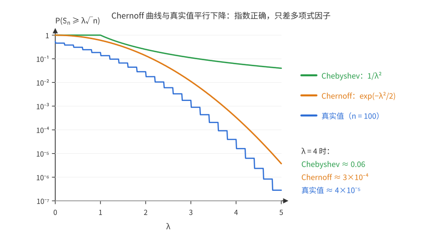
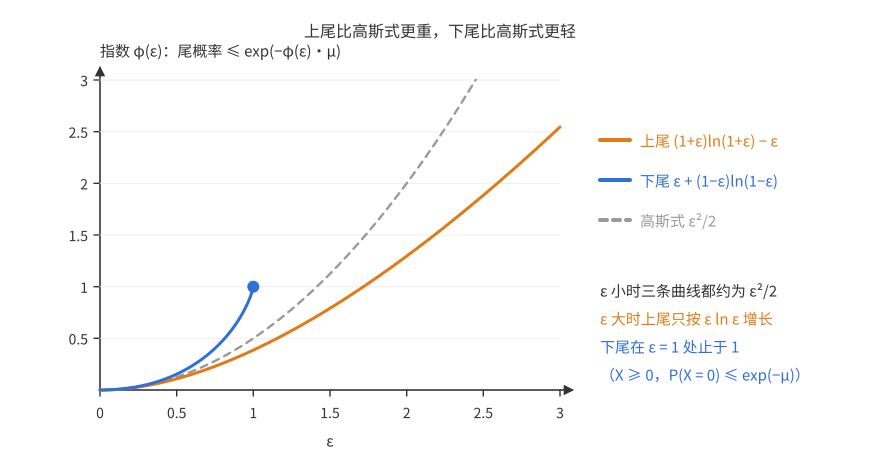
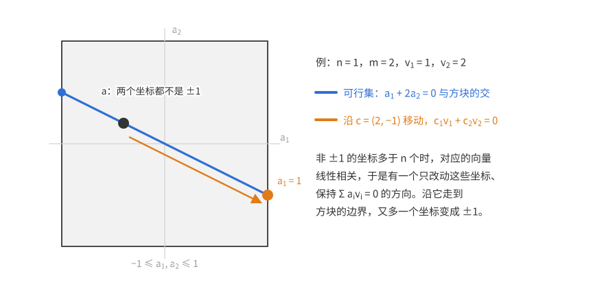
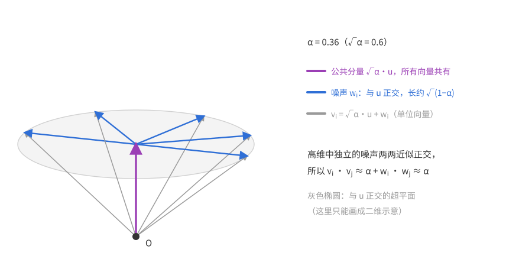
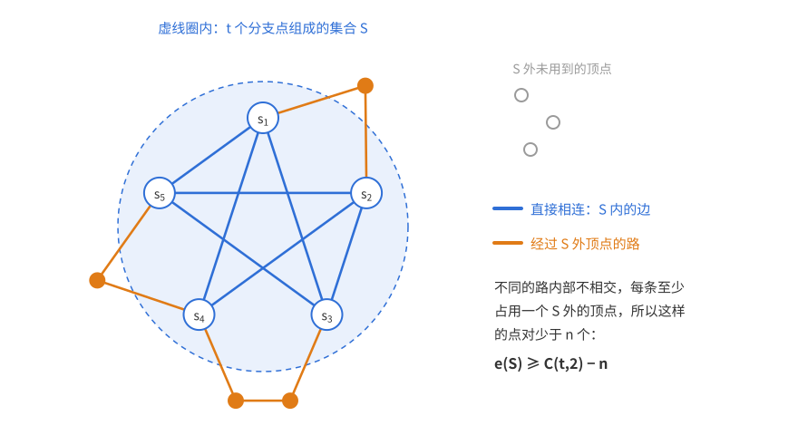
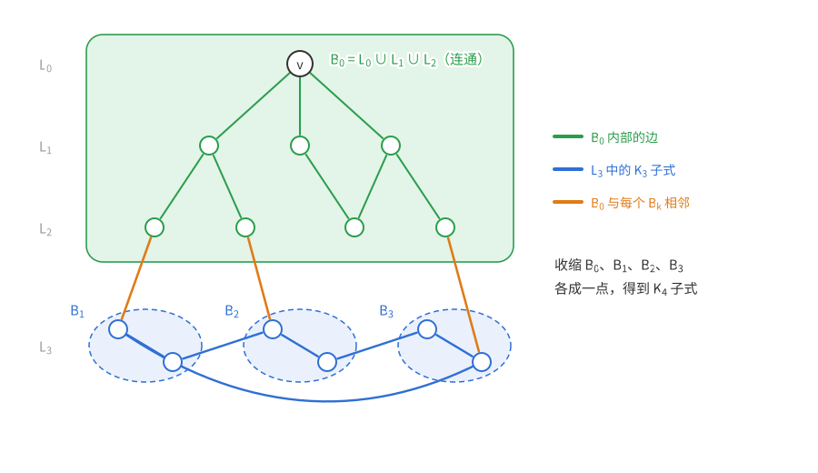

# 概率方法（五）：Chernoff 界

上一篇：[第 4 章 二阶矩方法](概率方法04——二阶矩方法.md)　下一篇：[第 6 章 Lovász 局部引理](<概率方法06——Lovász 局部引理.md>)

[第 4 章](概率方法04——二阶矩方法.md)用二阶矩证明了“随机变量集中在均值附近”，但 Chebyshev 不等式给出的偏离概率只按 $1/\lambda^2$ 衰减。本章的工具 **Chernoff 界**针对**独立**随机变量之和。最典型的情形是 $n$ 个独立均匀 $\pm1$ 变量之和：它向上偏离均值 $\lambda$ 个标准差以上的概率不超过 $e^{-\lambda^2/2}$（双侧再乘 2），和正态分布的尾巴一样快。

这个差别在概率方法里非常关键。并集上界要把很多坏事件的概率加起来：坏事件有 $m$ 个时，每个的概率要小于 $1/m$。$1/\lambda^2$ 的衰减要求 $\lambda\approx\sqrt m$，而 $e^{-\lambda^2/2}$ 只要求 $\lambda\approx\sqrt{2\ln m}$。于是“对指数多个对象同时控制”成为可能。

本章用它做三件事：控制所有集合上的着色和（差异问题）、指数多对向量的内积（近似等角向量）、所有 $t$ 元点集的边数（Hajós 猜想的反例）。

证明 Chernoff 界的方法——**对矩母函数 $\mathbb E e^{tX}$ 用 Markov 不等式，再优化 $t$**——本身和结论一样重要。[第 9 章](概率方法09——测度集中.md)的鞅集中不等式会再次用到同样的手法。

**本章读法。**

- 首读主线：5.0 节，从[目标](#目标比-chebyshev-强得多的尾估计)读到[定理与证明](#定理与证明)（定理 5.1、推论 5.2 和矩母函数方法），再读[有界变量](#有界变量)（定理 5.3、推论 5.4）和[乘法形式](#均值较小时乘法形式)（定理 5.5 及球与盒子的例子）；[与正态分布比较](#与正态分布比较)说明指数不能改进，可以略读。三个应用中必读的是定理 5.6、定理 5.12 和定理 5.15。
- 可以二读：[Spencer 定理](#六个标准差就够了)与[Komlós 猜想](#komlós-猜想)（研究背景，证明只给思路）、[精确等角](#精确等角至多-n1-个)（线性代数，与本章工具无关）、[Hadwiger 猜想的定量问题](#定量问题不含-k_t1-子式的图需要多少种颜色)（图论背景），以及各处的评注和“近期进展”。
- 与其他章的联系：[第 6 章](<概率方法06——Lovász 局部引理.md>)直接引用定理 5.1；[第 8 章](<概率方法08——Janson 不等式.md>)借用矩母函数方法，Janson 不等式推广定理 5.5 的下尾；[第 9 章](概率方法09——测度集中.md)的有界差分不等式改进推论 5.4(a) 的常数，Johnson–Lindenstrauss 引理与定理 5.12 同类；[第 10 章](概率方法10——熵方法.md)把矩母函数证明与熵证明对照；[第 11 章](概率方法11——容器方法.md)用乘法形式的 Chernoff 界收尾。

## 5.0 Chernoff 界与矩母函数方法

### 目标：比 Chebyshev 强得多的尾估计

先看最简单的情形：$X_1,\dots,X_n$ 独立，各以 $\frac12$ 概率取 $\pm1$，$S_n=X_1+\cdots+X_n$。$S_n$ 的均值为 0、方差为 $n$，标准差是 $\sqrt n$。我们想估计 $\mathbb P(S_n\ge\lambda\sqrt n)$。

- Chebyshev（第 4 章）：$\mathbb P(\lvert S_n\rvert\ge\lambda\sqrt n)\le\dfrac{\operatorname{Var}S_n}{\lambda^2n}=\dfrac1{\lambda^2}$。
- 中心极限定理提示真实答案：$S_n/\sqrt n$ 近似标准正态，尾巴约 $e^{-\lambda^2/2}$。

$1/\lambda^2$ 与 $e^{-\lambda^2/2}$ 差得极远。但 Chebyshev 只用了二阶矩，因而只要求 $X_i$ **两两独立**；要得到更好的界，必须用到更多的独立性。

### 从高阶矩到矩母函数

Chebyshev 的本质是对 $S_n^2$ 用 Markov 不等式（[定理 3.5](概率方法03——删除法.md#33-markov-不等式)：$X\ge0$ 时 $\mathbb P(X\ge a)\le\mathbb EX/a$）。自然的推广是用更高的矩。以四阶矩为例：
$$\mathbb E S_n^4=\sum_{i,j,k,l}\mathbb E[X_iX_jX_kX_l].$$
若某个下标恰好出现一次或三次，由独立性和 $\mathbb EX_i=0$，这一项为 0；非零的项只有四个下标全相同（$n$ 项）或两两配对成两个不同下标（$3n(n-1)$ 项），每项都等于 1。所以 $\mathbb ES_n^4=3n^2-2n$，于是
$$\mathbb P(\lvert S_n\rvert\ge\lambda\sqrt n)\le\frac{\mathbb ES_n^4}{\lambda^4n^2}\le\frac3{\lambda^4}.$$
这只用到 **4 维独立性**（任意 4 个 $X_i$ 独立）。

一般地，用 $2k$ 阶矩：$\mathbb ES_n^{2k}$ 等于 $[n]^{2k}$ 中“每个下标出现偶数次”的序列个数。每个这样的序列都可以把 $2k$ 个位置两两配对、使同一对上的下标相同，所以个数不超过“配对方式数 × 给每对选下标的方式数”$=(2k-1)!!\,n^k$。又
$$(2k-1)!!=\frac{(2k)!}{2^kk!}\le\frac{(2k)^k}{2^k}=k^k$$
（$\frac{(2k)!}{k!}=(k+1)(k+2)\cdots(2k)\le(2k)^k$），于是
$$\mathbb P(\lvert S_n\rvert\ge\lambda\sqrt n)\le\frac{\mathbb ES_n^{2k}}{\lambda^{2k}n^k}\le\Big(\frac k{\lambda^2}\Big)^k.$$
对 $k$ 最小化 $(k/\lambda^2)^k$，即令 $\frac{d}{dk}\big(k\ln\frac k{\lambda^2}\big)=\ln\frac k{\lambda^2}+1=0$，得 $k=\lambda^2/e$。取 $k=\lfloor\lambda^2/e\rfloor$，则 $k/\lambda^2\le1/e$，得到 $\le e^{-k}\le e^{1-\lambda^2/e}$——已经是高斯型的衰减了，只是常数差一点。

**教训**：阶数越高，尾巴越好，最佳阶数随 $\lambda$ 增长（$k\approx\lambda^2/e$）。与其逐个挑阶数，不如把所有矩打包：
$$\mathbb E e^{tS}=\sum_{k\ge0}\frac{t^k\,\mathbb ES^k}{k!},$$
这就是**矩母函数**（它正是矩序列 $\mathbb ES^k$ 的指数型生成函数，名字由此而来）。对 $e^{tS}$ 用 Markov 不等式，相当于同时用了所有的矩，参数 $t$ 扮演“选阶数”的角色。指数函数还有一个决定性的好处：$e^{t(X+Y)}=e^{tX}e^{tY}$，独立变量之和的矩母函数**分解为乘积**，每个因子只涉及一个变量，可以单独计算。

（这也说明，在没有完全独立性、但能估计足够高阶矩的场合，同样的思路仍能给出好的尾估计。）

### 定理与证明

**定理 5.1（Chernoff 界）**　$X_1,\dots,X_n$ 独立且均匀取 $\pm1$，$S_n=X_1+\cdots+X_n$。对任意 $\lambda>0$，
$$\mathbb P(S_n\ge\lambda\sqrt n)\le e^{-\lambda^2/2}.$$
等价地，对任意 $a>0$，$\mathbb P(S_n\ge a)\le e^{-a^2/(2n)}$。

*证明*　任取 $t>0$。由独立性，
$$\mathbb Ee^{tS_n}=\prod_{i=1}^n\mathbb Ee^{tX_i}=\Big(\frac{e^t+e^{-t}}2\Big)^n=(\cosh t)^n,$$
其中 $\cosh$ 是双曲余弦。比较 Taylor 展开：
$$\cosh t=\sum_{k\ge0}\frac{t^{2k}}{(2k)!}\le\sum_{k\ge0}\frac{t^{2k}}{2^kk!}=e^{t^2/2},$$
这里用了 $(2k)!=\big(1\cdot3\cdots(2k-1)\big)\cdot\big(2\cdot4\cdots2k\big)\ge2^kk!$。由 Markov 不等式，
$$\mathbb P(S_n\ge a)=\mathbb P(e^{tS_n}\ge e^{ta})\le\frac{\mathbb Ee^{tS_n}}{e^{ta}}\le e^{-ta+nt^2/2}.$$
右边对 $t$ 是二次函数的指数，在 $t=a/n$ 处取最小值 $e^{-a^2/(2n)}$。取 $a=\lambda\sqrt n$ 即得。$\square$

**参数 $t$ 的作用。** 对每个 $t>0$ 都得到一个合法的上界，最后选最好的那个：$t$ 太小，$e^{tS}$ 对大偏差不敏感；$t$ 太大，$\mathbb Ee^{tS}$ 本身被极少数极端情形撑大。

$t=a/n$ 是**二次上界** $e^{-ta+nt^2/2}$ 的最优参数，不是精确的最优参数：直接最小化 $e^{-ta}(\cosh t)^n$，得到的参数满足 $n\tanh t=a$（$0<a<n$ 时有唯一解；$a=n$ 时下确界在 $t\to\infty$ 处取到），$a\ll n$ 时它与 $a/n$ 几乎相同。

由对称性，$-S_n$ 与 $S_n$ 同分布，所以下尾也有同样的界，合起来：

**推论 5.2**　同上记号，对任意 $\lambda\ge0$，$\mathbb P(\lvert S_n\rvert\ge\lambda\sqrt n)\le2e^{-\lambda^2/2}$。

与 Chebyshev 对比：Chernoff 界要求 $X_i$ **相互独立**，Chebyshev 只要两两独立。适用面窄一些，换来的是指数级的改进。

### 有界变量

证明中唯一用到 $X_i$ 分布的地方是 $\mathbb Ee^{tX_i}\le e^{t^2/2}$。这对任何取值在 $[-1,1]$、均值为 0 的变量都成立：函数 $x\mapsto e^{tx}$ 是凸的，在区间 $[-1,1]$ 上位于两端点连线下方。把 $x$ 写成端点的凸组合 $x=\frac{1-x}2\cdot(-1)+\frac{1+x}2\cdot1$，得
$$e^{tx}\le\frac{1-x}2e^{-t}+\frac{1+x}2e^{t}\qquad(x\in[-1,1]).$$
两边取期望，用 $\mathbb EX=0$，得 $\mathbb Ee^{tX}\le\cosh t\le e^{t^2/2}$。各变量不必同分布，只要独立，乘积分解照样成立。于是：

**定理 5.3（有界变量的 Chernoff 界）**　$X_1,\dots,X_n$ 独立，取值于 $[-1,1]$，$\mathbb EX_i=0$。则 $S_n=X_1+\cdots+X_n$ 满足
$$\mathbb P(S_n\ge\lambda\sqrt n)\le e^{-\lambda^2/2},\qquad\text{即}\quad\mathbb P(S_n\ge a)\le e^{-a^2/(2n)}.$$

最常用的特例是 Bernoulli 变量之和。

**推论 5.4**　(a) 设 $X$ 是 $n$ 个独立 Bernoulli 变量之和（各自的概率 $p_i$ 可以不同），$\mu=\mathbb EX$。则对 $\lambda>0$，
$$\mathbb P(X\ge\mu+\lambda\sqrt n)\le e^{-\lambda^2/2},\qquad\mathbb P(X\le\mu-\lambda\sqrt n)\le e^{-\lambda^2/2}.$$
(b) 若 $X\sim\operatorname{Bin}(N,\frac12)$，则对 $s>0$，
$$\mathbb P\Big(X\ge\frac N2+s\Big)\le e^{-2s^2/N},\qquad\mathbb P\Big(X\le\frac N2-s\Big)\le e^{-2s^2/N}.$$

*证明*　(a) 设 $X=\sum\xi_i$，$\xi_i\sim\operatorname{Bernoulli}(p_i)$。$\xi_i-p_i$ 取值于 $[-p_i,1-p_i]\subseteq[-1,1]$，均值为 0，对它们用定理 5.3；下尾对 $p_i-\xi_i$ 用定理 5.3。

(b) 这里可以做得更好：$2\xi_i-1$ 恰好均匀取 $\pm1$，$2X-N$ 就是定理 5.1 中的 $S_N$。所以 $\mathbb P(X\ge\frac N2+s)=\mathbb P(S_N\ge2s)\le e^{-(2s)^2/(2N)}=e^{-2s^2/N}$。下尾同理。$\square$

(b) 的指数是 (a) 的 4 倍，原因是 (a) 把长度为 1 的区间 $[-p_i,1-p_i]$ 放进了长度为 2 的区间 $[-1,1]$，浪费了一倍的宽度。Hoeffding（1963）证明了对一般的 $p_i$ 也有 $\mathbb P(X\ge\mu+s)\le e^{-2s^2/n}$，需要更细的估计 $\mathbb Ee^{t(\xi-p)}\le e^{t^2/8}$（Hoeffding 引理）；本章只用到 (a) 和 (b)。

### 与正态分布比较

对标准正态 $Z$，配方可得 $\mathbb Ee^{tZ}=\frac1{\sqrt{2\pi}}\int e^{tx-x^2/2}dx=e^{t^2/2}$。同样的论证给出
$$\mathbb P(Z\ge\lambda)\le e^{-t\lambda}\mathbb Ee^{tZ}=e^{-t\lambda+t^2/2}\overset{t=\lambda}{=}e^{-\lambda^2/2}.$$
真实的尾巴是多少？对 $\lambda>0$，在积分里插入 $u/\lambda\ge1$：
$$\int_\lambda^\infty e^{-u^2/2}du\le\int_\lambda^\infty\frac u\lambda e^{-u^2/2}du=\frac{e^{-\lambda^2/2}}\lambda;$$
分部积分又得
$$\int_\lambda^\infty e^{-u^2/2}du=\frac{e^{-\lambda^2/2}}\lambda-\int_\lambda^\infty\frac{e^{-u^2/2}}{u^2}du\ge\frac{e^{-\lambda^2/2}}\lambda-\frac1{\lambda^3}\int_\lambda^\infty ue^{-u^2/2}du=\Big(\frac1\lambda-\frac1{\lambda^3}\Big)e^{-\lambda^2/2}.$$
所以 $\lambda\to\infty$ 时
$$\mathbb P(Z\ge\lambda)\sim\frac{e^{-\lambda^2/2}}{\sqrt{2\pi}\,\lambda}.$$
Chernoff 界的**指数**完全正确，只丢了一个 $\frac1{\sqrt{2\pi}\lambda}$ 的多项式因子。

定理 5.1 的指数 $\lambda^2/2$ 也不能再改进。中心极限定理说 $S_n/\sqrt n$ 依分布收敛到 $Z$，即对每个固定的 $\lambda$，$\mathbb P(S_n\ge\lambda\sqrt n)\to\mathbb P(Z\ge\lambda)$。若对某个 $c>\frac12$ 和一切 $n$、$\lambda$ 都有 $\mathbb P(S_n\ge\lambda\sqrt n)\le e^{-c\lambda^2}$，令 $n\to\infty$ 就得到 $\mathbb P(Z\ge\lambda)\le e^{-c\lambda^2}$，在 $\lambda$ 很大时与上面的渐近式矛盾。

下图画出 $n=100$ 时 $\mathbb P(S_n\ge\lambda\sqrt n)$ 的真实值（蓝色阶梯，$S_n$ 只取偶数值）与两种上界，纵轴是对数刻度：Chebyshev（绿）几乎是水平的，Chernoff（橙）与真实值以相同的“抛物线”速度下降。

同样的方法可以按具体分布调整，得到各种变量之和的尾估计，Alon–Spencer 的附录 A 收集了许多例子。下面是最重要的一个。

### 均值较小时：乘法形式

推论 5.4 的偏差以 $\sqrt n$ 为单位，$n$ 是**变量个数**。当各 $p_i$ 很小时，这很浪费：例如 $X\sim\operatorname{Bin}(n,\frac{\log n}n)$，$\mu=\log n$，真实的标准差约 $\sqrt{\log n}$，而推论 5.4 要求偏差达到 $\sqrt n$ 的若干倍才有用——比 $\mu$ 本身还大得多。我们需要以 $\mu$ 而不是 $n$ 为尺度的界。

**定理 5.5（乘法形式的 Chernoff 界）**　$X$ 是独立 Bernoulli 变量之和（概率可以不同），$\mu=\mathbb EX$。对任意 $\varepsilon>0$，
$$\mathbb P\big(X\ge(1+\varepsilon)\mu\big)\le e^{-\left((1+\varepsilon)\ln(1+\varepsilon)-\varepsilon\right)\mu}\le e^{-\frac{\varepsilon^2}{2+\varepsilon}\mu},$$
$$\mathbb P\big(X\le(1-\varepsilon)\mu\big)\le e^{-\left(\varepsilon+(1-\varepsilon)\ln(1-\varepsilon)\right)\mu}\le e^{-\varepsilon^2\mu/2}\qquad(0<\varepsilon<1).$$
特别地，$0<\varepsilon\le1$ 时上尾不超过 $e^{-\varepsilon^2\mu/3}$。

（上尾简化形式分母中的 2 不能换成 1：$\varepsilon\to0$ 时 $(1+\varepsilon)\ln(1+\varepsilon)-\varepsilon\approx\frac{\varepsilon^2}2$，比 $\frac{\varepsilon^2}{1+\varepsilon}\approx\varepsilon^2$ 小。）

*证明*　设 $X=\sum\xi_i$，$\xi_i\sim\operatorname{Bernoulli}(p_i)$。关键的一步是用 $1+x\le e^x$ 估计单个变量的矩母函数：
$$\mathbb Ee^{t\xi_i}=1+p_i(e^t-1)\le\exp\big(p_i(e^t-1)\big),\qquad\text{所以}\quad\mathbb Ee^{tX}\le\exp\big(\mu(e^t-1)\big).$$
（右边恰好是均值为 $\mu$ 的 Poisson 分布——取值 $k$ 的概率为 $e^{-\mu}\mu^k/k!$——的矩母函数，因为 $\sum_ke^{tk}e^{-\mu}\frac{\mu^k}{k!}=e^{-\mu}e^{\mu e^t}$：在矩母函数意义下，Bernoulli 之和被 Poisson 控制。注意这里只用到了 $\mu$，与 $n$ 无关。）

*上尾*　对 $t>0$，由 Markov 不等式
$$\mathbb P\big(X\ge(1+\varepsilon)\mu\big)\le e^{-t(1+\varepsilon)\mu}\,\mathbb Ee^{tX}\le\exp\big(\mu(e^t-1)-t(1+\varepsilon)\mu\big).$$
对 $t$ 求导令其为零，$e^t=1+\varepsilon$，即 $t=\ln(1+\varepsilon)$。代入后指数为 $\mu\varepsilon-(1+\varepsilon)\ln(1+\varepsilon)\,\mu$，即得第一个不等式。

*下尾*　对 $s>0$，
$$\mathbb P\big(X\le(1-\varepsilon)\mu\big)=\mathbb P\big(e^{-sX}\ge e^{-s(1-\varepsilon)\mu}\big)\le e^{s(1-\varepsilon)\mu}\,\mathbb Ee^{-sX}\le\exp\big(s(1-\varepsilon)\mu+\mu(e^{-s}-1)\big).$$
最优的 $s$ 满足 $e^{-s}=1-\varepsilon$，代入得 $\exp\big(-\mu(\varepsilon+(1-\varepsilon)\ln(1-\varepsilon))\big)$。

*化简*　记 $\varphi_+(\varepsilon)=(1+\varepsilon)\ln(1+\varepsilon)-\varepsilon$，$\varphi_-(\varepsilon)=\varepsilon+(1-\varepsilon)\ln(1-\varepsilon)$。要证 $\varphi_+(\varepsilon)\ge\frac{\varepsilon^2}{2+\varepsilon}$：两边在 0 处相等，比较导数，会发现只需 $\ln(1+\varepsilon)\ge\frac{2\varepsilon}{2+\varepsilon}$，而它本身也用比较导数来证。所以先证这个辅助不等式。

- 先证 $\ln(1+\varepsilon)\ge\frac{2\varepsilon}{2+\varepsilon}$：两边在 0 处相等，左边导数减右边导数为 $\frac1{1+\varepsilon}-\frac4{(2+\varepsilon)^2}=\frac{\varepsilon^2}{(1+\varepsilon)(2+\varepsilon)^2}\ge0$。
- 令 $g(\varepsilon)=\varphi_+(\varepsilon)-\frac{\varepsilon^2}{2+\varepsilon}$，$g(0)=0$，
$$g'(\varepsilon)=\ln(1+\varepsilon)-\frac{\varepsilon^2+4\varepsilon}{(2+\varepsilon)^2}\ge\frac{2\varepsilon}{2+\varepsilon}-\frac{\varepsilon^2+4\varepsilon}{(2+\varepsilon)^2}=\frac{\varepsilon^2}{(2+\varepsilon)^2}\ge0,$$
所以 $\varphi_+(\varepsilon)\ge\frac{\varepsilon^2}{2+\varepsilon}$；$\varepsilon\le1$ 时 $2+\varepsilon\le3$。
- 令 $h(\varepsilon)=\varphi_-(\varepsilon)-\frac{\varepsilon^2}2$，$h(0)=0$，$h'(\varepsilon)=-\ln(1-\varepsilon)-\varepsilon\ge0$（因为 $-\ln(1-\varepsilon)=\varepsilon+\frac{\varepsilon^2}2+\cdots$）。$\square$

$\varepsilon\ge1$ 的下尾不需要另外讨论：$\varepsilon=1$ 时 $\mathbb P(X\le0)=\prod(1-p_i)\le e^{-\mu}$；$\varepsilon>1$ 时 $(1-\varepsilon)\mu<0$，概率为 0。

### 上尾与下尾的不对称

定理 5.5 的上下尾形式不同，这不是证明技巧造成的，而是**必然**的。看 $X\sim\operatorname{Bin}(n,c/n)$，$c$ 是常数。$n\to\infty$ 时 $X$ 趋于均值为 $c$ 的 Poisson 分布，取值 $k$ 的概率
$$e^{-c}\frac{c^k}{k!}=e^{-k\ln k+O(k)}\qquad(k\to\infty,\ c\text{ 固定}),$$
这由 Stirling 公式 $k!=e^{k\ln k-k+O(\log k)}$ 得到。

若上尾也有高斯式的界 $e^{-\varepsilon^2\mu/2}$，取 $(1+\varepsilon)\mu=k$，它等于 $e^{-(k-c)^2/(2c)}=e^{-\Omega(k^2)}$，比真实的 $e^{-\Theta(k\log k)}$ 小得多，所以这样的界是错的。定理 5.5 的上尾指数 $\varphi_+(\varepsilon)\mu$ 在 $\mu=c$、$1+\varepsilon=k/c$ 时等于 $k\ln\frac kc-k+c=k\ln k+O(k)$，与 Poisson 分布精确吻合。

另一方面，$X\ge0$，下尾最多延伸到 $\varepsilon=1$，不存在“重尾”的问题。两者的共同点是：对小的 $\varepsilon\in[0,1]$，两个尾巴都按 $e^{-\Theta(\varepsilon^2\mu)}$ 衰减。

下图画出三个指数函数：上尾 $\varphi_+$（橙）、下尾 $\varphi_-$（蓝，定义在 $[0,1]$ 上）与高斯式的 $\varepsilon^2/2$（灰色虚线）。$\varepsilon$ 小时三条曲线贴在一起；$\varepsilon$ 大时 $\varphi_+$ 只按 $\varepsilon\ln\varepsilon$ 增长，明显低于抛物线。

**例（球与盒子：最大负载）**　把 $n$ 个球独立均匀地放进 $n$ 个盒子，装得最多的盒子里有几个球？每个盒子的球数 $X\sim\operatorname{Bin}(n,\frac1n)$，$\mu=1$。这里偏差远大于均值，正是上尾不对称起作用的场合。

对一个盒子用定理 5.5 的上尾，取 $1+\varepsilon=k$：
$$\mathbb P(X\ge k)\le e^{-\varphi_+(k-1)}=e^{-(k\ln k-k+1)}\le\Big(\frac ek\Big)^k.$$
对 $n$ 个盒子取并集上界，只要 $n(e/k)^k\to0$，比如 $k\ln\frac ke\ge(1+\delta)\ln n$（$\delta>0$ 为常数）就够了。取 $k=\big\lceil\frac{3\ln n}{\ln\ln n}\big\rceil$，则
$$\ln\frac ke=\ln\ln n-\ln\ln\ln n+O(1)=(1-o(1))\ln\ln n,$$
所以 $k\ln\frac ke=(3-o(1))\ln n\ge2\ln n$（$n$ 充分大），失败概率至多 $n\cdot n^{-2}=\frac1n$。于是最大负载以高概率是 $O\big(\frac{\log n}{\log\log n}\big)$；可以证明这个量级是对的。

指数的形状决定了答案。若误用高斯式的指数 $e^{-\varepsilon^2\mu/2}$，并集上界会“证明”最大负载只有 $O(\sqrt{\log n})$，这是错的；用简化形式 $e^{-\frac{\varepsilon^2}{2+\varepsilon}\mu}$（这里约为 $e^{-k}$）只能得到 $O(\log n)$；只有精确的 $\varphi_+(\varepsilon)\approx\varepsilon\ln\varepsilon$ 给出正确的 $\frac{\log n}{\log\log n}$。

## 5.1 差异

从这一节起是三个应用，模式相同：随机构造，用 Chernoff 界说明每个坏事件的概率指数小，再对很多个坏事件取并集上界。

给定一个超图（集族），能否把顶点染成红蓝两色，使**每条边**中红点与蓝点的个数都差不多？对比[第 1 章](概率方法01——引论.md) 1.3 节的超图二染色：那里只要求每条边不单色，即红蓝个数之差的绝对值小于边的大小；现在要求这个差尽量小。

用 $\pm1$ 表示颜色：着色 $\chi:[n]\to\{-1,1\}$，记 $\chi(A)=\sum_{i\in A}\chi(i)$。集族 $\mathcal F$ 的**差异**（discrepancy）是
$$\operatorname{disc}(\mathcal F)=\min_\chi\max_{A\in\mathcal F}\lvert\chi(A)\rvert.$$

**定理 5.6**　$\mathcal F$ 是 $[n]$ 的 $m$ 个子集组成的族，则存在着色使每个集合上 $\lvert\chi(A)\rvert<\sqrt{2n\ln(4m)}$。特别地 $\operatorname{disc}(\mathcal F)=O(\sqrt{n\log m})$（$m\ge2$）。

**参数从哪里来。** 随机着色下，$\chi(A)$ 是 $\lvert A\rvert\le n$ 个独立 $\pm1$ 之和，标准差至多 $\sqrt n$；要对 $m$ 个集合用并集上界，每个集合超标的概率要小于 $1/m$，由推论 5.2 需要 $2e^{-\lambda^2/2}<1/m$，即 $\lambda\approx\sqrt{2\ln m}$ 个标准差。

*证明*　每个顶点独立地均匀取 $\pm1$。设 $a=\sqrt{2n\ln(4m)}$。对每个 $A\in\mathcal F$，由推论 5.2（用 $\lvert A\rvert$ 个变量）
$$\mathbb P(\lvert\chi(A)\rvert\ge a)\le2e^{-a^2/(2\lvert A\rvert)}\le2e^{-a^2/(2n)}=\frac1{2m}.$$
（$A=\varnothing$ 时概率为 0。）对 $m$ 个集合取并集上界，有集合超标的概率至多 $\frac12$，所以存在着色使所有 $\lvert\chi(A)\rvert<a$。$\square$

### 六个标准差就够了

这一小节是研究背景，定理 5.7 不给完整证明；首读记住结论即可。

$\sqrt{\log m}$ 这个因子来自并集上界：随机着色把“每个集合都不超标”当成 $m$ 个几乎独立的要求，只能靠每个要求都以极高概率满足来过关。Spencer 证明，精心设计的着色可以去掉它。

**定理 5.7（Spencer 1985，“六个标准差就够了”）**　$[n]$ 的任意 $n$ 个子集组成的族，存在着色使每个集合上 $\lvert\chi(A)\rvert\le6\sqrt n$。更一般地，若 $\mathcal F$ 由 $m\ge n$ 个子集组成，可以把 $6\sqrt n$ 换成 $O\big(\sqrt{n\log(2m/n)}\big)$。

标题的意思是：$\chi(A)$ 在随机着色下的标准差至多 $\sqrt n$，随机着色需要 $\sqrt{2\ln n}$ 个标准差，而好的着色只需要 6 个。$\sqrt n$ 的量级不能再改进：利用 Hadamard 矩阵（元素为 $\pm1$、各行两两正交的方阵）可以构造 $n$ 个集合，使任何着色都有某个集合的 $\lvert\chi(A)\rvert\ge c\sqrt n$。

Spencer 还证明了带权的版本：给每个顶点一个权重 $p_i\in[0,1]$，可以选 $x_i\in\{0,1\}$，使每个集合 $A$ 上 $\big\lvert\sum_{i\in A}(x_i-p_i)\big\rvert$ 有同样的界。（$p_i\equiv\frac12$ 就回到原定理。）

**Spencer 的证明思路（粗略）。** 核心是**部分着色**：允许一部分点取 0（暂不着色），要求取 $\pm1$ 的点占一个固定比例，且每个集合上的和都是 $O(\sqrt n)$。

部分着色从鸽巢原理来。把每个着色 $\chi$ 对应到“各集合的和分别落在哪个长约 $c\sqrt n$ 的区间”这一编号向量。编号向量的可能取值很多，但随机着色下每个集合的和大多落在中间几个区间，典型的编号向量并不多（这一步要用熵来精确计数，熵见[第 10 章](概率方法10——熵方法.md)）。于是有大量着色共用同一个编号向量，其中必有两个 $\chi_1,\chi_2$ 在相当多的点上不同。令 $\chi=\frac{\chi_1-\chi_2}2$：它在两者不同的点上取 $\pm1$、其余点取 0，每个集合上的和至多是区间长度的一半。

对仍取 0 的点重复这一步，未着色的点每轮按比例减少，各轮误差加起来仍是 $O(\sqrt n)$。这个论证是非构造性的，Spencer 曾猜测不存在找到这种着色的高效算法。

**算法版本。** Bansal（2010）给出了第一个多项式时间算法，推翻了这一猜测。Lovett 和 Meka（2015）给出了一个更简洁的算法：允许每个顶点取 $[-1,1]$ 中的**分数值**，从全零向量出发在方块 $[-1,1]^n$ 里做小步随机游走。某个坐标碰到 $\pm1$ 就冻结，成为真正的颜色；某个集合的和接近界限时，就只沿保持该集合和不变的超平面走。每一轮冻结相当一部分坐标，而所有集合的和始终受控。

### Komlós 猜想

下面是差异理论中一个著名的问题（近期进展见本节末注）。本小节是选读：其中的推导依赖未证明的 Spencer 定理及其带权版本，跳过不影响后文；舍入引理 5.9 的想法本身值得一看。

**猜想 5.8（Komlós）**　存在绝对常数 $K$，使得对任意落在单位球内的向量 $v_1,\dots,v_m\in\mathbb R^n$，都能选 $\varepsilon_1,\dots,\varepsilon_m\in\{-1,1\}$，使
$$\varepsilon_1v_1+\cdots+\varepsilon_mv_m\in[-K,K]^n.$$

注意 $K$ 不依赖于 $m$ 和 $n$。Banaszczyk（1998）用凸几何的深刻想法证明了 $K=O(\sqrt{\log n})$ 的版本，Bansal 和 Jiang（2025）把界改进到 $\tilde O((\log n)^{1/4})$（$\tilde O$ 表示略去更低阶的因子，如 $\log\log n$ 的幂次）。

Spencer 定理推出 Komlós 猜想的一个特例：每个 $v_i$ 的所有坐标都是 $\pm n^{-1/2}$（它们恰好是单位向量；更一般地，坐标都是 $O(n^{-1/2})$ 也可以）。想法是：这样的向量组恰好对应一个集族，平衡向量和就是给这个集族着色；$m>n$ 时先用舍入引理把向量个数降到 $n$ 以内。

**注意角色对调。** 定理 5.7 中被染色的是 $n$ 个点、集合有 $m$ 个；这里被染色的是 $m$ 个向量（相当于 5.7 中的点），每个坐标 $j$ 给出一个集合（相当于 5.7 中的集合），共 $n$ 个（下面再添一个）。所以下面套用 5.7 时，“点数”是 $m$，“集合数”是 $n+1$。

*$m\le n$ 的情形。* 令 $A$ 为以 $\sqrt n\,v_i$ 为列的 $n\times m$ 的 $\pm1$ 矩阵，要找 $\varepsilon\in\{\pm1\}^m$ 使 $\lVert A\varepsilon\rVert_\infty=O(\sqrt n)$。写 $A=2B-J$，其中 $B$ 是 $0/1$ 矩阵，$J$ 是全 1 矩阵。$B$ 的第 $j$ 行是某个集合 $T_j\subseteq[m]$ 的示性向量，再加上 $T_0=[m]$。对这 $n+1$ 个集合（顶点数 $m\le n+1$）用定理 5.7 的一般形式，得到着色 $\varepsilon$，使每个 $\lvert\varepsilon(T_j)\rvert\le O\big(\sqrt{m\log(2(n+1)/m)}\big)=O(\sqrt n)$（函数 $x\ln\frac{2(n+1)}x$ 的最大值是 $\frac{2(n+1)}e$）。于是 $(A\varepsilon)_j=2\varepsilon(T_j)-\varepsilon(T_0)=O(\sqrt n)$，除以 $\sqrt n$ 即得。

*$m>n$ 的情形。* 先用下面的线性代数引理把“未定”的向量减少到至多 $n$ 个。

**引理 5.9**　对任意 $v_1,\dots,v_m\in\mathbb R^n$，存在 $(a_1,\dots,a_m)\in[-1,1]^m$，使 $a_1v_1+\cdots+a_mv_m=0$，且至多 $n$ 个 $a_i$ 不属于 $\{-1,1\}$。

**怎样想到。** 可行集 $P=\{a\in[-1,1]^m:\sum a_iv_i=0\}$ 是方块与一个子空间的交，含有原点，所以非空。想让尽量多的坐标“到达边界”$\pm1$：只要还有自由度——即还在方块内部的坐标比约束的维数 $n$ 多——就能沿着某个保持约束的方向一直走到方块的边界，又固定一个坐标。

下图是 $n=1$、$m=2$、$v_1=1$、$v_2=2$ 的例子：灰色方块是 $[-1,1]^2$，蓝色线段是可行集，从内部的点 $a$ 沿橙色方向 $c=(2,-1)$（满足 $c_1v_1+c_2v_2=0$）移动，到达 $a_1=1$ 时停下，此时只剩 1 个非 $\pm1$ 坐标。

*证明*　在 $P$ 中取一个 $\pm1$ 坐标个数最多的点 $a$，记 $I=\{i:a_i\notin\{-1,1\}\}$，则 $i\in I$ 时 $\lvert a_i\rvert<1$。假设 $\lvert I\rvert>n$，那么 $\{v_i:i\in I\}$ 是 $\mathbb R^n$ 中多于 $n$ 个向量，线性相关：存在不全为零的 $c_i$（$i\in I$；$i\notin I$ 时令 $c_i=0$），使 $\sum c_iv_i=0$。考虑 $a+sc$，$s\ge0$：它始终满足 $\sum(a_i+sc_i)v_i=0$，$I$ 外的坐标不变；令 $s^*$ 为使某个 $\lvert a_i+sc_i\rvert=1$（$i\in I$，$c_i\ne0$）的最小 $s>0$，它存在且有限。则 $a+s^*c\in P$，并且比 $a$ 多至少一个 $\pm1$ 坐标，与 $a$ 的选取矛盾。所以 $\lvert I\rvert\le n$。$\square$

现在对 $i\notin I$ 令 $\varepsilon_i=a_i$，则
$$\sum_{i=1}^m\varepsilon_iv_i=\sum_{i\in I}(\varepsilon_i-a_i)v_i+\sum_{i=1}^ma_iv_i=\sum_{i\in I}(\varepsilon_i-a_i)v_i,$$
问题化为：对至多 $n$ 个向量 $v_i$（$i\in I$），选 $\varepsilon_i\in\{\pm1\}$ 使 $\sum_{i\in I}(\varepsilon_i-a_i)v_i$ 的每个坐标为 $O(1)$。令 $p_i=\frac{1+a_i}2\in[0,1]$，$\varepsilon_i=2x_i-1$，则 $\varepsilon_i-a_i=2(x_i-p_i)$，这正是 Spencer 定理的带权版本，再像 $m\le n$ 的情形那样用 $A=2B-J$ 分解即可。

带权版本可以从 Spencer 定理推出：先用紧性论证（对有限精度的权重证明，再取极限）假设每个 $a_i$ 只有有限位二进制小数，再从最低位开始，每次用 Spencer 定理把一位“舍入”掉，各轮误差构成几何级数（细节见 Spencer 1985 的推论 8）。这一步这里只给出思路。

**近期进展（截至 2026 年）。** Komlós 猜想在 2024 年时仍是公开问题。2026 年 9 月，Guo、Fang、Lu 的预印本《Vector Balancing via Directional Total Variation》声称证明了这个猜想，常数为 $3\sqrt{2\pi}$；随后 Karingula 和 Lovett 的预印本《An elementary proof of the Komlós conjecture》给出常数 36 的初等证明，并有独立的 Lean 形式化。这些都是预印本，尚未正式发表。

## 5.2 近似等角向量

### 精确等角：至多 $n+1$ 个

先看精确等角：答案只是线性的 $n+1$。下一小节会看到，只要允许 $\varepsilon$ 的误差，Chernoff 界就能给出指数多个，两者对比鲜明。这部分是线性代数，不依赖本章的工具，可以快速浏览。

在 $\mathbb R^n$ 中，最多能放多少个两两夹角相等的单位向量？设 $v_1,\dots,v_m\in\mathbb R^n$ 是单位向量，两两内积都等于 $\alpha\in[-1,1)$。

把它们排成 $n\times m$ 矩阵 $V$ 的列，**Gram 矩阵** $G=V^{\mathsf T}V$ 的 $(i,j)$ 元是 $v_i\cdot v_j$，所以
$$G=(1-\alpha)I_m+\alpha J_m,$$
$I_m$、$J_m$ 分别是单位矩阵和全 1 矩阵。$J_m$ 的特征值是 $m$（特征向量为全 1 向量，一次）和 0（$m-1$ 重），所以 $G$ 的特征值是 $1+(m-1)\alpha$（一次）和 $1-\alpha$（$m-1$ 重）。

- Gram 矩阵半正定（对一切 $x\in\mathbb R^m$，$x^{\mathsf T}Gx=\lvert Vx\rvert^2\ge0$），所以特征值都非负，$1+(m-1)\alpha\ge0$，即 $\alpha\ge-\frac1{m-1}$。
- $\operatorname{rank}G=\operatorname{rank}V\le n$。若 $\alpha\ne-\frac1{m-1}$，$G$ 的特征值都是正数（$1-\alpha>0$），满秩，故 $m\le n$。
- 若 $\alpha=-\frac1{m-1}$，$G$ 的秩为 $m-1$，故 $m\le n+1$。

**定理 5.10**　设 $n\ge2$。$\mathbb R^n$ 中两两内积都等于 $\alpha$ 的单位向量的最大个数为：$\alpha=-\frac1n$ 时是 $n+1$；$\alpha\ge-\frac1{n-1}$ 且 $\alpha\ne-\frac1n$ 时是 $n$；$\alpha<-\frac1{n-1}$ 时是 $\big\lfloor1+\frac1{\lvert\alpha\rvert}\big\rfloor$。

*证明*　上界：上面已证 $\alpha\ge-\frac1{m-1}$，以及 $m\le n+1$ 且 $m=n+1$ 只在 $\alpha=-\frac1n$ 时可能。$\alpha<0$ 时由 $\alpha\ge-\frac1{m-1}$ 得 $m\le1+\frac1{\lvert\alpha\rvert}$；$\alpha<-\frac1{n-1}$ 时这个数小于 $n$，成为起作用的约束。

下界（构造）：任何秩为 $r$ 的 $m\times m$ 半正定矩阵 $G$ 都是 $\mathbb R^r$ 中 $m$ 个向量的 Gram 矩阵——写 $G=Q\Lambda Q^{\mathsf T}$（$Q$ 正交，$\Lambda$ 对角且只有 $r$ 个非零元），取 $V=\Lambda^{1/2}Q^{\mathsf T}$ 的非零行即可。对上面列出的每个 $m$，$\alpha\ge-\frac1{m-1}$ 成立，$G=(1-\alpha)I_m+\alpha J_m$ 半正定，秩为 $m$ 或 $m-1$，且不超过 $n$（$m=n+1$ 时 $\alpha=-\frac1n=-\frac1{m-1}$，秩为 $n$）。所以这 $m$ 个向量可以放进 $\mathbb R^n$。$\alpha=-\frac1n$ 的 $n+1$ 个向量就是正 $n$ 维单纯形的中心指向各顶点的方向。$\square$

如果只要求内积都**不超过**某个值，而不要求相等，个数上界也有类似的结论：

**命题 5.11**　设 $v_1,\dots,v_m\in\mathbb R^n$ 是单位向量。

(a) 若两两内积都 $\le-\beta$（$\beta>0$），则 $m\le1+\lfloor1/\beta\rfloor$。

(b) 若两两内积都 $\le0$，则 $m\le2n$。

*证明*　(a) 
$$0\le\Big\lvert\sum_iv_i\Big\rvert^2=m+\sum_{i\ne j}v_i\cdot v_j\le m-m(m-1)\beta,$$
所以 $(m-1)\beta\le1$，$m\le1+1/\beta$，而 $m$ 是整数。

(b) 对 $n$ 归纳，把命题加强为“$\mathbb R^n$ 中两两内积 $\le0$ 的**非零**向量至多 $2n$ 个”。$n=1$ 时这些向量是非零实数，两两乘积 $\le0$，至多一正一负。设 $n\ge2$，把 $v_1,\dots,v_{m-1}$ 投影到 $v_m$ 的正交补（$\cong\mathbb R^{n-1}$）上：$w_i=v_i-\frac{v_i\cdot v_m}{\lvert v_m\rvert^2}v_m$。则
$$w_i\cdot w_j=v_i\cdot v_j-\frac{(v_i\cdot v_m)(v_j\cdot v_m)}{\lvert v_m\rvert^2}\le0,$$
因为 $v_i\cdot v_m$ 和 $v_j\cdot v_m$ 都 $\le0$，乘积 $\ge0$。$w_i=0$ 当且仅当 $v_i$ 是 $v_m$ 的负倍数；这样的 $i$ 至多一个（两个都是 $v_m$ 的负倍数的向量内积为正）。所以至少 $m-2$ 个非零的 $w_i$ 落在 $\mathbb R^{n-1}$ 中且两两内积 $\le0$，由归纳假设 $m-2\le2(n-1)$，即 $m\le2n$。$\square$

两个界都是紧的：(a) 中 $1/\beta$ 是整数且 $n\ge1/\beta$ 时，正单纯形给出 $1+1/\beta$ 个向量；(b) 中 $\pm e_1,\dots,\pm e_n$ 恰好 $2n$ 个。

### 近似等角：指数多个

如果不要求夹角**精确**相等，只要求**近似**相等，向量个数会从线性跳到指数。

**定理 5.12（指数多个近似等角向量）**　对任意 $\alpha\in(0,1)$ 和 $\varepsilon>0$，令 $\delta=\min\{\varepsilon,\frac{1-\alpha}2\}$，$c=\frac{\delta^2}{16\ln2}$。则对每个 $n$，$\mathbb R^n$ 中存在 $\lfloor2^{cn}\rfloor$ 个单位向量，两两内积都落在 $[\alpha-\varepsilon,\alpha+\varepsilon]$ 中。

$\varepsilon\le\frac{1-\alpha}2$ 时 $\delta=\varepsilon$，常数就是 $\frac{\varepsilon^2}{16\ln2}$。截断 $\delta$ 的原因是：要数出 $m$ 个**不同**的单位向量，内积必须小于 1。若 $\varepsilon$ 很大时仍用 $\varepsilon$ 定出个数，结论就会出错，例如 $n=1$、$\alpha=\frac12$、$\varepsilon=5$ 时 $\lfloor e^{25/16}\rfloor=4$，而 $\mathbb R$ 中只有 $\pm1$ 两个单位向量。

**怎样设计随机向量。** 先看 $\alpha=0$：坐标独立均匀取 $\pm1$ 的随机向量，两个之间的内积是 $n$ 个独立 $\pm1$ 之和，由 Chernoff 界集中在 $0$ 附近 $O(\sqrt n)$ 的范围内，归一化后两两近似正交，失败概率 $e^{-\Omega(n)}$，所以可以同时放指数多个。

要让内积集中在 $\alpha>0$ 附近，就需要所有向量共有一个公共分量：希望 $v\approx\sqrt\alpha\,u+(\text{与 }u\text{ 正交的独立噪声})$，其中 $u$ 是固定方向，这样两个向量的内积约为 $\alpha$。最简单的实现是让每个坐标**偏向** $+1$：若每个坐标以概率 $p$ 取 $+1$，则 $\mathbb Ev(k)=2p-1$，向量的“平均部分”是 $(2p-1)\cdot\mathbf 1$，其余部分的坐标独立且均值为 0。令 $(2p-1)^2=\alpha$，即 $p=\frac{1+\sqrt\alpha}2$。

下图是这个设计的示意：每个向量（归一化后）都近似等于公共分量 $\sqrt\alpha\,u$（紫）加上一段噪声 $w_i$（与 $u$ 近似正交、长度约 $\sqrt{1-\alpha}$）。严格地说，$v_i$ 在 $u$ 方向的分量是它各坐标的平均值，只是集中在 $\sqrt\alpha$ 附近。噪声两两近似正交，所以 $v_i\cdot v_j\approx\alpha+w_i\cdot w_j\approx\alpha$。

*证明*　由 $\delta\le\frac{1-\alpha}2$ 得 $\alpha+\delta<1$。设 $m=\lfloor e^{\delta^2n/16}\rfloor=\lfloor2^{cn}\rfloor\ge2$（$m=1$ 时无需证明）。独立取随机向量 $v_1,\dots,v_m\in\{-1,1\}^n$，每个坐标独立地以概率 $p=\frac{1+\sqrt\alpha}2$ 取 $+1$。

固定 $i\ne j$，$v_i\cdot v_j=\sum_{k=1}^nY_k$，其中 $Y_k=v_i(k)v_j(k)$ 对不同的 $k$ 相互独立，取 $+1$ 的概率为 $p^2+(1-p)^2$，所以
$$\mathbb EY_k=p^2+(1-p)^2-2p(1-p)=(2p-1)^2=\alpha.$$
$\frac{Y_k-\alpha}2$ 取值于 $[-1,1]$、均值为 0，由定理 5.3（两侧）
$$\mathbb P\big(\lvert v_i\cdot v_j-n\alpha\rvert\ge n\delta\big)=\mathbb P\Big(\Big\lvert\sum_k\frac{Y_k-\alpha}2\Big\rvert\ge\frac{n\delta}2\Big)\le2e^{-(n\delta/2)^2/(2n)}=2e^{-n\delta^2/8}.$$
对 $\binom m2<\frac{m^2}2$ 对取并集上界，有一对失败的概率小于 $m^2e^{-n\delta^2/8}\le1$。所以存在一组向量，两两满足 $\lvert v_i\cdot v_j-n\alpha\rvert<n\delta$。$v_i/\sqrt n$ 是单位向量，两两内积落在 $(\alpha-\delta,\alpha+\delta)\subseteq[\alpha-\varepsilon,\alpha+\varepsilon]$ 中；由 $\alpha+\delta<1$，它们两两不同。$\square$

**上界也是指数的。** 这样的向量组是一种**球面码**（单位球面上两两距离不太小的点集）。若两两内积都 $\le\alpha+\varepsilon<1$，则两两距离 $\lvert v_i-v_j\rvert=\sqrt{2-2v_i\cdot v_j}\ge2r$，其中 $r=\frac12\sqrt{2(1-\alpha-\varepsilon)}$。以各 $v_i$ 为心、$r$ 为半径的球互不相交，都含在以原点为心、半径 $1+r$ 的球内，比较体积得 $m\le\big(\frac{1+r}r\big)^n=2^{C_{\alpha,\varepsilon}n}$。

**评注（固定夹角的等角直线）**　这是研究背景，首读可跳过。过原点、两两夹角都恰为 $\theta$ 的直线，等价于两两内积为 $\pm\alpha$（$\alpha=\cos\theta$）的单位向量。对固定的 $\alpha$ 和很大的 $n$，最多能放多少条？Jiang、Tidor、Yao、Zhang、Zhao（2021）解决了这个问题：最大条数随维数 $n$ **线性**增长，斜率由谱图论中的一个量决定——记 $\lambda=\frac{1-\alpha}{2\alpha}$，$k$ 为“邻接矩阵最大特征值恰为 $\lambda$ 的图”的最少顶点数，$k<\infty$ 时答案是 $\big\lfloor\frac{k(n-1)}{k-1}\big\rfloor$（$n$ 充分大），$k=\infty$ 时是 $n+o(n)$。

## 5.3 Hajós 猜想的反例

### 背景：子式、细分与染色

先回顾几个图论概念。

- $H$ 是 $G$ 的**导出子图**：从 $G$ 中删去若干顶点（及其关联的边）得到。
- $H$ 是 $G$ 的**子图**：从 $G$ 中删去若干顶点和若干边得到。
- $H$ 的一个**细分**：把 $H$ 的每条边换成一条路（路的内部是新顶点，不同的路内部不相交）。称 $G$ **含有 $H$ 细分**，若 $G$ 的某个子图是 $H$ 的一个细分。$H$ 的顶点在细分中称为**分支点**。
- $H$ 是 $G$ 的**子式**（minor）：从 $G$ 的某个子图出发，反复把边收缩成点得到。**收缩**边 $uv$ 是把 $u,v$ 合并成一个点，它与 $u$ 或 $v$ 原来的邻点都相邻（删去产生的重边和自环）。

含有 $H$ 细分则必含有 $H$ 子式（把每条路收缩成一条边），反之不然。

- **Kuratowski 定理**（1930）：图是平面图，当且仅当它不含 $K_5$ 细分和 $K_{3,3}$ 细分。
- **Wagner 定理**（1937）：图是平面图，当且仅当它不含 $K_5$ 子式和 $K_{3,3}$ 子式。（两个定理可以用不长的论证互相推出。）
- **四色定理**（Appel–Haken 1976）：平面图都可以 4 染色。

于是：不含 $K_5$、$K_{3,3}$ 子式的图都可以 4 染色。$K_5$ 的条件显然必要（$K_5$ 本身要 5 种颜色），那 $K_{3,3}$ 呢？4 可染色的“真正原因”是什么？

**猜想 5.13（Hadwiger 1943）**　对每个 $t\ge1$，不含 $K_{t+1}$ 子式的图都可以 $t$ 染色。

- $t=1$：不含 $K_2$ 子式就是没有边，平凡。
- $t=2$：不含 $K_3$ 子式等价于没有圈（圈可以收缩成三角形），即森林，可以 2 染色。
- $t=3$：用初等图论论证可证（Dirac 1952：不含 $K_4$ 子式的图有度数 $\le2$ 的顶点，于是可以贪心 3 染色）。
- $t=4$：等价于四色定理（Wagner 1937）。
- $t=5$：也归结为四色定理（Robertson–Seymour–Thomas 1993，获 Fulkerson 奖）。
- $t\ge6$：在 2024 年时是公开问题（近期出现了反例声明，见本节末注）。

把“子式”换成“细分”，得到一个更强的猜想（不含 $K_{t+1}$ 细分的图类更大）：

**猜想 5.14（Hajós 1961）**　不含 $K_{t+1}$ 细分的图都可以 $t$ 染色。

Hajós 猜想在 $t\le3$ 时成立。但一般情形是错的：Catlin（1979）对所有 $t\ge6$ 构造了反例（$t=4,5$ 仍未解决）。而且它错得很厉害——Erdős 和 Fajtlowicz（1981）证明几乎所有图都是反例。在随机图中找反例，往往是个好主意。

### 随机图几乎都是反例

**定理 5.15（Erdős–Fajtlowicz 1981）**　以 $1-o(1)$ 的概率，$G(n,\frac12)$ 不含 $K_t$ 细分，其中 $t=\lceil10\sqrt n\rceil$。

为什么这说明 $G(n,\frac12)$ 是 Hajós 猜想的反例？由[第 4 章](概率方法04——二阶矩方法.md#44-随机图的团数)团数的一阶矩上界（定理 4.16(a)，取 $k=(2+\delta)\log_2n$；独立数与团数同分布），以高概率 $\alpha(G)\le(2+o(1))\log_2n$，而每个颜色类都是独立集，所以
$$\chi(G)\ge\frac n{\alpha(G)}\ge(1+o(1))\frac n{2\log_2n}.$$
（这里 $\chi(G)$ 是色数，$\alpha(G)$ 是独立数，与 5.1 节的着色 $\chi$、5.2 节的内积 $\alpha$ 无关。）它远大于 $t-1\approx10\sqrt n$。Hajós 猜想（取参数 $t-1$）却断言：不含 $K_t$ 细分的图可以 $t-1$ 染色。

**怎样想到证明。** $K_t$ 细分需要给 $\binom t2$ 个点对各找一条路，路可以任意长，似乎很难排除。但路是**要占用顶点的**：除了直接相连的点对，每条路至少用掉一个 $S$ 外的顶点，而图里总共只有 $n$ 个顶点。只要 $\binom t2\gg n$（即 $t\gg\sqrt n$），绝大多数点对必须**直接相连**，$S$ 就成了一个近乎完全的子图。

而随机图中每个 $t$ 元集的边密度都在 $\frac12$ 附近——这正是 Chernoff 界加并集上界能处理的：一个集合密度偏高的概率是 $e^{-\Theta(t^2)}$，$t$ 元集的个数是 $\binom nt\le e^{t\ln n}$，$t\gg\log n$ 时前者获胜。所以 $\sqrt n$ 来自顶点预算，Chernoff 界只是负责收尾。

下图是 $t=5$ 的示意：蓝色点对在 $S$ 内直接相连，橙色点对通过 $S$ 外的顶点相连，每条橙色路占用至少一个 $S$ 外顶点，不同的路互不共用。

*证明*　分两步：先用顶点预算把“含 $K_t$ 细分”化为“某个 $t$ 元集的边数至少 $\frac34\binom t2$”，再用 Chernoff 界和并集上界说明这样的 $t$ 元集以高概率不存在。

设 $G$ 含 $K_t$ 细分，分支点集为 $S$，$\lvert S\rvert=t$。$S$ 中每对点之间有一条路，路的内部顶点都在 $S$ 外，不同点对的路内部不相交。长度至少为 2 的路各至少占用一个 $S$ 外的顶点，所以这样的点对少于 $n$ 个，其余的点对必须是 $G$ 的边：
$$e(S)\ge\binom t2-n.$$
记 $N=\binom t2$。由 $t\ge10\sqrt n$ 得 $N\ge\frac{10\sqrt n(10\sqrt n-1)}2\ge4n$，所以 $e(S)\ge N-n\ge\frac34N$。

对固定的 $t$ 元集 $S$，$e(S)\sim\operatorname{Bin}(N,\frac12)$，由推论 5.4(b)（$s=N/4$）
$$\mathbb P\Big(e(S)\ge\frac34N\Big)\le e^{-2(N/4)^2/N}=e^{-N/8}=e^{-t(t-1)/16}.$$
对全部 $\binom nt\le n^t$ 个 $t$ 元集取并集上界：
$$\binom nte^{-t(t-1)/16}\le\exp\Big(t\Big(\ln n-\frac{t-1}{16}\Big)\Big)\le\exp\Big(t\Big(\ln n-\frac{10\sqrt n-1}{16}\Big)\Big)=e^{-\Omega(n)}=o(1).$$
所以以高概率没有 $t$ 元集满足 $e(S)\ge\frac34N$，从而没有 $K_t$ 细分。$\square$

（证明中的常数 10 远非最优。）

### 定量问题：不含 $K_{t+1}$ 子式的图需要多少种颜色

这一小节与概率方法无关，属于背景，首读可跳过。保留它的理由是：Hajós 反例说明“细分”版本错得很厉害，自然要问“子式”版本（Hadwiger 猜想）至少能做到什么程度。也就是问一个弱一些的问题：不含 $K_{t+1}$ 子式的图，能否用**不太多**种颜色染色？

**定理 5.16（Wagner 1964）**　不含 $K_{t+1}$ 子式的图都可以 $2^{t-1}$ 染色。

*证明*　对 $t$ 归纳，思路是按到一个固定点的距离分层：先证每层不含 $K_t$ 子式，从而由归纳假设可以染色；再用两组颜色交替给各层染色。$t=1$ 时图没有边，1 种颜色即可。设 $t\ge2$，可以假设 $G$ 连通（各连通分支分别染色）。取顶点 $v$，令 $L_i$ 为与 $v$ 距离恰为 $i$ 的顶点集（$L_0=\{v\}$）。

*每层不含 $K_t$ 子式。* 设 $i\ge1$，若 $G[L_i]$ 含 $K_t$ 子式，其分支集（收缩成各顶点的连通块）为 $B_1,\dots,B_t\subseteq L_i$。令 $B_0=L_0\cup\cdots\cup L_{i-1}$：它是连通的（每个 $L_j$ 中的点都与 $L_{j-1}$ 中某点相邻），与 $L_i$ 不交，且与每个 $B_k$ 相邻（$L_i$ 中每个点都与 $L_{i-1}$ 中某点相邻）。把 $B_0$ 也收缩成一点，就得到 $K_{t+1}$ 子式，矛盾。

下图是 $i=3$、$t=3$ 的示意：$L_3$ 中三个分支集 $B_1,B_2,B_3$ 两两有边相连（$K_3$ 子式）；绿色区域 $B_0=L_0\cup L_1\cup L_2$ 连通，并且与每个 $B_k$ 都有边（橙色）。把 $B_0$ 收缩成一点，它与 $B_1,B_2,B_3$ 都相邻，得到 $K_4$ 子式。

*拼起来。* 由归纳假设，每个 $G[L_i]$ 可以用 $2^{t-2}$ 种颜色染色（$L_0$ 只有一个点）。$G$ 的边只出现在同一层内或相邻两层之间，所以偶数层用一组 $2^{t-2}$ 种颜色、奇数层用另一组不相交的 $2^{t-2}$ 种颜色，就是 $G$ 的合法染色，共 $2^{t-1}$ 种颜色。$\square$

这个界后来不断改进：Kostochka（1984）与 Thomason（1984）证明不含 $K_t$ 子式的图平均度为 $O(t\sqrt{\log t})$，从而可以 $O(t\sqrt{\log t})$ 染色；Delcourt 和 Postle（2021）进一步得到 $O(t\log\log t)$。关于 Hadwiger 猜想的更多内容见 Seymour 的综述（2016）。

**近期进展（截至 2026 年）。** 以下都是预印本或手稿，尚未正式发表或经同行评审。
- 2026 年 OpenAI 发布的手稿《A counterexample to Hadwiger's conjecture》声称构造了任意大的反例：独立数至多 2、色数超过 Hadwiger 数的图。给反例添一个与所有点相邻的顶点，色数和 Hadwiger 数都恰好加 1，所以若声明成立，猜想对所有充分大的 $t$ 都不成立。手稿附有 Lean 形式化；$t=6$ 等较小的情形仍未解决。
- Liu 和 Luo 的预印本《Beyond halfway to Hadwiger's conjecture》（2026）把上面的染色界改进到 $O(t\log\log\log t)$。
- OpenAI 发布的手稿《A linear list-coloring bound in terms of the Hadwiger number》（2026）声称列表色数至多是 Hadwiger 数的常数倍，从而得到 $O(t)$，附有 Lean 形式化。

## 本章小结

| 技巧 | 本章中的例子 |
|---|---|
| 对矩母函数用 Markov 不等式，再优化参数 $t$ | 定理 5.1、5.3、5.5 的证明 |
| 高阶矩 ↔ 矩母函数（打包所有的矩） | 四阶矩给出 $3/\lambda^4$，$2k$ 阶矩给出高斯型尾巴 |
| 凸性把有界变量化归为 $\pm1$ 变量 | 定理 5.3 |
| 用 $1+x\le e^x$ 得到只依赖均值的界 | 乘法形式（定理 5.5），上下尾的不对称，球与盒子的最大负载 |
| Chernoff 界 + 对指数多个对象取并集上界 | 差异 $O(\sqrt{n\log m})$、近似等角向量、Hajós 反例、习题 1–3、5 |
| 有偏的随机构造（让期望落在目标上） | 近似等角向量中的 $p=\frac{1+\sqrt\alpha}2$ |
| 线性代数：Gram 矩阵的秩与半正定性 | 精确等角至多 $n+1$ 个 |
| 有自由度就沿可行方向走到边界 | 舍入引理 5.9 |
| 资源计数把组合结构化为密度条件 | $K_t$ 细分 ⇒ $e(S)\ge\binom t2-n$ |
| 鸽巢原理 + 集中性（典型对象的取值范围小） | 习题 5(a) 称硬币下界 |
| 二阶矩、四阶矩与 Hölder 不等式给出 $\mathbb E\lvert S_n\rvert$ 的下界 | 习题 1、2 的评注（$n^{3/2}$ 不能改进） |
| 检验并集上界是否紧：找出和式中真正的主项 | 习题 5(b) 中随机方案的常数 $\log_29$ |

## 习题与解答

下面渐近记号的约定见[目录与记号](概率方法讲义——目录与记号.md)。

### 习题 1　$G(n,\frac12)$ 的最大二部子图

**题意**　证明：以 $1-o(1)$ 的概率，$G(n,\frac12)$ 的每个二部子图都至多有 $\frac{n^2}8+10n^{3/2}$ 条边。

**思路**　二部子图的边都落在某个“割”里。割只有 $2^n$ 个，每个割的边数是二项分布，偏离均值 $n^{3/2}$ 的概率是 $e^{-\Omega(n)}$ 量级——恰好与 $2^n$ 抗衡。这里 $n^{3/2}$ 的选取正是由“$2^n$ 个割”决定的：偏差 $a$ 的失败概率为 $e^{-\Theta(a^2/n^2)}$，要压过 $2^n$ 需要 $a\gtrsim n^{3/2}$。

*证明*　设 $H$ 是 $G$ 的二部子图，两部分为 $A',B'$。把其余顶点任意放进一侧，得到 $V$ 的划分 $(A,B)$，$H$ 的边都在 $A$ 与 $B$ 之间。所以只需证明：以高概率，对每个划分 $(A,B)$，跨越的边数 $e(A,B)\le\frac{n^2}8+10n^{3/2}$。

固定划分，$N=\lvert A\rvert\lvert B\rvert\le\frac{n^2}4$，$e(A,B)\sim\operatorname{Bin}(N,\frac12)$，均值 $\frac N2\le\frac{n^2}8$。$N=0$ 时 $e(A,B)=0$；否则由推论 5.4(b)
$$\mathbb P\Big(e(A,B)\ge\frac N2+10n^{3/2}\Big)\le\exp\Big(-\frac{2\cdot100n^3}N\Big)\le\exp\Big(-\frac{200n^3}{n^2/4}\Big)=e^{-800n}.$$
划分至多 $2^n$ 个，取并集上界，失败概率至多 $2^ne^{-800n}\to0$。$\square$

**评注**　常数 10 非常宽松：只要 $c>\sqrt{\ln2/8}\approx0.29$，$\frac{n^2}8+cn^{3/2}$ 就行（并集上界要求 $8c^2>\ln2$）。

$n^{3/2}$ 的量级是对的：按随机顺序逐个放顶点，每个顶点放进它在前面的邻居**较少**的那一侧，于是它与另一侧前面邻居之间的边都成为跨越边。第 $i$ 个顶点到前面 $i-1$ 个点的边与已经确定的划分独立，它贡献的跨越边数是 $\max(X,Y)=\frac{X+Y}2+\frac{\lvert X-Y\rvert}2$，其中 $X,Y$ 是它在两侧的邻居数，$X-Y$ 与 $\frac12(S_{i-1}+\text{常数})$ 同分布。对称变量满足 $\mathbb E\lvert S+c\rvert\ge\mathbb E\lvert S\rvert$（因为 $\lvert s+c\rvert+\lvert -s+c\rvert\ge2\lvert s\rvert$）。再由 Hölder 不等式 $\mathbb E[UV]\le(\mathbb E\lvert U\rvert^p)^{1/p}(\mathbb E\lvert V\rvert^q)^{1/q}$（$\frac1p+\frac1q=1$），取 $U=\lvert S\rvert^{2/3}$、$V=\lvert S\rvert^{4/3}$、$p=\frac32$、$q=3$，得 $\mathbb ES^2\le(\mathbb E\lvert S\rvert)^{2/3}(\mathbb ES^4)^{1/3}$；配合 $\mathbb ES_{i-1}^2=i-1$ 与 $\mathbb ES_{i-1}^4\le3(i-1)^2$，得 $\mathbb E\lvert S_{i-1}\rvert\ge\sqrt{(i-1)/3}$。求和得到最大割的期望至少 $\frac{n^2}8+\Omega(n^{3/2})$。

### 习题 2　难以平衡的灯阵

**题意**　证明存在常数 $C$，使对每个正整数 $n$，都有 $n\times n$ 的 $\pm1$ 矩阵 $A$，对一切 $x,y\in\{-1,1\}^n$ 满足 $\lvert y^{\mathsf T}Ax\rvert\le Cn^{3/2}$。

（背景：$n\times n$ 的灯阵，每盏灯亮为 $+1$、灭为 $-1$，每行每列各有一个开关可以把整行或整列取反。$x_j$、$y_i$ 表示是否拨动第 $j$ 列、第 $i$ 行的开关，$y^{\mathsf T}Ax$ 就是拨动后“亮灯数减灭灯数”。题目说：存在一种初始状态，无论怎样拨开关，亮灭之差都不超过 $Cn^{3/2}$。）

**思路**　随机矩阵。对固定的 $x,y$，$y^{\mathsf T}Ax$ 是 $n^2$ 个独立 $\pm1$ 之和，典型大小 $n$；要对 $4^n$ 对 $(x,y)$ 取并集上界，需要偏离 $\lambda$ 个标准差、$\lambda^2/2\approx n\ln4$，即 $\lambda\approx\sqrt n$，偏差约 $n\cdot\sqrt n=n^{3/2}$。

*证明*　取 $C=2$。$n=1$ 时 $\lvert y^{\mathsf T}Ax\rvert=1$，结论平凡；设 $n\ge2$。$A$ 的各元素独立均匀取 $\pm1$。固定 $x,y$，
$$y^{\mathsf T}Ax=\sum_{i,j}a_{ij}y_ix_j,$$
各项 $a_{ij}y_ix_j$ 独立均匀取 $\pm1$（$y_ix_j$ 是固定的符号）。由推论 5.2（$n^2$ 个变量，$\lambda=2\sqrt n$）
$$\mathbb P\big(\lvert y^{\mathsf T}Ax\rvert\ge2n^{3/2}\big)\le2e^{-2n}.$$
对 $4^n$ 对 $(x,y)$ 取并集上界，失败概率至多 $2(4/e^2)^n\le2(4/e^2)^2<0.6<1$。所以存在满足要求的 $A$。$\square$

**评注**　$n^{3/2}$ 不能改进：对**任意** $\pm1$ 矩阵 $A$，都能拨开关使 $y^{\mathsf T}Ax\ge n^{3/2}/\sqrt3$。取 $x$ 均匀随机，则 $(Ax)_i$ 是 $n$ 个独立 $\pm1$ 之和；由 Hölder 不等式和 $\mathbb ES_n^4\le3n^2$，
$$\mathbb E\lvert S_n\rvert\ge\frac{(\mathbb ES_n^2)^{3/2}}{(\mathbb ES_n^4)^{1/2}}\ge\frac{n^{3/2}}{\sqrt3\,n}=\sqrt{n/3}.$$
所以存在 $x$ 使 $\sum_i\lvert(Ax)_i\rvert\ge n\sqrt{n/3}$，再取 $y_i=\operatorname{sign}(Ax)_i$ 即可。精确的渐近常数是 $\sqrt{2/\pi}$（对应 $\mathbb E\lvert Z\rvert$）。

### 习题 3　所有三角形都接近正三角形

**题意**　证明存在常数 $c>1$，使对每个 $n$，$\mathbb R^n$ 中都有至少 $c^n$ 个点，其中任意三点构成的三角形的三个角都小于 $61^\circ$。

**思路**　三个角都接近 $60^\circ$，意味着三边长度几乎相等。所以要找指数多个**两两距离几乎相等**的点——这和定理 5.12 是同一回事：随机 $\pm1$ 向量两两的距离平方 $2n-2v_i\cdot v_j$ 集中在 $2n$ 附近。剩下的是把“边长误差”换算成“角度误差”。

*几何部分*　设三角形三边平方都在 $[L(1-\delta),L(1+\delta)]$ 中。由余弦定理，对边为 $c$ 的角 $C$ 满足
$$\cos C=\frac{a^2+b^2-c^2}{2ab}\ge\frac{2L(1-\delta)-L(1+\delta)}{a^2+b^2}\ge\frac{L(1-3\delta)}{2L(1+\delta)}=\frac{1-3\delta}{2(1+\delta)},$$
这里用了 $2ab\le a^2+b^2\le2L(1+\delta)$，且分子为正。取 $\delta=\frac1{200}$，右边 $=\frac{0.985}{2.01}>0.4900>\cos61^\circ\approx0.4848$，所以每个角都小于 $61^\circ$。

*概率部分*　取 $\eta=\frac1{200}$。在 $\{-1,1\}^n$ 中独立均匀地取 $m$ 个点。对每对 $i\ne j$，$v_i\cdot v_j$ 是 $n$ 个独立 $\pm1$ 之和，由推论 5.2
$$\mathbb P(\lvert v_i\cdot v_j\rvert\ge\eta n)\le2e^{-\eta^2n/2}.$$
取 $m=\lfloor e^{\eta^2n/4}\rfloor$，并集上界给出失败概率小于 $m^2e^{-\eta^2n/2}\le1$。于是存在 $m$ 个点，两两满足 $\lvert v_i\cdot v_j\rvert<\eta n$，从而
$$\lvert v_i-v_j\rvert^2=2n-2v_i\cdot v_j\in\big(2n(1-\eta),\,2n(1+\eta)\big),$$
由几何部分（$L=2n$，$\delta=\eta$），任意三点的三角形各角都小于 $61^\circ$。

*对所有 $n$ 成立*　令 $c=e^{\eta^2/8}>1$。若 $e^{\eta^2n/8}\ge2$，则
$$m=\lfloor e^{\eta^2n/4}\rfloor\ge\frac{e^{\eta^2n/4}}2=e^{\eta^2n/8}\cdot\frac{e^{\eta^2n/8}}2\ge c^n.$$
若 $e^{\eta^2n/8}<2$，则 $c^n<2\le n+1$，而正 $n$ 维单纯形的 $n+1$ 个顶点两两等距，所有三角形都是正三角形。两种情形都得到至少 $c^n$ 个点。$\square$

**评注**　这比“所有角都是锐角”强得多。Erdős–Füredi（1983）用随机 $0/1$ 向量证明了 $\mathbb R^n$ 中有指数多个点两两构成锐角三角形；另一方面，Danzer–Grünbaum（1962）证明 $\mathbb R^n$ 中所有角都 $\le90^\circ$ 的点集至多 $2^n$ 个点（立方体的顶点达到）。

### 习题 4　植入团

**题意**　设计一个确定性的多项式时间算法，使它在下面的随机输入上成功的概率随 $n\to\infty$ 趋于 1。

- 输入：一个 $n$ 顶点的无标号图 $G$，由 $G(n,\frac12)$ 与一个 $t=\big\lfloor100\sqrt{n\log n}\big\rfloor$ 个顶点的团取并得到；团的位置 $K$ 预先固定，或独立于 $G(n,\frac12)$ 随机选取。
- 输出：$G$ 中一个大小为 $t$ 的团。

**思路**　团里的点比普通点多出约 $t/2$ 个“免费”邻居，度数整体抬高 $t/2\approx50\sqrt{n\log n}$。而普通点的度数在 $\frac n2$ 附近的波动只有 $O(\sqrt{n\log n})$（对 $n$ 个顶点同时控制，需要 $\sqrt{\log n}$ 个标准差）。只要抬高量超过两倍的波动，度数最大的 $t$ 个点就恰好是团。$t$ 中的 $\sqrt{n\log n}$ 正是为此设定的。

*算法*　计算每个顶点的度数，输出度数最大的 $t$ 个顶点（并列时任取）。耗时 $O(n^2)$。

*分析*　设植入的团是 $K$，$\lvert K\rvert=t$（以下对每个固定的 $K$ 都成立，所以对独立于背景图随机选取的 $K$ 也成立。若 $K$ 的选择依赖已生成的背景图，例如专挑某点的邻点组团，下面的度数分布就不再成立）。

- $v\notin K$：$v$ 的每条边都来自 $G(n,\frac12)$，$\deg v\sim\operatorname{Bin}(n-1,\frac12)$。
- $u\in K$：$u$ 与 $K$ 中其余 $t-1$ 点必相邻，与 $K$ 外的点各以 $\frac12$ 独立相邻，$\deg u=(t-1)+\operatorname{Bin}(n-t,\frac12)$。

令 $s=\sqrt{n\ln n}$。由推论 5.4(b)，
$$\mathbb P\Big(\deg v\ge\frac{n-1}2+s\Big)\le e^{-2s^2/(n-1)}\le n^{-2},\qquad\mathbb P\Big(\deg u\le t-1+\frac{n-t}2-s\Big)\le e^{-2s^2/(n-t)}\le n^{-2}.$$
对 $n$ 个顶点取并集上界，以至少 $1-\frac1n$ 的概率，所有团外点的度数 $<\frac{n-1}2+s$，所有团内点的度数 $>\frac{n-1}2+\frac{t-1}2-s$。由于 $t-1\ge4s$（无论 $\log$ 取什么常用底数，$n$ 充分大时都成立），团内点的度数严格大于团外点，度数最大的 $t$ 个点恰为 $K$，输出正确。$\square$

**评注**　这个度数算法属于 Kučera（1995）。Alon、Krivelevich、Sudakov（1998）用邻接矩阵的特征向量，把可处理的团大小降到 $c\sqrt n$。对 $t=n^{\alpha}$（$0<\alpha<\frac12$ 固定）的植入团，至今没有已知的多项式算法（对固定的小 $t$，枚举所有 $t$ 元子集就是多项式时间的，所以必须让 $t$ 随 $n$ 增长），“植入团猜想”认为它是困难的，并被用作计算复杂性中的困难性假设。

### 习题 5　称硬币

**题意**　有 $n$ 枚外观相同的硬币，每枚的重量是两个已知值 $w_1\ne w_2$ 之一。有一台秤可以称出任意一组硬币的总重量。必须**事先**确定要称的子集 $S_1,\dots,S_k\subseteq[n]$，然后根据结果确定每枚硬币的重量。问最少需要多少次称量。

设 $X$ 为重 $w_1$ 的硬币集合，称 $S_i$ 得到 $w_1\lvert X\cap S_i\rvert+w_2(\lvert S_i\rvert-\lvert X\cap S_i\rvert)$，它与 $\lvert X\cap S_i\rvert$ 互相确定。所以称量方案可行，当且仅当映射 $X\mapsto(\lvert X\cap S_1\rvert,\dots,\lvert X\cap S_k\rvert)$ 是单射。

(a)★ 证明：若 $k\le1.99n/\log_2n$ 且 $n$ 充分大，则对任意 $S_1,\dots,S_k$，存在不同的 $X,Y\subseteq[n]$ 使 $\lvert X\cap S_i\rvert=\lvert Y\cap S_i\rvert$ 对一切 $i$ 成立。（要求用 Chernoff 界，而不是信息论。）

(b)★ 证明存在常数 $C$，使 (a) 中的 1.99 换成 $C$ 后结论不成立。$C$ 最好能取多少？

#### (a)

**思路**　直接用鸽巢原理：签名 $(\lvert X\cap S_i\rvert)_i$ 的每个分量有 $\lvert S_i\rvert+1\le n+1$ 种取值，共至多 $(n+1)^k\approx2^{k\log_2n}$ 种签名，要少于 $2^n$ 需要 $k<n/\log_2n$——只得到常数 1。改进的关键是：**典型**的 $X$ 的签名分量并不会取遍 $n+1$ 个值，而是集中在 $\lvert S_i\rvert/2$ 附近宽 $O(\sqrt{n\log n})$ 的窗口里，每个分量只“用掉” $\frac12\log_2n+O(\log\log n)$ 个比特，常数就翻倍成了 2。所以对典型的 $X$ 用鸽巢原理，而“典型”由 Chernoff 界保证。

*证明*　取 $X$ 为 $[n]$ 的均匀随机子集，则 $\lvert X\cap S_i\rvert\sim\operatorname{Bin}(\lvert S_i\rvert,\frac12)$。令 $s=\sqrt{n\ln(4n)/2}$。由推论 5.4(b)
$$\mathbb P\Big(\Big\lvert\lvert X\cap S_i\rvert-\frac{\lvert S_i\rvert}2\Big\rvert\ge s\Big)\le2e^{-2s^2/\lvert S_i\rvert}\le2e^{-2s^2/n}=\frac1{2n}.$$
$n\ge4$ 时 $k\le n$，对 $k$ 个集合取并集上界，以至少 $\frac12$ 的概率所有分量都落在各自的窗口 $\big(\frac{\lvert S_i\rvert}2-s,\frac{\lvert S_i\rvert}2+s\big)$ 中。称这样的 $X$ 为**典型**的，典型子集至少有 $2^{n-1}$ 个。

典型子集的签名中，每个分量是窗口里的整数，至多 $2s+1\le3s$ 种取值（$s\ge1$），所以签名至多 $(3s)^k$ 种。而
$$\log_2\big((3s)^k\big)=k\Big(\frac12\log_2n+\frac12\log_2\frac{\ln(4n)}2+\log_23\Big)\le\frac{1.99n}{\log_2n}\Big(\frac12\log_2n+O(\log\log n)\Big)=0.995n+O\Big(\frac{n\log\log n}{\log n}\Big),$$
$n$ 充分大时小于 $n-1$。于是典型子集比签名多，由鸽巢原理有两个不同的典型子集 $X,Y$ 签名相同。$\square$

**评注**　论证对任何小于 2 的常数都成立。信息论的说法是：$\lvert X\cap S_i\rvert$ 的熵约为 $\frac12\log_2n$，而单射要求总熵至少 $n$，所以 $k\ge(2-o(1))n/\log_2n$；熵方法见[第 10 章](概率方法10——熵方法.md)。

#### (b)

**思路**　随机选 $S_1,\dots,S_k$（每个元素独立以 $\frac12$ 入选），对每对 $X\ne Y$ 估计“$k$ 次称量都分不开它们”的概率，再取并集上界。设 $z=1_X-1_Y\in\{-1,0,1\}^n$，支撑大小为 $w$。一次随机称量分不开 $X,Y$ 的概率，就是一个 $w$ 项随机游走恰好落在某个特定值上的概率，约为 $1/\sqrt w$。所以支撑大的 $z$ 很难“蒙混过关”；支撑小的 $z$ 个数少。两头分别处理。

**引理**　对支撑大小为 $w\ge1$ 的 $z\in\{-1,0,1\}^n$，随机集合 $S$ 满足 $\sum_{j\in S}z_j=0$ 的概率至多 $q_w=\min\big(\frac12,\frac1{\sqrt w}\big)$。

*证明*　设 $\xi_j=1_{j\in S}=\frac{1+\eta_j}2$，$\eta_j$ 独立均匀取 $\pm1$。则
$$\sum_{j\in S}z_j=\sum_jz_j\xi_j=\frac12\Big(\sum_{j\in\operatorname{supp}z}z_j+\sum_{j\in\operatorname{supp}z}z_j\eta_j\Big).$$
$z_j\eta_j$（$j\in\operatorname{supp}z$）是 $w$ 个独立均匀的 $\pm1$，和与 $S_w$ 同分布。所以所求概率不超过 $\max_x\mathbb P(S_w=x)=\binom w{\lfloor w/2\rfloor}2^{-w}$。

- 它 $\le\frac12$：固定其余的 $\eta_j$，最后一个 $\eta_j$ 的两种取值给出 $S_w$ 的两个不同的值，各占一半。
- 它 $\le\frac1{\sqrt w}$：记 $b_m=\binom{2m}m4^{-m}=\prod_{j=1}^m\frac{2j-1}{2j}$。由 $\frac{2j-1}{2j}\le\frac{2j}{2j+1}$，
$$b_m^2\le\prod_{j=1}^m\frac{2j-1}{2j}\cdot\frac{2j}{2j+1}=\frac1{2m+1}.$$
$w=2m$ 时，$b_m\le\frac1{\sqrt{2m+1}}<\frac1{\sqrt w}$；$w=2m+1$ 时，$\binom{2m+1}m2^{-(2m+1)}=b_m\cdot\frac{2m+1}{2m+2}\le\frac{\sqrt{2m+1}}{2m+2}<\frac1{\sqrt w}$。$\square$

*证明（取 $C=4$）*　记 $L=\log_2n$，$k=\lfloor4n/L\rfloor\ge4n/L-1$，独立取 $k$ 个随机集合。称量方案失败，当且仅当存在非零 $z\in\{-1,0,1\}^n$ 使每个 $S_i$ 都满足 $\sum_{j\in S_i}z_j=0$。支撑大小为 $w$ 的 $z$ 有 $\binom nw2^w$ 个，所以
$$\mathbb P(\text{失败})\le\sum_{w=1}^n\binom nw2^wq_w^k.$$
令 $W=\lfloor n/L^2\rfloor$，分两段：

- *$w\le W$*：$\binom nw2^w\le(2n)^w\le(2n)^W$，$q_w\le\frac12$，这一段至多
$$W(2n)^W2^{-k}\le 2n\cdot2^{\frac n{L^2}(L+1)-\frac{4n}L}=2n\cdot2^{-\frac nL\left(3-\frac1L\right)}\to0.$$
- *$w>W$*：此时 $w>n/L^2-1$，即 $w\ge n/L^2$（$w$ 是整数且 $w\ge W+1$），所以 $q_w\le w^{-1/2}\le(L^2/n)^{1/2}$。又 $\sum_w\binom nw2^w\le3^n$，这一段至多
$$3^n\Big(\frac{L^2}n\Big)^{k/2}\le2^{n\log_23}\cdot2^{-\left(\frac{2n}L-\frac12\right)(L-2\log_2L)}\le2^{-n\left(2-\log_23-\frac{4\log_2L}L\right)+\frac L2}\to0,$$
因为 $\log_23\approx1.585<2$。

所以 $n$ 充分大时失败概率小于 1，存在 $k=\lfloor4n/\log_2n\rfloor$ 次称量的可行方案；称量次数更多时，添加任意集合不会破坏可行性。因此 (a) 中的 1.99 换成 $C=4$ 时结论不成立。$\square$

**最好的 $C$。** 上面两段分别要求 $C>1$ 和 $\frac C2>\log_23$，所以这个论证对任意 $C>\log_29=2\log_23\approx3.17$ 都成立。

能不能把并集上界算得更精确、从而压低 $C$？要回答这个问题，得找出求和里真正的大项。粗看起来，$\binom nw2^w$ 在 $w\approx\frac{2n}3$ 处最大（约 $3^n$），而那里每个 $z$ 的概率都按中央二项概率 $\approx w^{-1/2}$ 估计。

但引理只给了**上界**：同一支撑大小的 $z$，被分不开的概率可以差得极远。设 $z$ 有 $a$ 个 $+1$、$b$ 个 $-1$，则 $\sum_{j\in S}z_j=0$ 当且仅当 $S$ 选中的正坐标与负坐标一样多，由 Vandermonde 恒等式
$$p(z)=\mathbb P\Big(\sum_{j\in S}z_j=0\Big)=2^{-(a+b)}\sum_r\binom ar\binom br=2^{-(a+b)}\binom{a+b}a.$$
全为 $+1$ 的 $z$（$b=0$）只有 $S\cap\operatorname{supp}z=\varnothing$ 时才分不开，概率 $2^{-w}$，比中央概率小得多；只有正负平衡时 $p(z)$ 才达到中央概率。

所以不能把支撑约 $\frac{2n}3$ 的 $3^n$ 个 $z$ 一律当作大项，要找的是**个数多、且正负平衡**的那一类。正、负、零三种坐标各占三分之一，恰好两条都满足：多项式系数 $\frac{n!}{a!\,b!\,(n-a-b)!}$ 在 $a=b=\frac n3$ 时最大，而此时 $a=b$。

*严谨论证。* 由于 $S_1,\dots,S_k$ 独立，$\sum_zp(z)^k$ 恰好是“分不开的非零 $z$”的期望个数，也就是上面并集上界的精确值。只保留 $a=b=t=\lfloor n/3\rfloor$ 的项（$n\ge3$），这类 $z$ 有
$$N_t=\frac{n!}{t!\,t!\,(n-2t)!}=2^{(\log_23+o(1))n}$$
个（Stirling 公式）。每个这样的 $z$ 有 $p(z)=b_t=\binom{2t}t4^{-t}$。与引理中的上界对称，有下界 $b_t\ge\frac1{2\sqrt t}$：由 $(2j-1)^2\ge2j(2j-2)$ 得 $\frac{2j-1}{2j}\ge\frac{2j-2}{2j-1}$，所以
$$b_t^2=\frac14\prod_{j=2}^t\Big(\frac{2j-1}{2j}\Big)^2\ge\frac14\prod_{j=2}^t\frac{2j-1}{2j}\cdot\frac{2j-2}{2j-1}=\frac14\prod_{j=2}^t\frac{j-1}j=\frac1{4t}.$$
于是 $p(z)\ge\frac1{2\sqrt t}\ge\frac1{2\sqrt n}$。取 $k=(C+o(1))\,n/\log_2n$，则
$$\sum_zp(z)^k\ge N_t\Big(\frac1{2\sqrt n}\Big)^k=2^{(\log_23+o(1))n}\cdot2^{-k-\frac k2\log_2n}=2^{\left(\log_23-\frac C2+o(1)\right)n},$$
这里 $2^{-k}=2^{-O(n/\log n)}=2^{o(n)}$ 被吸收进 $o(1)$。若 $C<2\log_23$，右边趋于无穷，并集上界大于 1。所以**用这种“随机集合 + 并集上界”的论证**，常数不可能低于 $\log_29$。（直接计算这个和：$n=10^3$ 时使它小于 1 的最小 $C=k\log_2n/n$ 约为 $3.17$，与 $\log_29\approx3.170$ 吻合。）

注意这只说明**论证**到头了：期望个数大，并不直接推出随机方案以高概率失败。

**评注**　随机方案的 $\log_29$ 是 Erdős 和 Rényi（1963）得到的。真实答案是 $(2+o(1))n/\log_2n$：Lindström（1964）以及 Cantor 和 Mills（1966）给出了显式构造，与 (a) 的下界相符。所以 (a) 中的常数 2 是最优的，而随机构造在这里不是最优的——这是概率方法“随机对象不一定最好”的一个例子。
