# 概率方法（六）：Lovász 局部引理

上一篇：[第 5 章 Chernoff 界](<概率方法05——Chernoff 界.md>)　下一篇：[第 7 章 相关不等式](概率方法07——相关不等式.md)

概率方法最常见的形式是：列出一族**坏事件** $A_1,\dots,A_n$，证明以正概率它们都不发生。有两种情形是容易的：

- **完全独立**：各 $A_i$ 相互独立，且每个概率都小于 1。这时 $\mathbb P(\text{都不发生})=\prod(1-\mathbb P(A_i))>0$，无论事件有多少个。
- **并集上界**：$\sum\mathbb P(A_i)<1$。这时事件之间怎样相关都无所谓。

Lovász 局部引理（Erdős–Lovász 1975，下称 LLL）处理两者之间的情形：事件很多、概率之和远大于 1，但每个事件只和**少数**其他事件相关。[第 1 章](概率方法01——引论.md)已经陈述过它的变量形式（定理 1.3），并用它改进了拉姆塞数的下界（定理 1.4）；本章给出它的证明、各种变形和一批典型应用。

与前几章的工具相比，LLL 有一个特点：期望、方差、集中不等式得出的结论往往是“绝大多数随机结果都是好的”，而 LLL 给出的成功概率通常是**指数小**的（例如 $n$ 个独立事件都不发生的概率就是指数小的）。它证明的是“草堆里有针”，而不是“草堆里到处是针”。所以 LLL 的存在性证明怎样变成有效算法，是一个独立的难题，本章最后一节讲它的解决。

**本章读法。**

- 首读主线：[6.1 节](#61-局部引理的陈述与证明)的依赖图与变量模型，对称形式（定理 6.2）、一般形式（定理 6.3）及其证明，后面各节都建立在这里。接着读[6.2 节](#62-超图染色)的一致超图、非一致超图、紧性论证和平移集的多色染色（定理 6.5–6.10），[6.3 节](#63-独立横贯)（怎样选坏事件）和 6.4 节（怎样选依赖图），再读[6.5 节](#65-偏斜局部引理)的偏斜局部引理（定理 6.19、推论 6.20）、随机单射模型（定理 6.21）及拉丁横贯的应用（定理 6.23）。
- 可以二读：Beck 的等差数列定理的计算；[覆盖的分解](#覆盖的分解)（定理 6.13 的证明是本章最长的几何论证）和它后面的[补充：长度不等的区间](#补充长度不等的区间)（与 LLL 无关的旁支）；[6.6 节](#66-算法化的局部引理)首读只需知道 Moser–Tardos 算法和定理 6.24 的结论，关于单向置换的讨论和[熵压缩论证](#熵压缩论证)可以二读。
- 与其他章的联系：[第 7 章](概率方法07——相关不等式.md)把局部引理的乘积下界与 Harris 不等式对比，并提到随机单射模型中的负相关；[第 8 章](<概率方法08——Janson 不等式.md>)沿用依赖图的概念，并把 Janson 不等式的证明与 6.1 节“把条件拆成相关、无关两部分”的做法对照。

## 6.1 局部引理的陈述与证明

### 依赖图

先把“事件之间少量相关”说清楚。

**定义（独立于一组事件）**　称事件 $A_0$ **独立于**事件组 $A_1,\dots,A_m$，若对每个形如 $B_1B_2\cdots B_m$ 的事件（其中每个 $B_i$ 是 $A_i$ 或它的补 $\overline{A_i}$，并列表示“且”），都有
$$\mathbb P(A_0B_1\cdots B_m)=\mathbb P(A_0)\,\mathbb P(B_1\cdots B_m).$$
等价地，只要 $\mathbb P(B_1\cdots B_m)>0$，就有 $\mathbb P(A_0\mid B_1\cdots B_m)=\mathbb P(A_0)$。

由于 $A_1,\dots,A_m$ 生成的每个事件都是若干个 $B_1\cdots B_m$ 型事件的不交并，这个定义等价于：$A_0$ 与 $A_1,\dots,A_m$ 经过任意“且、或、非”组合得到的任何事件都独立。

**定义（依赖图）**　设 $A_1,\dots,A_n$ 是事件（我们想避开的坏事件），$G$ 是顶点集为 $[n]$ 的图。若对每个 $i$，$A_i$ 独立于 $\{A_j:j\notin N(i)\cup\{i\}\}$（$N(i)$ 是 $i$ 在 $G$ 中的邻点集合），就称 $G$ 是这组事件的**依赖图**。也可以用有向图，$N(i)$ 取 $i$ 的出邻点；下面的证明对有向图一字不改地成立，6.4 节会用到这一点。

两点说明。

- **依赖图不唯一。** 完全图总是合法的依赖图（每个 $i$ 都没有非邻点，条件空洞成立）。我们想要的是**边尽量少**的依赖图。
- **依赖图不是两两检查出来的。** 不能“只在 $A_i,A_j$ 不独立时连边”。例：$x_1,x_2,x_3$ 独立均匀取自 $\mathbb Z/2$，令 $A_i$ 为 $x_{i+1}+x_{i+2}=0$（下标模 3）。每个 $A_i$ 概率 $\frac12$，任两个都独立（例如 $A_1A_2$ 即 $x_2=x_3=x_1$，概率 $\frac14$）。但 $A_1A_2$ 发生时 $x_1+x_2=0$ 必然成立，$\mathbb P(A_3\mid A_1A_2)=1\ne\frac12$，所以 $A_3$ 不独立于 $\{A_1,A_2\}$。于是三个点的空图不是依赖图，只有一条边的图也不是（未被这条边碰到的那个点就违反条件）；而任意两条边的图是依赖图：度为 2 的点没有非邻点，度为 1 的两个点各自只有一个非邻点，两两独立已经够用。

实际应用中几乎总处在下面这种情形，依赖图可以直接写出来。

**变量模型**　设 $\{x_k:k\in I\}$ 是相互独立的随机变量，每个事件 $A_i$ 只由下标在 $B_i\subseteq I$ 中的变量决定。**典范依赖图**以 $[n]$ 为顶点，在 $B_i\cap B_j\ne\varnothing$ 时连边 $ij$。

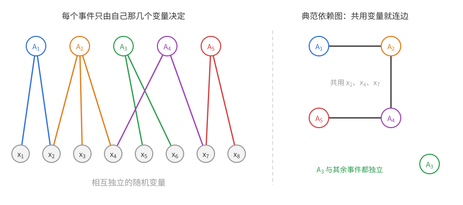

上图左边是事件与它依赖的变量，右边是由此得到的典范依赖图：共用一个变量的事件连边，$A_3$ 不与任何事件共用变量，是孤立点。

**引理 6.1**　变量模型中，典范依赖图是合法的依赖图。

*证明*　固定 $i$。所有不与 $A_i$ 相邻的 $A_j$ 都有 $B_j\cap B_i=\varnothing$，所以它们以及它们的任意组合，都只由 $\{x_k:k\notin B_i\}$ 决定；而 $A_i$ 只由 $\{x_k:k\in B_i\}$ 决定。两组独立随机变量各自决定的事件相互独立（概率论中的“分组原理”），故 $A_i$ 独立于所有非邻事件组成的事件组。$\square$

**变量模型看的是“表示”。** 任何一族事件都能平凡地写进变量模型：把整个随机样本当作唯一的变量就行，只是这时每个事件都依赖它，典范依赖图是完全图，毫无用处。所以变量模型的价值不在“能不能写成”，而在找到一组独立变量，使每个事件只依赖其中少数几个，典范依赖图因而稀疏；下文说某个随机对象“不是变量模型”，指的是没有这样有用的表示。

另外，典范依赖图只是合法依赖图中的一个，可能比必要的稠密：上面 $x_1,x_2,x_3$ 的例子里三个事件两两共用变量，典范依赖图是三角形，而两条边就够了。6.6 节会看到这种差别在算法中的后果。

**例（可满足性问题）**　**合取范式**（CNF）是若干**子句**的“且”，每个子句是若干**文字**（变量 $x_j$ 或其否定 $\neg x_j$）的“或”，例如
$$(x_1\vee x_2\vee\neg x_3)\wedge(\neg x_1\vee x_2\vee x_4)\wedge(x_2\vee\neg x_4\vee x_5).$$
问题是给布尔变量赋值使整个式子为真。计算机科学中大量问题都能写成这种形式。给每个变量独立均匀地赋 0 或 1，令 $A_i$ 为“第 $i$ 个子句为假”，这正是变量模型：$A_i$ 只依赖于第 $i$ 个子句里出现的变量。若每个子句恰含 $k$ 个不同变量（**$k$-CNF**），则子句为假当且仅当它的 $k$ 个文字全为假，$\mathbb P(A_i)=2^{-k}$。

### 两种形式

**定理 6.2（局部引理，对称形式）**　设 $\mathbb P(A_i)\le p$ 对一切 $i$ 成立，且每个 $A_i$ 独立于除至多 $d$ 个之外的所有其他事件组成的事件组（即有一个最大度 $\le d$ 的依赖图）。若
$$e\,p\,(d+1)\le1,$$
则以正概率所有 $A_i$ 都不发生。

例如上面的 $k$-CNF：若每个子句至多与 $2^k/e-1$ 个其他子句共用变量，则 $e\cdot2^{-k}\cdot2^k/e=1$，式子可满足。

**定理 6.3（局部引理，一般形式）**　设 $A_i$ 独立于 $\{A_j:j\notin N(i)\cup\{i\}\}$。若存在 $x_1,\dots,x_n\in[0,1)$ 使
$$\mathbb P(A_i)\le x_i\prod_{j\in N(i)}(1-x_j)\qquad\text{对一切 }i\in[n],$$
则
$$\mathbb P(\text{所有 }A_i\text{ 都不发生})\ge\prod_{i=1}^n(1-x_i)>0.$$

下面先讲证明是怎样想出来的，参数 $x_i$ 和条件中的乘积都会自然出现。

**从目标出发。** 记 $\overline A_S=\bigwedge_{j\in S}\overline{A_j}$（$\overline A_\varnothing$ 是全空间）。要证明 $\mathbb P(\overline A_{[n]})>0$，最直接的办法是链式法则（即条件概率的乘法公式 $\mathbb P(BC)=\mathbb P(B)\,\mathbb P(C\mid B)$ 反复使用）：
$$\mathbb P(\overline A_{[n]})=\prod_{i=1}^n\mathbb P\big(\overline{A_i}\,\big|\,\overline A_{[i-1]}\big)=\prod_{i=1}^n\Big(1-\mathbb P\big(A_i\,\big|\,\overline A_{[i-1]}\big)\Big).$$
所以只需对每个 $i$ 证明：**在已知前面的坏事件都没发生的条件下，$A_i$ 的概率不超过某个 $x_i<1$**。若事件都独立，这个条件概率就是 $\mathbb P(A_i)$，无事可做。

**障碍。** 有依赖时，“避开了别的坏事件”这个信息会改变 $A_i$ 的概率，而且可能使它变大。例如 $A_j$ 与 $A_i$ 是同一枚硬币的正反面，已知 $A_j$ 没发生，$A_i$ 就必然发生。所以必须控制邻居带来的影响。

**前缀不够用。** 先试着直接估计 $\mathbb P(A_i\mid\overline A_{[i-1]})$。条件里的事件分成两类：$A_i$ 的邻居 $S_1=[i-1]\cap N(i)$，和其余的 $S_2=[i-1]\setminus S_1$。下面会看到，非邻居容易处理，麻烦在于要估计 $\mathbb P(\overline A_{S_1}\mid\overline A_{S_2})$。用链式法则展开它，会出现 $\mathbb P\big(A_j\mid\overline A_{S_2\cup\{\cdots\}}\big)$ 这样的项，条件集已经**不是前缀**了。所以只对前缀证明是不够的：要让论证能调用自己，必须对**任意**条件集 $S$（$i\notin S$）证明 $\mathbb P(A_i\mid\overline A_S)\le x_i$。把要证的命题加强，是为了让归纳能进行下去。

**拆开条件。** 于是对一般的 $S$，把条件集合分成两部分：$S_1=S\cap N(i)$（$A_i$ 的邻居）和 $S_2=S\setminus S_1$（与 $A_i$ 独立的部分）。
$$\mathbb P(A_i\mid\overline A_S)=\frac{\mathbb P\big(A_i\overline A_{S_1}\mid\overline A_{S_2}\big)}{\mathbb P\big(\overline A_{S_1}\mid\overline A_{S_2}\big)}.$$

下图中实线是依赖图，$i$ 的邻居 $N(i)$ 用橙色标出；条件集 $S$ 是带虚线圈的点，它被切成 $S_1=S\cap N(i)$（橙色，进入分母）和 $S_2$（灰色，与 $A_i$ 独立）。

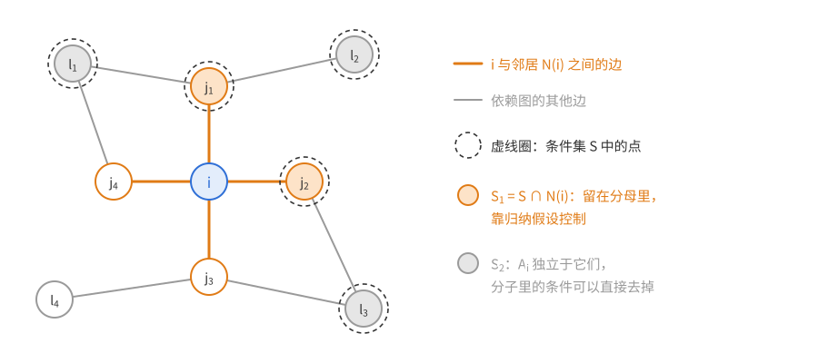

分子扔掉 $\overline A_{S_1}$ 只会变大，变成 $\mathbb P(A_i\mid\overline A_{S_2})$，由独立性就等于 $\mathbb P(A_i)$。难的是分母：它是“已知一些事件没发生时，再避开 $A_i$ 的邻居”的概率——**这正是我们要估计的同一类量**。这提示对 $|S|$ 用归纳法：若已知每个邻居 $j$ 在更小的条件集下满足 $\mathbb P(A_j\mid\cdots)\le x_j$，用链式法则展开分母，它至少是 $\prod_{j\in S_1}(1-x_j)\ge\prod_{j\in N(i)}(1-x_j)$。于是
$$\mathbb P(A_i\mid\overline A_S)\le\frac{\mathbb P(A_i)}{\prod_{j\in N(i)}(1-x_j)}.$$
要让归纳闭合，右边必须 $\le x_i$——**这正是定理 6.3 的条件**。所以 $x_i$ 的含义是：我们事先“承诺”的 $A_i$ 在任何条件下的概率上界；条件 $\mathbb P(A_i)\le x_i\prod_{N(i)}(1-x_j)$ 恰好保证这个承诺能被兑现。

**为什么出现 $e$。** 对称情形取所有 $x_i=x$，条件变成 $p\le x(1-x)^d$。右边在 $x=\frac1{d+1}$ 处最大，值为
$$\frac1{d+1}\Big(1-\frac1{d+1}\Big)^d\ge\frac1{e(d+1)},$$
因为 $\big(1+\frac1d\big)^d\le e$。这就是对称形式中 $e$ 的来源。

**定理 6.3 的证明**　对 $|S|$ 归纳证明下面两个断言：对每个 $S\subseteq[n]$，

1. $\mathbb P(\overline A_S)>0$；
2. 对每个 $i\notin S$，$\mathbb P(A_i\mid\overline A_S)\le x_i$。

$|S|=0$ 时，$\overline A_\varnothing$ 是全空间，断言 1 成立；断言 2 即 $\mathbb P(A_i)\le x_i\prod_{N(i)}(1-x_j)\le x_i$。

设两个断言对所有元素个数小于 $s$ 的集合成立，$|S|=s\ge1$。

*断言 1*：任取 $j\in S$，由归纳假设（对 $S\setminus\{j\}$）
$$\mathbb P(\overline A_S)=\mathbb P(\overline A_{S\setminus\{j\}})\big(1-\mathbb P(A_j\mid\overline A_{S\setminus\{j\}})\big)\ge\mathbb P(\overline A_{S\setminus\{j\}})(1-x_j)>0.$$

*断言 2*：设 $i\notin S$，$S_1=S\cap N(i)=\{j_1,\dots,j_r\}$，$S_2=S\setminus S_1$。由断言 1，下面的条件概率都有定义。
$$\mathbb P(A_i\mid\overline A_S)=\frac{\mathbb P(A_i\overline A_{S_1}\mid\overline A_{S_2})}{\mathbb P(\overline A_{S_1}\mid\overline A_{S_2})}.\tag{6.1}$$
分子：
$$\mathbb P(A_i\overline A_{S_1}\mid\overline A_{S_2})\le\mathbb P(A_i\mid\overline A_{S_2})=\mathbb P(A_i)\le x_i\prod_{j\in N(i)}(1-x_j),\tag{6.2}$$
其中等号用到 $A_i$ 独立于 $\{A_j:j\in S_2\}$（$S_2$ 中没有 $i$ 的邻居）。分母：若 $r=0$ 它等于 1；否则
$$\mathbb P(\overline A_{S_1}\mid\overline A_{S_2})=\prod_{t=1}^r\Big(1-\mathbb P\big(A_{j_t}\,\big|\,\overline A_{S_2\cup\{j_1,\dots,j_{t-1}\}}\big)\Big)\ge\prod_{t=1}^r(1-x_{j_t})\ge\prod_{j\in N(i)}(1-x_j),$$
这里对集合 $S_2\cup\{j_1,\dots,j_{t-1}\}$（不含 $j_t$，元素个数 $<s$）用了归纳假设。两式相除得 $\mathbb P(A_i\mid\overline A_S)\le x_i$，归纳完成。

最后由链式法则和断言 2，
$$\mathbb P(\overline A_{[n]})=\prod_{i=1}^n\Big(1-\mathbb P\big(A_i\mid\overline A_{[i-1]}\big)\Big)\ge\prod_{i=1}^n(1-x_i).\qquad\square$$

**定理 6.2 的证明**　若 $d=0$，事件相互独立（每个 $A_i$ 独立于其余所有事件组成的事件组，链式法则直接给出 $\prod(1-\mathbb P(A_i))$），且 $p\le1/e<1$，结论成立。若 $d\ge1$，取 $x_i=\frac1{d+1}$，则
$$x_i\prod_{j\in N(i)}(1-x_j)\ge\frac1{d+1}\Big(1-\frac1{d+1}\Big)^d\ge\frac1{e(d+1)}\ge p,$$
由定理 6.3 即得，而且得到 $\mathbb P(\text{都不发生})\ge\big(1-\frac1{d+1}\big)^n$。$\square$

**常数 $e$ 的意义。** 条件 $p(d+1)\le1$ 这个量级是不能省的：令 $X$ 在 $[d+1]$ 上均匀分布，$A_i=\{X=i\}$，每个概率 $\frac1{d+1}$，依赖图取 $K_{d+1}$（最大度 $d$），而这 $d+1$ 个事件必有一个发生。所以 LLL 的最佳常数介于 1 和 $e$ 之间。Shearer（1985）证明了当 $d\to\infty$ 时常数 $e$ 不能改进。在绝大多数应用中常数无关紧要。

**一般形式何时有用。** 当坏事件“性质很不相同”——例如概率相差悬殊——对称形式只能用最大的 $p$ 和最大的 $d$，两者往往来自不同的事件，会白白损失。一般形式允许给每个事件量身定做 $x_i$；通常取 $x_i$ 与 $\mathbb P(A_i)$ 同一量级（例如 $x_i=2\mathbb P(A_i)$ 或稍大一点的幂次）。下面是一个常用的现成选择。

**推论 6.4**　在定理 6.3 的设定下，若对每个 $i$ 有 $\mathbb P(A_i)<\frac12$ 且 $\sum_{j\in N(i)}\mathbb P(A_j)\le\frac14$，则以正概率所有 $A_i$ 都不发生。

*证明*　取 $x_i=2\mathbb P(A_i)<1$。由 $\prod(1-x_j)\ge1-\sum x_j$（对 $j$ 个数归纳，或看成并集上界），
$$x_i\prod_{j\in N(i)}(1-x_j)\ge2\mathbb P(A_i)\Big(1-\sum_{j\in N(i)}2\mathbb P(A_j)\Big)\ge2\mathbb P(A_i)\cdot\frac12=\mathbb P(A_i).\qquad\square$$

**证明中独立性用在哪里。** 回看证明，独立性只在 (6.2) 的等号处用过一次，而且只需要“$\le$”：
$$\mathbb P\big(A_i\,\big|\,\overline A_{S_2}\big)\le\mathbb P(A_i)\qquad(S_2\cap(N(i)\cup\{i\})=\varnothing).$$
也就是说，只要“避开非邻居不会让 $A_i$ 更容易发生”，证明就照样成立。这引出 6.5 节的“偏斜局部引理”。

## 6.2 超图染色

### 一致超图

回忆[第 1 章 1.3 节](概率方法01——引论.md#13-超图的二染色)：$k$ 一致超图由顶点集和它的一族 $k$ 元子集（称为边）组成；**可以二染色**指能把顶点染成两色，使没有一条边是单色的。那里的定理 1.10 说：边数少于 $2^{k-1}$ 的 $k$ 一致超图可以二染色。那是一个**全局**条件。LLL 给出一个**局部**条件：边数可以任意多，只要每条边与不太多的边相交。

**定理 6.5**　若 $k$ 一致超图的每条边至多与 $\frac{2^{k-1}}e-1$ 条其他边相交，则它可以二染色。

*证明*　顶点独立均匀地染两色。对每条边 $f$，令 $A_f$ 为“$f$ 单色”，$\mathbb P(A_f)=2^{1-k}=:p$。这是变量模型，$A_f$ 只依赖 $f$ 中顶点的颜色，典范依赖图中 $A_f$ 的邻居是与 $f$ 相交的边，至多 $d=\frac{2^{k-1}}e-1$ 个。$ep(d+1)=e\cdot2^{1-k}\cdot\frac{2^{k-1}}e=1$，由定理 6.2 得证。$\square$

**推论 6.6**　$k\ge9$ 时，每个 $k$ 一致 $k$ 正则超图（每个顶点恰在 $k$ 条边中）都可以二染色。

*证明*　一条边的 $k$ 个顶点各自还在 $k-1$ 条其他边中，所以每条边至多与 $d=k(k-1)$ 条其他边相交。$k=9$ 时 $e\,(k(k-1)+1)\,2^{1-k}=73e/256\approx0.78<1$，且 $k$ 增大时左边递减（$k(k-1)+1$ 至多增长到原来的 $\frac{(k+1)k+1}{k(k-1)+1}<2$ 倍，而 $2^{1-k}$ 减半）。由定理 6.2 得证。$\square$

$k=2$ 时结论不成立（三角形是 2 一致 2 正则的，不可二染色），$k=3$ 时也不成立（Fano 平面是 3 一致 3 正则的，第 1 章证明了它不可二染色）。Thomassen（1992）证明了 $k\ge4$ 时结论都成立，那需要别的方法。

### 非一致超图：需要一般形式

**定理 6.7**　设超图 $H$ 的每条边至少有 3 个顶点，且对每条边 $f$，
$$\sum_{g\in E(H)\setminus\{f\},\ g\cap f\ne\varnothing}2^{-|g|}\le\frac18,$$
则 $H$ 可以二染色。

**为什么对称形式不够。** 设 $H$ 由两部分组成：一条孤立的 3 元边，以及 $2^{k-3}+1$ 条 $k$ 元边，它们共用一个顶点、其余顶点互不相同（像一朵“向日葵”）。定理 6.7 的条件成立：3 元边没有邻居，和为 0；每条大边与其余 $2^{k-3}$ 条大边相交，和为 $2^{k-3}\cdot2^{-k}=\frac18$。但对称形式只能取全局的最坏值：$p=\mathbb P(3\text{ 元边单色})=\frac14$，$d=2^{k-3}$，$ep(d+1)=\frac e4(2^{k-3}+1)$ 远大于 1。

问题在于：概率大的事件（小边）邻居少，邻居多的事件（大边）概率小（单看大边，$k\ge5$ 时 $e\cdot2^{1-k}(2^{k-3}+1)<1$，$k$ 大时约为 $\frac e4$），对称形式把两者的最坏值硬凑在一起了。这个例子是刻意简化的（两部分不相交，本可以分开处理），只为把损失看清楚；真正需要一般形式的，是各种大小的边大量交织的情形，例如下面 Beck 的等差数列定理。

*证明*　随机均匀二染色，$A_f$ 为“$f$ 单色”。$\mathbb P(A_f)=2^{1-|f|}\le\frac14<\frac12$，且
$$\sum_{g\ne f,\ g\cap f\ne\varnothing}\mathbb P(A_g)=\sum_{g\ne f,\ g\cap f\ne\varnothing}2\cdot2^{-|g|}\le\frac14.$$
由推论 6.4，以正概率没有单色边。$\square$

### 紧性论证：从有限到无限

LLL 只能处理有限多个事件，但下面几个应用里的对象是无限的（整个实数轴、整个整数集、整个空间）。连接两者的是一个紧性论证。

**引理 6.8（紧性论证）**　考虑变量模型的如下变形：变量可以有无限多个，但每个变量只有**有限多个**可能取值；事件可以有无限多个，但每个事件只依赖**有限多个**变量。若任意有限多个事件都可以同时避开（即存在一种赋值使它们都不发生），则所有事件可以同时避开。

*证明（变量可数的情形）*　设变量为 $v_1,v_2,\dots$。想法是逐个确定 $v_1,v_2,\dots$ 的值，而每一步都不能把路走死：已经定下的这一段，必须还能延拓成避开任意有限多个事件的赋值。把这个要求写成定义：对 $v_1,\dots,v_m$ 的一个赋值 $\alpha$，若对每个有限事件组，都存在一个与 $\alpha$ 在 $v_1,\dots,v_m$ 上一致、且避开这组事件的完整赋值，就称 $\alpha$ **可延拓**。

由假设，空赋值可延拓。设 $\alpha$（定义在 $v_1,\dots,v_m$ 上）可延拓，断言 $v_{m+1}$ 的有限多个取值中，至少有一个 $a$ 使 $\alpha\cup\{v_{m+1}=a\}$ 可延拓。否则对每个取值 $a$，有一个有限事件组 $\mathcal E_a$ 无法被与 $\alpha\cup\{v_{m+1}=a\}$ 一致的赋值避开。取 $\mathcal E=\bigcup_a\mathcal E_a$（有限个有限集之并，仍有限）。因 $\alpha$ 可延拓，有与 $\alpha$ 一致的赋值 $\beta$ 避开 $\mathcal E$；设 $\beta(v_{m+1})=a$，则 $\beta$ 避开了 $\mathcal E_a$，矛盾。

于是可以逐个确定 $v_1,v_2,\dots$ 的值，使每一步的部分赋值都可延拓，得到完整赋值 $\alpha_\infty$。任取一个事件 $E$，它只依赖有限个变量，都在某个 $v_1,\dots,v_m$ 之中。$\alpha_\infty$ 在前 $m$ 个变量上的限制可延拓，所以有与它在 $v_1,\dots,v_m$ 上一致的赋值避开 $E$；$E$ 只看这 $m$ 个变量，故 $\alpha_\infty$ 也避开 $E$。$\square$

（这一段讲不可数的情形，首读可跳过。）变量不可数时，结论同样成立，标准证明用 Tikhonov 定理：所有赋值构成的空间 $\prod_vS_v$（每个 $S_v$ 是有限离散空间）在乘积拓扑下紧；“避开事件 $E$”的赋值集合 $C_E$ 是闭集；假设说 $\{C_E\}$ 有有限交性质，紧性就给出 $\bigcap_EC_E\ne\varnothing$。下面的应用都可以化归到可数情形，所以不需要这个拓扑工具。

**“每个变量取值有限”不能去掉。** 设 $X$ 是唯一的变量，取值于正整数，$\mathbb P(X=n)=2^{-n}$；令 $A_n=\{X=n\}$。每个事件只依赖一个变量，任意有限个 $A_n$ 都能避开（取 $X$ 比它们的下标都大），但不可能所有 $A_n$ 都不发生。引理的证明中“$v_{m+1}$ 只有有限多个取值”正是在取并集 $\bigcup_a\mathcal E_a$ 时用到的。

**定理 6.9**　设超图 $H$ 的顶点集可以无限，每条边是有限集、至少有 $k$ 个顶点、至多与 $d$ 条其他边相交。若 $e\,2^{1-k}(d+1)\le1$，则 $H$ 可以二染色。

*证明*　先化归到可数情形。在边之间按“相交”连线，得到一个最大度 $\le d$ 的图；它的每个连通分支是可数的（从一条边出发，距离 $r$ 以内的边至多 $1+d+\dots+d^r$ 条）。不同分支中的边没有公共顶点，所以可以对每个分支分别染色，不属于任何边的顶点随便染。下设边可数，从而涉及的顶点可数。

变量是每个顶点的颜色（两种取值），事件 $A_f$ 为“边 $f$ 单色”，只依赖 $f$ 的有限个顶点。任取有限个事件，对它们用对称 LLL：$\mathbb P(A_f)=2^{1-|f|}\le2^{1-k}$，每个至多与 $d$ 个相交，条件 $e2^{1-k}(d+1)\le1$ 成立，所以能同时避开。由引理 6.8，所有 $A_f$ 能同时避开。$\square$

### 平移集的多色染色

这是 Erdős 和 Lovász 在提出局部引理的原始论文中的应用。用 $k$ 种颜色给实数染色，即取 $c:\mathbb R\to[k]$；称 $T\subseteq\mathbb R$ 是**多色**的，若 $k$ 种颜色在 $T$ 中都出现。

**问题**　对每个 $k$，是否存在 $m$，使得对任意 $m$ 元集 $S\subseteq\mathbb R$，都能 $k$ 染色 $\mathbb R$，使 $S$ 的每个平移 $S+x$ 都是多色的？

**定理 6.10**　若
$$e\,\big(m(m-1)+1\big)\,k\Big(1-\frac1k\Big)^m\le1,$$
则对任意 $m$ 元集 $S\subseteq\mathbb R$，存在 $\mathbb R$ 的 $k$ 染色使 $S$ 的每个平移都是多色的。

*证明*　每个实数的颜色独立均匀地取自 $[k]$。对每个 $x$，令 $A_x$ 为“$S+x$ 不是多色的”，即某种颜色在 $S+x$ 中缺席，由并集上界 $\mathbb P(A_x)\le k(1-\frac1k)^m$。$A_x$ 只依赖 $S+x$ 中 $m$ 个点的颜色。$S+x$ 与 $S+y$ 相交当且仅当 $y-x\in S-S$，而 $S-S$ 中非零元至多 $m(m-1)$ 个，所以每个事件至多与 $m(m-1)$ 个其他事件共用变量。

事件有不可数个，但“$S+x$ 与 $S+y$ 相交”定义的图最大度 $\le m(m-1)$，每个连通分支可数，不同分支涉及的点互不相交。对每个分支，变量（分支涉及的点的颜色）可数、各有 $k$ 种取值，任意有限个事件由对称 LLL 可以同时避开，再由引理 6.8 全部避开。各分支拼起来，其余点任意染色即可。$\square$

**数量级。** 条件对 $m=(3+\varepsilon)k\ln k$ 成立（$k$ 充分大）：$k(1-\frac1k)^m\le ke^{-m/k}=k^{-2-\varepsilon}$，而 $e(m(m-1)+1)\le em^2=e(3+\varepsilon)^2k^2\ln^2k$，乘积 $e(3+\varepsilon)^2\ln^2k/k^\varepsilon\to0$。所以 $m=O(k\log k)$ 就够了，与 $S$ 的形状无关。

### 等差数列的二染色

**定理 6.11（Beck 1980）**　对每个 $\varepsilon\in(0,1)$，存在 $k_0$ 和 $\mathbb Z$ 的一个二染色，使得没有单色的 $k$ 项等差数列，其中 $k\ge k_0$、公差（正整数）小于 $2^{(1-\varepsilon)k}$。

**思路。** 随机二染色，$k$ 项等差数列单色的概率是 $2^{1-k}$。不同长度的数列概率相差悬殊，而长数列碰到的数列也更多，正是“性质很不相同”的局面，用一般形式。对 $k$ 项数列取 $x$ 比 $2^{1-k}$ 稍大一点：$x=2^{-(1-\varepsilon/2)k}$，留出 $2^{-\varepsilon k/2}$ 的余量来吸收邻居的影响。

*证明*　每个整数独立均匀地染两色。对每个“容许”的数列 $P$（项数 $\ell\ge k_0$、公差 $<2^{(1-\varepsilon)\ell}$），令 $A_P$ 为“$P$ 单色”，$\mathbb P(A_P)=2^{1-\ell}$。由紧性论证（变量是可数个整数的颜色，每个事件依赖有限个变量），只需证明任意有限个事件可以同时避开；对有限个事件，邻居只会更少，所以下面对全体事件验证一般形式的条件即可。

对 $\ell$ 项数列取 $x_P=2^{-(1-\varepsilon/2)\ell}$。固定 $k$ 项容许数列 $P$。与 $P$ 相交的 $\ell$ 项容许数列：选一个公共元素（$P$ 中 $k$ 种）、它在新数列中的位置（$\ell$ 种）、公差（少于 $2^{(1-\varepsilon)\ell}$ 种），至多 $k\ell2^{(1-\varepsilon)\ell}$ 个。要验证
$$2^{1-k}\le2^{-(1-\varepsilon/2)k}\prod_{\ell\ge k_0}\Big(1-2^{-(1-\varepsilon/2)\ell}\Big)^{k\ell2^{(1-\varepsilon)\ell}}.$$
（邻居集合是无限的，但乘积中各因子都在 $(0,1]$ 内，任何有限子乘积都不小于全乘积。）对 $x\in[0,\frac12]$ 有 $1-x\ge e^{-2x}$，所以右边的乘积至少
$$\exp\Big(-\sum_{\ell\ge k_0}2\cdot2^{-(1-\varepsilon/2)\ell}\cdot k\ell2^{(1-\varepsilon)\ell}\Big)=\exp\Big(-k\sum_{\ell\ge k_0}\ell\,2^{1-\varepsilon\ell/2}\Big).$$
级数 $\sum_\ell\ell2^{1-\varepsilon\ell/2}$ 收敛，取 $k_0$ 充分大使尾和 $\le\varepsilon/4$，并且 $k_0\ge8/\varepsilon$。则右边至少 $2^{-(1-\varepsilon/2)k}e^{-\varepsilon k/4}$，只需
$$2^{1-\varepsilon k/2}\le e^{-\varepsilon k/4}\iff\ln2\le\varepsilon k\Big(\frac{\ln2}2-\frac14\Big)\approx0.0966\,\varepsilon k,$$
这在 $k\ge k_0\ge8/\varepsilon$ 时成立（$\ln2/0.0966\approx7.18$）。$\square$

**推论：van der Waerden 数的下界。** 记 $W(k)$ 为使 $[N]$ 的任意二染色都有单色 $k$ 项等差数列的最小 $N$。把定理中的染色限制在 $[N]$，$N=\lfloor2^{(1-\varepsilon)k}\rfloor$：$[N]$ 中 $k$ 项数列的公差至多 $\frac{N-1}{k-1}<2^{(1-\varepsilon)k}$，所以没有单色的。故 $W(k)>2^{(1-\varepsilon)k}$（$k$ 充分大）。

### 覆盖的分解

这一小节是进阶内容，首读可以只看“为什么这是超图染色问题”，以及定理 6.13 的陈述和紧随其后的思路。

称 $\mathbb R^d$ 中的一族球是**覆盖**，若它们的并是整个空间；是 **$k$ 重覆盖**，若每个点至少在 $k$ 个球中。称 $k$ 重覆盖是**可分解**的，若这族球可以分成两族，每族都是覆盖。

**问题**　$k$ 充分大时，$\mathbb R^d$ 中由单位球组成的 $k$ 重覆盖是否都可分解？

**为什么这是超图染色问题。** 把球看成超图的顶点，每个点 $x$ 给出一条边 $E_x=\{\text{包含 }x\text{ 的球}\}$。把球二染色，两种颜色的球各成一族；两族都是覆盖，就是每个点 $x$ 处两种颜色的球都有，即每条边 $E_x$ 都不单色。所以**覆盖可分解，当且仅当这个超图可以二染色**；$k$ 重覆盖说的是每条边至少有 $k$ 个顶点。这正是本节的问题，只要每条边只与不太多的边相交，LLL 就能用。这个超图一般有无穷多个顶点和边，所以要用无限版本的定理 6.9。

下图左边是平面上的几个单位圆盘（球）和两个点 $x,y$，右边是对应的超图：圆盘是顶点，$E_x$、$E_y$ 是边；$E_x$ 与 $E_y$ 相交，因为圆盘 $B_3$ 同时包含 $x,y$。

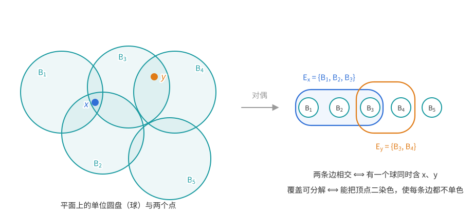

先看低维的情形，它告诉我们能期望什么。

**一维：等长区间可以分成 $k$ 个覆盖。** 一维的单位球是长为 2 的开区间。这里用不着 LLL。

**引理 6.12**　设 $\{(t-1,t+1):t\in T\}$（$T$ 是可以有重复的指标族）是 $\mathbb R$ 的 $k$ 重覆盖，则它可以分成 $k$ 族，每族都是覆盖。

*证明*　第一步，取一个“局部有限”的子族，它仍是 $k$ 重覆盖。对每个 $x$，取 $k$ 个包含 $x$ 的区间，它们都是开集，所以同时包含 $x$ 的某个开邻域 $U_x$。闭区间 $[m,m+1]$ 紧，被有限个 $U_x$ 覆盖，于是有一个有限子族 $\mathcal F_m$ $k$ 重覆盖 $[m,m+1]$。$\mathcal F_m$ 中每个区间都碰到 $[m,m+1]$，中心在 $(m-1,m+2)$ 内。令 $\mathcal F'=\bigcup_{m\in\mathbb Z}\mathcal F_m$，它仍是 $k$ 重覆盖，而且任何有界区间里只有 $\mathcal F'$ 的有限个中心。

第二步，把 $\mathcal F'$ 的中心从小到大排成 $\cdots\le t_{-1}\le t_0\le t_1\le\cdots$（相同的中心任意排序；中心在两个方向都无界，因为有限个有界区间盖不住 $\mathbb R$），把中心为 $t_i$ 的区间放进第 $i\bmod k$ 族。对任意 $x$，包含 $x$ 的区间恰是中心落在 $(x-1,x+1)$ 中的那些，它们的下标是**连续的**一段整数，且至少 $k$ 个，因而取遍模 $k$ 的所有余数。所以每一族都盖住 $x$。

第三步，不在 $\mathcal F'$ 中的区间随便放进某一族——往覆盖里添加区间仍是覆盖。$\square$

区间长度不等时结论仍然成立，但要换一种论证，见本节末尾的补充。

**二维起有反例。** 这一段是研究背景，首读可跳过。Mani-Levitska 和 Pach 在 1986 年的一份未发表手稿中声称，平面上单位圆盘的 33 重覆盖都可分解。这个说法流传很广，却从未得到独立核实，而且是错的：Pach 和 Pálvölgyi（2016，《Unsplittable coverings in the plane》）证明，对每个 $k$，平面上都有由开单位圆盘组成的不可分解的 $k$ 重覆盖。把这样的平面反例放进高维空间，平面外的点另用碰不到这个平面的单位球补足，就得到每个 $d\ge2$ 的反例。可见分界在一维与二维之间。

不过，不可分解的覆盖必定很不均匀：

**定理 6.13（Mani-Levitska–Pach 1986）**　$\mathbb R^3$ 中由开单位球组成的不可分解的 $k$ 重覆盖，必有某个点被覆盖至少 $c\,2^{k/3}$ 次，$c>0$ 是绝对常数。

在 $\mathbb R^d$ 中同样的证明给出 $c_d2^{k/d}$。这个结果也出自那份 1986 年的手稿，公开发表的证明见 Pach–Pálvölgyi（2016）的定理 3。$d=2$ 时它与上面的反例并不矛盾：平面上不可分解的 $k$ 重覆盖，必有点被覆盖 $c_2 2^{k/2}$ 次以上。

**思路。** 由上面的转化，只需让超图的每条边只与不太多（约 $2^k$ 以内）的边相交，定理 6.9 就给出二染色。若每点至多被覆盖 $t$ 次，与 $E_x$ 相交的边 $E_y$ 只能来自 $x$ 附近的 $O(t)$ 个球；而 $E_y$ 由 $y$ 的**包含模式**（$y$ 落在这些球中的哪几个里）决定。模式的种数由这些球面把空间分成的区域数控制，下面的几何引理说它是 $O(t^3)$。于是依赖度只是 $t$ 的多项式，$t$ 比 $2^{k/3}$ 小一个常数倍时 LLL 就能用。

**引理 6.14**　$n\ge2$ 个球面把 $\mathbb R^3$ 分成至多 $n^3$ 个连通区域。

*证明*　先降一维。设 $f(m)$ 为一个球面上 $m$ 个圆最多把球面分成的区域数，$f(0)=1$，$f(1)=2$。加入第 $m+1$ 个圆时，它与已有每个圆至多交于 2 点（两个圆分别是球面与两个平面的交，两平面交于一条直线，直线与球面至多交于 2 点；重合的圆不增加区域），共至多 $2m$ 个交点，把新圆分成至多 $\max(2m,1)$ 段弧；每段弧落在一个已有区域内，至多把它一分为二。所以 $f(m+1)\le f(m)+2m$（$m\ge1$），得 $f(m)\le m(m-1)+2$。

再看空间。设 $g(m)$ 为 $m$ 个球面最多把 $\mathbb R^3$ 分成的区域数，$g(1)=2$。加入第 $m+1$ 个球面时，它与已有每个球面交于一个圆（或一点，或为空），这至多 $m$ 个圆把新球面分成至多 $f(m)$ 块（单点不分割球面）；每块落在一个已有区域内，至多把它一分为二。所以 $g(m+1)\le g(m)+f(m)$，
$$g(n)\le2+\sum_{j=1}^{n-1}\big(j(j-1)+2\big)=2n+\frac{n(n-1)(n-2)}3\le n^3\qquad(n\ge2).\qquad\square$$

（“一段曲线或一块曲面至多把一个区域一分为二”是 Jordan 曲线定理一类的直观事实，这里不展开。）

*定理 6.13 的证明*　证明分三步：先把覆盖转化为超图 $H$；再证明 $H$ 的每条边至多与 $(64t)^3$ 条其他边相交（体积比较控制附近的球数，引理 6.14 控制包含模式数）；最后代入定理 6.9 得出矛盾。

设 $\mathcal F$ 是不可分解的 $k$ 重覆盖，并假设每个点至多被覆盖 $t$ 次；要证明 $t\ge c2^{k/3}$。$k\le2$ 时取 $c\le\frac12$ 即可（每点至少被覆盖 $k\ge1$ 次），下设 $k\ge3$。每个开球含有理点，每个有理点至多在 $t$ 个球中，所以 $\mathcal F$ 可数。

构造超图 $H$：顶点是 $\mathcal F$ 中的球，边是所有不同的集合 $E_x$（$x\in\mathbb R^3$）。由 $k$ 重覆盖，$|E_x|\ge k$；由假设 $|E_x|\le t$。

*断言：每条边至多与 $D=(64t)^3$ 条其他边相交。* 固定 $x$。若 $E_x\cap E_y\ne\varnothing$，有一个单位球同时含 $x,y$，故 $|x-y|<2$；$E_y$ 中每个球的中心与 $y$ 距离小于 1，从而与 $x$ 距离小于 3。令 $\mathcal F_x$ 为中心与 $x$ 距离小于 3 的球，它们都含于半径 4 的球 $B(x,4)$ 中。比较体积：
$$|\mathcal F_x|\cdot\mathrm{vol}(B_1)=\int_{B(x,4)}\#\{B\in\mathcal F_x:z\in B\}\,dz\le t\cdot\mathrm{vol}(B(x,4))=64t\cdot\mathrm{vol}(B_1),$$
所以 $|\mathcal F_x|\le64t$。而对这样的 $y$，$E_y=\{B\in\mathcal F_x:y\in B\}$。所以只需证明：$n=|\mathcal F_x|$ 个开单位球 $B(c_1,1),\dots,B(c_n,1)$ 给出的“包含模式”$T(y)=\{i:|y-c_i|<1\}$ 至多有 $n^3$ 种（$n\le1$ 时至多 2 种）。

直接用 $n$ 个单位球面分出的区域来数，有个小麻烦：恰好落在某个球面上的点，模式可能与两侧都不同，不属于任何区域。所以先把半径稍微缩小一点，使所有代表点都离开球面，而它们的模式不变。具体地，对每种出现过的模式取一个代表点 $y$，得到有限点集 $Y$。取 $\rho<1$，使得对所有 $y\in Y$ 和所有 $i$：$|y-c_i|<1$ 时 $|y-c_i|<\rho$，且 $|y-c_i|\ne\rho$（只需 $\rho$ 大于有限个小于 1 的数、并避开有限个值）。于是 $Y$ 中各点关于半径 $\rho$ 的球的模式与原来相同，而且都不在半径 $\rho$ 的球面上。沿一条不穿过这些球面的道路，“是否在球 $B(c_i,\rho)$ 内”不会改变（介值定理），所以模式在半径 $\rho$ 的 $n$ 个球面的补集的每个连通区域上是常数。不同模式的代表点落在不同区域，由引理 6.14，模式至多 $n^3$ 种。断言得证。

于是 $H$ 的每条边至少 $k$ 个顶点、至多与 $D=(64t)^3$ 条其他边相交。若 $t<c2^{k/3}$ 且 $c=\big(64\cdot(8e)^{1/3}\big)^{-1}$，则（用 $k\ge3$）
$$e2^{1-k}(D+1)\le2e\cdot64^3c^3+e2^{1-k}\le\frac14+\frac e4<1.$$
由定理 6.9（其中的 $d$ 取为 $D$），$H$ 可以二染色：两种颜色的球各成一族，每个 $x$ 的 $E_x$ 中两色都有，即两族都是覆盖，与不可分解矛盾。所以 $t\ge c2^{k/3}$。$\square$

### 补充：长度不等的区间

这一段与 LLL 无关，只把引理 6.12 推广到长度不等的区间，第一次阅读可以跳过。这里的两个结论是旁支，不参与本章编号。

一维的结论其实不需要等长，但引理 6.12 的证明离不开等长。它的关键是“包含 $x$ 的区间在中心的顺序中连成一段”，长度不同时这就不对了。例如 $(0,10)$、$(5.5,5.8)$、$(6,7)$ 的中心依次是 $5$、$5.65$、$6.5$，包含 $x=6.5$ 的是第一个和第三个，夹在中间的那个不含 $x$；循环分色可能把含 $x$ 的两个区间分进同一族，而另一族在 $x$ 处落空。

所以要换一种分法。先只要求盖住一个有界闭集 $S$（例如一条闭线段），并且只有有限多个区间。从左往右看，每一族都有一条“前沿”：$S$ 中第一个还没被这一族盖住的点。目标是把每一族的前沿都推出 $S$。把区间按左端点从小到大逐个分配，最自然的贪心是**每个区间交给当前前沿最靠左的那一族**：最落后的一族最需要帮助，而区间按左端点的顺序到来，越早到的越有机会盖住靠左的前沿。下面证明这个贪心不会失败。这里只讨论开区间，与本节的开球一致。

**命题（任意长度的开区间）**　设 $S\subseteq\mathbb R$ 是非空的有界闭集，$\mathcal H$ 是有限多个开区间组成的族（长度可以不同，也可以是 $(-\infty,b)$、$(a,+\infty)$ 这样的射线），$S$ 的每个点至少在 $\mathcal H$ 的 $k$ 个区间中。则 $\mathcal H$ 可以分成 $k$ 族，每族都盖住 $S$。

*证明*　对一族区间 $\mathcal C$，记 $\phi(\mathcal C)$ 为 $S$ 中不被 $\mathcal C$ 盖住的最小点（这些点构成 $S$ 的闭子集，非空时有最小元）；$S$ 全被盖住时记 $\phi(\mathcal C)=+\infty$。把 $\mathcal H$ 的区间按左端点从小到大排列（相同的任意排），依次处理：开始时 $k$ 族都是空的，每个区间放进当前 $\phi$ 最小的一族（并列时任选）。族只会变大，所以每族的 $\phi$ 只增不减，$k$ 个 $\phi$ 的最小值也只增不减。

设处理完后有某族的 $\phi$ 有限，取其中最小的值 $s$，设它是族 $\mathcal C$ 的。$s\in S$ 至少在 $k$ 个区间 $J_1,\dots,J_k$ 中。考察其中任一个 $J$：处理它时，它进了族 $\mathcal C'$，$\mathcal C'$ 当时的 $\phi$ 值 $f$ 是当时的最小值，所以 $f\le s$。

- *放进 $J$ 之后，$\mathcal C'$ 的 $\phi$ 大于 $s$。* 若 $f=s$：$J$ 盖住 $s$，而 $S$ 中小于 $s$ 的点已被 $\mathcal C'$ 盖住，所以新的 $\phi$ 大于 $s$。若 $f<s$：假如 $f\notin J$，因为 $J$ 是含 $s$ 的区间，它的左端点 $\ge f$；此后处理的区间左端点都不更小，作为开区间都不含 $f$，于是 $\mathcal C'$ 永远盖不住 $f$，最终 $\phi(\mathcal C')\le f<s$，与 $s$ 的最小性矛盾。所以 $f\in J$，从而 $J\supseteq[f,s]$，放进 $J$ 后 $\mathcal C'$ 盖住了 $S$ 中所有 $\le s$ 的点。
- *$J_1,\dots,J_k$ 进了不同的族。* 若 $J_a$ 先于 $J_b$ 进了同一族 $\mathcal C'$，则放进 $J_a$ 后 $\mathcal C'$ 的 $\phi$ 就 $>s$，以后一直如此；而处理 $J_b$ 时 $\mathcal C'$ 的 $\phi$ 是当时的最小值，于是当时的最小值 $>s$，最终的最小值也 $>s$，矛盾。

于是 $J_1,\dots,J_k$ 恰好进了全部 $k$ 族，每族的 $\phi$ 最终都 $>s$，$\mathcal C$ 也不例外，矛盾。所以每族的 $\phi$ 都是 $+\infty$。$\square$

下图是 $k=2$、$S=[0,10]$ 的一次运行。区间按左端点自上而下处理，颜色表示它进了哪一族；每行的短竖线标出处理它之前蓝、橙两族的前沿 $\phi$（已盖住全部 $S$ 的族不画）。可以看到每个区间都进了前沿较靠左的一族，并且都盖住了那条前沿；最下面两条线是两族各自的并，都盖住了 $S$。

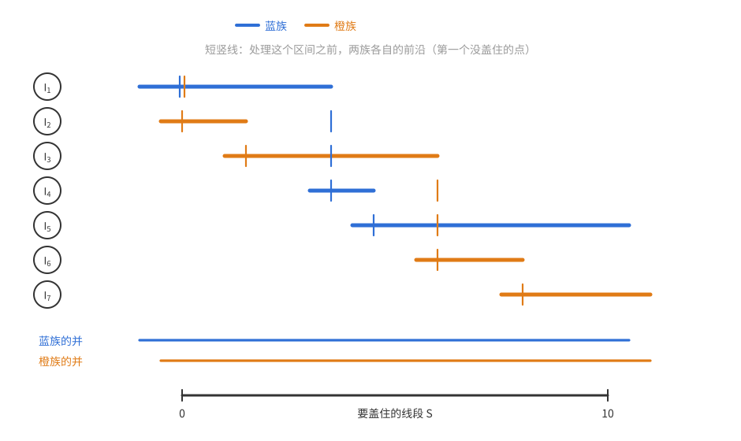

两条性质各管一件事。第一条说“落后的族得到一个含 $s$ 的区间，就一口气越过 $s$”，用到的是区间为开、按左端点处理：没盖住前沿的区间，以后的区间也补不上，所以它必须盖住前沿。第二条说“含 $s$ 的 $k$ 个区间不会挤进同一族”，用到的是每次都交给最落后的族。重数 $\ge k$ 只在最后一步用到。

**从有限到无限。** 称一族区间**局部有限**，若每个有界集只与其中有限个区间相交。

**命题（一维覆盖的分解）**　由开区间组成的 $\mathbb R$ 的 $k$ 重覆盖若是局部有限的，或者区间长度有上界，则可以分成 $k$ 个覆盖。引理 6.12 是长度有上界的特例。

*证明*　先设覆盖局部有限。每个 $[m,m+1]$ 只碰到有限个区间，所以区间只有可数个。用引理 6.8：变量是每个区间的族号（$k$ 种取值）；对每个整数 $m$，事件 $B_m$ 为“某一族没有盖住 $[m,m+1]$”。能盖住 $[m,m+1]$ 中的点的只有与它相交的那有限个区间，所以 $B_m$ 只依赖有限个变量。任取有限个事件 $B_m$（$m\in M$），令 $S=\bigcup_{m\in M}[m,m+1]$，$\mathcal H$ 为与 $S$ 相交的（有限个）区间；$S$ 的每个点在 $\mathcal H$ 的至少 $k$ 个区间中。由上面的命题，$\mathcal H$ 可以分成 $k$ 族、每族都盖住 $S$，其余区间随便分，这些 $B_m$ 就都避开了。由引理 6.8，所有 $B_m$ 可以同时避开，即每族都盖住 $\mathbb R$。

区间长度都 $\le L$ 时，重复引理 6.12 证明的第一步：取有限子族 $\mathcal F_m$ $k$ 重覆盖 $[m,m+1]$，它的区间都含于 $(m-L,m+1+L)$，所以 $\bigcup_m\mathcal F_m$ 是局部有限的 $k$ 重覆盖。把它分成 $k$ 个覆盖，剩下的区间随便放。$\square$

长度无界且不局部有限时（例如 $(-n,n)$，$n=1,2,\dots$，无穷多个区间都经过原点），某个点处的事件要依赖无穷多个变量，引理 6.8 不能直接套用，需要另外的论证，这里不讨论。

## 6.3 独立横贯

这一节的应用很有教益：即使知道要用 LLL，选什么作坏事件也不是显然的，不同的选法效果差别很大。

最大度为 $\Delta$ 的图有大小至少 $|V|/(\Delta+1)$ 的独立集（贪心）。下面的定理说，把要求降低一个常数倍，就能让独立集还是给定划分的一个**横贯**（每组恰取一点）。

**定理 6.15**　设图 $G=(V,E)$ 最大度为 $\Delta$，$V=V_1\cup\cdots\cup V_r$ 是一个划分，每个 $|V_i|\ge2e\Delta$。则 $G$ 有一个独立集，在每个 $V_i$ 中恰有一个点。

每组独立均匀地随机选一点 $v_i\in V_i$。这是变量模型，变量是 $v_1,\dots,v_r$。要选一族坏事件，使得全部避开时 $\{v_1,\dots,v_r\}$ 就是独立集。同一组内部的边无关紧要（每组只选一点），先把它们删去，于是所有边都连接不同的组。为了先看清坏事件该怎样选，暂设每组恰有 $k$ 个点。

**尝试一：以“组对”为单位。** 对每对有边相连的组 $V_i,V_j$，令 $A_{ij}$ 为“$v_i$ 与 $v_j$ 相邻”。$V_i,V_j$ 之间至多 $k\Delta$ 条边，所以 $\mathbb P(A_{ij})\le k\Delta/k^2=\Delta/k$。$A_{ij}$ 依赖 $v_i,v_j$，与 $A_{i'j'}$ 相邻当且仅当 $\{i,j\}\cap\{i',j'\}\ne\varnothing$；与 $V_i$ 有边相连的组至多 $k\Delta$ 个，所以 $d\le2k\Delta$。$ep(d+1)\approx e\cdot\frac\Delta k\cdot2k\Delta=2e\Delta^2$，远大于 1。

**问题在哪。** “$V_i$ 与 $V_j$ 之间某条边被选中”把至多 $k\Delta$ 条边的情况打包成一个事件，概率被放大了 $k\Delta$ 倍；而打包并没有换来更好的依赖度上界（下面会看到，两种方案的依赖度都是 $O(k\Delta)$ 量级）。应该把事件拆细。

**尝试二：以“边”为单位。** 对每条边 $f=uw$（$u\in V_i$，$w\in V_j$），令 $A_f$ 为“$u,w$ 都被选中”，$\mathbb P(A_f)=1/k^2$。$A_f$ 依赖 $v_i,v_j$，与它相邻的是有端点在 $V_i\cup V_j$ 中的边对应的事件，约 $2k\Delta$ 个。于是 $ep(d+1)\approx2e\Delta/k$，$k\ge2e\Delta$ 时不超过 1，这正是定理中的条件。

**组的大小不齐时。** 一般地，$\mathbb P(A_f)=\frac1{|V_i||V_j|}$，依赖度约 $(|V_i|+|V_j|)\Delta$：连接两个小组的边概率大、邻居少，连接两个大组的边概率小、邻居多。对称 LLL 只能取最大的 $p$ 和最大的 $d$，两者来自不同的边。例如一些组恰有 $2e\Delta$ 个点、另一些组有 $K$ 个点时，$ep(d+1)$ 约为 $e\cdot\frac1{(2e\Delta)^2}\cdot2K\Delta=\frac K{2e\Delta}$，$K$ 大时远超 1。修补的办法是**把每组修剪成同样大小**：从每个 $V_i$ 中删掉一些点，只留 $\lceil2e\Delta\rceil$ 个。在更小的组里找到的独立横贯也是原来的独立横贯，而修剪把所有事件拉到了同一水平。（也可以不修剪而用一般形式，但修剪更简单。）

*证明*　$\Delta=0$ 时结论平凡，设 $\Delta\ge1$。按上面的办法，不妨设每个 $|V_i|=k:=\lceil2e\Delta\rceil$，且所有边都连接不同的组（删点、删边都不会增大最大度）。每组独立均匀地随机选一点 $v_i\in V_i$；对每条边 $f=uw$（$u\in V_i$，$w\in V_j$），令 $A_f$ 为“$u,w$ 都被选中”，$\mathbb P(A_f)=1/k^2$。$A_f$ 只依赖 $v_i,v_j$；$A_g$ 与它相邻当且仅当 $g$ 有端点在 $V_i\cup V_j$ 中。$V_i\cup V_j$ 的 $2k$ 个点各至多 $\Delta$ 条边，共至多 $2k\Delta$ 条（按端点计重数），其中 $f$ 本身被计了两次，所以 $d\le2k\Delta-2$。于是
$$e\,p\,(d+1)\le\frac{e(2k\Delta-1)}{k^2}<\frac{2e\Delta}k\le1.$$
由对称 LLL，以正概率没有 $A_f$ 发生，此时 $\{v_1,\dots,v_r\}$ 是独立集。$\square$

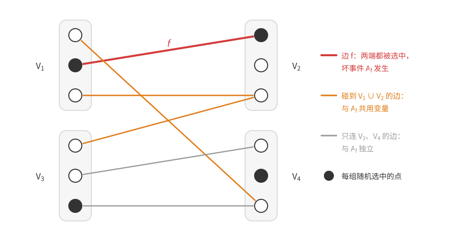

图中每组随机选一点（黑点）。红边 $f$ 的两端都被选中，即坏事件 $A_f$ 发生；橙边碰到 $V_1\cup V_2$，与 $A_f$ 共用变量 $v_1$ 或 $v_2$；灰边只连 $V_3,V_4$，与 $A_f$ 独立。

**两次尝试的对比。** 两种方案的依赖度都只能估计为 $O(k\Delta)$，差别主要在概率：尝试一的事件概率 $\Delta/k$，尝试二是 $1/k^2$。细化事件让概率下降了 $k\Delta$ 倍，而依赖度的上界仍是同一量级。注意拆细并不保证实际依赖度不增加：同一组对拆出的各个边事件都依赖这两组的选择，彼此相关，实际依赖度可能比打包时更大。要紧的是 LLL 条件里概率与依赖度的乘积变小了。习题 9 会再用到“把坏事件拆细”的想法。

**评注**　Alon（1988）把这个结果作为引理，用于他对至今未解决的**线性荫度猜想**（猜想最大度为 $\Delta$ 的图的边总能分成 $\lceil(\Delta+1)/2\rceil$ 个线性森林，即每个连通分支都是路的森林）的近似证明，那个证明大量使用 LLL。Haxell（1995、2001）把条件放宽到 $|V_i|\ge2\Delta$；Szabó 和 Tardos（2006）证明 $2\Delta$ 换成 $2\Delta-1$ 就不再成立。

## 6.4 长度被 $k$ 整除的有向圈

上一节讲坏事件要选得细；这一节讲依赖图也要选得细：典范依赖图多算了一类邻居，改用更精细的有向依赖图，才得到想要的条件。

称有向图是 **$r$ 正则**的，若每个点的入度和出度都是 $r$。

**定理 6.16（Alon–Linial 1989）**　对每个 $k$，存在 $r$，使每个 $r$ 正则有向图都有长度被 $k$ 整除的有向圈。

**推论 6.17**　对每个 $k$，存在 $r$，使每个 $2r$ 正则（无向简单）图都有长度被 $k$ 整除的圈。

*证明*　$2r$ 正则图的每个连通分支都有 Euler 回路（经过每条边恰好一次的闭路线；连通图中每点度为偶数时它存在），沿 Euler 回路给边定向，每个点进出次数相同，得到 $r$ 正则有向图。由定理 6.16，它有长度被 $k$ 整除的有向圈；简单图的定向没有长度 1、2 的有向圈，所以这个有向圈是原图的一个圈。$\square$

我们证明一个更一般的结论。

**定理 6.18（Alon–Linial 1989）**　设有向图（无自环）的最小出度为 $\delta$，最大入度为 $\Delta$。若
$$k\le\frac{\delta}{1+\ln(1+\delta\Delta)},$$
则它有长度被 $k$ 整除的有向圈。

取 $\delta=\Delta=r$：$r\ge Ck\log k$ 时条件成立，这给出定理 6.16。

**思路：用标号强迫整除性。** 怎样保证圈长被 $k$ 整除？给每个点一个标号 $x_v\in\mathbb Z/k$，只沿“标号加 1”的边走：沿这样的圈走一周，标号回到原值，总共加了圈长那么多个 1，所以圈长 $\equiv0\pmod k$。而只要**每个点都有一条通向标号加 1 的点的出边**，从任一点出发一直走下去，在有限图中必然重复，重复的那一段就是这样一个圈。坏事件就是“某个点无路可走”，随机标号下它的概率是 $(1-\frac1k)^\delta\approx e^{-\delta/k}$，很小；它只依赖局部的标号，正适合 LLL。

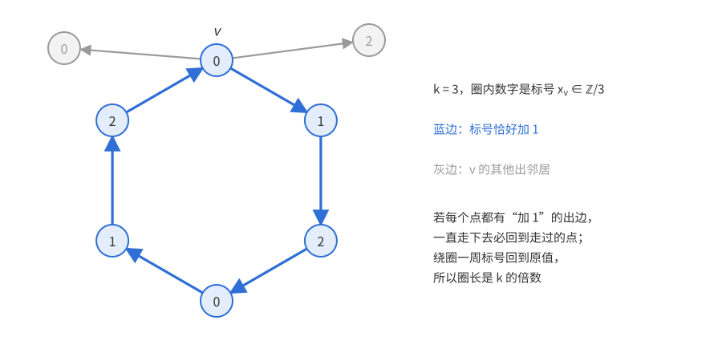

图中 $k=3$，圈内数字是标号。蓝边都是“标号加 1”的边，绕一圈正好经过 $0,1,2,0,1,2$；$v$ 的其他出边（灰色）通向标号不对的点，不能走。

*证明*　删去一些边，使每个点的出度恰为 $\delta$（入度只会变小，仍 $\le\Delta$）；新图中的圈也是原图中的圈。

每个点独立均匀地取标号 $x_v\in\mathbb Z/k$。令 $A_v$ 为“$v$ 的出邻居中没有标号为 $x_v+1$ 的”。$v$ 的 $\delta$ 个出邻居都不是 $v$ 本身，在给定 $x_v$ 的条件下它们的标号独立均匀，所以
$$\mathbb P(A_v)=\Big(1-\frac1k\Big)^\delta\le e^{-\delta/k}.$$
若所有 $A_v$ 都不发生，按上面的论证就得到长度被 $k$ 整除的有向圈。

*第一次尝试：典范依赖图。* $A_v$ 依赖于 $\{v\}\cup N^+(v)$ 的标号（$N^+$、$N^-$ 分别表示出邻居和入邻居）。$A_w$ 与 $A_v$ 相邻当且仅当 $\{v\}\cup N^+(v)$ 与 $\{w\}\cup N^+(w)$ 相交：$w\in N^-(v)$（至多 $\Delta$ 个），或 $w\in N^+(v)$（$\delta$ 个），或 $w$ 与 $v$ 有公共出邻居（至多 $\delta(\Delta-1)$ 个）。最大度 $\le\Delta+\delta\Delta$，LLL 给出的条件是 $k\le\delta/(1+\ln(1+\Delta+\delta\Delta))$，几乎就是要证的结论，但多了一个 $\Delta$。

*改进：更小的依赖图。* 关键观察：**即使知道了 $N^+(v)$ 以外所有点（包括 $v$ 自己）的标号**，$N^+(v)$ 中的标号仍然独立均匀，所以 $A_v$ 的条件概率仍是 $(1-\frac1k)^\delta$。换言之，$A_v$ 独立于由 $N^+(v)$ 以外的标号决定的一切事件。若 $N^+(v)\cap(\{w\}\cup N^+(w))=\varnothing$，$A_w$ 就是这样的事件。所以可以取依赖有向图：$v\to w$ 当且仅当 $w\ne v$ 且 $N^+(v)$ 与 $\{w\}\cup N^+(w)$ 相交。这样的 $w$ 或者在 $N^+(v)$ 中（$\delta$ 个），或者是 $N^+(v)$ 中某点的入邻居、但不是 $v$（每个点至多 $\Delta-1$ 个），共至多 $\delta+\delta(\Delta-1)=\delta\Delta$ 个。“第一次尝试”中的“入邻居”一类不必再数。

现在 $p\le e^{-\delta/k}$，$d=\delta\Delta$，
$$e\,p\,(d+1)\le e^{1-\delta/k}(1+\delta\Delta)\le1\iff\frac\delta k\ge1+\ln(1+\delta\Delta),$$
正是假设。由对称 LLL（依赖有向图的出度 $\le d$），以正概率所有 $A_v$ 都不发生。$\square$

这里的依赖图不是对称的：$A_v$ 独立于 $A_w$ 的非邻居族，不意味着 $A_w$ 独立于 $A_v$ 的非邻居族。LLL 的证明只需要每个事件独立于**自己的**非出邻居组成的事件组，所以有向图完全够用。

## 6.5 偏斜局部引理

### 把“独立”放宽为“不更容易发生”

离开变量模型，回到一般的事件族。6.1 节末尾已经指出：LLL 的证明只在 (6.2) 用到独立性，而且只用到“避开非邻居不会使 $A_i$ 更容易发生”。直觉上也是如此：若避开一些坏事件反而让别的坏事件更难发生，局面只会更好。把 (6.2) 中的等号换成不等号，证明的其余部分一字不改，得到：

**定理 6.19（偏斜局部引理）**　设 $A_1,\dots,A_n$ 是事件，对每个 $i$ 取定 $N(i)\subseteq[n]\setminus\{i\}$，使得
$$\mathbb P\Big(A_i\,\Big|\,\bigwedge_{j\in S}\overline{A_j}\Big)\le\mathbb P(A_i)\qquad\text{对一切 }i\text{ 及 }S\subseteq[n]\setminus(N(i)\cup\{i\})\text{（条件事件概率为正）}.\tag{6.3}$$
若存在 $x_1,\dots,x_n\in[0,1)$ 使 $\mathbb P(A_i)\le x_i\prod_{j\in N(i)}(1-x_j)$ 对一切 $i$ 成立，则
$$\mathbb P(\text{所有 }A_i\text{ 都不发生})\ge\prod_{i=1}^n(1-x_i).$$

*证明*　与定理 6.3 的证明完全相同，只是 (6.2) 中的 $\mathbb P(A_i\mid\overline A_{S_2})=\mathbb P(A_i)$ 改为由 (6.3) 得到的 $\mathbb P(A_i\mid\overline A_{S_2})\le\mathbb P(A_i)$（$S_2$ 与 $N(i)\cup\{i\}$ 不交，且由断言 1 有 $\mathbb P(\overline A_{S_2})>0$）。$\square$

同样取 $x_i=\frac1{d+1}$，得到对称版本：

**推论 6.20（偏斜局部引理，对称形式）**　在定理 6.19 中，若 $|N(i)|\le d$、$\mathbb P(A_i)\le p$ 对一切 $i$ 成立，且 $ep(d+1)\le1$，则以正概率所有 $A_i$ 都不发生。

满足 (6.3) 的（有向）图称为**负依赖图**。与普通依赖图一样，它**不能**靠两两检查事件对来构造：(6.3) 要求的是关于一整组非邻居的条件。

条件 (6.3) 看起来很难验证。幸运的是，许多应用都落在下面这个模型里，那里有一个容易写出的“典范负依赖图”，地位相当于变量模型中的典范依赖图。

### 随机单射模型

回忆：图中的**匹配**是两两没有公共顶点的一组边；在两侧为 $X,Y$ 的二部图中，**$X$ 到 $Y$ 的完全匹配**是覆盖 $X$ 每个点的匹配。

**随机单射模型（Lu–Székely 2007）**　$X,Y$ 是有限集，$|X|\le|Y|$。均匀随机地取单射 $f:X\to Y$，它等同于完全二部图 $K_{X,Y}$ 中 $X$ 到 $Y$ 的一个完全匹配 $M$（边 $x\,f(x)$），下面两种说法混用。对 $K_{X,Y}$ 中的匹配 $F$（不必完全），令 $A_F$ 为事件“$F\subseteq M$”。给定匹配 $F_1,\dots,F_n$，事件 $A_{F_1},\dots,A_{F_n}$ 的**典范负依赖图**在 $F_i$ 与 $F_j$（$i\ne j$）有公共顶点时连边 $ij$。

直观上，“$f$ 不含 $F_1,\dots,F_k$”只是排除了一些配对方式；只要这些 $F_j$ 不碰 $F_0$ 的顶点，被排除的东西对“$F_0$ 的端点怎样配对”没有偏向，所以不会让 $F_0\subseteq M$ 更容易。下面的定理把这个直观变成证明，它说明典范负依赖图满足 (6.3)。

**定理 6.21（随机单射模型中的负依赖）**　在随机单射模型中，设匹配 $F_0$ 与 $F_1\cup\cdots\cup F_k$ 没有公共顶点，则
$$\mathbb P\big(A_{F_0}\,\big|\,\overline{A_{F_1}}\cdots\overline{A_{F_k}}\big)\le\mathbb P(A_{F_0}).$$

**思路。** 设 $F_0$ 在 $X$ 一侧的端点集为 $X_0$。$f$ 在 $X_0$ 上的限制是 $X_0\to Y$ 的某个单射 $T$；不加条件时每个 $T$ 等可能，$F_0$ 只是其中之一。只要证明：在“避开 $F_1,\dots,F_k$”的条件下，$T=F_0$ 的结果数**不多于**任何其他 $T$ 的结果数，那么 $F_0$ 的条件概率就不超过平均份额 $\mathbb P(A_{F_0})$。比较两个集合的大小，最好的办法是造一个单射；而把 $F_0$ 的 $Y$ 端点“换成”$T$ 的 $Y$ 端点，自然的工具是 $Y$ 上的一个置换。

*证明*　记 $X_0\subseteq X$、$Y_0\subseteq Y$ 为 $F_0$ 的两侧端点集。对 $K_{X,Y}$ 中的匹配 $T$，令
$$\mathcal M_T=\{X\text{ 到 }Y\text{ 的完全匹配，含 }T\text{，且不含 }F_1,\dots,F_k\text{ 中任何一个}\}.$$
每个不含任何 $F_j$ 的完全匹配，在 $X_0$ 上的限制恰是某个单射 $T:X_0\hookrightarrow Y$，所以
$$\mathbb P\big(A_{F_0}\,\big|\,\overline{A_{F_1}}\cdots\overline{A_{F_k}}\big)=\frac{|\mathcal M_{F_0}|}{\sum_{T:X_0\hookrightarrow Y}|\mathcal M_T|},\qquad\mathbb P(A_{F_0})=\frac1{\#\{T:X_0\hookrightarrow Y\}}$$
（后者由对称性：$f|_{X_0}$ 在所有单射 $X_0\hookrightarrow Y$ 上均匀分布）。所以只需证明对每个 $T:X_0\hookrightarrow Y$ 都有 $|\mathcal M_{F_0}|\le|\mathcal M_T|$。

设 $Y_1$ 是 $T$ 在 $Y$ 一侧的端点集。取 $Y$ 的一个置换 $\sigma$，满足：

- 对每个 $x\in X_0$，$\sigma(F_0(x))=T(x)$，即 $\sigma$ 把 $Y_0$ 按 $F_0$、$T$ 的对应映到 $Y_1$；
- $\sigma$ 固定 $Y_0\cup Y_1$ 以外的每个点。

这样的 $\sigma$ 存在：$Y_0\to Y_1$ 的部分已确定，剩下要把 $Y_1\setminus Y_0$ 一一映到 $Y_0\setminus Y_1$，两者元素个数相同（$|Y_0|=|Y_1|$）。

考虑映射 $f\mapsto\sigma\circ f$，它在单射之间是单射。若 $f\in\mathcal M_{F_0}$，则 $\sigma\circ f$ 在 $X_0$ 上等于 $T$。还要说明 $\sigma\circ f$ 仍不含任何 $F_j$（$j\ge1$）。假设 $\sigma\circ f\supseteq F_j$，看 $F_j$ 的任一条边 $(x,y)$，由假设 $x\notin X_0$、$y\notin Y_0$：

- 若 $y\in Y_1$，则 $y\in Y_1\setminus Y_0$，$\sigma^{-1}(y)\in Y_0$（因为 $\sigma$ 把 $Y_0$ 映满 $Y_1$），即 $f(x)\in Y_0$。但 $f\supseteq F_0$ 意味着 $f(X_0)=Y_0$，单射 $f$ 不能把 $X_0$ 以外的 $x$ 也映进 $Y_0$，矛盾。
- 若 $y\notin Y_1$，则 $y\notin Y_0\cup Y_1$，$\sigma^{-1}(y)=y$，即 $f(x)=y$。

所以 $F_j$ 的每条边都在 $f$ 中，$f\supseteq F_j$，与 $f\in\mathcal M_{F_0}$ 矛盾。于是 $f\mapsto\sigma\circ f$ 是 $\mathcal M_{F_0}\to\mathcal M_T$ 的单射，$|\mathcal M_{F_0}|\le|\mathcal M_T|$。$\square$

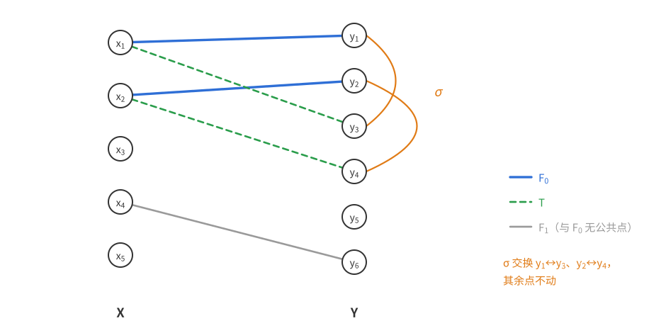

图中 $F_0=\{x_1y_1,x_2y_2\}$（蓝），$T=\{x_1y_3,x_2y_4\}$（绿虚线），$\sigma$ 交换 $y_1\leftrightarrow y_3$、$y_2\leftrightarrow y_4$。$F_1=\{x_4y_6\}$ 与 $F_0$ 没有公共点；证明中的第一种情形说的是：若某条 $F_j$ 的边落到 $y_3$ 或 $y_4$，那么换回去之前 $f$ 就得把 $X_0$ 以外的点映到 $y_1$ 或 $y_2$，而这两个点已经被 $x_1,x_2$ 占用了。

**推论（典范负依赖图合法）**　对 $i$ 和与 $N(i)\cup\{i\}$ 不交的 $S$，$\{F_j:j\in S\}$ 都与 $F_i$ 无公共顶点，由定理 6.21 即得 (6.3)。

先看一个热身例子。

**推论 6.22（错排的下界）**　$[n]$ 的均匀随机置换没有不动点的概率至少是 $(1-\frac1n)^n$。

*证明*　$n=1$ 时唯一的置换有不动点，两边都是 0。下设 $n\ge2$，这样下面取的 $x_i=\frac1n$ 小于 1，符合定理 6.19 的要求。在随机单射模型中取 $X=Y=[n]$，$f$ 是均匀随机置换。令 $F_i$ 为单条边 $(i,i)$，$A_{F_i}$ 即 $f(i)=i$，$\mathbb P(A_{F_i})=\frac1n$。各 $F_i$ 两两没有公共顶点，典范负依赖图是空图，每个 $N(i)=\varnothing$。在定理 6.19 中取 $x_i=\frac1n$，条件 $\mathbb P(A_{F_i})\le x_i$ 成立，所以
$$\mathbb P(f\text{ 没有不动点})\ge\Big(1-\frac1n\Big)^n.\qquad\square$$

没有不动点的置换称为**错排**。由容斥原理，错排的精确概率是 $\sum_{i=0}^n\frac{(-1)^i}{i!}\to\frac1e$；而 $(1-\frac1n)^n$ 也趋于 $\frac1e$，所以这个下界在渐近意义下是精确的。注意事件 $f(i)=i$ 之间其实是**正相关**的（$\mathbb P(f(1)=1,f(2)=2)=\frac1{n(n-1)}>\frac1{n^2}$），却仍能得到“好像独立一样”的下界——偏斜局部引理关心的是“避开”之间的关系，而不是“发生”之间的关系。

### 拉丁横贯

$n$ 阶**拉丁方**是填满 $n$ 种符号的 $n\times n$ 方阵，每种符号在每行、每列恰好出现一次。例如
$$\begin{matrix}\mathbf1&2&3\\2&3&\mathbf1\\3&\mathbf1&2\end{matrix}\qquad\begin{matrix}\mathbf1&2&3\\2&\mathbf3&1\\3&1&\mathbf2\end{matrix}$$
这类方阵因 Euler 用拉丁字母填写而得名。对一般的 $n\times n$ 方阵，**横贯**是每行每列各取一格、共 $n$ 格；若这 $n$ 格中的数两两不同，称为**拉丁横贯**。上面右边的方阵中，主对角线 $1,3,2$ 是一个拉丁横贯；左边加粗的三格都是 1，是横贯但不是拉丁横贯。

**猜想（Ryser 1967）**　奇数阶拉丁方都有拉丁横贯。

**为什么要求奇数。** 取 $n$ 为偶数，$\mathbb Z/n$ 的加法表 $L(i,j)=i+j$ 是拉丁方。任一横贯对应一个置换 $\pi$，所取的数之和为
$$\sum_i\big(i+\pi(i)\big)=2\sum_{i=0}^{n-1}i=n(n-1)\equiv0\pmod n.$$
若这 $n$ 个数两两不同，它们恰是 $0,1,\dots,n-1$，和为 $\frac{n(n-1)}2\equiv\frac n2\pmod n$（$n$ 偶数时 $n-1$ 是奇数），不等于 $0$。所以这个拉丁方没有拉丁横贯。

偶数阶的情形需要修改猜想：

**猜想（Ryser–Brualdi–Stein）**　每个拉丁方都有一个横贯，包含至少 $n-1$ 种不同的符号。

（这一段是研究背景，首读可跳过。）Keevash、Pokrovskiy、Sudakov、Yepremyan（2022）证明了总有横贯包含 $n-O(\log n/\log\log n)$ 种符号，改进了 Hatami–Shor（2008）的 $n-O(\log^2n)$。Montgomery 在 2023 年的预印本中对所有充分大的 $n$ 证明了这个猜想，用到半随机方法和吸收方法等精细技术。（注意另有一个同名的“Ryser 猜想”，讲的是多部超图的覆盖数与匹配数，不要混淆。）

下面是偏斜局部引理最初的应用，它不要求方阵是拉丁方，只要求没有一个数出现得太频繁。

**定理 6.23（Erdős–Spencer 1991）**　若 $n\times n$ 方阵中每个数至多出现 $\frac n{4e}$ 次，则它有拉丁横贯。

**思路。** 随机取一个横贯，即均匀随机置换 $f$（第 $r$ 行取第 $f(r)$ 列）。坏事件按 6.3 节的经验取得**细**：不是“某个数出现两次”，而是“某一对相等的格子同时被取中”，概率只有 $\frac1{n(n-1)}$。这些事件不在变量模型里（各行的选择不独立），但恰好是随机单射模型中的 $A_F$。

*证明*　把行看作 $X=[n]$，列看作 $Y=[n]$，横贯即完全匹配。对每一对**不同行、不同列**的相等格子 $\{(r_1,c_1),(r_2,c_2)\}$，令 $F=\{r_1c_1,r_2c_2\}$（一个大小为 2 的匹配），坏事件 $A_F$ 为“两格都被取中”，$\mathbb P(A_F)=\frac1{n(n-1)}$。（同行或同列的相等格子不可能同时被取中，不必考虑。）避开所有 $A_F$ 的横贯就是拉丁横贯。

在典范负依赖图中，$A_F$ 与 $A_{F'}$ 相邻当且仅当涉及的四个格子有公共的行或列。固定 $F$，它的两行两列共含 $4n-4$ 个格子（四个交叉格各算了两次）。与之相邻的 $F'$ 必有一格 $z$ 在这些格子中，而 $F'$ 的另一格是与 $z$ 相等的某格，至多 $\frac n{4e}-1$ 种。所以
$$d\le(4n-4)\Big(\frac n{4e}-1\Big)=\frac{n(n-1)}e-4(n-1)\le\frac{n(n-1)}e-1,$$
$ep(d+1)\le e\cdot\frac1{n(n-1)}\cdot\frac{n(n-1)}e=1$。由推论 6.20，以正概率没有坏事件发生。$\square$

习题 12、13 是偏斜局部引理的另外两个应用。

## 6.6 算法化的局部引理

### 问题

设一个变量模型中的问题（例如 $k$-CNF）满足 LLL 的条件，所以有解。能否**有效地找到**一个解？这里“有效”指（期望）运行时间不超过输入规模（变量数、事件数）的某个多项式，即**多项式时间**。

LLL 的证明是非构造的。更糟的是，随机取一个赋值，它避开所有坏事件的概率往往是指数小的（见本章导言），“多试几次”行不通。LLL 能否算法化，曾是长期悬而未决的问题。Beck（1991）首先在比 LLL 强得多的稀疏条件下给出了 $k$-CNF 的多项式时间算法，此后 Alon 等人陆续放宽条件。Moser（2009）在读博士期间取得突破，给出条件与 LLL 存在性结论几乎一样的简洁随机算法；Moser 和 Tardos（2010）随后把算法推广到变量模型中的一般 LLL。

### Moser–Tardos 算法

算法简单得出人意料：先随机取值，看见哪个坏事件发生，就把它的变量重新抽一遍。下文把“将一个事件依赖的变量全部按原分布重新独立取值”简称为**重抽**这个事件。

> **算法（Moser–Tardos 修补算法）**　输入：变量模型中的变量与坏事件。
> 1. 每个变量按自己的分布独立随机取值；
> 2. 只要还有坏事件发生：任选一个正在发生的坏事件，重抽它。
>
> （“任选”可以规定为按字典序选第一个，使算法明确。）

**定理 6.24（Moser–Tardos 2010）**　设坏事件 $A_1,\dots,A_n$ 满足定理 6.3 的条件（依赖图取典范依赖图），即存在 $x_i\in[0,1)$ 使 $\mathbb P(A_i)\le x_i\prod_{j\in N(i)}(1-x_j)$。则在上述算法中，对每个 $i$，
$$\mathbb E[A_i\text{ 被重抽的次数}]\le\frac{x_i}{1-x_i}.$$

**拉斯维加斯与蒙特卡洛。** 定理控制的是重抽次数的**期望**：算法一旦停机，输出一定正确，但运行时间是随机的。随机算法有两种重要的类型：

- **蒙特卡洛算法**：总会停机给出输出，但有小概率输出错误；
- **拉斯维加斯算法**：输出总是正确的，但运行时间是随机的，可能很长（甚至不停机）。

Moser–Tardos 算法是拉斯维加斯算法，期望运行步数（重抽的总次数）至多 $\sum_ix_i/(1-x_i)$，通常是问题参数的多项式。

有效的拉斯维加斯算法总能变成有效的蒙特卡洛算法：若期望时间为 $T$，运行到 $CT$ 步还没结束就停机并宣布失败，由 Markov 不等式，失败概率 $\le\frac1C$。

反过来却未必可行：从蒙特卡洛算法出发，想反复运行直到得到正确答案，但可能**没有有效的办法检验**答案是否正确。例如要找 $K_n$ 的一个二染色，没有大小 $\ge100\log_2n$ 的单色团：由第 1 章定理 1.1 的并集上界，均匀随机染色以压倒性的概率满足要求，但我们没有有效的方法检验一个具体染色是否满足（要检查约 $n^{100\log_2n}$ 个子集）。为这个问题找一个拉斯维加斯算法是重要的公开问题。

**算法只能利用变量表示。** 定理 6.24 要求的是**典范**依赖图，而定理 6.3 允许任何合法的依赖图。差别来自算法本身：重抽一个坏事件会改变它的变量，波及所有与它共用变量的事件；至于事件之间是否“恰好独立”，算法无从利用。6.1 节说过，典范依赖图可能比合法的依赖图稠密得多。下面这个极端的例子说明，这个限制无法去掉（这个例子和随后关于单向置换的讨论属于背景，首读可跳过）。

把 $\{0,1,\dots,2^k-1\}$ 中的数看成 $k$ 位二进制串，设 $f$ 是这个集合到自身的双射，而且容易计算。考虑**求逆**问题：给定 $y$，找 $x$ 使 $f(x)=y$。令 $x$ 均匀随机，坏事件 $A_i$ 为“$f(x)$ 的第 $i$ 位与 $y$ 不同”（$i\in[k]$）。因为 $f$ 是双射，$f(x)$ 也均匀分布，所以 $A_1,\dots,A_k$ **恰好相互独立**、各有概率 $\frac12$：空图是合法的依赖图，定理 6.3 的条件成立。但每个 $A_i$ 一般依赖 $x$ 的全部 $k$ 位，典范依赖图是完全图 $K_k$，相对于它条件不能成立：若 $\frac12\le x_i\prod_{j\ne i}(1-x_j)$ 对一切 $i$ 成立，把 $k\ge2$ 个不等式相乘，左边是 $2^{-k}$，右边是 $\prod_ix_i(1-x_i)^{k-1}\le\prod_ix_i(1-x_i)\le4^{-k}$，矛盾。

这不是定理不够精细。若有算法能对这类例子都有效，就能对任意容易计算的双射快速求逆，从而不存在**单向置换**（容易计算、难以求逆的双射）。而人们普遍相信单向置换存在，这是密码学的基本假设之一（比“单向函数存在”更强，单向函数不要求是双射）。（一个常见的候选是有限域中的离散对数：$x\mapsto g^x$ 容易计算，反过来求 $x$ 被认为很难，Diffie–Hellman 密钥交换等方案依赖于此。）

所以在这一假设下，普通 LLL 可以利用“恰好独立”这类巧合，算法却只能利用给定的变量表示。

**初始值必须随机。** 算法第 1 步的随机初值不能换成任意赋值，否则定理 6.24 不成立。最小的例子：只有一个均匀随机位 $X$，唯一的坏事件 $A=\{X=0\}$，没有邻居。$\mathbb P(A)=\frac12$，取 $x_A=\frac12$ 满足条件，定理给出的界是 $\frac{x_A}{1-x_A}=1$。若初值取 $X=0$，算法一直重抽到 $X=1$ 为止，重抽次数 $N$ 满足 $\mathbb P(N=n)=2^{-n}$（$n\ge1$），$\mathbb E N=2>1$。若初值也是随机的，则以概率 $\frac12$ 一次都不用抽，$\mathbb E N=\frac12\cdot2=1$，恰好等于界。道理是：分析把初值也当作一次“新鲜的随机抽样”来计算概率，挑一个坏的初值，等于凭空多出一次必然发生的坏事件。

这里不证明定理 6.24。Moser–Tardos 的原文写得很漂亮，篇幅也不长，值得一读；其核心是给每次重抽构造一棵“见证树”，记录是哪些更早的重抽导致了它，再估计每种见证树出现的概率。下面换一个稍有不同的算法，用一个巧妙的想法——“熵压缩”——对 $k$-CNF 证明它有效。

### 熵压缩论证

这一小节是进阶证明，首读可跳过。下面对 $k$-CNF 证明 Moser 算法的正确性。这个论证属于 Moser（2009）；他论文中的论证要复杂得多，在会议报告中讲的是下面的版本，经 Fortnow 和 Tao 的博客传播开来（Fortnow 称之为“有史以来最好的 STOC 报告之一”；STOC 是理论计算机科学的重要会议），Tao 给它起名“熵压缩”。我们不用熵的语言（熵见第 10 章 [熵方法](概率方法10——熵方法.md)），只用计数和鸽笼原理。

约定：$k$-CNF 的每个子句恰含 $k$ 个文字，涉及 $k$ 个**不同**的变量（取自 $x_1,\dots,x_n$），每个变量以 $x_j$ 或 $\neg x_j$ 的形式出现。一个子句为假当且仅当它的 $k$ 个变量取某个**唯一确定**的值（例如 $x_1\vee\neg x_2\vee x_3$ 为假当且仅当 $(x_1,x_2,x_3)=(0,1,0)$）。

**为什么换成递归版本。** 下面证明的是 Moser 最初的递归版本，而不是上面 Moser–Tardos 算法那样的平坦版本（只有一层循环）。递归的好处是：每次被重抽的子句一定与“当前正在修补的子句”共用变量，所以记录它只需要一个“在邻居中的序号”，而不必用全局编号，这正是压缩的来源（见下文）。代价是得到的界不如定理 6.24 精确。

> **算法（Moser 修补算法）**　输入：$k$-CNF。输出：满足它的赋值。
> 1. 把所有变量任意赋值；
> 2. 只要有为假的子句 $C$：调用 fix($C$)。
>
> **子程序 fix($C$)：**
> 3. 重抽 $C$，即把它的 $k$ 个变量重新独立均匀取值；
> 4. 只要有为假的子句 $D$ 与 $C$ 共用变量（允许 $D=C$）：调用 fix($D$)。
>
> （有多个为假的子句可选时，按某个固定顺序选第一个。）

注意第 1 步是**任意**赋值，与上面“初值必须随机”并不矛盾：下面的界对每个固定的初值都成立，但形式不同，原因见引理 6.27 之后的说明。

**定理 6.25（Moser 算法的正确性）**　设 $k\ge4$，$k$-CNF 中每个子句至多与 $2^{k-3}$ 个其他子句共用变量。则 Moser 算法输出满足的赋值，且调用 fix 的期望总次数为 $O(mn)$，其中 $n$ 是变量数、$m$ 是子句数。

对比：每个子句在随机赋值下为假的概率恰为 $2^{-k}$，LLL 保证每个子句至多与 $2^k/e-1$ 个子句共用变量时有解。所以这个定理只差一个无关紧要的常数因子。（$k\le3$ 的情形见本节末尾。）

**引理 6.26（外层循环）**　外层循环（第 2 行）中，每个子句至多被调用一次。从而外层至多调用 fix $m$ 次。

*证明*　断言：若 fix($C$) 返回，则返回时 $C$ 为真，并且调用前为真的子句返回时仍为真。对调用过程中发生的 fix 调用总次数归纳。fix($C$) 返回意味着第 4 行的循环结束了，即没有与 $C$ 共用变量的子句为假，特别地 $C$ 为真。设子句 $E$ 在调用前为真。若 $E$ 与 $C$ 共用变量，循环结束时它为真。若不共用，第 3 行不改变 $E$ 的变量，此后 $E$ 的变量只被递归调用 fix($D$) 改变；每个递归调用包含的调用更少，由归纳假设它保持为真的子句为真，所以 $E$ 始终为真。

于是外层循环调用 fix($C$) 之后，$C$ 为真且永远保持为真（外层后续的调用都保持为真的子句），$C$ 不会再在第 2 行作为假子句出现。$\square$

**引理 6.27（递归调用的次数）**　设 $k\ge4$，$k$-CNF 中每个子句至多与 $2^{k-3}$ 个其他子句共用变量。固定子句 $C_0$ 和一个初始赋值，执行 fix($C_0$)。则对每个正整数 $\ell$，
$$\mathbb P(\text{第 4 行的递归调用至少有 }\ell\text{ 次})\le2^{n-1}\Big(\frac34\Big)^\ell.$$

由此，一次 fix($C_0$) 的期望递归调用次数至多
$$\sum_{\ell\ge1}\min\Big(1,2^{n-1}\Big(\frac34\Big)^\ell\Big)\le\ell_0+\sum_{j\ge0}\Big(\frac34\Big)^j=O(n),\qquad\ell_0=\Big\lceil\frac{n-1}{\log_2(4/3)}\Big\rceil.$$
外层的每次调用都从当时的某个赋值出发、使用新的随机位，所以引理对每次调用都适用。结合引理 6.26，fix 的期望总调用次数至多 $m(1+O(n))=O(mn)$；特别地算法以概率 1 停机，停机时没有假子句。这就证明了定理 6.25。

**证明的想法。** 每次重抽消耗 $k$ 个随机位。如果递归调用次数很多，我们会证明：这些随机位可以从一份**更短**的记录中完全复原。$k\ell$ 个真正随机的位不可能被无损地压缩得更短（鸽笼原理），所以长时间运行的概率很小。

*证明*　把随机性预先固定：取均匀随机的位串 $\mathbf x\in\{0,1\}^{k\ell}$，每次执行第 3 行时，用 $\mathbf x$ 中接下来的 $k$ 位作为新取值。若即将进行第 $\ell$ 次递归调用，就立刻停机并宣布“失败”。此时已经做了 $\ell$ 次重抽（最初的 fix($C_0$) 一次，加上 $\ell-1$ 次递归调用），$\mathbf x$ 的 $k\ell$ 位恰好用完。“递归调用至少 $\ell$ 次”恰是“这个截断的过程失败”，而它只取决于 $\mathbf x$。

在运行中记录一份**执行记录**：每次递归调用 fix($D$) 记一条“调用 $D$”，每当某个递归调用的第 4 行循环结束记一条“结束”。最初的 fix($C_0$) 本身不记（它是已知的）。读执行记录时用一个栈追踪当前正在执行的是哪个子句，就能知道每条“结束”属于哪次调用。

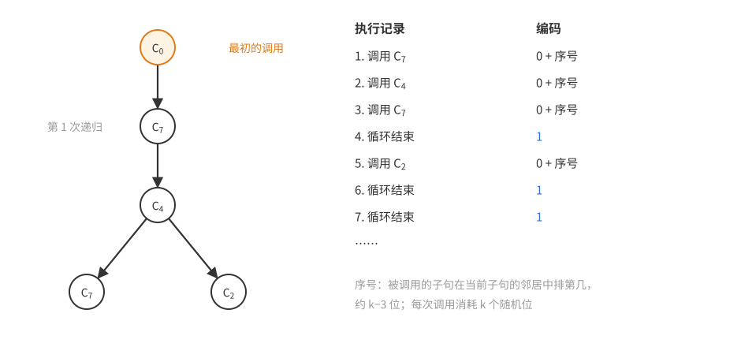

图左是一次运行的递归调用树，右边是对应的执行记录：fix($C_0$) 调用 fix($C_7$)，它调用 fix($C_4$)，后者先后调用 fix($C_7$) 和 fix($C_2$)。

*把记录编码得很短。* 关键在于：不用子句在全体子句中的绝对编号（那需要 $\log_2m$ 位，太贵了），而用它在**当前子句的邻居中的序号**。在 fix($C$) 中被调用的 $D$ 必与 $C$ 共用变量，连 $C$ 自己在内至多 $2^{k-3}+1$ 种可能。所以执行记录由两部分信息确定：

- “调用”与“结束”的排列模式：$\ell-1$ 条调用、至多 $\ell-1$ 条结束，是长度 $\le2\ell-2$ 的二元串，至多 $2^{2\ell-1}$ 种；
- 每条调用的序号：每条至多 $2^{k-3}+1$ 种，共至多 $(2^{k-3}+1)^{\ell-1}$ 种。

所以执行记录至多有 $2^{2\ell-1}(2^{k-3}+1)^{\ell-1}$ 种。

*关键断言（复原随机性）：在停机时刻，由当时的赋值 $\alpha$ 和执行记录，可以完全复原 $\mathbf x$。*

由执行记录可以知道依次被重抽的子句 $D_1=C_0,D_2,\dots,D_\ell$。倒着复原：最后一次重抽作用于 $D_\ell$，此后没有任何变化，所以 $\alpha$ 在 $D_\ell$ 的变量上的值就是 $\mathbf x$ 的最后 $k$ 位。若 $\ell\ge2$，$D_\ell$ 是因为**为假**才被调用的，而重抽紧接在检查之后，所以重抽之前 $D_\ell$ 的变量取唯一的那组使它为假的值；把它们填回去，就得到第 $\ell$ 次重抽之前的赋值。如此重复，依次读出 $\mathbf x$ 的每一段 $k$ 位（第一段是对 $D_1=C_0$ 的重抽，读出它不需要知道更早的赋值）。断言得证。

于是映射“$\mathbf x\mapsto$（停机时的赋值，执行记录）”在导致失败的 $\mathbf x$ 上是单射。赋值至多 $2^n$ 种，所以
$$2^{k\ell}\cdot\mathbb P(\text{失败})=\#\{\text{导致失败的 }\mathbf x\}\le2^n\cdot2^{2\ell-1}(2^{k-3}+1)^{\ell-1}\le2^{n-1}\big(4(2^{k-3}+1)\big)^\ell.$$
而 $4(2^{k-3}+1)=2^{k-1}+4$，所以
$$\mathbb P(\text{失败})\le2^{n-1}\Big(\frac12+2^{2-k}\Big)^\ell\le2^{n-1}\Big(\frac34\Big)^\ell\qquad(k\ge4).\qquad\square$$

**初值为什么可以任意。** 这里的初始赋值是任意的，代价体现在计数里：停机时的赋值有 $2^n$ 种，都要算进“记录”，所以界里多出因子 $2^{n-1}$，一次 fix 的期望递归调用次数是 $O(n)$ 而不是常数。与前面单个随机位的例子对照：Moser–Tardos 的界不含 $n$，是因为它把随机初值也算进了随机性。但不能简单地说“这里若也随机取初值，$2^n$ 因子就抵消了”：首次重抽会覆盖 $C_0$ 上的初值，上面的倒推只复原重抽用的随机位，复原不出被覆盖的初值（例如两个只在 $C_0$ 的某一位上不同的初值，记录和终态可以完全相同）。Moser–Tardos 的分析用另一种记录方式处理这一点，这里不展开。

**为什么叫熵压缩。** 每次递归调用消耗 $k$ 个随机位，却只在执行记录中留下约 $(k-3)+2=k-1$ 位（一位“调用”标记、约 $k-3$ 位序号、一位“结束”标记），再加上最终赋值这 $n$ 位“常数量”的信息，而且这个转换可逆。若运行很久，就相当于把 $k\ell$ 个随机位无损地压缩成约 $(k-1)\ell+n$ 位——信息守恒不允许这样的压缩持续下去。

**$k\le3$ 的情形。** 熵压缩在这里失效：$k=3$ 时 $4(2^{k-3}+1)=2^k$，每次递归调用在执行记录里留下的位数和它消耗的随机位一样多，什么也没压缩。不过这时条件强到几乎平凡：每个子句至多与一个其他子句共用变量（$k\le2$ 时不与任何子句共用），共用变量的子句构成至多两个子句的小分支，fix 只会重抽 $C_0$ 所在分支里的子句，分支里的子句全为真时就逐层返回。可以直接验证，每次重抽之后还要再重抽的条件概率至多 $\frac18+\frac12=\frac58$（刚重抽的子句为假，或它唯一的邻居因共用变量的新值而为假），所以一次 fix 的期望重抽次数至多 $\frac83$。因此定理 6.25 的结论对 $k\le3$ 同样成立。

**两种证明有什么关系？** 熵压缩论证（以及 Moser–Tardos 的推广）似乎给出了与 6.1 节完全不同的 LLL 证明。两者是否本质上是同一个证明，目前不知道，这是一个有趣的开放问题。

## 本章小结

| 技巧 | 本章中的例子 |
|---|---|
| 依赖稀疏 + 每个事件概率小（对称 LLL） | 一致超图二染色、平移集多色染色、覆盖分解、$k$-CNF |
| 事件性质悬殊时用一般形式，$x_i$ 取得与 $\mathbb P(A_i)$ 同量级 | 非一致超图、Beck 的等差数列定理 |
| 紧性论证：从有限个事件过渡到无限个 | 无限超图、实数与整数的染色、覆盖分解 |
| 对偶成超图二染色（球为顶点，每个点给出一条边），用几何计数控制依赖度 | 覆盖分解（体积比较、球面分出的区域数） |
| 把坏事件拆细，概率下降得比依赖度上界增长得快 | 独立横贯（组对 → 边）、拉丁横贯 |
| 修剪对象使所有坏事件处于同一水平 | 独立横贯中把每组修成同样大小 |
| 精细地确定依赖图，用有向依赖图 | 长度被 $k$ 整除的有向圈 |
| 用随机标号强迫算术性质 | 标号沿边加 1 的有向圈 |
| 只需“避开不会更容易发生”（偏斜 LLL） | 随机单射模型、错排下界、拉丁横贯 |
| 构造单射比较两类结果的个数 | 随机单射模型中的负依赖 |
| 可逆编码 + 鸽笼原理（熵压缩） | Moser 算法的正确性 |

## 习题与解答

下面渐近记号的约定见[目录与记号](概率方法讲义——目录与记号.md)。除特别说明外，图都是有限图；“LLL”指 6.1 节的局部引理，对称形式为定理 6.2，一般形式为定理 6.3。一般形式中常用不等式
$$1-x\ge e^{-2x}\qquad(0\le x\le\tfrac12),$$
它把 $\prod(1-x_j)$ 化成 $\exp(-2\sum x_j)$，于是验证 LLL 的条件就变成估计“邻居的 $x_j$ 之和”。

### 习题 1　边染色避开单色三角形

**题意**　证明可以用至多 $3\sqrt n$ 种颜色给 $K_n$ 的边染色，使得没有单色三角形。

**思路**　随机染色，坏事件是“某个三角形单色”，概率 $1/k^2$。三角形很多（约 $n^3/6$ 个），并集上界需要 $k\gtrsim n^{3/2}$；但每个三角形只和共边的 $3(n-3)$ 个三角形相关，这正是 LLL 的用武之地：只需 $k^2\gtrsim e\cdot3n$，即 $k\approx\sqrt{3e}\sqrt n\approx2.86\sqrt n$。

*证明*　$n\le2$ 时没有三角形，下设 $n\ge3$。令 $k=\lfloor3\sqrt n\rfloor$，每条边独立均匀地染 $k$ 种颜色之一。对每个三角形 $T$，令 $A_T$ 为“$T$ 的三条边同色”，则 $\mathbb P(A_T)=k\cdot k^{-3}=k^{-2}$。

这是变量模型（变量是各边的颜色），$A_T$ 只由 $T$ 的三条边决定。与 $T$ 共用边的其他三角形：$T$ 的每条边另在 $n-3$ 个三角形中，而两个不同的三角形至多共用一条边，所以恰有 $3(n-3)$ 个。由引理 6.1，典范依赖图的最大度 $d=3(n-3)$。

对称 LLL 要求 $e\,k^{-2}(3n-8)\le1$，即 $k^2\ge e(3n-8)$。由 $k\ge3\sqrt n-1$，
$$k^2-e(3n-8)\ge9n-6\sqrt n+1-3en+8e=(9-3e)n-6\sqrt n+1+8e.$$
$9-3e>0.84$，而二次式 $0.84y^2-6y+22$（$y=\sqrt n$）的判别式 $36-4\cdot0.84\cdot22<0$，所以上式恒正。由定理 6.2，以正概率没有单色三角形。$\square$

**评注**　这个界其实很弱。一个简单的递归构造只用 $\lceil\log_2n\rceil$ 种颜色：把点集分成两半，两半之间的边全用一种新颜色（它们构成二部图，没有三角形），两半内部递归。反方向，多色拉姆塞数满足 $R_k(3)\le e\,k!+1$，所以至少需要约 $\log n/\log\log n$ 种颜色。确定真实的量级等价于确定 $R_k(3)$ 的增长速度（已知介于 $c^k$ 与 $O(k!)$ 之间），是著名的未解问题。本题的意义在于方法：LLL 只用了“每个三角形只和 $O(n)$ 个三角形共边”这个局部信息，就把并集上界的 $n^{3/2}$ 降到了 $\sqrt n$。

### 习题 2　超图的“均匀”染色

**题意**　证明：每个 $k$ 一致 $k$ 正则超图（每条边 $k$ 个点，每个点在 $k$ 条边中）的顶点，都可以用至多 $k/\log k$ 种颜色染色，使每种颜色在每条边上至多出现 $O(\log k)$ 次。

**思路**　用 $r\approx k/\ln k$ 种颜色随机染色，每条边上每种颜色平均出现 $k/r\approx\ln k$ 次。坏事件是“某条边上某种颜色出现太多次”。出现 $t$ 次的概率大约是 $\binom kt r^{-t}\approx(e\ln k/t)^t$，取 $t=C\ln k$ 就是 $k$ 的负的大幂次；而每条边只和至多 $k^2$ 条边相交，LLL 正好够用。这里平均值 $\ln k$ 本身已经是 $O(\log k)$，问题只在于让**每一条**边都不偏离平均太多——这正是 LLL 擅长的“处处都好”。

*证明*　设 $k\ge2$，令 $r=\lfloor k/\ln k\rfloor\ge1$，$t=\lceil2e^2\ln k\rceil$。因为 $k/\ln k\ge e>1$，有 $r\ge\frac k{2\ln k}$（$\lfloor x\rfloor\ge x/2$ 对 $x\ge1$ 成立）。每个点独立均匀地染 $r$ 种颜色之一。

对每条边 $f$，令 $A_f$ 为“某种颜色在 $f$ 上出现至少 $t$ 次”。若 $t>k$，$A_f$ 不可能发生；否则 $A_f$ 意味着存在颜色 $c$ 和 $f$ 的 $t$ 元子集全染 $c$，所以
$$\mathbb P(A_f)\le r\binom kt r^{-t}\le r\Big(\frac{ek}{tr}\Big)^t\le r\Big(\frac{2e\ln k}{t}\Big)^t\le r\,e^{-t}\le k\cdot k^{-2e^2}=k^{1-2e^2}.$$
（用了 $\binom kt\le(ek/t)^t$ 和 $\frac{2e\ln k}t\le\frac1e$。）

$A_f$ 只由 $f$ 上各点的颜色决定。$f$ 的每个点另在 $k-1$ 条边中，所以与 $f$ 相交的其他边至多 $k(k-1)$ 条，$d+1\le k^2$。于是
$$e\cdot\mathbb P(A_f)\cdot(d+1)\le e\,k^{3-2e^2}\le e\cdot2^{-11}<1.$$
由定理 6.2，以正概率所有 $A_f$ 都不发生。这样的染色只用了 $r\le k/\ln k$ 种颜色，且每种颜色在每条边上出现少于 $t=O(\log k)$ 次。$\square$

（上面 $\log$ 取自然对数。若取以 2 为底，令 $r=\lfloor k/\log_2k\rfloor\ge\frac{k\ln2}{2\ln k}$、$t=\lceil2e^2\log_2k\rceil$，同样的计算给出 $\frac{ek}{tr}\le\frac1e$，其余不变。）

**评注**　“$k$ 正则”只用来控制依赖度 $d\le k^2$。若改为每个点至多在 $D$ 条边中，同样的论证给出 $O(\log(kD))$ 的界。与[第 5 章](<概率方法05——Chernoff 界.md>)的差异理论对照：那里要求每条边上两色的个数差小，这里要求每种颜色都不太多，都是“对每条边都均衡”的要求。

### 习题 3★　每格一点，刺穿所有细长矩形

**题意**　证明存在常数 $C>0$，使得对充分小的 $\varepsilon>0$，可以在平面的每个单位方格 $[n,n+1)\times[m,m+1)$（$m,n\in\mathbb Z$）中恰选一点，使得每个 $\varepsilon\times\frac C\varepsilon\log\frac1\varepsilon$ 的矩形（方向任意，不必与坐标轴平行）都至少含一个选中的点。

**思路**　每格随机选一点，点的“密度”是 1。一个面积为 $A$ 的矩形 $R$ 不含选中点的概率是
$$\prod_Q\big(1-\text{面积}(R\cap Q)\big)\le e^{-A},$$
（$Q$ 跑遍单位方格），面积 $A=C\log\frac1\varepsilon$ 时就是 $\varepsilon^C$——这就是长度里 $\log\frac1\varepsilon$ 的来源：要让这个概率小到可以对抗依赖度，而依赖度是 $\varepsilon^{-O(1)}$ 量级的。

障碍有两个。第一，矩形有不可数多个，而且位置相近的矩形高度相关，不能直接作为坏事件；办法是选一个可数的“网”：一族尺寸减半的矩形，使每个 $\varepsilon\times L$ 矩形都**包含**网中某个矩形，于是只需刺穿网中的矩形。网要足够密才能“被包含”，但每个单位方格附近只能有 $\varepsilon^{-O(1)}$ 个网中矩形，这样依赖度才是多项式的。第二，平面无限，要用紧性论证（引理 6.8），而它要求每个变量只有有限多个取值；所以把“在方格中均匀取点”换成“在方格中一个很细的有限点阵上均匀取点”，代价只是面积估计里的一点误差。

记 $L=\frac C\varepsilon\ln\frac1\varepsilon$，$C=112$（未作优化）。下面 $\varepsilon$ 充分小，特别地 $L\ge2$，且 $L\le\varepsilon^{-2}$。

**第一步：网。** 令 $\delta=\varepsilon/8$，$\theta=\frac\varepsilon{2L}$。网 $\mathcal T$ 由所有这样的矩形组成：中心在 $\delta\mathbb Z^2$ 中，长边方向与 $x$ 轴的夹角是 $\theta$ 的整数倍（取 $[0,\pi)$ 中的），尺寸为 $\frac\varepsilon2\times\frac L2$。

*断言：每个 $\varepsilon\times L$ 矩形 $R$ 都包含 $\mathcal T$ 中某个矩形。* 设 $R$ 的中心为 $z$，长边方向的单位向量为 $u$（角度 $\varphi$），$v\perp u$，则 $R=\{z+su+tv:\lvert s\rvert\le\frac L2,\lvert t\rvert\le\frac\varepsilon2\}$。取 $z'\in\delta\mathbb Z^2$ 使 $\lvert z'-z\rvert\le\delta$，取 $\theta$ 的整数倍 $\varphi'$ 使方向差 $\lvert\varphi'-\varphi\rvert\le\theta$（方向按模 $\pi$ 计），相应的单位向量为 $u',v'$。令 $R'=\{z'+su'+tv':\lvert s\rvert\le\frac L4,\lvert t\rvert\le\frac\varepsilon4\}\in\mathcal T$。对 $R'$ 中任一点 $p$，
$$\lvert(p-z)\cdot v\rvert\le\lvert z'-z\rvert+\frac L4\lvert u'\cdot v\rvert+\frac\varepsilon4\le\delta+\frac L4\sin\theta+\frac\varepsilon4\le\frac\varepsilon8+\frac\varepsilon8+\frac\varepsilon4=\frac\varepsilon2,$$
$$\lvert(p-z)\cdot u\rvert\le\delta+\frac L4+\frac\varepsilon4\le\frac L2,$$
所以 $p\in R$，即 $R'\subseteq R$。参数 $\delta,\theta$ 正是由这两行倒推出来的：中心的误差和方向误差在长度 $L/4$ 上造成的偏移，都要被宽度上的余量 $\varepsilon/4$ 吸收。

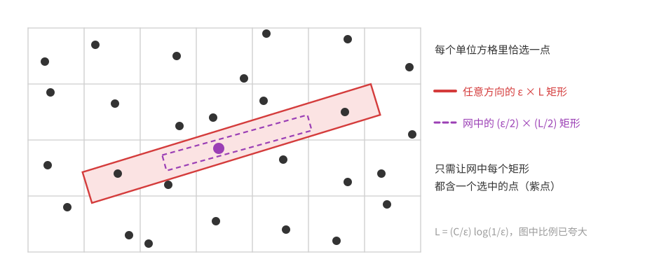

图中红色是任意的 $\varepsilon\times L$ 矩形，紫色虚线是网中被它包含的 $\frac\varepsilon2\times\frac L2$ 矩形；紫色的大点是刺穿它的选中点。

**第二步：随机选点。** 令 $M=\lceil23/\varepsilon\rceil$，把每个单位方格分成 $M^2$ 个边长 $\frac1M$ 的小格，各方格**独立**地在自己的 $M^2$ 个小格中心里均匀选一个。这是变量模型：变量是各方格选中的点，可数多个，每个只有 $M^2$ 种取值。

对 $R'\in\mathcal T$，令 $A_{R'}$ 为“$R'$ 不含选中点”。设完全落在 $R'$ 内的小格共 $N$ 个，它们分属于不同的方格，方格 $Q$ 中有 $N_Q$ 个，则方格 $Q$ 的选中点落入 $R'$ 的概率至少 $p_Q=N_Q/M^2$，所以
$$\mathbb P(A_{R'})\le\prod_Q(1-p_Q)\le\exp\Big(-\sum_Qp_Q\Big)=\exp\Big(-\frac N{M^2}\Big).$$
估计 $N$：$R'$ 中不被“完全在 $R'$ 内的小格”覆盖的点 $x$，所在小格（直径 $\frac{\sqrt2}M$）伸出了 $R'$，所以 $x$ 到 $R'$ 的边界距离至多 $w=\frac{\sqrt2}M$。边长 $a\times b$ 的矩形中到边界距离 $\le w$ 的部分面积至多 $2w(a+b)$（周长乘 $w$）。所以
$$\frac N{M^2}\ge\frac{\varepsilon L}4-\sqrt2\cdot\frac{L+\varepsilon}M\ge\frac{\varepsilon L}4-\frac{2\sqrt2L\varepsilon}{23}\ge\frac{\varepsilon L}8,$$
从而 $\mathbb P(A_{R'})\le e^{-\varepsilon L/8}=\varepsilon^{C/8}=\varepsilon^{14}$。

**第三步：依赖度。** $A_{R'}$ 只依赖于与 $R'$ 相交的方格。$R'$ 的点到中心的距离至多 $\frac L4+\frac\varepsilon4<\frac L2$，所以 $R'$ 落在一个边长 $L$ 的正方形里，至多与 $(L+2)^2\le4L^2$ 个方格相交。反过来，与某个固定方格 $Q$ 相交的网中矩形，中心到 $Q$ 的距离小于 $\frac L2$，落在边长 $L+1$ 的正方形中，这样的中心至多 $\big(\frac{L+1}\delta+1\big)^2\le\big(\frac{16L}\varepsilon\big)^2$ 个；方向至多 $\frac\pi\theta+1\le\frac{7L}\varepsilon$ 种。所以
$$d\le4L^2\cdot\frac{256L^2}{\varepsilon^2}\cdot\frac{7L}\varepsilon<7200\,\frac{L^5}{\varepsilon^3}\le7200\,\varepsilon^{-13}.$$

**第四步：LLL 与紧性。** 对 $\mathcal T$ 的任意有限子族，依赖度仍 $\le d$，而
$$e\cdot\varepsilon^{14}\cdot(7200\,\varepsilon^{-13}+1)<2\times10^4\,\varepsilon\le1$$
对充分小的 $\varepsilon$ 成立。由定理 6.2，有限子族中的坏事件可以同时避开。由引理 6.8（变量可数，每个只有有限多个取值，每个事件只依赖有限多个变量），所有 $A_{R'}$ 可以同时避开：存在每格一点的选法，使网中每个矩形都含选中的点。由第一步，每个 $\varepsilon\times L$ 矩形包含网中某个矩形，从而含选中的点。$\square$

**评注**　面积为常数是必要的：选中点的密度为 1，一个面积 $A<1$ 的矩形在随机平移下平均含 $A<1$ 个点，所以总有某个平移不含点。本题的矩形面积是 $C\log\frac1\varepsilon$，与这个平凡下界只差对数因子。这类问题被称为“能见度差的森林”：把选中的点看成树，问能否让森林里任何方向的视线都很快被挡住；本题的构造来自 Alon（2018）。

### 习题 4　列表染色

**题意**　证明存在常数 $c>0$ 使下面成立：给定图 $G$，每个点 $v$ 有一个 $k$ 种颜色的列表 $L(v)$；若对每个点 $v$ 和每种颜色 $\alpha$，$v$ 的邻点中列表含 $\alpha$ 的至多 $ck$ 个，则存在正常染色，使每个点染的是自己列表中的颜色。

**思路**　每个点从自己的列表里随机选色。坏事件若取“边 $uv$ 两端同色”，概率是 $\lvert L(u)\cap L(v)\rvert/k^2$，可能大到 $1/k$，依赖度却有 $2\Delta$ 量级，而 $\Delta$ 可以远大于 $k$——题设根本没有限制最大度。题设限制的是“某种颜色在邻域中出现的次数”，所以应该把坏事件**拆细**到颜色：“$u,v$ 都选了 $\alpha$”。这样概率是 $1/k^2$，而与它相关的事件只有 $O(k\cdot ck)$ 个——和最大度无关。这和 6.3 节独立横贯里“把坏事件从组对拆到边”是同一个想法。

*证明*　取 $c=\frac1{8e}$。若 $ck<1$，题设说任两个相邻点的列表不交，任意选色都是正常的。下设 $ck\ge1$，于是 $k\ge8e>2$。

每个点 $v$ 独立地从 $L(v)$ 中均匀选一色。对每条边 $uv$ 和每个 $\alpha\in L(u)\cap L(v)$，令 $A_{uv,\alpha}$ 为“$u,v$ 都选了 $\alpha$”，$\mathbb P(A_{uv,\alpha})=k^{-2}$。若这些事件都不发生，染色就是正常的。

$A_{uv,\alpha}$ 只由 $u,v$ 的选择决定。涉及点 $u$ 的事件 $A_{uw,\beta}$：$\beta\in L(u)$ 有 $k$ 种，对每个 $\beta$，列表含 $\beta$ 的邻点 $w$ 至多 $ck$ 个，共至多 $ck^2$ 个。对 $v$ 同样，所以依赖度 $d\le2ck^2$，而
$$e\cdot\frac1{k^2}\cdot(2ck^2+1)=\frac14+\frac e{k^2}\le\frac14+\frac e4<1.$$
由定理 6.2，以正概率得到合乎要求的染色。$\square$

**评注**　注意结论与最大度无关：一个点可以有极多的邻点，只要每种颜色在它的邻域列表中出现不太频繁。Reed（1999）猜想“每种颜色至多出现在 $k-1$ 个邻点的列表中”就够了；Bohman–Holzman（2002）否定了这个猜想，而 Reed–Sudakov（2002）证明了 $(1-o(1))k$ 就够了。

### 习题 5　相邻的两段总是相差很多

**题意**　证明：对每个 $\varepsilon>0$，存在 $\ell_0$ 和 0-1 无穷序列 $(a_1,a_2,\dots)$，使得对每个 $\ell>\ell_0$ 和每个 $i\ge1$，相邻的两段 $(a_i,\dots,a_{i+\ell-1})$ 与 $(a_{i+\ell},\dots,a_{i+2\ell-1})$ 至少在 $(\frac12-\varepsilon)\ell$ 个位置上不同。

**思路**　随机序列中，两段在每个位置上不同的概率是 $\frac12$，且各位置独立，所以“不同的位置少于 $(\frac12-\varepsilon)\ell$ 个”的概率是 $e^{-\Omega(\varepsilon^2\ell)}$。坏事件由“起点 $i$、长度 $\ell$”标记，有无穷多个，长度各不相同：长的事件概率小但依赖多，短的事件概率大但依赖少。对称形式处理不了这种悬殊，要用一般形式，并让 $x$ 随长度指数衰减。$\ell_0$ 的作用是去掉短段——短段的偏差概率不够小，本来也不可能避开（例如 $\ell=1$ 时要求处处 $a_i\ne a_{i+1}$，再看 $\ell=2$ 就矛盾了）。

*证明*　各 $a_j$ 独立均匀取 0 或 1。对 $i\ge1$、$\ell>\ell_0$（$\ell_0$ 待定），令 $B_{i,\ell}$ 为“两段相差的位置少于 $(\frac12-\varepsilon)\ell$ 个”。

**概率。** 令 $Y_j=a_{i+j}\oplus a_{i+\ell+j}$（$0\le j<\ell$），它们涉及的位置两两不交，所以是独立的均匀 0-1 变量，相差的位置数 $Y=\sum Y_j\sim\mathrm{Bin}(\ell,\frac12)$。令 $X_j=1-2Y_j\in\{\pm1\}$，则 $B_{i,\ell}$ 即 $\sum X_j>2\varepsilon\ell$，由[第 5 章](<概率方法05——Chernoff 界.md>)的 Chernoff 界（定理 5.1），
$$\mathbb P(B_{i,\ell})\le e^{-(2\varepsilon\ell)^2/(2\ell)}=e^{-2\varepsilon^2\ell}.$$

**依赖。** $B_{i,\ell}$ 只由区间 $I_{i,\ell}=[i,i+2\ell-1]$ 上的 $a_j$ 决定，用典范依赖图。固定 $\ell'$，与 $I_{i,\ell}$ 相交的区间 $I_{i',\ell'}$ 的起点 $i'$ 落在 $[i-2\ell'+1,\,i+2\ell-1]$ 中，至多 $2\ell+2\ell'$ 个。

**参数。** 取 $x_{i,\ell}=e^{-\varepsilon^2\ell}$（不依赖 $i$）。令
$$S_0=\sum_{\ell'>\ell_0}e^{-\varepsilon^2\ell'},\qquad S_1=\sum_{\ell'>\ell_0}\ell'e^{-\varepsilon^2\ell'}.$$
两个级数都收敛，所以可以取 $\ell_0$ 充分大，使 $4S_0\le\varepsilon^2/2$、$4S_1\le\varepsilon^2/2$，且 $e^{-\varepsilon^2\ell_0}\le\frac12$。于是
$$x_{i,\ell}\prod_{(i',\ell')\sim(i,\ell)}(1-x_{i',\ell'})\ge e^{-\varepsilon^2\ell}\exp\Big(-2\sum_{\ell'>\ell_0}(2\ell+2\ell')e^{-\varepsilon^2\ell'}\Big)=e^{-\varepsilon^2\ell}e^{-4\ell S_0-4S_1}\ge e^{-\varepsilon^2\ell-\varepsilon^2\ell/2-\varepsilon^2/2}\ge e^{-2\varepsilon^2\ell},$$
最后一步用了 $\ell\ge1$。所以 LLL 一般形式的条件对一切事件成立（对任意有限子族更是如此，因为邻居只会更少）。

**紧性。** 由定理 6.3，任意有限多个 $B_{i,\ell}$ 可以同时避开。变量 $a_j$ 可数、各取两个值，每个事件只依赖有限个变量，由引理 6.8，所有 $B_{i,\ell}$ 可以同时避开，所得序列即为所求。$\square$

**评注**　$\frac12$ 恰是随机序列中相邻两段差异比例的典型值；本题说明，可以让**每一对**足够长的相邻段都不明显低于这个典型值，而随机序列本身做不到这一点（无穷长的随机序列中，几乎必然会在某处出现两段几乎相同的相邻长段），LLL 把“典型”变成了“处处”。本题是 Thue 的“无平方词”问题的近似版本：二元序列中不可能避免两段完全相同的相邻段 $ww$（三个字母就可以），但可以要求相邻的长段**相差很多**。

### 习题 6　非重复染色

**题意**　证明：对每个 $\Delta$，存在 $k$，使每个最大度至多 $\Delta$ 的图都可以用 $k$ 种颜色给顶点染色，使得不存在路 $v_1v_2\cdots v_{2\ell}$（$\ell\ge1$，路上的点互不相同）满足 $v_i$ 与 $v_{i+\ell}$ 同色（$i=1,\dots,\ell$），即路的前一半与后一半的颜色序列相同。

**思路**　随机染 $k$ 种颜色，坏事件是“某条 $2\ell$ 个点的路重复着色”，概率 $k^{-\ell}$。与这条路相交的 $2\ell'$ 个点的路约有 $\ell\ell'\Delta^{2\ell'}$ 条。和习题 5 一样，事件按长度分层、层与层之间悬殊，要用一般形式，并让 $x$ 按 $\Delta^{-2\ell}$ 衰减以抵消路的条数；$k$ 取 $\Delta^2$ 的常数倍时，概率 $k^{-\ell}$ 正好能压过 $x_\ell$ 与邻居带来的损失。

*证明*　$\Delta=0$ 时没有边，结论平凡；下设 $\Delta\ge1$，令 $k=\lceil4e^4\Delta^2\rceil$。每个点独立均匀地染 $k$ 种颜色之一。对每条有序的路 $P=(v_1,\dots,v_{2\ell})$，令 $A_P$ 为“$v_i$ 与 $v_{i+\ell}$ 同色对一切 $i\le\ell$ 成立”，$\mathbb P(A_P)=k^{-\ell}$。

**依赖。** $A_P$ 只由 $P$ 上点的颜色决定。经过固定点 $w$、有 $2\ell'$ 个点的有序路：$w$ 的位置有 $2\ell'$ 种，再从 $w$ 向两边逐点延伸，每步至多 $\Delta$ 种选择，共至多 $2\ell'\Delta^{2\ell'-1}$ 条。所以与 $P$（$2\ell$ 个点）相交的 $2\ell'$ 点有序路至多 $4\ell\ell'\Delta^{2\ell'-1}$ 条。

**参数。** 取 $x_P=(2\Delta)^{-2\ell}\le\frac14$。则
$$\sum_{P'\sim P}x_{P'}\le\sum_{\ell'\ge1}4\ell\ell'\Delta^{2\ell'-1}(2\Delta)^{-2\ell'}=\frac{4\ell}\Delta\sum_{\ell'\ge1}\ell'4^{-\ell'}=\frac{4\ell}\Delta\cdot\frac49<2\ell,$$
$$x_P\prod_{P'\sim P}(1-x_{P'})\ge(2\Delta)^{-2\ell}e^{-4\ell}=\big(4e^4\Delta^2\big)^{-\ell}\ge k^{-\ell}=\mathbb P(A_P).$$
由定理 6.3，以正概率没有重复着色的路。$\square$

**评注**　这样的染色称为**非重复染色**，所需的最少颜色数叫图的 Thue 色数，名字来自 Thue（1906）：路（即序列）可以用 3 种颜色非重复染色，即存在三个字母的无穷无平方词。本题的 $O(\Delta^2)$ 来自 Alon–Grytczuk–Hałuszczak–Riordan（2002），他们还证明了存在需要 $\Omega(\Delta^2/\log\Delta)$ 种颜色的图，所以指数 2 不能改进。用 6.6 节的熵压缩方法，常数可以改进到 $(1+o(1))\Delta^2$（Dujmović–Joret–Kozik–Wood 2016）。

### 习题 7　无双色圈的正常边染色

**题意**　证明：最大度为 $\Delta$ 的图可以用 $O(\Delta)$ 种颜色正常边染色（相邻的边不同色），使每个圈上至少出现三种颜色。

**思路**　在正常边染色中，只用两种颜色的圈一定是两色交替的偶圈。所以坏事件有两类：相邻两边同色（概率 $1/k$），以及某个长为 $2\ell$ 的圈两色交替（奇数位置的边同色、偶数位置的边同色，概率 $k^{-(2\ell-2)}$）。第一类概率大但依赖少；第二类的个数随 $\ell$ 以 $\Delta^{2\ell}$ 增长，概率以 $k^{-2\ell}$ 下降，所以 $k$ 只要是 $\Delta$ 的常数倍就能压住。两类事件性质悬殊，用一般形式。

*证明*　设 $\Delta\ge1$，令 $k=64\Delta$，每条边独立均匀地染 $k$ 种颜色之一。坏事件：

- 对每对相邻的边 $\{f,g\}$，$A_{fg}$ 为“$f,g$ 同色”，$\mathbb P=\frac1k$；
- 对每个长为 $2\ell$（$\ell\ge2$）的圈 $C$，$B_C$ 为“$C$ 的奇数位置的边同色、偶数位置的边同色”，$\mathbb P=k^{-(\ell-1)}\cdot k^{-(\ell-1)}=k^{-(2\ell-2)}$。

若都不发生，染色是正常的；且任一圈若只用两种颜色，由正常性它必两色交替、长度为偶数，于是 $B_C$ 发生。所以只需以正概率避开所有坏事件。

**依赖。** 事件只由所涉及边的颜色决定。固定一条边 $f=uv$：含 $f$ 的 $A$ 型事件至多 $2(\Delta-1)<2\Delta$ 个；含 $f$ 的长为 $2\ell$ 的圈至多 $\Delta^{2\ell-2}$ 个（沿 $u\to v$ 之后逐点选下一个点，前 $2\ell-2$ 步每步至多 $\Delta$ 种选择，最后一步回到 $u$ 是确定的）。

**参数。** 取 $x_A=\frac2k$，$x_C=(4\Delta)^{-(2\ell-2)}$（$C$ 长 $2\ell$），都 $\le\frac12$。对每条边 $f$，含 $f$ 的事件的 $x$ 之和
$$\Phi\le2\Delta\cdot\frac2{64\Delta}+\sum_{\ell\ge2}\Delta^{2\ell-2}(4\Delta)^{-(2\ell-2)}=\frac1{16}+\sum_{m\ge1}16^{-m}=\frac1{16}+\frac1{15}.$$
一个涉及 $s$ 条边的事件，其邻居的 $x$ 之和至多 $s\Phi$，所以 $\prod(1-x)\ge e^{-2s\Phi}$，且 $2\Phi<0.26$。

- $A_{fg}$（$s=2$）：$x_A e^{-4\Phi}\ge\frac2ke^{-0.52}>\frac1k$。
- $B_C$（$s=2\ell$）：$x_Ce^{-4\ell\Phi}\ge(4\Delta)^{-(2\ell-2)}e^{-0.52\ell}$。由于 $\ell\le2\ell-2$，$e^{-0.52\ell}\ge e^{-0.52(2\ell-2)}$，所以上式 $\ge(4e^{0.52}\Delta)^{-(2\ell-2)}\ge(64\Delta)^{-(2\ell-2)}=\mathbb P(B_C)$。

由定理 6.3，以正概率所有坏事件都不发生。$\square$

**评注**　这样的染色叫**无圈边染色**（每两种颜色的并是森林）。本题与常数 64 来自 Alon–McDiarmid–Reed（1991）。猜想是 $\Delta+2$ 种颜色就够（Fiamčík；Alon–Sudakov–Zaks），至今未解决。一般图的上界后来都用 6.6 节的熵压缩类方法得到：Esperet–Parreau（2013）得到 $4(\Delta-1)$，之后改进到 $3.569(\Delta-1)$（Fialho、de Lima、Procacci 2020）；Kirousis、Livieratos、Singh 2026 年的预印本声称 $3.142(\Delta-1)+1$。下一题说明在高围长的二部图中，$\Delta+1$ 种颜色就够了。

### 习题 8★　高围长二部图：$\Delta+1$ 种颜色

**题意**　证明：对每个 $\Delta$，存在 $g$，使每个最大度为 $\Delta$、围长至少 $g$ 的二部图都可以用 $\Delta+1$ 种颜色正常边染色，且每个圈上至少出现三种颜色。

**思路**　$\Delta+1$ 种颜色太少，不能像上题那样从完全随机的染色出发——随机染色连“正常”都几乎不可能。应该从一个**已经正常**的染色出发做局部修改。二部图有 $\Delta$ 色的正常边染色（König 定理），它唯一的毛病是可能有双色圈：对两种颜色 $i,j$，颜色 $i,j$ 的边构成的子图中每个点度数 $\le2$，它是路和交替偶圈的并。多出的第 $\Delta+1$ 种颜色（记为 $\star$）就用来**打断**这些双色圈：每条边独立地以小概率 $p$ 改染 $\star$。

这带来三个要求：

1. 改染 $\star$ 的边要构成匹配，否则不正常。两条相邻边都被改染的概率是 $p^2$，而每条边只有 $2\Delta$ 条相邻边，所以 $p\ll1/\Delta$ 就行。
2. 每个原有的双色圈至少有一条边被改染。圈长 $m$ 时失败概率 $(1-p)^m\approx e^{-pm}$。要它很小，必须 $pm\gg1$，即 $m\gg1/p\gtrsim\Delta$——**这就是需要高围长的原因**：短的双色圈打断不了。好在经过一条边的双色圈至多 $\Delta-1$ 个（每选定另一种颜色 $j$，至多一个），依赖不多。
3. 改染后不能产生新的双色圈：$\star$ 与某种颜色 $i$ 交替的圈。这要求圈上一半的边被改染，概率约 $p^\ell$（圈长 $2\ell$）。但长 $2\ell$ 的圈可能有 $\Delta^{2\ell}$ 个，$p^\ell\Delta^{2\ell}$ 并不小！要细一点数：这种圈的另一半边原来全是颜色 $i$，而每个点至多一条 $i$ 色边，所以沿圈走时这一半的边是**被迫**的，只有另一半的边可以自由选择，这样的圈只有约 $\Delta\cdot\Delta^{\ell}$ 个，$p^\ell\Delta^\ell$ 就小了。

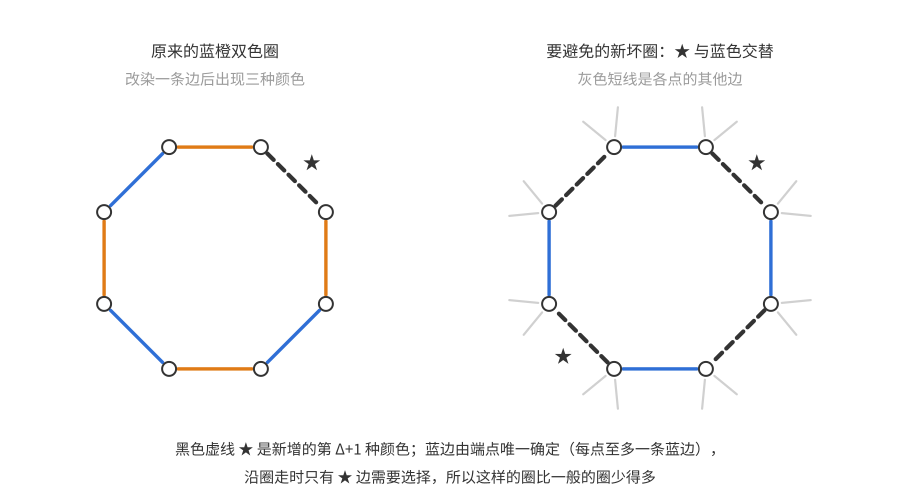

图中左边是原来的双色圈（蓝、橙交替），其中一条边改染为 $\star$（黑色粗虚线）后，圈上出现了三种颜色；右边是要避免的新坏圈：$\star$ 与蓝色交替，蓝色边沿途是被迫的（每点至多一条蓝边），只有 $\star$ 边是“自由”的。

*证明*　设 $\Delta\ge2$（$\Delta\le1$ 时图中没有圈），令 $p=\frac1{32\Delta}$，$g=\lceil64\Delta\ln(512\Delta^2)\rceil$。由 König 定理，取 $G$ 的正常边染色 $c:E\to[\Delta]$。每条边独立地以概率 $p$ 被**选中**，被选中的边改染 $\star$，其余保持原色。

称一个圈 $C$ 为**候选圈**，若它长度为偶数 $2\ell$，且两个奇偶类（相间的两组边）中至少一个在 $c$ 下同色。坏事件：

- $A_{ff'}$（$f,f'$ 相邻）：$f,f'$ 都被选中。$\mathbb P=p^2$。
- $B_C$（$C$ 是 $c$ 下的双色圈，长 $m\ge g$）：$C$ 中没有边被选中。$\mathbb P=(1-p)^m\le e^{-pm}$。
- $D_C$（$C$ 是候选圈，长 $2\ell\ge g$）：$C$ 的某个奇偶类全被选中。$\mathbb P\le2p^\ell$。

*若都不发生，新染色合乎要求。* 被选中的边两两不相邻，所以新染色正常。设某个圈 $C$ 只用两种颜色，由正常性它两色交替。若两种颜色都不是 $\star$，$C$ 没有边被选中，且是 $c$ 下的双色圈，$B_C$ 发生。若其中一种是 $\star$，则 $C$ 的一个奇偶类全被选中，另一类全未被选中且同为某色 $i$——所以 $C$ 是候选圈，$D_C$ 发生。

*依赖的计数。* 用典范依赖图（变量是各边是否被选中）。固定一条边 $f=uv$，$c(f)=i$：

- 含 $f$ 的 $A$ 型事件少于 $2\Delta$ 个。
- 含 $f$ 的 $B$ 型圈至多 $\Delta-1$ 个：对每个 $j\ne i$，$f$ 所在的 $\{i,j\}$ 色子图的连通分支是唯一的，至多是一个圈。
- 含 $f$ 的长 $2\ell$ 候选圈至多 $4\Delta^\ell$ 个。沿圈 $u\to v\to\cdots$ 走（两种走向），同色的那个奇偶类所在的位置上，下一条边由颜色唯一确定。若 $f$ 属于同色类，颜色就是 $i$，另一类的 $\ell$ 条边各至多 $\Delta$ 种选择；若 $f$ 属于另一类，先选同色类的颜色（$\le\Delta$ 种），另一类除 $f$ 外的 $\ell-1$ 条边各至多 $\Delta$ 种选择。合计至多 $2\cdot(\Delta^\ell+\Delta^\ell)=4\Delta^\ell$。

*参数。* 取 $x_A=2p^2$，长 $m$ 的 $B_C$ 取 $x=e^{-pm/2}\le e^{-pg/2}$，长 $2\ell$ 的 $D_C$ 取 $x=2(2p)^\ell$。它们都 $\le\frac12$。对每条边，含它的事件的 $x$ 之和
$$\Phi\le2\Delta\cdot2p^2+\Delta e^{-pg/2}+\sum_{\ell\ge g/2}4\Delta^\ell\cdot2(2p)^\ell=\frac p8+\Delta e^{-pg/2}+8\sum_{\ell\ge g/2}16^{-\ell}.$$
由 $g$ 的取法，$e^{-pg/2}=e^{-g/(64\Delta)}\le\frac1{512\Delta^2}$，所以第二项 $\le\frac p{16}$；第三项 $\le\frac{128}{15}\,4^{-g}$，远小于 $\frac p{16}$。于是 $\Phi\le\frac p4$。涉及 $s$ 条边的事件，邻居的 $x$ 之和 $\le s\Phi$，$\prod(1-x)\ge e^{-2s\Phi}$。逐类验证定理 6.3 的条件：

- $A_{ff'}$（$s=2$）：$2p^2e^{-4\Phi}\ge2p^2e^{-p}\ge p^2$。
- $B_C$（$s=m$）：$e^{-pm/2}e^{-2m\Phi}\ge e^{-pm/2-pm/2}=e^{-pm}\ge\mathbb P(B_C)$。
- $D_C$（$s=2\ell$）：$2(2p)^\ell e^{-4\ell\Phi}\ge2p^\ell\big(2e^{-p}\big)^\ell\ge2p^\ell\ge\mathbb P(D_C)$。

由定理 6.3，以正概率所有坏事件都不发生。$\square$

**评注**　逐条看参数是怎样被“逼出来”的：$B$ 型事件要求 $\Phi\lesssim p$，而 $A$ 型事件对 $\Phi$ 的贡献是 $\Delta p^2$，所以 $p\lesssim1/\Delta$；$B$ 型事件的贡献是 $\Delta e^{-pg/2}$，要它 $\lesssim p$，所以 $g\gtrsim\frac1p\log\frac\Delta p\approx\Delta\log\Delta$。二部性只用于 König 定理；对一般图，从 Vizing 定理的 $\Delta+1$ 色正常染色出发，同样的论证给出 $\Delta+2$ 种颜色，这是 Alon–Sudakov–Zaks（2001）对围长 $\ge c\Delta\log\Delta$ 的图证明的结果。

### 习题 9★　每种颜色在邻域中至多出现 $r$ 次

**题意**　证明：对每个正整数 $r$，存在 $C_r$，使每个最大度为 $\Delta\ge1$ 的图都有一个至多用 $C_r\Delta^{1+1/r}$ 种颜色的正常顶点染色，且每个点的邻点中每种颜色至多出现 $r$ 次。

**思路**　先看颜色数为什么是 $\Delta^{1+1/r}$。用 $k$ 种颜色随机染色，一个点的某 $r+1$ 个邻点同色的概率是 $k^{-r}$，而一个点的邻域中有 $\binom\Delta{r+1}\approx\Delta^{r+1}$ 组这样的邻点。坏事件若取“点 $v$ 的邻域中某色出现超过 $r$ 次”，概率约 $\Delta^{r+1}k^{-r}$，这要求 $k\gg\Delta^{1+1/r}$——正是题中的量级。但这个事件依赖于 $\Delta$ 个点的颜色，依赖度约 $\Delta^2$，概率需要 $\lesssim\Delta^{-2}$，又要多付出代价。

办法仍是**把坏事件拆细**（6.3 节独立横贯中的想法）：对每个点 $v$ 和每个 $(r+1)$ 元子集 $S\subseteq N(v)$，令坏事件为“$S$ 全同色”。概率 $k^{-r}$；它只依赖 $r+1$ 个点，而含某个固定点 $x$ 的这类事件约 $\Delta\cdot\Delta^r$ 个（先选 $x$ 的邻点 $v$，再在 $N(v)$ 中选其余 $r$ 个）。于是 LLL 要求的是 $k^{-r}\cdot\Delta^{r+1}\lesssim1$，即 $k\gtrsim\Delta^{1+1/r}$，没有额外损失。

*证明*　设 $\Delta\ge1$，令 $C=12(r+1)$，$k=\lceil C\Delta^{1+1/r}\rceil\le2C\Delta^{1+1/r}$，所以 $C_r=24(r+1)$ 即可。每个点独立均匀地染 $k$ 种颜色之一。坏事件：

- 对每条边 $uw$，$A_{uw}$：$u,w$ 同色，$\mathbb P=\frac1k$；
- 对每个点 $v$ 和 $(r+1)$ 元子集 $S\subseteq N(v)$，$B_{v,S}$：$S$ 中的点全同色，$\mathbb P=k^{-r}$。

都不发生时，染色正常，且每个点的邻域中每种颜色至多出现 $r$ 次。

**依赖。** 固定一个点 $x$。含 $x$ 的 $A$ 型事件至多 $\Delta$ 个；含 $x$ 的 $B$ 型事件 $B_{v,S}$（$x\in S$）：$v\in N(x)$ 至多 $\Delta$ 种，$S\setminus\{x\}$ 是 $N(v)\setminus\{x\}$ 的 $r$ 元子集，至多 $\binom\Delta r\le\frac{\Delta^r}{r!}$ 种。

**参数。** 取 $x_A=\frac2k$，$x_B=2k^{-r}$。注意 $\frac\Delta k\le\frac1{C\Delta^{1/r}}\le\frac1C$，$\frac{\Delta^{r+1}}{k^r}\le\frac1{C^r}$。含固定点 $x$ 的事件的 $x$ 之和
$$\Phi\le\Delta\cdot\frac2k+\frac{\Delta^{r+1}}{r!}\cdot2k^{-r}\le\frac2C+\frac2{C^r}\le\frac4C=\frac1{3(r+1)}.$$
涉及 $s$ 个点的事件，$\prod(1-x)\ge e^{-2s\Phi}$。

- $A_{uw}$（$s=2$）：$\frac2ke^{-4\Phi}\ge\frac2ke^{-2/3}>\frac1k$（$4\Phi\le\frac4{3(r+1)}\le\frac23$）。
- $B_{v,S}$（$s=r+1$）：$2k^{-r}e^{-2(r+1)\Phi}\ge2k^{-r}e^{-2/3}>k^{-r}$。

由定理 6.3 即得。$\square$

**评注**　比较“粗”事件与“细”事件：粗事件“$v$ 的邻域中某色出现 $>r$ 次”是很多细事件 $B_{v,S}$ 的并，用 LLL 处理并集时，并集的概率只能用并集上界估计为至多各部分概率之和，依赖度却是各部分依赖的并；拆开后，每个细事件只“背负”自己那 $r+1$ 个点的依赖。$r=1$ 时题目要求每个点的邻点颜色互不相同，即 $G^2$（距离 $\le2$ 的点连边）的正常染色，贪心就能用 $\Delta^2+1$ 种颜色做到，与这里的 $\Delta^{1+1/r}=\Delta^2$ 一致。这类染色称为 **$r$-节俭染色**（Hind–Molloy–Reed 1997）。

### 习题 10　有向图中的不交圈

**题意**　有向图称为 $k$ 正则的，若每个点的入度与出度都是 $k$；圈不能重复经过顶点。

(a) 证明每个 $k$ 正则有向图都有至少 $ck/\log k$ 个顶点不交的有向圈，$c>0$ 是常数。

(b)★ 证明每个 $k$ 正则有向图都有至少 $ck$ 个顶点不交的有向圈，$c>0$ 是常数。（提示：一分为二，再迭代。）

**思路**　基本事实：**每个点出度 $\ge1$ 的有限有向图必有有向圈**（从任一点出发沿出边一直走，点有限，必然回到走过的点）。所以要得到 $r$ 个不交圈，只需把顶点分成 $r$ 类，使每个点在自己类中至少有一个出邻点——每类导出的子图里就各有一个圈。

自然的做法是随机把顶点染成 $r$ 色。第一个想到的坏事件是“$v$ 在自己的颜色类中没有出邻点”，可它不够：把所有点染成同一种颜色就避开了全部这类事件，却只有一个非空的颜色类。我们要的“$r$ 类”必须每类都非空，所以把坏事件加强为“$N^+(v)$ 中缺了某种颜色”。避开它，每种颜色就都出现（颜色类非空），而且 $v$ 自己的颜色也在 $N^+(v)$ 中出现，一举两得。代价只是概率多了一个因子 $r$：$\mathbb P\le r(1-\frac1r)^k\approx re^{-k/r}$。依赖度约 $k^2$，LLL 要求 $re^{-k/r}\lesssim k^{-2}$，即 $r$ 取到 $k/(3\ln k)$ 量级就够，这就是 (a)。

对数因子的损失来自“一步到位”：一次分成 $r$ 类时，每个点在自己类中的出度期望只有 $k/r$，要让**每个**点都不为零，期望必须大到 $\log k$ 量级才能对抗 $k^2$ 的依赖度。(b) 的提示是分步走：每次只**一分为二**，此时每个点在自己一半中的度数期望是 $k/2$，而偏离的标准差只有 $\sqrt k$，LLL 可以保证所有点的度数都在 $\frac k2(1\pm O(\sqrt{\log k/k}))$ 内——新的两个子图都**近似正则**。这里出度和入度都要控制：出度保证最后每类都有圈；入度则是因为下一轮 LLL 的依赖度要靠入度来数（一个点被多少个点当作出邻居）。对每一半重复这个操作，直到度数降到一个大常数 $D^*$，此时有约 $k/D^*$ 类，每类的最小出度仍为正。要检查的是误差的累积：第 $j$ 次划分时度数约为 $D$，相对误差增加 $O(\sqrt{\log D/D})$，而 $D$ 是几何级数，误差之和由最后（最小的）$D$ 主导，只要 $D^*$ 足够大，总误差就很小。

*(a) 的证明*　设 $k\ge5$，令 $r=\lfloor k/(3\ln k)\rfloor$；$k\ge5$ 时 $k/(3\ln k)\ge1$，所以 $r\ge1$，且 $r\ge\frac k{6\ln k}$（$y\ge1$ 时 $\lfloor y\rfloor\ge\frac y2$）。$r=1$ 时一个圈就够了，下设 $r\ge2$。每个点独立均匀地染 $r$ 色之一。令 $A_v$ 为“某种颜色没有出现在 $N^+(v)$ 中”。由并集上界，
$$\mathbb P(A_v)\le r\Big(1-\frac1r\Big)^k\le re^{-k/r}\le rk^{-3},$$
最后一步用了 $k/r\ge3\ln k$。$A_v$ 只由 $N^+(v)$ 中 $k$ 个点的颜色决定。$A_u$ 与 $A_v$ 共用变量当且仅当 $N^+(u)\cap N^+(v)\ne\varnothing$：$N^+(v)$ 中每个点 $w$ 的入度为 $k$，除 $v$ 外至多 $k-1$ 个 $u$ 以 $w$ 为出邻点，所以依赖度 $d\le k(k-1)$。于是
$$e\cdot rk^{-3}\big(k(k-1)+1\big)\le\frac{er}k\le\frac e{3\ln k}<1\qquad(k\ge5).$$
由定理 6.2，存在染色使所有 $A_v$ 都不发生。此时每种颜色都出现在某个 $N^+(v)$ 中，$r$ 个颜色类都非空；每个点 $v$ 自己的颜色在 $N^+(v)$ 中出现，即 $v$ 在自己的颜色类中有出邻点。所以每个颜色类导出的子图出度处处为正，各含一个有向圈，这 $r\ge\frac k{6\ln k}$ 个圈顶点不交。$2\le k\le4$ 时 $\frac k{6\ln k}\le\frac4{6\ln4}<1$，一个圈就够了。所以 $c=\frac16$（$\log$ 取自然对数）对一切 $k\ge2$ 成立。$\square$

*(b) 的证明*　先证明一次“对半分”的引理，再迭代。

**引理（对半分）**　设 $D\ge200$，$0\le\eta\le\frac12$，有向图 $H$ 中每个点的入度和出度都在 $[(1-\eta)D,(1+\eta)D]$ 中。则可以把顶点分成 $V_1,V_2$，使每个点 $v$ 和每个 $i\in\{1,2\}$ 都满足
$$\lvert N^+(v)\cap V_i\rvert,\ \lvert N^-(v)\cap V_i\rvert\in\Big[(1-\eta')\frac D2,\ (1+\eta')\frac D2\Big],\qquad\eta'=\eta+2\sqrt{\frac{3\ln D}D}.$$

*证明*　每个点独立均匀地放进 $V_1$ 或 $V_2$。令 $\lambda=\sqrt{3D\ln D}$。对点 $v$，令 $A_v$ 为“$\lvert N^+(v)\cap V_1\rvert$ 或 $\lvert N^-(v)\cap V_1\rvert$ 与 $\frac{d^\pm(v)}2$ 相差超过 $\lambda$”。$\lvert N^+(v)\cap V_1\rvert\sim\mathrm{Bin}(m,\frac12)$，$m=d^+(v)\le2D$；由[第 5 章](<概率方法05——Chernoff 界.md>)的 Chernoff 界（定理 5.1，对 $\pm1$ 变量 $2\cdot\mathbb 1_{w\in V_1}-1$ 及其相反数各用一次），
$$\mathbb P\Big(\Big\lvert\lvert N^+(v)\cap V_1\rvert-\frac m2\Big\rvert>\lambda\Big)\le2e^{-(2\lambda)^2/(2m)}\le2e^{-\lambda^2/D}=2D^{-3}.$$
入度同理，所以 $\mathbb P(A_v)\le4D^{-3}$。$A_v$ 只由 $N^+(v)\cup N^-(v)$（至多 $4D$ 个点）的去向决定；每个点 $w$ 属于至多 $4D$ 个点 $u$ 的 $N^+(u)\cup N^-(u)$，所以依赖度 $d\le16D^2$。而
$$e\cdot4D^{-3}(16D^2+1)\le\frac{4e\cdot17}D<1\qquad(D\ge200).$$
由定理 6.2，存在使所有 $A_v$ 都不发生的划分。此时 $\lvert N^+(v)\cap V_1\rvert\in\frac{d^+(v)}2\pm\lambda\subseteq(1\pm\eta)\frac D2\pm\lambda=(1\pm\eta')\frac D2$，$V_2$ 的部分是 $d^+(v)$ 减去 $V_1$ 的部分，同样落在这个区间中；入度同理。$\square$

**迭代。** 函数 $\sqrt{\ln x/x}$ 在 $x\ge e$ 上递减，级数
$$\Sigma(D^*)=\sum_{m\ge0}2\sqrt{\frac{3\ln(2^mD^*)}{2^mD^*}}$$
收敛，且 $D^*\to\infty$ 时趋于 0。取常数 $D^*\ge200$ 使 $\Sigma(D^*)\le\frac12$（数值上 $D^*=10^4$ 即可，此时 $\Sigma\approx0.39$）。

设 $k\ge D^*$（$k<D^*$ 时一个圈就够了：取 $c=1/D^*$）。令 $t\ge1$ 为满足 $k/2^{t-1}\ge D^*$ 的最大整数，$D_j=k/2^j$。从 $H_0=G$、$\eta_0=0$ 出发，对 $j=0,1,\dots,t-1$ 依次把引理用于 $H_j$（参数 $D_j,\eta_j$），得到划分后，令 $H_{j+1}$ 为只保留两部分**内部**的边所得的有向图，$\eta_{j+1}=\eta_j+2\sqrt{3\ln D_j/D_j}$。

需要检查每次都能用引理：$D_j\ge D_{t-1}\ge D^*\ge200$；而 $D_j=2^{t-1-j}D_{t-1}\ge2^{t-1-j}D^*$，由单调性
$$\eta_j\le\eta_t=\sum_{j<t}2\sqrt{\frac{3\ln D_j}{D_j}}\le\Sigma(D^*)\le\frac12.$$

下图是这个迭代的示意：每层把每个部分一分为二，度数减半，误差 $\eta_j$ 逐层累加；$t$ 层之后得到 $2^t$ 个部分，各含一个圈。

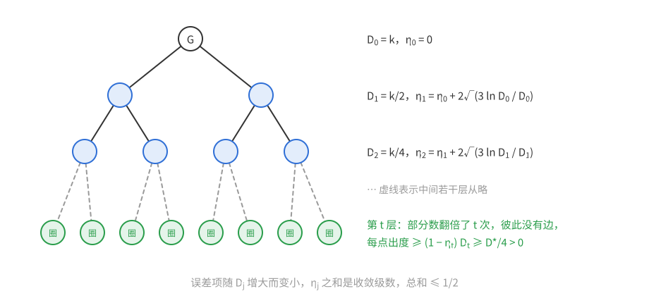

“部分”的个数每次翻倍：设 $P$ 是 $H_j$ 的一个部分（$H_j$ 的边都在部分内部），$P$ 被划分成 $P\cap V_1$ 和 $P\cap V_2$。任取 $v\in P$，它在 $V_1$ 和 $V_2$ 中都有出邻点（个数 $\ge(1-\eta_{j+1})D_j/2>0$），而这些出邻点都在 $P$ 中，所以两半都非空。于是 $H_t$ 有 $2^t$ 个非空的部分，彼此之间没有边，每个点在 $H_t$ 中的出度至少 $(1-\eta_t)D_t\ge\frac12\cdot\frac{D^*}2>0$。每个部分导出的子图出度处处为正，各含一个有向圈；它们顶点不交，共 $2^t$ 个。由 $t$ 的最大性，$k/2^t<D^*$，即 $2^t>k/D^*$。取 $c=1/D^*$ 即得结论。$\square$

**评注**　(a) 与 (b) 的对比说明了一个常见现象：一次性的随机划分要求“每一块都好”，需要为最坏的点付出对数代价；分层逐次划分时，每层只要求“近似均衡”，偏差是 $\sqrt{D\log D}$ 而不是 $D$ 的常数倍，相对误差随 $D$ 增大而变小，累积起来是收敛的级数。

线性的量级是最好的：完全有向图（任两点之间两个方向的边都有）是 $k$ 正则的，只有 $k+1$ 个点，而每个圈至少两个点，所以至多 $\frac{k+1}2$ 个不交圈。对一般的有向图，Bermond–Thomassen 猜想最小出度 $2r-1$ 就保证 $r$ 个不交圈；Alon（1996）证明了最小出度 $64r$ 就够了，后来 Bucić（2018，《An improved bound for disjoint directed cycles》）改进到 $18r$。

### 习题 11　均匀生成树与彩虹生成树

**题意**

(a) **Cayley 公式的推广。** 用 Prüfer 编码证明恒等式
$$x_1x_2\cdots x_n(x_1+\cdots+x_n)^{n-2}=\sum_Tx_1^{d_T(1)}x_2^{d_T(2)}\cdots x_n^{d_T(n)},$$
其中 $T$ 跑遍顶点集为 $[n]$ 的所有（带标号的）树，$d_T(i)$ 是 $i$ 在 $T$ 中的度数。

(b) 设 $F$ 是顶点集为 $[n]$ 的森林，各连通分支分别有 $f_1,\dots,f_s$ 个点（$f_1+\cdots+f_s=n$，孤立点也算一个分支）。证明顶点集为 $[n]$、包含 $F$ 的树恰有 $n^{n-2}\prod_{i=1}^s\frac{f_i}{n^{f_i-1}}$ 棵。

(c) **均匀生成树的独立性。** 设 $H_1,H_2$ 是 $K_n$ 的两个顶点不交的子图，$T$ 是 $K_n$ 的均匀随机生成树。证明事件 $H_1\subseteq T$ 与 $H_2\subseteq T$ 独立。

(d)★ **彩虹生成树的填装。** 证明存在常数 $c>0$：对 $K_n$ 的任意边染色，若每种颜色至多出现 $cn$ 次，则存在至少 $cn$ 棵两两边不交的生成树，每棵树的边颜色互不相同（称为**彩虹**的）。（可以直接使用前几问的结论。）

**思路**　(d) 是目标，前三问是为它准备的工具。想法很直接：独立地取 $t\approx cn$ 棵均匀随机生成树，坏事件有两类——同一棵树中有两条同色的边，以及两棵树共用一条边。每个坏事件都是“某个小森林包含于某棵（或某两棵）随机树”，概率是 $O(1/n^2)$，而相关的事件约 $cn^2$ 个，LLL 正好够用。

困难在于依赖图：一棵均匀生成树的各条边**不是**独立的（例如恰有 $n-1$ 条边），这不是变量模型。(c) 正好补上这一环：只要两个子图没有公共**顶点**，“包含于 $T$”的两个事件就独立。于是可以把“支撑集有公共顶点”作为依赖图的边。而 (c) 又来自 (b) 的乘积公式：包含一个森林的概率是各分支贡献之积。(b) 则来自 (a)：把森林的每个分支缩成一个点，问题就变成在 $s$ 个“大点”上数带权的树。

*(a) 的证明*　回忆 Prüfer 编码：对顶点集 $[n]$（$n\ge2$）上的树 $T$，反复删去编号最小的叶子并记下它的邻点，直到只剩两个点，得到序列 $(p_1,\dots,p_{n-2})\in[n]^{n-2}$。这是树与 $[n]^{n-2}$ 之间的双射（Prüfer 1918），且**每个点 $i$ 在序列中恰出现 $d_T(i)-1$ 次**：$i$ 每被记一次，就失去一个邻点；若 $i$ 在某一步被删去，此时它是叶子，此前已被记 $d_T(i)-1$ 次，此后不再被记；若 $i$ 留到最后，它恰剩一个邻点（最后两个点相邻），同样被记了 $d_T(i)-1$ 次。所以
$$\sum_T\prod_ix_i^{d_T(i)}=x_1\cdots x_n\sum_T\prod_ix_i^{d_T(i)-1}=x_1\cdots x_n\sum_{(p_1,\dots,p_{n-2})\in[n]^{n-2}}x_{p_1}\cdots x_{p_{n-2}}=x_1\cdots x_n(x_1+\cdots+x_n)^{n-2}.$$
（$n=1$ 时左边是 $x_1\cdot x_1^{-1}=1$，右边只有一棵单点树，也是 $1$。）$\square$

*(b) 的证明*　把 $F$ 的第 $i$ 个分支记为 $F_i$。

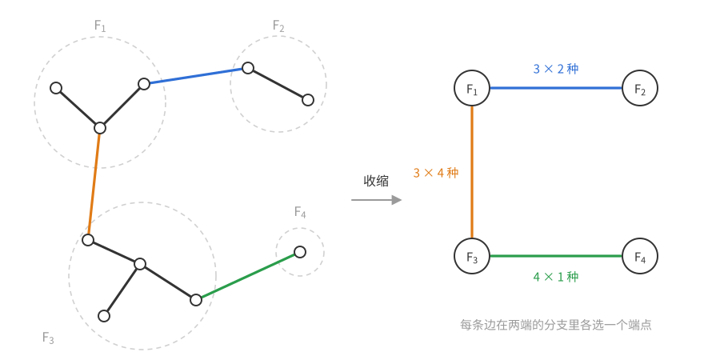

上图左边是包含 $F$ 的一棵树：黑色是 $F$ 的边，彩色是 $T$ 中连接不同分支的边；右边把每个分支缩成一个点，彩色边变成 $s$ 个点上的一棵树 $T'$。反过来，给定 $T'$ 的一条边 $ij$，在 $F_i$ 和 $F_j$ 中各选一个端点，有 $f_if_j$ 种方式。

*对应。* 设树 $T\supseteq F$。$T$ 有 $n-1$ 条边，$F$ 有 $n-s$ 条，所以 $T\setminus F$ 恰有 $s-1$ 条边，每条都连接两个不同的分支（连接同一分支的边会和 $F_i$ 中的路构成圈）。把每个 $F_i$ 缩成一点，这 $s-1$ 条边构成 $s$ 个点上的连通图（$T$ 连通），从而是一棵树 $T'$（不会出现重边：两条边连接同一对分支也会构成圈）。反过来，给定 $s$ 个点上的树 $T'$，并对它的每条边 $ij$ 在 $F_i,F_j$ 中各选一个端点，加到 $F$ 上，得到 $n-1$ 条边的连通图，即一棵包含 $F$ 的树。两个方向互逆，所以
$$\#\{T\supseteq F\}=\sum_{T'}\prod_{ij\in T'}f_if_j=\sum_{T'}\prod_{i=1}^sf_i^{d_{T'}(i)}=f_1\cdots f_s\,(f_1+\cdots+f_s)^{s-2}=f_1\cdots f_s\,n^{s-2},$$
第三个等号是 (a)（$s\ge2$；$s=1$ 时 $F$ 本身是树，个数为 $1=f_1n^{-1}$，公式同样成立）。最后
$$n^{n-2}\prod_{i=1}^s\frac{f_i}{n^{f_i-1}}=n^{n-2}\cdot\frac{f_1\cdots f_s}{n^{n-s}}=f_1\cdots f_s\,n^{s-2}.\qquad\square$$

特别地，$\mathbb P(F\subseteq T)=\prod_{i=1}^s\frac{f_i}{n^{f_i-1}}$，孤立点的因子是 $1$，所以**只有非平凡分支有贡献**。例如单条边：$\mathbb P(g\in T)=\frac2n$（这也可以由 $n-1$ 条边平分到 $\binom n2$ 条边上直接看出）；两条共点的边：$\frac3{n^2}$；两条不交的边：$\frac4{n^2}$。

*(c) 的证明*　若 $H_1$ 含圈，则 $\mathbb P(H_1\subseteq T)=0$，$\mathbb P(H_1\cup H_2\subseteq T)=0$，独立性平凡成立；$H_2$ 同理。设 $H_1,H_2$ 都是森林。由于它们顶点不交，$H_1\cup H_2$ 也是森林，它的非平凡分支恰是 $H_1$ 的非平凡分支与 $H_2$ 的非平凡分支之并。由 (b) 之后的乘积公式，
$$\mathbb P(H_1\cup H_2\subseteq T)=\prod_{H_1\text{ 的分支}}\frac{f}{n^{f-1}}\cdot\prod_{H_2\text{ 的分支}}\frac{f}{n^{f-1}}=\mathbb P(H_1\subseteq T)\,\mathbb P(H_2\subseteq T).\qquad\square$$

注意“顶点不交”不能放宽为“边不交”：两条共点的边各自在 $T$ 中的概率是 $\frac2n$，同时在的概率是 $\frac3{n^2}\ne\frac4{n^2}$。

*(d) 的证明*　取 $c=\frac1{100e}$。若 $cn<1$，题设“每种颜色至多出现 $cn$ 次”意味着没有边，只能 $n\le1$，结论平凡；下设 $cn\ge1$，从而 $n\ge100e>270$。令 $t=\lceil cn\rceil\le2cn$，独立地取 $t$ 棵 $K_n$ 的均匀随机生成树 $T_1,\dots,T_t$。坏事件：

- **R 型**（不彩虹）：对每个 $a\in[t]$ 和每对同色的不同边 $\{g,h\}$，$R_{a,gh}$：$g,h\in T_a$。由 (b) 之后的例子，$\mathbb P\le\frac4{n^2}$。
- **O 型**（重叠）：对每对 $a<b$ 和每条边 $g$，$O_{ab,g}$：$g\in T_a$ 且 $g\in T_b$。$\mathbb P=\big(\frac2n\big)^2=\frac4{n^2}$。

都不发生时，$T_1,\dots,T_t$ 是两两边不交的彩虹生成树。

**依赖图。** 每个坏事件都形如
$$E=\bigcap_{a\in I(E)}\{S_{E,a}\subseteq T_a\},$$
其中 $I(E)$ 是涉及的树的编号（R 型一个，O 型两个），$S_{E,a}$ 是一个小森林（一条或两条边）。称 $S_{E,a}$ 的顶点为 $E$ 在第 $a$ 棵树上的**支撑点**。令 $E\sim E'$ 当且仅当存在 $a\in I(E)\cap I(E')$，使 $E,E'$ 在第 $a$ 棵树上的支撑点有公共点。

*断言：这是合法的依赖图。* 固定 $E$，设 $E'_1,\dots,E'_m$ 都与 $E$ 不相邻。先看它们的任意交：
$$\bigcap_{l\in J}E'_l=\bigcap_{a}\{U_a\subseteq T_a\},\qquad U_a=\bigcup_{l\in J,\ a\in I(E'_l)}S_{E'_l,a}.$$
对 $a\in I(E)$，由不相邻，$U_a$ 与 $S_{E,a}$ 顶点不交。各棵树独立，再在每棵树上用 (c)（$a\notin I(E)$ 时取 $S_{E,a}=\varnothing$）：
$$\mathbb P\Big(E\cap\bigcap_{l\in J}E'_l\Big)=\prod_a\mathbb P(S_{E,a}\cup U_a\subseteq T_a)=\prod_a\mathbb P(S_{E,a}\subseteq T_a)\,\mathbb P(U_a\subseteq T_a)=\mathbb P(E)\,\mathbb P\Big(\bigcap_{l\in J}E'_l\Big).$$
所以 $E$ 与非邻事件的**每个交**都独立（$J=\varnothing$ 时平凡）。这已经推出 $E$ 独立于事件组 $\{E'_1,\dots,E'_m\}$：对每个形如 $B_1\cdots B_m$（$B_l$ 为 $E'_l$ 或其补）的事件，把补事件写成 $\mathbb 1_{\overline{E'_l}}=1-\mathbb 1_{E'_l}$，展开乘积，$\mathbb 1_{B_1\cdots B_m}$ 是若干 $\pm\mathbb 1_{\bigcap_{l\in J}E'_l}$ 之和。对每一项乘以 $\mathbb 1_E$ 取期望，再用刚证明的乘积关系，就得到 $\mathbb P(E\,B_1\cdots B_m)=\mathbb P(E)\,\mathbb P(B_1\cdots B_m)$。

（这里用 (c) 的方式值得注意：(c) 本身只说两个事件独立，但“包含于 $T$”的事件之交仍是“包含于 $T$”的事件，所以两两的独立性可以推广到整组。普通事件没有这种封闭性，这正是一般情况下依赖图不能两两检查的原因。）

**依赖度。** 对固定的树 $a$ 和点 $v$，计算在第 $a$ 棵树上以 $v$ 为支撑点的事件个数：R 型事件 $R_{a,gh}$ 中 $g,h$ 之一以 $v$ 为端点，先选这条边（$\le n$ 种），再选与它同色的另一条（$<cn$ 种），共不超过 $cn^2$ 个；O 型事件 $O_{ab,g}$（或 $O_{ba,g}$）中 $g$ 以 $v$ 为端点，$\le n$ 种，另一棵树 $<t\le2cn$ 种，共不超过 $2cn^2$ 个。每个坏事件共有至多 4 个“（树，支撑点）”对（R 型：一棵树上至多 4 个点；O 型：两棵树上各 2 个点），所以
$$d\le4\cdot3cn^2=12cn^2.$$

**LLL。** $e\cdot\frac4{n^2}\cdot(12cn^2+1)=48ec+\frac{4e}{n^2}=0.48+\frac{4e}{n^2}<1$。由定理 6.2，以正概率所有坏事件都不发生，得到 $t\ge cn$ 棵两两边不交的彩虹生成树。$\square$

**评注**　本题的关键一步是 (c)：均匀生成树虽然不是变量模型，但“顶点不交即独立”给出了一个和变量模型一样好用的依赖图。均匀随机生成树还有许多别的好性质（例如任两条边“包含于 $T$”的事件是负相关的），它们在随机图论中很常用。关于彩虹生成树，Brualdi–Hollingsworth（1996）猜想：$n\ge6$ 为偶数时，$K_n$ 的每个用 $n-1$ 种颜色的正常边染色，其边集都能分解成 $\frac n2$ 棵彩虹生成树。$n=4$ 时不成立：$K_4$ 的三个颜色类是三个完美匹配，彩虹生成树要从每个匹配各取一条边，不是三角形的取法只有 4 个星，而任两个星共用一条边。Glock、Kühn、Montgomery、Osthus（2021，《Decompositions into isomorphic rainbow spanning trees》）对充分大的 $n$ 证明了这个猜想，而且这些树可以取成彼此同构的。本题的条件（每种颜色至多 $cn$ 次，$c$ 很小）比正常边染色（每种颜色至多 $\frac n2$ 次）强得多，但已经给出了线性多棵。

下面两题用偏斜局部引理（定理 6.19、推论 6.20）和随机单射模型（定理 6.21）。

### 习题 12　在 $K_n$ 中放两个边不交的拷贝

**题意**　证明存在常数 $c>0$：若 $n$ 个点、$m$ 条边的图 $H$ 的最大度至多 $cn^2/m$，则 $K_n$ 中可以找到 $H$ 的两个边不交的拷贝。

**思路**　第一个拷贝就放 $H$ 本身（顶点集 $[n]$），第二个拷贝是 $\sigma(H)$，$\sigma$ 是 $[n]$ 的均匀随机置换。坏事件：$H$ 的某条边 $xy$ 被映到 $H$ 的某条边 $uv$ 上。“$\sigma(x)=u,\sigma(y)=v$”恰是随机单射模型中“含匹配 $\{xu,yv\}$”的事件，概率 $\frac1{n(n-1)}$，有典范负依赖图可用。这类事件有 $(2m)^2$ 个，并集上界要求 $m\lesssim n$；而与一个事件相关的只有约 $\Delta m$ 个（要么在定义域一侧碰到 $x,y$，要么在值域一侧碰到 $u,v$），所以条件是 $\Delta m\lesssim n^2$。

*证明*　取 $c=\frac1{64e}$。$m=0$ 时平凡。$m\ge1$ 时最大度 $\Delta\ge1$，题设给出 $n^2\ge m/c\ge64e$，所以 $n\ge14$。

在随机单射模型中取 $X=Y=[n]$，单射即置换 $\sigma$。对每对**有序**的边 $(x,y)$、$(u,v)$（$xy,uv\in E(H)$），令 $A_{xy\to uv}$ 为“$\sigma(x)=u$ 且 $\sigma(y)=v$”，即 $\sigma$ 含匹配 $\{xu,yv\}$（左侧 $x,y$，右侧 $u,v$）。$\mathbb P=\frac1{n(n-1)}$。若这些事件都不发生，$\sigma(H)$ 的每条边 $\sigma(x)\sigma(y)$ 都不是 $H$ 的边，两个拷贝边不交。

用典范负依赖图（定理 6.21 后的推论）：两个匹配有公共顶点时相邻（左侧的点和右侧的点分开算）。与 $\{xu,yv\}$ 在左侧相交的事件：有序边 $(x',y')$ 有一个端点在 $\{x,y\}$ 中，至多 $2\cdot2\Delta=4\Delta$ 种，右侧任意，$2m$ 种，共 $\le8\Delta m$；右侧相交的同理。所以 $d\le16\Delta m\le16cn^2=\frac{n^2}{4e}$。验证推论 6.20：
$$e\cdot\frac1{n(n-1)}\Big(\frac{n^2}{4e}+1\Big)=\frac{n^2/4+e}{n(n-1)}<1\qquad(n\ge14).$$
所以以正概率所有坏事件都不发生。$\square$

**评注**　这是一个**图的填装**问题：两个 $n$ 点图 $G_1,G_2$ 能否边不交地放进同一个 $K_n$。经典的 Sauer–Spencer 定理（1978）说 $2\Delta(G_1)\Delta(G_2)<n$ 时可以，对 $G_1=G_2=H$ 要求 $\Delta\lesssim\sqrt n$。本题的条件 $\Delta\lesssim n^2/m$ 在 $H$ 稀疏时宽松得多：例如 $m=O(n)$ 时，最大度可以到 $cn$ 的量级。

### 习题 13★　填装拉丁横贯

**题意**　证明存在常数 $c>0$：若 $n\times n$ 方阵中每个数至多出现 $cn$ 次，则它含有 $cn$ 个两两不交（没有公共格子）的拉丁横贯。

**思路**　定理 6.23 用随机置换找到一个拉丁横贯。现在要 $t\approx cn$ 个，自然的想法是独立地取 $t$ 个随机置换 $\sigma_1,\dots,\sigma_t$，第 $a$ 个横贯是格子 $\{(i,\sigma_a(i))\}$。坏事件有两类：同一个横贯中有两格同数（与定理 6.23 相同），以及两个横贯共用一个格子。后者概率 $\frac1{n^2}$，与前者同阶；每个格子被至多 $t\approx cn$ 个置换共享，所以依赖度的估计和单个横贯时一样是 $O(cn^2)$。

新的困难是负依赖图：现在的概率空间是 $t$ 个**独立**的随机置换，事件可能同时涉及两个置换（“$\sigma_a(i)=j$ 且 $\sigma_b(i)=j$”）。需要先把定理 6.21 推广到乘积空间。

**引理（独立随机单射的乘积）**　设 $\sigma_1,\dots,\sigma_t$ 是独立的随机单射（各自在随机单射模型中）。考虑形如
$$E=\bigcap_{a\in I(E)}\{\sigma_a\supseteq M_{E,a}\}$$
的事件，$M_{E,a}$ 是匹配。令 $E\sim E'$ 当且仅当存在 $a\in I(E)\cap I(E')$ 使 $M_{E,a}$ 与 $M_{E',a}$ 有公共顶点。则这个图满足 (6.3)：对与 $E$ 都不相邻的 $E'_1,\dots,E'_m$，令 $B=\overline{E'_1}\cdots\overline{E'_m}$，有 $\mathbb P(E\cap B)\le\mathbb P(E)\,\mathbb P(B)$。

*证明*　把 $E$ 写成 $\bigcap_{a\in I(E)}F_a$，$F_a=\{\sigma_a\supseteq M_{E,a}\}$。只需证明：对每个 $a\in I(E)$ 和每个形如 $G=B\cap\bigcap_{a'\in I'}F_{a'}$（$I'\subseteq I(E)\setminus\{a\}$）的事件，
$$\mathbb P(F_a\cap G)\le\mathbb P(F_a)\,\mathbb P(G).\tag{$*$}$$
有了 $(*)$，把 $I(E)$ 中的坐标逐个剥离：$\mathbb P(F_{a_1}F_{a_2}\cdots B)\le\mathbb P(F_{a_1})\mathbb P(F_{a_2}\cdots B)\le\cdots\le\prod_a\mathbb P(F_a)\cdot\mathbb P(B)=\mathbb P(E)\mathbb P(B)$，最后一步用了各 $\sigma_a$ 独立。

证明 $(*)$：固定除 $\sigma_a$ 之外的所有 $\sigma_c$，看 $G$ 作为 $\sigma_a$ 的事件变成什么。每个 $F_{a'}$（$a'\ne a$）已经确定为真或假；每个 $E'_l$ 中不涉及坐标 $a$ 的部分也已确定。若某个 $F_{a'}$ 为假，或某个 $E'_l$ 不涉及 $a$ 却已经为真，则 $G$ 为空。否则 $G$ 变成
$$\bigcap_{l\in L}\{\sigma_a\not\supseteq M_{E'_l,a}\},$$
其中 $L$ 是涉及 $a$、且其他坐标的部分都已成立的那些 $l$。由于 $E'_l\not\sim E$，这些 $M_{E'_l,a}$ 都与 $M_{E,a}$ 没有公共顶点，由定理 6.21（$\sigma_a$ 与已固定的其他置换独立），条件概率满足
$$\mathbb P(F_a\cap G\mid\text{其他 }\sigma_c)\le\mathbb P(F_a)\,\mathbb P(G\mid\text{其他 }\sigma_c).$$
（定理 6.21 的结论可以写成 $\mathbb P(A_{F_0}\overline{A_{F_1}}\cdots\overline{A_{F_k}})\le\mathbb P(A_{F_0})\mathbb P(\overline{A_{F_1}}\cdots\overline{A_{F_k}})$，条件事件概率为 0 时也成立。）对其他 $\sigma_c$ 取期望即得 $(*)$。$\square$

*主要证明*　取 $c=\frac1{50e}$。若 $cn<1$，题设意味着方阵中没有数，不可能；所以 $cn\ge1$，$n\ge50e>135$。令 $t=\lceil cn\rceil\le2cn$，独立地取 $[n]$ 的均匀随机置换 $\sigma_1,\dots,\sigma_t$（行 $\to$ 列），第 $a$ 个横贯是 $\{(i,\sigma_a(i))\}$。坏事件：

- **同数**：对每个 $a$ 和每对不同行、不同列、填数相同的格子 $(i,j),(i',j')$，事件 $\sigma_a\supseteq\{ij,i'j'\}$，概率 $\frac1{n(n-1)}$。
- **共格**：对每对 $a<b$ 和每个格子 $(i,j)$，事件 $\sigma_a\ni ij$ 且 $\sigma_b\ni ij$，概率 $\frac1{n^2}$。

两类事件的概率都 $\le\frac2{n^2}$。都不发生时，$t$ 个横贯都是拉丁的，且两两没有公共格子。（同行或同列的两格不可能同在一个横贯中，不必列为坏事件。）

**依赖度。** 用引理中的图。固定置换 $a$ 和一个顶点（某行 $i$ 或某列 $j$），计算在置换 $a$ 中的匹配含这个顶点的事件：同数事件中含行 $i$ 的，先选行 $i$ 中的格子（$n$ 种），再选与它同数的另一格（$<cn$ 种），不超过 $cn^2$ 个；共格事件中含行 $i$ 的，选行 $i$ 中的格子（$n$ 种）和另一个置换（$<t\le2cn$ 种），不超过 $2cn^2$ 个。列同理。每个坏事件有至多 4 个“（置换，顶点）”对（同数：一个置换中 2 行 2 列；共格：两个置换中各 1 行 1 列），所以
$$d\le4\cdot3cn^2=12cn^2.$$

**偏斜 LLL。** $e\cdot\frac2{n^2}\cdot(12cn^2+1)=24ec+\frac{2e}{n^2}=0.48+\frac{2e}{n^2}<1$。由推论 6.20 与引理，以正概率所有坏事件都不发生，得到 $t\ge cn$ 个两两不交的拉丁横贯。$\square$

**评注**　与定理 6.23 比较：那里每个数至多出现 $\frac n{4e}$ 次就保证一个拉丁横贯，这里把条件加强到 $cn$（常数小得多），就换来线性多个不交的横贯。极端情形是拉丁方（每个数恰好出现 $n$ 次）：Ryser 猜想奇数阶拉丁方有拉丁横贯，Ryser–Brualdi–Stein 猜想任意 $n$ 阶拉丁方有含 $n-1$ 种符号的横贯（见 6.5 节；Montgomery 的预印本已对充分大的 $n$ 证明了它），这类关于（几乎）完整横贯的问题远超出 LLL 的能力。本题的方法——独立地取多个随机对象，把“彼此不冲突”也写成局部坏事件——是用 LLL 做**填装**的通用模式，习题 11(d) 用的是同一个模式。
