# 概率方法（七）：相关不等式

上一篇：[第 6 章 Lovász 局部引理](<概率方法06——Lovász 局部引理.md>)　下一篇：[第 8 章 Janson 不等式](<概率方法08——Janson 不等式.md>)

前几章反复遇到同一个难处：一族事件 $A_1,\dots,A_k$ 互相不独立，$\mathbb P(A_1\cdots A_k)$ 就没法写成乘积。第 6 章的局部引理限制的是**依赖的范围**：每个事件只和少数事件相关，就能得到乘积型的下界 $\mathbb P(\text{都不发生})\ge\prod(1-x_i)$。本章换一个角度，限制依赖的**方向**：在独立随机变量上，若各个事件都“往同一个方向”单调（都是加边越多越容易发生，或者都是越少越容易发生），它们就是**正相关**的，
$$\mathbb P(A_1\cdots A_k)\ge\mathbb P(A_1)\cdots\mathbb P(A_k)$$
（并列 $A_1\cdots A_k$ 表示这些事件同时发生，下同），而且不需要任何稀疏性条件，事件可以重叠得任意厉害。这就是 Harris 不等式（在统计物理中常称 FKG 不等式）。它只给出一个方向的界：单调事件“同时发生”的概率至少和独立时一样大。

于是“随机图不含三角形”这类事件的概率有了一个一行就能写出的下界；对于一类特殊的事件（某个固定集合整个落在随机集合里，例如某个三角形的三条边全部出现），下一章的 Janson 不等式给出与之匹配的上界。本章最后用“最大度不超过 $n/2$”的例子说明，这个下界也可能在指数上就差得很远，并讲清差距从哪里来。

**本章读法。**

- 首读主线：7.1 节的定理 7.1、定理 7.2 及其归纳证明、[推论 7.3](#推论递减事件与多个事件)（最常用的是 (c)），以及 7.2 节的[定理 7.4](#不含三角形的概率) 和它与空图下界的比较。
- 可以二读：一般 FKG 条件的研究背景、[渗流评注](#评注渗流)、命题 7.6 的严格证明（首读看懂“潮水”的启发式计算即可），以及篇幅较长的习题 3(c)、习题 4 的一般情形和习题 7、8。
- 与其他章的联系：[第 8 章](<概率方法08——Janson 不等式.md>)紧接本章：用推论 7.3(c) 给出 Janson 不等式的下界一侧，用推论 7.3(b) 证明 Janson 不等式本身，并给出与定理 7.4 匹配的上界。

## 7.1 Harris–FKG 不等式

### 递增事件与递减事件

[第 4 章](概率方法04——二阶矩方法.md#单调性质与阈值的定义)讨论阈值时已经用过单调性质，这里换成坐标的写法。把 $x\in\{0,1\}^n$ 看成 $[n]$ 的子集（第 $i$ 个坐标为 1 表示 $i$ 入选），按坐标比较大小：$x\le y$ 指每个 $i$ 都有 $x_i\le y_i$，即对应的子集包含关系。

**定义（递增事件、递减事件）**　$A\subseteq\{0,1\}^n$ 称为**递增**的（也叫递增性质、上集），若
$$x\in A,\ x\le y\ \Longrightarrow\ y\in A,$$
即在布尔格（$\{0,1\}^n$ 连同上面的逐坐标偏序）中向上封闭：把若干个 0 改成 1 不会让 $x$ 离开 $A$。类似地，向下封闭的 $A$ 称为**递减**的。$A$ 递增当且仅当它的补集 $\overline A$ 递减。

在随机图 $G(n,p)$ 中，基础集是 $K_n$ 的 $\binom n2$ 条边，每条边独立地以概率 $p$ 出现。“连通”“含三角形”“有哈密顿圈”“色数至少 5”都是递增的：加边不会破坏它们。“是平面图”“不含三角形”“最大度至多 $d$”都是递减的。“恰有一个三角形”“含导出的 $C_4$”既不递增也不递减。

本章的主要结论一句话就能说出来：

> **独立随机变量的递增事件是正相关的。**

**定理 7.1（Harris 1960）**　设 $A,B$ 是一组独立布尔随机变量 $x_1,\dots,x_n$ 的递增事件（$x_i$ 不必同分布），则
$$\mathbb P(AB)\ge\mathbb P(A)\,\mathbb P(B).$$
当 $\mathbb P(B)>0$ 时，这等价于 $\mathbb P(A\mid B)\ge\mathbb P(A)$。

先用一个最小的例子看清它在说什么。取 $n=3$，每个坐标独立地以概率 $p$ 为 1。令 $A$ 为“至少两个坐标为 1”，$B$ 为“$x_1=1$”，两者都是递增的。

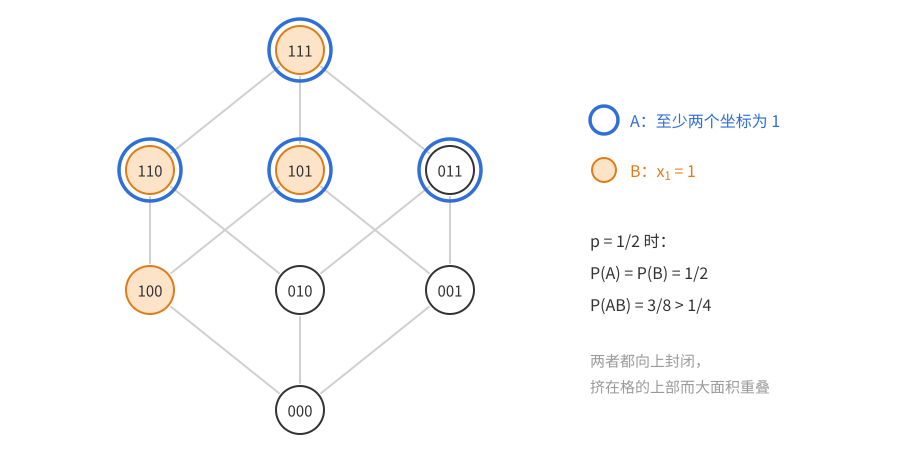

图中是 $\{0,1\}^3$ 的布尔格，向上的边表示把一个 0 改成 1。蓝框圈出 $A$，橙色填充标出 $B$，两者都“挂在格的上部”，所以必然大面积重叠。具体计算：
$$\mathbb P(A)=3p^2-2p^3,\quad\mathbb P(B)=p,\quad\mathbb P(AB)=\mathbb P(x_1=1,\ x_2+x_3\ge1)=p(2p-p^2),$$
$$\mathbb P(AB)-\mathbb P(A)\mathbb P(B)=2p^2-4p^3+2p^4=2p^2(1-p)^2\ge0.$$
直观上：知道 $B$ 发生，相当于知道“有一个坐标被抬成了 1”，整体往上推了一点，自然更容易落进同样挂在上部的 $A$。定理说的是，这个直觉对**任意**两个递增事件、任意独立的（不必同分布的）坐标都成立。

### 独立性不能去掉

定理的条件里，“各坐标独立”是本质的，“同分布”则不需要。

- **完全负相关的坐标。** 设 $x_1$ 均匀取 0 或 1，$x_2=1-x_1$。$A=\{x_1=1\}$、$B=\{x_2=1\}$ 都递增，各有概率 $\frac12$，但 $\mathbb P(AB)=0$。
- **固定大小的随机子集。** 从 $[n]$ 中均匀随机取一个 $k$ 元子集 $S$（$1\le k<n$），坐标 $1_{i\in S}$ 不独立：一个元素入选，留给其他元素的名额就少了。$A=\{1\in S\}$、$B=\{2\in S\}$ 都递增，却有
$$\mathbb P(AB)=\frac{k(k-1)}{n(n-1)}<\Big(\frac kn\Big)^2=\mathbb P(A)\mathbb P(B).$$
所以在“恰有 $m$ 条边的均匀随机图” $G(n,m)$ 中不能直接套用 Harris 不等式；[第 6 章](<概率方法06——Lovász 局部引理.md>)的随机单射模型也是这种“抢名额”的负相关。

（这一段是研究背景，首读可跳过。）不过，独立性可以换成更弱的条件，这对统计物理很重要，相关不等式的理论原本就是从那里来的。Fortuin、Kasteleyn、Ginibre（1971）证明：在有限分配格上（例如 $\{0,1\}^n$，其中 $x\vee y$、$x\wedge y$ 是逐坐标取较大者、较小者，即子集的并与交），若测度 $\mu$ 处处为正且满足
$$\mu(x\vee y)\,\mu(x\wedge y)\ge\mu(x)\,\mu(y),$$
则递增函数在 $\mu$ 下正相关。独立坐标的乘积测度对上式取等号，所以 Harris 不等式是它的特例；铁磁 Ising 模型等不独立的模型也满足这个条件。因此文献中常把这类结果统称为 **FKG 不等式**。我们只用独立的情形，一般情形见 Alon–Spencer。

另外，$p=\frac12$ 时 Harris 不等式就是一个计数结论：$[n]$ 上的两个上集 $\mathcal A,\mathcal B$ 满足 $2^n|\mathcal A\cap\mathcal B|\ge|\mathcal A||\mathcal B|$，这是 Kleitman（1966）独立发现的，常称 Kleitman 引理。

### 函数形式与证明

**怎样想到证明。** 直接对事件做归纳不方便：把 $A$ 按 $x_1=0$、$x_1=1$ 切开以后，得到的是条件概率，它是关于 $x_1$ 的**数值函数**，已经不是事件了。所以干脆把命题推广到函数：事件换成单调函数，$\mathbb P(AB)\ge\mathbb P(A)\mathbb P(B)$ 换成 $\mathbb E[fg]\ge\mathbb E f\,\mathbb E g$。推广以后，“对一个坐标取条件期望”这个操作在命题内部是封闭的，归纳就能进行。推广到函数还有一个好处：坐标不必是布尔的，可以取实数值，7.2 节要用到正态变量。

设每个 $\Omega_i$ 是一个全序集（例如 $\{0,1\}$ 或 $\mathbb R$），$x_i\in\Omega_i$ 按某个分布随机选取，各 $x_i$ 相互独立。函数 $f(x_1,\dots,x_n)$ 称为**单调递增**的，若 $x\le y$（逐坐标）蕴含 $f(x)\le f(y)$；单调递减类似。

**定理 7.2（Harris 不等式，函数形式）**　若 $f,g$ 是独立随机变量 $x_1,\dots,x_n$ 的单调递增函数，则
$$\mathbb E[fg]\ge(\mathbb E f)(\mathbb E g).$$

（为了让期望都有意义，设 $f,g$ 有界；本章用到的都是示性函数或有限集上的函数。对平方可积的 $f,g$，把它们截断成 $\max(-K,\min(f,K))$——截断保持单调性——再令 $K\to\infty$ 即可。）

取 $f=1_A$、$g=1_B$：$A$ 递增等价于 $1_A$ 单调递增，$\mathbb E[1_A1_B]=\mathbb P(AB)$，定理 7.1 就是定理 7.2 的特例。

*证明*　对 $n$ 归纳。

*$n=1$。* 先看一个熟悉的特例：$x$ 在 $a_1<\dots<a_m$ 上均匀分布。这时要证
$$\frac1m\sum_if(a_i)g(a_i)\ge\frac1{m^2}\sum_if(a_i)\sum_jg(a_j),$$
即排序不等式“同序和不小于乱序和”的平均形式。它的标准证明是把两边之差写成
$$\frac1{2m^2}\sum_{i,j}\big(f(a_i)-f(a_j)\big)\big(g(a_i)-g(a_j)\big),$$
每一项里 $f$ 与 $g$ 的增量同号，所以和非负。而对 $(i,j)$ 的双重平均，正是对两个独立同分布的随机下标取期望。于是一般情形照样做：取 $y$ 为 $x=x_1$ 的一个独立同分布副本。$\Omega_1$ 是全序集，对任意两个值总有 $x\le y$ 或 $y\le x$，而 $f,g$ 都递增，所以 $f(x)-f(y)$ 与 $g(x)-g(y)$ 同号（或有一个为 0），
$$0\le\mathbb E\big[(f(x)-f(y))(g(x)-g(y))\big]=2\,\mathbb E[fg]-2\,\mathbb E f\,\mathbb E g.$$
展开时用到 $x,y$ 独立同分布：$\mathbb E[f(x)g(x)]=\mathbb E[f(y)g(y)]=\mathbb E[fg]$，$\mathbb E[f(x)g(y)]=\mathbb E f\,\mathbb E g$。这个单变量情形常称为 **Chebyshev 和不等式**。

*由 $n-1$ 到 $n$（$n\ge2$）。* 思路是先把 $x_2,\dots,x_n$ 平均掉，把问题压成 $x_1$ 的单变量问题。定义 $\Omega_1$ 上的函数
$$f_1(t)=\mathbb E[f\mid x_1=t]=\mathbb E_{x_2,\dots,x_n}\big[f(t,x_2,\dots,x_n)\big],$$
$g_1$ 和 $(fg)_1$ 类似定义（把 $f$ 换成 $g$、$fg$）。第二个等号是**用到独立性的地方**：$x_1$ 与 $(x_2,\dots,x_n)$ 独立，所以固定 $x_1=t$ 以后，其余坐标的分布不变，条件期望就是把 $t$ 代进去再对其余坐标求期望。

两条性质：

1. 对固定的 $t$，$(x_2,\dots,x_n)\mapsto f(t,x_2,\dots,x_n)$ 和对应的 $g$ 都是 $n-1$ 个独立变量的递增函数。由归纳假设，
$$(fg)_1(t)\ge f_1(t)\,g_1(t)\qquad\text{对每个 }t\in\Omega_1.\tag{7.1}$$
2. $f_1,g_1$ 是 $t$ 的递增函数：$t\le t'$ 时，对每组 $(x_2,\dots,x_n)$ 都有 $f(t,x_2,\dots)\le f(t',x_2,\dots)$，取期望保持不等号。

于是
$$\mathbb E[fg]=\mathbb E\big[(fg)_1(x_1)\big]\overset{(7.1)}{\ge}\mathbb E\big[f_1(x_1)g_1(x_1)\big]\overset{n=1}{\ge}\mathbb E f_1\cdot\mathbb E g_1=\mathbb E f\cdot\mathbb E g.$$
第一个和最后一个等号是全期望公式。$\square$

回头看证明，单调性用了两次：一次保证固定 $x_1$ 后的“切片”仍然递增，可以用归纳假设；一次保证平均后的 $f_1,g_1$ 仍然同向单调，可以用单变量情形。独立性用了一次，保证切片上的期望就是条件期望。前面的两个反例正是破坏了这一步：$x_2=1-x_1$ 时，固定 $x_1$ 会把 $x_2$ 也固定住。

下图以 $n=2$、$f=1_A$ 为例：左边正方形是 $(x_1,x_2)\in[0,1]^2$，浅蓝色是递增事件 $A$，竖直的粗线是固定 $x_1=t$（橙）、$x_1=t'$（紫）时切片中落在 $A$ 里的部分；右边是 $f_1(t)$，即切片中 $A$ 所占的比例。切片本身仍是递增的，这是第一次用单调性；$t\le t'$ 时切片包含关系使 $f_1$ 递增，这是第二次。

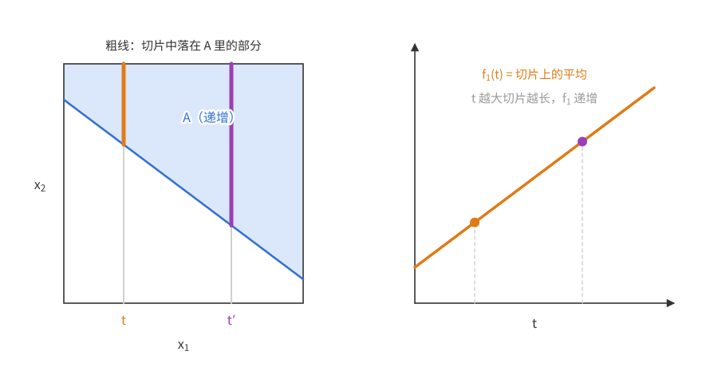

### 推论：递减事件与多个事件

把所有坐标的全序同时反过来，递增函数就变成递减函数，而独立性不受影响。（只反转一部分坐标不行：$x_1+x_2$ 只反转 $x_1$ 的顺序后，对 $x_1$ 递减、对 $x_2$ 仍递增，两者都不是。）所以“同向”才是关键：两个函数同为递增或同为递减时正相关，一增一减时负相关。

**推论 7.3**　设 $A,B$ 是独立随机变量的事件。

(a) 若 $A,B$ 都递减，则 $\mathbb P(AB)\ge\mathbb P(A)\mathbb P(B)$。

(b) 若 $A$ 递增、$B$ 递减，则 $\mathbb P(AB)\le\mathbb P(A)\mathbb P(B)$。

(c) 若 $A_1,\dots,A_k$ 都递增（或都递减），则 $\mathbb P(A_1\cdots A_k)\ge\mathbb P(A_1)\cdots\mathbb P(A_k)$。

*证明*　(b) $B$ 递减，所以 $\overline B$ 递增，由定理 7.1，
$$\mathbb P(AB)=\mathbb P(A)-\mathbb P(A\overline B)\le\mathbb P(A)-\mathbb P(A)\mathbb P(\overline B)=\mathbb P(A)\mathbb P(B).$$
(a) $\overline A,\overline B$ 都递增，由定理 7.1，$\mathbb P(\overline A\,\overline B)\ge\mathbb P(\overline A)\mathbb P(\overline B)$，于是
$$\mathbb P(AB)=1-\mathbb P(\overline A)-\mathbb P(\overline B)+\mathbb P(\overline A\,\overline B)\ge(1-\mathbb P(\overline A))(1-\mathbb P(\overline B))=\mathbb P(A)\mathbb P(B).$$
(c) 递增事件的交仍是递增的（$x$ 属于每个 $A_i$、$y\ge x$，则 $y$ 属于每个 $A_i$）。所以 $A_2\cdots A_k$ 递增，由定理 7.1，
$$\mathbb P(A_1A_2\cdots A_k)\ge\mathbb P(A_1)\,\mathbb P(A_2\cdots A_k),$$
再对 $k$ 归纳。都递减的情形同理，用 (a) 代替定理 7.1。$\square$

(c) 是本章最常用的形式：**一族同向单调的事件同时发生的概率，不低于它们独立时的概率**。和局部引理对比：局部引理的乘积下界要求依赖图稀疏，而这里对依赖结构没有任何要求，代价是事件必须同向单调。

**例（平面性与连通性）**　在 $G(n,p)$ 中，
$$\mathbb P(\text{平面}\mid\text{连通})\le\mathbb P(\text{平面}).$$
“是平面图”是递减性质（删边保持平面性），“连通”是递增性质，由推论 7.3(b)，$\mathbb P(\text{平面且连通})\le\mathbb P(\text{平面})\mathbb P(\text{连通})$，两边除以 $\mathbb P(\text{连通})$（$0<p\le1$ 时为正）即得。直观上：知道图连通，就知道它的边“不太少”，平面的可能性只会降低。这种结论单凭直觉似乎显然，但要严格证明，几乎只能靠相关不等式。

### 评注：渗流

（本节是研究背景，首读只看图和图下那一段即可；习题 3 会用到这里的模型。）这类不等式最初是为研究**渗流**引入的。经典模型是平面整点格 $\mathbb Z^2$：相距为 1 的两点之间有一条边，每条边独立地以概率 $p$ 保留（称为“开”），否则删去。这是流体在多孔介质中渗透的理想化数学模型。开边组成的连通分支称为**团簇**。关心的量是
$$\theta(p)=\mathbb P_p(\text{原点所在的团簇是无限的}).$$
只要 $p<1$，原点的四条边就以正概率全部关闭，所以 $\theta(p)<1$；“发生渗流”指的是 $\theta(p)>0$。（“某处存在无限团簇”的概率只能是 0 或 1，它为 1 当且仅当 $\theta(p)>0$。）$\theta(p)$ 随 $p$ 单调不减，因此存在临界值 $p_c$：$p<p_c$ 时 $\theta=0$，$p>p_c$ 时 $\theta>0$。

Harris（1960）证明 $\theta(\frac12)=0$，从而 $p_c\ge\frac12$，本章的不等式正是他为这个证明引入的；Kesten（1980）证明 $p>\frac12$ 时 $\theta(p)>0$，从而 $p_c=\frac12$。这样精确的临界值极为罕见：$\frac12$ 来自 $\mathbb Z^2$ 的自对偶性（它的对偶格仍是 $\mathbb Z^2$），而 $\mathbb Z^2$ 上的点渗流、$\mathbb Z^3$ 上的边渗流，临界值都只有数值估计。

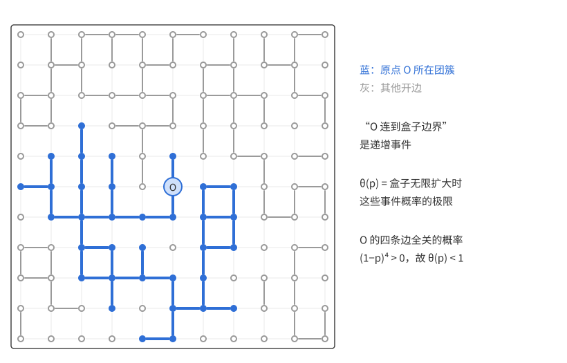

上图是 $p=\frac12$ 时一个盒子里的随机开边，蓝色是原点所在的团簇。“原点与盒子边界相连”是递增事件（多开一些边只会更容易连通），$\theta(p)$ 是盒子无限扩大时这些事件概率的极限。渗流理论中的许多论证，就是用 Harris 不等式把几个递增的“连通”事件同时发生的概率拼接起来，例如“左右穿越”与“上下穿越”同时发生的概率不低于两者之积。

## 7.2 在随机图中的应用

本节用推论 7.3(c) 估计 $G(n,p)$ 的两个递减性质（不含三角形、最大度不超过 $n/2$）的概率，并比较这个下界离真实值有多远：前一个例子中，Harris 下界在 $p\lesssim n^{-1/2}$ 时量级正确（下一章证明）；后一个例子中，它在指数上就偏小。

### 不含三角形的概率

**问题**　$G(n,p)$ 不含三角形的概率是多少？

$p\ll1/n$ 时三角形的期望个数 $\binom n3p^3\to0$，这个概率趋于 1；$p$ 更大时它趋于 0，我们关心它**以多快的速度**趋于 0。本节用 Harris 不等式给出下界，下一章用 Janson 不等式给出匹配的上界。

**怎样想到。** 不含三角形，就是对每个三元组 $\{i,j,k\}$，事件“$ijk$ 不构成三角形”都发生。如果这 $\binom n3$ 个事件相互独立，答案就是 $(1-p^3)^{\binom n3}$。它们当然不独立——共用一条边的两个三元组相互影响，而且每个事件和 $\Theta(n)$ 个事件共边，依赖图一点也不稀疏。但每个事件都是递减的（删边不会制造三角形），推论 7.3(c) 说同向单调的事件只会正相关，所以独立时的乘积就是一个下界。

**定理 7.4**　$\mathbb P\big(G(n,p)\text{ 不含三角形}\big)\ge(1-p^3)^{\binom n3}$。

*证明*　基础集是 $K_n$ 的边。对每个三元组 $i<j<k$，事件 $T_{ijk}=\{ij,jk,ik\text{ 不全出现}\}$ 是递减的，概率为 $1-p^3$。由推论 7.3(c)，
$$\mathbb P(G(n,p)\text{ 不含三角形})=\mathbb P\Big(\bigcap_{i<j<k}T_{ijk}\Big)\ge\prod_{i<j<k}\mathbb P(T_{ijk})=(1-p^3)^{\binom n3}.\qquad\square$$

**这个下界有多好？** 设 $p\le0.99$。由 $x\le-\ln(1-x)\le\frac{x}{1-x}$，对 $x=p^3\le0.99^3$ 有 $p^3\le-\ln(1-p^3)\le34p^3$，即 $1-p^3=e^{-\Theta(p^3)}$，于是
$$\mathbb P(\text{不含三角形})\ge e^{-\Theta(n^3p^3)}.$$
另一个下界更粗暴：空图不含三角形，
$$\mathbb P(\text{不含三角形})\ge\mathbb P(G(n,p)\text{ 是空图})=(1-p)^{\binom n2}=e^{-\Theta(n^2p)}$$
（同样用 $p\le-\ln(1-p)\le100p$）。哪个更好，取决于哪个指数更小：$n^3p^3\le n^2p$ 当且仅当 $p\le n^{-1/2}$。合起来，
$$\mathbb P(G(n,p)\text{ 不含三角形})\ge\begin{cases}e^{-O(n^3p^3)},&p\lesssim n^{-1/2},\\[2pt] e^{-O(n^2p)},&n^{-1/2}\lesssim p\le0.99.\end{cases}$$
在分界点 $p\asymp n^{-1/2}$ 处两个指数都是 $\Theta(n^{3/2})$，衔接一致。

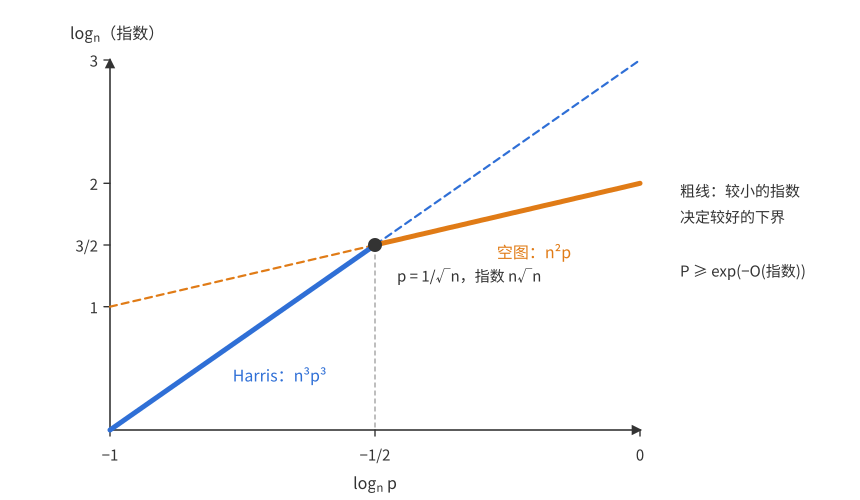

上图横轴是 $\log_np$，纵轴是指数的量级 $\log_n(\cdot)$：蓝线是 Harris 下界的指数 $n^3p^3$，橙线是空图下界的指数 $n^2p$。概率下界由较小的指数决定，即图中加粗的折线，拐点在 $p=n^{-1/2}$。

两个下界代表两种“避开三角形”的方式。Harris 下界是**各自付代价**：每个三元组各自独立地付出代价 $p^3$，共 $\binom n3$ 份；空图下界则是**集体行动**：让所有边集体缺失，一次性避开全部三角形，代价是 $\binom n2$ 条边各付 $p$。三角形很多（$n^3p^3\gg n^2p$）时，集体行动更便宜。（集体行动还可以更聪明：只要求图是一个固定二部划分的子图，代价是约 $n^2/4$ 条跨不过去的边各付 $p$，比空图的 $n^2/2$ 省一半，但量级相同。）下一章将用 Janson 不等式证明上面的两种情形都与真实值同阶，即折线就是真实指数的量级。

### 最大度

**问题**　$G(n,\frac12)$ 的最大度不超过 $n/2$ 的概率是多少？

**Harris 下界。** 每个顶点 $v$ 的度 $\deg v\sim\mathrm{Bin}(n-1,\frac12)$ 关于 $\frac{n-1}2$ 对称，而 $\frac{n-1}2<\frac n2$，所以 $\mathbb P(\deg v\le n/2)\ge\frac12$，事实上比 $\frac12$ 多出 $\Theta(n^{-1/2})$（多出的是中间一两个取值的概率）。“$\deg v\le n/2$”是递减事件，由推论 7.3(c)，
$$\mathbb P\big(\text{最大度}\le n/2\big)\ge\prod_v\mathbb P(\deg v\le n/2)\ge2^{-n}.$$
多出的 $\Theta(n^{-1/2})$ 只贡献因子 $e^{O(\sqrt n)}$，所以这个下界是 $(\frac12+o(1))^n$。

真实值在指数上就比它大：各顶点“度不大”这些事件之间的正相关，远强于 Harris 不等式所保证的“不低于独立”。

**定理 7.5（Riordan–Selby 2000）**
$$\mathbb P\big(G(n,\tfrac12)\text{ 的最大度}\le n/2\big)=(0.6102\cdots+o(1))^n.$$

证明超出本课程范围。下面在一个更容易处理的连续模型中算出这个常数，看清它从哪里来；Riordan 和 Selby 正是以这种直观为基础，在随机图中严格证明了上述结果。

**连续模型。** 随机图在 $K_n$ 的每条边上放一个独立的伯努利变量。把它中心化：$2(1_{uv\in G}-\frac12)$ 是均值 0、方差 1 的 $\pm1$ 变量，$\sum_{u\ne v}2(1_{uv\in G}-\frac12)=2\deg v-(n-1)$，事件 $\deg v\le n/2$ 大致就是这个和 $\le0$。把每条边上的 $\pm1$ 换成标准正态变量，就得到下面的模型。由中心极限定理，单个和的分布在两个模型中相近；但所有顶点**同时**满足条件是一个**大偏差事件**（概率随 $n$ 指数地变小，中心极限定理管不到这么小的概率），两个模型给出同样的常数，这一点除了直观之外并无先验的理由。

**命题 7.6（正态边权下的“最大度”）**　在 $K_n$ 的每条边 $uv$ 上放一个独立的标准正态变量 $Z_{uv}$，令 $W_v=\sum_{u\ne v}Z_{uv}$。则
$$\mathbb P(W_v\le0\ \ \forall v)=(0.6102\cdots+o(1))^n.$$

$\mathbb P(W_v\le0)=\frac12$，而事件 $\{W_v\le0\}$ 是独立的实值变量 $Z_{uv}$ 的递减事件（定理 7.2 允许坐标取实数值），所以 Harris 不等式同样给出 $\mathbb P(W_v\le0\ \forall v)\ge2^{-n}$。真实值大得多。

**怎样想到证明：找出公共成分。** 先看 $W_v$ 之间怎样相关。$\mathrm{Var}\,W_v=n-1$；$u\ne v$ 时 $W_u$、$W_v$ 恰好共用一条边 $uv$。按协方差的双线性（[第 4 章](概率方法04——二阶矩方法.md#怎样算方差)）展开，不同边上的项相互独立、协方差为 0，只剩共用的那一项，所以 $\mathrm{Cov}(W_u,W_v)=\mathrm{Var}\,Z_{uv}=1$。两两之间的相关系数（协方差除以两个标准差之积）只有 $\frac1{n-1}$，单看一对几乎是独立的。但 $n$ 个变量两两都有这一点点相关，合起来就不能忽略。

把所有方差和协方差排成一张 $n\times n$ 的表（协方差矩阵）：对角线上是 $n-1$，其余位置都是 $1$。这张表正是“每个坐标一份方差 $n-2$ 的独立噪声、再加一份所有坐标共享的方差 1 的成分”会产生的表。具体地，取独立的标准正态变量 $Z_0',Z_1',\dots,Z_n'$，向量
$$\sqrt{n-2}\,(Z_1',\dots,Z_n')+Z_0'\,(1,\dots,1)$$
每个坐标方差为 $(n-2)+1=n-1$，任两坐标协方差为 1，与 $(W_v)$ 的表完全一样（$n\ge3$）。

要把“表一样”变成“分布一样”，需要概率论中的一个基本事实，这里直接引用。若干个独立标准正态变量的线性组合排成的向量，称为**联合正态**向量；**联合正态向量的分布完全由各坐标的均值与两两协方差决定**。（一维时这就是熟悉的“正态分布由均值和方差决定”。）$(W_v)$ 的每个坐标是独立变量 $Z_{uv}$ 的线性组合，上面的向量是独立变量 $Z_i'$ 的线性组合，两者均值都是 0、协方差表相同，所以 $(W_v)_{v\in[n]}$ 与上面的向量同分布。

这一步把 $n$ 个两两弱相关的变量，换成了“公共成分 + 独立噪声”：相关性全部集中到一个变量 $Z_0'$ 上。可以把 $Z_0'$ 想成所有顶点共享的一股“潮水”：它一下降，所有的 $W_v$ 同时被压低。固定 $Z_0'=z$ 后，各坐标独立，每个坐标满足条件的概率是 $\Phi\big(-z/\sqrt{n-2}\big)$，其中 $\Phi$ 是标准正态的分布函数，$\varphi=\Phi'$ 是密度。于是有两种策略：

- **潮水不动**（$z=0$）：每个坐标各凭运气，概率 $\Phi(0)^n=2^{-n}$。这正是 Harris 下界的量级——它相当于让每个事件各自付出代价。
- **潮水下降** $z=-u\sqrt{n-2}$（$u>0$）：这本身要付出代价，正态密度在这里约为 $e^{-nu^2/2}$；但回报是每个坐标的成功概率从 $\frac12$ 提高到 $\Phi(u)$。总体约为
$$\big(e^{-u^2/2}\,\Phi(u)\big)^n.$$

所以答案的底数应该是 $\max_u e^{-u^2/2}\Phi(u)$。在 $u=0$ 处它的值是 $\frac12$，导数是 $\varphi(0)>0$，所以稍微让潮水下降一点总是划算的，底数一定严格大于 $\frac12$。和不含三角形的例子一样，“集体行动”打败了“各自付代价”。

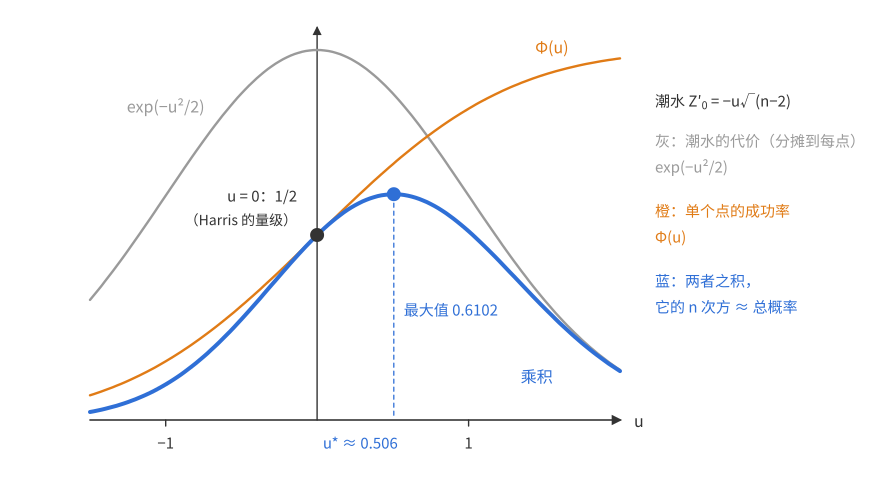

上图画出潮水的代价 $e^{-u^2/2}$（灰）、单个坐标的成功概率 $\Phi(u)$（橙）和两者之积（蓝）。乘积在 $u=0$ 处为 $\frac12$，在 $u^*\approx0.506$ 处达到最大值 $0.6102\cdots$。最优点满足 $\frac{d}{du}\big(-\frac{u^2}2+\ln\Phi(u)\big)=0$，即 $u^*\Phi(u^*)=\varphi(u^*)$；此时 $e^{-u^{*2}/2}\approx0.880$，$\Phi(u^*)\approx0.694$。

下面把这个启发式计算变成严格证明。（严格证明是进阶内容，首读可以跳过，直接看后面“回到随机图”一段。）关键是换元 $z=-u\sqrt{n-2}$：它让被积函数的指数部分**恰好**是 $(n-2)g(u)$（$g$ 的定义见下），于是只需比较 $g$ 与它的最大值，不必再估计近似误差。这种“$\frac1n\ln\int e^{ng}\to\max g$”的论证称为 **Laplace 方法**。

*命题 7.6 的证明*　记
$$g(u)=-\frac{u^2}2+\ln\Phi(u),\qquad M=\max_{u\in\mathbb R}g(u).$$
**第一步：化成一维积分。** 由上面的同分布表示，对 $Z_0'$ 取条件，
$$\mathbb P(W_v\le0\ \forall v)=\mathbb P\Big(Z_i'\le-\frac{Z_0'}{\sqrt{n-2}}\ \forall i\in[n]\Big)=\int_{-\infty}^{\infty}\varphi(z)\,\Phi\Big(\frac{-z}{\sqrt{n-2}}\Big)^n dz.$$
令 $z=-u\sqrt{n-2}$，$\varphi(z)=\frac1{\sqrt{2\pi}}e^{-(n-2)u^2/2}$，得
$$\mathbb P(W_v\le0\ \forall v)=\sqrt{\frac{n-2}{2\pi}}\int_{-\infty}^{\infty}e^{-(n-2)u^2/2}\,\Phi(u)^n\,du=\sqrt{\frac{n-2}{2\pi}}\int_{-\infty}^{\infty}e^{(n-2)g(u)}\,\Phi(u)^2\,du.\tag{7.2}$$
**第二步：$M$ 存在且在某个 $u^*>0$ 处取到。** $g$ 连续；$u\to-\infty$ 时 $\ln\Phi(u)\to-\infty$，$u\to+\infty$ 时 $-u^2/2\to-\infty$，而 $\ln\Phi\le0$，所以 $g\to-\infty$（两端），最大值存在。又 $u\le0$ 时 $g'(u)=-u+\frac{\varphi(u)}{\Phi(u)}>0$，所以最大值点 $u^*>0$。

**第三步：上界。** 由 $\Phi\le1$ 得 $g(u)\le-\frac{u^2}2$，又 $g\le M$，所以对 $n\ge3$，
$$e^{(n-2)g(u)}\Phi(u)^2\le e^{(n-3)g(u)}\cdot e^{g(u)}\le e^{(n-3)M}e^{-u^2/2}.$$
代入 (7.2)，$\int e^{-u^2/2}du=\sqrt{2\pi}$，得
$$\mathbb P(W_v\le0\ \forall v)\le\sqrt{n-2}\;e^{(n-3)M}.$$
**第四步：下界。** 任给 $\varepsilon>0$，由 $g$ 的连续性取 $\delta>0$，使 $[u^*,u^*+\delta]$ 上 $g\ge M-\varepsilon$；这个区间里 $u>0$，$\Phi(u)\ge\frac12$，从而 $\Phi(u)^2\ge\frac14$。只保留 (7.2) 中这一段积分，
$$\mathbb P(W_v\le0\ \forall v)\ge\sqrt{\frac{n-2}{2\pi}}\cdot\frac\delta4\cdot e^{(n-2)(M-\varepsilon)}.$$
**第五步：取极限。** 第三、四步的多项式因子和常数因子取 $\frac1n\ln$ 后趋于 0，所以
$$M-\varepsilon\le\liminf_{n\to\infty}\frac1n\ln\mathbb P(W_v\le0\ \forall v)\le\limsup_{n\to\infty}\frac1n\ln\mathbb P(W_v\le0\ \forall v)\le M.$$
令 $\varepsilon\to0$，$\mathbb P(W_v\le0\ \forall v)=(e^M+o(1))^n$。数值求解 $u\Phi(u)=\varphi(u)$ 得 $u^*=0.50605\cdots$，$e^M=e^{-u^{*2}/2}\Phi(u^*)=0.61023\cdots$。$\square$

**评注（更精确的渐近式）**　（进阶补充，首读可跳过。）$g$ 是严格凹函数（正态分布函数是对数凹的），在 $u^*$ 处对 $g$ 做二阶 Taylor 展开，还能把 (7.2) 算得更精确：$\mathbb P(W_v\le0\ \forall v)\sim C\,e^{Mn}$（$e^M=0.61023\cdots$），其中 $C=e^{u^{*2}}/\sqrt{1+2u^{*2}}\approx1.05$，数值积分 (7.2) 也证实了这一点。

**回到随机图。** 连续模型说明了 $0.6102$ 的来历：最可能的“所有顶点度都不超过 $n/2$”的方式，不是每个顶点各自碰运气，而是全图整体偏稀，把所有顶点的度一起往下压一点，再让每个顶点各自以约 $0.694$ 的概率落在 $n/2$ 以下。Harris 不等式只能看到“正相关”这个定性事实，看不到这种集体机制带来的指数级增益。

那么能否用更强的工具补上这个差距？下一章的 Janson 不等式形式上也能用：$\{\Delta(G)\le d\}$ 就是“没有一个以某点为中心、带 $d+1$ 片叶子的星形边集整个出现”，正是 Janson 的框架；但这些星形大量共用边，相关性的总贡献远大于期望个数，得到的界毫无用处。所以 Harris 下界与真实值之间的差距，只能靠这种针对具体问题的分析来弥补。

## 本章小结

| 技巧 | 本章中的例子 |
|---|---|
| 识别递增、递减事件（加边是否保持性质） | 连通、含三角形递增；平面、不含三角形、最大度 $\le n/2$ 递减 |
| Harris 不等式：同向单调事件正相关，乘积是交的下界 | 布尔格 $n=3$ 的例子、不含三角形的下界 $(1-p^3)^{\binom n3}$、最大度的下界 $2^{-n}$ |
| 一增一减负相关 | $\mathbb P(\text{平面}\mid\text{连通})\le\mathbb P(\text{平面})$ |
| 把事件推广成函数，以便对坐标取条件期望做归纳 | 定理 7.2 的证明（单变量情形即 Chebyshev 和不等式） |
| 检查独立性：不独立时正相关可能失效 | $x_2=1-x_1$、固定大小的随机子集 |
| 比较“各自付代价”与“集体行动”两种策略 | 空图下界在 $p\gg n^{-1/2}$ 时胜过 Harris；最大度问题的 $0.6102$ |
| 把正态向量的相关性集中到一个公共成分，条件化后变独立 | 命题 7.6 中的 $\sqrt{n-2}\,Z'+Z_0'\mathbf 1$ |
| Laplace 方法：$\frac1n\ln\int e^{ng}\to\max g$ | 命题 7.6 的严格证明 |
| 用 Harris 不等式拼接递增的“连通”事件 | 渗流评注中的穿越事件，习题 3（RSW） |
| 把不单调的条件扩充成单调的，再用 Harris | 习题 2：相交族扩成极大相交族，后者是上集 |
| 把取值归并成全序的“类型”，再用函数形式（定理 7.2） | 习题 6：每次抽样按落在 $J$、其他、$I$ 排序 |
| 保留 Harris 证明中的余项，得到定量加强 | 习题 4：共享一个变量就严格正相关 |
| 禁止两个证据共用元素，相关方向反转 | 习题 8：$\mathbb P(A\,\square\,B)\le\mathbb P(A)\mathbb P(B)$ |

## 习题与解答

记号约定见[目录与记号](概率方法讲义——目录与记号.md)。本章的习题大多只用到一件事：先认清事件是递增还是递减，再用 Harris 不等式（定理 7.1、推论 7.3）。第 3 题（渗流）和第 8 题（不交发生）篇幅较长，前者要用到平面格的对偶结构，后者是 van den Berg–Kesten 不等式的一个特例。

### 习题 1　红蓝两色都连通

**题意**　$G=(V,E)$ 是一个图。把每条边独立、等可能地染成红色或蓝色，$E_0$ 为红边集，$E_1$ 为蓝边集，$G_i=(V,E_i)$。证明
$$\mathbb P(G_0\text{ 与 }G_1\text{ 都连通})\le\mathbb P(G_0\text{ 连通})^2.$$

**思路**　要证的是一个“交的概率不超过乘积”的不等式，这正是推论 7.3(b) 的形状：一个递增事件与一个递减事件负相关。所以只需找一组独立坐标，使“$G_0$ 连通”递增、“$G_1$ 连通”递减。取每条边是否为红色作为坐标即可：红边越多，红图越容易连通，蓝图越难连通。

*证明*　对每条边 $e$ 令 $x_e=1_{\{e\text{ 为红色}\}}$，这些 $x_e$ 独立，各以概率 $\frac12$ 取 1。$G_0$ 的边集是 $\{e:x_e=1\}$，$G_1$ 的边集是 $\{e:x_e=0\}$。

- “$G_0$ 连通”是 $x$ 的递增事件：把某个 $x_e$ 从 0 改成 1 只是给 $G_0$ 加一条边，连通图加边仍连通。
- “$G_1$ 连通”是 $x$ 的递减事件：把某个 $x_e$ 从 1 改成 0 是给 $G_1$ 加一条边。

由推论 7.3(b)，
$$\mathbb P(G_0,G_1\text{ 都连通})\le\mathbb P(G_0\text{ 连通})\,\mathbb P(G_1\text{ 连通}).$$
最后，交换红蓝两色（$x\mapsto1-x$）保持分布不变，因为每条边红蓝等可能，所以 $\mathbb P(G_1\text{ 连通})=\mathbb P(G_0\text{ 连通})$。$\square$

**评注**　等可能这个条件只在最后一步用到。若每条边以概率 $p$ 染红，同样的论证给出 $\mathbb P(G_0,G_1\text{ 都连通})\le\mathbb P(G(p)\text{ 连通})\,\mathbb P(G(1-p)\text{ 连通})$，其中 $G(p)$ 表示以概率 $p$ 独立保留 $G$ 的每条边得到的随机子图。以 $G=K_4$ 为例，穷举 $2^6$ 种染色：左边为 $\frac{3}{16}$，右边为 $(\frac{38}{64})^2\approx0.353$。

### 习题 2　若干个相交族的并（Kleitman）

**题意**　集族 $\mathcal F$ 称为**相交**的，若其中任意两个集合（包括一个集合与它自己）的交非空。设 $\mathcal F_1,\dots,\mathcal F_k$ 都是 $[n]$ 的子集族，并且每个都是相交的。证明
$$\Big|\bigcup_{i=1}^k\mathcal F_i\Big|\le2^n-2^{n-k}.$$

**思路**　等价地，要证并集之外至少还剩 $2^{n-k}$ 个集合，也就是说 $\overline{\mathcal F_1}\cap\cdots\cap\overline{\mathcal F_k}$ 至少占全部子集的 $2^{-k}$。看成 $[n]$ 的均匀随机子集 $R$（每个元素独立以概率 $\frac12$ 入选），就是要证
$$\mathbb P(R\notin\mathcal F_1,\dots,R\notin\mathcal F_k)\ge2^{-k}.$$
这像是 $k$ 个各有概率 $\ge\frac12$ 的事件同时发生，Harris 不等式（推论 7.3(c)）能给出这样的乘积下界，前提是这些事件同向单调。一般的相交族并不单调，但相交族总能扩充成**极大**相交族，而扩充只会让并集变大。极大相交族恰好是上集，并且恰好含一半的子集。所以证明分两步：先把每个 $\mathcal F_i$ 扩成极大相交族，再用 Harris 不等式。

**引理**　$n\ge1$ 时，$[n]$ 上的极大相交族 $\mathcal F$（不能再添加任何集合而保持相交）是上集，并且 $|\mathcal F|=2^{n-1}$。

*证明*　$\mathcal F$ 非空，因为 $\{[n]\}$ 是相交族，极大族至少含 $[n]$。

*上集。* 设 $A\in\mathcal F$、$B\supseteq A$。对任意 $C\in\mathcal F$，$B\cap C\supseteq A\cap C\ne\varnothing$；又 $B\cap B=B\supseteq A\ne\varnothing$。所以 $\mathcal F\cup\{B\}$ 仍相交，由极大性 $B\in\mathcal F$。

*恰含一半。* 把 $2^n$ 个子集配成 $2^{n-1}$ 对 $\{A,[n]\setminus A\}$。每对至多有一个属于 $\mathcal F$，因为 $A\cap([n]\setminus A)=\varnothing$。另一方面，每对至少有一个属于 $\mathcal F$：设 $A\notin\mathcal F$。若 $A=\varnothing$，则 $[n]\setminus A=[n]\in\mathcal F$。若 $A\ne\varnothing$，则 $A\cap A\neq\varnothing$，加入 $A$ 后仍不相交的原因只能是存在 $C\in\mathcal F$ 使 $A\cap C=\varnothing$，即 $C\subseteq[n]\setminus A$；由上集性质 $[n]\setminus A\in\mathcal F$。所以 $|\mathcal F|=2^{n-1}$。$\square$

*证明*　$n=0$ 时只有空集这一个子集，相交族都是空族，左边为 0，结论成立。下设 $n\ge1$。

把每个 $\mathcal F_i$ 扩充成一个极大相交族 $\mathcal G_i\supseteq\mathcal F_i$（有限情形，逐个添加集合直到不能再加即可）。$\bigcup\mathcal F_i\subseteq\bigcup\mathcal G_i$，所以只需对 $\mathcal G_i$ 证明。

设 $R$ 是 $[n]$ 的均匀随机子集。由引理，每个 $\mathcal G_i$ 是上集，所以事件 $\{R\in\mathcal G_i\}$ 递增，$\{R\notin\mathcal G_i\}$ 递减，且 $\mathbb P(R\notin\mathcal G_i)=1-2^{n-1}/2^n=\frac12$。由推论 7.3(c)（递减的情形），
$$\mathbb P\Big(R\notin\bigcup_i\mathcal G_i\Big)=\mathbb P\Big(\bigcap_i\{R\notin\mathcal G_i\}\Big)\ge\prod_{i=1}^k\mathbb P(R\notin\mathcal G_i)=2^{-k}.$$
乘以 $2^n$，$\big|\bigcup\mathcal G_i\big|\le2^n-2^{n-k}$。$\square$

**评注**　界是最优的（$k\le n$ 时）：取 $\mathcal F_i=\{A:i\in A\}$，它们都相交，并集是与 $[k]$ 相交的所有集合，共 $2^n-2^{n-k}$ 个。$k=1$ 时就是熟知的结论：相交族至多有 $2^{n-1}$ 个集合。这是 Kleitman（1966）的结果，证明的关键一步是把“相交”这个不单调的条件换成“极大相交”，后者自动单调。

### 习题 3　渗流的穿越概率（RSW 定理）

**题意**　$G_{m,n}$ 是顶点集为 $[m]\times[n]$ 的方格图（宽 $m$ 个点、高 $n$ 个点），相距为 1 的两点之间连边。**水平穿越**是一条从最左一列某点走到最右一列某点的路。$H_{m,n}$ 是把 $G_{m,n}$ 的每条边独立地以概率 $\frac12$ 保留（称为“开”）得到的随机子图。记 $\mathrm{RSW}(k)$ 为命题：存在常数 $c_k>0$，使得对所有正整数 $n$，
$$\mathbb P(H_{kn,n}\text{ 有水平穿越})\ge c_k.$$

(a) 证明 $\mathrm{RSW}(1)$。

(b) 证明 $\mathrm{RSW}(2)$ 蕴含 $\mathrm{RSW}(100)$。

(c) ★★（很难）证明 $\mathrm{RSW}(2)$。

**思路**　三问的难度相差很大，原因都在“拼接”上。

- 正方形有一个特殊的对称性：在 $p=\frac12$ 时，“开边构成水平穿越”与“闭边在对偶格上构成竖直的阻断”这两件事，恰好是同一个形状的穿越问题转了 $90^\circ$。两者必有一个发生，于是各有约一半的概率，这就是 (a)。
- 有了“长方形 $2n\times n$”的穿越，拼成更长的长方形很容易：相邻两个长方形重叠一个 $n\times n$ 的正方形，在重叠处再要一条**竖直**穿越，它必然同时碰到两条水平穿越，把它们接起来。三类事件都是递增的，Harris 不等式把概率乘起来，这就是 (b)。
- 难的是从正方形走到长方形。仿照 (b) 用两个重叠的正方形拼接，重叠部分是一个细高条，在细高条里竖直穿越是“长方向”，正是要证的东西，论证会循环。(c) 要用一个反射技巧绕开这一点（见 (c) 的思路）。

**准备：记号与两个基本事实**　对整点矩形 $\Lambda=[a,b]\times[c,d]$（只取其中的整点，相邻整点连边），记 $H(\Lambda)$ 为“$\Lambda$ 中有由开边组成的水平穿越”，$V(\Lambda)$ 为“有从最下一行到最上一行的开路（竖直穿越）”。$G_{m,n}$ 就是 $[1,m]\times[1,n]$。记 $h(m,n)=\mathbb P(H_{m,n}\text{ 有水平穿越})$。

*(M) 单调性与对称性。* 一条水平穿越截到第一次碰到第 $m'$ 列为止（$m'\le m$），就是左边 $m'$ 列构成的矩形的水平穿越；一个矩形的水平穿越也是任何把它上下加高的矩形的水平穿越。所以 $h(m,n)$ 对 $m$ 不增、对 $n$ 不减。另外，旋转 $90^\circ$ 和关于坐标轴、对角线的反射都把方格图映成方格图并保持边的独立 $\frac12$ 分布，所以 $\mathbb P(V(\text{宽 }m\text{、高 }n\text{ 的矩形}))=h(n,m)$。

*(T) 平面拓扑事实。* 在一个闭矩形里，连接左右两边的连续曲线与连接上下两边的连续曲线必相交。这是平面拓扑的经典定理，可由 Jordan 曲线定理推出，也与二维 Brouwer 不动点定理等价。我们只对折线用它。两条格路（由格边组成的折线）若相交，只能交在公共顶点上，因为两条不同的格边至多交于一个公共端点。所以：

> **(T′)** 同一个整点矩形里的一条水平穿越路和一条竖直穿越路必有公共顶点。

后面还会遇到“对偶路”，它由格子小方块的中心和格边的中点连成：从一个小方块的中心出发，经过它某条边的中点，走到相邻小方块的中心。这样的折线只在所经过的格边中点处碰到格线。因此，一条格路与一条对偶路若相交，交点必是某条被对偶路**横穿**的格边的中点，而且这条格边就在格路上。

#### (a) 正方形：对偶论证

**引理 1**　设 $m,n\ge2$。若 $H_{m,n}$ 没有水平穿越，则存在一族闭边，经过下面的对应后，构成 $G_{m-1,n+1}$ 中的一条竖直穿越。由此
$$h(m,n)+h(n+1,m-1)\ge1.$$

**怎样想到。** 没有水平穿越时，看从左边一列出发、沿开边能走到的点集 $C$，它到不了右边。$C$ 的“边界”由闭边组成，它把左右隔开，应该从上到下贯穿整个矩形。问题是怎样严格地说“边界贯穿”。下面的奇偶性论证可以避开拓扑：边界上每个内部的“格子”都恰好被偶数条边界边穿过，只有上下两个“外部”被奇数条穿过，于是由握手定理，两个外部被边界连在一起。

*证明*　令 $C$ 为 $G_{m,n}$ 中能由开路连到第 1 列的顶点集，第 1 列本身也算在内。没有水平穿越，意味着 $C$ 与第 $m$ 列不交。

*对偶图。* 对 $1\le i\le m-1$、$1\le j\le n-1$，记 $f_{i,j}$ 为以 $(i,j)$ 为左下角的单位小方块。再添两个“外部”顶点：$\beta$ 代表矩形下方，$\tau$ 代表矩形上方。对偶边按格边来定义，每条对偶边横穿一条格边，连接这条格边两侧的两个对偶顶点：

- 水平格边 $(i,j)(i+1,j)$ 两侧是 $f_{i,j-1}$ 与 $f_{i,j}$；在最下一行（$j=1$）时下侧是 $\beta$，在最上一行（$j=n$）时上侧是 $\tau$。
- 竖直格边 $(i,j)(i,j+1)$，若 $2\le i\le m-1$，两侧是 $f_{i-1,j}$ 与 $f_{i,j}$。第 1 列与第 $m$ 列的竖直格边不配对偶边。

*边界边都是闭的，且都有对偶。* 令 $\partial C$ 为恰有一个端点属于 $C$ 的格边集合。这样的边一定是闭的：若它开，另一个端点也能连到第 1 列，也属于 $C$。第 1 列的竖直边两端都在 $C$ 中，第 $m$ 列的竖直边两端都不在 $C$ 中，所以 $\partial C$ 中的边都配有对偶边。令 $D^*$ 为 $\partial C$ 中各边的对偶边组成的图。

*数度数的奇偶性。*

- 小方块 $f_{i,j}$ 的四条边围成一个 4-圈，它的四个角依次排列。沿这个圈走一周，“属于 $C$”与“不属于 $C$”之间的切换次数是偶数；每次切换恰好对应一条 $\partial C$ 中的边。所以 $f_{i,j}$ 在 $D^*$ 中的度数为偶数。（若 $i=1$，小方块左边在第 1 列，两端都在 $C$ 中，不发生切换，不影响结论。$i=m-1$ 时右边同理。）
- $\beta$ 在 $D^*$ 中的度数，等于最下一行的格边中属于 $\partial C$ 的条数，也就是沿最下一行从 $(1,1)\in C$ 走到 $(m,1)\notin C$ 时的切换次数，为奇数。同理 $\tau$ 的度数为奇数。

在 $D^*$ 中，$\beta$ 所在的连通分支的度数之和是偶数，所以这个分支里还有另一个奇度点，只能是 $\tau$。于是 $D^*$ 中有一条从 $\beta$ 到 $\tau$ 的路，它的每一步都横穿一条闭边。

*对应到 $G_{m-1,n+1}$。* 把 $f_{i,j}$ 对应到点 $(i,j+1)$；把 $\beta$ 与 $f_{i,1}$ 之间的对偶边对应到竖直边 $(i,1)(i,2)$，把 $\tau$ 与 $f_{i,n-1}$ 之间的对偶边对应到竖直边 $(i,n)(i,n+1)$。小方块之间的对偶边对应到相邻点之间的边。这样，每条对偶边都对应 $G_{m-1,n+1}=[1,m-1]\times[1,n+1]$ 的一条边，并且除了第 1 行与第 $n+1$ 行的水平边以外，$G_{m-1,n+1}$ 的每条边都恰好被对应一次。规定：一条对应边是“开”的，当且仅当它所横穿的格边是闭的；第 1 行与第 $n+1$ 行的水平边另用独立的公平硬币决定开闭。这样得到的随机子图与 $H_{m-1,n+1}$ 同分布，而上面那条 $\beta$ 到 $\tau$ 的对偶路，对应它的一条从第 1 行到第 $n+1$ 行的开路。所以
$$1-h(m,n)\le\mathbb P\big(V(\text{宽 }m-1\text{、高 }n+1)\big)=h(n+1,m-1).\qquad\square$$

下图中，蓝色是 $C$（与左列相连的开边），灰色是其余开边，闭边不画。红色虚线是闭边的对偶边连成的、从下方 $\beta$ 到上方 $\tau$ 的阻断路，它穿过的每条格边都是闭的。

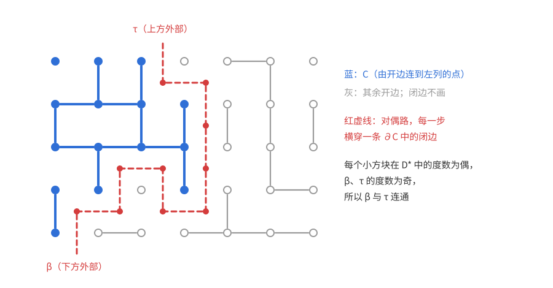

*(a) 的证明*　$n=1$ 时 $G_{1,1}$ 只有一个点，它既在最左列又在最右列，$h(1,1)=1$。设 $n\ge2$，在引理 1 中取 $m=n$：
$$h(n,n)+h(n+1,n-1)\ge1.$$
由 (M)，$h(n+1,n-1)\le h(n,n-1)\le h(n,n)$。所以 $2h(n,n)\ge1$，即对所有 $n$ 有 $h(n,n)\ge\frac12$，$\mathrm{RSW}(1)$ 成立，$c_1=\frac12$。$\square$

**评注**　由 (T) 还能证明水平穿越与对偶阻断不能同时出现，于是引理 1 中其实是等式 $h(n,n)+h(n+1,n-1)=1$。小情形可以直接枚举：$n=2,3,4$ 时 $h(n,n)$ 依次为 $\frac34$、$\frac{43}{64}$、$\frac{82623}{131072}\approx0.630$，$h(n+1,n-1)$ 依次为 $\frac14$、$\frac{21}{64}$、$\frac{48449}{131072}$，和都恰为 1。把引理用于宽 $n+1$、高 $n$ 的矩形，它的对偶恰好是自身转 $90^\circ$，于是得到经典的恒等式 $h(n+1,n)=\frac12$。

#### (b) 由 $\mathrm{RSW}(2)$ 推出 $\mathrm{RSW}(100)$

*证明*　固定 $n$。对 $i=0,1,\dots,98$，令
$$R_i=[1+in,\ (i+2)n]\times[1,n],$$
它宽 $2n$ 个点、高 $n$ 个点。$R_0$ 从第 1 列开始，$R_{98}$ 到第 $100n$ 列结束，它们都在 $G_{100n,n}$ 里。相邻两个的重叠部分
$$Q_i=R_i\cap R_{i+1}=[1+(i+1)n,\ (i+2)n]\times[1,n]\qquad(0\le i\le97)$$
是 $n\times n$ 的正方形。考虑事件
$$E=\bigcap_{i=0}^{98}H(R_i)\ \cap\ \bigcap_{i=0}^{97}V(Q_i).$$

*$E$ 蕴含 $G_{100n,n}$ 有开的水平穿越。* $Q_i$ 与 $R_i$ 等高，所以 $Q_i$ 的竖直穿越也是 $R_i$ 的竖直穿越，由 (T′) 它与 $R_i$ 的水平穿越 $\eta_i$ 有公共顶点；同理它与 $\eta_{i+1}$ 也有公共顶点。于是 $\eta_0,\dots,\eta_{98}$ 由这些竖直穿越依次连成一个开的连通集，它含第 1 列的点（$\eta_0$ 的起点）和第 $100n$ 列的点（$\eta_{98}$ 的终点），其中就有一条开的水平穿越。

*概率。* 所有这些事件都是递增的（开边越多越容易穿越），由推论 7.3(c)、$\mathrm{RSW}(2)$ 与 (a)，
$$h(100n,n)\ge\mathbb P(E)\ge\prod_{i=0}^{98}\mathbb P(H(R_i))\prod_{i=0}^{97}\mathbb P(V(Q_i))\ge c_2^{99}\,2^{-98}.$$
这个下界与 $n$ 无关，所以 $\mathrm{RSW}(100)$ 成立。$\square$

（同样的论证说明：只要某一个 $k>1$ 使 $\mathrm{RSW}(k)$ 成立，所有 $\mathrm{RSW}(k')$ 都成立。）

#### (c) ★★ 证明 $\mathrm{RSW}(2)$

**思路**　由 (b) 的拼接法，只要对某个宽高比大于 1 的长方形证明穿越概率有一致的正下界，再拼接几次就能得到宽高比 2。我们证明：对 $n\ge1$，宽 $3n+1$、高 $2n+1$ 的矩形
$$R=[-n,2n]\times[-n,n]$$
有 $\mathbb P(H(R))\ge\frac1{128}$。

先看直接拼接为什么不行。$R$ 的左半是正方形 $S'=[-n,n]^2$，右边还多出一截。$S'$ 的水平穿越概率 $\ge\frac12$，但它只走到 $x=n$。要继续往右，自然想在 $S=[0,n]^2$（$S'$ 右上角的小正方形）里找一条**竖直**穿越 $\gamma$，让左边来的路接到 $\gamma$ 上，右边再用同样的办法接过去。障碍在于：$S'$ 的水平穿越可能从 $S$ 的下方经过（走在下半平面），根本碰不到 $\gamma$。

**反射的想法。** 把 $\gamma$ 关于 $x$ 轴反射，得到 $\sigma\gamma$（$\sigma(x,y)=(x,-y)$）。$\gamma$ 从 $S$ 的顶边 $y=n$ 走到底边 $y=0$，$\sigma\gamma$ 从 $y=0$ 走到 $y=-n$，两者拼成一堵从 $S'$ 顶边到底边的“墙” $\gamma\cup\sigma\gamma$。$S'$ 的任何水平穿越都要撞上这堵墙，所以以至少 $\frac12$ 的概率，左边 $L=\{-n\}\times[-n,n]$ 能连到墙上。墙的上半截 $\gamma$ 是真的开路，下半截 $\sigma\gamma$ 只是一条几何上的曲线，不一定开。但墙**左侧**的区域关于 $x$ 轴对称，那里的边又是独立的，所以“连到上半截”和“连到下半截”的概率相等，各至少 $\frac14$。连到上半截，就连到了真正的开路 $\gamma$。

这个想法要求：选定 $\gamma$ 以后，墙左侧的边还是“新鲜的”，没有被选 $\gamma$ 的过程看过。所以 $\gamma$ 必须**从右边探索**出来，类似于“最右的竖直穿越”。下面用 $S$ 中从右侧外部出发的闭对偶团簇来精确地实现它。

**事件。** 记 $S=[0,n]^2$，$S'=[-n,n]^2$，$L=\{-n\}\times[-n,n]$ 为 $S'$ 的左边。令
- $A=V(S)$；
- $B$：存在 $S$ 的一条开的竖直穿越，它在 $S'$ 内由开路连到 $L$；
- $B'$：$B$ 关于直线 $x=\frac n2$ 的镜像，即存在 $S$ 的一条开的竖直穿越，它在 $[0,2n]\times[-n,n]$ 内由开路连到右边 $\{2n\}\times[-n,n]$。镜像 $x\mapsto n-x$ 把 $S$ 映成自身，把 $S'$ 映成 $[0,2n]\times[-n,n]$，把 $L$ 映成 $\{2n\}\times[-n,n]$。

**第一步：$H(S)\cap B\cap B'\subseteq H(R)$。** 设 $B$ 中的竖直穿越为 $\gamma_1$，$B'$ 中的为 $\gamma_2$，$H(S)$ 中的水平穿越为 $\eta$。由 (T′)，$\eta$ 与 $\gamma_1$、$\gamma_2$ 都有公共顶点。于是 $L\to\gamma_1\to\eta\to\gamma_2\to\{2n\}\times[-n,n]$ 是 $R$ 内一个开的连通集，含 $R$ 左右两边的点，所以 $H(R)$ 发生。三个事件都递增，由推论 7.3(c)、(a) 与 $\mathbb P(B')=\mathbb P(B)$，
$$\mathbb P(H(R))\ge\mathbb P(H(S))\,\mathbb P(B)^2\ge\frac12\,\mathbb P(B)^2.$$
剩下只需证明 $\mathbb P(B)\ge\frac18$。由 (a)，$\mathbb P(A)=h(n+1,n+1)\ge\frac12$，所以只需证明
$$\mathbb P(B)\ge\tfrac14\,\mathbb P(A).\tag{7.3}$$

**第二步：从右边探索出一条竖直穿越。** 在 $S$ 上建立对偶图（与引理 1 相同，只是转了 $90^\circ$）：对偶顶点是 $S$ 的 $n^2$ 个单位小方块 $f_{i,j}=[i,i+1]\times[j,j+1]$（$0\le i,j\le n-1$），外加左侧外部 $\lambda$、右侧外部 $\rho$。$S$ 的每条竖直格边，以及第 $1,\dots,n-1$ 行的水平格边，各配一条横穿它的对偶边，连接它两侧的对偶顶点（第 0 列竖直边的左侧是 $\lambda$，第 $n$ 列竖直边的右侧是 $\rho$）。最上、最下两行的水平边不配对偶边。称对偶边**闭**，若它横穿的格边是闭的。令
$$\mathcal D=\{\text{能由闭对偶边连到 }\rho\text{ 的对偶顶点}\}\ni\rho.$$

*(i) 若 $A$ 发生，则 $\lambda\notin\mathcal D$。* 否则有一条由闭对偶边组成的从 $\lambda$ 到 $\rho$ 的对偶路。把它画成折线：从第 0 列某条竖直边的中点出发（这一点在 $S$ 的左边上），经过各个小方块的中心，到第 $n$ 列某条竖直边的中点（在 $S$ 的右边上）。它是 $S$ 中连接左右两边的曲线，由 (T) 必与开的竖直穿越相交；而交点只能是被横穿的某条格边的中点，并且这条格边在竖直穿越上，因而是开的，与“横穿的格边是闭的”矛盾。

*(ii) 若 $\lambda\notin\mathcal D$，则 $\mathcal D$ 的“边界”含一条开的竖直穿越。* 令 $\partial\mathcal D$ 为这样的格边：它配有对偶边，并且对偶边的两端恰有一个在 $\mathcal D$ 中。这些边都是开的，否则对偶边是闭的，另一端也会在 $\mathcal D$ 中。用引理 1 的奇偶性论证：

- $S$ 中不在最上、最下两行的顶点 $v$，周围的对偶顶点（四个小方块；在第 0 列或第 $n$ 列时是两个小方块加上 $\lambda$ 或 $\rho$）围成一圈，$v$ 处的每条边恰好分隔圈上相邻的两个对偶顶点。所以 $v$ 关联的 $\partial\mathcal D$ 边数等于绕一圈时“属于 $\mathcal D$”的切换次数，为偶数。
- 把最上一行的点合并成一个点 $T^*$。它关联的、配有对偶边的格边只有向下的竖直边 $(i,n-1)(i,n)$，$i=0,\dots,n$，它们依次分隔 $\lambda,f_{0,n-1},\dots,f_{n-1,n-1},\rho$ 中相邻的两个。首项 $\lambda\notin\mathcal D$，末项 $\rho\in\mathcal D$，切换次数为奇数。所以 $T^*$ 的度数为奇数。同理，最下一行合并成的 $B^*$ 度数为奇数。

由握手定理，在边集 $\partial\mathcal D$ 中 $T^*$ 与 $B^*$ 连通。取一条最短的 $T^*$–$B^*$ 路，拆开合并点，就得到一条开路：它从最上一行的某点走到最下一行的某点，中间的点都不在这两行上。在所有这样的路中按某个固定的顺序取第一条，记为 $\Gamma=\Gamma(\mathcal D)$。于是 $\Gamma$ 是 $S$ 的开的竖直穿越，它的边都属于 $\partial\mathcal D$，它是 $\mathcal D$ 的函数。

*(iii) $\{\mathcal D=d\}$ 只依赖于 $K(d)$ 内部的边。* 令 $K(d)$ 为 $d$ 中各小方块的角点，再加上第 $n$ 列（右边）的所有点。事件 $\{\mathcal D=d\}$ 只由与 $d$ 中对偶顶点关联的对偶边的开闭决定（$d$ 内部要靠闭对偶边连通，向外的对偶边都要不闭）。这些对偶边所横穿的格边，要么是 $d$ 中某个小方块的边，要么是与 $\rho$ 相邻的第 $n$ 列竖直边，两个端点都在 $K(d)$ 中。

**第三步：反射。** 固定一个满足 $\lambda\notin d$ 的 $d$，记 $\gamma=\Gamma(d)$。$\gamma$ 只有终点在 $x$ 轴上，所以 $\gamma\cup\sigma\gamma$ 是一条简单路，从 $S'$ 的顶边走到底边，所有点的横坐标都在 $[0,n]$ 中。令

- $W$ 为 $S'$ 中能从 $L$ 出发、沿 $S'$ 的格边（不管开闭）走到、而途中不经过 $\gamma\cup\sigma\gamma$ 上任何点的顶点集；
- $E_W$ 为至少有一个端点在 $W$ 中的 $S'$ 的边。

下图中，蓝色实线是 $\gamma$（$S$ 的开的竖直穿越），蓝色虚线是它的镜像 $\sigma\gamma$，浅蓝区域是墙左侧的 $W$，绿色是从 $L$ 连到 $\gamma$ 的开路。

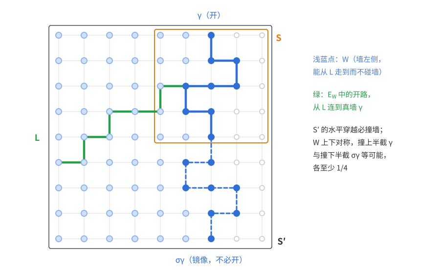

*(iv) $W\cap K(d)=\varnothing$。* 设 $w\in W\cap K(d)$，$\pi$ 是 $S'$ 中从 $L$ 到 $w$、不碰 $\gamma\cup\sigma\gamma$ 的格路。作为折线，$\pi$ 与墙不交（两条格路只能交在公共顶点上）。

- 若 $w$ 在第 $n$ 列，它在 $S'$ 的右边上，$\pi$ 就是 $S'$ 中连接左右两边、却不碰从上到下的墙的曲线，与 (T) 矛盾。
- 若 $w$ 是某个 $f\in d$ 的角点，则有闭对偶边组成的对偶路 $f=f_0,f_1,\dots,f_r,\rho$。作折线 $\kappa$：从 $w$ 走到 $f_0$ 的中心，再依次经过被横穿格边的中点走到下一个中心，最后经第 $n$ 列某条竖直边的中点到达 $S'$ 的右边。被横穿的格边两侧都在 $\mathcal D$ 中，所以不属于 $\partial d$，更不在 $\gamma$ 上；$\kappa$ 只在 $w$ 和这些中点处碰到格线，所以与 $\gamma$ 不交。$\kappa$ 在上半平面 $y\ge0$ 中，在 $x$ 轴上至多碰到 $w$（最下一行的水平边没有对偶边，不会被横穿），而 $w\notin\sigma\gamma$，所以 $\kappa$ 也不碰 $\sigma\gamma$。于是 $\pi$ 接 $\kappa$ 是 $S'$ 中连接左右两边、却不碰墙的曲线，与 (T) 矛盾。

*(v) 条件概率的估计。* 由 (iii)(iv)，$E_W$ 中的边都不是“两端都在 $K(d)$ 中”的边，所以它们的开闭与事件 $\{\mathcal D=d\}$ 独立，在条件 $\mathcal D=d$ 下仍是独立的公平硬币。令
$$Y=Y_d=\{\text{只用 }E_W\text{ 中的开边，能从 }L\text{ 走到 }\gamma\cup\sigma\gamma\},$$
$Y^+=Y^+_d$、$Y^-=Y^-_d$ 分别表示走到 $\gamma$、走到 $\sigma\gamma$，$Y=Y^+\cup Y^-$。

- $H(S')\subseteq Y$：$S'$ 的开的水平穿越由 (T′) 必碰到墙 $\gamma\cup\sigma\gamma$（它是 $S'$ 的竖直穿越路）。截到第一次碰墙为止，前面的点都在 $W$ 中，所用的边都属于 $E_W$。
- $\sigma$ 保持 $S'$、$L$ 和墙不变，因而 $\sigma(W)=W$、$\sigma(E_W)=E_W$，并把 $Y^+$ 映成 $Y^-$，同时保持边的独立公平分布。所以 $\mathbb P(Y^+)=\mathbb P(Y^-)$。

$Y^\pm$ 只依赖于 $E_W$ 中的边，所以
$$\mathbb P(Y^+\mid\mathcal D=d)=\mathbb P(Y^+)\ge\tfrac12\mathbb P(Y)\ge\tfrac12\mathbb P(H(S'))\ge\tfrac14,$$
最后一步用 (a)（$S'$ 是 $(2n+1)\times(2n+1)$ 的正方形）。

*(vi) 合起来。* 在 $\{\mathcal D=d\}\cap Y^+$ 上，$\gamma$ 是 $S$ 的开的竖直穿越，并由 $S'$ 中的开路连到 $L$，所以 $B$ 发生。对所有满足 $\lambda\notin d$ 的 $d$ 求和，再用 (i)：
$$\mathbb P(B)\ge\sum_{d:\,\lambda\notin d}\mathbb P(\mathcal D=d)\,\mathbb P(Y^+_d\mid\mathcal D=d)\ge\tfrac14\,\mathbb P(\lambda\notin\mathcal D)\ge\tfrac14\,\mathbb P(A).$$
这就是 (7.3)。于是 $\mathbb P(H(R))\ge\frac12\cdot\frac1{64}=\frac1{128}$。

**第四步：拼成宽高比 2。** 由第三步，对每个 $N\ge1$，宽 $3N+1$、高 $2N+1$ 的矩形水平穿越概率至少 $2^{-7}$。照 (b) 拼接三个这样的矩形
$$R_i=[iN,\ iN+3N]\times[0,2N]\qquad(i=0,1,2),$$
相邻两个重叠成 $(2N+1)\times(2N+1)$ 的正方形 $Q_i=[(i+1)N,\ iN+3N]\times[0,2N]$（$i=0,1$），在 $Q_i$ 中要求竖直穿越。由 (T′) 与推论 7.3(c)，
$$h(5N+1,\ 2N+1)\ge(2^{-7})^3\,(2^{-1})^2=2^{-23}.$$
对 $n\ge8$，取 $N=\lfloor(n-1)/2\rfloor\ge3$，则 $2N+1\le n$，且 $2n\le4N+4\le5N+1$。由 (M)，
$$h(2n,n)\ge h(2n,\ 2N+1)\ge h(5N+1,\ 2N+1)\ge2^{-23}.$$
对 $n\le7$，最下一行的 $2n-1$ 条边全开就给出水平穿越，$h(2n,n)\ge2^{-(2n-1)}\ge2^{-13}$。所以对所有 $n$ 有 $h(2n,n)\ge2^{-23}$，$\mathrm{RSW}(2)$ 成立。$\square$

**评注**　

- 这里的常数非常粗糙，但这类问题只关心“与 $n$ 无关”。第三步的拼接方式如下图：两条竖直穿越分别连向左右两边，再由 $S$ 的一条水平穿越把它们接起来。

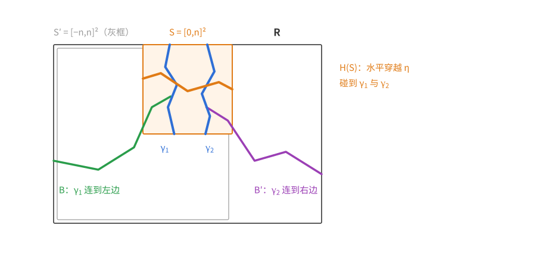

- 反射论证的要点有两个。一是**对称性**：墙左侧的区域关于 $x$ 轴对称，所以“碰到真墙”与“碰到假墙”等可能。二是**探索的方向**：$\gamma$ 必须由墙右侧的信息决定，左侧的边才保持独立。第二步用闭对偶团簇 $\mathcal D$ 实现了“从右边探索”，(iv) 保证 $\mathcal D$ 没有越过墙。
- 这个定理是 Russo（1978）与 Seymour、Welsh（1978）分别证明的，称为 RSW 定理；上面的反射写法是近年讲义中流行的简化证明。它是 Kesten 证明 $\mathbb Z^2$ 边渗流临界值 $p_c=\frac12$ 的关键工具，也给出临界渗流中“任意宽高比的长方形穿越概率都在 $c$ 与 $1-c$ 之间”。

### 习题 4　独立的递增事件依赖于不交的变量

**题意**　设 $A,B$ 是一组独立随机变量 $x_1,\dots,x_n$ 的两个递增事件，并且 $A,B$ 相互独立。证明可以把这些变量分成两个不交的子集 $S,T$，使 $A$ 只依赖于 $S$ 中的变量，$B$ 只依赖于 $T$ 中的变量。

（框架同定理 7.2：$x_i$ 取值于全序集 $\Omega_i$，例如 $\{0,1\}$、$\{0,1,\dots,m\}$ 或 $\mathbb R$，涉及的事件和函数都可测。）

**“依赖”要按几乎必然的意义理解。** 对连续分布，逐点的说法是错的。设 $x_1,x_2$ 独立且服从标准正态分布，
$$A=\{x_1>0\}\cup\{x_1=0,\ x_2>0\},\qquad B=\{x_2>0\}.$$
两者都递增（若 $x\in A$、$x'\ge x$：$x'_1>0$ 时 $x'\in A$；$x'_1=0$ 时必有 $x_1=0$、$x_2>0$，于是 $x'_2\ge x_2>0$，仍有 $x'\in A$）。$\mathbb P(x_1=0)=0$，所以 $\mathbb P(AB)=\mathbb P(x_1>0,\,x_2>0)=\frac14=\mathbb P(A)\mathbb P(B)$。但 $(0,1)\in A$、$(0,-1)\notin A$，逐点地看 $A$ 依赖 $x_2$，$B$ 也依赖 $x_2$，找不到不交的 $S,T$。在零概率集上改动事件不应影响结论，所以规定：$A$ **只依赖于** $S$，指存在一个只由 $x_S=(x_i)_{i\in S}$ 决定的事件 $A'$，使 $\mathbb P(A\triangle A')=0$。上例中取 $A'=\{x_1>0\}$ 即可。本题在这个意义下证明。

**思路**　Harris 不等式说 $\mathbb P(AB)\ge\mathbb P(A)\mathbb P(B)$，题目给的是等号。要证的是：等号成立时，$A$ 与 $B$ 之间没有任何“共享的变量”。所以应该把 Harris 不等式加强成定量形式：只要某个变量同时影响 $A$ 和 $B$，就能给 $\mathbb P(AB)-\mathbb P(A)\mathbb P(B)$ 一个严格正的下界。回顾定理 7.2 的归纳证明，对一个坐标取条件期望时，单变量那一步（Chebyshev 和不等式）恰好产生一个形如“$f$ 的增量乘 $g$ 的增量”的余项，它就是我们要的下界。先在布尔变量下把这件事算清楚，再处理一般分布。

**热身：布尔变量。** 设 $x_i$ 是布尔变量，$\mathbb P(x_i=1)=p_i\in(0,1)$（若 $p_i\in\{0,1\}$，$x_i$ 几乎必然是常数，代入后删去）。这时每个具体的取值组合都有正概率，几乎必然的依赖与逐点的依赖是一回事，可以用组合的方式定义“影响”。

**定义**　称变量 $x_i$ **影响** $A$，若存在 $x\in A$，把 $x$ 的第 $i$ 个坐标翻转后得到的 $x^{(i)}\notin A$。记 $S_A$ 为影响 $A$ 的变量的集合。

*$A$ 只依赖于 $S_A$。* 若 $x,y$ 在 $S_A$ 上取值相同，可以把 $x$ 在 $S_A$ 以外的坐标逐个改成 $y$ 的值；每一步翻转的都是不影响 $A$ 的坐标，所以 $x$ 是否属于 $A$ 不变，最后得到 $y$。所以 $x\in A\iff y\in A$。

于是只需证明 $S_A\cap S_B=\varnothing$，再取 $S=S_A$、$T=[n]\setminus S_A\supseteq S_B$。

**引理 1**　对每个 $i$，记 $A_0,A_1$ 为 $A$ 在 $x_i=0,1$ 处的截面（看成其余 $n-1$ 个变量的事件），$a_t=\mathbb P(A_t)$；$B_0,B_1,b_t$ 类似。则
$$\mathbb P(AB)-\mathbb P(A)\mathbb P(B)\ge p_i(1-p_i)(a_1-a_0)(b_1-b_0).$$

*证明*　记 $p=p_i$。$A$ 递增，所以截面 $A_0,A_1$ 都是递增的，且 $A_0\subseteq A_1$；$B$ 同理。对其余变量用 Harris 不等式，$\mathbb P(A_tB_t)\ge a_tb_t$。于是
$$\mathbb P(AB)=(1-p)\mathbb P(A_0B_0)+p\,\mathbb P(A_1B_1)\ge(1-p)a_0b_0+p\,a_1b_1.$$
另一方面 $\mathbb P(A)\mathbb P(B)=\big((1-p)a_0+pa_1\big)\big((1-p)b_0+pb_1\big)$。相减并整理：
$$(1-p)a_0b_0+pa_1b_1-\big((1-p)a_0+pa_1\big)\big((1-p)b_0+pb_1\big)=p(1-p)(a_1-a_0)(b_1-b_0).\qquad\square$$

*证明*　设 $i\in S_A\cap S_B$。$i$ 影响 $A$，所以存在 $x\in A$ 使 $x^{(i)}\notin A$。由于 $A$ 递增，必是 $x_i=1$、翻转后 $x_i=0$。于是 $x$ 去掉第 $i$ 个坐标后得到的 $x'$ 满足 $x'\in A_1\setminus A_0$。每个 $p_j\in(0,1)$，所以每个具体的取值组合都有正概率，$a_1-a_0=\mathbb P(A_1\setminus A_0)\ge\mathbb P(x')>0$。同理 $b_1-b_0>0$。由引理 1，$\mathbb P(AB)>\mathbb P(A)\mathbb P(B)$，与 $A,B$ 独立矛盾。所以 $S_A\cap S_B=\varnothing$。$\square$

热身的论证其实给出比题目更多的东西：引理 1 是 Harris 不等式的定量加强。只要 $A,B$ 有一个共同的“开关” $x_i$（即 $i\in S_A\cap S_B$），它们就严格正相关，差距至少是 $p_i(1-p_i)(a_1-a_0)(b_1-b_0)$。Harris 不等式的“松弛”来自每一个共享的变量。

**一般情形。** 下面把论证推广到一般分布，需要一些测度论的语言（Fubini 定理、几乎必然、条件期望）；只关心布尔变量的读者可以跳到本题的评注。

热身的论证有两处用到“每个取值组合都有正概率”：用“翻转一个坐标是否改变 $A$”来定义影响；由 $x'\in A_1\setminus A_0$ 推出 $a_1>a_0$。连续分布下单个取值组合的概率是 0，这两步都失效。开头的例子正是这样：$x_2$ 在逐点意义下影响 $A$，对概率却毫无作用。所以要换一个只看概率的“影响”：看 $A$ 的条件概率是否随 $x_i$ 变化。

对每个 $i$，记 $w=(x_j)_{j\ne i}$ 为其余坐标，$A_t=\{w:(t,w)\in A\}$ 为 $A$ 在 $x_i=t$ 处的截面，令
$$a_i(t)=\mathbb P(A\mid x_i=t)=\mathbb P(w\in A_t).$$
第二个等号又是独立性：固定 $x_i=t$ 不改变 $w$ 的分布。右边对每个 $t$ 都有定义，由 Fubini 定理是 $t$ 的可测函数。$A$ 递增，所以 $t\le t'$ 时 $A_t\subseteq A_{t'}$，$a_i$ 递增。布尔情形中 $a_i(0)=a_0$、$a_i(1)=a_1$。对 $B$ 类似定义 $B_t$ 和 $b_i$。

**定义**　称 $x_i$ **实质影响** $A$，若 $a_i(x_i)$ 不是几乎必然的常数。记 $S_A$ 为实质影响 $A$ 的变量的集合，$S_B$ 类似。布尔情形（$p_i\in(0,1)$）中，这就是 $a_1\ne a_0$，与热身中的“影响”等价。

下面分两步证明：(1) $A$ 只依赖于 $S_A$；(2) $S_A\cap S_B=\varnothing$。然后取 $S=S_A$、$T=[n]\setminus S_A\supseteq S_B$ 即可。

*第一步：$A$ 只依赖于 $S_A$。* 热身中是把不影响 $A$ 的坐标逐个改掉。这里照样做，只是“改成另一个值”换成“换成一个独立的新样本”，“不变”换成“几乎必然不变”。

**引理 2**　设 $i\notin S_A$，$x_i'$ 与 $x_i$ 同分布，且 $x_i,x_i',w$ 相互独立。则几乎必然 $1_A(x_i,w)=1_A(x_i',w)$。

*证明*　$a_i(x_i)$ 几乎必然等于某个常数，$a_i(x_i')$ 同分布，几乎必然等于同一个常数，所以 $a_i(x_i)=a_i(x_i')$ 几乎必然成立。对固定的 $t,t'$，截面 $A_t,A_{t'}$ 是嵌套的，对称差的概率就是两者概率之差：
$$\mathbb P(w\in A_t\triangle A_{t'})=\lvert a_i(t)-a_i(t')\rvert.$$
$w$ 与 $(x_i,x_i')$ 独立，先对 $w$ 取期望，得
$$\mathbb E\,\big\lvert 1_A(x_i,w)-1_A(x_i',w)\big\rvert=\mathbb E\,\big\lvert a_i(x_i)-a_i(x_i')\big\rvert=0.\qquad\square$$

单调性在这里是关键：截面嵌套，条件概率相同才推出截面几乎相同。没有单调性，结论就不成立。例如两枚独立的公平硬币，$A=\{x_1=x_2\}$，$\mathbb P(A\mid x_1=t)\equiv\frac12$ 与 $t$ 无关，但 $A$ 显然依赖 $x_1$。

设 $[n]\setminus S_A=\{i_1,\dots,i_m\}$。取 $x$ 的独立副本 $x'$，把 $x$ 的坐标 $i_1,\dots,i_m$ 依次换成 $x'$ 的对应坐标，得到 $x=z^{(0)},z^{(1)},\dots,z^{(m)}$。每个 $z^{(k-1)}$ 的各坐标相互独立，且与 $x$ 同分布（所以 $a_{i_k}$ 不变）；换进来的 $x'_{i_k}$ 与 $z^{(k-1)}$ 独立。由引理 2，$1_A(z^{(k-1)})=1_A(z^{(k)})$ 几乎必然。连起来，$1_A(x)=1_A(z^{(m)})$ 几乎必然，其中 $z^{(m)}=(x_{S_A},x'_{[n]\setminus S_A})$。令
$$h(x_{S_A})=\mathbb P\big((x_{S_A},x'_{[n]\setminus S_A})\in A\ \big|\ x_{S_A}\big),$$
即固定 $x_{S_A}$、对 $x'$ 的其余坐标求概率。$x'$ 与 $x$ 独立，所以 $\mathbb E[1_A(z^{(m)})\mid x]=h(x_{S_A})$，于是
$$1_A(x)=\mathbb E[1_A(x)\mid x]=\mathbb E[1_A(z^{(m)})\mid x]=h(x_{S_A})\qquad\text{几乎必然}.$$
示性函数几乎必然等于 $h(x_{S_A})$，所以 $A'=\{h(x_{S_A})=1\}$ 只由 $x_{S_A}$ 决定，且 $\mathbb P(A\triangle A')=0$。

*第二步：$S_A\cap S_B=\varnothing$。* 这就是定理 7.2 归纳证明的那一步，只是把余项留下来。固定 $i$。截面 $A_t,B_t$ 是 $w$ 的递增事件，对 $w$ 用定理 7.2（取示性函数），$\mathbb P(w\in A_t\cap B_t)\ge a_i(t)\,b_i(t)$。由全期望公式和独立性，
$$\mathbb P(AB)-\mathbb P(A)\mathbb P(B)=\mathbb E\big[\mathbb P(w\in A_{x_i}\cap B_{x_i})\big]-\mathbb E\,a_i(x_i)\,\mathbb E\,b_i(x_i)\ge\operatorname{Cov}\big(a_i(x_i),b_i(x_i)\big).$$
布尔情形中右边正是 $p_i(1-p_i)(a_1-a_0)(b_1-b_0)$，这个不等式是引理 1 的推广。剩下要说明：同一个变量的两个递增函数，只要都不是几乎必然的常数，协方差就严格为正。

**引理 3**　设随机变量 $x$ 取值于全序集 $\Omega$，$\varphi,\psi$ 是 $\Omega$ 上有界的递增函数，且 $\varphi(x),\psi(x)$ 都不是几乎必然的常数，则 $\operatorname{Cov}(\varphi(x),\psi(x))>0$。

*证明*　同定理 7.2 中 $n=1$ 的情形，取 $x$ 的独立同分布副本 $x'$，
$$2\operatorname{Cov}\big(\varphi(x),\psi(x)\big)=\mathbb E\big[(\varphi(x)-\varphi(x'))(\psi(x)-\psi(x'))\big],$$
被积式处处 $\ge0$，只需找一个正概率事件，使被积式在其上 $>0$。

$\varphi(x)$ 不是几乎必然的常数，所以存在实数 $c$ 使 $0<\mathbb P(\varphi(x)<c)<1$；否则 $\mathbb P(\varphi(x)<c)$ 对每个 $c$ 只取 $0$ 或 $1$，$\varphi(x)$ 就几乎必然等于 $\sup\{c:\mathbb P(\varphi(x)<c)=0\}$。同样取 $d$ 使 $0<\mathbb P(\psi(x)<d)<1$。令
$$U=\{u\in\Omega:\varphi(u)<c\},\qquad V=\{u\in\Omega:\psi(u)<d\}.$$
$\varphi$ 递增，所以 $U$ 是下集（$u\in U$、$u'\le u$ 推出 $u'\in U$），$V$ 也是。**全序集中的两个下集必定嵌套**：若 $u\in U\setminus V$、$v\in V\setminus U$，则 $u\le v$ 推出 $u\in V$，$v\le u$ 推出 $v\in U$，都矛盾。不妨设 $U\subseteq V$。在事件 $\{x\in U,\ x'\notin V\}$ 上，$x\in U\subseteq V$，$x'\notin V\supseteq U$，所以 $\varphi(x)<c\le\varphi(x')$、$\psi(x)<d\le\psi(x')$，被积式 $>0$。这个事件的概率是 $\mathbb P(x\in U)\,\mathbb P(x\notin V)>0$。$\square$

全序在这里必不可少。在偏序集 $\{0,1\}^2$ 上（两坐标独立且都是公平硬币），$\varphi(u)=u_1$、$\psi(u)=u_2$ 都递增，都不是常数，协方差却是 0。这正是第二步要先把问题压到单个坐标上的原因。

*完成证明*　设 $i\in S_A\cap S_B$。$a_i,b_i$ 取值于 $[0,1]$，有界且递增，$a_i(x_i),b_i(x_i)$ 都不是几乎必然的常数。由引理 3，$\operatorname{Cov}(a_i(x_i),b_i(x_i))>0$，再由第二步的不等式，$\mathbb P(AB)>\mathbb P(A)\mathbb P(B)$，与 $A,B$ 独立矛盾。所以 $S_A\cap S_B=\varnothing$。取 $S=S_A$、$T=[n]\setminus S_A$。由第一步，$A$ 只依赖于 $S$；同理 $B$ 只依赖于 $S_B\subseteq T$，从而只依赖于 $T$。$\square$

**评注**　热身之后指出的定量加强在一般情形同样成立：对每个 $i$，
$$\mathbb P(AB)-\mathbb P(A)\mathbb P(B)\ge\operatorname{Cov}\big(a_i(x_i),b_i(x_i)\big)\ge0,$$
差距至少是开关 $x_i$ 对两者条件概率的影响的协方差；布尔情形中就是 $p_i(1-p_i)(a_1-a_0)(b_1-b_0)$。热身里删去 $p_i\in\{0,1\}$ 的变量，在一般框架中是自动的：例如 $p_1=1$ 时 $A=B=\{x_1=1\}$ 是两个独立的（概率为 1 的）事件，逐点地看它们都依赖 $x_1$，但 $x_1$ 几乎必然是常数，条件概率 $\mathbb P(A\mid x_1)$ 当然也是，所以 $x_1$ 不实质影响它们。

### 习题 5　再加一个递减条件

**题意**　$U_1,U_2$ 是一组独立布尔变量的递增事件，$D$ 是递减事件，并且 $U_1$ 与 $U_2$ 独立。证明（设 $\mathbb P(U_2D)>0$）
$$\mathbb P(U_1\mid U_2\cap D)\le\mathbb P(U_1\mid U_2).$$

**思路**　直观上，知道 $D$（某种“边少”的信息）会降低递增事件 $U_1$ 的概率；但条件里还有 $U_2$，在 $U_2$ 之下概率测度已不再是乘积测度，不能直接套推论 7.3(b)。$U_1,U_2$ 独立这个条件提示用习题 4：$U_1,U_2$ 依赖于不交的变量组。于是先固定 $U_2$ 所用的变量，$U_2$ 就成了确定的事，剩下的变量仍是独立的，$U_1$ 仍递增，$D$ 仍递减，可以在剩下的变量上用推论 7.3(b)。

*证明*　$U_1,U_2$ 独立，右边等于 $\mathbb P(U_1)$，所以要证
$$\mathbb P(U_1U_2D)\le\mathbb P(U_1)\,\mathbb P(U_2D).$$
由习题 4，变量分成不交的 $S,T$，$U_1$ 只依赖于 $x_S$，$U_2$ 只依赖于 $x_T$。对 $x_T$ 的每个取值 $t$：

- 给定 $x_T=t$ 时，$U_2$ 是否发生已经确定；
- $U_1$ 不依赖于 $x_T$，看成 $x_S$（从而看成 $x_{[n]\setminus T}$）的事件，它仍递增；
- $D$ 的截面 $D_t=\{x_{[n]\setminus T}:(x_{[n]\setminus T},t)\in D\}$ 是 $x_{[n]\setminus T}$ 的递减事件。

$x_{[n]\setminus T}$ 与 $x_T$ 独立，由推论 7.3(b)，
$$\mathbb P(U_1D\mid x_T=t)\le\mathbb P(U_1)\,\mathbb P(D\mid x_T=t).$$
乘以 $1_{U_2}(t)\,\mathbb P(x_T=t)$ 再对 $t$ 求和：
$$\mathbb P(U_1U_2D)=\sum_t1_{U_2}(t)\,\mathbb P(x_T=t)\,\mathbb P(U_1D\mid x_T=t)\le\mathbb P(U_1)\sum_t1_{U_2}(t)\,\mathbb P(x_T=t)\,\mathbb P(D\mid x_T=t)=\mathbb P(U_1)\,\mathbb P(U_2D).\qquad\square$$

**评注**　$U_1,U_2$ 独立的条件不能去掉。取两个独立的公平硬币 $x_1,x_2$，$U_1=\{x_2=1\}$，$U_2=\{x_1=1\text{ 或 }x_2=1\}$，$D=\{x_1=0\}$。则 $U_2\cap D=\{x_1=0,x_2=1\}$，$\mathbb P(U_1\mid U_2D)=1$，而 $\mathbb P(U_1\mid U_2)=\frac{1/2}{3/4}=\frac23$，不等式反向。这里 $U_1,U_2$ 共享变量 $x_2$，不独立。原因在于，在 $U_2$ 的条件下测度已不是乘积测度，Harris 不等式不再可用；习题 4 的作用正是在独立时把 $U_2$ 隔离到另一组变量上。

### 习题 6　集卡问题中的负相关

**题意**　$s_1,\dots,s_m$ 是 $[n]$ 中独立的随机元素（有放回地抽取，各自的分布可以不同，也不必均匀），$S=\{s_1,\dots,s_m\}$。$I,J$ 是 $[n]$ 的两个不交子集。证明
$$\mathbb P(I\cup J\subseteq S)\le\mathbb P(I\subseteq S)\,\mathbb P(J\subseteq S).$$

**思路**　直观上，“集齐 $I$”和“集齐 $J$”在抢同一批抽样次数：一次抽样落进 $I$，就不能落进 $J$。这是负相关，形状上像推论 7.3(b)：一个递增事件与一个递减事件。困难在于变量 $s_j$ 取值于 $[n]$，没有现成的序。解决办法是只看每次抽样的**类型**：落在 $I$ 中、落在 $J$ 中，还是都不在。把三种类型排成 $J<\text{其他}<I$，“集齐 $I$”就随类型递增，“集齐 $J$”随类型递减；给定类型以后，两件事各自只依赖于不同的抽样，相互独立。

*证明*　对每个 $j\in[m]$ 定义类型
$$t_j=\begin{cases}+1,&s_j\in I,\\0,&s_j\notin I\cup J,\\-1,&s_j\in J.\end{cases}$$
$t_1,\dots,t_m$ 相互独立，各取值于全序集 $\{-1<0<+1\}$。记 $K(t)=\{j:t_j=+1\}$，$M(t)=\{j:t_j=-1\}$。

*给定类型时的条件独立。* 给定 $t=(t_1,\dots,t_m)$，各 $s_j$ 仍相互独立，$s_j$ 的条件分布是它在相应类型上的条件分布（若某类型的概率为 0，该类型不会出现，无需定义）。事件 $\{I\subseteq S\}$ 只取决于 $\{s_j:j\in K(t)\}$，因为只有这些抽样落在 $I$ 中；事件 $\{J\subseteq S\}$ 只取决于 $\{s_j:j\in M(t)\}$。$K(t)\cap M(t)=\varnothing$，所以
$$\mathbb P(I\cup J\subseteq S\mid t)=\varphi(t)\,\psi(t),\qquad\varphi(t)=\mathbb P(I\subseteq S\mid t),\ \psi(t)=\mathbb P(J\subseteq S\mid t).$$

*单调性。* $\varphi(t)$ 是“用 $K(t)$ 中这些独立抽样（各按落在 $I$ 中的条件分布）集齐 $I$ 的概率”，只依赖于 $K(t)$，并且 $K$ 越大越容易集齐：多出来的抽样只会多覆盖一些元素。把某个 $t_j$ 调大，$K(t)$ 只可能增大（从 $0$ 到 $+1$ 时增加 $j$，其余情形不变），所以 $\varphi$ 是 $t$ 的递增函数。同理 $\psi$ 只依赖于 $M(t)$，$M$ 越大越大，而调大 $t_j$ 只可能使 $M(t)$ 变小，所以 $\psi$ 是 $t$ 的递减函数。

由定理 7.2（对递增的 $\varphi$ 与递增的 $-\psi$），$\mathbb E[\varphi\psi]\le\mathbb E\varphi\,\mathbb E\psi$，即
$$\mathbb P(I\cup J\subseteq S)=\mathbb E[\varphi(t)\psi(t)]\le\mathbb E[\varphi(t)]\,\mathbb E[\psi(t)]=\mathbb P(I\subseteq S)\,\mathbb P(J\subseteq S).\qquad\square$$

**评注**　这里定理 7.2 用在了取三个值的变量上，这正是把 Harris 不等式推广到全序集上的好处。若改用布尔变量来编码（例如对每个 $j$、每个 $i\in[n]$ 记“$s_j=i$”），这些变量并不独立（每个 $j$ 恰有一个 $i$），无法直接套用定理 7.1。

### 习题 7★　恰有一个事件发生

**题意**　证明存在常数 $c<1$ 与 $\varepsilon>0$：若 $A_1,\dots,A_k$ 是独立布尔变量的递增事件，每个 $\mathbb P(A_i)\le\varepsilon$，$X$ 为发生的事件个数，则 $\mathbb P(X=1)\le c$。（尽量给出小的 $c$。猜想是任何 $c>\frac1e$ 都可以。）

**结论**　对任意这样的事件族，记 $\varepsilon=\max_i\mathbb P(A_i)$，则
$$\mathbb P(X=1)\le\frac{1+\varepsilon^2}2.$$
所以任给 $c>\frac12$，取 $\varepsilon=\sqrt{2c-1}$ 即可；例如 $\varepsilon=\frac1{10}$、$c=\frac{101}{200}$。另一方面，独立的情形说明 $c$ 不能小于 $\frac1e$（见评注）。

**思路**　先看为什么 $\frac1e$ 是自然的猜测：$k$ 个独立事件各以概率 $\frac1k$ 发生时，$X$ 近似服从均值为 1 的 Poisson 分布，$\mathbb P(X=1)\approx\frac1e$。

直接用 Harris 不等式会怎样？记 $q=\mathbb P(X=0)$，$\mu=\mathbb EX$，$B_i=\bigcap_{j\ne i}\overline{A_j}$（递减）。$\{X=1\}=\bigsqcup_i(A_i\cap B_i)$，而 $A_i$ 递增、$B_i$ 递减，所以 $\mathbb P(A_iB_i)\le\mathbb P(A_i)\mathbb P(B_i)$；又 $q=\mathbb P(\overline{A_i}B_i)\ge(1-\mathbb P(A_i))\mathbb P(B_i)$，所以 $\mathbb P(B_i)\le q/(1-\varepsilon)$。合起来
$$\mathbb P(X=1)\le\frac{q\mu}{1-\varepsilon}.$$
$\mu$ 不大时这很好，但事件可以高度正相关，$\mu$ 很大而 $q$ 并不小，这个界就失效了。

需要一个不依赖 $\mu$ 的论证。把事件族切成前后两段 $I,J$，令 $U=\bigcup_{i\in I}A_i$、$V=\bigcup_{j\in J}A_j$，两者都递增。$X=1$ 时，唯一发生的事件在哪一段，就恰好是 $U,V$ 中的哪一个发生。所以“恰好一个事件发生”被“$U,V$ 恰好一个发生”控制。Harris 不等式说 $U,V$ 正相关，“都发生”和“都不发生”至少占去一定的概率，留给“恰好一个”的就不多。要让这个限制最紧，两段应当各分到一半“唯一发生”的概率：若一段几乎占满，另一段几乎不发生，正相关就没有约束力。每个事件的概率都 $\le\varepsilon$，保证切点能选得足够准，误差只有 $\varepsilon$。

*证明*　对每个 $i$，令 $w_i=\mathbb P(A_i\cap B_i)$ 为“恰好 $A_i$ 发生”的概率，则
$$s:=\mathbb P(X=1)=\sum_{i=1}^kw_i,\qquad0\le w_i\le\mathbb P(A_i)\le\varepsilon.$$
$s=0$ 时无须证明。部分和 $w_1+\dots+w_t$ 从 $0$ 增到 $s$，每步至多增加 $\varepsilon$，所以可以取 $t$ 使它与 $\frac s2$ 相差至多 $\frac\varepsilon2$。令 $I=\{1,\dots,t\}$、$J=\{t+1,\dots,k\}$，
$$x=\sum_{i\in I}w_i,\qquad y=\sum_{j\in J}w_j,\qquad x+y=s,\qquad\lvert x-y\rvert\le\varepsilon.\tag{7.4}$$
令 $U,V$ 如上，记四个格子的概率
$$\alpha=\mathbb P(U\overline V),\quad\beta=\mathbb P(\overline UV),\quad\tau=\mathbb P(UV),\quad z=\mathbb P(\overline U\,\overline V),\qquad\alpha+\beta+\tau+z=1.$$

- 唯一发生的事件在 $I$ 中时 $U\overline V$ 发生，在 $J$ 中时 $\overline UV$ 发生，所以 $\alpha\ge x$、$\beta\ge y$，并且 $s\le\alpha+\beta$。
- $U,V$ 递增，由定理 7.1，$\tau\ge(\alpha+\tau)(\beta+\tau)$。展开并用 $\alpha+\beta+\tau+z=1$，这等价于
$$z\tau\ge\alpha\beta.\tag{7.5}$$

下图是这四格。橙色的两格是 $U,V$ 恰好一个发生，“恰有一个 $A_i$ 发生”只能落在这里；蓝色的两格是都发生、都不发生。(7.5) 说对角两格之积不小于反对角两格之积：正相关把概率挤到对角线上。

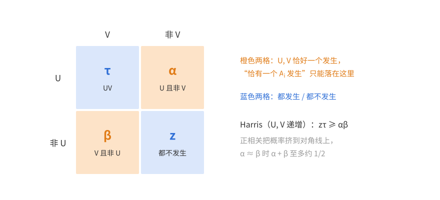

于是由算术—几何平均不等式与 (7.4)(7.5)，
$$1-s\ge1-\alpha-\beta=z+\tau\ge2\sqrt{z\tau}\ge2\sqrt{\alpha\beta}\ge2\sqrt{xy}=\sqrt{s^2-(x-y)^2}.$$
两边非负，平方得 $1-2s\ge-(x-y)^2$，即
$$\mathbb P(X=1)=s\le\frac{1+(x-y)^2}2\le\frac{1+\varepsilon^2}2.\qquad\square$$

**评注**　

- *下界。* 取 $A_i=\{x_i=1\}$，$x_1,\dots,x_k$ 独立，$\mathbb P(x_i=1)=\frac1k$，则 $\mathbb P(X=1)=(1-\frac1k)^{k-1}\to\frac1e$。所以最优常数（$\varepsilon\to0$ 时）在 $[\frac1e,\frac12]$ 之间，猜想是 $\frac1e$。
- *随 $q$ 变化的界。* 另一种切法能给出依赖于 $q$ 的信息：不按“唯一发生”的概率平分，而按“前一段都不发生”的概率 $a=\mathbb P(D_I)$ 来选切点，其中 $D_I=\overline U$、$D_J=\overline V$，$b=\mathbb P(D_J)$。这时 $\mathbb P(X=1)\le\mathbb P(\overline{D_I}D_J)+\mathbb P(D_I\overline{D_J})=a+b-2q$，又由推论 7.3(a) 有 $q\ge ab$。取 $a\approx\frac12$ 得 $\mathbb P(X=1)\le a+b(1-2a)<\frac12+\varepsilon$（$q>\frac12$ 时直接用 $\mathbb P(X=1)\le1-q$）。若 $q\le\frac14$，把切点选在 $a\approx\sqrt q$ 处，则 $b\le q/a\approx\sqrt q$，得到 $\mathbb P(X=1)\le2\sqrt q-2q+\varepsilon$。于是
$$\mathbb P(X=1)\le g(q)+\varepsilon,\qquad g(q)=\begin{cases}2\sqrt q-2q,&q\le\frac14,\\[2pt]\frac12,&\frac14\le q\le\frac12,\\[2pt]1-q,&q\ge\frac12.\end{cases}$$
独立的例子给出的是 $q\ln\frac1q$（$X$ 近似 Poisson 时 $\mathbb P(X=1)\approx\mu e^{-\mu}=q\ln\frac1q$）。下图比较这几条曲线：$g$ 只在 $q\in[\frac14,\frac12]$ 上取到 $\frac12$，主证明的界 $\frac{1+\varepsilon^2}2$ 也几乎就是 $\frac12$，猜想的界是 $q\ln\frac1q$ 的最大值 $\frac1e$。

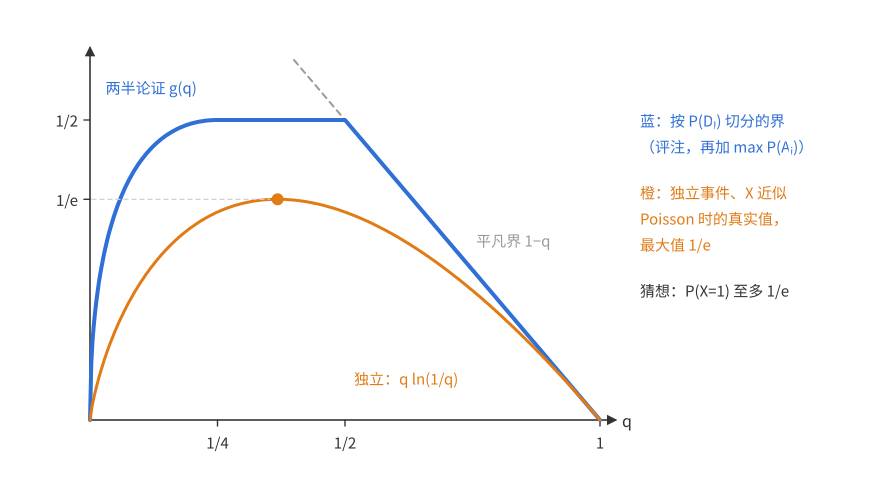

- *为什么停在 $\frac12$。* 两种切法都只用到 $U,V$（或 $D_I,D_J$）这两个事件，而“两个递减事件恰有一个发生”的概率确实可以是 $\frac12$（两个独立的、概率各为 $\frac12$ 的事件）。要改进，必须用上每一半内部“至多一个事件发生”的结构，例如需要 $\mathbb P(X_I\ge2,\ D_J)$ 的下界；但它是一个递增事件与一个递减事件的交，Harris 不等式只给它上界。把同样的切分递归地用在两半内部，数值上也不能把 $\frac12$ 降下来：瓶颈正是 $q=\frac14$、$a=b=\frac12$ 的情形。所以 $\frac12$ 以下需要新的想法，猜想 $\frac1e$ 仍未解决。

### 习题 8★　不交地包含（BK 不等式的特例）

**题意**　$\mathcal S,\mathcal T$ 各是 $[n]$ 的一族子集。$R\subseteq[n]$ 是随机子集，每个元素独立入选（概率可以各不相同）。令 $A$ 为“存在 $S\in\mathcal S$ 使 $S\subseteq R$”，$B$ 为“存在 $T\in\mathcal T$ 使 $T\subseteq R$”，$C$ 为“存在**不交**的 $S\in\mathcal S$、$T\in\mathcal T$，都含于 $R$”。证明
$$\mathbb P(C)\le\mathbb P(A)\,\mathbb P(B).$$

**思路**　$A,B$ 都递增，Harris 不等式给出 $\mathbb P(AB)\ge\mathbb P(A)\mathbb P(B)$，方向相反。$C\subseteq AB$，并且要求两个“证据” $S,T$ 用不交的元素：正相关来自 $A,B$ 可以共用同一批元素，禁止共用以后，找到 $S$ 之后只能在剩下的元素里找 $T$，像是在一个独立副本里找，概率不超过 $\mathbb P(B)$。这个直觉对应的严格证明是对 $n$ 归纳，按元素 $n$ 是否入选切开。

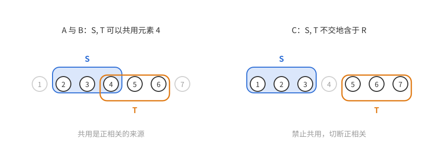

上图中深色的元素在 $R$ 中，灰色的不在；蓝框是 $S$，橙框是 $T$。左边 $S,T$ 共用元素 4，这是 $A,B$ 正相关的来源；右边要求 $S,T$ 不交，正是 $C$。

- $n\notin R$ 时，$S,T$ 都不能含 $n$，$C$ 化为 $n-1$ 个元素上同类的事件，可以直接用归纳假设。
- $n\in R$ 时，$n$ 至多给 $S,T$ 中的一个用，$C$ 化为两个事件的并 $X\cup Y$（$n$ 给 $S$ 用，或者给 $T$ 用）。若只用 $\mathbb P(X\cup Y)\le\mathbb P(X)+\mathbb P(Y)$，就多算了 $\mathbb P(XY)$；若只用“$X\cup Y$ 含于‘$S,T$ 都可以用 $n$’的事件”（下文的 $\mathcal C(\mathcal S_1,\mathcal T_1)$），得到的就只是 Harris 方向的界。两个上界各自都不够。

  该怎样组合它们，可以从目标倒推。按 $n$ 是否入选展开，目标 $\mathbb P(A)\mathbb P(B)$ 是
  $$p^2a_1b_1+p(1-p)(a_1b_0+a_0b_1)+(1-p)^2a_0b_0$$
  （$a_t,b_t$ 是截面概率，见下文），而 $\mathbb P(C)=(1-p)u+p\,\mathbb P(X\cup Y)$，其中 $u$ 是 $n\notin R$ 时的截面概率，归纳假设给出 $u\le a_0b_0$。目标里 $a_0b_0$ 的系数是 $(1-p)^2$，而 $u$ 的系数是 $1-p$，所以把 $(1-p)u$ 拆成 $(1-p)^2u+p(1-p)u$：前一部分由 $u\le a_0b_0$ 对上目标的最后一项。剩下的要求（两边除以 $p$）是
  $$\mathbb P(X\cup Y)\le p\,a_1b_1+(1-p)\big(a_1b_0+a_0b_1-u\big).$$
  也就是说，需要 $\mathbb P(X\cup Y)$ 的一个上界，它“$p$ 份像 $a_1b_1$、$1-p$ 份像 $a_1b_0+a_0b_1-u$”。上面两个上界恰好就是这两样（容斥里减去的 $\mathbb P(XY)$ 至少是 $u$），取以 $p,1-p$ 为权的凸组合即可。权重是从目标反推出来的。

**记号**　对 $[n']$ 上的两个集族 $\mathcal S',\mathcal T'$ 和随机子集 $R'$，记 $\mathcal A(\mathcal S')$ 为“$\mathcal S'$ 中某个集合含于 $R'$”，$\mathcal C(\mathcal S',\mathcal T')$ 为“存在不交的 $S\in\mathcal S'$、$T\in\mathcal T'$ 都含于 $R'$”。要证的是 $\mathbb P(\mathcal C(\mathcal S,\mathcal T))\le\mathbb P(\mathcal A(\mathcal S))\,\mathbb P(\mathcal A(\mathcal T))$ 对所有集族成立。

*证明*　对 $n$ 归纳。

*$n=0$。* $R=\varnothing$，一切都是确定的：$A$ 发生当且仅当 $\varnothing\in\mathcal S$，$C$ 发生当且仅当 $\varnothing\in\mathcal S$ 且 $\varnothing\in\mathcal T$（空集与空集不交），即 $C=AB$。两边相等。

*由 $n-1$ 到 $n$。* 记 $p=\mathbb P(n\in R)$，$R'=R\cap[n-1]$，它是 $[n-1]$ 上同类型的随机子集，与“$n$ 是否入选”独立。定义 $[n-1]$ 上的集族
$$\mathcal S_0=\{S\in\mathcal S:n\notin S\},\qquad\mathcal S_1=\{S\setminus\{n\}:S\in\mathcal S\},$$
$\mathcal T_0,\mathcal T_1$ 类似。显然 $\mathcal S_0\subseteq\mathcal S_1$。

*$A$、$B$ 的截面。* 给定 $n\notin R$，$A$ 等价于 $\mathcal A(\mathcal S_0)$；给定 $n\in R$，$A$ 等价于 $\mathcal A(\mathcal S_1)$。记 $a_t=\mathbb P(\mathcal A(\mathcal S_t))$、$b_t=\mathbb P(\mathcal A(\mathcal T_t))$，则
$$\mathbb P(A)\mathbb P(B)=\big((1-p)a_0+pa_1\big)\big((1-p)b_0+pb_1\big).$$

*$C$ 的截面。* 给定 $n\notin R$，$C$ 等价于 $U:=\mathcal C(\mathcal S_0,\mathcal T_0)$。给定 $n\in R$，断言 $C$ 等价于 $X\cup Y$，其中
$$X=\mathcal C(\mathcal S_1,\mathcal T_0),\qquad Y=\mathcal C(\mathcal S_0,\mathcal T_1).$$
- 若不交的 $S,T\subseteq R$，它们至多一个含 $n$。若 $n\notin T$，则 $S\setminus\{n\}\in\mathcal S_1$、$T\in\mathcal T_0$，两者不交且含于 $R'$，$X$ 发生；若 $n\in T$，则 $n\notin S$，同理 $Y$ 发生。
- 反过来，若 $X$ 发生，有 $S\in\mathcal S$、$T\in\mathcal T_0$ 使 $S\setminus\{n\}$ 与 $T$ 不交且都含于 $R'$。则 $S\subseteq R'\cup\{n\}\subseteq R$，$T\subseteq R$，且 $S\cap T=(S\setminus\{n\})\cap T=\varnothing$（因为 $n\notin T$），$C$ 发生。$Y$ 同理。

于是
$$\mathbb P(C)=(1-p)\,\mathbb P(U)+p\,\mathbb P(X\cup Y).$$

*估计 $\mathbb P(X\cup Y)$。* 由 $\mathcal S_0\subseteq\mathcal S_1$、$\mathcal T_0\subseteq\mathcal T_1$：
- $U\subseteq X\cap Y$，所以 $\mathbb P(X\cup Y)=\mathbb P(X)+\mathbb P(Y)-\mathbb P(XY)\le\mathbb P(X)+\mathbb P(Y)-\mathbb P(U)$；
- $X\cup Y\subseteq\mathcal C(\mathcal S_1,\mathcal T_1)$。

对 $[n-1]$ 上的四对集族用归纳假设：$\mathbb P(U)\le a_0b_0$，$\mathbb P(X)\le a_1b_0$，$\mathbb P(Y)\le a_0b_1$，$\mathbb P(\mathcal C(\mathcal S_1,\mathcal T_1))\le a_1b_1$。记 $u=\mathbb P(U)$，得到两个上界
$$\mathbb P(X\cup Y)\le a_1b_1,\qquad\mathbb P(X\cup Y)\le a_1b_0+a_0b_1-u.$$
取它们以 $p$ 与 $1-p$ 为权的凸组合：
$$\mathbb P(X\cup Y)\le p\,a_1b_1+(1-p)(a_1b_0+a_0b_1-u).$$
代入，
$$\mathbb P(C)\le(1-p)u+p^2a_1b_1+p(1-p)(a_1b_0+a_0b_1)-p(1-p)u=p^2a_1b_1+p(1-p)(a_1b_0+a_0b_1)+(1-p)^2u.$$
最后用 $u\le a_0b_0$，右边不超过
$$p^2a_1b_1+p(1-p)(a_1b_0+a_0b_1)+(1-p)^2a_0b_0=\big((1-p)a_0+pa_1\big)\big((1-p)b_0+pb_1\big)=\mathbb P(A)\mathbb P(B).\qquad\square$$

**评注**　

- $C$ 常记作 $A\,\square\,B$，读作“$A,B$ 不交地发生”。van den Berg 与 Kesten（1985）对一般的递增事件证明了 $\mathbb P(A\,\square\,B)\le\mathbb P(A)\mathbb P(B)$，并猜想对任意事件都成立（“不交发生”要适当定义）；这个猜想由 Reimer（2000）证明，称为 BKR 不等式。本题是递增事件的情形：每个递增事件都可以写成“某个极小元含于 $R$”，所以本题的形式并不比一般递增情形弱。
- 它与 Harris 不等式互补：$\mathbb P(A\,\square\,B)\le\mathbb P(A)\mathbb P(B)\le\mathbb P(A\cap B)$。在渗流中，BK 不等式常用来给“有两条不交的开路”这类事件的概率作上界，例如“原点有两条不交的开路连到远处”的概率至多是“有一条”的概率的平方。
