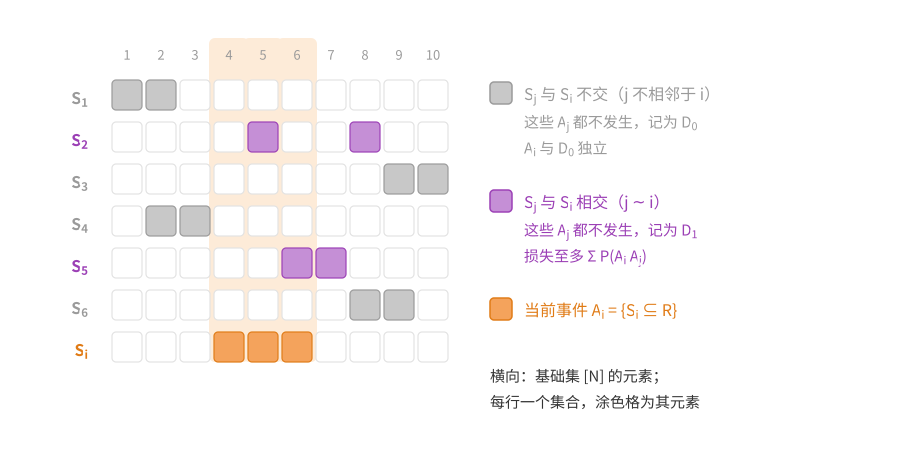
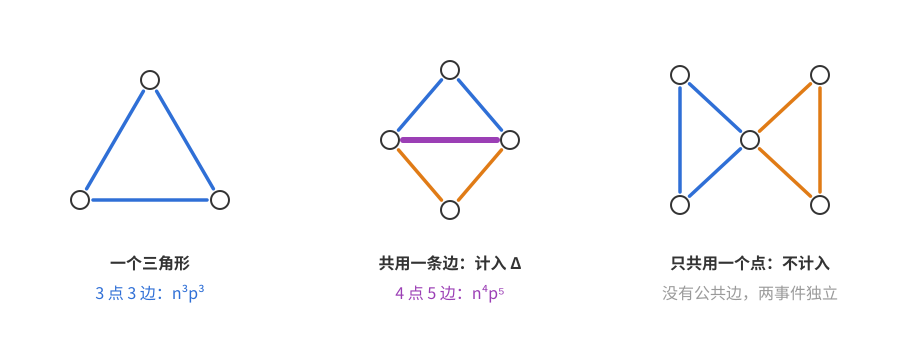
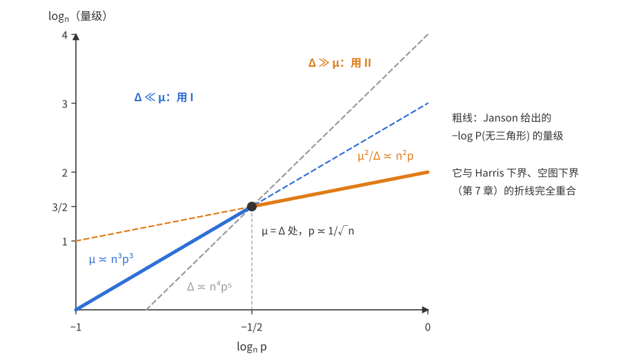
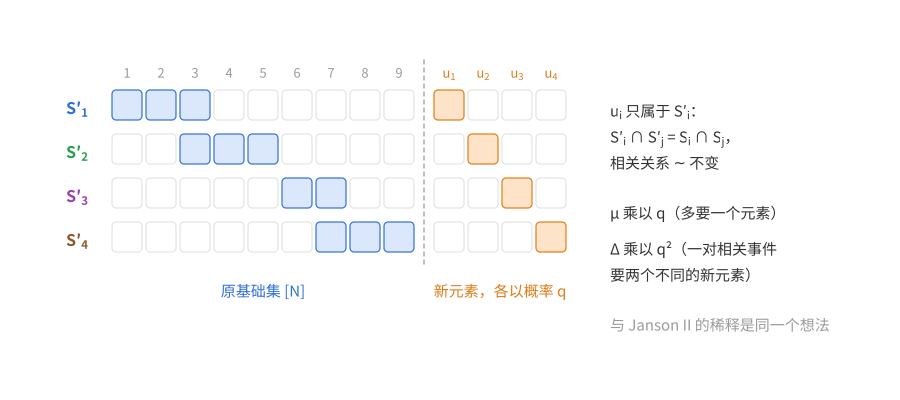
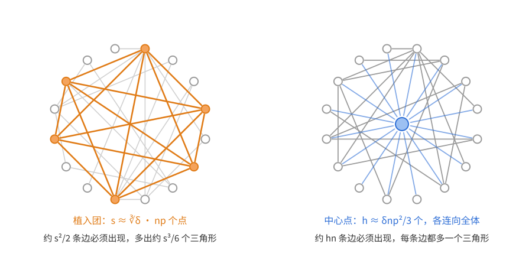
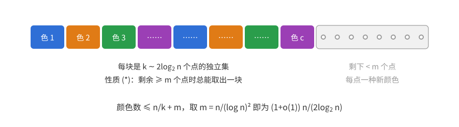
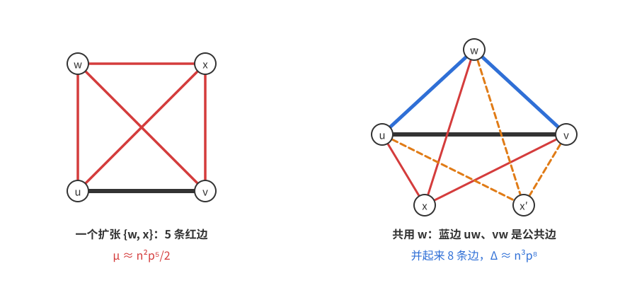
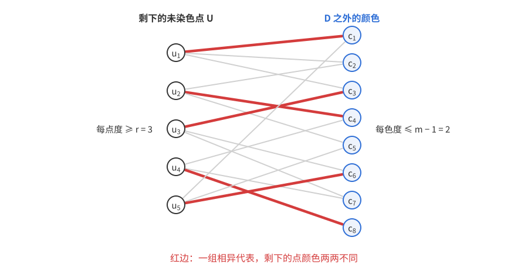

# 概率方法（八）：Janson 不等式

上一篇：[第 7 章 相关不等式](概率方法07——相关不等式.md)　下一篇：[第 9 章 测度集中](概率方法09——测度集中.md)

第 7 章的 Harris 不等式给出了“一个子结构都不出现”的概率的**下界**：例如 $G(n,p)$ 不含三角形的概率至少是 $(1-p^3)^{\binom n3}$，相当于假装各个三角形相互独立。本章的 Janson 不等式（Janson 1990）给出与之匹配的**上界**。

它处理的仍是第 4 章二阶矩方法的局面：$X$ 是一族事件 $A_i$ 的示性变量之和，相关性由“相关的对”的总贡献 $\Delta$ 度量。二阶矩方法只能说 $\mathbb P(X=0)$ 按多项式速度趋于 0，Janson 不等式则给出**指数**衰减的界，而且在相关性很弱时连指数中的常数都是对的。代价是适用范围较窄：每个 $A_i$ 必须形如“某个固定集合 $S_i$ 整个落在随机集合里”，而且只有相关性 $\Delta$ 不太大时界才有用（第 7 章最大度的例子可以改写成这种形式，但相关性太强，得不到有用的界）。

本章依次讲三件事：不存在的概率（Janson 不等式 I、II），下尾概率（Janson 不等式 III），以及一个经典应用——$G(n,\frac12)$ 的色数。

**本章读法。**

- 首读主线：8.1 节的设定、定理 8.1 及其证明、命题 8.2、三角形的例子（定理 8.3）、定理 8.5 与统一界 $e^{-\frac12\min(\mu,\mu^2/\Delta)}$；8.2 节的定理 8.7 及其证明、[推论 8.8](#例三角形个数的下尾)；8.3 节的引理 8.12 与定理 8.11。
- 可以二读：定理 8.1 后面的两条注、定理 8.6 中显式常数的计算、各处标明“研究背景”的段落（包括[上尾](#上尾没有对应的-janson-不等式)一小节从 DeMarco–Kahn 结果到末尾的内容），以及习题 4★、6★。
- 与其他章的联系：[第 9 章](概率方法09——测度集中.md)在[9.3 节](概率方法09——测度集中.md#再看团数小团数的指数小概率)用有界差分不等式重新得到引理 8.12 那样的指数小概率，并与 Janson 不等式 II 的指数 $\mu^2/\Delta$ 作比较；9.3 节开头还引用定理 8.11；本章评注中提到的无三角形图计数，由[第 11 章](概率方法11——容器方法.md)的容器方法证明。

## 8.1 不存在的概率

### 设定

下面的设定同时让人想起第 4 章的二阶矩方法和第 6 章局部引理的随机变量模型。

**设定（Janson 不等式的框架）**　$R$ 是 $[N]$ 的随机子集，每个元素独立地以各自的概率 $p_1,\dots,p_N$ 被选入（概率可以不同）。给定 $S_1,\dots,S_k\subseteq[N]$，令 $A_i$ 为事件 $S_i\subseteq R$，
$$X=\sum_{i=1}^k1_{A_i},\qquad\mu=\mathbb EX=\sum_i\mathbb P(A_i).$$
若 $i\ne j$ 且 $S_i\cap S_j\ne\varnothing$，记 $i\sim j$。令
$$\Delta=\sum_{(i,j):\,i\sim j}\mathbb P(A_iA_j)=\sum_{(i,j):\,i\sim j}\mathbb P(S_i\cup S_j\subseteq R),$$
这里求和跑遍**有序**对，$(i,j)$ 与 $(j,i)$ 各算一次。

几点说明。

- $X$ 数的是有多少个 $S_i$ 整个落在 $R$ 里。典型例子：$R$ 是 $G(n,p)$ 的边集，$S_i$ 是某个三角形的三条边，$X$ 就是三角形个数。
- 若 $j\ne i$ 且 $i\not\sim j$，$A_i$ 与 $A_j$ 由不相交的坐标决定，所以独立。更强地，$A_i$ 与整个族 $\{A_j:j\ne i,\ j\not\sim i\}$ 独立，因为后者全部由 $[N]\setminus S_i$ 中的坐标决定。（按定义总有 $i\not\sim i$，所以 $j\ne i$ 必须写出来：$A_i$ 当然不与自己独立。）这正是局部引理所需的“依赖图”性质。
- 每个 $A_i$ 都是**递增**事件（$R$ 变大不会让 $S_i\subseteq R$ 失效），而且是最简单的一种：由单个集合生成的上集，称为**主上集**。（**上集**是对“加入元素”封闭的子集族，也就是递增事件；由 $S_i$ 生成的上集就是所有包含 $S_i$ 的子集组成的族。）
- 与第 4 章的关系：[第 4 章](概率方法04——二阶矩方法.md#依赖稀疏时的方差估计)用的是 $\Delta^*=\max_i\sum_{j\sim i}\mathbb P(A_j\mid A_i)$。由 $\mathbb P(A_iA_j)=\mathbb P(A_i)\mathbb P(A_j\mid A_i)$，
$$\Delta=\sum_i\mathbb P(A_i)\sum_{j\sim i}\mathbb P(A_j\mid A_i)\le\mu\,\Delta^*,$$
对称时取等号。同样的计算给出 $\operatorname{Var}X\le\mu+\Delta$：$\operatorname{Var}1_{A_i}\le\mathbb P(A_i)$，$i\sim j$ 时 $\operatorname{Cov}\le\mathbb P(A_iA_j)$，其余协方差为 0。

### 目标：把 Harris 下界反过来

我们要估计 $\mathbb P(X=0)$，即所有 $A_i$ 都不发生的概率。

**一个方向已经有了。** 每个 $\overline{A_i}$ 都是递减事件，第 7 章的 Harris 不等式（[推论 7.3(c)](概率方法07——相关不等式.md#推论递减事件与多个事件)）说同向单调的事件正相关，所以
$$\mathbb P(X=0)=\mathbb P\big(\overline{A_1}\cdots\overline{A_k}\big)\ge\prod_{i=1}^k\big(1-\mathbb P(A_i)\big).$$
若各 $A_i$ 相互独立，这就是等式，而右边约为 $e^{-\mu}$。

**另一个方向**要说明：相关性弱时，真实概率不会比独立情形大太多。相关性的强弱用什么度量？两个事件只在 $S_i,S_j$ 相交时才相关，而 $\Delta$ 正是所有相关对“同时发生”的概率之和。所以期待的结论形如 $\mathbb P(X=0)\le e^{-\mu+(\text{关于 }\Delta\text{ 的修正})}$。

**定理 8.1（Janson 不等式 I；Janson、Łuczak、Ruciński 1990）**　在上述设定下，
$$\mathbb P(X=0)\le e^{-\mu+\Delta/2}.$$

它在 $\Delta=o(\mu)$ 时最有用：此时上界是 $e^{-(1-o(1))\mu}$。与 Harris 下界配合：

**命题 8.2（匹配的下界）**　在上述设定下，$\mathbb P(X=0)\ge\prod_i(1-\mathbb P(A_i))$。若 $\max_i\mathbb P(A_i)\le\varepsilon<1$，则 $\mathbb P(X=0)\ge e^{-\mu/(1-\varepsilon)}$。特别地，若 $\max_i\mathbb P(A_i)=o(1)$ 且 $\Delta=o(\mu)$，则
$$\mathbb P(X=0)=e^{-(1+o(1))\mu}.$$

*证明*　第一个不等式就是上面的 Harris 论证。对 $0\le x\le\varepsilon$，$-\ln(1-x)=\sum_{m\ge1}x^m/m\le x/(1-x)\le x/(1-\varepsilon)$，所以 $\prod_i(1-\mathbb P(A_i))\ge\exp\big(-\sum_i\mathbb P(A_i)/(1-\varepsilon)\big)=e^{-\mu/(1-\varepsilon)}$。最后一句：取 $\varepsilon=o(1)$ 得下界 $e^{-(1+o(1))\mu}$，定理 8.1 给出上界 $e^{-\mu+o(\mu)}$。$\square$

条件 $\max_i\mathbb P(A_i)=o(1)$ 在典型应用中自然成立（每个三角形出现的概率 $p^3\to0$），它为什么不能去掉，见下面证明之后的注。

### 怎样想到证明

**第一步：链式法则。** 把“都不发生”拆成一步一步：令
$$r_i=\mathbb P\big(A_i\mid\overline{A_1}\cdots\overline{A_{i-1}}\big),$$
则
$$\mathbb P(X=0)=\prod_{i=1}^k\mathbb P\big(\overline{A_i}\mid\overline{A_1}\cdots\overline{A_{i-1}}\big)=\prod_{i=1}^k(1-r_i)\le e^{-(r_1+\cdots+r_k)}.$$
若各事件独立，$r_i=\mathbb P(A_i)$，指数正好是 $-\mu$。所以目标变成：**每个 $r_i$ 不比 $\mathbb P(A_i)$ 小太多**，总损失不超过 $\Delta/2$。

**第二步：损失从哪里来。** Harris 不等式告诉我们方向：$A_i$ 递增，“前面的都不发生”递减，二者负相关，所以 $r_i\le\mathbb P(A_i)$——条件只会让 $A_i$ 更难发生。损失有多大？把前面的事件分成两组（见下图）：

- $D_0$：与 $S_i$ **不交**的那些 $A_j$（$j<i$，$j\not\sim i$）都不发生。它和 $A_i$ 独立，按理不该造成损失。
- $D_1$：与 $S_i$ **相交**的那些 $A_j$（$j<i$，$j\sim i$）都不发生。损失只能来自这里，直觉上应该不超过“$A_i$ 和某个相交的 $A_j$ 同时发生”的概率 $\sum_{j<i,\,j\sim i}\mathbb P(A_iA_j)$。

上图中每行是一个集合，橙色是当前的 $S_i$，紫色行与 $S_i$ 有公共元素（归入 $D_1$），灰色行与 $S_i$ 不交（归入 $D_0$）。

**第三步：分子、分母区别对待。** $r_i$ 是一个分式，$D_1$ 在分子、分母里都出现。要的是 $r_i$ 的**下界**，而把分母里的 $D_1$ 扔掉只会让分母变大、分式变小，方向正好，所以分母里的 $D_1$ 可以免费去掉。分子里的 $D_1$ 正是损失所在，不能扔，只能显式扣除“$A_i$ 与某个相交的 $A_j$ 同时发生”的概率。这个扣除项还带着条件 $D_0$；被扣除的事件是递增的，而 $D_0$ 是递减事件，在 $D_0$ 的条件下它的概率只会变小，所以条件也能去掉，剩下的正是第二步猜的 $\sum_{j<i,\,j\sim i}\mathbb P(A_iA_j)$。

第 6 章局部引理的证明（[6.1 节](<概率方法06——Lovász 局部引理.md#61-局部引理的陈述与证明>)）也把条件分成“与 $A_i$ 相关”和“与 $A_i$ 无关”两部分，并在分子、分母中区别对待；这里的处理方向恰好相反：局部引理要的是 $\mathbb P(A_i\mid\cdots)$ 的**上界**，Janson 要的是**下界**。

### 证明

*定理 8.1 的证明*　若某个 $\mathbb P(\overline{A_1}\cdots\overline{A_{i-1}})=0$，则 $\mathbb P(X=0)=0$，结论平凡；下设这些概率都为正。由第一步，只需证明

**断言**　对每个 $i\in[k]$，
$$r_i\ge\mathbb P(A_i)-\sum_{j<i:\,j\sim i}\mathbb P(A_iA_j).$$

*断言的证明*　固定 $i$，令 $D_0=\bigcap_{j<i,\,j\not\sim i}\overline{A_j}$，$D_1=\bigcap_{j<i,\,j\sim i}\overline{A_j}$（空交理解为必然事件）。则
$$r_i=\mathbb P(A_i\mid D_0D_1)=\frac{\mathbb P(A_iD_0D_1)}{\mathbb P(D_0D_1)}\ge\frac{\mathbb P(A_iD_0D_1)}{\mathbb P(D_0)}=\mathbb P(A_iD_1\mid D_0)=\mathbb P(A_i\mid D_0)-\mathbb P(A_i\overline{D_1}\mid D_0).$$
$A_i$ 只依赖 $S_i$ 中的坐标，$D_0$ 只依赖与 $S_i$ 不交的那些 $S_j$ 中的坐标，所以二者独立，$\mathbb P(A_i\mid D_0)=\mathbb P(A_i)$。

$A_i\overline{D_1}=A_i\cap\bigcup_{j<i,\,j\sim i}A_j$ 是递增事件的交，仍递增；$D_0$ 是递减事件的交，仍递减。由 Harris 不等式（推论 7.3(b)），$\mathbb P(A_i\overline{D_1}D_0)\le\mathbb P(A_i\overline{D_1})\mathbb P(D_0)$，即
$$\mathbb P(A_i\overline{D_1}\mid D_0)\le\mathbb P(A_i\overline{D_1})=\mathbb P\Big(A_i\cap\bigcup_{j<i,\,j\sim i}A_j\Big)\le\sum_{j<i:\,j\sim i}\mathbb P(A_iA_j),$$
最后一步是并集上界。代回即得断言。

*回到定理*　对断言求和。$\sum_i\sum_{j<i,\,j\sim i}\mathbb P(A_iA_j)$ 中每个**无序**相关对 $\{i,j\}$ 恰好出现一次（在较大的下标处），而 $\Delta$ 对有序对求和，每个无序对算两次，所以这个和等于 $\Delta/2$。于是 $\sum_ir_i\ge\mu-\Delta/2$，
$$\mathbb P(X=0)\le e^{-\sum_ir_i}\le e^{-\mu+\Delta/2}.\qquad\square$$

**注（更精细的形式）**　断言其实给出更多。若某个 $\mathbb P(A_i)=1$，则 $\mathbb P(X=0)=0$，没什么可说；下设 $\varepsilon=\max_i\mathbb P(A_i)<1$，$\delta_i=\sum_{j<i,\,j\sim i}\mathbb P(A_iA_j)$，则
$$1-r_i\le1-\mathbb P(A_i)+\delta_i\le(1-\mathbb P(A_i))\Big(1+\frac{\delta_i}{1-\varepsilon}\Big)\le(1-\mathbb P(A_i))\,e^{\delta_i/(1-\varepsilon)},$$
连乘得
$$\prod_i(1-\mathbb P(A_i))\le\mathbb P(X=0)\le\prod_i(1-\mathbb P(A_i))\cdot e^{\Delta/(2(1-\varepsilon))},$$
左边是 Harris 下界。这就是 Alon–Spencer 书中 Janson 不等式的形式：**真实概率与“假装独立”的概率之比，被 $e^{\Delta/(2(1-\varepsilon))}$ 控制**。

**注（条件 $\max_i\mathbb P(A_i)=o(1)$ 的作用）**　上式右边的因子含 $\frac1{1-\varepsilon}$，命题 8.2 的下界也是，所以 $\varepsilon=\max_i\mathbb P(A_i)$ 小，才能把“假装独立”的概率写成 $e^{-(1+o(1))\mu}$。这个条件不能干脆去掉：若某个 $\mathbb P(A_i)$ 不小，$1-\mathbb P(A_i)$ 就明显小于 $e^{-\mathbb P(A_i)}$，而这种损失可以累积。例如 $k$ 个相互独立、概率都是 $\frac12$ 的事件：$\Delta=0$，$\mu=k/2$，但 $\mathbb P(X=0)=2^{-k}=e^{-(2\ln2)\mu}$，指数比 $\mu$ 大了 $2\ln2\approx1.39$ 倍。

反过来，这个条件也不是必要的：只要大概率事件为数不多，结论照样成立。比如在一族满足条件、且 $\mu\to\infty$ 的事件之外，再添一个概率 $\frac12$ 的独立事件，$-\ln\mathbb P(X=0)$ 只多出常数 $\ln2$，渐近式不受影响。

**评注（历史与适用范围）**　这一段是研究背景，首读可跳过。Janson 的原始证明用的是解析插值方法。上面的证明基于 Boppana 和 Spencer（1989），并采用了 Warnke 的一个修改（私人交流），其中也吸收了 Riordan 和 Warnke（2015）的想法——他们把 Janson 不等式从主上集推广到一般的上集。

Alon–Spencer 中较早的证明要用到主上集的结构。回头看上面的证明，它只用到两件事：(1) $A_i$ 递增、各 $\overline{A_j}$ 递减，以便用 Harris 不等式；(2) $A_i$ 与 $D_0$ 独立。所以只要把 $i\sim j$ 理解为“$A_i$ 与 $A_j$ 所依赖的坐标集相交”，$j\not\sim i$ 的那些事件就由与 $A_i$ 无关的坐标决定，(2) 仍然成立，同样的证明对一般的递增事件 $A_i$ 也成立（Riordan–Warnke 2015）。

### 例：$G(n,p)$ 不含三角形，$p\ll n^{-1/2}$

**问题**　$G(n,p)$ 不含三角形的概率是多少？

第 7 章（[定理 7.4](概率方法07——相关不等式.md#不含三角形的概率)）给出了下界 $(1-p^3)^{\binom n3}$。现在套用 Janson 的设定：$[N]$ 是 $K_n$ 的 $N=\binom n2$ 条边，$S_1,\dots,S_{\binom n3}$ 是各个三角形的边集（每个 3 元），$X$ 是三角形个数。

**计算 $\mu$ 与 $\Delta$。** $\mu=\binom n3p^3\asymp n^3p^3$。两个不同的三角形若共用两条边，就共用三个顶点，从而相同；所以相关的两个三角形恰好共用**一条**边，并起来是 4 个顶点、5 条边（下图中间）。数有序对：先选第一个三角形（$\binom n3$ 种），再选公共边（3 种），再选第二个三角形的第三个顶点（$n-3$ 种），所以
$$\Delta=3(n-3)\binom n3p^5=\frac{n(n-1)(n-2)(n-3)}2\,p^5\asymp n^4p^5,\qquad\frac\Delta\mu=3(n-3)p^2.$$
只共用一个顶点的两个三角形没有公共边，相应事件独立，不计入 $\Delta$。

所以 $\Delta=o(\mu)$ 当且仅当 $p=o(n^{-1/2})$。这时 Janson 不等式 I 与 Harris 下界吻合：

**定理 8.3**　若 $p=o(n^{-1/2})$，则
$$\mathbb P(G(n,p)\text{ 不含三角形})=e^{-(1+o(1))\mu}=e^{-(1+o(1))n^3p^3/6}.$$

*证明*　上界：$-\mu+\Delta/2=-\mu\big(1-\tfrac32(n-3)p^2\big)=-(1-o(1))\mu$，由定理 8.1。下界：每个 $\mathbb P(A_i)=p^3=o(1)$，由命题 8.2。最后 $\mu=\binom n3p^3=(1+O(1/n))\frac{n^3p^3}6$。$\square$

**推论 8.4**　对常数 $c>0$，
$$\lim_{n\to\infty}\mathbb P\big(G(n,c/n)\text{ 不含三角形}\big)=e^{-c^3/6}.$$

*证明*　$p=c/n$ 时 $\mu=\binom n3\frac{c^3}{n^3}\to\frac{c^3}6$，$\Delta\le\frac{n^4}2\cdot\frac{c^5}{n^5}\to0$。上界 $e^{-\mu+\Delta/2}\to e^{-c^3/6}$；下界 $(1-c^3/n^3)^{\binom n3}\to e^{-c^3/6}$。$\square$

（这一段是研究背景，首读可跳过。）事实上，$G(n,c/n)$ 中三角形的个数依分布收敛到均值 $c^3/6$ 的 Poisson 分布，推论 8.4 是它在 0 处的值（[第 4 章习题 6](概率方法04——二阶矩方法.md#习题-6三角形个数的-poisson-极限)）；而当 $np\to\infty$ 且 $n^2(1-p)\to\infty$ 时，三角形个数（标准化后）渐近正态（Ruciński 1988）。第二个条件不能省：$p$ 极接近 1 时 $G(n,p)$ 几乎必然是完全图，标准化后的值趋于常数 0，见[第 4 章](概率方法04——二阶矩方法.md#三角形的阈值)的说明；第 4 章习题 7 证明的是 $p=\frac12$ 的情形。

和二阶矩方法比较：Chebyshev 不等式只给出 $\mathbb P(X=0)\le\operatorname{Var}X/\mu^2$，这是多项式量级的；Janson 不等式 I 连指数里的常数都给对了。

### $\Delta\ge\mu$ 的情形：Janson 不等式 II

**障碍。** 若 $p\gg n^{-1/2}$，则 $\Delta\gg\mu$，$e^{-\mu+\Delta/2}>1$，Janson 不等式 I 什么也没说。这时还该期待 $e^{-(1+o(1))\mu}$，甚至 $e^{-c\mu}$ 吗？不该。第 7 章已经指出另一个下界：空图不含三角形，
$$\mathbb P(G(n,p)\text{ 不含三角形})\ge(1-p)^{\binom n2}=e^{-\Theta(n^2p)}\qquad(p\le0.99),$$
而 $p\gg n^{-1/2}$ 时 $n^2p\ll n^3p^3$（等价于 $np^2\gg1$），所以真实概率远大于 $e^{-c\mu}$。我们希望证明的是匹配的上界 $e^{-\Theta(n^2p)}$。

**想法：稀释。** 困难在于相关的对太多，$\Delta$ 压过了 $\mu$。如果只看一部分事件呢？对任意子族 $T\subseteq[k]$，记 $X_T=\sum_{i\in T}1_{A_i}$。$X=0$ 推出 $X_T=0$，所以
$$\mathbb P(X=0)\le\mathbb P(X_T=0)\le e^{-\mu_T+\Delta_T/2},$$
其中 $\mu_T,\Delta_T$ 是子族的参数。把每个事件以概率 $q$ 留下，$\mu_T$ 按 $q$ 缩小，$\Delta_T$ 却按 $q^2$ 缩小（一个相关对要两个成员都留下）。于是可以选 $q$ 使 $\Delta_T$ 降到 $\mu_T$ 以下，Janson 不等式 I 就又有用了。这和第 2 章的交叉数不等式（[2.6 节](概率方法02——期望的线性性.md#26-交叉数不等式)）如出一辙：先有一个只在有限范围内有效的“便宜”界，再用随机抽样把它放大到全范围。

**定理 8.5（Janson 不等式 II）**　在上述设定下，若 $\Delta\ge\mu$，则
$$\mathbb P(X=0)\le e^{-\mu^2/(2\Delta)}.$$

*证明*　随机选 $T\subseteq[k]$，每个下标独立地以概率 $q\in[0,1]$ 选入。则 $\mathbb E\mu_T=q\mu$；$\Delta_T$ 中的每个有序对 $(i,j)$ 满足 $i\ne j$，两者都被选入的概率为 $q^2$，所以 $\mathbb E\Delta_T=q^2\Delta$。由期望的线性性，
$$\mathbb E\Big[-\mu_T+\frac{\Delta_T}2\Big]=-q\mu+\frac{q^2\Delta}2,$$
所以存在某个 $T$ 使 $-\mu_T+\Delta_T/2\le-q\mu+q^2\Delta/2$，从而对每个 $q\in[0,1]$，
$$\mathbb P(X=0)\le e^{-q\mu+q^2\Delta/2}.$$
右边的指数是 $q$ 的二次函数，在 $q=\mu/\Delta$ 处取最小值；$\Delta\ge\mu$ 保证 $q\in[0,1]$。代入得 $-\frac{\mu^2}\Delta+\frac{\mu^2}{2\Delta}=-\frac{\mu^2}{2\Delta}$。$\square$

$\Delta<\mu$ 时最优的 $q$ 超出 $[0,1]$，取 $q=1$ 就回到 Janson 不等式 I。合起来：
$$\mathbb P(X=0)\le\begin{cases}e^{-\mu+\Delta/2},&\Delta<\mu,\\ e^{-\mu^2/(2\Delta)},&\Delta\ge\mu,\end{cases}\qquad\text{两种情形都有}\quad\mathbb P(X=0)\le e^{-\frac12\min(\mu,\,\mu^2/\Delta)}.$$
（$\Delta<\mu$ 时 $-\mu+\Delta/2<-\mu/2$。本章约定 $\Delta=0$ 时 $\mu^2/\Delta=+\infty$；$\mu=0$ 时右边为 1，界平凡。）

**评注（与二阶矩方法比较）**　若 $\mu\to\infty$ 且 $\Delta=o(\mu^2)$，Janson 不等式 II 推出 $\mathbb P(X=0)=o(1)$，这一点二阶矩方法也能做到。差别在于速度。记 $\rho=\mu^2/(\mu+\Delta)$，由 $\operatorname{Var}X\le\mu+\Delta$ 和 Chebyshev 不等式，
$$\mathbb P(X=0)\le\frac{\operatorname{Var}X}{\mu^2}\le\frac1\rho,$$
而 Janson 不等式给出 $e^{-\Omega(\rho)}$（下一节的 (8.1) 式正是 $e^{-\rho/2}$）。一个是 $\rho$ 的倒数，一个是 $\rho$ 的指数。8.3 节求随机图的色数时，要对指数多个子集同时取并集上界，多项式的界无济于事，指数的界就成了关键。

### 不含三角形的概率：完整的图景

现在 $p\gg n^{-1/2}$：
$$\frac{\mu^2}{2\Delta}=\frac{\binom n3^2p^6}{2\cdot3(n-3)\binom n3p^5}=\frac{n(n-1)(n-2)}{36(n-3)}\,p\sim\frac{n^2p}{36}.$$
所以 $n$ 充分大时（$\Delta\ge\mu$ 即 $3(n-3)p^2\ge1$），Janson 不等式 II 给出
$$\mathbb P(G(n,p)\text{ 不含三角形})\le e^{-\mu^2/(2\Delta)}=e^{-\Theta(n^2p)},$$
与空图下界 $e^{-\Theta(n^2p)}$ 同阶：$\mu^2/\Delta\asymp(n^3p^3)^2/(n^4p^5)=n^2p$，Janson 不等式 II 自动找到了“集体行动”（让边集体缺失）的代价。

这不是巧合。把指数写成 $\mu^2/\Delta=\mu\big/(\Delta/\mu)$，而 $\Delta/\mu=3(n-3)p^2$ 是“给定一个三角形出现，与它共边的三角形还期望出现几个”。粗略地看，出现的三角形按共边关系聚成一簇一簇：每簇约 $3np^2$ 个，簇数约 $\mu/(3np^2)\asymp n^2p$。所以 Janson II 的指数数的其实是“近似独立的簇有多少个”。每一簇都围绕一条出现的边（含这条边的三角形约 $np^2$ 个），所以簇数与边数 $\binom n2p$ 同阶，这正是空图下界的代价。

习题 5 把这个观察推广到一般的子图 $H$：$\mu^2/\Delta$ 由两个拷贝的公共部分中最“便宜”的那个决定。

上面两种情形在交界 $p\asymp n^{-1/2}$ 处需要单独看一眼。用统一形式 $e^{-\frac12\min(\mu,\mu^2/\Delta)}$ 可以一次处理所有 $p$，并给出不依赖于 $p$ 的常数：

**定理 8.6**　存在绝对常数 $c,C>0$，使对所有 $n\ge4$ 和 $0<p\le0.99$，
$$e^{-C\min(n^3p^3,\,n^2p)}\le\mathbb P(G(n,p)\text{ 不含三角形})\le e^{-c\min(n^3p^3,\,n^2p)}.$$
即
$$\mathbb P(G(n,p)\text{ 不含三角形})=\begin{cases}\exp\big(-\Theta(n^2p)\big),&p\gtrsim n^{-1/2},\\ \exp\big(-\Theta(n^3p^3)\big),&p\lesssim n^{-1/2}.\end{cases}$$

*证明*　*上界*。$n\ge4$ 时 $\frac{(n-1)(n-2)}{n^2}\ge\frac38$，所以
$$\mu=\binom n3p^3\ge\frac{n^3p^3}{16},\qquad\frac{\mu^2}\Delta=\frac{\binom n3p}{3(n-3)}\ge\frac{(n-1)(n-2)}{18}\,p\ge\frac{n^2p}{48}.$$
由上一小节的统一形式，$\mathbb P\le\exp\big(-\frac12\min(\mu,\mu^2/\Delta)\big)\le\exp\big(-\frac1{96}\min(n^3p^3,n^2p)\big)$。

*下界*。对 $0\le x\le0.99^3$，$-\ln(1-x)\le\frac x{1-x}\le34x$；对 $0\le x\le0.99$，$-\ln(1-x)\le100x$。所以 Harris 下界 $(1-p^3)^{\binom n3}\ge e^{-34\binom n3p^3}\ge e^{-6n^3p^3}$，空图下界 $(1-p)^{\binom n2}\ge e^{-100\binom n2p}\ge e^{-50n^2p}$。取两者中较大的，$\mathbb P\ge e^{-50\min(n^3p^3,n^2p)}$。$\square$

上图横轴是 $\log_np$，纵轴是各量的 $\log_n$。蓝虚线 $\mu$、灰虚线 $\Delta$ 在 $p=n^{-1/2}$ 处相交：左边 $\Delta\ll\mu$，Janson 不等式 I 给出指数 $\mu$；右边 $\Delta\gg\mu$，Janson 不等式 II 给出指数 $\mu^2/\Delta\asymp n^2p$（橙线）。粗折线就是 $-\log\mathbb P(\text{不含三角形})$ 的量级，它和第 7 章由 Harris 下界与空图下界拼成的折线完全一样——上下界在量级上吻合。

**小 $n$ 的例子**　$n=7$ 时可以枚举全部 $2^{21}$ 个图精确计算。例如 $p=0.3$：Harris 下界 $0.384$，真实值 $0.487$，Janson I 上界 $0.648$；$p=0.5$：Harris 下界 $0.0093$，真实值 $0.064$，Janson II 上界 $0.48$。小 $n$ 时界很松，但方向都对。

**评注（更精确的结果）**　这一段是研究背景，首读可跳过。关于不含三角形的图，已知的精确结果远比定理 8.6 强。

1. $n$ 个顶点上不含三角形的图有 $2^{(1+o(1))n^2/4}$ 个（[第 11 章](概率方法11——容器方法.md)定理 11.1 用容器方法证明了这一计数）。更强地，几乎所有（$1-o(1)$ 比例的）$n$ 顶点无三角形图都是二部图（Erdős、Kleitman、Rothschild 1976）。
2. 若 $m\ge Cn^{3/2}\sqrt{\log n}$，其中常数 $C>\sqrt3/4$（这个常数是最优的），则几乎所有 $n$ 顶点、$m$ 条边的无三角形图都是二部图（Osthus、Prömel、Taraz 2003）。这一结果已推广到对每个固定的 $r$ 不含 $K_r$ 的图（Balogh、Morris、Samotij、Warnke 2016）。
3. 对 $n^{-1/2}\ll p\ll1$（Łuczak 2000），
$$-\log\mathbb P(G(n,p)\text{ 不含三角形})\sim-\log\mathbb P(G(n,p)\text{ 是二部图})\sim\frac{n^2p}4.$$
这一结果借助超图容器方法推广到了一般的禁止子图 $H$（Balogh、Morris、Samotij 2015），容器方法见[第 11 章](概率方法11——容器方法.md)。

对照第 3 条：Janson 不等式 II 给出的常数是 $\frac1{36}$，真实常数是 $\frac14$。下界的 $\frac14$ 来自“$G$ 落在一个固定的平衡完全二部图里”：跨不过去的边约 $n^2/4$ 条，全部缺失的概率 $(1-p)^{n^2/4}=e^{-(1+o(1))n^2p/4}$。Łuczak 定理说这种集体行动就是最便宜的避开三角形的方式。

## 8.2 下尾

上一节估计的是“一个都没有”的概率。现在问更一般的下尾：数目明显少于期望的概率。

**问题**　固定常数 $0<\delta\le1$，$X$ 是 $G(n,p)$ 中三角形的个数。估计 $\mathbb P\big(X\le(1-\delta)\mathbb EX\big)$。

### 怎样想到：矩母函数就是一个“不存在”的概率

$X$ 不是独立变量之和，第 5 章的 Chernoff 界不能直接用：那里的关键是独立和的矩母函数分解为各项的乘积，这里做不到。但 Chernoff 界的**方法**（[矩母函数方法](<概率方法05——Chernoff 界.md#从高阶矩到矩母函数>)）仍可以借鉴：对 $\lambda\ge0$，由 Markov 不等式，
$$\mathbb P(X\le\mu-t)=\mathbb P\big(e^{-\lambda X}\ge e^{-\lambda(\mu-t)}\big)\le e^{\lambda(\mu-t)}\,\mathbb Ee^{-\lambda X}.$$
难处是估计 $\mathbb Ee^{-\lambda X}$。令 $q=1-e^{-\lambda}\in[0,1)$，则 $e^{-\lambda X}=(1-q)^X$。$(1-q)^X$ 有一个概率解释：给每个事件 $A_i$ 配一枚独立的硬币 $W_i\sim\operatorname{Bernoulli}(q)$（$W_i=1$ 记作正面），那么给定 $R$ 时，“发生了的 $X$ 个事件的硬币全是反面”的条件概率恰为 $(1-q)^X$。换句话说，
$$\mathbb Ee^{-\lambda X}=\mathbb P(Y=0),\qquad Y=\sum_i1_{A_i}W_i.$$
而 $Y=0$ 是一个“不存在”事件，并且 $Y$ 仍然落在 Janson 的设定里——Janson 不等式 I 正好可以估计它。下尾问题就这样化归为上一节的问题。

**定理 8.7（Janson 不等式 III）**　在 8.1 节的设定下，对任意 $0\le t\le\mu$，
$$\mathbb P(X\le\mu-t)\le\exp\Big(-\frac{t^2}{2(\mu+\Delta)}\Big).$$

*证明*（Warnke）　设 $\lambda\ge0$ 待定，$q=1-e^{-\lambda}$。如上，
$$\mathbb P(X\le\mu-t)\le e^{\lambda(\mu-t)}\,\mathbb E\big[(1-q)^X\big].$$

由上面的解释，$\mathbb E[(1-q)^X]=\mathbb P(Y=0)$，其中 $Y=\sum_i1_{A_i}W_i$，$W_1,\dots,W_k\sim\operatorname{Bernoulli}(q)$ 相互独立且与 $R$ 独立（给定 $R$ 时，$Y=0$ 的条件概率是 $(1-q)^X$，再对 $R$ 取期望）。剩下的关键是说明 $Y$ 也落在 Janson 的设定里。

*$Y$ 符合 Janson 的设定。* 在基础集 $[N]$ 中添加 $k$ 个新元素 $u_1,\dots,u_k$，$u_i$ 以概率 $q$ 被选入（即 $W_i=1$），并把 $S_i$ 换成 $S_i'=S_i\cup\{u_i\}$。则 $1_{A_i}W_i$ 正是 $S_i'$ 落在扩大后的随机集里的示性变量。新元素两两不同，所以 $S_i'\cap S_j'=S_i\cap S_j$，相关关系 $\sim$ 不变。参数为
$$\mu_Y=\sum_iq\,\mathbb P(A_i)=q\mu,\qquad\Delta_Y=\sum_{(i,j):\,i\sim j}\mathbb E\big[1_{A_i}W_i1_{A_j}W_j\big]=q^2\Delta$$
（$i\ne j$ 时 $W_i,W_j$ 独立）。由 Janson 不等式 I，
$$\mathbb E\big[(1-q)^X\big]=\mathbb P(Y=0)\le e^{-q\mu+q^2\Delta/2}.$$

下图示意这个扩充：每行是一个 $S_i'$，蓝格是原来的 $S_i$，橙格是它私有的新元素 $u_i$。新元素互不共用，所以相交关系不变；每个事件多要一个元素，$\mu$ 乘 $q$，每个相关对多要两个不同的新元素，$\Delta$ 乘 $q^2$。

*优化 $\lambda$。* 对 $\lambda\ge0$ 有 $\lambda-\frac{\lambda^2}2\le q=1-e^{-\lambda}\le\lambda$：右边是 $e^{-\lambda}\ge1-\lambda$；左边是 $e^{-\lambda}\le1-\lambda+\frac{\lambda^2}2$（两边在 0 处相等，差的导数 $1-\lambda-e^{-\lambda}\le0$）。于是 $-q\mu\le-(\lambda-\frac{\lambda^2}2)\mu$，$q^2\Delta\le\lambda^2\Delta$，
$$\mathbb P(X\le\mu-t)\le\exp\Big(\lambda(\mu-t)-\Big(\lambda-\frac{\lambda^2}2\Big)\mu+\frac{\lambda^2\Delta}2\Big)=\exp\Big(-\lambda t+\frac{\lambda^2}2(\mu+\Delta)\Big).$$
取 $\lambda=t/(\mu+\Delta)$ 得 $\exp\big(-\frac{t^2}{2(\mu+\Delta)}\big)$。$\square$

**几点说明。**

- *它统一了 I 和 II。* 取 $t=\mu$：
$$\mathbb P(X=0)\le\exp\Big(-\frac{\mu^2}{2(\mu+\Delta)}\Big).\tag{8.1}$$
$\Delta\le\mu$ 时指数至少 $\mu/4$（Janson I 给 $\mu-\Delta/2\ge\mu/2$）；$\Delta\ge\mu$ 时至少 $\mu^2/(4\Delta)$（Janson II 给 $\mu^2/(2\Delta)$）。所以 (8.1) 用一个式子同时涵盖了前两个不等式，只在指数上差一个绝对常数因子。具体地，与统一界 $e^{-\frac12\min(\mu,\mu^2/\Delta)}$ 相比至多差因子 2（$\Delta=\mu$ 时取到）；与 I、II 本身相比，记 $r=\Delta/\mu$，指数之比在 $r\le1$ 时为 $2+r-r^2\le\frac94$，在 $r\ge1$ 时为 $1+\frac1r\le2$。
- *它推广了 Chernoff 界。* 若各 $S_i$ 两两不交，则 $\Delta=0$，$X$ 是独立 Bernoulli 变量之和，定理 8.7 变成 $\mathbb P(X\le\mu-t)\le e^{-t^2/(2\mu)}$，正是第 5 章乘法形式 Chernoff 界的下尾 $e^{-\varepsilon^2\mu/2}$（$t=\varepsilon\mu$，见[第 5 章](<概率方法05——Chernoff 界.md#均值较小时乘法形式>)）。$\Delta$ 就是相关性在分母上付出的代价。
- *从这个角度重看 Janson II。* $Y=0$ 正是“随机子族 $T=\{i:W_i=1\}$ 中的事件都不发生”。$X=0$ 推出 $Y=0$，所以 $\mathbb P(X=0)\le\mathbb P(Y=0)\le e^{-q\mu+q^2\Delta/2}$，不必再说“存在某个好的 $T$”。两个证明里的稀释是同一个想法。

### 例：三角形个数的下尾

**推论 8.8**　固定 $\delta\in(0,1]$。$X$ 是 $G(n,p)$ 中三角形的个数，$n\ge4$，$0<p\le0.99$。则
$$\mathbb P\big(X\le(1-\delta)\mathbb EX\big)=\begin{cases}\exp\big(-\Theta_\delta(n^2p)\big),&p\gtrsim n^{-1/2},\\ \exp\big(-\Theta_\delta(n^3p^3)\big),&p\lesssim n^{-1/2}.\end{cases}$$

*证明*　上界：取 $t=\delta\mu$。$\mu+\Delta\le2\max(\mu,\Delta)$，所以
$$\frac{t^2}{2(\mu+\Delta)}\ge\frac{\delta^2}4\min\Big(\mu,\frac{\mu^2}\Delta\Big)\ge\frac{\delta^2}{4\cdot48}\min(n^3p^3,n^2p),$$
后一步用了定理 8.6 证明中的估计。下界：$\mathbb P(X\le(1-\delta)\mu)\ge\mathbb P(X=0)\ge e^{-50\min(n^3p^3,n^2p)}$，由定理 8.6。$\square$

注意下界中的常数与 $\delta$ 无关：只少 1% 的三角形，和一个三角形都没有，代价在量级上相同。原因是二者都需要“全局性地”压低三角形的密度，而这只能靠让大量的边一起缺失（或让大量三元组各自付出代价）来实现。

### 上尾没有对应的 Janson 不等式

由下尾的结果，也许会猜 $\mathbb P(X\ge(1+\delta)\mathbb EX)\le e^{-\Theta_\delta(n^2p)}$。这是错的。

**论证在哪里断掉。** 为什么 Janson 的论证不能照搬？下尾的证明把 $\mathbb Ee^{-\lambda X}$ 化成了“稀释后的事件都不发生”的概率，由 Harris 不等式，正相关只会让“都不发生”比独立时**更容易**，而 Janson 不等式说明它高出独立乘积的程度由 $\Delta$ 控制。上尾要估计的是 $\mathbb Ee^{\lambda X}$，它没有“不发生”的解释；正相关反而会把它推大，而且一小块稠密结构就能推大很多，$\Delta$ 再也控制不住。这提示反例应当是一个局部的稠密结构。

**怎样想到反例。** 下尾要求**到处**少一些三角形，上尾却可以由一个**局部**的结构造成：在某处植入一个稠密的小块，就能一次制造大量三角形。最直接的是植入一个团：$s$ 个点的团带来 $\binom s3\approx s^3/6$ 个三角形，要多出 $\delta\mu\approx\delta n^3p^3/6$ 个，只需 $s\approx\delta^{1/3}np$；代价是这 $\binom s2\approx\delta^{2/3}n^2p^2/2$ 条边全部出现。

**命题 8.9**　固定 $\delta>0$。若 $np\to\infty$ 且 $p\to0$，则 $n$ 充分大时
$$\mathbb P\big(X\ge(1+\delta)\mathbb EX\big)\ge p^{O_\delta(n^2p^2)}.$$

*证明*　*选 $s$。* 令 $\mu=\mathbb EX$，$s=\lceil(12\delta\mu)^{1/3}\rceil+2$，则 $\binom s3\ge\frac{(s-2)^3}6\ge2\delta\mu$。由 $\mu\le n^3p^3/6$，$(12\delta\mu)^{1/3}\le(2\delta)^{1/3}np$；因 $np\to\infty$，$n$ 充分大时 $s\le2(2\delta)^{1/3}np$，又因 $p\to0$，$s=o(n)$。

*用 Harris 不等式拆开。* 固定 $s$ 元点集 $S$，令 $E_1=\{S\text{ 构成团}\}$，$Z$ 为至少有一个顶点不在 $S$ 中的三角形的个数。在 $E_1$ 上，$X=\binom s3+Z\ge2\delta\mu+Z$，所以
$$\{X\ge(1+\delta)\mu\}\supseteq E_1\cap\{Z\ge(1-\delta)\mu\}.$$
$E_1$ 与 $\{Z\ge(1-\delta)\mu\}$ 都是递增事件，由 Harris 不等式，
$$\mathbb P\big(X\ge(1+\delta)\mu\big)\ge\mathbb P(E_1)\,\mathbb P\big(Z\ge(1-\delta)\mu\big)=p^{\binom s2}\,\mathbb P\big(Z\ge(1-\delta)\mu\big).$$
*用 Chebyshev 不等式估计 $Z$。* 最后说明 $\mathbb P(Z\ge(1-\delta)\mu)\ge\frac12$。$\mathbb EZ=\mu-\binom s3p^3=\mu(1-O(s^3/n^3))=(1-o(1))\mu$。$Z$ 也是 Janson 设定中的计数（少了一些三角形），$\operatorname{Var}Z\le\mu+\Delta$。由 Chebyshev 不等式（$Z<(1-\delta)\mu$ 时 $Z-\mathbb EZ<-\delta\mu+o(\mu)$，$n$ 充分大时小于 $-\frac{\delta\mu}2$），
$$\mathbb P\big(Z<(1-\delta)\mu\big)\le\mathbb P\Big(\lvert Z-\mathbb EZ\rvert>\frac{\delta\mu}2\Big)\le\frac{4(\mu+\Delta)}{\delta^2\mu^2}\to0,$$
因为 $\mu\asymp n^3p^3\to\infty$，$\Delta/\mu^2\asymp1/(n^2p)\to0$。所以概率至少 $\frac12p^{\binom s2}\ge p^{\binom s2+1}\ge p^{4(2\delta)^{2/3}n^2p^2}$（$n$ 充分大）。$\square$

**比较。** 植入团的指数是 $n^2p^2\log(1/p)$（因为 $p^{n^2p^2}=e^{-n^2p^2\log(1/p)}$），下尾的指数由推论 8.8 是 $\min(n^3p^3,n^2p)$，两支要分别比：

- $p\gtrsim n^{-1/2}$ 时下尾指数是 $n^2p$，而 $n^2p^2\log(1/p)\ll n^2p$ 等价于 $p\log(1/p)\to0$，即 $p\to0$。
- $p\lesssim n^{-1/2}$ 时下尾指数是 $n^3p^3$，而 $n^2p^2\log(1/p)\ll n^3p^3$ 等价于 $np\gg\log(1/p)$。由于 $\log(1/p)\le\log n$，$np\gg\log n$ 就够了。

所以在 $p\to0$ 且 $np\gg\log n$ 时，上尾比下尾**厚得多**。

两端的边界情形都不能省：若 $p$ 是常数且 $(1+\delta)p^3<1$（否则上尾事件可能是空的，见下文），两者都是 $e^{-\Theta(n^2)}$；若 $np=O(\log n)$，植入团的指数就不再比下尾指数小一个量级；更稀疏时，例如 $p=(\log\log n)/n$，植入团的指数 $\asymp(\log\log n)^2\log n$ 反而远大于下尾指数 $(\log\log n)^3$。这时植入团不是最便宜的办法；由下面的 DeMarco–Kahn 定理，上尾与下尾同为 $e^{-\Theta_\delta(n^3p^3)}$。

从这里到本节末是研究背景，首读可跳过。仍设 $p\to0$，命题 8.9 的下界在 $p\gtrsim\log n/n$ 时就是真实的量级（DeMarco、Kahn 2012；Chatterjee 2012）：
$$\mathbb P\big(X\ge(1+\delta)\mathbb EX\big)=p^{\Theta_\delta(n^2p^2)},\qquad \frac{\log n}n\lesssim p\ll1,$$
但证明要复杂得多。DeMarco 和 Kahn 的结果对 $1/n<p\ll1$ 都成立，形式是 $\exp\big(-\Theta_\delta(\min\{n^2p^2\log(1/p),\,n^3p^3\})\big)$；$p\gtrsim\log n/n$ 时取到前一项，更稀疏时取到后一项，上尾与下尾同阶。（$p$ 为常数时要另外小心：例如 $p=0.9$、$\delta=1$ 时 $2\mathbb EX>\binom n3$，事件 $X\ge2\mathbb EX$ 是空的，不可能有正的下界。）

近年来大偏差理论的发展甚至确定了指数中的常数：

**定理 8.10（Harel、Mousset、Samotij 2022）**　设 $X$ 是 $G(n,p)$ 中三角形的个数，$\delta>0$ 固定。若 $n^{-1/2}\ll p\ll1$，则
$$-\log\mathbb P\big(X\ge(1+\delta)\mathbb EX\big)\sim\min\Big(\frac\delta3,\frac{\delta^{2/3}}2\Big)n^2p^2\log(1/p);$$
若 $n^{-1}\log n\ll p\ll n^{-1/2}$，则
$$-\log\mathbb P\big(X\ge(1+\delta)\mathbb EX\big)\sim\frac{\delta^{2/3}}2\,n^2p^2\log(1/p).$$

**两个常数从哪里来。** 这两个常数恰好对应两种廉价的局部构造（见下图）。

- *植入团*：上面算过，$s\approx\delta^{1/3}np$ 个点的团，要求约 $\frac{\delta^{2/3}}2n^2p^2$ 条边出现，概率 $p^{\frac{\delta^{2/3}}2n^2p^2}$，即常数 $\frac{\delta^{2/3}}2$。
- *植入中心点*：取 $h$ 个点，让它们与所有其他点相连。每个中心点与图中每条已有的边构成三角形，约多出 $h\cdot\frac{n^2p}2$ 个三角形；要多出 $\frac{\delta n^3p^3}6$ 个，需 $h\approx\frac{\delta np^2}3$。代价是约 $hn=\frac\delta3n^2p^2$ 条边出现，即常数 $\frac\delta3$。

中心点至少要有一个，即 $\delta np^2/3\gtrsim1$，这要求 $p\gtrsim n^{-1/2}$。这解释了为什么 $\min$ 只出现在 $p\gg n^{-1/2}$ 的范围里。两者比较，$\frac\delta3<\frac{\delta^{2/3}}2$ 当且仅当 $\delta<\frac{27}8$：小偏差时中心点更便宜，大偏差时团更便宜。

左图在稀疏的随机图（灰色）中植入一个团（橙色）；右图植入一个与所有点相连的中心点（蓝色），原有的每条灰边都和它构成一个三角形。

**评注（大偏差：偏离时图长什么样）**　求精确常数的现代思路是：在所有可能的“偏离方式”中，找出满足三角形数要求、代价最小的那个，它也描述了以偏离事件为条件时随机图典型地长什么样。上尾的最优偏离方式是局部的：植入团或中心点，即上面的两种构造（Lubetzky、Zhao 2017 用这个思路求得定理 8.10 中的两个常数）。

下尾（以下限于 $n^{-1/2}\ll p\ll1$；更稀疏时推论 8.8 给出的代价 $\Theta_\delta(n^3p^3)$ 远小于 $n^2p$，下面的均匀降密度不可能最优）最自然的候选是整体均匀地把每条边的概率从 $p$ 降到约 $(1-\delta)^{1/3}p$，这时三角形期望数恰好变成 $(1-\delta)\mu$，代价是 $\Theta_\delta(n^2p)$，与推论 8.8 一致。Kozma、Samotij（2023）把下尾的速率化归为这样一个优化问题；已知 $\delta$ 较小时最优方式就是这种均匀降低，常数由此定出。$\delta$ 接近 1 时，预期最优方式是把顶点分成两块、块内与块间边密度不同（Zhao 2017），但还不能证明，所以下尾的精确常数目前只在小 $\delta$ 时已知。

## 8.3 随机图的色数

**问题**　$G(n,\frac12)$ 的色数是多少？

### 下界与目标

[第 4 章 4.4 节](概率方法04——二阶矩方法.md#44-随机图的团数)用二阶矩方法求出了 $G(n,\frac12)$ 的团数 $\omega$：以高概率它集中在两个值上，特别地
$$\omega\big(G(n,\tfrac12)\big)\sim2\log_2n\quad\text{whp}.$$
图 $G$ 的**独立数** $\alpha(G)$ 是 $G$ 中最大独立集的大小，它等于补图的团数。$G(n,\frac12)$ 与其补图同分布，所以 $\alpha(G(n,\frac12))\sim2\log_2n$ whp。每个颜色类都是独立集，所以 $\chi(G)\ge|V(G)|/\alpha(G)$，从而
$$\chi\big(G(n,\tfrac12)\big)\ge\frac{(1+o(1))\,n}{2\log_2n}\quad\text{whp}.$$
下面的里程碑式定理说这个下界渐近精确。

**定理 8.11（Bollobás 1988）**　以高概率
$$\chi\big(G(n,\tfrac12)\big)\sim\frac n{2\log_2n}.$$

**要做到什么。** 上界要求用 $(1+o(1))\frac n{2\log_2n}$ 种颜色正常染色，也就是说几乎所有颜色类都得是大小约 $2\log_2n$ 的独立集——几乎和最大独立集一样大。自然的策略是贪心：取出一个约 $2\log_2n$ 元的独立集作为一种颜色，删掉，再在剩下的图里取，如此反复。

**障碍。** 取出第一个独立集后，剩下的图**不再**服从 $G(n',\frac12)$ 的分布：第一个独立集是看着图挑出来的，剩下的边已经被“看过”了，不能重新抽样。所以不能简单地对剩下的图再用一次团数定理。

**修补：对所有子集同时成立。** 与其追踪剩下的图长什么样，不如要求一个更强的、与挑选过程无关的性质：
$$(*)\qquad\text{每个 }m\text{ 元顶点子集都含一个 }k\text{ 元独立集}.$$
只要 $(*)$ 成立，不管前面怎样挑，剩下的点只要还有 $m$ 个，就能再取出 $k$ 元独立集。

对固定的 $m$ 元子集 $S$，$G[S]$ 服从 $G(m,\frac12)$，确实可以用团数的结果；难处在于要对 $\binom nm$ 个子集**同时**成立，必须用并集上界。设 $m=n^{1-o(1)}$ 且 $m=o(n)$，则 $\log\binom nm\sim m\log\frac nm$（粗略地不超过 $m\log n$，也不超过 $n\log2$），这是关于 $m$ 的指数量级，而二阶矩方法给出的失败概率 $\mathbb P(\alpha(G(m,\frac12))<k)$ 只是多项式小，远远压不住。这正是 8.1 节“与二阶矩方法比较”的评注所说的：**需要指数小的失败概率**。下面的引理 8.12 用 Janson 不等式 II 给出 $e^{-m^{2-o(1)}}$。

### 关键引理：独立数很少偏低

回忆团数集中在使 $k$ 团期望个数 $\binom nk2^{-\binom k2}$ 既不太大、也不太接近 0 的那个 $k$ 附近。下面的引理说，把 $k$ 哪怕只降低一个常数，“没有 $k$ 团”的概率就变得极小。

**引理 8.12**　设 $k_0=k_0(n)$ 是使 $\binom nk2^{-\binom k2}\ge1$ 的最大整数 $k$。则
$$\mathbb P\big(\alpha(G(n,\tfrac12))<k_0-3\big)\le e^{-n^{2-o(1)}}.$$

对照一个平凡的下界：$\mathbb P(\alpha<k_0-3)\ge\mathbb P(G\text{ 是完全图})=2^{-\binom n2}=e^{-\Theta(n^2)}$。所以指数 $n^{2-o(1)}$ 几乎是最优的。

**参数怎样选。** 由对称性，只需估计“没有 $k$ 团”的概率，$k$ 待定。要用 Janson 不等式 II，指数是 $\mu^2/(2\Delta)$，所以要看 $\Delta/\mu^2$。两个 $k$ 团相关，当且仅当它们共用至少两个点；把 $\Delta/\mu^2=\sum_ig(i)$ 按公共点数 $i$ 分组，两端的项最值得注意：

- $i=2$ 的一项约 $k^4/n^2$，与 $\mu$ 无关。它给出的指数是 $n^2/(2k^4)=n^{2-o(1)}$，这正是想要的量级，而且与 $\mu$ 无关，$\mu$ 在指数里被约掉了。
- $i$ 接近 $k$ 的项对应两个几乎相同的团。把 $i=k$ 代进 $g$ 的公式（下面第二步），恰好得到 $1/\mu$；$i$ 接近 $k$ 时这些项也由 $1/\mu$ 控制，第二步会证明它们的总和至多 $1/\mu$。

要让指数达到 $n^{2-o(1)}$，就要 $i=2$ 一项占主导，即 $1/\mu\ll k^4/n^2$，也就是 $\mu\gg n^2/k^4=n^{2-o(1)}$。而在 $k_0$ 处 $\mu$ 只保证 $\ge1$；下面第一步会算出，$k$ 每减 1，$\mu$ 增大约 $n^{1-o(1)}$ 倍。所以减 3 之后 $\mu\ge n^{3-o(1)}$，足够了。（更细地估计 $i=k-1$ 的项，它约为 $n^{-1+o(1)}/\mu$，可知减 2 已经够用，减 3 是留出余量。对色数而言，$k$ 差一个常数无关紧要，只要 $k\sim2\log_2n$。）

下图画出 $\log_n g(i)$ 随 $i$ 的变化（$n=10^{12}$，$k=k_0-3$）：两端高、中间极低，呈 U 形。左端 $i=2$ 处约为 $k^4/n^2$，右端由 $1/\mu$ 控制；$\mu$ 越大，右端越低。

的U形.svg>)

*证明*　由对称性，只需证 $\mathbb P(\omega(G(n,\frac12))<k_0-3)\le e^{-n^{2-o(1)}}$。记 $\mu_k=\binom nk2^{-\binom k2}$，$L=\log_2n$，令 $k=k_0-3$。

*第一步：$\mu$ 很大。* 由 $\binom n{k+1}/\binom nk=\frac{n-k}{k+1}$，
$$\frac{\mu_{k+1}}{\mu_k}=\frac{n-k}{k+1}\,2^{-k}.$$
由第 4 章的粗估，$k_0\sim2L$；对 $k\sim2L$，$2^{-k}=n^{-2+o(1)}$，而 $\frac{n-k}{k+1}=n^{1-o(1)}$，所以这个比值是 $n^{-1+o(1)}$。于是
$$\mu:=\mu_{k_0-3}=\mu_{k_0}\cdot n^{3-o(1)}\ge n^{3-o(1)}.$$

*第二步：计算 $\Delta$。* 套用 Janson 的设定：基础集是 $K_n$ 的边，每个 $k$ 元点集 $S$ 对应事件“$S$ 是团”，$X$ 是 $k$ 团个数，$\mu=\mathbb EX$。两个 $k$ 元集 $S,T$ 相关当且仅当 $i=|S\cap T|\ge2$，此时 $S\cup T$ 内需要出现 $2\binom k2-\binom i2$ 条边。按 $i$ 分组：
$$\Delta=\sum_{i=2}^{k-1}\binom nk\binom ki\binom{n-k}{k-i}2^{-2\binom k2+\binom i2}=\mu^2\sum_{i=2}^{k-1}g(i),\qquad g(i)=\frac{\binom ki\binom{n-k}{k-i}}{\binom nk}2^{\binom i2}.$$
这里的 $g(i)$ 与第 4 章定理 4.16 证明中的完全相同。下面证明 $i=2$ 一项占主导：
$$\Delta=(1+o(1))\,\mu^2\,\frac{k^4}{n^2}.$$

- *$i=2$ 的项。* 展开阶乘，
$$\frac{\binom{n-k}{k-2}}{\binom nk}=k(k-1)\cdot\frac{\prod_{j=0}^{k-3}(n-k-j)}{\prod_{j=0}^{k-1}(n-j)}=\frac{k(k-1)}{n^2}\big(1+O(k^2/n)\big),$$
因为分子、分母中共 $O(k)$ 个因子与 $n$ 之比都是 $1-O(k/n)$。$k=O(\log n)$，所以
$$g(2)=2\binom k2\frac{\binom{n-k}{k-2}}{\binom nk}\sim2\cdot\frac{k^2}2\cdot\frac{k^2}{n^2}=\frac{k^4}{n^2}.$$
- *$3\le i\le k/2$ 的项。* 用第 4 章的估计 (I)：$g(i)\le\frac1{i!}b_i^{\,i}$，$b_i=\frac{k^22^{(i-1)/2}}{n-i}\le\frac{2k^2\,2^{(i-1)/2}}n$。函数 $i\mapsto i\ln\big(\frac{2k^2}n\big)+\frac{i(i-1)}2\ln2$ 是 $i$ 的凸二次函数，在区间 $[3,k/2]$ 上的最大值在端点处取得。$i=3$ 时 $g(3)\le(4k^2/n)^3=O(k^6/n^3)$；$i=k/2$ 时，因 $k\le2L+1$（第 4 章定理 4.16 证明的第一步），$\frac{i-1}2\ln2\le\frac{\ln n}2-\frac{\ln2}4$，所以 $\ln b_i\le\ln(2k^2)-\frac{\ln n}2\to-\infty$，这一项小于任何多项式。合起来，这些项的总和至多 $k\cdot O(k^6/n^3)=O(k^7/n^3)=o(k^4/n^2)$。
- *$k/2<i\le k-1$ 的项。* 令 $j=k-i\in[1,k/2)$，用第 4 章的估计 (II)：$g(i)\le\big(kn\,2^{-(2k-j-1)/2}\big)^j/\mu$。$2k-j-1>\frac32k-1$，而 $k\sim2L$，所以底数至多 $kn\,2^{-3k/4+1/2}=n^{-1/2+o(1)}<\frac12$（$n$ 充分大）。这些项的总和至多 $\frac1\mu\sum_{j\ge1}2^{-j}\le\frac1\mu\le n^{-3+o(1)}=o(k^4/n^2)$。

这就证明了 $\Delta\sim\mu^2k^4/n^2$。

*第三步：应用 Janson 不等式 II。* $\Delta\ge\mu$ 等价于 $\mu\gtrsim n^2/k^4$，由第一步，$n$ 充分大时成立。于是
$$\mathbb P\big(\omega<k_0-3\big)=\mathbb P(X=0)\le e^{-\mu^2/(2\Delta)}=\exp\Big(-(1+o(1))\frac{n^2}{2k^4}\Big)=e^{-n^{2-o(1)}}.\qquad\square$$

### 定理 8.11 的证明

**参数怎样选。** 设 $m$ 是“剩下多少点就停”的门槛，$k$ 是每次取出的独立集大小。有三个要求：

1. 最后剩下的不到 $m$ 个点各用一种新颜色，这部分要可以忽略：$m=o(n/\log n)$。
2. $k$ 要渐近于 $2\log_2n$。对 $G(m,\frac12)$ 用引理 8.12 得到的是 $k\approx2\log_2m$，所以需要 $\log m\sim\log n$，即 $m=n^{1-o(1)}$。
3. 并集上界要压得住：$\binom nm e^{-m^{2-o(1)}}=o(1)$。$\binom nm<2^n$，所以只需 $m^{2-o(1)}\gg n$，在 $m=n^{1-o(1)}$ 时自动成立。

取 $m=\lceil n/(\log n)^2\rceil$ 就同时满足三条。

*证明*　下界已在定理前说明，下证上界。设 $G\sim G(n,\frac12)$，$m=\lceil n/(\log n)^2\rceil$，$k=k_0(m)-3$。由 $k_0(m)\sim2\log_2m$ 和 $\log_2m=\log_2n-2\log_2\log n+O(1)\sim\log_2n$，得 $k\sim2\log_2n$。

对每个 $m$ 元点集 $S$，$G[S]$ 服从 $G(m,\frac12)$。由引理 8.12，
$$\mathbb P\big(\alpha(G[S])<k\big)\le e^{-m^{2-o(1)}}=e^{-n^{2-o(1)}}.$$
对全部 $\binom nm<2^n$ 个这样的 $S$ 取并集上界，
$$\mathbb P\big(\text{存在 }m\text{ 元子集 }S\text{ 使 }\alpha(G[S])<k\big)<2^ne^{-n^{2-o(1)}}=o(1).$$
所以以高概率 $G$ 具有性质 $(*)$：每个 $m$ 元顶点子集都含一个 $k$ 元独立集。

设 $G$ 具有性质 $(*)$，执行下面的染色：

1. 只要还剩至少 $m$ 个顶点：在剩下的顶点中取一个 $k$ 元独立集（由 $(*)$，它存在），作为一个新的颜色类，并删去这 $k$ 个点。
2. 剩下的不到 $m$ 个顶点，每个用一种新颜色。

每个颜色类都是独立集，所以这是正常染色。第 1 步至多执行 $n/k$ 次，颜色数至多
$$\frac nk+m=(1+o(1))\frac n{2\log_2n}+O\Big(\frac n{(\log n)^2}\Big)\sim\frac n{2\log_2n}.\qquad\square$$

上图示意染色过程：彩色块是依次取出的 $k$ 元独立集，各成一个颜色类；灰色部分是最后剩下的不到 $m$ 个点，每点一种颜色。

**评注**

- *渐近来得很慢。* 把上面的参数代入具体数值：$n=10^9$ 时 $m\approx2.3\times10^6$，Janson 指数约 $2.8\times10^6$，而 $\ln\binom nm\approx1.6\times10^7$，并集上界**还不成立**；$n=10^{12}$ 时才成立。证明给出的颜色数与 $\frac n{2\log_2n}$ 之比，在 $n=10^{12},10^{20},10^{40}$ 时依次约为 $1.73,1.42,1.22$。这类渐近论证说明的是极限行为，不是中等规模的数值。
- *文献。* Bollobás 的原始论证用鞅集中不等式（[第 9 章](概率方法09——测度集中.md)）得到引理 8.12 那样的指数界，这里用 Janson 不等式是另一条路。

## 本章小结

| 技巧 | 本章中的例子 |
|---|---|
| Harris 下界 + Janson 上界夹逼“不存在”的概率 | 定理 8.3：$p\ll n^{-1/2}$ 时 $\mathbb P(\text{无三角形})=e^{-(1+o(1))\mu}$；推论 8.4 |
| 链式法则 + 按“与 $S_i$ 是否相交”拆分条件 | Janson 不等式 I 的证明（定理 8.1） |
| 随机稀释事件族，使 $\Delta$ 按 $q^2$、$\mu$ 按 $q$ 缩小 | Janson 不等式 II（定理 8.5），统一界 $e^{-\frac12\min(\mu,\mu^2/\Delta)}$ |
| 两个下界（各自付代价、集体行动）与上界在量级上吻合 | 定理 8.6：无三角形概率 $e^{-\Theta(\min(n^3p^3,\,n^2p))}$ |
| 矩母函数 $\mathbb E(1-q)^X$ 解释为稀释后族的“不存在”概率 | Janson 不等式 III（定理 8.7），推广 Chernoff 下尾 |
| 给每个 $S_i$ 添一个私有新元素，把稀释后的计数 $Y$ 化归回 Janson 的设定 | 定理 8.7 的证明（$\mu$ 乘 $q$，$\Delta$ 乘 $q^2$） |
| 下尾与“完全不存在”同阶 | 推论 8.8：三角形个数的下尾 |
| 局部植入结构说明上尾更厚 | 命题 8.9（植入团），定理 8.10 的两个常数（团与中心点） |
| 指数小的失败概率 + 对所有子集取并集上界 | 引理 8.12，$\chi(G(n,\frac12))\sim\frac n{2\log_2n}$（定理 8.11） |
| 要求一个与挑选过程无关的“对所有子集成立”的性质，绕开条件化 | 定理 8.11 中的性质 $(*)$ 与贪心染色 |

## 习题与解答

下面渐近记号的约定见[目录与记号](概率方法讲义——目录与记号.md)。$[n]_p$ 表示 $[n]$ 的随机子集，每个元素独立地以概率 $p$ 入选（同[第 4 章](概率方法04——二阶矩方法.md)习题 3）。几道题反复用到 8.1 节的统一界：在 Janson 的设定下
$$\mathbb P(X=0)\le e^{-\frac12\min(\mu,\,\mu^2/\Delta)},$$
其中 $\Delta$ 对**有序**相关对求和。这个界只需要 $\Delta$ 的**上界**：把 $\Delta$ 放大只会让右边变大，所以数相关对时可以放心地粗估。

### 习题 1　不含 3 项等差数列的概率

**题意**　对所有 $0<p\le0.99$（$p$ 可以依赖于 $n$），求 $[n]_p$ 不含 3 项等差数列的概率，精确到指数中的常数因子。答案的形式应与定理 8.6（$G(n,p)$ 不含三角形的概率）类似。

**答案**　存在绝对常数，使对所有 $n\ge3$ 和 $0<p\le0.99$，
$$e^{-100\min(n^2p^3,\,np)}\le\mathbb P\big([n]_p\text{ 不含 3 项等差数列}\big)\le e^{-\min(n^2p^3,\,np)/1296}.$$
也就是说，概率在 $p\lesssim n^{-1/2}$ 时为 $e^{-\Theta(n^2p^3)}$，在 $p\gtrsim n^{-1/2}$ 时为 $e^{-\Theta(np)}$。

**思路**　照搬定理 8.6 的模式：三角形换成等差数列，边换成整数。

- *两个下界从哪里来。* 一是 Harris 下界——假装各个等差数列独立，代价是期望个数 $\mu\asymp n^2p^3$；二是“集体行动”——$[n]_p$ 是空集就一定不含等差数列，代价是 $(1-p)^n=e^{-\Theta(np)}$。真实概率至少是两者中较大的那个，所以指数至多是 $\min(n^2p^3,np)$ 的常数倍。
- *上界要配上这两个量。* 统一界给出指数 $\frac12\min(\mu,\mu^2/\Delta)$。要算 $\Delta$，就要知道两个等差数列可以怎样重叠：共一个元素时，并集有 5 个元素，这样的对约 $n^3$ 个，贡献 $n^3p^5$；共两个元素时，并集有 4 个元素，但两个数加上它们在数列中的位置就决定了整个数列，这样的对只有 $O(n^2)$ 个，贡献 $n^2p^4$。于是 $\mu^2/\Delta\asymp\min(np,n^2p^2)$，再和 $\mu\asymp n^2p^3$ 取最小，$n^2p^2$ 被 $n^2p^3$ 压住，正好剩下 $\min(n^2p^3,np)$——Janson 不等式又一次自动找到了“集体缺失”的代价。
- 两个量在 $n^2p^3=np$ 即 $p=n^{-1/2}$ 处交换，和三角形的交界相同：三角形是 $n^3p^3$ 对 $n^2p$，这里是 $n^2p^3$ 对 $np$，两个比值都是 $np^2$。一般地，对 3 元结构，$\mu$ 与“元素个数 $\times p$”之比等于 $\frac d3p^2$，$d$ 是每个元素平均所在的结构个数；一条边在 $n-2$ 个三角形中，一个整数平均在约 $\frac34n$ 个等差数列中，$d$ 都是 $n$ 的量级。

*证明*　把 3 项等差数列看作 3 元集 $\{a,a+d,a+2d\}$（$d\ge1$），共有
$$N=\sum_{d\ge1}(n-2d)^+=\Big\lfloor\frac{(n-1)^2}4\Big\rfloor$$
个。$n\ge3$ 时 $\frac{n^2}{12}\le N\le\frac{n^2}4$。套用 Janson 的设定：基础集是 $[n]$，$S_i$ 是各个等差数列，$X$ 是 $[n]_p$ 中等差数列的个数，$\mu=Np^3$。

*数相关对。* 设 $P\ne Q$ 是两个有公共元素的等差数列。

- 恰有一个公共元素：$|P\cup Q|=5$。先选公共元素 $x$（$n$ 种）；含 $x$ 的等差数列中，$x$ 作首项、中项、末项的各至多 $n/2$ 个，共至多 $\frac32n$ 个；$P,Q$ 各从中选，有序对至多 $n\cdot(\frac32n)^2=\frac94n^3$ 个。
- 恰有两个公共元素 $a<b$：$|P\cup Q|=4$。含 $a,b$ 两数的等差数列只有 $\{a,b,2b-a\}$、$\{2a-b,a,b\}$、$\{a,\frac{a+b}2,b\}$ 三种可能，所以给定 $P$ 和它的一对元素（3 种），$Q$ 至多 2 种。有序对至多 $6N\le\frac32n^2$ 个。

于是
$$\Delta\le\frac94n^3p^5+\frac32n^2p^4\le2\max\Big(\frac94n^3p^5,\ \frac32n^2p^4\Big).$$

*上界。* 由 $\mu\ge n^2p^3/12$，
$$\frac{\mu^2}\Delta\ge\frac{n^4p^6/144}{2\max(\frac94n^3p^5,\frac32n^2p^4)}=\min\Big(\frac{np}{648},\ \frac{n^2p^2}{432}\Big).$$
因为 $p\le1$，$n^2p^2\ge n^2p^3$，所以
$$\min\Big(\mu,\frac{\mu^2}\Delta\Big)\ge\min\Big(\frac{n^2p^3}{12},\frac{np}{648},\frac{n^2p^3}{432}\Big)\ge\frac{\min(n^2p^3,np)}{648},$$
由统一界，$\mathbb P(X=0)\le e^{-\min(n^2p^3,np)/1296}$。

*下界。* 与定理 8.6 的证明相同，$0\le x\le0.99$ 时 $-\ln(1-x)\le\frac x{1-x}\le100x$。Harris 不等式（命题 8.2）给出
$$\mathbb P(X=0)\ge(1-p^3)^N\ge e^{-100Np^3}\ge e^{-25n^2p^3};$$
而 $[n]_p=\varnothing$ 时 $X=0$，所以 $\mathbb P(X=0)\ge(1-p)^n\ge e^{-100np}$。取较大者，$\mathbb P(X=0)\ge e^{-100\min(n^2p^3,np)}$。$\square$

**小 $n$ 的例子**　$n=12$ 时枚举 $2^{12}$ 个子集精确计算：$p=0.1,0.3,0.5,0.8$ 时概率依次为 $0.975,0.615,0.172,0.0014$，$-\ln\mathbb P/\min(n^2p^3,np)$ 依次约为 $0.18,0.13,0.29,0.69$，都落在 $[\frac1{1296},100]$ 内，而且远离两端：证明中的常数很保守。

**评注**　$p\gg n^{-1/2}$ 时，下界用的是空集。用更大的无 3 项等差数列的集合 $A$ 代替空集（$[n]_p\subseteq A$ 的概率是 $(1-p)^{n-|A|}$）连指数的主项常数都不会改变：Roth 定理（1953）说这样的 $A$ 只有 $o(n)$ 个元素，所以指数 $(n-|A|)\big(-\ln(1-p)\big)=(1-o(1))\,n\big(-\ln(1-p)\big)$。这和三角形的情形不同——那里用的是含 $n^2/4$ 条边的完全二部图，它把指数中的常数从“全部边”改进到“一半的边”。

### 习题 2　最大的诱导无三角形子图

**题意**　证明：以概率 $1-o(1)$，$G(n,\frac12)$ 中诱导子图不含三角形的最大顶点子集的大小为 $\Theta(\log n)$。

**思路**　*下界*几乎是白送的：独立集的诱导子图没有边，当然不含三角形，而 $G(n,\frac12)$ 的独立数约为 $2\log_2n$。

*上界*要说明：$k=C\log n$ 时，没有哪个 $k$ 元集的诱导子图不含三角形。自然的做法是一阶矩：对 $\binom nk$ 个 $k$ 元集取并集上界，每个集合的诱导子图服从 $G(k,\frac12)$。$\binom nk\le n^k=e^{k\ln n}$，所以需要
$$\mathbb P\big(G(k,\tfrac12)\text{ 不含三角形}\big)\le e^{-(\text{比 }k\ln n\text{ 大})}.$$
$k\ln n$ 只是 $k$ 的 $\log n$ 倍，而一个 $k$ 点的随机图有 $\binom k2$ 条边，不含三角形的代价应该是 $k^2$ 量级——当 $k\gg\ln n$ 时就压住了 $k\ln n$。定理 8.6 正好给出这个 $e^{-\Theta(k^2)}$。

为什么不用更简单的办法？一个想法是：无三角形图中每个点的邻域都是独立集，于是 $k$ 点的无三角形图有大小约 $\sqrt k$ 的独立集，再由 $\alpha\approx2\log_2n$ 得 $k=O(\log^2n)$。这只给出 $\log^2n$，丢了一个对数因子：它只用了“含大独立集”这一个后果，而“没有三角形”在 $k^2$ 条边上处处施加约束，指数级更难发生。

*证明*　*下界。* 由引理 8.12，以高概率 $\alpha(G(n,\frac12))\ge k_0(n)-3$，而 $k_0(n)\sim2\log_2n$。最大独立集的诱导子图没有边，所以以高概率存在大小 $(2-o(1))\log_2n$ 的诱导无三角形子图。

*上界。* 设 $k\ge4$。对固定的 $k$ 元集 $S$，$G[S]$ 服从 $G(k,\frac12)$。由定理 8.6（$p=\frac12$），
$$\mathbb P\big(G[S]\text{ 不含三角形}\big)\le\exp\Big(-\frac1{96}\min\Big(\frac{k^3}8,\frac{k^2}2\Big)\Big)=e^{-k^2/192},$$
这里 $k\ge4$ 保证 $\frac{k^3}8\ge\frac{k^2}2$。对所有 $k$ 元集取并集上界，
$$\mathbb P\big(\text{存在 }k\text{ 元集使 }G[S]\text{ 不含三角形}\big)\le\binom nke^{-k^2/192}\le\exp\Big(k\Big(\ln n-\frac k{192}\Big)\Big).$$
取 $k=\lceil200\ln n\rceil$，右边至多 $e^{-k\ln n/24}\to0$。所以以高概率每个诱导无三角形子图都少于 $200\ln n$ 个点。$\square$

**评注**

- *不用 Janson 也可以。* 上界只需要“$G(k,\frac12)$ 不含三角形的概率是 $e^{-\Omega(k^2)}$”，这可以用边不交的三角形直接得到。把 $3m$ 个点分成三组 $A,B,C$，每组用 $\mathbb Z_m$ 标号，取三角形 $\{a_A,b_B,(a+b)_C\}$（$a,b\in\mathbb Z_m$）：任意一条边都确定第三个点（如 $a_A,c_C$ 确定 $b=c-a$），所以这 $m^2$ 个三角形两两边不交，各自是否出现相互独立。于是 $\mathbb P(G(3m,\frac12)\text{ 不含三角形})\le(7/8)^{m^2}$。
- *真实的常数。* 实际上答案是 $(4+o(1))\log_2n$。下界：以高概率每个 $\lceil n/2\rceil$ 元集都含大小 $k_0(\lceil n/2\rceil)-3\sim2\log_2n$ 的独立集（与定理 8.11 证明中的性质 $(*)$ 同样的并集上界：$2^ne^{-n^{2-o(1)}}=o(1)$）。先取一个最大独立集 $I_1$，再在其余的点里取一个 $\lceil n/2\rceil$ 元集，从中得到独立集 $I_2$；$I_1\cup I_2$ 诱导一个二部图，不含三角形，大小 $(4-o(1))\log_2n$。上界：由 Erdős–Kleitman–Rothschild 的计数结果（$k$ 个顶点上的无三角形图有 $2^{k^2/4+o(k^2)}$ 个，[第 11 章](概率方法11——容器方法.md)定理 11.1 用容器方法证明），$\mathbb P(G(k,\frac12)\text{ 不含三角形})\le2^{k^2/4+o(k^2)-\binom k2}=2^{-(1+o(1))k^2/4}$。取 $k=(4+\varepsilon)\log_2n$，并集上界给出 $\binom nk2^{-(1+o(1))k^2/4}\le2^{k\log_2n-(1+o(1))k^2/4}\to0$，所以 $k\le(4+o(1))\log_2n$。上下两半合起来，$(4+o(1))\log_2n$ 这个答案在本讲义内有完整证明。

### 习题 3　再论几乎完美的三角形因子

**题意**　用 Janson 不等式重做[第 4 章](概率方法04——二阶矩方法.md)习题 11，并推广如下。

(a) 证明：对每个 $\varepsilon>0$，存在 $C_\varepsilon>0$，使得以概率 $1-o(1)$，$G(n,C_\varepsilon n^{-2/3})$ 含有至少 $(\frac13-\varepsilon)n$ 个两两没有公共顶点的三角形。

(b)（选做）比较用第 4 章习题 11 的方法与用本题的方法得到的 $C_\varepsilon$ 对 $\varepsilon$ 的依赖（不计常数因子）。

**思路**　*目标转化。* 第 4 章的做法是一轮一轮“啃”：每轮用新鲜的随机性在剩下的点上找三角形。有没有一次到位的办法？最朴素的算法是贪心：不断取出不交的三角形，直到剩下的点中再也没有三角形。这样得到一个**极大**的不交三角形族，剩下的点集 $R$ 诱导一个无三角形子图。若 $|R|<\varepsilon n$，就有至少 $(1-\varepsilon)n/3$ 个三角形。

*障碍与修补。* $R$ 是看着图选出来的，不能把 $G[R]$ 当成随机图。和定理 8.11 一样，改为要求一个与挑选过程无关的性质：
$$(**)\qquad\text{每个 }\lceil\varepsilon n\rceil\text{ 元点集都含一个三角形}.$$
有了 $(**)$，任何极大族剩下的点都不到 $\varepsilon n$ 个。

*需要多强的界。* 要对 $\binom n{\varepsilon n}$ 个集合取并集上界，所以单个集合不含三角形的概率要小于 $\binom n{\varepsilon n}^{-1}\approx e^{-\varepsilon n\ln(1/\varepsilon)}$。二阶矩方法只给出多项式小的界，不够；定理 8.6 给出的是 $e^{-\Theta(\min(m^3p^3,m^2p))}$，$m=\varepsilon n$。代入 $p=Cn^{-2/3}$：$m^3p^3=\varepsilon^3C^3n$，$m^2p=\varepsilon^2Cn^{4/3}$，后者大得多，所以指数是 $\Theta(\varepsilon^3C^3n)$——它和 $\ln\binom n{\varepsilon n}$ 一样是 $n$ 的线性量级，只要 $C$ 足够大就能压住。这就是 $n^{-2/3}$ 这个密度的由来：它恰好让“一个 $\varepsilon n$ 元集不含三角形”的代价与这种集合的个数的对数同阶。

*(a) 的证明*　设 $p=Cn^{-2/3}$，$m=\lceil\varepsilon n\rceil$，$C$ 待定，不妨设 $\varepsilon<1$。$n$ 充分大时 $m\ge4$，$p\le0.99$。对固定的 $m$ 元集 $S$，$G[S]\sim G(m,p)$，由定理 8.6，
$$\mathbb P\big(G[S]\text{ 不含三角形}\big)\le\exp\Big(-\frac1{96}\min(m^3p^3,m^2p)\Big).$$
$m^3p^3\ge\varepsilon^3C^3n$，$m^2p\ge\varepsilon^2Cn^{4/3}$，$n$ 充分大时后者更大，所以上式至多 $e^{-\varepsilon^3C^3n/96}$。又 $\binom nm\le(en/m)^m\le(e/\varepsilon)^{\varepsilon n+1}$。并集上界：
$$\mathbb P\big((**)\text{ 不成立}\big)\le\Big(\frac e\varepsilon\Big)^{\varepsilon n+1}e^{-\varepsilon^3C^3n/96}=\frac e\varepsilon\exp\Big(-\varepsilon n\Big(\frac{\varepsilon^2C^3}{96}-\ln\frac e\varepsilon\Big)\Big).$$
取
$$C_\varepsilon=\Big(\frac{192\ln(e/\varepsilon)}{\varepsilon^2}\Big)^{1/3},$$
括号里至少 $\ln(e/\varepsilon)\ge1$，右边 $\to0$。所以以高概率 $(**)$ 成立。

设 $(**)$ 成立。取一个极大的两两不共点的三角形族 $\mathcal T$，令 $R$ 为未被覆盖的点。由极大性，$G[R]$ 不含三角形（否则可以再添一个），所以 $|R|<m$，即 $|R|\le\varepsilon n$。于是
$$|\mathcal T|=\frac{n-|R|}3\ge\frac{(1-\varepsilon)n}3\ge\Big(\frac13-\varepsilon\Big)n.\qquad\square$$

（结论比题目要求的稍强：覆盖的点占 $1-\varepsilon$，所以三角形个数至少 $(\frac13-\frac\varepsilon3)n$。）

*(b)*　**本题的方法**给出
$$C_\varepsilon=O\Big(\varepsilon^{-2/3}\big(\log\tfrac1\varepsilon\big)^{1/3}\Big).$$
其中 $\varepsilon^{-2/3}$ 来自“$\varepsilon n$ 个点上的三角形期望数要与点数同阶”，即 $p\gtrsim(\varepsilon n)^{-2/3}$（这比含三角形的阈值 $(\varepsilon n)^{-1}$ 高得多），$(\log\frac1\varepsilon)^{1/3}$ 来自并集上界里的 $\binom n{\varepsilon n}$。

**第 4 章的啃食法。** 那里的 (b) 取固定的层密度 $q$ 和 $K$ 层：每层覆盖剩余点的至少 $3\%$，要降到 $\varepsilon n$ 需要 $K\asymp\log\frac1\varepsilon$ 层；最后几层只剩约 $\varepsilon n$ 个点，要在 $G(\varepsilon n,q)$ 上用 (a)，需要 $q\ge(\varepsilon n)^{-2/3}$。总密度 $Kq$ 给出
$$C_\varepsilon=O\Big(\varepsilon^{-2/3}\log\tfrac1\varepsilon\Big).$$

**分档啃食。** 但层密度不必相同。剩余点数多时，(a) 所需的密度 $m^{-2/3}$ 小。改为按剩余点数分档：第 $j$ 档对应剩余点数 $m\in(0.97^jn,0.97^{j-1}n]$，配一个独立的层 $G_j\sim G(n,q_j)$，$q_j=(0.97^jn)^{-2/3}\ge m^{-2/3}$；当前剩余点数落在第 $j$ 档时，就用 $G_j$ 在剩余点上取一个最大的两两不共点的三角形族（与第 4 章一致；只取极大族不够，它可能只有最大族的 $\frac13$）。

为什么各层的随机性不会被“用旧”？若成功（覆盖至少 $3\%$），剩余点数降到 $\le0.97m\le0.97^jn$，以后只会用编号更大的层，所以每层至多用一次，剩余点集只由已用过的层决定，与 $G_j$ 独立，[第 4 章习题 11](概率方法04——二阶矩方法.md#习题-11几乎完美的三角形因子)的论证照样成立。档数 $J=\lceil\ln(1/\varepsilon)/\ln(1/0.97)\rceil$ 是常数，各档失败的概率都 $\to0$。总密度
$$\sum_{j=1}^Jq_j=n^{-2/3}\sum_{j=1}^J0.97^{-2j/3}\le n^{-2/3}\frac{0.97^{-2J/3}}{1-0.97^{2/3}}=O\big(\varepsilon^{-2/3}\big)\,n^{-2/3}.$$
等比级数由最后一项主导，所以分档啃食给出 $C_\varepsilon=O(\varepsilon^{-2/3})$。

**对比。** 三种做法依次是 $\varepsilon^{-2/3}\log\frac1\varepsilon$（固定密度啃食）、$\varepsilon^{-2/3}(\log\frac1\varepsilon)^{1/3}$（Janson + 贪心）、$\varepsilon^{-2/3}$（分档啃食）。Janson 的方法要求的性质 $(**)$ 是“**每个** $\varepsilon n$ 元集都含三角形”，比需要的强：我们只需要贪心剩下的那**一个**集合含三角形。对每个集合都成立的代价就是并集上界中的 $\log\binom n{\varepsilon n}$，它带来了多出的 $(\log\frac1\varepsilon)^{1/3}$。从一阶矩看，这个代价对 $(**)$ 本身大概是实质性的：由 Harris 下界，一个 $\varepsilon n$ 元集不含三角形的概率至少 $e^{-O(\varepsilon^3C^3n)}$，乘以集合个数 $(1/\varepsilon)^{\varepsilon n}$ 后，当 $C\ll\varepsilon^{-2/3}(\log\frac1\varepsilon)^{1/3}$ 时期望个数趋于无穷。（期望趋于无穷并不保证以高概率存在，所以这只是启发，没有证明 $(**)$ 在更小的 $C$ 下不成立。）

**评注**　另一方面，$C_\varepsilon$ 至少要随 $\varepsilon\to0$ 增长：$p=Cn^{-2/3}$ 时，一个点所在三角形的个数近似服从均值 $\binom{n-1}2p^3\approx C^3/2$ 的 Poisson 分布，约 $e^{-C^3/2}$ 比例的点不在任何三角形中（这一点可以用二阶矩方法严格化，这里不展开），所以 $C_\varepsilon\gtrsim(\log\frac1\varepsilon)^{1/3}$。真正最优的依赖关系夹在 $(\log\frac1\varepsilon)^{1/3}$ 与 $\varepsilon^{-2/3}$ 之间，本讲义不讨论它的确切量级。

### 习题 4★　扩张的阈值

**题意**　证明：对每个常数 $C>16/5$，若 $n^2p^5>C\log n$，则以概率 $1-o(1)$，$G(n,p)$ 的每条边都包含在某个 $K_4$ 中。

（注意：这个事件**不是**递增的——添一条新边，它自己可能不在任何 $K_4$ 中——所以不能只对某个特定的 $p$ 证明，再用单调性推到更大的 $p$。证明必须对满足条件的**所有** $p$ 一致成立。）

**思路**　*把问题局部化。* 固定一对顶点 $u,v$。边 $uv$ 在某个 $K_4$ 中，当且仅当存在另外两点 $w,x$，使 $uw,ux,vw,vx,wx$ 五条边都在——称 $\{w,x\}$ 为 $uv$ 的一个**扩张**。记 $X_{uv}$ 为扩张的个数。这五条边都不是 $uv$，所以事件 $\{X_{uv}=0\}$ 与边 $uv$ 是否出现独立。于是“坏边”（出现了、但不在 $K_4$ 中）的期望个数是
$$\mathbb E[\#\text{坏边}]=\binom n2\,p\,\mathbb P(X_{uv}=0).$$

*$16/5$ 从哪里来。* 扩张的期望个数是 $\mu=\binom{n-2}2p^5\approx\frac{n^2p^5}2$。若扩张近似独立，$\mathbb P(X_{uv}=0)\approx e^{-\mu}$，坏边期望约 $\frac{n^2p}2e^{-n^2p^5/2}$。在临界处 $n^2p^5\approx C\log n$，所以 $p\approx n^{-2/5+o(1)}$，$n^2p=n^{8/5+o(1)}$；要让 $n^{8/5}e^{-\frac C2\ln n}\to0$，需要 $\frac C2>\frac85$，即 $C>\frac{16}5$。（这里 $\log$ 取自然对数。）

*“近似独立”要用 Janson 不等式 I 兑现。* 需要 $\Delta=o(\mu)$。两个扩张 $\{w,x\},\{w',x'\}$ 的边集相交，当且仅当它们共用一个顶点（五条边每条都至少含 $w$ 或 $x$）；共用 $w$ 时公共边是 $uw,vw$，并起来 8 条边。所以 $\Delta\approx n^3p^8$，$\Delta/\mu\approx2np^3$。在临界处 $np^3=n^{-1/5+o(1)}\to0$，正合适。

上图左边是边 $uv$（粗线）的一个扩张 $\{w,x\}$：五条红边连同 $uv$ 构成 $K_4$。右边是两个共用顶点 $w$ 的扩张 $\{w,x\}$、$\{w,x'\}$：蓝色的 $uw,vw$ 是两者的公共边，红色实线和橙色虚线分别是各自独有的三条边，并起来共 8 条边；这是唯一一种相关的情形。

*非单调带来的麻烦。* 条件 $n^2p^5>C\log n$ 只限制了 $p$ 的下方，$p$ 可以很大（比如常数）。$p\ge n^{-1/3}$ 时 $np^3\ge1$，$\Delta$ 不再比 $\mu$ 小，Janson I 失效。但这时 $\mu\approx n^2p^5\ge n^{1/3}$ 远大于 $\log n$，失败概率只要是 $e^{-n^{\Omega(1)}}$ 就绰绰有余——统一界 $e^{-\frac12\min(\mu,\mu^2/\Delta)}$ 正好给出这一点。所以按 $np^3$ 的大小分两种情况。

*证明*　$n^2p^5>C\log n$ 时 $p\to0$ 不一定成立，但 $p\ge(C\log n/n^2)^{1/5}$。取 $\eta\in(0,1)$ 使 $a:=\frac{(1-\eta)^2}2C>\frac85$（$C>\frac{16}5$ 保证存在）。下面所有“$n$ 充分大”只依赖于 $C$ 与 $\eta$，与 $p$ 无关。

固定 $u\ne v$。Janson 设定：基础集是 $K_n$ 中除 $uv$ 外的边，$S_{\{w,x\}}$ 是扩张 $\{w,x\}$ 的五条边，$\{w,x\}$ 跑遍 $V\setminus\{u,v\}$ 的二元子集。
$$\mu=\binom{n-2}2p^5,\qquad\Delta=(n-2)(n-3)(n-4)\,p^8,$$
后者数的是共用恰好一个顶点的有序对：公共点 $n-2$ 种，两个扩张的另一点依次 $n-3$、$n-4$ 种，每对的并恰为 8 条边。于是
$$\frac\Delta\mu=2(n-4)p^3\le2np^3.$$

*情形 1：$2np^3\le\eta$。* 由 Janson 不等式 I，
$$\mathbb P(X_{uv}=0)\le e^{-\mu+\Delta/2}=e^{-\mu(1-\Delta/(2\mu))}\le e^{-(1-\eta/2)\mu}.$$
$n$ 充分大时 $\binom{n-2}2\ge(1-\eta/2)\frac{n^2}2$，所以 $(1-\frac\eta2)\mu\ge(1-\frac\eta2)^2\frac{n^2p^5}2\ge a\,x/C$，其中 $x:=n^2p^5$。（这里用了 $(1-\frac\eta2)^2\ge(1-\eta)^2$。）记 $b=a/C=\frac{(1-\eta)^2}2$。坏边的期望个数
$$\mathbb E[\#\text{坏边}]\le\frac{n^2p}2e^{-bx}=\frac12n^{8/5}x^{1/5}e^{-bx},$$
用到 $p=(x/n^2)^{1/5}$。函数 $x\mapsto x^{1/5}e^{-bx}$ 在 $x>\frac1{5b}$ 时递减，而 $x>C\log n$，所以 $n$ 充分大时
$$\mathbb E[\#\text{坏边}]\le\frac12n^{8/5}(C\ln n)^{1/5}n^{-bC}=\frac12(C\ln n)^{1/5}n^{8/5-a}\to0.$$

*情形 2：$2np^3>\eta$。* 这时 $p>(\eta/(2n))^{1/3}$。$n$ 充分大时
$$\mu\ge\frac{n^2p^5}3\ge\frac13\Big(\frac\eta2\Big)^{5/3}n^{1/3},\qquad\frac{\mu^2}\Delta=\frac\mu{2(n-4)p^3}\ge\frac{n^2p^5/3}{2np^3}=\frac{np^2}6\ge\frac16\Big(\frac\eta2\Big)^{2/3}n^{1/3}.$$
记 $c_\eta=\frac16(\frac\eta2)^{5/3}$（它不超过上面两个系数），由统一界，$\mathbb P(X_{uv}=0)\le e^{-\frac12c_\eta n^{1/3}}$，所以
$$\mathbb E[\#\text{坏边}]\le n^2e^{-\frac12c_\eta n^{1/3}}\to0.$$

两种情形的上界都只依赖于 $n$（以及 $C,\eta$），所以对满足 $n^2p^5>C\log n$ 的所有 $p$ 一致地有 $\mathbb E[\#\text{坏边}]\to0$。由 Markov 不等式，以概率 $1-o(1)$ 没有坏边，即每条边都在某个 $K_4$ 中。$\square$

**评注**

- *常数 $16/5$ 对一阶矩方法是最优的。* 若 $n^2p^5=C\ln n$ 且 $C<\frac{16}5$，则 $\Delta=o(\mu)$、$\mu=O(\log n)$，由命题 8.2，$\mathbb P(X_{uv}=0)=e^{-(1+o(1))\mu}$，坏边的期望个数是 $n^{8/5-C/2+o(1)}\to\infty$。要由此推出“以高概率存在坏边”，还需要二阶矩方法控制不同的边 $uv$ 之间的相关性，这里不做。所以本题只证明了阈值的一侧。
- *为什么题目强调非单调。* 通常的单调性论证是：$p_1<p_2$ 时可以把 $G(n,p_1)$ 与 $G(n,p_2)$ 耦合成 $G_1\subseteq G_2$，递增性质从 $G_1$ 传给 $G_2$。这里 $G_2$ 比 $G_1$ 多出的边未必在任何 $K_4$ 中，性质传不过去。所以证明里不能只处理临界附近的 $p$，情形 2 专门处理较大的 $p$。
- 这类问题叫“扩张”：给定一个小结构（这里是一条边），问它能否在随机图中扩展成更大的结构（这里是 $K_4$）。一般的扩张阈值由 Spencer（1990）研究。

### 习题 5　小子图个数的下尾

**题意**　固定图 $H$（至少一条边）和 $\delta\in(0,1]$。$X_H$ 是 $G(n,p)$ 中 $H$ 的拷贝个数。证明：对所有 $n\ge v(H)$ 和 $0<p<0.99$，
$$\mathbb P\big(X_H\le(1-\delta)\mathbb EX_H\big)=e^{-\Theta_{H,\delta}(\Phi_H)},\qquad\Phi_H:=\min_{H'\subseteq H,\ e(H')>0}n^{v(H')}p^{e(H')},$$
其中 $\Theta_{H,\delta}$ 中的常数只依赖于 $H$ 和 $\delta$，与 $n,p$ 无关。（$n<v(H)$ 时 $X_H\equiv0$，题目退化，故排除。）

**思路**　推论 8.8 是 $H=K_3$ 的情形，那里 $\Phi_{K_3}=\min(n^2p,n^3p^3)$（$H'$ 取一条边或整个三角形；取两条边的路得到 $n^3p^2$，不会是最小值）。一般情形照同一模式：

- *上界*用 Janson 不等式 III：指数是 $\frac{\delta^2\mu^2}{2(\mu+\Delta)}\asymp\min(\mu,\mu^2/\Delta)$。问题归结为计算 $\mu^2/\Delta$。两个拷贝相关，当且仅当它们共用至少一条边；按“公共部分”$J$ 的样子分类，一对拷贝的并有 $2v(H)-v(J)$ 个点、$2e(H)-e(J)$ 条边，所以
$$\frac{\mu^2}\Delta\asymp\frac{n^{2v(H)}p^{2e(H)}}{\sum_Jn^{2v(H)-v(J)}p^{2e(H)-e(J)}}\asymp\min_Jn^{v(J)}p^{e(J)}.$$
注意两个**不同**的拷贝的公共部分 $J$ 不可能是整个 $H$（否则两个拷贝重合），所以这里的 $\min$ 只跑遍真子图，单独的 $\mu^2/\Delta$ 并不总与 $\Phi_H$ 同阶（例如 $H=K_3$、$p=n^{-2}$ 时 $\mu^2/\Delta\to\frac1{18}$，而 $\Phi_{K_3}=n^{-3}$）。缺的 $J=H$ 一项正好由 $\mu\asymp n^{v(H)}p^{e(H)}$ 补上：$\min(\mu,\mu^2/\Delta)\asymp\Phi_H$——它和第 4 章“最稠密子结构”的量是同一个东西。证明中其实只需要两个下界 $\mu\gtrsim\Phi_H$、$\mu^2/\Delta\gtrsim\Phi_H$。
- *下界*：$\Phi_H$ 在某个 $H'$ 处取到。没有 $H'$ 的拷贝就没有 $H$ 的拷贝，而 Harris 不等式说“没有 $H'$”的概率至少约 $e^{-\mathbb EX_{H'}}\approx e^{-n^{v(H')}p^{e(H')}}=e^{-\Phi_H}$。也就是说，最便宜的压低 $H$ 个数的办法，是让最“脆弱”的子结构 $H'$ 整个消失。

*证明*　**约化。** 若 $H$ 有孤立点，设去掉它们后得到 $H_0$，孤立点有 $s$ 个。$H$ 的一个拷贝由 $H_0$ 的一个拷贝加上另外 $s$ 个点组成，且这种表示唯一，所以 $X_H=\binom{n-v(H_0)}sX_{H_0}$，比例因子是确定的数，事件 $\{X_H\le(1-\delta)\mathbb EX_H\}$ 与 $\{X_{H_0}\le(1-\delta)\mathbb EX_{H_0}\}$ 相同。又 $\Phi$ 的最小值总在没有孤立点的 $H'$ 处取到（删去孤立点使 $n^{v(H')}$ 变小），所以 $\Phi_H=\Phi_{H_0}$。下面设 $H$ 没有孤立点，记 $v=v(H)$，$e=e(H)\ge1$。所有常数 $c_1,c_2,\dots$ 只依赖于 $H$。

**$\mu$ 的量级。** $K_n$ 中 $H$ 的拷贝个数为 $\frac{(n)_v}{\lvert\operatorname{Aut}H\rvert}$。$n\ge v$ 时 $(n)_v=\prod_{i<v}(n-i)\ge(n/v)^v$（因为 $n-i\ge n-v+1\ge n/v$），所以
$$c_1n^vp^e\le\mu=\mathbb EX_H\le n^vp^e.$$
特别地 $\mu\ge c_1\Phi_H$（$H'=H$ 是 $\Phi_H$ 定义中的一项）。

**$\Delta$ 的上界。** Janson 设定：基础集是 $K_n$ 的边，$S_i$ 是各拷贝的边集。（没有孤立点时，拷贝由它的边集决定，所以不同的拷贝对应不同的 $S_i$。）设 $(H_1,H_2)$ 是一个有序相关对，即 $H_1\ne H_2$ 且有公共边。令 $J$ 为以 $V(H_1)\cap V(H_2)$ 为点集、$E(H_1)\cap E(H_2)$ 为边集的图，它同构于 $H$ 的一个子图 $H'$，$e(H')\ge1$。$H_1\cup H_2$ 有 $2v-v(J)$ 个点、$2e-e(J)$ 条边，所以 $\mathbb P(H_1\cup H_2\subseteq G)=p^{2e-e(J)}$。

固定 $s=v(J)$，数这样的有序对：$H_1$ 至多 $n^v$ 种；在 $V(H_1)$ 中选出公共的 $s$ 个点，至多 $2^v$ 种；再选 $H_2$ 的其余 $v-s$ 个点，至多 $n^{v-s}$ 种；最后在已选的 $v$ 个点上放一个 $H$ 的拷贝，至多 $v!$ 种。共至多 $2^vv!\,n^{2v-s}$ 对。把 $J$ 的边数也分类（至多 $e$ 种取值），得到
$$\Delta\le c_2\sum_{H'}n^{2v-v(H')}p^{2e-e(H')},$$
其中 $H'$ 跑遍 $H$ 的子图的同构类中满足 $e(H')\ge1$ 的那些（有限多个）。每一项等于 $n^{2v}p^{2e}/(n^{v(H')}p^{e(H')})\le n^{2v}p^{2e}/\Phi_H$，所以
$$\Delta\le c_3\frac{n^{2v}p^{2e}}{\Phi_H},\qquad\frac{\mu^2}\Delta\ge\frac{c_1^2n^{2v}p^{2e}}{c_3n^{2v}p^{2e}/\Phi_H}=c_4\Phi_H.$$

**上界。** 由定理 8.7，取 $t=\delta\mu$，
$$\mathbb P\big(X_H\le(1-\delta)\mu\big)\le\exp\Big(-\frac{\delta^2\mu^2}{2(\mu+\Delta)}\Big)\le\exp\Big(-\frac{\delta^2}4\min\Big(\mu,\frac{\mu^2}\Delta\Big)\Big)\le e^{-c_5\delta^2\Phi_H},$$
这里用了 $\mu+\Delta\le2\max(\mu,\Delta)$，$c_5=\frac14\min(c_1,c_4)$。

**下界。** 取 $H'\subseteq H$，$e(H')\ge1$，使 $n^{v(H')}p^{e(H')}=\Phi_H$。$H$ 的每个拷贝都含 $H'$ 的拷贝，所以 $X_{H'}=0$ 推出 $X_H=0\le(1-\delta)\mu$。$K_n$ 中 $H'$ 的拷贝至多 $n^{v(H')}$ 个，每个出现的概率是 $p^{e(H')}\le p<0.99$。由 Harris 不等式（命题 8.2）和 $-\ln(1-x)\le100x$（$0\le x\le0.99$），
$$\mathbb P\big(X_H\le(1-\delta)\mu\big)\ge\mathbb P(X_{H'}=0)\ge\big(1-p^{e(H')}\big)^{n^{v(H')}}\ge e^{-100\,n^{v(H')}p^{e(H')}}=e^{-100\Phi_H}.$$
两边合起来即得结论。$\square$

**评注**

- 下界的常数 $100$ 与 $H$、$\delta$ 都无关，上界的常数是 $c_5\delta^2$。和推论 8.8 一样：只少 $\delta$ 比例，与完全没有，代价同阶。
- 与第 4 章的联系：[第 4 章](概率方法04——二阶矩方法.md)由 $\Phi_H\to\infty$ 推出 $X_H$ 的集中（$X_H=(1+o(1))\mathbb EX_H$ 以高概率成立，引理 4.8），那里只证明了这一方向。本题的下界补上了另一方向：$\Phi_H=O(1)$ 时 $\mathbb P(X_H=0)\ge e^{-100\Phi_H}$ 有正的下界，集中不成立。本题还把它定量化了：下尾偏离的概率恰好是 $e^{-\Theta(\Phi_H)}$。所以 $\Phi_H$ 不仅决定“是否集中”，还决定下尾集中的速度。
- 上尾则完全不同，见 8.2 节命题 8.9 与定理 8.10：上尾概率可以远大于 $e^{-\Theta(\Phi_H)}$。

### 习题 6★　随机图的列表色数

**题意**　图 $G$ 的**列表色数**（也叫可选数）$\chi_\ell(G)$ 是满足下述条件的最小 $L$：无论给每个顶点指定怎样的一个 $L$ 元“可用颜色表”，都存在一个正常染色，使每个顶点的颜色取自它自己的表。证明：以概率 $1-o(1)$，
$$\chi_\ell\big(G(n,\tfrac12)\big)=(1+o(1))\frac n{2\log_2n}.$$

**思路**　*下界*是免费的：所有表都相同时就是普通染色，所以 $\chi_\ell\ge\chi$，再用定理 8.11。

*上界*：设每个顶点有一张 $L=(1+\varepsilon)\frac n{2\log_2n}$ 元的表。想模仿定理 8.11 的证明——每次取出一个约 $2\log_2n$ 元的独立集，涂成同一种颜色。新的约束是：这些点的表里都得有这种颜色。于是对每种颜色 $c$，看“表里有 $c$ 的、还没染色的点”组成的集合 $U_c$；只要某个 $U_c$ 至少有 $m$ 个点，性质 $(*)$ 就保证 $U_c$ 里有 $k$ 元独立集，把它涂成 $c$，然后**作废**颜色 $c$（以后谁都不再用它，这样不同步骤之间不会冲突）。

*这一步什么时候停，停下时剩什么？* 停下时，每种仍可用的颜色都只出现在不到 $m$ 个未染色点的表里。每一步染 $k$ 个点、作废一种颜色，所以至多 $n/k\approx\frac n{2\log_2n}$ 步，每个点的表至多被作废这么多种颜色，还剩约 $\varepsilon\frac n{2\log_2n}$ 种。这里正是 $\varepsilon$ 的余量起作用的地方：$L$ 只比步数多一点点，剩下的颜色就有 $\Theta(n/\log n)$ 种。

*收尾。* 定理 8.11 的收尾是“剩下的点每点一种新颜色”；现在不能发明新颜色，只能从各自剩下的表中选。最省事的办法是让剩下的点**颜色两两不同**，这样自然是正常染色（各步用过的颜色都已作废，也不会和前面冲突）。这是一个“相异代表系”问题：每个点有至少 $r\approx\varepsilon\frac n{2\log_2n}$ 种颜色可选，每种颜色至多出现在 $m$ 张表里。由 Hall 定理，$r\ge m$ 就够了。而 $m=n/(\log n)^2\ll n/\log n$，余量很充足。

上图是收尾阶段的二部图：左边是剩下的未染色点，右边是仍可用的颜色，连线表示“该颜色在该点的表中”。每个左点的度至少 $r$，每个右点的度小于 $m$；$r\ge m$ 时 Hall 条件成立，红色的边是一组相异代表。

*证明*　下界：每个顶点的表都取 $\{1,\dots,L\}$ 时，列表染色就是普通的 $L$ 染色，所以 $\chi_\ell(G)\ge\chi(G)$。由定理 8.11，以高概率 $\chi_\ell(G(n,\frac12))\ge(1-o(1))\frac n{2\log_2n}$。

上界：固定 $\varepsilon\in(0,1)$，只需证明以高概率 $\chi_\ell(G(n,\frac12))\le(1+\varepsilon)\frac n{2\log_2n}$。沿用定理 8.11 证明中的参数 $m=\lceil n/(\log n)^2\rceil$，$k=k_0(m)-3\sim2\log_2n$；那里已证明以高概率 $G$ 具有性质

$(*)$　每个 $m$ 元顶点子集都含一个 $k$ 元独立集。

设 $G$ 具有 $(*)$，$n$ 充分大，使得
$$\frac nk\le\Big(1+\frac\varepsilon3\Big)\frac n{2\log_2n}\qquad\text{且}\qquad\frac\varepsilon2\cdot\frac n{2\log_2n}\ge m.$$
（前者由 $k\sim2\log_2n$，后者由 $m=O(n/\log^2n)$。）令 $L=\lceil(1+\varepsilon)\frac n{2\log_2n}\rceil$，任给每个顶点 $v$ 一张 $L$ 元表 $\Lambda(v)$。按两个阶段染色。

*阶段一。* 维护未染色点集 $U$（初始为 $V$）和作废颜色集 $D$（初始为空）。对颜色 $c\notin D$，令 $U_c=\{u\in U:c\in\Lambda(u)\}$。只要存在 $c\notin D$ 使 $|U_c|\ge m$：取 $U_c$ 的一个 $m$ 元子集，由 $(*)$，它含一个 $k$ 元独立集 $I$；把 $I$ 中的点都染成 $c$，从 $U$ 中删去 $I$，把 $c$ 加入 $D$。

每一步染 $k$ 个新点，所以至多执行 $n/k$ 步，$|D|\le n/k$。每一步染上的颜色 $c$ 在该点的表中；同一步的点构成独立集；不同步用的颜色不同。所以阶段一得到的部分染色是正常的、符合表的。

*阶段二。* 阶段一结束时，对每个 $u\in U$ 令 $\Lambda'(u)=\Lambda(u)\setminus D$，则
$$|\Lambda'(u)|\ge L-\frac nk\ge(1+\varepsilon)\frac n{2\log_2n}-\Big(1+\frac\varepsilon3\Big)\frac n{2\log_2n}\ge\frac\varepsilon2\cdot\frac n{2\log_2n}\ge m.$$
而由停止条件，每种颜色 $c\notin D$ 至多出现在 $m-1$ 个 $\Lambda'(u)$（$u\in U$）中。

考虑二部图 $B$：一侧是 $U$，另一侧是 $D$ 之外的颜色，$u$ 与 $c$ 相连当且仅当 $c\in\Lambda'(u)$。对任意 $T\subseteq U$，记 $N(T)$ 为 $T$ 在 $B$ 中的邻域。数 $T$ 与 $N(T)$ 之间的边：
$$m|T|\le\sum_{u\in T}|\Lambda'(u)|=e_B(T,N(T))\le\sum_{c\in N(T)}\deg_B(c)\le(m-1)|N(T)|,$$
所以 $|N(T)|\ge|T|$。由 Hall 定理，$B$ 有一个饱和 $U$ 的匹配，即可以给每个 $u\in U$ 选一种颜色 $\phi(u)\in\Lambda'(u)$，且两两不同。

*合起来正常。* 阶段二的颜色两两不同，所以 $U$ 内部没有冲突；它们都不在 $D$ 中，而阶段一只用了 $D$ 中的颜色，所以 $U$ 与已染色点之间也没有冲突。于是得到一个符合表的正常染色。表是任意的，所以 $\chi_\ell(G)\le L$。$\square$

**评注**

- 本题的论证说明，一旦有了定理 8.11 证明中那种“对所有 $m$ 元子集成立”的性质 $(*)$，列表染色几乎不比普通染色难。关键的两点是：$(*)$ 对**任意**子集成立，所以可以用在依赖于表的集合 $U_c$ 上；而阶段一的步数由 $n/k$ 控制，与表无关。
- 对一般的图，$\chi_\ell$ 可以远大于 $\chi$：例如完全二部图 $K_{t,t}$ 的色数是 2，但 $t$ 足够大时列表色数趋于无穷（Erdős、Rubin、Taylor 1979）。本题说明对 $G(n,\frac12)$，二者渐近相等。
