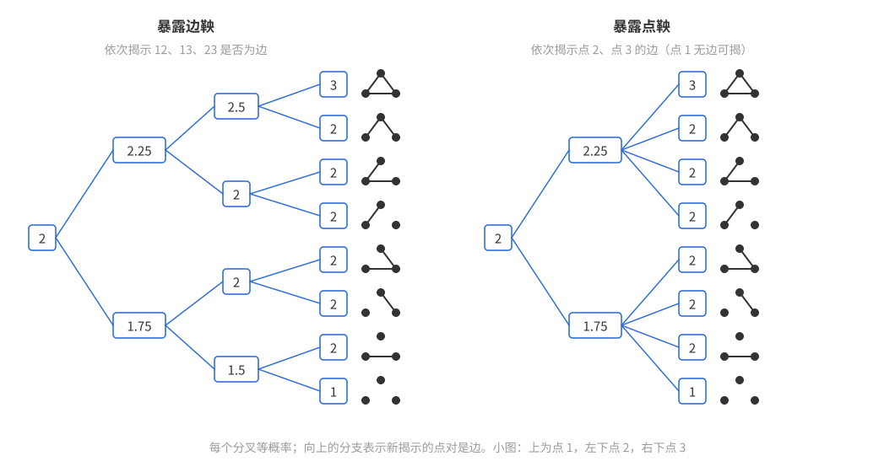
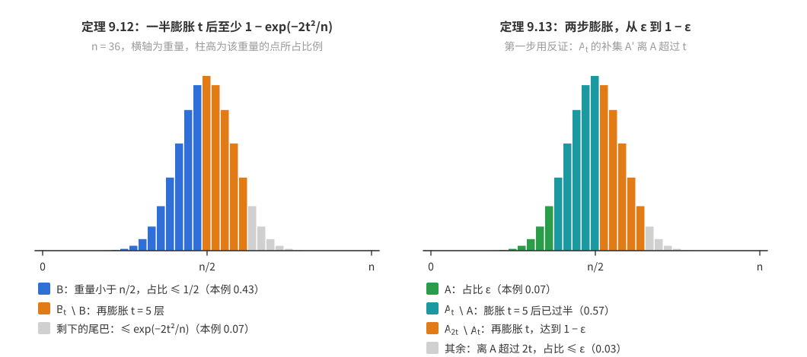
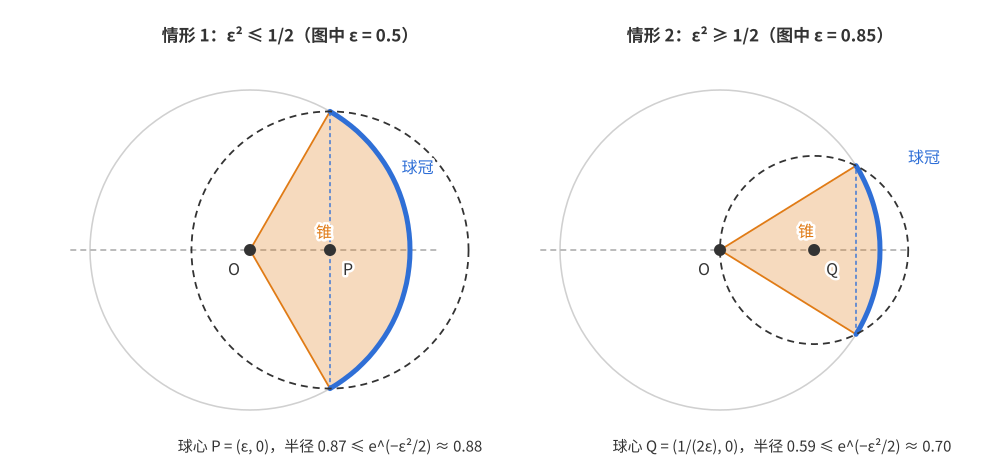
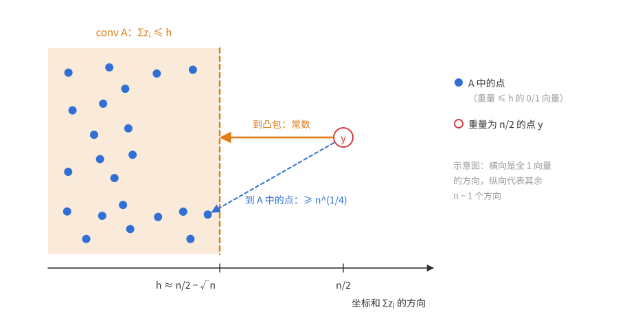
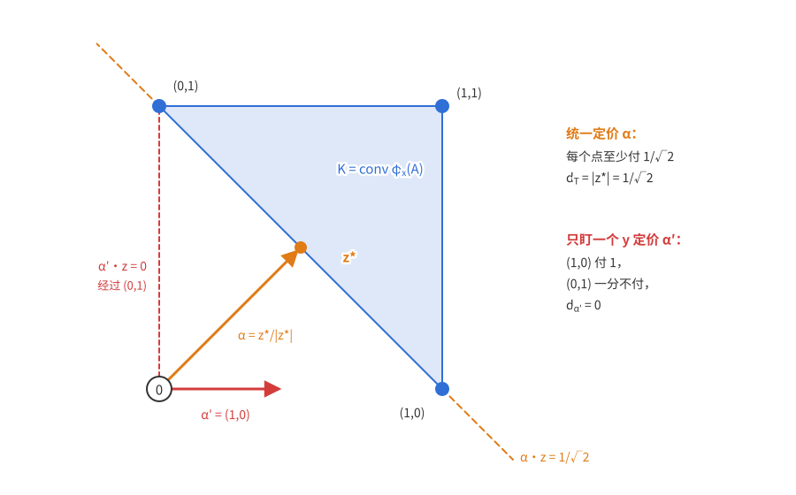
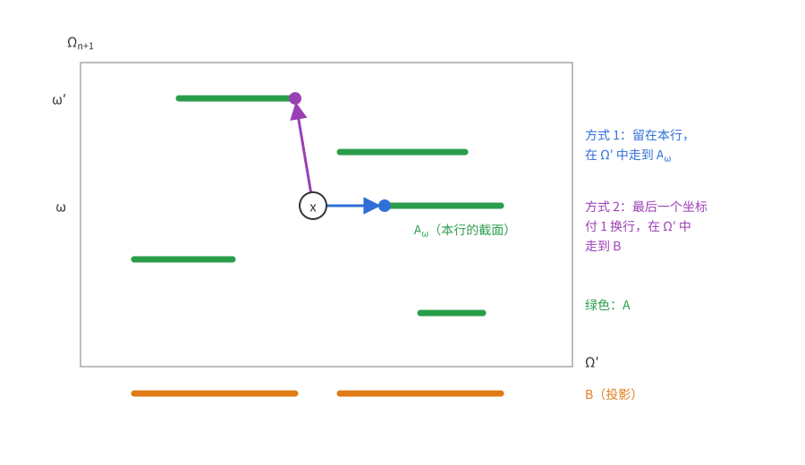
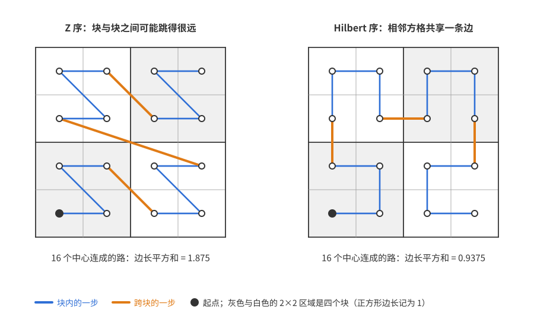
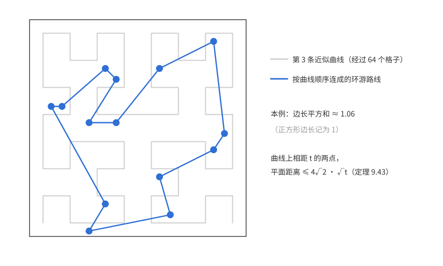
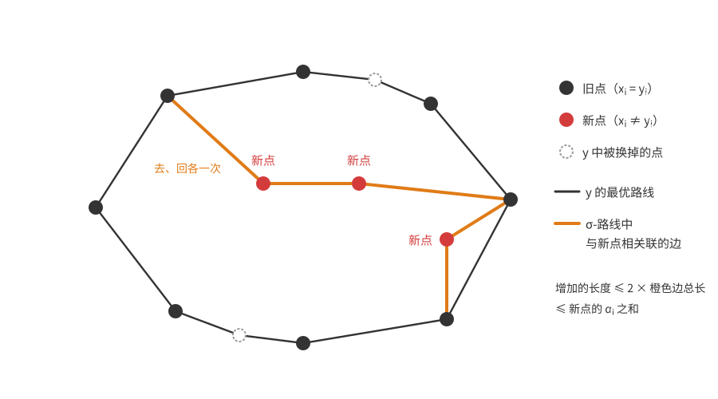
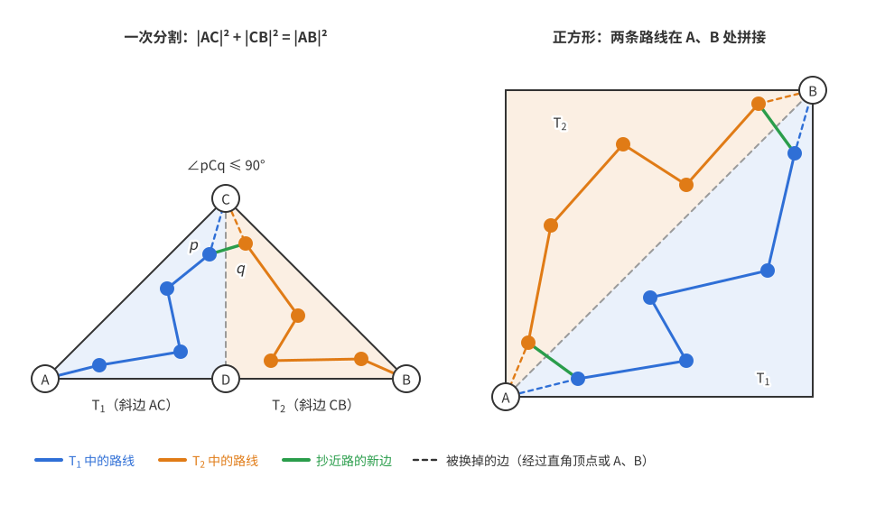

# 概率方法（九）：测度集中

上一篇：[第 8 章 Janson 不等式](<概率方法08——Janson 不等式.md>)　下一篇：[第 10 章 熵方法](概率方法10——熵方法.md)

第 5 章的 Chernoff 界说的是：$n$ 个独立、取值范围统一有界（例如都在 $[0,1]$ 中）的变量之和，偏离均值超过 $\lambda\sqrt n$ 的概率至多是 $2e^{-c\lambda^2}$（这是上界，一般没有同阶的下界）。可是组合中关心的量很少是独立变量之和：随机图的色数、最大独立集、随机点集上的最短旅行路线、随机矩阵的范数……它们都是许多独立随机输入的**复杂函数**。本章的主题是一句话：

> 依赖于许多独立输入、而对每个输入都不太敏感的函数，几乎是常数。

这叫**测度集中**。本章给出三类工具。

- 第一类是**鞅方法**（Azuma 不等式、有界差分不等式，9.1–9.3 节）：把输入一个一个揭示出来，把偏差拆成一串“每步不大、条件均值为零”的增量，再照搬 Chernoff 的矩母函数论证。用它可以证明随机图的色数集中在 $O(\sqrt n)$ 宽的窗口里，稀疏时甚至集中在 4 个值上。
- 第二类是**几何的等周不等式**（9.4 节）：在 Hamming 立方体、球面、高斯空间中，半个空间的 $t$-邻域几乎是全部，由此推出 Lipschitz 函数集中在中位数附近，并顺带得到 Johnson–Lindenstrauss 降维引理。
- 第三类是 **Talagrand 不等式**（9.5 节）：有界差分不等式给出的窗口宽度是 $\sqrt n$；当函数是凸的、或者它的取值能被少数坐标“作证”时，Talagrand 不等式把窗口缩小到与维数无关，或者只与函数的典型值有关（窗口约为典型值的平方根）。

本章最后（9.6 节）用 Talagrand 不等式证明平面上随机点的最短旅行路线高度集中。

与前几章不同，这里的结论大多不是“某个对象存在”，而是“某个随机量几乎确定”。但它们常常是存在性论证的关键一步：知道 $X$ 高度集中，就可以对指数多个事件取并集上界。

**本章读法。**

- 首读主线（鞅方法）：9.1 节的定理 9.1 和空号个数的例子；9.2 节从[揭示输入的想法](#想法一个一个地揭示输入)读到 Azuma 不等式（定理 9.2–9.4）、[Hoeffding 引理](#hoeffding-引理)（引理 9.5），以及 Azuma 不等式和有界差分不等式的证明；9.3 节的定理 9.6，以及定理 9.8 证明中“$Y=0$ 的概率不小 + 下尾 ⇒ 均值小”的套路，它在定理 9.13 的第二种证明和多道习题中反复出现。9.4 节首读[Hamming 立方体](#hamming-立方体)（定理 9.12、9.13）和[等周与集中的等价](#等周与集中的等价)（定理 9.14）；球面和高斯空间只需记住推论 9.18、9.20 以及“高斯向量 $\approx\sqrt n\cdot$ 随机单位向量”，定理 9.16 的证明可以略读；[Johnson–Lindenstrauss 引理](#johnsonlindenstrauss-引理)是“集中 + 并集上界”的标准应用，应该看。9.5 节首读推论 9.29（凸 Lipschitz 函数）、凸距离的定义与对偶形式（命题 9.30）、定理 9.31 的陈述，以及组合中最好用的两种形式：[带权证书](#带权证书的函数)（定理 9.34、9.35）和[可证函数](#可证函数与最长递增子列)（定理 9.36、推论 9.38）。
- 可以二读：引理 9.7 的证明（计算较长）；[次高斯分布](#次高斯分布)一小节中引理 9.21 的证明和命题 9.22；“为什么极值集合是半空间”的启发式论证；[Talagrand 不等式的证明](#talagrand-不等式的证明)；9.6 节中[空间填充曲线](#空间填充曲线)的细节（9.6 节首读可以只看定理 9.40 的鞅证明，以及定理 9.42 证明中引理 9.45 的思路）。各处评注中关于真实波动量级的文献结果（Heckel、Tracy–Widom 分布等）是研究背景，首读可以跳过。
- 与其他章的联系：定理 9.1 改进了[第 5 章推论 5.4(a)](<概率方法05——Chernoff 界.md#有界变量>) 的常数；引理 9.7 用有界差分不等式得到[第 8 章引理 8.12](<概率方法08——Janson 不等式.md#关键引理独立数很少偏低>) 那样的指数界；第 10、11 章不再把本章的结果当作工具使用。

## 9.1 有界差分不等式

### 问题：不是和的随机变量

先看一个例子。$n$ 个人各自独立、均匀地从 $[n]$ 中选一个号码，$Z$ 是没人选的号码个数。每个号码没人选的概率是 $(1-\frac1n)^n$，所以
$$\mathbb EZ=n\Big(1-\frac1n\Big)^n\in\Big[\frac{n-1}e,\ \frac ne\Big],$$
这里用了 $(1-\frac1n)^n\le e^{-1}\le(1-\frac1n)^{n-1}$。$Z$ 离 $n/e$ 能有多远？

$Z$ 是 $n$ 个示性变量（第 $j$ 号没人选）之和，但这些示性变量**不独立**，Chernoff 界不能直接用。换个角度看：$Z$ 是 $n$ 个**独立**输入 $s_1,\dots,s_n$ 的函数，只是这个函数不是加法。它有一个好性质：改动任何一个人的选择，$Z$ 至多变化 1（原来的号码可能变成没人选，使 $Z$ 加 1；新的号码可能不再没人选，使 $Z$ 减 1；两者同时发生时相互抵消，所以净变化至多为 1）。

Chernoff 界的情形 $Z=X_1+\cdots+X_n$ 也有这个性质：改动一个 $X_i$，和至多变化 $X_i$ 的取值范围。我们希望这个性质本身就足以推出集中。

### 定理

**定理 9.1（有界差分不等式，McDiarmid 不等式）**　设 $X_1\in\Omega_1,\dots,X_n\in\Omega_n$ 是相互独立的随机变量，函数 $f:\Omega_1\times\cdots\times\Omega_n\to\mathbb R$ 满足：只要 $x=(x_1,\dots,x_n)$ 与 $x'$ 仅在第 $i$ 个坐标不同，就有
$$\lvert f(x)-f(x')\rvert\le c_i,\tag{9.1}$$
其中 $c_1,\dots,c_n$ 是常数。则 $Z=f(X_1,\dots,X_n)$ 对任意 $\lambda\ge0$ 满足
$$\mathbb P(Z-\mathbb EZ\ge\lambda)\le\exp\Big(\frac{-2\lambda^2}{c_1^2+\cdots+c_n^2}\Big),\qquad\mathbb P(Z-\mathbb EZ\le-\lambda)\le\exp\Big(\frac{-2\lambda^2}{c_1^2+\cdots+c_n^2}\Big).$$
特别地，若所有 $c_i=1$，则两个尾概率都不超过 $e^{-2\lambda^2/n}$。

这个结果也叫 Azuma–Hoeffding 不等式。它说**独立输入的 Lipschitz 函数是集中的**，波动窗口的宽度是 $O(\sqrt{c_1^2+\cdots+c_n^2})$，所有 $c_i=1$ 时是 $O(\sqrt n)$。

**检验。** 取 $f(x)=x_1+\cdots+x_n$，$x_i\in\{0,1\}$，则 $c_i=1$，得到 $n$ 个独立 Bernoulli 变量之和 $X$ 满足 $\mathbb P(X\ge\mathbb EX+s)\le e^{-2s^2/n}$，各 $p_i$ 可以不同。这正是[第 5 章“有界变量”一节](<概率方法05——Chernoff 界.md#有界变量>)末尾提到、而推论 5.4(a) 差了因子 4 的 Hoeffding 界。所以在这类加性形式的界上，定理 9.1 改进了推论 5.4(a) 的常数。但它不能代替[乘法形式的 Chernoff 界](<概率方法05——Chernoff 界.md#均值较小时乘法形式>)：均值小时后者可能强得多。例如 $X\sim\operatorname{Bin}(n,n^{-1/2})$，$\mu=\sqrt n$，取偏差 $s=\mu$，这里只得到 $e^{-2}$，定理 5.5 却给出 $e^{-\sqrt n/3}$。

**例（空号个数）。** 回到开头的 $Z$：$c_i=1$，所以
$$\mathbb P(\lvert Z-\mathbb EZ\rvert\ge\lambda)\le2e^{-2\lambda^2/n}.$$
取 $\lambda=C\sqrt n$，偏离超过 $C\sqrt n$ 的概率至多 $2e^{-2C^2}$。所以对任意给定的 $\varepsilon>0$，取足够大的常数 $C$，就以至少 $1-\varepsilon$ 的概率有 $Z\in\frac ne\pm C\sqrt n$；若要以高概率（失败概率趋于 0），窗口须放宽到 $\frac ne\pm a_n\sqrt n$，其中 $a_n\to\infty$ 可以任意慢。（固定倍数的窗口一般做不到以高概率：$Z$ 近似正态，落在 $\pm C\sqrt n$ 之外的概率趋于一个正常数。）本章说“窗口宽度 $O(\sqrt n)$”都是这个意思。

这个窗口宽度是对的：直接算二阶矩可得 $\operatorname{Var}Z=n\big(\frac1e-\frac2{e^2}\big)+O(1)\approx0.097n$，所以 $Z$ 的标准差确实是 $\Theta(\sqrt n)$ 量级。

**独立性不能少。** 若 $X_1=X_2=\cdots=X_n$ 是同一枚均匀硬币（取值 $0,1$），$f$ 是求和，则 (9.1) 仍以 $c_i=1$ 成立，但 $Z$ 等概率地取 $0$ 和 $n$，毫无集中可言。证明中会看到独立性用在哪里。

定理 9.1 的证明要借助鞅，下一节先建立这个工具。

## 9.2 鞅与 Azuma 不等式

### 想法：一个一个地揭示输入

回顾 Chernoff 界的证明（[第 5 章 5.0 节](<概率方法05——Chernoff 界.md#定理与证明>)）：对 $e^{tS}$ 用 Markov 不等式，而 $\mathbb Ee^{tS}$ 因为独立性**分解为乘积**，每个因子 $\mathbb Ee^{tX_i}\le e^{t^2/2}$ 单独估计。现在 $Z=f(X_1,\dots,X_n)$ 不是和，没有东西可以分解。

但我们可以**人为地**把 $Z-\mathbb EZ$ 写成和。设想 $X_1,\dots,X_n$ 按顺序一个一个揭示。揭示了前 $i$ 个之后，我们对 $Z$ 的最好预测是条件期望
$$Z_i=\mathbb E[Z\mid X_1,\dots,X_i].$$
（条件期望 $\mathbb E[Z\mid X_1,\dots,X_i]$ 的意思是：把 $X_1,\dots,X_i$ 固定为它们实际取到的值，对其余的随机性求 $Z$ 的平均。它随 $X_1,\dots,X_i$ 的取值而变，所以本身是一个由 $X_1,\dots,X_i$ 决定的随机变量。）一开始什么都不知道，$Z_0=\mathbb EZ$；全部揭示后 $Z_n=Z$。于是
$$Z-\mathbb EZ=\sum_{i=1}^n(Z_i-Z_{i-1})=\sum_{i=1}^nD_i,$$
$D_i$ 是“揭示 $X_i$ 带来的预测修正”。

这些 $D_i$ 一般**不独立**，但它们有两个替代性质：

- **条件均值为零**：在已知 $X_1,\dots,X_{i-1}$ 时，修正量的平均是 0。否则，若预期修正量是正的，当初的预测 $Z_{i-1}$ 就应该更高。
- **有界**：在条件 (9.1) 下，揭示 $X_i$ 至多让预测改变 $c_i$。

Chernoff 的论证里，独立性只用在一处：把 $\mathbb Ee^{t\sum X_i}$ 拆开。下面会看到，“条件均值为零且有界”已经足以**从最后一项开始逐项剥离**：先对前 $n-1$ 个变量取条件，最后一个增量的条件矩母函数被一个常数控制，再对前 $n-2$ 个……这就是鞅方法。

### 鞅

**定义（鞅）**　随机实数序列 $Z_0,Z_1,\dots$ 称为**鞅**，如果每个 $\mathbb E\lvert Z_n\rvert<\infty$，且
$$\mathbb E[Z_{n+1}\mid Z_0,\dots,Z_n]=Z_n.$$

在本章的应用中，$Z_i$ 总是某个“揭示序列” $X_1,X_2,\dots$ 的前 $i$ 项的函数，并满足更强的 $\mathbb E[Z_{i}\mid X_1,\dots,X_{i-1}]=Z_{i-1}$。它蕴含上面的定义：$Z_0,\dots,Z_{i-1}$ 都由 $X_1,\dots,X_{i-1}$ 决定，对 $\mathbb E[Z_i\mid X_1,\dots,X_{i-1}]=Z_{i-1}$ 再关于 $Z_0,\dots,Z_{i-1}$ 取条件期望即可（条件期望的**塔性质**：先在较多的信息下取条件期望，再在较少的信息下取，结果等于直接在较少的信息下取条件期望）。严格的测度论表述要用 $\sigma$-代数流（英文 filtration），本讲义所涉及的都是有限概率空间，按上面的初等方式理解即可。

**例 1（独立增量的随机游走）**　$X_1,X_2,\dots$ 独立，$\mathbb EX_i=0$，则部分和 $Z_n=X_1+\cdots+X_n$ 是鞅：$\mathbb E[Z_{n+1}\mid X_1,\dots,X_n]=Z_n+\mathbb EX_{n+1}=Z_n$。

**例 2（赌博策略）**　对一串公平硬币下注，每轮之前可以根据已有结果任意调整赌注。设 $Z_n$ 是第 $n$ 轮后的余额，则无论策略如何，$Z_n$ 都是鞅：第 $n+1$ 轮的赌注 $b$ 由过去决定，赢输各半，余额的条件期望变化为 $\frac12b-\frac12b=0$。

“鞅”（martingale）一词原指倍投策略：从赌注 1 开始，每输一次就把赌注翻倍，第一次赢就停手，这时恰好净赚 1。以概率 1 总会赢，看似白赚；但对每个**固定**的 $n$ 仍有 $\mathbb EZ_n=0$：前 $n$ 轮全输的概率 $2^{-n}$ 乘上亏损 $2^n-1$，恰好抵消其余情形的收益 $(1-2^{-n})\cdot1$。要兑现那 1 元，需要无限的本金。

下面这个例子是本章的核心。

**例 3（Doob 鞅）**　$X_1,\dots,X_n$ 是随机变量（不必独立，但应用中通常独立），$f$ 是函数，令
$$Z_i=\mathbb E[f(X_1,\dots,X_n)\mid X_1,\dots,X_i],\qquad0\le i\le n.$$
$Z_i$ 是看到前 $i$ 个变量、其余仍随机时 $f$ 的期望。它是鞅：由塔性质，
$$\mathbb E[Z_{i+1}\mid X_1,\dots,X_i]=\mathbb E\big[\mathbb E[f\mid X_1,\dots,X_{i+1}]\ \big|\ X_1,\dots,X_i\big]=\mathbb E[f\mid X_1,\dots,X_i]=Z_i.$$
（直观上：今天对“明天的预测”的预测，就是今天的预测。）它满足 $Z_0=\mathbb EZ$（一个常数）、$Z_n=Z$（我们关心的随机变量），在两者之间插值。

在随机图 $G(n,p)$ 上，有两种常用的揭示顺序。

**例 4（暴露边鞅）**　给 $\binom n2$ 个点对固定一个顺序，依次揭示每个点对是不是边。对任何图参数 $f$，令 $Z_i$ 为揭示前 $i$ 个点对后 $f(G(n,p))$ 的条件期望，得到长为 $\binom n2$ 的 Doob 鞅。

**例 5（暴露点鞅）**　给顶点固定一个顺序，第 $i$ 步（$0\le i\le n$）揭示两端都在前 $i$ 个顶点中的所有边。这相当于把输入分组：$X_i$ 是“顶点 $i$ 与顶点 $1,\dots,i-1$ 之间的边”，它们相互独立，得到长为 $n$ 的 Doob 鞅。

下图是 $n=3$、$p=\frac12$ 时色数 $\chi(G)$ 的两种暴露鞅。从左端出发，每个分叉以相等的概率走向各分支，方框里的数是当前的条件期望，最右边是最终的图。三个点时，三角形的色数为 3、空图为 1，其余为 2，所以 $Z_0=\mathbb E\chi=2$。暴露点鞅中第 1 步什么也不揭示（$Z_1=Z_0$），图中省略了这一步。

用哪一种取决于应用，二者之间有取舍：暴露边鞅更长（$\binom n2$ 步），但每步只揭示一条边，增量容易控制；暴露点鞅只有 $n$ 步，但每步揭示很多边，需要参数 $f$ 对“改动一个顶点的所有边”也不敏感。下一节色数的集中正好落在后一种情形。

### Azuma 不等式

主要结论是：增量有界的鞅是集中的。

**定理 9.2（Azuma 不等式）**　设鞅 $Z_0,Z_1,\dots,Z_n$ 满足 $\lvert Z_i-Z_{i-1}\rvert\le1$（$i\in[n]$）。则对任意 $\lambda>0$，
$$\mathbb P(Z_n-Z_0\ge\lambda\sqrt n)\le e^{-\lambda^2/2}.$$

这与第 5 章定理 5.1 对独立 $\pm1$ 之和的界一字不差。更一般地，允许每步的界不同：

**定理 9.3（Azuma 不等式）**　设鞅 $Z_0,\dots,Z_n$ 满足 $\lvert Z_i-Z_{i-1}\rvert\le c_i$（$i\in[n]$）。则对任意 $\lambda>0$，
$$\mathbb P(Z_n-Z_0\ge\lambda)\le\exp\Big(\frac{-\lambda^2}{2(c_1^2+\cdots+c_n^2)}\Big).$$

把它用于 Doob 鞅，可以得到有界差分不等式，只是指数上的常数是 $\frac12$ 而不是 2。为了得到定理 9.1 的精确常数，需要下面这个略强的形式。（常数在应用中几乎从不重要，不关心常数的读者可以只记定理 9.3。）关键的观察是：$\lvert Z_i-Z_{i-1}\rvert\le c_i$ 只说 $Z_i$ 落在以 $Z_{i-1}$ 为中心、长 $2c_i$ 的区间里，而真正起作用的是区间的**长度**。

**定理 9.4（Doob 鞅的 Azuma 不等式）**　设 $Z_i=\mathbb E[f(X_1,\dots,X_n)\mid X_1,\dots,X_i]$ 是 Doob 鞅。假设对每个 $i$ 和 $(X_1,\dots,X_{i-1})$ 的任意取值，$Z_i$ 的可能取值都落在某个长度为 $c_i$ 的区间里（$c_i$ 是常数，区间的位置可以依赖于 $X_1,\dots,X_{i-1}$）。则对任意 $\lambda>0$，
$$\mathbb P(Z_n-Z_0\ge\lambda)\le\exp\Big(\frac{-2\lambda^2}{c_1^2+\cdots+c_n^2}\Big).$$

**评注。** (1) 对 $-f$ 用同一定理，得到下尾 $\mathbb P(Z_n-Z_0\le-\lambda)\le\exp\big(\frac{-2\lambda^2}{\sum c_i^2}\big)$；两者合起来，$\mathbb P(\lvert Z_n-Z_0\rvert\ge\lambda)\le2\exp\big(\frac{-2\lambda^2}{\sum c_i^2}\big)$。

(2) 定理 9.3 是定理 9.4 的特例：取 $(X_1,\dots,X_n)=(Z_1,\dots,Z_n)$、$f(X_1,\dots,X_n)=X_n$，则这个 Doob 鞅就是原来的鞅（由鞅性质 $\mathbb E[Z_n\mid Z_1,\dots,Z_i]=Z_i$）；条件 $\lvert Z_i-Z_{i-1}\rvert\le c_i$ 说明给定前 $i-1$ 项时 $Z_i$ 落在长 $2c_i$ 的区间 $[Z_{i-1}-c_i,Z_{i-1}+c_i]$ 中，代入定理 9.4 得 $\exp\big(\frac{-2\lambda^2}{4\sum c_i^2}\big)$，正是定理 9.3。（若 $Z_0$ 不是常数，就把 $Z_0$ 当作第 0 个先揭示的变量；下面定理 9.4 的证明在每一步多一个条件变量，丝毫不受影响。）定理 9.2 又是定理 9.3 取 $c_i=1$、把 $\lambda$ 换成 $\lambda\sqrt n$ 的特例。

所以只需证明定理 9.4。按前面的计划，要估计单个增量的条件矩母函数：增量的条件均值为 0，取值落在长为 $c_i$ 的区间中。第 5 章对区间 $[-1,1]$ 做过这件事，得到 $\mathbb Ee^{tX}\le\cosh t\le e^{t^2/2}$；现在区间的位置不再对称，需要一个对任意位置都成立的估计。

### Hoeffding 引理

**引理 9.5（Hoeffding 引理）**　设实随机变量 $X$ 取值于一个长度为 $\ell$ 的区间，且 $\mathbb EX=0$。则
$$\mathbb Ee^X\le e^{\ell^2/8}.$$
把它用于 $tX$（取值区间长 $\lvert t\rvert\ell$），得到对一切实数 $t$，$\mathbb Ee^{tX}\le e^{t^2\ell^2/8}$。

**怎样想到的。** 第一步与第 5 章相同：$e^x$ 是凸函数，在区间 $[a,b]$ 上位于两端点连线的下方，所以 $\mathbb Ee^X$ 不超过“把 $X$ 的质量按均值不变的方式推到两个端点”后的值。换句话说，**最坏情形是只取两个端点的分布**。对两点分布，矩母函数可以显式写出，剩下的是一个单变量的微积分不等式。

*证明*　设 $X\in[a,b]$，$a\le0\le b$（因为 $\mathbb EX=0$），$b-a=\ell$。$\ell=0$ 时 $X\equiv0$，结论显然，下设 $\ell>0$。由凸性，
$$e^x\le\frac{b-x}{b-a}e^a+\frac{x-a}{b-a}e^b,\qquad x\in[a,b].$$
右边关于 $x$ 是线性的，取期望并用 $\mathbb EX=0$：
$$\mathbb Ee^X\le\frac b{b-a}e^a+\frac{-a}{b-a}e^b.$$
令 $p=\frac{-a}{b-a}\in[0,1]$，则 $a=-p\ell$，$b=(1-p)\ell$，于是
$$\ln\mathbb Ee^X\le\ln\big((1-p)e^{-p\ell}+pe^{(1-p)\ell}\big)=-p\ell+\ln\big(1-p+pe^\ell\big)=:\varphi(\ell).$$
固定 $p$，只需证 $\varphi(\ell)\le\ell^2/8$ 对 $\ell\ge0$ 成立。计算导数：
$$\varphi'(\ell)=-p+\frac{pe^\ell}{1-p+pe^\ell}=-p+q(\ell),\qquad q(\ell)=\frac{p}{(1-p)e^{-\ell}+p}\in[0,1],$$
$$\varphi''(\ell)=q'(\ell)=\frac{p(1-p)e^{-\ell}}{\big((1-p)e^{-\ell}+p\big)^2}=q(\ell)\big(1-q(\ell)\big)\le\frac14.$$
又 $\varphi(0)=0$，$\varphi'(0)=-p+p=0$。由带 Lagrange 余项的 Taylor 公式，存在 $\xi\in(0,\ell)$ 使
$$\varphi(\ell)=\varphi(0)+\varphi'(0)\ell+\frac{\varphi''(\xi)}2\ell^2\le\frac{\ell^2}8.\qquad\square$$

**$\frac18$ 从哪里来。** $\varphi''=q(1-q)$ 正是取 1 的概率为 $q$ 的 0-1 变量的方差。长为 1 的区间上方差至多 $\frac14$，从 $0$ 积分两次得 $\frac12\cdot\frac14\cdot\ell^2=\frac{\ell^2}8$。

**与第 5 章对照。** 均匀 $\pm1$ 变量的区间长 $\ell=2$，引理给出 $\mathbb Ee^{tX}\le e^{t^2/2}$，与第 5 章相同；Bernoulli 变量的区间长 $\ell=1$，给出 $\mathbb Ee^{t(\xi-p)}\le e^{t^2/8}$，比把 $[-p,1-p]$ 放进 $[-1,1]$ 好 4 倍。常数 $\frac18$ 不能再改进：$p=\frac12$ 时 $X=\pm\frac\ell2$ 等概率，$\ln\mathbb Ee^X=\ln\cosh\frac\ell2=\frac{\ell^2}8-O(\ell^4)$。

### Azuma 不等式的证明

*定理 9.4 的证明*　记 $D_i=Z_i-Z_{i-1}$。取定 $t\ge0$（稍后选择）。在 $(X_1,\dots,X_{i-1})$ 的任意取值下，$D_i$ 的条件均值为 0（鞅性质），且取值落在长为 $c_i$ 的区间中（$Z_{i-1}$ 此时是常数，平移不改变区间长度）。由引理 9.5，
$$\mathbb E\big[e^{tD_i}\ \big|\ X_1,\dots,X_{i-1}\big]\le e^{t^2c_i^2/8}.$$
$Z_{i-1}-Z_0$ 由 $X_1,\dots,X_{i-1}$ 决定，所以可以把它提到条件期望外面：
$$\mathbb E\big[e^{t(Z_i-Z_0)}\big]=\mathbb E\Big[e^{t(Z_{i-1}-Z_0)}\ \mathbb E\big[e^{tD_i}\ \big|\ X_1,\dots,X_{i-1}\big]\Big]\le e^{t^2c_i^2/8}\ \mathbb E\big[e^{t(Z_{i-1}-Z_0)}\big].$$
从 $i=n$ 一直剥到 $i=1$（$Z_0-Z_0=0$），得
$$\mathbb E\big[e^{t(Z_n-Z_0)}\big]\le e^{t^2(c_1^2+\cdots+c_n^2)/8}.$$
记 $S=c_1^2+\cdots+c_n^2$，由 Markov 不等式，
$$\mathbb P(Z_n-Z_0\ge\lambda)\le e^{-t\lambda}\,\mathbb E\big[e^{t(Z_n-Z_0)}\big]\le\exp\Big(-t\lambda+\frac{t^2S}8\Big).$$
指数是 $t$ 的二次函数，在 $t=4\lambda/S$ 处取最小值 $-\frac{4\lambda^2}S+\frac{2\lambda^2}S=-\frac{2\lambda^2}S$。$\square$

与 Chernoff 的证明逐行对照：唯一的改动是把“独立 $\Rightarrow$ 矩母函数相乘”换成“条件均值为零 $\Rightarrow$ 逐项剥离”。

### 有界差分不等式的证明

*定理 9.1 的证明*　考虑 Doob 鞅 $Z_i=\mathbb E[f(X_1,\dots,X_n)\mid X_1,\dots,X_i]$。由于 $X_i$ 相互独立，给定 $X_1=x_1,\dots,X_i=x_i$ 时，$X_{i+1},\dots,X_n$ 的分布不变，所以
$$Z_i=g_i(X_1,\dots,X_i),\qquad g_i(x_1,\dots,x_i)=\mathbb E\,f(x_1,\dots,x_i,X_{i+1},\dots,X_n).$$
固定 $x_1,\dots,x_{i-1}$。对 $X_i$ 的两个可能值 $x_i,x_i'$，
$$\big\lvert g_i(x_1,\dots,x_{i-1},x_i)-g_i(x_1,\dots,x_{i-1},x_i')\big\rvert\le\mathbb E\big\lvert f(\dots,x_i,\dots)-f(\dots,x_i',\dots)\big\rvert\le c_i,$$
因为期望号内的两个输入只在第 $i$ 个坐标不同。所以给定 $X_1,\dots,X_{i-1}$ 时，$Z_i$ 的所有可能值落在长为 $c_i$ 的区间 $\big[\inf_{x_i}g_i,\ \sup_{x_i}g_i\big]$ 中。由定理 9.4 得上尾，对 $-f$ 得下尾。$\square$

独立性在这里用了两次：一是让 $Z_i$ 只通过“剩下的变量照原分布随机”来计算，二是让 $g_i$ 的比较只涉及第 $i$ 个坐标。前面“同一枚硬币”的反例中，揭示 $X_1$ 就决定了一切，$Z_1-Z_0=\pm\frac n2$，增量根本不受 $c_1=1$ 控制。

**评注（Azuma 比有界差分更灵活）。** 有界差分不等式要求 $c_i$ 是**最坏情形**下改动第 $i$ 个坐标引起的变化。而定理 9.4 只要求 $Z_i$ 的条件取值范围小，这是对后面坐标**取平均**之后的变化。可能出现这样的情形：对某些极端的 $(X_{i+1},\dots,X_n)$，改动 $X_i$ 会使 $f$ 变化很大，但对后面坐标平均之后变化不大。这时直接用定理 9.4，$c_i$ 可以取得比 (9.1) 中的更小。9.6 节的旅行商问题就是这样：改动一个点在最坏情形下会让最短路线变化 $\Theta(1)$，但对后面尚未揭示的随机点取平均之后，变化只有 $O(1/\sqrt{n-i})$。

## 9.3 随机图的色数

### 不知道均值，也能证明集中

$G(n,\frac12)$ 的色数是多少？Bollobás（1988）证明了以高概率 $\chi(G(n,\frac12))\sim\frac n{2\log_2n}$（见[第 8 章定理 8.11](<概率方法08——Janson 不等式.md#83-随机图的色数>)）。但在此之前，人们已经用有界差分不等式知道：色数集中在均值附近 $O(\sqrt n)$ 宽的窗口中。有意思的是，这个证明**完全不需要知道均值是多少**。

**目标与限制。** 想用定理 9.1，要把 $\chi(G)$ 写成独立输入的函数，并让每个输入的影响不超过常数。若以每条边为一个输入（暴露边鞅），改一条边确实只让 $\chi$ 变化至多 1，但输入有 $\binom n2$ 个，窗口宽度是 $\sqrt{\binom n2}\approx n/\sqrt2$，比 $\chi\approx\frac n{2\log_2n}$ 本身还宽，毫无用处。要让窗口变窄，必须**减少输入的个数**，同时保持每个输入的影响有界。把与同一个顶点相关的边打包成一个输入（暴露点鞅），输入只剩 $n-1$ 个；剩下要检查的是：改动一个顶点的所有边，$\chi$ 变化多少？答案是至多 1，因为总可以给这个顶点单独换一种新颜色。

**定理 9.6（Shamir–Spencer 1987）**　对任意 $n\ge2$、$p$ 和 $\lambda\ge0$，$Z=\chi(G(n,p))$ 满足
$$\mathbb P\big(\lvert Z-\mathbb EZ\rvert\ge\lambda\sqrt{n-1}\big)\le2e^{-2\lambda^2}.$$

*证明*　令顶点集为 $[n]$。对 $i=2,\dots,n$，令 $X_i\in\Omega_i=\{0,1\}^{i-1}$ 记录点对 $\{j,i\}$（$j<i$）是否为边。每个点对恰好属于一个 $X_i$（较大端点的那个），所以图 $G$ 与 $(X_2,\dots,X_n)\in\Omega_2\times\cdots\times\Omega_n$ 一一对应，且在 $G(n,p)$ 中各 $X_i$ 相互独立。

若 $G,G'$ 只在 $X_i$ 处不同，那么它们只在与顶点 $i$ 相关联的边上不同。取 $G$ 的一个 $\chi(G)$ 色正常染色，把顶点 $i$ 改涂一种全新的颜色，得到 $G'$ 的正常染色（$G'$ 中不与 $i$ 关联的边和 $G$ 相同，染色合法；与 $i$ 关联的边两端颜色不同，因为 $i$ 的颜色是独有的），所以 $\chi(G')\le\chi(G)+1$；对称地 $\chi(G)\le\chi(G')+1$。于是 (9.1) 以 $c_2=\cdots=c_n=1$ 成立，由定理 9.1（共 $n-1$ 个坐标），两侧尾概率各不超过 $\exp\big(-2\lambda^2(n-1)/(n-1)\big)=e^{-2\lambda^2}$。$\square$

**评注（色数并不总是更集中）。** 这一段是研究背景，首读可以跳过。$\sqrt n$ 的窗口比 $\chi\approx\frac n{2\log_2n}$ 小得多，但它是真实的宽度吗？长期以来多数专家相信真实窗口要窄得多。Heckel（2021）证明了相反的事实：对任意常数 $c<\frac14$，存在无穷多个 $n$，使 $\chi(G(n,\frac12))$ **不能**以高概率落在任何一个长为 $n^c$ 的区间里。有猜想认为，集中窗口的宽度随 $n$ 在 $n^{1/4+o(1)}$ 与 $n^{1/2+o(1)}$ 之间来回波动；Heckel 和 Riordan（2023）进一步证明了：对某些 $n$，窗口宽度至少是 $n^{1/2-o(1)}$，与定理 9.6 只差 $n^{o(1)}$ 因子。

### 再看团数：小团数的指数小概率

Bollobás 证明 $\chi(G(n,\frac12))\sim\frac n{2\log_2n}$ 时，关键一步是证明：$G(n,\frac12)$ 的**每个**大小约 $n/\log^2n$ 的诱导子图都含有约 $2\log_2n$ 个点的团。子图有指数多个，要对它们取并集上界，就需要“团数偏小”的概率远小于 $2^{-n}$。第 8 章用 Janson 不等式得到了这个估计（[引理 8.12](<概率方法08——Janson 不等式.md#关键引理独立数很少偏低>)，那里讲的是独立数，取补图即得团数）；这里用有界差分不等式再证一次——这其实是 Bollobás 1988 年的原始做法。

设 $f(n,k)=\binom nk2^{-\binom k2}$ 为 $G(n,\frac12)$ 中 $k$ 团个数的期望，$k_0=k_0(n)$ 为使 $f(n,k_0)\ge1$ 的最大正整数，则 $k_0\sim2\log_2n$（[第 4 章 4.4 节](概率方法04——二阶矩方法.md#44-随机图的团数)）。

**引理 9.7**　$\mathbb P\big(\omega(G(n,\frac12))<k_0-3\big)=e^{-n^{2-o(1)}}$。

**怎样选函数。** 要证明的是“不存在 $k$ 团”（$k=k_0-3$）的概率极小。最自然的函数是 $k$ 团的个数 $X$：它的均值很大，“$X=0$”是一个大偏差。但 $X$ 对单条边太敏感：一条边可能属于极多的 $k$ 团（例如在一个大团内部），删掉它会让 $X$ 骤降，有界差分的 $c_i$ 无法控制。

我们其实只关心“有没有 $k$ 团”，所以可以换一个**更迟钝**的函数，只要它在“没有 $k$ 团”时取 0，在典型情形取值很大。改动一条边能破坏很多团，但这些团都共用这条边。如果只数**两两不共边**的团，一条边至多影响其中一个。于是令
$$Y=Y(G)=\text{G 中两两没有公共边的 }k\text{ 团的最大个数}.$$

- $Y=0$ 当且仅当 $G$ 没有 $k$ 团。
- 改动一条边，$Y$ 至多变化 1：设 $G'$ 由 $G$ 删去边 $e$ 得到，$G$ 中一族两两不共边的 $k$ 团至多有一个含 $e$，去掉它就是 $G'$ 中的一族，所以 $Y(G')\ge Y(G)-1$；反之 $G'$ 中的团在 $G$ 中仍是团，$Y(G)\ge Y(G')$。加边的情形对称。

注意要用**边**作为输入而不是顶点：一个顶点可以属于许多两两不共边的 $k$ 团（例如许多 $k$ 团在同一个顶点处粘在一起，像一朵花），改动它的所有边会让 $Y$ 变化很大。

*证明*　证明分三步：先用有界差分不等式把问题归结为 $\mathbb EY\ge n^{2-o(1)}$；再把 $Y$ 写成一个辅助图的独立数，用 Caro–Wei 不等式化为辅助图的点数与边数；最后估计这两个量的期望，并说明以不小的概率点数不太少、边数不太多。

令 $k=k_0-3$。由有界差分不等式（$\binom n2$ 个坐标，$c_i=1$）的下尾，
$$\mathbb P(\omega(G)<k)=\mathbb P(Y=0)\le\mathbb P(Y-\mathbb EY\le-\mathbb EY)\le\exp\Big(-\frac{2(\mathbb EY)^2}{\binom n2}\Big).\tag{9.2}$$
所以只要证明 $\mathbb EY\ge n^{2-o(1)}$，右边就是 $\exp(-n^{4-o(1)}/n^2)=e^{-n^{2-o(1)}}$。

*把 $Y$ 写成独立数。* 作辅助图 $\mathcal H$：顶点是 $G$ 中的 $k$ 团，两个 $k$ 团至少共用 2 个顶点（即有公共边）时相邻。则 $Y=\alpha(\mathcal H)$。下界独立数的标准办法是用平均度：由第 2 章的 Caro–Wei 不等式（[定理 2.5](概率方法02——期望的线性性.md#carowei-不等式)）加上 Jensen 不等式（$x\mapsto\frac1{1+x}$ 是凸函数），对平均度为 $d$ 的图 $H$，
$$\alpha(H)\ge\sum_v\frac1{1+d_v}\ge\frac{|V(H)|}{1+d}=\frac{|V(H)|^2}{|V(H)|+2|E(H)|}.$$
（也可以用第 3 章的删除法，只差常数因子。）所以要让 $Y$ 大，需要 $\mathcal H$ 的顶点多、平均度相对小。

*$\mathcal H$ 的点数与边数。* 设 $X=|V(\mathcal H)|$ 为 $k$ 团个数，$\mu=\mathbb EX=f(n,k)$。

- $\mu\ge n^{3-o(1)}$：对 $k\sim2\log_2n$，$\frac{f(n,k)}{f(n,k+1)}=\frac{(k+1)2^k}{n-k}=n^{1-o(1)}$（因为 $2^k=n^{k/\log_2n}=n^{2+o(1)}$），所以 $f(n,k_0-3)\ge f(n,k_0)\,n^{3-o(1)}\ge n^{3-o(1)}$。（取 $k_0-3$ 而不是 $k_0$，就是为了让团足够多。）
- 设 $\Delta_{\mathcal H}=\mathbb E|E(\mathcal H)|$。先看量级：与一个给定的 $k$ 元集共用至少两个点的 $k$ 元集，只占全部 $k$ 元集的约 $k^4/n^2$；共用一条边只让“两个都是团”的概率翻一倍。所以应有 $\Delta_{\mathcal H}\approx\mu^2n^{-2}$，即 $\mathcal H$ 的平均度约为 $\mu\cdot n^{-2+o(1)}$，比顶点数小 $n^2$ 倍左右。下面把它写准。对 $k$ 元集 $S,T$，$|S\cap T|=i$ 时二者都是团的概率为 $2^{-2\binom k2+\binom i2}$，所以
$$\Delta_{\mathcal H}=\frac12\sum_{|S\cap T|\in[2,k-1]}2^{-2\binom k2+\binom i2}=\frac{\mu^2}2\sum_{i=2}^{k-1}g(i),\qquad g(i)=\frac{\binom ki\binom{n-k}{k-i}}{\binom nk}2^{\binom i2}.$$
断言：$\sum_{i=2}^{k-1}g(i)\le n^{-2+o(1)}$，从而
$$\Delta_{\mathcal H}\le\mu^2n^{-2+o(1)}.$$
主导项是 $i=2$：由 $\binom{n-k}{k-2}\le\binom{n-2}{k-2}=\binom nk\frac{k(k-1)}{n(n-1)}$，得 $g(2)\le2\binom k2\frac{k(k-1)}{n(n-1)}=O\big(\frac{k^4}{n^2}\big)=n^{-2+o(1)}$。其余各项是[第 4 章定理 4.16](概率方法04——二阶矩方法.md#44-随机图的团数) 证明中估计过的同一个和式（$g(i)$ 的定义完全相同），结论是：$3\le i\le k/2$ 时由估计 (I)，每项至多 $n^{-2+o(1)}$；$k/2<i\le k-1$ 时由估计 (II)，这些项之和是 $o(1/\mu)\le n^{-3+o(1)}$。共 $k=O(\log n)$ 项，合起来仍是 $n^{-2+o(1)}$。

*集中。* 由 Chebyshev，$\operatorname{Var}X\le\mu+\mu^2\sum_ig(i)$（不共边的两个团相互独立，协方差为 0），所以 $\mathbb P(X<\mu/2)\le\frac4\mu+4\sum_ig(i)=o(1)$。由 Markov，$\mathbb P(|E(\mathcal H)|>4\Delta_{\mathcal H})\le\frac14$。所以事件 $\mathcal G=\{X\ge\mu/2,\ |E(\mathcal H)|\le4\Delta_{\mathcal H}\}$ 的概率至少 $\frac34-o(1)\ge\frac12$。函数 $x\mapsto\frac{x^2}{x+c}$ 在 $x>0$ 上递增，所以在 $\mathcal G$ 上
$$Y=\alpha(\mathcal H)\ge\frac{X^2}{X+2|E(\mathcal H)|}\ge\frac{(\mu/2)^2}{\mu/2+8\Delta_{\mathcal H}}\ge\frac{\mu^2/4}{2\max(\mu/2,\,8\Delta_{\mathcal H})}=\min\Big(\frac\mu4,\ \frac{\mu^2}{64\Delta_{\mathcal H}}\Big)\ge n^{2-o(1)}.$$
因此 $\mathbb EY\ge\frac12n^{2-o(1)}=n^{2-o(1)}$，代入 (9.2) 得上界 $e^{-n^{2-o(1)}}$。

下界是平凡的：空图没有 $k$ 团，$\mathbb P(\omega<k)\ge2^{-\binom n2}=e^{-O(n^2)}$。所以指数中的 $n^{2-o(1)}$ 只差 $n^{o(1)}$ 因子，是精确的。$\square$

**说明。** $\mu$ 本身的量级随 $n$ 在 $n^{3-o(1)}$ 与 $n^{4+o(1)}$ 之间波动（取决于 $n$ 落在两个相邻 $k_0$ 之间的什么位置），但证明只用到比值 $\mu^2/\Delta_{\mathcal H}=n^{2-o(1)}$ 和 $\mu\ge n^{3-o(1)}$。这里的 $o(1)$ 收敛很慢，主要因为 $g(2)\approx k^4/n^2$ 中的 $k^4$。

与 Janson 不等式的证明比较：Janson 不等式直接给出形如 $\mathbb P(X=0)\le e^{-\mu^2/(2\Delta)}$ 的界，这里 $\mu^2/\Delta=n^{2-o(1)}$；有界差分则绕道“不共边的团的最大个数” $Y$，指数是 $(\mathbb EY)^2/\binom n2$，而 $\mathbb EY$ 的下界本身又来自 $\mu^2/\Delta_{\mathcal H}$。两条路得到的都是 $e^{-n^{2-o(1)}}$。

### 稀疏随机图：色数集中在四个值上

当 $p$ 足够小时，色数的集中程度远好于 $\sqrt n$。

**定理 9.8（Shamir–Spencer 1987）**　固定 $\alpha>\frac56$。存在 $u=u(n,p)$，使当 $p<n^{-\alpha}$ 时，
$$\mathbb P\big(u\le\chi(G(n,p))\le u+3\big)=1-o(1)\qquad(n\to\infty).$$

**怎样想到。** 定理 9.6 的窗口是 $\sqrt n$，来自有界差分的固有宽度，无法再缩小。要得到常数宽的窗口，不能直接对 $\chi$ 用集中不等式。换个思路：$\sqrt n$ 宽的波动若只发生在**少数顶点**上，就无伤大雅。具体地：

1. 选 $u$ 为色数的一个“低位分位数”：$\chi\le u$ 的概率不可忽略（至少 $\varepsilon$），但 $\chi<u$ 的概率很小。这样 $\chi\ge u$ 自动以至少 $1-\varepsilon$ 的概率成立（最后再让 $\varepsilon\to0$），只需证上界。
2. 考虑“要删掉多少个顶点，剩下的图才能 $u$ 染色”，记为 $Y$。这个量与 $\chi$ 一样是顶点 Lipschitz 的，所以集中在 $\mathbb EY\pm O(\sqrt n)$。又因为 $Y=0$ 的概率至少 $\varepsilon$，集中性**反过来**迫使 $\mathbb EY=O(\sqrt n)$，于是以至少 $1-\varepsilon$ 的概率 $Y=O(\sqrt n)$（常数依赖于 $\varepsilon$）。
3. 剩下 $O(\sqrt n)$ 个点，在稀疏随机图中，这么少的点诱导的子图结构简单，3 种新颜色就够。于是 $\chi\le u+3$。

第 3 步是 $\alpha>\frac56$ 的来源。

*证明*　先说明只需证：对每个 $\varepsilon>0$，存在 $u=u(n,p,\varepsilon)$，使 $p<n^{-\alpha}$ 且 $n$ 充分大时
$$\mathbb P\big(u\le\chi(G(n,p))\le u+3\big)\ge1-3\varepsilon.\tag{9.3}$$
这是标准的对角线论证：对 $m=1,2,\dots$，取 $N_m$ 使 $n\ge N_m$ 时 (9.3) 对 $\varepsilon=1/m$ 成立，不妨 $N_1<N_2<\cdots$；对 $N_m\le n<N_{m+1}$，令 $u(n,p)=u(n,p,1/m)$。则当 $n\ge N_m$ 时概率至少 $1-3/m$，所以趋于 1。（$N_m$ 只依赖于 $\varepsilon$ 和 $\alpha$、不依赖于 $p$，这一点由下面的论证保证。）

固定 $\varepsilon>0$。令 $u$ 为使 $\mathbb P(\chi(G(n,p))\le u)>\varepsilon$ 的最小整数。对 $G\sim G(n,p)$，令
$$Y=Y(G)=\min\{|S|:\ S\subseteq V(G),\ G-S\text{ 可以 }u\text{ 染色}\}.$$
改动某个顶点 $v$ 的所有边：若 $G-S$ 可 $u$ 染色，则 $G'-(S\cup\{v\})=G-(S\cup\{v\})$ 也可以，所以 $Y(G')\le Y(G)+1$，反之亦然。对暴露点鞅的坐标（同定理 9.6 的证明）用有界差分不等式，
$$\mathbb P(Y\le\mathbb EY-\lambda\sqrt n)\le e^{-2\lambda^2},\qquad\mathbb P(Y\ge\mathbb EY+\lambda\sqrt n)\le e^{-2\lambda^2}.$$
（坐标只有 $n-1$ 个，界只会更好。）取 $\lambda=\lambda(\varepsilon)>0$ 使 $e^{-2\lambda^2}=\varepsilon$。

*下尾说明 $\mathbb EY$ 小。* 由 $u$ 的定义，
$$e^{-2\lambda^2}=\varepsilon<\mathbb P(\chi(G)\le u)=\mathbb P(Y=0)=\mathbb P(Y\le\mathbb EY-\mathbb EY)\le\exp\Big(-\frac{2(\mathbb EY)^2}n\Big),$$
所以 $\mathbb EY<\lambda\sqrt n$。

*上尾说明 $Y$ 很少大。* $\mathbb P(Y\ge2\lambda\sqrt n)\le\mathbb P(Y\ge\mathbb EY+\lambda\sqrt n)\le\varepsilon$。

于是 $n$ 充分大时，下面三个事件各自以至少 $1-\varepsilon$ 的概率发生：

- 存在 $S\subseteq V(G)$，$|S|\le2\lambda\sqrt n$，使 $G-S$ 可以 $u$ 染色（上一段）；
- $G$ 中任何至多 $2\lambda\sqrt n$ 个顶点诱导的子图都可以 3 染色（下面的引理 9.9，取 $C=2\lambda$）；
- $\chi(G)\ge u$（由 $u$ 的最小性，$\mathbb P(\chi\le u-1)\le\varepsilon$）。

三者同时发生的概率至少 $1-3\varepsilon$。此时用 $u$ 种颜色染 $G-S$，再用 3 种新颜色染 $G[S]$，得到 $G$ 的正常染色，所以 $u\le\chi(G)\le u+3$。$\square$

**引理 9.9**　固定 $\alpha>\frac56$ 和 $C>0$，设 $p\le n^{-\alpha}$。则以 $1-o(1)$ 的概率，$G(n,p)$ 中任何至多 $C\sqrt n$ 个顶点的子集诱导的子图都可以 3 染色。

**怎样想到。** 不能 3 染色的图必须“稠密”一些：有一个低度数的顶点，就可以先染别的、最后再给它挑颜色。所以最小的不可 3 染色的子图每个顶点度数至少 3，边数至少是点数的 $\frac32$ 倍。而稀疏随机图中，小点集几乎不可能有这么多边。

*证明*　若结论不成立，取一个点数最少的 $T\subseteq V(G)$，使 $G[T]$ 不可 3 染色，则 $|T|\le C\sqrt n$。$G[T]$ 的最小度至少 3：若 $T$ 中某个 $x$ 在 $G[T]$ 中度数不超过 2，由最小性 $G[T-x]$ 可以 3 染色，$x$ 的至多 2 个邻点至多用掉 2 种颜色，给 $x$ 染第三种，得到 $G[T]$ 的 3 染色，矛盾。所以 $G[T]$ 至少有 $\frac32|T|$ 条边。又至多 3 个点的图都可 3 染色，故 $t=|T|\ge4$。

对 $t$ 个点的集合和其中 $s=\lceil3t/2\rceil$ 个点对用并集上界。利用 $\binom nk\le(en/k)^k$，以及 $t\le C\sqrt n$ 时 $\frac{e\binom t2p}{s}\le\frac{etp}3<1$（于是 $\big(\frac{e\binom t2p}s\big)^s\le\big(\frac{etp}3\big)^{3t/2}$），
$$\sum_{t=4}^{C\sqrt n}\binom nt\binom{\binom t2}{s}p^{s}\le\sum_{t=4}^{C\sqrt n}\Big(\frac{en}t\Big)^t\Big(\frac{etp}3\Big)^{3t/2}=\sum_{t=4}^{C\sqrt n}\Big(\frac{e^{5/2}}{3^{3/2}}\,n\,t^{1/2}p^{3/2}\Big)^t.$$
括号内不超过 $\frac{e^{5/2}}{3^{3/2}}\,C^{1/2}\,n^{1+\frac14-\frac{3\alpha}2}=O\big(n^{\frac54-\frac{3\alpha}2}\big)$，当 $\alpha>\frac56$ 时趋于 0。于是和式不超过一个首项为 $o(1)$ 的几何级数，为 $o(1)$。$\square$

$\frac56$ 正是使 $n\cdot(\sqrt n)^{1/2}\cdot p^{3/2}\to0$ 的临界指数：$1+\frac14-\frac32\alpha<0$。

**评注。** Łuczak（1991）用同样思路的精细化证明了 $\alpha>\frac56$ 时色数**两点集中**；Alon 和 Krivelevich（1997）把条件放宽到 $\alpha>\frac12$：对任意 $\alpha>\frac12$，$\chi(G(n,n^{-\alpha}))$ 以高概率集中在两个值上。

## 9.4 等周不等式：几何的视角

鞅方法给出的窗口是 $\sqrt{\sum c_i^2}$：它只知道“改一个坐标，函数变化多少”，与空间本身的几何无关。这一节换一个角度，把集中性归结为空间的形状。同样是 1-Lipschitz 函数，在 Hamming 立方体上窗口是 $\sqrt n$（这一点等周视角并不比有界差分更好），在半径 1 的球面上是 $1/\sqrt n$，在高斯空间中是与维数无关的常数。新东西在于：窗口宽度由空间的几何决定。9.5 节的 Talagrand 不等式要做的，就是把高斯空间那种与维数无关的集中，在一定条件下带回离散的乘积空间。

下面两件事是同一枚硬币的两面：

| 概率 | 几何 |
|---|---|
| Lipschitz 函数集中在某个值附近 | 等周不等式：测度一半的集合，稍微膨胀就几乎占满全空间 |

Milman 在 1970 年代认识到测度集中现象的重要性并大力推广，此后它成为概率论、Banach 空间几何的核心工具，在理论计算机科学中也影响深远。

### 欧氏空间

经典的等周定理说：$\mathbb R^n$ 中体积给定的集合里，球的表面积最小。（“等周”指固定周长，等价地也可以固定表面积、使体积最大。）二维情形古希腊人已经知道，严格证明直到 19 世纪末才出现。

为了推广到其他空间，用“膨胀”代替“表面积”。设 $(X,d_X)$ 是度量空间，$A\subseteq X$。对 $x\in X$，记 $d_X(x,A)=\inf_{a\in A}d_X(x,a)$ 为 $x$ 到 $A$ 的距离，令
$$A_t=\{x\in X:\ d_X(x,A)\le t\}$$
为 $A$ 的 **$t$-邻域**，即把 $A$ 向外膨胀距离 $t$ 得到的集合。

**定理 9.10（欧氏空间的等周不等式）**　设 $A\subseteq\mathbb R^n$ 可测，$B$ 是与 $A$ 体积相等的球。则对一切 $t\ge0$，$\operatorname{vol}A_t\ge\operatorname{vol}B_t$。

**评注。** (1) 一个干净的证明来自 Brunn–Minkowski 不等式 $\operatorname{vol}(A+C)^{1/n}\ge\operatorname{vol}(A)^{1/n}+\operatorname{vol}(C)^{1/n}$，其中 $A+C=\{a+c:\ a\in A,\ c\in C\}$ 是两个集合的 Minkowski 和。设 $B$ 的半径为 $r$，$B(1)$ 为单位球，则 $A_t\supseteq A+tB(1)$（对闭集取等号），于是
$$\operatorname{vol}(A_t)^{1/n}\ge\operatorname{vol}(A)^{1/n}+t\operatorname{vol}(B(1))^{1/n}=(r+t)\operatorname{vol}(B(1))^{1/n}=\operatorname{vol}(B_t)^{1/n}.$$

(2) 经典的表面积形式 $\operatorname{vol}_{n-1}\partial A\ge\operatorname{vol}_{n-1}\partial B$ 与这里的膨胀形式等价（对 $t$ 求导即从膨胀形式得到表面积形式）；本章只用膨胀形式。

### Hamming 立方体

在 $\{0,1\}^n$ 上取 Hamming 距离（两个向量不同坐标的个数），$A_t$ 按上面的方式定义。**Hamming 球**是到某个点距离不超过 $r$ 的点集，例如 $\{x:\ \operatorname{wt}(x)\le r\}$，其中 $\operatorname{wt}(x)$ 是 $x$ 的重量（1 的个数）。Harper 定理给出了精确的等周不等式。

**定理 9.11（Hamming 立方体的等周不等式，Harper 1966）**　设 $A\subseteq\{0,1\}^n$，$B\subseteq\{0,1\}^n$ 是 Hamming 球，且 $|A|\ge|B|$。则对一切 $t\ge0$，$|A_t|\ge|B_t|$。

**评注。** 当 $|A|$ 恰好等于某个 Hamming 球的大小 $\binom n0+\binom n1+\cdots+\binom nk$ 时，这个界是精确的。实际上有更强的结论：对任意的 $|A|$ 和 $t$，使 $|A_t|$ 最小的 $A$ 可以取为**单纯序**的一个初始段——先按重量排序，重量相同的按字典序排。极值集合论中这方面的内容可参看 Bollobás 的书 *Combinatorics*（1986）。

把 Harper 定理与 Chernoff 界结合，得到一个反直觉的结论：立方体的直径是 $n$，但一半的立方体只要膨胀 $O(\sqrt n)$（远小于 $n$），就几乎覆盖整个立方体。

**定理 9.12（从一半到 $1-\varepsilon$ 的快速膨胀）**　设 $t$ 是正整数。对任意 $A\subseteq\{0,1\}^n$，$|A|\ge2^{n-1}$，有
$$|A_t|>\big(1-e^{-2t^2/n}\big)2^n.$$

*证明*　令 $B=\{x:\ \operatorname{wt}(x)<n/2\}$，它是 Hamming 球，且 $|B|\le2^{n-1}\le|A|$（重量 $<n/2$ 与重量 $>n/2$ 的点一样多）。由 Harper 定理，$|A_t|\ge|B_t|$。$B$ 中的最大重量是 $\lceil n/2\rceil-1$，所以重量为 $w$ 的点到 $B$ 的距离是 $\max(0,\ w-\lceil n/2\rceil+1)$，从而
$$B_t=\{x:\ \operatorname{wt}(x)\le\lceil n/2\rceil-1+t\}=\{x:\ \operatorname{wt}(x)<n/2+t\}$$
（$t$ 是整数，$n$ 为奇数和偶数时分别验证即可）。均匀随机的 $x$ 的重量服从 $\operatorname{Bin}(n,\frac12)$，由第 5 章推论 5.4(b)，$\mathbb P(\operatorname{wt}(x)\ge n/2+t)\le e^{-2t^2/n}$；而且对 $t>0$ 这个不等式是严格的（推论 5.4(b) 来自定理 5.1 的证明，其中 $\cosh s<e^{s^2/2}$ 对 $s\ne0$ 严格成立）。所以 $|B_t|>(1-e^{-2t^2/n})2^n$。$\square$

（Hamming 距离只取整数值，所以 $A_t=A_{\lfloor t\rfloor}$；对非整数的 $t$，只能用 $\lfloor t\rfloor$ 代入上式。）

下图左半是 $n=36$、$t=5$ 时的定理 9.12：横轴是重量，柱高是该重量的点所占的比例。蓝色是 $B$，橙色是膨胀 $t$ 层后新增的部分，灰色尾巴不超过 $e^{-2t^2/n}$。立方体的直径是 $n$，膨胀 $\sqrt n$ 量级就几乎占满。右半是下面定理 9.13 的两步膨胀：从占比 $\varepsilon$ 的 $A$（绿色）出发，膨胀 $t$ 后已经过半，再膨胀 $t$ 就达到 $1-\varepsilon$。

更进一步，哪怕起点只是立方体的一小部分（比如 1%），稍加膨胀也能覆盖几乎全部。

**定理 9.13（从 $\varepsilon$ 到 $1-\varepsilon$ 的快速膨胀）**　设 $0<\varepsilon<1$，$C=\sqrt{2\ln(1/\varepsilon)}$。若 $A\subseteq\{0,1\}^n$，$|A|\ge\varepsilon2^n$，则
$$|A_{C\sqrt n}|\ge(1-\varepsilon)2^n.$$

**想法。** $A$ 不到一半，不能直接用定理 9.12。但可以分两步：先膨胀一次，证明 $A_t$ 至少占一半；再膨胀一次，用定理 9.12。第一步用反证：$A_t$ 的补集 $A'$ 离 $A$ 的距离大于 $t$，如果 $A'$ 占了一半以上，它膨胀 $t$ 后会几乎覆盖全部，必然碰到 $A$，矛盾。这里利用了膨胀关系的**对称性**：$A'$ 离 $A$ 远，等于 $A$ 离 $A'$ 远。

*第一种证明（用 Harper 定理）*　取正整数 $t=\big\lceil\sqrt{n\ln(1/\varepsilon)/2}\big\rceil$，则 $e^{-2t^2/n}\le\varepsilon$。令 $A'=\{0,1\}^n\setminus A_t$，则 $A'$ 中每个点到 $A$ 的距离大于 $t$，所以 $A'_t\cap A=\varnothing$。若 $|A'|\ge2^{n-1}$，由定理 9.12，$|A'_t|>(1-\varepsilon)2^n$，再加上 $|A|\ge\varepsilon2^n$，$A'_t$ 与 $A$ 必相交，矛盾。所以 $|A'|<2^{n-1}$，即 $|A_t|>2^{n-1}$。对 $A_t$ 再用定理 9.12，$|A_{2t}|\ge|(A_t)_t|>(1-\varepsilon)2^n$。$\square$

这个证明因为取整，得到的膨胀半径是 $2t\le C\sqrt n+2$，比定理所说的 $C\sqrt n$ 多了至多 2。下面的第二种证明不依赖 Harper 定理，也没有取整问题，给出的正是定理的原样。

*第二种证明（用有界差分不等式）*　取均匀随机的 $x\in\{0,1\}^n$，令 $X=d(x,A)$。改动 $x$ 的一个坐标，$X$ 至多变化 1（三角不等式），所以由定理 9.1，
$$\mathbb P(X-\mathbb EX\le-\lambda)\le e^{-2\lambda^2/n},\qquad\mathbb P(X-\mathbb EX\ge\lambda)\le e^{-2\lambda^2/n}.$$
$X=0$ 当且仅当 $x\in A$，所以
$$\varepsilon\le\mathbb P(x\in A)=\mathbb P(X=0)=\mathbb P(X-\mathbb EX\le-\mathbb EX)\le e^{-2(\mathbb EX)^2/n},$$
即 $\mathbb EX\le\sqrt{n\ln(1/\varepsilon)/2}=\frac{C\sqrt n}2$。再用上尾，
$$\mathbb P(x\notin A_{C\sqrt n})=\mathbb P(X>C\sqrt n)\le\mathbb P\Big(X\ge\mathbb EX+\frac{C\sqrt n}2\Big)\le e^{-2(C^2n/4)/n}=e^{-C^2/2}=\varepsilon.\qquad\square$$

第二种证明的结构与定理 9.8 的证明一模一样：“$X=0$ 的概率不小”加上下尾，推出均值小；再用上尾，推出 $X$ 很少大。这是本章反复出现的套路。

### 等周与集中的等价

上面两种证明显示了几何等周不等式与概率集中不等式的联系。下面把这种联系说清楚。

**定义（Lipschitz 函数）**　设 $(X,d_X)$、$(Y,d_Y)$ 是度量空间。称 $f:X\to Y$ 是 **$C$-Lipschitz** 的，如果对一切 $x,x'\in X$，$d_Y(f(x),f(x'))\le Cd_X(x,x')$。

有界差分条件 (9.1)（$c_i=1$）就是说 $f$ 关于 Hamming 距离是 1-Lipschitz 的。所以定理 9.1 说：$\{0,1\}^n$ 上关于 Hamming 距离 1-Lipschitz 的 $f$，在均匀分布下集中在均值附近，
$$\mathbb P(\lvert f-\mathbb Ef\rvert\ge n\lambda)\le2e^{-2n\lambda^2}.$$
$f$ 的取值范围可以宽达 $n$，但除了指数小的部分外，它都落在 $\mathbb Ef\pm o(n)$ 之内——**几乎处处几乎是常数**。这是高维特有的反直觉现象。

**定理 9.14（两种测度集中的等价）**　设 $(\Omega,\mathbb P)$ 是带度量的概率空间，$t,\varepsilon\ge0$。下面两条等价：

(a)（膨胀，近似等周）若 $A\subseteq\Omega$，$\mathbb P(A)\ge\frac12$，则 $\mathbb P(A_t)\ge1-\varepsilon$。

(b)（Lipschitz 函数的集中）若 $f:\Omega\to\mathbb R$ 是 1-Lipschitz 的，$m\in\mathbb R$ 满足 $\mathbb P(f\le m)\ge\frac12$，则 $\mathbb P(f>m+t)\le\varepsilon$。

*证明*　(a)$\Rightarrow$(b)：令 $A=\{x:\ f(x)\le m\}$，则 $\mathbb P(A)\ge\frac12$。$f$ 是 1-Lipschitz 的，所以对 $x\in A_t$（以及任意 $\delta>0$，存在 $a\in A$ 使 $d(x,a)\le t+\delta$），$f(x)\le f(a)+t+\delta\le m+t+\delta$，故 $f(x)\le m+t$。于是 $\{f>m+t\}\subseteq\Omega\setminus A_t$，由 (a)，$\mathbb P(f>m+t)\le1-\mathbb P(A_t)\le\varepsilon$。

(b)$\Rightarrow$(a)：令 $f(x)=d(x,A)$，$m=0$。由三角不等式 $f$ 是 1-Lipschitz 的，且 $\mathbb P(f\le0)\ge\mathbb P(A)\ge\frac12$。由 (b)，$1-\mathbb P(A_t)=\mathbb P(f>t)\le\varepsilon$。$\square$

**中位数。** (b) 中通常取 $m$ 为 $f$ 的**中位数**，即满足 $\mathbb P(f\ge m)\ge\frac12$ 且 $\mathbb P(f\le m)\ge\frac12$ 的数（总存在，但不一定唯一）。对 $f$ 和 $-f$ 各用一次 (b)，就得到双侧的集中 $\mathbb P(\lvert f-m\rvert>t)\le2\varepsilon$。对集中性好的分布，均值和中位数相差不大：若 $f$ 在某个 $m$ 附近有 $e^{-t^2/2}$ 型的尾，则均值和每个中位数离 $m$ 都只有 $O(1)$。精确表述见下文引理 9.21。

非正式地说，一个空间（准确地说是一列空间）有**测度集中**性质，是指定理 9.14 中的 $\varepsilon$ 随 $t$ 迅速衰减（“Lévy 族”的概念使之精确化）。Hamming 立方体是一例；其他重要的例子有球面、高斯空间、正交群和酉群、正曲率流形、对称群。

### 球面

高维几何中的测度集中是一个丰富而优美的题材，入门可读 Ball 的综述 *An Elementary Introduction to Modern Convex Geometry*（1997）。除了欧氏空间和 Hamming 立方体，还有几种空间的精确等周不等式已知，其中球面和高斯空间尤为重要。下面的定理归功于 Lévy（约 1919 年）。

在单位球面 $S^{n-1}\subseteq\mathbb R^n$ 上，**球冠**是球面与一个半空间的交，例如 $\{x\in S^{n-1}:\ x_1\ge a\}$；记 $\sigma$ 为 $S^{n-1}$ 上的均匀概率测度（归一化的 $(n-1)$ 维面积）。

**定理 9.15（球面上的 Lévy 等周不等式）**　设 $A\subseteq S^{n-1}$ 可测，$B$ 是与 $A$ 面积相等的球冠。则对一切 $t\ge0$，$\sigma(A_t)\ge\sigma(B_t)$。

（距离可以用 $\mathbb R^n$ 中的欧氏距离，也可以用球面上的测地距离，二者是彼此的单调函数，膨胀后的球冠仍是球冠。）

要从等周不等式得到集中，还需要知道球冠有多小。

**定理 9.16（球冠的大小）**　设 $x=(x_1,\dots,x_n)$ 是 $\mathbb R^n$ 中均匀随机的单位向量。则对任意 $\varepsilon\ge0$，
$$\mathbb P(x_1\ge\varepsilon)\le e^{-n\varepsilon^2/2}.$$

**想法。** 面积不好直接算，体积却有一个漂亮的比较方式。把球冠 $C=\{x\in S^{n-1}:\ x_1\ge\varepsilon\}$ 与原点连成一个“锥” $\widetilde C=\{ry:\ y\in C,\ 0\le r\le1\}$。由极坐标，锥的体积与球冠面积成正比（比例常数 $\frac1n$ 对任何球冠都相同），所以
$$\frac{\operatorname{vol}_{n-1}C}{\operatorname{vol}_{n-1}S^{n-1}}=\frac{\operatorname{vol}_n\widetilde C}{\operatorname{vol}_nB(1)}.$$
只要把锥 $\widetilde C$ 装进一个半径为 $r$ 的小球，右边就不超过 $r^n$。半径 $r<1$ 的 $n$ 次方是指数小的——这正是高维的威力。剩下的是一道平面几何题：怎样用尽量小的球装下这个锥。下图画出了过 $x_1$ 轴的一个截面。

图中蓝色是球冠，橙色阴影是锥 $\widetilde C$，虚线圆是装下它的小球。左图 $\varepsilon\le\frac1{\sqrt2}$，小球以球冠底面的圆心 $P=(\varepsilon,0,\dots,0)$ 为心；右图 $\varepsilon\ge\frac1{\sqrt2}$，小球改为以原点和球冠边界圆为界。

*证明*　只需对 $0\le\varepsilon\le1$ 证明（$\varepsilon>1$ 时概率为 0）。由上面的体积比，只需找半径 $r\le e^{-\varepsilon^2/2}$ 的球包含 $\widetilde C$。球是凸集，$\widetilde C$ 包含于 $C\cup\{0\}$ 的凸包，所以只需球包含 $C$ 和原点。

*情形 1：$0\le\varepsilon\le\frac1{\sqrt2}$。* 取以 $P=(\varepsilon,0,\dots,0)$ 为心、半径 $r=\sqrt{1-\varepsilon^2}$ 的球。对 $x\in C$，
$$\lvert x-P\rvert^2=\lvert x\rvert^2-2\varepsilon x_1+\varepsilon^2=1-2\varepsilon x_1+\varepsilon^2\le1-\varepsilon^2,$$
所以 $C$ 在球内；原点到 $P$ 的距离 $\varepsilon\le\sqrt{1-\varepsilon^2}$（因为 $\varepsilon^2\le\frac12$），也在球内。而 $\sqrt{1-\varepsilon^2}\le e^{-\varepsilon^2/2}$（由 $1-u\le e^{-u}$）。

*情形 2：$\frac1{\sqrt2}\le\varepsilon\le1$。* 这时原点离 $P$ 太远，改取以 $Q=(c,0,\dots,0)$ 为心、半径 $c$ 的球，让原点恰在球面上，并选 $c$ 使球冠的边界圆（$x_1=\varepsilon$，$\lvert x\rvert=1$）也恰在球面上：$(\varepsilon-c)^2+(1-\varepsilon^2)=c^2$，解得 $c=\frac1{2\varepsilon}$（也可以用相似三角形得到）。对 $x\in C$，
$$\lvert x-Q\rvert^2=1-2cx_1+c^2\le1-2c\varepsilon+c^2=c^2,$$
所以 $C$ 在球内。还需 $\frac1{2\varepsilon}\le e^{-\varepsilon^2/2}$，即 $g(\varepsilon)=e^{\varepsilon^2/2}-2\varepsilon\le0$。$g''(x)=(1+x^2)e^{x^2/2}>0$，$g$ 是凸函数，在区间上的最大值在端点取到：$g(\frac1{\sqrt2})=e^{1/4}-\sqrt2\approx-0.130$，$g(1)=e^{1/2}-2\approx-0.351$，都是负的。

两种情形都有 $\mathbb P(x_1\ge\varepsilon)\le r^n\le e^{-n\varepsilon^2/2}$。$\square$

（这个证明及配图思路取自 Tkocz 2012 年的讲义，基于 Ball 1997 的方法。）

**这个界有多好？** $x_1$ 的方差是 $\frac1n$（由对称性 $\mathbb E x_1^2=\frac1n\mathbb E\lvert x\rvert^2=\frac1n$），所以 $\sqrt nx_1$ 近似标准正态：在 $\varepsilon=c/\sqrt n$ 这个尺度上，真实的尾概率趋于 $1-\Phi(c)$（$\Phi$ 为标准正态分布函数），与 $e^{-n\varepsilon^2/2}=e^{-c^2/2}$ 只差一个关于 $c$ 的多项式因子，所以定理 9.16 指数里的 $\frac12$ 不能改大。

合起来得到球面上的集中：

**推论 9.17（球面上的测度集中）**　设 $n\ge2$。在 $S^{n-1}$ 上取 $\mathbb R^n$ 的欧氏距离。若 $A\subseteq S^{n-1}$，$\sigma(A)\ge\frac12$，则
$$\sigma(A_t)\ge1-e^{-nt^2/4}.$$

*证明*　设 $H=\{x\in S^{n-1}:\ x_1\le0\}$ 是半球面，$\sigma(H)=\frac12\le\sigma(A)$。取包含 $H$ 的球冠 $B$ 使 $\sigma(B)=\sigma(A)$，由 Lévy 不等式，$\sigma(A_t)\ge\sigma(B_t)\ge\sigma(H_t)$。下面算 $H_t$。设 $x\in S^{n-1}$，$x_1=s>0$，写 $x=(s,x')$，$\lvert x'\rvert=\sqrt{1-s^2}$。$x$ 到 $H$ 最近的点是赤道上的 $(0,x'/\lvert x'\rvert)$，距离平方为
$$s^2+\big(1-\sqrt{1-s^2}\big)^2=2-2\sqrt{1-s^2}.$$
若 $t\ge\sqrt2$，任何点到 $H$ 的距离都不超过 $\sqrt2$，$H_t$ 是整个球面，结论显然。若 $t<\sqrt2$，当 $s\le t/\sqrt2$ 时 $\sqrt{1-s^2}\ge\sqrt{1-t^2/2}\ge1-\frac{t^2}2$，距离平方 $\le t^2$，所以 $x\in H_t$。于是
$$1-\sigma(H_t)\le\mathbb P\Big(x_1>\frac t{\sqrt2}\Big)\le e^{-n(t/\sqrt2)^2/2}=e^{-nt^2/4}.\qquad\square$$

指数中的 $\frac14$ 比 $\frac12$ 差，原因是欧氏距离 $t$ 只对应高度 $t/\sqrt2$ 的保证（$s\le t/\sqrt2$ 这一步是粗放的）。用测地距离并更细致地估计，可以把 $e^{-nt^2/4}$ 改进为 $\sqrt{\pi/8}\,e^{-nt^2/2}$（见 Barvinok 的讲义第 14 节）。

由定理 9.14（对 $f$ 和 $-f$ 各用一次，$m$ 取中位数）：

**推论 9.18（球面上 Lipschitz 函数的集中）**　若 $f:S^{n-1}\to\mathbb R$ 是 1-Lipschitz 的可测函数，则存在实数 $m$（$f$ 的中位数），使在 $S^{n-1}$ 的均匀测度下
$$\mathbb P(\lvert f-m\rvert>t)\le2e^{-nt^2/4}.$$

非正式地说：**高维球面上的每个 Lipschitz 函数几乎处处几乎是常数**，偏离的尺度是 $1/\sqrt n$。例如 $f(x)=x_1$，它在 $[-1,1]$ 中取值，但它的典型大小是 $1/\sqrt n$：对任意 $a_n\to\infty$，几乎所有点上 $\lvert x_1\rvert\le a_n/\sqrt n$（固定倍数 $C/\sqrt n$ 则不行，因为 $\sqrt n\,x_1$ 近似服从标准正态）。换句话说，高维球面的面积几乎全部集中在任何一条“赤道”附近。

### 高斯空间

另一个重要的例子是**高斯空间**：$\mathbb R^n$ 配上欧氏距离和标准高斯测度 $\gamma_n$，即坐标为 $n$ 个独立标准正态变量的随机向量的分布（协方差矩阵为 $I_n$），密度为 $(2\pi)^{-n/2}e^{-\lvert x\rvert^2/2}$。不致混淆时把 $\gamma_n$ 简写为 $\gamma$。

高斯空间中的等周问题，答案是什么？前面的例子里极值集合都是“球”，但这里的答案是**半空间**，即某个超平面一侧的点。高斯等周不等式由 Borell（1975）和 Sudakov–Tsirel'son（1974）独立证明。

**定理 9.19（高斯等周不等式）**　设 $A\subseteq\mathbb R^n$ 可测，$H\subseteq\mathbb R^n$ 是半空间，$\gamma(A)=\gamma(H)$。则对一切 $t\ge0$，$\gamma(A_t)\ge\gamma(H_t)$。

取 $H=\{x_1\le0\}$，则 $H_t=\{x_1\le t\}$，$\gamma(H_t)=\Phi(t)$（$\Phi$ 为标准正态分布函数）。正态尾概率有一个干净的估计：对 $t\ge0$，
$$1-\Phi(t)=\int_0^\infty\frac{e^{-(t+u)^2/2}}{\sqrt{2\pi}}\,du=e^{-t^2/2}\int_0^\infty\frac{e^{-u^2/2}}{\sqrt{2\pi}}e^{-tu}\,du\le\frac12e^{-t^2/2}.$$
第一个等号是把积分变量从 $s\ge t$ 换成 $u=s-t\ge0$；第二个等号展开 $(t+u)^2=t^2+2tu+u^2$；最后一步用 $e^{-tu}\le1$ 和 $\int_0^\infty\frac{e^{-u^2/2}}{\sqrt{2\pi}}du=\frac12$。所以 $\gamma(H_t)\ge1-\frac12e^{-t^2/2}$。与推论 9.18 同理，得到：

**推论 9.20（高斯向量的测度集中）**　若 $f:\mathbb R^n\to\mathbb R$ 是 1-Lipschitz 的，$Z$ 是 $n$ 个独立标准正态变量组成的向量，则 $X=f(Z)$ 对某个 $m$（$X$ 的中位数）满足
$$\mathbb P(\lvert X-m\rvert\ge t)\le2e^{-t^2/2}\qquad(t\ge0).$$

（由上面的尾估计，右边其实可以换成 $e^{-t^2/2}$。）注意这个界**与维数 $n$ 无关**：高斯空间的“尺度”已经是 1 了，不像球面那样要乘 $1/\sqrt n$。

**高斯向量的长度与方向。** 把 $Z$ 拆成长度和方向两部分，$Z=\lvert Z\rvert\cdot\frac{Z}{\lvert Z\rvert}$，分别来看。

- *方向。* 密度 $(2\pi)^{-n/2}e^{-\lvert x\rvert^2/2}$ 只依赖于 $\lvert x\rvert$，所以 $Z$ 的分布在任何正交变换下不变。在每个球面 $\lvert x\rvert=\rho$ 上，条件分布因此是均匀的，与 $\rho$ 无关；于是方向 $Z/\lvert Z\rvert$ 是 $S^{n-1}$ 上的均匀随机点，而且与长度 $\lvert Z\rvert$ 独立。
- *长度。* $\lvert Z\rvert^2=Z_1^2+\cdots+Z_n^2$ 是 $n$ 个独立同分布、均值 1、方差 2 的变量之和，所以 $\lvert Z\rvert^2$ 在 $n$ 附近的波动尺度是 $\sqrt n$（尾部可以仿照[第 5 章](<概率方法05——Chernoff 界.md>) Chernoff 界的证明估计）。开方时窗口被压缩：$\sqrt{n+s}-\sqrt n\approx\frac s{2\sqrt n}$，平方的 $O(\sqrt n)$ 波动只变成长度的 $O(1)$ 波动。更省事的办法是注意 $x\mapsto\lvert x\rvert$ 是 1-Lipschitz 的，由推论 9.20 直接得到 $\mathbb P\big(\big\lvert\lvert Z\rvert-m\big\rvert\ge t\big)\le2e^{-t^2/2}$。

两部分合起来：高斯向量的长度集中在 $\sqrt n$ 附近，波动尺度是 $O(1)$（与本章开头空号数的例子一样，固定厚度 $C$ 的球壳只能装下至少 $1-\varepsilon$ 的测度，$C$ 依赖于 $\varepsilon$；要以高概率，厚度须取任意 $a_n\to\infty$）；它的方向在单位球面上均匀分布，且与长度独立。即
$$\text{随机高斯向量}\approx\sqrt n\cdot\text{随机单位向量}.$$
实际使用时通常倒过来：要分析均匀随机的单位向量 $u$，就把它写成 $Z/\lvert Z\rvert$。分母几乎是常数 $\sqrt n$，分子的坐标相互独立，计算比直接处理球面上的均匀分布容易得多。高斯向量能这样用，靠的是它同时满足“旋转不变”和“坐标独立”两条；这两条同时成立几乎刻画了高斯分布（Maxwell 定理：坐标独立且分布旋转不变的随机向量，坐标必是同方差的中心正态变量）。

**为什么极值集合是半空间？** 把上面的对应再倒过来用，可以从 Lévy 的球面等周不等式猜出答案（下面两段是启发式的论证，不是证明，首读可以跳过）。取 $N\gg n$，在半径 $\sqrt N$ 的球面 $\sqrt N\,S^{N-1}$ 上均匀取点 $y=\sqrt N\,W/\lvert W\rvert$（$W$ 为 $N$ 维标准高斯向量），只看前 $n$ 个坐标 $\pi(y)$。由于 $\lvert W\rvert/\sqrt N\to1$，$\pi(y)\approx(W_1,\dots,W_n)$ 近似服从 $\gamma_n$：$n$ 维高斯空间是高维球面在前 $n$ 个坐标上的投影（这个观察通常归于 Poincaré）。

现在设 $A\subseteq\mathbb R^n$，令 $\widetilde A=\pi^{-1}(A)$ 为球面上的原像。投影不增加距离，所以球面上离 $\widetilde A$ 不超过 $t$ 的点投影后离 $A$ 不超过 $t$，即 $\widetilde A_t\subseteq\pi^{-1}(A_t)$，于是 $\gamma(A_t)\gtrsim\sigma(\widetilde A_t)$。由 Lévy 不等式，同测度的集合中球冠的 $t$-邻域最小。球冠 $\{y:\ y_1\le a\}$（$a=O(1)$，离赤道很近）恰好是半空间 $\{x:\ x_1\le a\}$ 的原像；在半径 $\sqrt N$ 的大球面上，它的 $t$-邻域近似是 $\{y_1\le a+t\}$，也就是 $H_t$ 的原像。所以 $\gamma(A_t)\gtrsim\gamma(H_t)$：球面上的极值集合是球冠，投影下来就成了高斯空间的半空间。

立方体给出另一个印证（这个解释来自 Zhao 的讲义）：把 $\{-1,1\}^{mn}$ 的坐标分成 $n$ 组、每组 $m$ 个，每组之和除以 $\sqrt m$ 由中心极限定理近似标准正态，立方体便近似 $n$ 维高斯空间；Harper 定理的极值集合——以全 $-1$ 向量为心的 Hamming 球——是“坐标总和不超过阈值”的点集，对应到高斯空间正是半空间 $\{x_1+\cdots+x_n\le c\}$，再由旋转不变性，所有方向的半空间都一样。

### 次高斯分布

为了统一叙述前面的各种集中不等式，引入一个术语。这一小节是工具箱，不是主线：它整理的记号和“换中心”的引理，供下面的 JL 引理和 9.5、9.6 节使用。

**定义（次高斯）**　称随机变量 $X$ 是**关于均值 $K$-次高斯**（$K$-subGaussian）的，如果
$$\mathbb P(\lvert X-\mathbb EX\rvert\ge t)\le2e^{-t^2/K^2}\qquad\text{对一切 }t\ge0.$$

这个定义并不统一：有的文献把这里的“$K$-次高斯”叫作“$K^2$-次高斯”。通常不在乎常数因子，所以说一族随机变量 $X_n$ 是 $O(K_n)$-次高斯的，意思是存在常数 $C,c>0$，使
$$\mathbb P(\lvert X_n-\mathbb EX_n\rvert\ge t)\le Ce^{-ct^2/K_n^2}\qquad\text{对一切 }t\ge0\text{ 和 }n.$$
在允许改变常数 $c,C$ 的意义下，把 $\mathbb EX_n$ 换成中位数，定义不变（见下面的引理 9.21）。

前面的结论都可以写成这种形式：从下表的空间中随机取点 $X$，$f$ 是 1-Lipschitz 函数，则 $f(X)$ 是 $K$-次高斯的。

| 空间 | 距离 | $K$ | 依据 |
|---|---|---|---|
| $\{0,1\}^n$ | Hamming | $O(\sqrt n)$ | 有界差分不等式（定理 9.1） |
| $S^{n-1}$ | 欧氏 | $O(1/\sqrt n)$ | Lévy 集中（推论 9.18） |
| 高斯空间 $\mathbb R^n$ | 欧氏 | $O(1)$ | 高斯等周不等式（推论 9.20） |

下面的引理说明，对次高斯变量，尾巴是围绕中位数、均值还是均方根来定义，差别不大。

**引理 9.21（次高斯分布的中位数与均值）**　存在常数 $C>0$，使对任意实随机变量 $X$，若对某个常数 $m$ 和 $K>0$，
$$\mathbb P(\lvert X-m\rvert\ge t)\le2e^{-t^2/K^2}\qquad\text{对一切 }t\ge0,$$
则：

(a) $X$ 的每个中位数 $\mathrm MX$ 满足 $\lvert\mathrm MX-m\rvert\le CK$；

(b) $\lvert\mathbb EX-m\rvert\le CK$；

(c) 对任意 $p\ge1$，记 $\lVert X\rVert_p=(\mathbb E\lvert X\rvert^p)^{1/p}$ 为 $L^p$ 范数，则 $\big\lvert\lVert X\rVert_p-\lvert m\rvert\big\rvert\le CK\sqrt p$；

(d) 对每个常数 $A$，存在常数 $c>0$，使只要 $\lvert m'-m\rvert\le AK$，就有 $\mathbb P(\lvert X-m'\rvert\ge t)\le2e^{-ct^2/K^2}$ 对一切 $t\ge0$ 成立。

*证明*　用 $X/K$ 代替 $X$，不妨设 $K=1$。

(a) 记 $s=\sqrt{2\ln2}$，则 $2e^{-s^2}=\frac12$。若中位数 $\mathrm MX>m+s$，取 $s<s''<\mathrm MX-m$，则 $\frac12\le\mathbb P(X\ge\mathrm MX)\le\mathbb P(\lvert X-m\rvert\ge s'')\le2e^{-s''^2}<\frac12$，矛盾；另一侧同理。所以 $\lvert\mathrm MX-m\rvert\le\sqrt{2\ln2}$。

(b) $\lvert\mathbb EX-m\rvert\le\mathbb E\lvert X-m\rvert=\int_0^\infty\mathbb P(\lvert X-m\rvert\ge t)\,dt\le\int_0^\infty2e^{-t^2}dt=\sqrt\pi$。

(c) 由 $L^p$ 范数的三角不等式（常数 $m$ 的 $L^p$ 范数是 $\lvert m\rvert$），$\big\lvert\lVert X\rVert_p-\lvert m\rvert\big\rvert\le\lVert X-m\rVert_p$。而
$$\lVert X-m\rVert_p^p=\int_0^\infty\mathbb P(\lvert X-m\rvert^p\ge s)\,ds\le\int_0^\infty2e^{-s^{2/p}}ds=2\Gamma\Big(1+\frac p2\Big)$$
（代换 $u=s^{2/p}$；这里 $\Gamma(a)=\int_0^\infty u^{a-1}e^{-u}\,du$ 是 Gamma 函数，满足 $\Gamma(1+a)=a\Gamma(a)$，在正整数处 $\Gamma(1+k)=k!$）。$p\ge2$ 时 $\Gamma(1+\frac p2)\le(\frac p2)^{p/2}$，所以 $\lVert X-m\rVert_p\le2^{1/p}\sqrt{p/2}\le\sqrt{2p}$；$1\le p<2$ 时 $\Gamma(1+\frac p2)\le1$，$\lVert X-m\rVert_p\le2\le2\sqrt p$。

(d) 取 $c=\min\big(\frac14,\frac{\ln2}{4A^2}\big)$。当 $t\le2A$ 时，$2e^{-ct^2}\ge2e^{-\ln2}=1$，不等式平凡。当 $t>2A$ 时，$\lvert m'-m\rvert\le A<t/2$，所以 $\lvert X-m'\rvert\ge t$ 推出 $\lvert X-m\rvert\ge t/2$，概率至多 $2e^{-t^2/4}\le2e^{-ct^2}$。$\square$

下面的命题给出次高斯性的另外两种常见刻画。本章后面不再用到它，初读可以跳过。

**命题 9.22（次高斯的等价刻画）**　存在绝对常数 $C$，使对实随机变量 $X$，下面三条中任一条对某个 $K_i$ 成立时，其余两条对某个 $K_j\le CK_i$ 成立：

(a)（尾概率）$\mathbb P(\lvert X\rvert\ge t)\le2e^{-t^2/K_1^2}$ 对一切 $t\ge0$；

(b)（矩）$\lVert X\rVert_p\le K_2\sqrt p$ 对一切 $p\ge1$；

(c)（$X^2$ 的矩母函数）$\mathbb Ee^{X^2/K_3^2}\le2$。

*证明*　(a)$\Rightarrow$(b)：即引理 9.21(c) 取 $m=0$ 的证明，$K_2=2K_1$。

(b)$\Rightarrow$(c)：展开指数，用 $k!\ge(k/e)^k$：
$$\mathbb Ee^{X^2/K_3^2}=1+\sum_{k\ge1}\frac{\mathbb EX^{2k}}{k!\,K_3^{2k}}\le1+\sum_{k\ge1}\frac{(2kK_2^2)^k}{(k/e)^kK_3^{2k}}=1+\sum_{k\ge1}\Big(\frac{2eK_2^2}{K_3^2}\Big)^k.$$
取 $K_3=\sqrt{6e}\,K_2$，括号为 $\frac13$，和为 $\frac12$，所以 $\le\frac32\le2$。

(c)$\Rightarrow$(a)：由 Markov，$\mathbb P(\lvert X\rvert\ge t)=\mathbb P\big(e^{X^2/K_3^2}\ge e^{t^2/K_3^2}\big)\le2e^{-t^2/K_3^2}$，$K_1=K_3$。$\square$

更多内容可看 Vershynin 的教科书 *High-Dimensional Probability*（2018）第 2.5.1 节，这是该领域极好的入门书。

### Johnson–Lindenstrauss 引理

高维空间中给定 $N$ 个点，能不能把它们放进低得多的维数，同时几乎不改变两两距离？下面的结果说：只需 $O(\varepsilon^{-2}\log N)$ 维，距离的失真不超过 $1\pm\varepsilon$ 倍。这叫**降维**，从泛函分析到算法设计都是重要工具。

**定理 9.23（Johnson–Lindenstrauss 1982）**　存在常数 $C>0$ 使下述成立。设 $0<\varepsilon<1$，$X$ 是 $\mathbb R^m$ 中 $N$ 个点组成的集合。则对任意 $d>C\varepsilon^{-2}\ln N$（且 $d\le m$），存在 $f:X\to\mathbb R^d$，使
$$(1-\varepsilon)\lvert x-y\rvert\le\lvert f(x)-f(y)\rvert\le(1+\varepsilon)\lvert x-y\rvert\qquad\text{对一切 }x,y\in X.$$

（$d>m$ 时直接取 $f$ 为嵌入即可。）维数 $C\varepsilon^{-2}\log N$ 只在 $\varepsilon$ 不太小时才有意义：$N$ 个点总可以等距地放进至多 $N-1$ 维的仿射子空间，所以 $\varepsilon<N^{-1/2}$ 时这个界不如平凡的嵌入。在合理的参数范围内，这个维数是最优的（Larsen–Nelson 2017）。

**怎样想到。** 要同时保持 $\binom N2$ 个距离。若有一个**随机**线性映射 $f$，使每个**固定**向量的长度以极高的概率（失败概率 $\ll N^{-2}$）几乎不变，就可以对所有点对取并集上界。线性映射 $f$ 保持 $x-y$ 的长度，就是保持单位向量 $z=\frac{x-y}{\lvert x-y\rvert}$ 的长度。最自然的随机线性映射是**向随机 $d$ 维子空间投影**，再乘一个常数修正平均缩短。一个单位向量投影后长度大约是 $\sqrt{d/m}$（$d$ 个坐标分走了总长度平方 1 中的 $d/m$）。问题归结为：这个长度有多集中？投影长度是球面上的 1-Lipschitz 函数，而高维球面上的 Lipschitz 函数集中在 $O(1/\sqrt m)$ 的窗口里——正是推论 9.18。相对误差 $\varepsilon$ 对应绝对误差 $\varepsilon\sqrt{d/m}$，失败概率约 $e^{-cm\cdot\varepsilon^2d/m}=e^{-c\varepsilon^2d}$，要小于 $N^{-2}$，就需要 $d\gtrsim\varepsilon^{-2}\log N$。

由旋转不变性，“固定向量投影到随机子空间”与“随机单位向量投影到固定子空间”同分布，后者更好算。

**引理 9.24（随机投影）**　存在常数 $c>0$ 使下述成立。设 $m\ge d$，$P:\mathbb R^m\to\mathbb R^d$ 是到前 $d$ 个坐标张成的子空间的正交投影，$z$ 是 $\mathbb R^m$ 中均匀随机的单位向量，$Y=\lvert Pz\rvert$。则对一切 $t\ge0$，
$$\mathbb P\Big(\Big\lvert Y-\sqrt{\frac dm}\Big\rvert\ge t\Big)\le2e^{-cmt^2}.$$

*证明*　骨架只有两句：$\lvert Pz\rvert$ 是球面上的 1-Lipschitz 函数，所以集中在中位数附近 $O(1/\sqrt m)$ 的窗口里（推论 9.18）；均方根 $\sqrt{d/m}$ 与中位数只差 $O(1/\sqrt m)$，所以也可以以 $\sqrt{d/m}$ 为中心（引理 9.21）。下面补上细节。

$z_1^2+\cdots+z_m^2=1$，各 $z_i$ 同分布，所以 $\mathbb Ez_i^2=\frac1m$，
$$\mathbb EY^2=\mathbb E\big[z_1^2+\cdots+z_d^2\big]=\frac dm,\qquad\text{即}\quad\lVert Y\rVert_2=\sqrt{\frac dm}.$$
$z\mapsto\lvert Pz\rvert$ 在球面上是 1-Lipschitz 的（$\big\lvert\lvert Pz\rvert-\lvert Pz'\rvert\big\rvert\le\lvert P(z-z')\rvert\le\lvert z-z'\rvert$）。由推论 9.18，记 $\mathrm MY$ 为 $Y$ 的中位数，
$$\mathbb P(\lvert Y-\mathrm MY\rvert\ge t)\le2e^{-mt^2/4},$$
（推论 9.18 写的是严格不等号 $>t$，对略小于 $t$ 的数用它再取极限即得 $\ge t$。）这就是引理 9.21 的条件，其中 $K=2/\sqrt m$，中心取为 $\mathrm MY\ge0$。由引理 9.21(c)（$p=2$），$\big\lvert\sqrt{d/m}-\mathrm MY\big\rvert\le CK\sqrt2=O(1/\sqrt m)$；再由引理 9.21(d)（$A=C\sqrt2$），把中心从 $\mathrm MY$ 换成 $\sqrt{d/m}$，得 $\mathbb P(\lvert Y-\sqrt{d/m}\rvert\ge t)\le2e^{-c't^2/K^2}=2e^{-cmt^2}$。$\square$

*定理 9.23 的证明*　不妨设 $N\ge2$，$d\le m$。取 $\mathbb R^m$ 中均匀随机的 $d$ 维子空间 $W$，令 $f(x)=\sqrt{m/d}\cdot\operatorname{proj}_W(x)$。对每对不同的点 $x,x'\in X$，令 $z=\frac{x-x'}{\lvert x-x'\rvert}$，则
$$\sqrt{\frac md}\,Y=\frac{\lvert f(x)-f(x')\rvert}{\lvert x-x'\rvert},\qquad Y=\lvert\operatorname{proj}_Wz\rvert,$$
由旋转不变性，$Y$ 与引理 9.24 中的 $Y$ 同分布。取 $t=\varepsilon\sqrt{d/m}$，
$$\mathbb P\Big(\Big\lvert\sqrt{\frac md}\,Y-1\Big\rvert\ge\varepsilon\Big)=\mathbb P\Big(\Big\lvert Y-\sqrt{\frac dm}\Big\rvert\ge\varepsilon\sqrt{\frac dm}\Big)\le2e^{-c\varepsilon^2d}<2N^{-cC}.$$
对 $\binom N2<N^2/2$ 对点取并集上界，失败的总概率小于 $N^{2-cC}\le1$，只要 $C\ge2/c$。所以以正概率，随机的 $f$ 满足要求。$\square$

**评注。** 实际应用中常用更简单的随机矩阵：$f(x)=\frac1{\sqrt d}Gx$，$G$ 是 $d\times m$ 的独立标准正态矩阵。此时 $Gz$ 对单位向量 $z$ 恰好是 $d$ 维标准高斯向量，$\lvert Gz\rvert$ 集中在 $\sqrt d\pm O(1)$（推论 9.20），论证更直接。这正是“高斯向量 $\approx\sqrt n\cdot$ 随机单位向量”的一次应用。

一个漂亮的推论，与第 5 章的近似等角向量（[定理 5.12](<概率方法05——Chernoff 界.md#近似等角指数多个>)）是同一类结论：

**推论 9.25**　存在常数 $c>0$，使对每个正整数 $d$ 和 $0<\varepsilon<1$，$\mathbb R^d$ 中存在 $\lfloor e^{c\varepsilon^2d}\rfloor$ 个点，两两距离都在 $[1-\varepsilon,1+\varepsilon]$ 中。

*证明*　设 $C$ 是定理 9.23 的常数，取 $c=\frac1{2C}$，$N=\lfloor e^{c\varepsilon^2d}\rfloor$，不妨 $N\ge2$。边长为 1 的正单纯形有 $N$ 个顶点，位于 $\mathbb R^{N-1}$ 中，两两距离都是 1。若 $d\ge N-1$，单纯形本身就放得进 $\mathbb R^d$。否则，由 $C\varepsilon^{-2}\ln N\le C\varepsilon^{-2}\cdot c\varepsilon^2d=\frac d2<d$，定理 9.23 把这 $N$ 个顶点映到 $\mathbb R^d$ 中，两两距离落在 $[1-\varepsilon,1+\varepsilon]$。$\square$

## 9.5 Talagrand 不等式

Talagrand（1995）发展了一个强有力的集中不等式，适用于许多以独立随机数据为输入的组合优化问题。先回头看前两节缺了什么。有界差分不等式按 Hamming 距离（$\ell^1$ 型）计量输入的改动，可是许多函数在同时改动 $k$ 个坐标时只变化 $O(\sqrt k)$，这 $\sqrt k$ 与 $k$ 的差距会把窗口从 $O(1)$ 放大到 $\sqrt n$；等周方法在球面、高斯空间上没有这种浪费，却需要连续的几何结构。Talagrand 不等式在离散的乘积空间上做到了“不浪费”。下面的第一个例子先把这个障碍讲清楚。

Talagrand 不等式最一般的形式不太好理解，所以先讲一个几何意味明显的特例，再讲一般形式；要得到组合上的推论，需要一般形式。完整证明见本节末尾（也可参看 Alon–Spencer 的教科书或 Tao 的博客文章）。

### 一个问题：到子空间的距离

**问题**　$V$ 是 $\mathbb R^n$ 中固定的 $d$ 维子空间，$x$ 在 $\{-1,1\}^n$ 中均匀随机。$\operatorname{dist}(x,V)$ 集中得怎样？

设 $P=(p_{ij})$ 是到 $V^\perp$ 的正交投影矩阵，$\operatorname{tr}P=\dim V^\perp=n-d$。则 $\operatorname{dist}(x,V)^2=\lvert Px\rvert^2=x\cdot Px=\sum_{i,j}x_ix_jp_{ij}$，由 $\mathbb E[x_ix_j]=1_{i=j}$，
$$\mathbb E\big[\operatorname{dist}(x,V)^2\big]=\sum_ip_{ii}=\operatorname{tr}P=n-d.$$
所以 $\operatorname{dist}(x,V)$ 的典型值是 $\sqrt{n-d}$。问题是它在 $\sqrt{n-d}$ 附近集中到什么程度。

先看余维数为 1（$V$ 是超平面）的几个特例。

- $V$ 是坐标超平面 $e_i^\perp$：$\operatorname{dist}(x,V)=\lvert x_i\rvert=1$，是常数。
- $V=(1,\dots,1)^\perp$：$\operatorname{dist}(x,V)=\lvert x_1+\cdots+x_n\rvert/\sqrt n$，由中心极限定理趋于 $\lvert Z\rvert$（$Z\sim N(0,1)$），特别地是 $O(1)$-次高斯的。
- 一般地，$V=\alpha^\perp$，$\alpha$ 是单位向量：$\operatorname{dist}(x,V)=\lvert\alpha\cdot x\rvert$。翻转 $x_i$ 使 $\lvert\alpha\cdot x\rvert$ 至多改变 $2\lvert\alpha_i\rvert$，由定理 9.1，
$$\mathbb P\big(\lvert\operatorname{dist}(x,V)-\mathbb E\operatorname{dist}(x,V)\rvert\ge t\big)\le2\exp\Big(\frac{-2t^2}{4(\alpha_1^2+\cdots+\alpha_n^2)}\Big)=2e^{-t^2/2},$$
仍是 $O(1)$-次高斯的。

余维数更高时，
$$\operatorname{dist}(x,V)=\sup_{\alpha\in V^\perp,\ \lvert\alpha\rvert=1}\lvert\alpha\cdot x\rvert,$$
是无穷多个线性函数的上确界，不清楚怎样对它们同时用有界差分不等式。直接对函数 $x\mapsto\operatorname{dist}(x,V)$ 用有界差分：翻转一个坐标使 $x$ 移动欧氏距离 2，所以它关于 Hamming 距离是 2-Lipschitz 的，得到
$$\mathbb P\big(\lvert\operatorname{dist}(x,V)-\mathbb E\operatorname{dist}(x,V)\rvert\ge t\big)\le2e^{-t^2/(2n)},$$
只说明它是 $O(\sqrt n)$-次高斯的。这很差：$\operatorname{dist}(x,V)\le\lvert x\rvert=\sqrt n$，窗口和取值范围一样宽。

**障碍在哪里？** 有界差分不等式用 Hamming 距离（$\ell^1$ 型）衡量输入的变化：同时改 $k$ 个坐标，它只能保证函数变化不超过 $2k$。但 $\operatorname{dist}(x,V)$ 关于欧氏距离（$\ell^2$）是 1-Lipschitz 的，改 $k$ 个坐标，函数至多变化 $2\sqrt k$。有界差分把 $\sqrt k$ 当成了 $k$，浪费了。

若 $x$ 不是从 $\{-1,1\}^n$ 取，而是从包含它的半径 $\sqrt n$ 的球面上均匀取，那么 Lévy 集中（推论 9.18，缩放后窗口为 $\sqrt n\cdot O(1/\sqrt n)=O(1)$）说明 $\operatorname{dist}(x,V)$ 是 $O(1)$-次高斯的。离散立方体上是否也成立？Talagrand 不等式给出肯定的回答：

**定理 9.26**　设 $V$ 是 $\mathbb R^n$ 中固定的 $d$ 维子空间，$x$ 在 $\{-1,1\}^n$ 中均匀随机。则存在绝对常数 $C,c>0$，使
$$\mathbb P\big(\lvert\operatorname{dist}(x,V)-\sqrt{n-d}\rvert\ge t\big)\le Ce^{-ct^2}\qquad(t\ge0).$$

证明在推论 9.29 之后。

### 凸 Lipschitz 函数

下面 $\operatorname{dist}(\cdot,\cdot)$ 都指欧氏距离。

**定理 9.27（Talagrand）**　设 $A\subseteq\mathbb R^n$ 是凸集，$x$ 在 $\{0,1\}^n$ 中均匀随机。则对任意 $t\ge0$，
$$\mathbb P(x\in A)\,\mathbb P(\operatorname{dist}(x,A)\ge t)\le e^{-t^2/4}.$$

**评注。** (1) 注意 $A$ 是 $\mathbb R^n$ 中的凸集，而不只是立方体顶点的集合。(2) 有界差分不等式只能给出 $e^{-ct^2/n}$ 型的界（$\operatorname{dist}(x,A)$ 关于 Hamming 距离是 1-Lipschitz 的），比 Talagrand 的界差得多：后者与维数 $n$ 无关。

**凸性不能去掉。** 令
$$A=\Big\{x\in\{0,1\}^n:\ \operatorname{wt}(x)\le\frac n2-\sqrt n\Big\}$$
（这里 $A$ 是离散的点集，不是它的凸包）。对任何 $\operatorname{wt}(y)\ge n/2$ 的 $y\in\{0,1\}^n$，$y$ 与 $A$ 中每个点至少有 $\sqrt n$ 个坐标不同，所以欧氏距离 $\operatorname{dist}(y,A)\ge n^{1/4}$。由中心极限定理，$\operatorname{wt}(x)\approx\frac n2+\frac{\sqrt n}2Z$，所以 $n$ 充分大时 $\mathbb P(x\in A)\to\mathbb P(Z\le-2)\approx0.023$，而 $\mathbb P(\operatorname{wt}(x)\ge n/2)\ge\frac12$。于是 $t=n^{1/4}$ 时左边至少是一个正常数，右边是 $e^{-\sqrt n/4}\to0$，结论不成立。

对比一下 $A$ 的凸包。令 $h=\lfloor\frac n2-\sqrt n\rfloor$（$n\ge4$ 时 $h\ge0$），则 $A$ 就是重量不超过整数 $h$ 的点，$\operatorname{conv}A=\{z\in[0,1]^n:\ \sum z_i\le h\}$（$h$ 是整数时，这个多面体的顶点都是 $0/1$ 向量，且都在 $A$ 中）。对 $\operatorname{wt}(y)=\frac n2$ 的 $y$（设 $n$ 为偶数），把它的 $\frac n2$ 个 1 各减小 $\frac{n/2-h}{n/2}$，坐标和就降到 $h$，落进 $\operatorname{conv}A$；由 $\frac n2-h<\sqrt n+1$，移动的距离是
$$\sqrt{\tfrac n2}\cdot\frac{n/2-h}{n/2}=\frac{n/2-h}{\sqrt{n/2}}<\sqrt2+\sqrt{\tfrac2n},$$
只是常数（$\frac n2-\sqrt n$ 恰为整数时正好是 $\sqrt2$）。离散点集之间隔着 $n^{1/4}$ 的“缝隙”，凸包把缝隙填平了。Talagrand 不等式量的是到凸集的距离，正好排除了这种情况。

下图是示意：横向是全 1 向量的方向（坐标和），纵向代表其余方向。$A$ 的点（蓝色）都在 $\sum z_i\le h$ 一侧，但离 $y$ 最近的那个点也要在纵向上走很远；凸包（橙色阴影）则把整个半空间填满，$y$ 只需沿全 1 方向走常数距离。

与定理 9.14 的证明类似，可以把集合形式换成函数形式。

**推论 9.28（Talagrand）**　设 $f:\mathbb R^n\to\mathbb R$ 是凸的、1-Lipschitz 的（关于欧氏距离），$x$ 在 $\{0,1\}^n$ 中均匀随机。则对任意 $r\in\mathbb R$，$t\ge0$，
$$\mathbb P(f(x)\le r)\,\mathbb P(f(x)\ge r+t)\le e^{-t^2/4}.$$

*定理 9.27 与推论 9.28 等价的证明*　定理 $\Rightarrow$ 推论：令 $A=\{z:\ f(z)\le r\}$，它是凸函数的下水平集，因而是凸集。若 $f(x)\ge r+t$，则 $\operatorname{dist}(x,A)\ge t$：否则有 $a\in A$，$\lvert x-a\rvert<t$，$f(x)\le f(a)+\lvert x-a\rvert<r+t$。所以 $\mathbb P(f(x)\le r)=\mathbb P(x\in A)$，$\mathbb P(f(x)\ge r+t)\le\mathbb P(\operatorname{dist}(x,A)\ge t)$。

推论 $\Rightarrow$ 定理：取 $r=0$，$f(z)=\operatorname{dist}(z,A)$。$A$ 凸时它是凸函数（若 $a,b\in A$ 分别接近 $z,w$ 的最近点，则 $\lambda a+(1-\lambda)b\in A$，$\lvert\lambda z+(1-\lambda)w-(\lambda a+(1-\lambda)b)\rvert\le\lambda\lvert z-a\rvert+(1-\lambda)\lvert w-b\rvert$），且是 1-Lipschitz 的。$\mathbb P(x\in A)\le\mathbb P(f(x)\le0)$。$\square$

证明只用到 $\{f\le r\}$ 是凸集，所以凸性可以减弱为**拟凸**：每个下水平集 $\{f\le a\}$ 都是凸集。

记 $\mathrm MX$ 为随机变量 $X$ 的一个中位数。

**推论 9.29（Talagrand）**　设 $f:\mathbb R^n\to\mathbb R$ 凸且 1-Lipschitz，$x$ 在 $\{0,1\}^n$ 中均匀随机。则
$$\mathbb P\big(\lvert f(x)-\mathrm Mf(x)\rvert\ge t\big)\le4e^{-t^2/4}.$$

*证明*　在推论 9.28 中取 $r=\mathrm Mf(x)$，由 $\mathbb P(f\le\mathrm Mf)\ge\frac12$ 得 $\mathbb P(f\ge\mathrm Mf+t)\le2e^{-t^2/4}$。取 $r=\mathrm Mf(x)-t$，由 $\mathbb P(f\ge\mathrm Mf)\ge\frac12$ 得 $\mathbb P(f\le\mathrm Mf-t)\le2e^{-t^2/4}$。两者相加。$\square$

*定理 9.26 的证明*　写 $x=2y-\mathbf 1$，$y$ 在 $\{0,1\}^n$ 中均匀随机。$g(y)=\frac12\operatorname{dist}(2y-\mathbf 1,V)=\big\lvert P\big(y-\tfrac12\mathbf 1\big)\big\rvert$ 是凸函数（范数复合仿射映射）且 1-Lipschitz（$\lvert Pz\rvert\le\lvert z\rvert$）。由推论 9.29，$D=\operatorname{dist}(x,V)=2g(y)$ 满足 $\mathbb P(\lvert D-\mathrm MD\rvert\ge t)\le4e^{-t^2/16}\le2e^{-t^2/K^2}$，其中 $K$ 是一个绝对常数（$t$ 小时右边大于 1，不等式平凡）。又 $\lVert D\rVert_2=\sqrt{\mathbb ED^2}=\sqrt{n-d}$，由引理 9.21(c)，$\lvert\sqrt{n-d}-\mathrm MD\rvert=O(1)$；再由引理 9.21(d) 把中心换成 $\sqrt{n-d}$。$\square$

**例（随机矩阵的算子范数）**　设 $A$ 是 $n\times n$ 随机矩阵，元素独立、均匀取 $\pm1$。把 $A$ 看成 $\mathbb R^{n^2}$ 中的向量，写 $A=2Y-J$，$Y\in\{0,1\}^{n^2}$ 均匀随机，$J$ 是全 1 矩阵。$Y\mapsto\lVert2Y-J\rVert_{\mathrm{op}}$ 是凸函数（算子范数是范数），并且是 2-Lipschitz 的，因为 $\lVert\cdot\rVert_{\mathrm{op}}\le\lVert\cdot\rVert_{\mathrm{HS}}$，后者是 Hilbert–Schmidt 范数（又称 Frobenius 范数，即矩阵元素的 $\ell^2$ 范数）。由推论 9.29 和引理 9.21，$\lVert A\rVert_{\mathrm{op}}$ 关于均值是 $O(1)$-次高斯的。

这是很强的结论：$\lVert A\rVert_{\mathrm{op}}$ 的典型值约为 $2\sqrt n$，而它的波动只有常数量级，与 $n$ 无关。有界差分不等式在这里只能给出 $O(n)$ 的窗口（$n^2$ 个输入，每个影响至多 2）。（随机矩阵理论还知道更精确的结果：波动的真实量级是 $n^{-1/6}$，服从 Tracy–Widom 分布。）

### 凸距离

**目标与障碍。** 定理 9.27 只对 $\{0,1\}^n$ 中的随机点、到 $\mathbb R^n$ 中凸集的欧氏距离成立。组合应用中的输入却是一般的独立坐标：随机图的边、排列中的位置、平面上的随机点。我们想把定理 9.27 推广到一般乘积空间 $\Omega=\Omega_1\times\cdots\times\Omega_n$（配上乘积概率测度，即各坐标独立）。障碍很明显：$\Omega_i$ 中的点不能做凸组合，也没有欧氏距离，“到凸包的距离”无从谈起。

**修补：只记录“哪些坐标不同”。** 回到 $\{0,1\}^n$，看 $\operatorname{dist}(x,\operatorname{conv}A)$ 到底依赖什么。把 $x_i=1$ 的那些坐标做翻转 $u\mapsto1-u$，这是保持欧氏距离和凸包的仿射等距变换：它把 $x$ 变成 $\vec0$，把 $y\in A$ 变成指示向量
$$\phi_x(y)=(1_{x_1\ne y_1},\dots,1_{x_n\ne y_n})\in\{0,1\}^n,$$
即 $x$ 与 $y$ 在哪些坐标上不同。所以对 $A\subseteq\{0,1\}^n$，
$$\operatorname{dist}(x,\operatorname{conv}A)=\operatorname{dist}\big(\vec0,\ \operatorname{conv}\phi_x(A)\big),\qquad\phi_x(A)=\{\phi_x(y):\ y\in A\}.$$
右边只用到“$x$ 与 $A$ 中各点在哪些坐标上不同”，而这对任何 $\Omega_i$ 都有意义。于是把右边当作定义。

**定义（凸距离）**　设 $\Omega=\Omega_1\times\cdots\times\Omega_n$，$x\in\Omega$，$A\subseteq\Omega$。$x$ 到 $A$ 的 **Talagrand 凸距离**是
$$d_T(x,A)=\operatorname{dist}\big(\vec0,\ \operatorname{conv}\phi_x(A)\big).$$
（$\phi_x(A)$ 是 $\{0,1\}^n$ 的子集，总是有限的，所以凸包是紧集，最近点存在；约定 $d_T(x,\varnothing)=+\infty$。）由上面的等式，$\Omega=\{0,1\}^n$ 时 $d_T(x,A)=\operatorname{dist}(x,\operatorname{conv}A)$。

**对偶形式。** 这个定义是“到某个凸包的距离”，要用它，最好能给出简单的下界。凸集的最近点原理提供了这样的写法。对 $\alpha=(\alpha_1,\dots,\alpha_n)\in\mathbb R^n_{\ge0}$ 和 $x,y\in\Omega$，定义**加权 Hamming 距离**
$$d_\alpha(x,y)=\sum_{i:\ x_i\ne y_i}\alpha_i=\alpha\cdot\phi_x(y),\qquad d_\alpha(x,A)=\inf_{y\in A}d_\alpha(x,y),$$
其中 $\lvert\alpha\rvert^2=\alpha_1^2+\cdots+\alpha_n^2$。

**命题 9.30（凸距离的对偶形式）**　对 $x\in\Omega$，$A\subseteq\Omega$，
$$d_T(x,A)=\sup_{\alpha\in\mathbb R^n_{\ge0},\ \lvert\alpha\rvert=1}d_\alpha(x,A).$$

*证明*　记 $K=\operatorname{conv}\phi_x(A)$。对 $\alpha\ge0$，$d_\alpha(x,A)=\min_{s\in\phi_x(A)}\alpha\cdot s=\min_{z\in K}\alpha\cdot z$（线性函数在凸包上的最小值在顶点处取到；$\phi_x(A)$ 是有限集）。记 $z^*$ 为 $K$ 中离原点最近的点，$\delta=\lvert z^*\rvert=d_T(x,A)$。

- $\sup\le\delta$：对任何单位向量 $\alpha\ge0$，$\min_{z\in K}\alpha\cdot z\le\alpha\cdot z^*\le\lvert z^*\rvert$。
- $\sup\ge\delta$：$\delta=0$ 时显然（$d_\alpha\ge0$）。设 $\delta>0$，取 $\alpha=z^*/\delta$。因为 $K\subseteq[0,1]^n$，$z^*\ge0$，所以 $\alpha\ge0$ 是合法的。由最近点的性质，对一切 $z\in K$，$(z-z^*)\cdot z^*\ge0$（否则沿 $z^*\to z$ 的线段走一小步会更接近原点），即 $\alpha\cdot z\ge\delta$。$\square$

**为什么要对偶形式。** 后面的应用（定理 9.34、9.36）都是同一个套路：对每个 $x$ 给出一个具体的价格向量 $\alpha$，证明 $d_\alpha(x,A)$ 大，从而 $d_T(x,A)$ 大。sup 形式让任何一个 $\alpha$ 都直接给出 $d_T$ 的下界，而不必算出凸包。

**怎样理解。** $d_\alpha(x,A)$ 是“对手”给每个坐标定一个价格 $\alpha_i$ 之后，从 $x$ 走到 $A$ 要付的最小代价；$d_T$ 是对手在预算 $\lvert\alpha\rvert=1$ 下能逼出的最高价。它的妙处在于：对手必须**事先**统一定价，不能针对 $A$ 中每个 $y$ 分别定价。最优的价格向量就是从原点指向凸包最近点的方向。

下图是 $n=2$ 的例子：$\phi_x(A)=\{(1,0),(0,1),(1,1)\}$（蓝点），阴影是凸包 $K$。离原点最近的点是 $z^*=(\frac12,\frac12)$，$d_T=\frac1{\sqrt2}$；最优价格 $\alpha=z^*/\lvert z^*\rvert$ 的等价线 $\alpha\cdot z=\frac1{\sqrt2}$（橙色虚线）恰好是 $K$ 的支撑线，$K$ 中每个点都至少付 $\frac1{\sqrt2}$。若对手只盯着一个 $y$ 定价（红色），比如取 $\alpha'=(1,0)$，对 $\phi_x(y)=(1,0)$ 要价 1，可是 $(0,1)$ 这个点一分钱都不用付，$d_{\alpha'}(x,A)=0$。

两个简单的比较：

- 取 $\alpha=(\frac1{\sqrt n},\dots,\frac1{\sqrt n})$：$d_T(x,A)\ge\frac1{\sqrt n}d_H(x,A)$，$d_H$ 是 Hamming 距离。
- 若 $y\in A$ 与 $x$ 恰在集合 $D$ 上不同，则 $\phi_x(y)\in K$，$\lvert\phi_x(y)\rvert=\sqrt{|D|}$，所以 $d_T(x,A)\le\sqrt{d_H(x,A)}$。

凸距离总在这两者之间。

于是下面的定理 9.31（一般形式）在 $\Omega=\{0,1\}^n$ 时正好退化为定理 9.27（对立方体顶点的集合；对一般凸集 $A$，取 $A\cap\{0,1\}^n$ 即可，因为 $\operatorname{conv}(A\cap\{0,1\}^n)\subseteq A$）。

**定理 9.31（Talagrand 不等式，一般形式）**　设 $\Omega=\Omega_1\times\cdots\times\Omega_n$ 配上乘积概率测度，$A\subseteq\Omega$，$x\in\Omega$ 是坐标独立的随机点，$t\ge0$。则
$$\mathbb P(x\in A)\,\mathbb P\big(d_T(x,A)\ge t\big)\le e^{-t^2/4}.$$

证明放在本节末尾。先看它怎样推广前面的几何结论：从独立的布尔变量推广到独立的有界变量。

**引理 9.32（凸距离不小于欧氏距离）**　设 $A\subseteq[0,1]^n$，$x\in[0,1]^n$，则 $\operatorname{dist}(x,\operatorname{conv}A)\le d_T(x,A)$。

*证明*　不妨设 $\delta=\operatorname{dist}(x,\operatorname{conv}A)>0$。设 $z^*$ 是 $\operatorname{conv}A$ 的闭包中离 $x$ 最近的点（$\operatorname{conv}A$ 本身未必闭，但到它的距离等于到其闭包的距离，闭包是紧凸集，最近点存在），令 $\alpha=(x-z^*)/\delta$。由最近点的性质，对一切 $y\in A$，$\alpha\cdot(x-y)\ge\delta$。另一方面，坐标都在 $[0,1]$ 中，
$$\alpha\cdot(x-y)\le\sum_{i=1}^n\lvert\alpha_i\rvert\,\lvert x_i-y_i\rvert\le\sum_{i:\ x_i\ne y_i}\lvert\alpha_i\rvert=d_{\lvert\alpha\rvert}(x,y),$$
其中 $\lvert\alpha\rvert=(\lvert\alpha_1\rvert,\dots,\lvert\alpha_n\rvert)$ 是非负单位向量。对 $y\in A$ 取下确界，$\delta\le d_{\lvert\alpha\rvert}(x,A)\le d_T(x,A)$。$\square$

**推论 9.33（Talagrand 不等式：凸集与凸 Lipschitz 函数）**　设 $x=(x_1,\dots,x_n)\in[0,1]^n$ 的坐标是相互独立的随机变量（不必同分布），$A\subseteq[0,1]^n$ 是凸集，$t\ge0$。则
$$\mathbb P(x\in A)\,\mathbb P(\operatorname{dist}(x,A)\ge t)\le e^{-t^2/4}.$$
若 $f:[0,1]^n\to\mathbb R$ 是凸的 1-Lipschitz 函数，则 $\mathbb P(\lvert f-\mathrm Mf\rvert\ge t)\le4e^{-t^2/4}$。

*证明*　取 $\Omega_i=[0,1]$。由引理 9.32，$\operatorname{dist}(x,A)=\operatorname{dist}(x,\operatorname{conv}A)\le d_T(x,A)$，所以 $\mathbb P(\operatorname{dist}(x,A)\ge t)\le\mathbb P(d_T(x,A)\ge t)$，由定理 9.31 得第一式。第二式与推论 9.28、9.29 的推导相同。$\square$

### 带权证书的函数

下面是组合应用中最好用的形式。应该把 $f(x)$ 想成某个优化问题在随机输入 $x$ 上的最优值；假设条件说的是改动 $x$ 的一部分坐标时，$f(x)$ 最多下降多少。下一节的例子是单位正方形中 $n$ 个随机点的最短环游路线长度（欧氏旅行商问题）。

**定理 9.34（Talagrand 不等式：带权证书的函数）**　设 $\Omega=\Omega_1\times\cdots\times\Omega_n$ 配上乘积测度，$f:\Omega\to\mathbb R$。假设对每个 $x\in\Omega$，存在 $\alpha(x)=(\alpha_1(x),\dots,\alpha_n(x))\in\mathbb R^n_{\ge0}$，使
$$f(y)\ge f(x)-\sum_{i:\ x_i\ne y_i}\alpha_i(x)\qquad\text{对一切 }y\in\Omega.$$
则对任意 $t\ge0$，
$$\mathbb P(\lvert f-\mathrm Mf\rvert\ge t)\le4e^{-t^2/K^2},\qquad K=2\sup_{x\in\Omega}\lvert\alpha(x)\rvert.$$

**评注。** (1) 对 $-f$ 用定理，可以把假设换成 $f(y)\le f(x)+\sum_{i:\ x_i\ne y_i}\alpha_i(x)$。注意 $x$ 与 $y$ 的地位不对称：权重由 $x$ 决定。

(2) 向量 $\alpha(x)$ 衡量 $f(x)$ 在改动 $x$ 的部分坐标时有多“坚固”：$\alpha_i(x)$ 是坐标 $i$ 的“责任”。关键在于**每个 $x$ 可以有自己的权重**。若 $\alpha$ 不随 $x$ 变化，取 $\alpha_i=c_i$，假设就是有界差分条件 (9.1)（逐个坐标改动并累加），定理给出 $4e^{-t^2/(4\sum c_i^2)}$，与定理 9.1 只差指数中的常数因子。Talagrand 的威力在于：对每个具体的 $x$，往往只有少数坐标真正“要紧”，$\lvert\alpha(x)\rvert$ 比最坏情形的 $\sqrt{\sum c_i^2}$ 小得多。

*证明*　任取 $r\in\mathbb R$，令 $A=\{y\in\Omega:\ f(y)\le r-t\}$。设 $f(x)\ge r$。由假设，对一切 $y\in A$，
$$d_{\alpha(x)}(x,y)=\sum_{i:\ x_i\ne y_i}\alpha_i(x)\ge f(x)-f(y)\ge t.$$
对 $y\in A$ 取下确界，$d_{\alpha(x)}(x,A)\ge t$。把 $\alpha(x)$ 归一化为单位向量，由凸距离的对偶形式（命题 9.30），$\lvert\alpha(x)\rvert\,d_T(x,A)\ge t$，所以
$$d_T(x,A)\ge\frac t{\lvert\alpha(x)\rvert}\ge\frac{2t}K.$$
即 $\{f\ge r\}\subseteq\{d_T(x,A)\ge2t/K\}$。由定理 9.31，
$$\mathbb P(f\le r-t)\,\mathbb P(f\ge r)\le\mathbb P(x\in A)\,\mathbb P\Big(d_T(x,A)\ge\frac{2t}K\Big)\le e^{-t^2/K^2}.$$
取 $r=\mathrm Mf+t$，由 $\mathbb P(f\le\mathrm Mf)\ge\frac12$ 得 $\mathbb P(f\ge\mathrm Mf+t)\le2e^{-t^2/K^2}$；取 $r=\mathrm Mf$，由 $\mathbb P(f\ge\mathrm Mf)\ge\frac12$ 得 $\mathbb P(f\le\mathrm Mf-t)\le2e^{-t^2/K^2}$。两者相加。$\square$

### 随机矩阵的最大特征值

**定理 9.35**　设 $A=(a_{ij})$ 是 $n\times n$ 随机对称矩阵，上三角（含对角线）的元素相互独立，取值于 $[-1,1]$。记 $\lambda_1(A)$ 为 $A$ 的最大特征值，则
$$\mathbb P\big(\lvert\lambda_1(A)-\mathrm M\lambda_1(A)\rvert\ge t\big)\le4e^{-t^2/32}.$$

**怎样想到。** 随机对称矩阵只有 $n(n+1)/2$ 个独立元素（下三角由上三角对称得到），有界差分只能给出 $O(n)$ 的窗口。要用定理 9.34，需要为每个矩阵 $A$ 找一个权重 $\alpha(A)$，说明“把 $A$ 的部分元素改掉，$\lambda_1$ 至多下降多少”。$\lambda_1(A)$ 有一个**证书**：它的单位特征向量 $v$，$\lambda_1(A)=v^\top Av$。对别的矩阵 $B$，同一个 $v$ 至少证明了 $\lambda_1(B)\ge v^\top Bv$。所以 $\lambda_1$ 的下降至多是 $v^\top(A-B)v$，只涉及改动过的元素，元素 $(i,j)$ 的责任是 $\lvert v_i\rvert\lvert v_j\rvert$ 的量级。$v$ 是单位向量，这些责任的平方和是 $O(1)$——与 $n$ 无关。

*证明*　要为每个 $A$ 找 $\alpha(A)=(\alpha_{ij})_{i\le j}$，使对一切元素在 $[-1,1]$ 中的对称矩阵 $B$，
$$\lambda_1(B)\ge\lambda_1(A)-\sum_{i\le j:\ a_{ij}\ne b_{ij}}\alpha_{ij}.\tag{9.4}$$
设 $v=v(A)$ 是 $\lambda_1(A)$ 的单位特征向量。由 Courant–Fischer（$\lambda_1(B)=\max_{\lvert u\rvert=1}u^\top Bu$），$v^\top Av=\lambda_1(A)$，$v^\top Bv\le\lambda_1(B)$。于是
$$\lambda_1(A)-\lambda_1(B)\le v^\top(A-B)v\le\sum_{i,j:\ a_{ij}\ne b_{ij}}\lvert v_i\rvert\lvert v_j\rvert\,\lvert a_{ij}-b_{ij}\rvert\le\sum_{i,j:\ a_{ij}\ne b_{ij}}2\lvert v_i\rvert\lvert v_j\rvert,$$
这里 $(i,j)$ 跑遍有序对。把 $(i,j)$ 与 $(j,i)$ 合并，(9.4) 对下面的权重成立：
$$\alpha_{ij}=\begin{cases}4\lvert v_i\rvert\lvert v_j\rvert,&i<j,\\2\lvert v_i\rvert^2,&i=j.\end{cases}$$
其平方和
$$\sum_{i\le j}\alpha_{ij}^2=16\sum_{i<j}v_i^2v_j^2+4\sum_iv_i^4\le8\sum_{i\ne j}v_i^2v_j^2+8\sum_iv_i^4=8\Big(\sum_iv_i^2\Big)^2=8.$$
所以 $K=2\sqrt8$，$K^2=32$，由定理 9.34 得证。$\square$

**评注。** 若元素均值为 0，用矩方法（计算 $\mathbb E\operatorname{tr}A^{2k}$）可以证明 $\mathbb E\lambda_1(A)=O(\sqrt n)$，常数也能算出来（例如 $\pm1$ 元素时 $\lambda_1\approx2\sqrt n$）。更深刻的事实是：对均匀 $\pm1$ 元素，波动的真实尺度是 $n^{-1/6}$，标准化后的分布收敛到 **Tracy–Widom 分布** $F_1$（Soshnikov 1999）。下面的最长递增子列中还会遇到这一族分布。

### 可证函数与最长递增子列

排列 $\sigma=(\sigma_1,\dots,\sigma_n)$ 的**递增子列**是指某个 $(\sigma_{i_1},\dots,\sigma_{i_\ell})$，$i_1<\cdots<i_\ell$，且 $\sigma_{i_1}<\cdots<\sigma_{i_\ell}$。

**问题**　均匀随机排列的最长递增子列长度 $X$ 集中得怎样？

$\sigma$ 的各项不独立，但可以这样生成均匀随机排列：取独立的 $x_1,\dots,x_n\sim\mathrm{Unif}[0,1]$，让 $\sigma$ 记录它们的大小顺序。这样问题就变成独立随机变量的问题：$X$ 是 $x_1,\dots,x_n$ 中最长递增子列的长度。

**$X=\Theta(\sqrt n)$。**

- *上界*：长为 $k$ 的递增子列的期望个数为 $\binom nk\frac1{k!}$（选 $k$ 个位置，它们按递增顺序排列的概率是 $1/k!$）。由 $\binom nk\le(en/k)^k$、$k!\ge(k/e)^k$，它不超过 $(e^2n/k^2)^k$。取 $k=\lceil2e\sqrt n\rceil$，得 $\mathbb P(X\ge k)\le4^{-k}\to0$。
- *下界*：Erdős–Szekeres 定理说，$n$ 个不同实数组成的序列总有长至少 $\lceil\sqrt n\rceil$ 的递增子列或递减子列（给每个位置 $i$ 标上“以 $i$ 结尾的最长递增、递减子列的长度” $(a_i,b_i)$，不同位置的标记不同，若都小于 $\lceil\sqrt n\rceil$，标记至多 $(\lceil\sqrt n\rceil-1)^2<n$ 种，矛盾）。把序列倒过来，递增与递减互换，而均匀随机排列的分布不变，所以 $\mathbb P(X\ge\lceil\sqrt n\rceil)\ge\frac12$。再用下面的定理 9.36 把“至少一半的概率”提升到“以高概率”：取 $r=\lceil\sqrt n\rceil$、$t=r/2$，得 $\mathbb P(X\le r/2)\le2e^{-r/16}\to0$。

改动一个 $x_i$，$X$ 至多变化 1，所以有界差分不等式说明 $X$ 是 $O(\sqrt n)$-次高斯的，窗口与 $X$ 本身同阶。能不能做得更好？

关键的观察：“存在长为 $s$ 的递增子列”只需检查 $s$ 个坐标就能**验证**——给出这 $s$ 个位置即可，其余坐标随便怎么改都不影响。Talagrand 不等式说明，在这种情形下典型波动是 $O(\sqrt{\mathrm MX})$，这里就是 $O(n^{1/4})$。

**定义（可证）**　设 $\Omega=\Omega_1\times\cdots\times\Omega_n$，$A\subseteq\Omega$。称 $A$ 是 **$s$-可证的**，如果对每个 $x\in A$，存在 $I(x)\subseteq[n]$，$|I(x)|\le s$，使任何在 $I(x)$ 上与 $x$ 一致的 $y\in\Omega$ 都属于 $A$。$I(x)$ 称为 $x\in A$ 的**证书**。（“可证”是 certifiable 的译名，意思是“有短证书、可以快速验证”，不是“可以被证明”。）

例如对上面的随机排列，“最长递增子列 $\ge s$”是 $s$-可证的：证书就是一个长为 $s$ 的递增子列的下标。

**定理 9.36（可证函数的 Talagrand 不等式）**　设 $\Omega=\Omega_1\times\cdots\times\Omega_n$ 配上乘积测度，$f:\Omega\to\mathbb R$ 关于 Hamming 距离是 1-Lipschitz 的，且 $\{f\ge r\}$ 是 $s$-可证的。则对任意 $t\ge0$，
$$\mathbb P(f\le r-t)\,\mathbb P(f\ge r)\le e^{-t^2/(4s)}.$$

**怎样想到。** 要用凸距离，需要对每个 $y\in B=\{f\ge r\}$ 定一个价格向量，使 $A=\{f\le r-t\}$ 中每个点离 $y$ 都“很贵”。$y$ 的证书 $I(y)$ 告诉我们该把钱花在哪里：任何 $x\in A$ 都必须在证书上与 $y$ 有至少 $t$ 处不同（否则把 $x$ 在证书上改成 $y$ 的值，只改了不到 $t$ 个坐标就从 $f\le r-t$ 跳到了 $f\ge r$，违反 Lipschitz）。所以把单位预算平均分给证书上的至多 $s$ 个坐标。

*证明*　令 $A=\{x:\ f(x)\le r-t\}$，$B=\{y:\ f(y)\ge r\}$。对 $y\in B$，取证书 $I(y)$，$|I(y)|\le s$。对任意 $x\in A$，令 $z$ 在 $I(y)$ 上取 $y$ 的值、在其余坐标取 $x$ 的值，则 $z\in B$，$f(z)\ge r$。$z$ 与 $x$ 只在 $D=\{i\in I(y):\ x_i\ne y_i\}$ 上不同，由 1-Lipschitz，$|D|\ge f(z)-f(x)\ge t$。

令 $\alpha(y)$ 为 $I(y)$ 的示性向量除以 $\sqrt{|I(y)|}$（单位向量）。则对任意 $x\in A$，
$$d_{\alpha(y)}(y,x)=\frac{|\{i\in I(y):\ x_i\ne y_i\}|}{\sqrt{|I(y)|}}\ge\frac t{\sqrt s}.$$
所以对一切 $y\in B$，$d_T(y,A)\ge t/\sqrt s$。（$t>0$ 时 $I(y)$ 非空，除非 $A$ 是空集，那时结论平凡。）由定理 9.31，
$$\mathbb P(f\le r-t)\,\mathbb P(f\ge r)\le\mathbb P(A)\,\mathbb P\Big(d_T(x,A)\ge\frac t{\sqrt s}\Big)\le e^{-t^2/(4s)}.\qquad\square$$

本章的应用都是整数值函数，所以直接陈述整数值的版本。

**推论 9.37（可证函数的 Talagrand 不等式）**　设 $\Omega$ 配上乘积测度，$f:\Omega\to\mathbb Z$ 关于 Hamming 距离是 1-Lipschitz 的，且对每个正整数 $r$，$\{f\ge r\}$ 是 $r$-可证的。设 $M\ge1$ 是 $f$ 的一个整数中位数。则对任意 $t\ge0$，
$$\mathbb P(f\le M-t)\le2\exp\Big(\frac{-t^2}{4M}\Big),\qquad\mathbb P(f\ge M+t)\le2\exp\Big(\frac{-t^2}{4(M+t)}\Big).$$

*证明*　（整数中位数总存在：$M=\min\{m\in\mathbb Z:\ \mathbb P(f\le m)\ge\frac12\}$ 满足 $\mathbb P(f\le M)\ge\frac12$，且 $\mathbb P(f\ge M)=1-\mathbb P(f\le M-1)>\frac12$。）

下尾：对 $r=M$ 用定理 9.36（$s=M$），$\mathbb P(f\le M-t)\,\mathbb P(f\ge M)\le e^{-t^2/(4M)}$，再用 $\mathbb P(f\ge M)\ge\frac12$。

上尾：假设只对整数阈值成立，所以令 $r=\lceil M+t\rceil$，$t'=r-M\ge t$。$f$ 取整数值，$\{f\ge M+t\}=\{f\ge r\}$。对 $r$ 和间隔 $t'$ 用定理 9.36（$s=r=M+t'$，$r-t'=M$），得 $\mathbb P(f\le M)\,\mathbb P(f\ge M+t)\le\exp\big(\frac{-t'^2}{4(M+t')}\big)$。$u^2/(M+u)$ 关于 $u\ge0$ 递增，所以间隔变大只会让界更好，右边不超过 $\exp\big(\frac{-t^2}{4(M+t)}\big)$。再用 $\mathbb P(f\le M)\ge\frac12$。$\square$

两个尾的形状不对称：下尾的窗口是 $\sqrt M$；上尾在 $t\lesssim M$ 时也是 $\sqrt M$ 的窗口，$t\gg M$ 时退化为 $e^{-t/4}$ 量级的指数尾。这反映了“可证”只对**大值**提供证书：证明 $f$ 大很容易（指出证书），证明 $f$ 小则没有短证书。

用于最长递增子列：$f$ 取整数值，“$f\ge r$”对正整数 $r$ 是 $r$-可证的，$f\ge1$，所以有整数中位数 $M\ge1$。由上面 $X=\Theta(\sqrt n)$ 的讨论，$M=\Theta(\sqrt n)$（上界部分给出 $M<\lceil2e\sqrt n\rceil$）。取 $t=Cn^{1/4}$，两个尾的指数 $\frac{t^2}{4M}$ 和 $\frac{t^2}{4(M+t)}$ 都随 $C\to\infty$ 一致地（对一切 $n$）趋于无穷，于是两个尾概率之和可以通过取大 $C$ 压到 $\varepsilon$ 以下。得到：

**推论 9.38（最长递增子列）**　设 $X$ 是 $[n]$ 的均匀随机排列的最长递增子列长度。则对每个 $\varepsilon>0$，存在 $C>0$，使
$$\mathbb P\big(\lvert X-\mathrm MX\rvert\le Cn^{1/4}\big)\ge1-\varepsilon.$$

**评注。** 这一段是研究背景，首读可以跳过。随机排列最长递增子列的分布现在已经通过一些深刻的结果完全清楚了。Vershik–Kerov（1977，Logan–Shepp 同年独立得到）证明了 $\mathbb EX\sim2\sqrt n$。Baik、Deift 和 Johansson（1999）证明了正确的波动尺度是 $n^{1/6}$，并且 $n^{-1/6}(X-2\sqrt n)$ 收敛到 GUE 型 Tracy–Widom 分布 $F_2$。它与上面实对称矩阵最大特征值的极限 $F_1$ 同属 Tracy–Widom 分布族，但不是同一个分布（例如均值分别约为 $-1.77$ 和 $-1.21$）：随机排列对应的是复 Hermite 随机矩阵（GUE）的最大特征值。三种方法给出的窗口依次是：有界差分 $n^{1/2}$，Talagrand $n^{1/4}$，真实值 $n^{1/6}$。

### Talagrand 不等式的证明

现在证明定理 9.31。这一小节是进阶内容，首读可以只看下面“加强命题”一段和最后的“回顾”。

证明分四步：先把定理加强为便于归纳的积分不等式 (9.5)；再把凸距离改写成到某个“向上闭包”的凸包的距离；然后对维数 $n$ 归纳，从 $n$ 到 $n+1$ 时把两种走到 $A$ 的方式按比例 $\lambda$ 混合；最后用引理 9.39 选出 $\lambda$，并对最后一个坐标取平均，使归纳闭合。

为避免测度论细节，设每个 $\Omega_i$ 是有限集。本章不少应用的坐标取连续值（推论 9.33、定理 9.35 的 $[-1,1]$，最长递增子列的 $[0,1]$，下一节定理 9.42 的 $[0,1]^2$）。对它们，下面的论证只需把对 $\Omega_{n+1}$ 的有限求和换成积分，其余逐字不变，要补的只是可测性的细节（$\phi_x(A)$ 总在有限集 $\{0,1\}^n$ 中取值，凸包与最近点的论证不受影响）；也可以像定理 9.42 之后说明的那样先离散化再取极限。

**加强命题，便于归纳。** 我们证明比定理 9.31 更强的结论：对任何非空的 $A\subseteq\Omega$，
$$\mathbb E\big[e^{d_T(x,A)^2/4}\big]\le\frac1{\mathbb P(A)}.\tag{9.5}$$
由 Markov 不等式，$\mathbb P(d_T(x,A)\ge t)\,e^{t^2/4}\le\mathbb E\big[e^{d_T^2/4}\big]\le\frac1{\mathbb P(A)}$，这就是定理 9.31。（$A$ 为空集时定理平凡。）

为什么要换成 (9.5)？定理 9.31 是两个概率的乘积，难以对维数归纳；而 (9.5) 是一个积分不等式，可以逐个坐标“剥离”，与 Azuma 不等式的证明中逐项剥离矩母函数是同一个想法。对乘积空间证明不等式，标准的策略就是**张量化**：证明一个对维数归纳时能自我复制的形式。

**凸距离的另一种写法。** 对 $x\in\Omega$，令
$$U_A(x)=\{s\in\{0,1\}^n:\ \text{存在 }y\in A\text{ 使 }s\ge\phi_x(y)\text{（逐坐标）}\},$$
即“允许在 $s_i=1$ 的坐标上与 $x$ 不同，就能走到 $A$”的那些 $s$。$U_A(x)$ 是 $\phi_x(A)$ 的“向上闭包”。对 $\alpha\ge0$，$\alpha\cdot s$ 随 $s$ 增大而增大，所以 $\min_{s\in U_A(x)}\alpha\cdot s=\min_{s\in\phi_x(A)}\alpha\cdot s$。重复命题 9.30 的证明（$\operatorname{conv}U_A(x)\subseteq[0,1]^n$，最近点仍非负）得
$$d_T(x,A)=\operatorname{dist}\big(\vec0,\ \operatorname{conv}U_A(x)\big).$$
所以：**只要找到 $\operatorname{conv}U_A(x)$ 中的一个点 $z$，就有 $d_T(x,A)\le\lvert z\rvert$。** 归纳中的上界都是这样得到的。

*定理 9.31 的证明（证明 (9.5)）*　对 $n$ 归纳。

*$n=1$。* 若 $x\in A$，$d_T(x,A)=0$；否则 $U_A(x)=\{1\}$，$d_T(x,A)=1$。记 $u=\mathbb P(A)\in(0,1]$，要证 $u+(1-u)e^{1/4}\le\frac1u$。因为 $\frac1u-u=\frac{(1-u)(1+u)}u$，只需 $\frac{1+u}u\ge e^{1/4}$，而左边 $\ge2>e^{1/4}$。

*从 $n$ 到 $n+1$。* 设 $\Omega=\Omega'\times\Omega_{n+1}$，$\Omega'=\Omega_1\times\cdots\times\Omega_n$，点写成 $x=(x',\omega)$。对 $A\subseteq\Omega$ 和 $\omega\in\Omega_{n+1}$，令
$$A_\omega=\{y'\in\Omega':\ (y',\omega)\in A\}\ (\text{截面}),\qquad B=\bigcup_\omega A_\omega\ (\text{投影}).$$
**两种走到 $A$ 的方式。** 从 $x=(x',\omega)$ 出发：

- 最后一个坐标不动，在 $\Omega'$ 中走到截面 $A_\omega$：若 $s\in U_{A_\omega}(x')$，则 $(s,0)\in U_A(x)$；
- 最后一个坐标付钱改掉，在 $\Omega'$ 中走到投影 $B$：若 $s\in U_B(x')$，则有 $y'$ 与某个 $\omega'$ 使 $(y',\omega')\in A$、$s\ge\phi_{x'}(y')$，于是 $(s,1)\ge\phi_x((y',\omega'))$，$(s,1)\in U_A(x)$。

下图把 $\Omega'$ 画成横轴、$\Omega_{n+1}$ 画成纵轴（示意）。绿色区域是 $A$，所在行的绿色线段是截面 $A_\omega$，底部的橙色线段是投影 $B$。从 $x=(x',\omega)$ 出发，方式 1 留在本行走到 $A_\omega$；方式 2 付 1 的代价换到另一行 $\omega'$，走到 $B$ 上方属于 $A$ 的某一点。

取 $\operatorname{conv}U_{A_\omega}(x')$ 中离原点最近的点 $\xi$（$A_\omega$ 非空时）和 $\operatorname{conv}U_B(x')$ 中离原点最近的点 $\eta$。对任意 $\lambda\in[0,1]$，凸组合 $\lambda(\xi,0)+(1-\lambda)(\eta,1)\in\operatorname{conv}U_A(x)$，所以
$$d_T(x,A)^2\le(1-\lambda)^2+\lvert\lambda\xi+(1-\lambda)\eta\rvert^2\le(1-\lambda)^2+\lambda\,d_T(x',A_\omega)^2+(1-\lambda)\,d_T(x',B)^2,$$
后一步用了 $\lvert\cdot\rvert^2$ 的凸性。这就是凸距离允许“混合策略”的好处：一部分质量按第一种方式走，一部分按第二种方式走。

固定 $\omega$，对 $x'$ 取期望，用 Hölder 不等式（$\mathbb E[F^\lambda G^{1-\lambda}]\le(\mathbb EF)^\lambda(\mathbb EG)^{1-\lambda}$）和归纳假设：
$$\mathbb E_{x'}\big[e^{d_T((x',\omega),A)^2/4}\big]\le e^{(1-\lambda)^2/4}\Big(\mathbb E_{x'}e^{d_T(x',A_\omega)^2/4}\Big)^\lambda\Big(\mathbb E_{x'}e^{d_T(x',B)^2/4}\Big)^{1-\lambda}\le e^{(1-\lambda)^2/4}\Big(\frac1{\mathbb P'(A_\omega)}\Big)^\lambda\Big(\frac1{\mathbb P'(B)}\Big)^{1-\lambda},$$
其中 $\mathbb P'$ 是 $\Omega'$ 上的测度。记 $r=\mathbb P'(A_\omega)/\mathbb P'(B)\in[0,1]$（$A_\omega\subseteq B$），右边等于 $\frac1{\mathbb P'(B)}e^{(1-\lambda)^2/4}r^{-\lambda}$。

**还差什么。** 要让归纳闭合，对 $\omega$ 平均之后应得到 $\le\frac1{\mathbb P(A)}$。注意 $\mathbb E_\omega\mathbb P'(A_\omega)=\mathbb P(A)$，所以 $\mathbb E_\omega r=\mathbb P(A)/\mathbb P'(B)=:v\in(0,1]$，而
$$\frac1{\mathbb P'(B)}(2-v)=\frac{v(2-v)}{\mathbb P(A)}\le\frac1{\mathbb P(A)}.$$
所以只要能对每个 $\omega$ 选一个 $\lambda$，把 $e^{(1-\lambda)^2/4}r^{-\lambda}$ 压到关于 $r$ **线性**的 $2-r$ 以下就够了：线性的界才能与对 $\omega$ 的平均交换。

最优的 $\lambda$ 由对指数 $\frac{(1-\lambda)^2}4-\lambda\ln r$ 求导得到，$\lambda=1+2\ln r$。令 $u=-\ln r$，这时左边是 $e^{u-u^2}$，右边 $2-e^{-u}$，两者在 $u=0$ 处展开都是 $1+u-\frac{u^2}2+O(u^3)$，在 $r=1$ 附近二阶相切，所以 $2-r$ 这个形式没有浪费。指数里的 $\frac14$ 也由此而来：把 $\frac14$ 换成 $c$，左边变成 $e^{u-u^2/(4c)}$，二阶比较要求 $\frac12-\frac1{4c}\le-\frac12$，即 $c\le\frac14$。

**引理 9.39**　对 $0<r\le1$，$\displaystyle\min_{0\le\lambda\le1}e^{(1-\lambda)^2/4}\,r^{-\lambda}\le2-r$。

*证明*　若 $r\le e^{-1/2}$，取 $\lambda=0$：$e^{1/4}\approx1.284\le2-e^{-1/2}\approx1.393\le2-r$。若 $e^{-1/2}<r\le1$，取 $\lambda=1+2\ln r\in(0,1]$，则左边为 $\exp\big((\ln r)^2-\lambda\ln r\big)=\exp\big(-\ln r-(\ln r)^2\big)$。令 $u=-\ln r\in[0,\frac12)$，只需证 $F(u)=\ln(2-e^{-u})-u+u^2\ge0$。$F(0)=0$，
$$F'(u)=\frac1{2e^u-1}-1+2u,\quad F'(0)=0,\qquad F''(u)=2-\frac{2e^u}{(2e^u-1)^2}.$$
记 $w=e^u\ge1$，$(2w-1)^2-w=(4w-1)(w-1)\ge0$，所以 $F''\ge0$，$F$ 是凸函数，在 $u\ge0$ 上 $F(u)\ge F(0)+F'(0)u=0$。$\square$

回到归纳。对 $\lambda$ 取最优，由引理 9.39，
$$\mathbb E_{x'}\big[e^{d_T((x',\omega),A)^2/4}\big]\le\frac1{\mathbb P'(B)}\Big(2-\frac{\mathbb P'(A_\omega)}{\mathbb P'(B)}\Big).$$
（若 $A_\omega=\varnothing$ 或 $\mathbb P'(A_\omega)=0$，只用第二种方式，取 $\lambda=0$，右边是 $e^{1/4}/\mathbb P'(B)\le2/\mathbb P'(B)$，上式仍成立。）再对 $\omega$ 取期望，$\mathbb E_\omega\mathbb P'(A_\omega)=\mathbb P(A)$，得
$$\mathbb E\big[e^{d_T(x,A)^2/4}\big]\le\frac1{\mathbb P'(B)}\Big(2-\frac{\mathbb P(A)}{\mathbb P'(B)}\Big)=\frac1{\mathbb P(A)}\cdot v(2-v)\le\frac1{\mathbb P(A)},$$
其中 $v=\mathbb P(A)/\mathbb P'(B)\in(0,1]$，$v(2-v)=1-(1-v)^2\le1$。归纳完成。$\square$

**回顾。** 证明的骨架与 Azuma 不等式相同：选一个能逐坐标剥离的指数型量，每剥一层付出一个可控的代价。不同的是，这里的“代价”不再是常数 $e^{t^2c_i^2/8}$，而是在两种策略（保留坐标、付钱改坐标）之间按比例 $\lambda$ 混合后的最优值；凸距离的定义（单位预算 $\lvert\alpha\rvert=1$、到凸包的距离）恰好让这种混合在平方意义下可加，而 $e^{d^2/4}$ 中的 $\frac14$ 是让引理 9.39 成立的常数。

## 9.6 欧氏旅行商问题

给定点 $x_1,\dots,x_n\in[0,1]^2$，记 $L(x_1,\dots,x_n)=L(\{x_1,\dots,x_n\})$ 为经过所有点并回到起点的最短环游路线的长度，即
$$L(x_1,\dots,x_n)=\min_\sigma\Big(\lvert x_{\sigma(1)}-x_{\sigma(2)}\rvert+\lvert x_{\sigma(2)}-x_{\sigma(3)}\rvert+\cdots+\lvert x_{\sigma(n)}-x_{\sigma(1)}\rvert\Big),$$
$\sigma$ 跑遍 $[n]$ 的排列。精确求解欧氏旅行商问题是 NP 困难的，但对任意常数 $\varepsilon>0$ 都有多项式时间的 $(1+\varepsilon)$ 倍近似算法（Arora 1998）。令
$$L_n=L(x_1,\dots,x_n),\qquad x_1,\dots,x_n\ \text{独立同分布于}\ \mathrm{Unif}([0,1]^2).$$

**$\mathbb EL_n=\Theta(\sqrt n)$。**

- *上界*：下面的引理 9.44 说明任意 $n$ 个点都有一条环游路线，边长的**平方和**是 $O(1)$。由 Cauchy–Schwarz，它的总长不超过 $\sqrt n\cdot\sqrt{O(1)}=O(\sqrt n)$。这是对**任意**点集都成立的确定性上界。
- *下界*：环游路线中从 $x_i$ 出发的那条边至少是 $x_i$ 到最近的其他点的距离 $d_i$，所以 $L_n\ge\sum_id_i$。对 $r=1/\sqrt{\pi n}$，$\mathbb P(d_i\ge r)\ge(1-\pi r^2)^{n-1}=(1-\frac1n)^{n-1}\ge\frac1e$，所以 $\mathbb Ed_i\ge\frac re$，$\mathbb EL_n\ge\frac n{e\sqrt{\pi n}}=\Omega(\sqrt n)$。

Beardwood、Halton 和 Hammersley（1959）证明了 $L_n/\sqrt n$ 以高概率（实际上几乎必然）收敛到某个常数 $\beta$；$\beta$ 的精确值至今未知，数值模拟给出约 $0.71$。下面关心 $L_n$ 的集中程度，并用两种方法展示本章的不同技术。

### 鞅方法

下面这个简单的单调性很重要：对任意点集 $S$ 和点 $x\in[0,1]^2$，
$$L(S)\le L(S\cup\{x\})\le L(S)+2\operatorname{dist}(x,S).\tag{9.6}$$
左边：在 $S\cup\{x\}$ 的最优路线中跳过 $x$（从 $x$ 的前一个点直接走到后一个点），由三角不等式长度不增，得到经过 $S$ 的路线。右边：设 $y$ 是 $S$ 中离 $x$ 最近的点，沿 $S$ 的最优路线走，到达 $y$ 时绕道去 $x$ 再回到 $y$，得到经过 $S\cup\{x\}$、长为 $L(S)+2\operatorname{dist}(x,S)$ 的路线。

直接用有界差分不等式：改动一个 $x_i$，$L$ 至多变化 $O(1)$（由 (9.6)，至多 $2\sqrt2$），所以 $L_n$ 关于均值是 $O(\sqrt n)$-次高斯的。由于 $L_n$ 的典型值本身就是 $\Theta(\sqrt n)$，这个结论毫无用处。

**改进的关键。** 最坏情形下改动一个点确实可能让 $L$ 变化 $\Theta(1)$（比如其余点都挤在一个角落里）。但在 Doob 鞅中，揭示第 $i$ 个点时，后面还有 $n-i$ 个点**尚未揭示、均匀随机**。不管 $x_i$ 放在哪里，它附近大概率会有后来的点，离它的距离约 $1/\sqrt{n-i}$；由 (9.6)，$x_i$ 的位置对 $L$ 的**条件期望**的影响只有这么大。这正是 9.2 节末尾评注所说的情形：用 Azuma 不等式（定理 9.3、9.4）而不是有界差分，$c_i$ 可以取平均意义下的变化。

**定理 9.40（Rhee–Talagrand 1987）**　$L_n$ 关于均值是 $O(\sqrt{\log n})$-次高斯的：存在常数 $c>0$，使
$$\mathbb P(\lvert L_n-\mathbb EL_n\rvert\ge t)\le2\exp\Big(\frac{-ct^2}{\log n}\Big)\qquad\text{对一切 }t>0.$$

需要下面的估计。

**引理 9.41**　设 $S$ 是 $[0,1]^2$ 中 $k$ 个独立均匀随机点的集合，$y\in[0,1]^2$ 是固定点。则 $\mathbb E\operatorname{dist}(y,S)\lesssim\frac1{\sqrt k}$。

*证明*　$y$ 到正方形中任何点的距离不超过 $\sqrt2$。对 $0\le t\le\sqrt2$，$y$ 在每个坐标方向上至少有一侧离边界 $\ge\frac12$，所以圆盘 $B(y,t)$ 与正方形的交至少包含一个以 $y$ 为顶点、半径 $\min(t,\frac12)$ 的四分之一圆盘（朝这两侧的那个象限），其面积至少 $\frac\pi4\min(t,\frac12)^2\ge\frac\pi4\cdot\frac{t^2}8=\frac\pi{32}t^2$（$t\le\sqrt2$ 时 $\frac12\ge\frac t{2\sqrt2}$）。于是
$$\mathbb E\operatorname{dist}(y,S)=\int_0^{\sqrt2}\mathbb P(\operatorname{dist}(y,S)\ge t)\,dt=\int_0^{\sqrt2}\big(1-\operatorname{area}(B(y,t)\cap[0,1]^2)\big)^kdt\le\int_0^\infty e^{-\pi kt^2/32}dt=\frac12\sqrt{\frac{32}k}=\frac{2\sqrt2}{\sqrt k}.$$
（最后用了 $1-u\le e^{-u}$ 和 $\int_0^\infty e^{-at^2}dt=\frac12\sqrt{\pi/a}$，$a=\pi k/32$。）$\square$

*定理 9.40 的证明*　令
$$L_{n,i}(x_1,\dots,x_i)=\mathbb E\big[L_n(x_1,\dots,x_n)\ \big|\ x_1,\dots,x_i\big]$$
为给定前 $i$ 个点、对后 $n-i$ 个点取平均时 $L_n$ 的期望。

*断言*：固定 $x_1,\dots,x_{i-1}$，$L_{n,i}$ 作为 $x_i$ 的函数，变化幅度至多 $c_i=O\big(1/\sqrt{n-i+1}\big)$。

设 $x_i,x_i'$ 是第 $i$ 个点的两个位置，$S'$ 是其余 $n-1$ 个点。由 (9.6) 的右边和左边，
$$L(\dots,x_i,\dots)\le L(S')+2\operatorname{dist}(x_i,S')\le L(\dots,x_i',\dots)+2\operatorname{dist}(x_i,S').$$
当 $i<n$ 时，$\operatorname{dist}(x_i,S')\le\operatorname{dist}(x_i,\{x_{i+1},\dots,x_n\})$；当 $i=n$ 时，它不超过 $\sqrt2$。对 $x_{i+1},\dots,x_n$ 取期望，由引理 9.41（$k=n-i$ 个点），
$$L_{n,i}(x_1,\dots,x_{i-1},x_i)\le L_{n,i}(x_1,\dots,x_{i-1},x_i')+O\Big(\frac1{\sqrt{n-i}}\Big)\quad(i<n),$$
$i=n$ 时误差为 $O(1)$。由于 $n-i\ge\frac12(n-i+1)$，两种情形都是 $O(1/\sqrt{n-i+1})$。交换 $x_i,x_i'$ 得到另一方向，断言成立。

于是 Doob 鞅 $Z_i=L_{n,i}(x_1,\dots,x_i)$ 满足：给定 $x_1,\dots,x_{i-1}$ 时，$Z_i$ 落在长为 $c_i$ 的区间内，而 $Z_{i-1}$ 是 $Z_i$ 对 $x_i$ 的平均，也在这个区间内，所以 $\lvert Z_i-Z_{i-1}\rvert\le c_i$。由于
$$\sum_{i=1}^nc_i^2\lesssim\sum_{i=1}^n\frac1{n-i+1}=1+\frac12+\cdots+\frac1n=O(\log n),$$
由 Azuma 不等式（定理 9.3，或定理 9.4）及其下尾，$Z_n=L_n$ 关于 $Z_0=\mathbb EL_n$ 是 $O(\sqrt{\log n})$-次高斯的。$\square$

$\log n$ 从哪里来：最后揭示的那些点，后面没有多少点来“掩护”，影响是 $\Theta(1)$；越早揭示的点影响越小。调和级数把这些影响累加成 $\log n$。要去掉它，需要不按顺序揭示、而是直接利用“每个点只对环游路线负局部责任”的结构——这正是 Talagrand 不等式（带权证书的形式）擅长的。

### Talagrand 不等式

**定理 9.42（Rhee–Talagrand 1989）**　$L_n$ 关于均值是 $O(1)$-次高斯的：存在常数 $C,c>0$，使
$$\mathbb P(\lvert L_n-\mathbb EL_n\rvert\ge t)\le Ce^{-ct^2}\qquad\text{对一切 }t>0.$$

Rhee（1991）证明了这个尾概率界是精确的。

**目标与限制。** 要用定理 9.34，需要为每个点集 $x=(x_1,\dots,x_n)$ 给每个点分配一个“责任” $\alpha_i(x)$，使得：(i) 把 $x$ 中的一部分点换掉（得到 $y$），$L$ 的下降不超过被换掉的点的责任之和，即 $L(x)\le L(y)+\sum_{i:\ x_i\ne y_i}\alpha_i(x)$；(ii) 责任的平方和 $\sum_i\alpha_i(x)^2=O(1)$，与 $n$ 无关。

对 (i)，自然的想法是：用 $x$ 自己的一条好路线，把 $x_i$ 的责任定为它在这条路线上的两条边的长度（的常数倍）——从 $y$ 的最优路线出发，沿着这些边绕道去访问新点即可。对 (ii)，需要这条路线的**边长平方和**是 $O(1)$。注意最优路线的总长是 $\Theta(\sqrt n)$，$n$ 条边每条平均约 $1/\sqrt n$，平方和约 $n\cdot\frac1n=1$，所以 $O(1)$ 是合理的；但我们需要对**每个**点集都成立，包括很不均匀的点集。这就是“空间填充曲线”的用处。下面的证明取自 Steele（1997）。

### 空间填充曲线

**空间填充曲线**是从 $[0,1]$ 到 $[0,1]^2$ 的连续满射。Peano（1890）构造了第一条空间填充曲线，Hilbert（1891）构造了另一条，称为 **Hilbert 曲线** $H$。它是一列分段线性曲线的逐点极限：第 $m$ 条曲线把正方形分成 $4^m$ 个边长 $2^{-m}$ 的小方格，按一定顺序依次经过每个方格的中心，相邻两个方格总是共享一条边；从第 $m$ 条到第 $m+1$ 条，把每个方格再四等分，四个子方格按旋转或翻转过的“⊓”形顺序经过。

我们只需要 $H$ 的一个性质：对每个 $m$ 和 $1\le i\le4^m$，$H$ 把区间 $\big[\frac{i-1}{4^m},\frac i{4^m}\big]$ 映满一个边长 $2^{-m}$ 的二进方格 $\big[\frac{j-1}{2^m},\frac j{2^m}\big]\times\big[\frac{k-1}{2^m},\frac k{2^m}\big]$。

**定义（Hölder 连续）**　设 $(X,d_X)$、$(Y,d_Y)$ 是度量空间。称 $f:X\to Y$ 是**指数为 $\alpha$ 的 Hölder 连续**映射，如果存在常数 $C$（依赖于 $f$），使
$$d_Y(f(x),f(x'))\le C\,d_X(x,x')^\alpha\qquad\text{对一切 }x,x'\in X.$$

指数为 1 的 Hölder 连续就是 Lipschitz 连续。若 $X$ 的直径有界，则指数为 $\alpha$ 的 Hölder 连续映射对任何 $\alpha'<\alpha$ 也是指数为 $\alpha'$ 的 Hölder 连续映射（$d^\alpha=d^{\alpha'}d^{\alpha-\alpha'}\le d^{\alpha'}\operatorname{diam}^{\alpha-\alpha'}$）。

**定理 9.43**　Hilbert 曲线 $H:[0,1]\to[0,1]^2$ 是指数为 $\frac12$ 的 Hölder 连续映射：$\lvert H(s)-H(s')\rvert\le4\sqrt2\,\lvert s-s'\rvert^{1/2}$。

*证明*　设 $0<\lvert s-s'\rvert\le1$，取整数 $m\ge0$ 使 $4^{-m-1}<\lvert s-s'\rvert\le4^{-m}$。长为 $4^{-m}$ 的二进区间中，$s$ 和 $s'$ 落在同一个或相邻的两个里。每个区间的像是边长 $2^{-m}$ 的方格；相邻两个区间有公共端点，它的像同时属于两个方格，所以两个方格相交，并集的直径至多 $2\sqrt2\cdot2^{-m}$。于是
$$\lvert H(s)-H(s')\rvert\le2\sqrt2\cdot2^{-m}=4\sqrt2\cdot\big(4^{-m-1}\big)^{1/2}<4\sqrt2\,\lvert s-s'\rvert^{1/2}.\qquad\square$$

**这个证明用到了近似曲线的哪些性质？** 只有两条：(i) **块性质**：按顺序从 $4^l$ 的倍数处开始数的连续 $4^l$ 个方格，恰好拼成一个二进方格，所以一段参数区间的像落在一个小方格里；(ii) **相邻性**：顺序上相邻的两个方格共边，所以 $s,s'$ 跨在两块之间时，两点的距离仍只是块边长的常数倍。两条缺一不可。把每个方格四等分、子方格一律按“左下、右下、左上、右上”排列的 Z 序满足 (i) 而不满足 (ii)：一块的最后一个方格和下一块的第一个方格可以隔得很远。按 Z 序走遍 $4^m$ 个方格中心，边长平方和是 $\frac32m$，随 $m$ 无界；按 Hilbert 序则是 $2-2^{1-m}<2$（这两个数都把回到起点的那一步算在内）。

下图是 $m=2$ 的情形：每个灰色或白色的 $2\times2$ 区域（一个块）都被连续走完，蓝色是块内的一步，橙色是跨块的一步。Z 序的跨块步可以斜穿大半个正方形，Hilbert 序的跨块步只连接共边的两个方格。

只用第 $m$ 条近似曲线、绕开极限曲线的完整初等证明（常数也更好），见习题 16。

指数 $\frac12$ 是空间填充曲线能达到的最好指数：若空间填充曲线是指数为 $\alpha$ 的 Hölder 连续映射，则 $\alpha\le\frac12$。因为 $[0,1]$ 分成 $k$ 段长 $\frac1k$ 的区间，它们的像覆盖面积为 1 的正方形，每个像的直径至多 $Ck^{-\alpha}$、面积至多 $\pi C^2k^{-2\alpha}$，所以 $k\cdot\pi C^2k^{-2\alpha}\ge1$ 对一切 $k$ 成立，只能 $\alpha\le\frac12$。直观上：一维的长度要铺满二维的面积，长度 $\ell$ 的一段只能覆盖面积约 $\ell$ 的区域，直径约 $\sqrt\ell$。

**引理 9.44（空间填充曲线启发式）**　对任意 $x_1,\dots,x_n\in[0,1]^2$，存在 $[n]$ 的排列 $\sigma$，使（下标按模 $n$ 理解）
$$\sum_{i=1}^n\lvert x_{\sigma(i)}-x_{\sigma(i+1)}\rvert^2=O(1).$$

*证明*　按点在 Hilbert 曲线上出现的顺序排列（$H$ 不是单射，顺序不唯一，任取一种）：取 $0\le t_1\le t_2\le\cdots\le t_n\le1$ 使 $H(t_i)=x_{\sigma(i)}$。由定理 9.43，
$$\sum_{i=1}^n\lvert x_{\sigma(i)}-x_{\sigma(i+1)}\rvert^2=\sum_{i=1}^n\lvert H(t_i)-H(t_{i+1})\rvert^2\le32\sum_{i=1}^n\lvert t_i-t_{i+1}\rvert\le32\cdot2=64,$$
其中 $i<n$ 的项之和是 $t_n-t_1\le1$，回到起点的那一项 $\lvert t_n-t_1\rvert\le1$。$\square$

Hölder 指数恰好是 $\frac12$，把“参数的差”变成“距离的平方”，于是平方和被参数区间的总长控制住。下图是 $m=3$ 时的 Hilbert 曲线近似（灰色）和 14 个点按它的顺序连成的环游路线（蓝色）。点的顺序由它所在的小方格在灰色曲线上的位置决定；同一区域的点在路线上也相邻，所以长边很少。

### 定理 9.42 的证明

由定理 9.34 和引理 9.21（把中位数换成均值），只需证明下面的引理。

**引理 9.45**　设 $\Omega=([0,1]^2)^n$ 是 $n$ 元点组的空间。存在映射 $\alpha:\Omega\to\mathbb R^n_{\ge0}$，使对一切 $x\in\Omega$，$\alpha(x)=(\alpha_1(x),\dots,\alpha_n(x))$ 满足
$$L(x)\le L(y)+\sum_{i:\ x_i\ne y_i}\alpha_i(x)\qquad\text{对一切 }y\in\Omega,\tag{9.7}$$
$$\sup_{x\in\Omega}\sum_{i=1}^n\alpha_i(x)^2=O(1).\tag{9.8}$$

*证明*　给定 $x$，取引理 9.44 中的排列 $\sigma$，它给出经过 $x_1,\dots,x_n$ 的一条环游路线（称为 $\sigma$-路线）。令 $\alpha_i(x)$ 为 $x_i$ 在 $\sigma$-路线上两条边长度之和的两倍：记 $j=\sigma^{-1}(i)$，
$$\alpha_i(x)=2\Big(\lvert x_i-x_{\sigma(j+1)}\rvert+\lvert x_i-x_{\sigma(j-1)}\rvert\Big).$$
这就是 $x_i$ 的“责任”：它衡量服务 $x_i$ 要多花多少路程。

*证明 (9.7)。* 记 $N=\{i:\ x_i\ne y_i\}$ 为“新点”的下标，其余的点 $x_i=y_i$（$i\notin N$）称为“旧点”。

- 若 $N=[n]$（所有点都不同）：$\sum_i\alpha_i(x)=4\times(\sigma\text{-路线的长度})$，所以 $L(x)\le\sigma\text{-路线的长度}\le\sum_i\alpha_i(x)$，(9.7) 成立。
- 若至少有一个旧点：在 $\sigma$-路线的循环顺序中，新点组成若干段连续的“弧”，每段弧两端都紧挨着旧点。从 $y$ 的最优路线出发（它经过所有旧点），对每段弧，在它前面那个旧点处绕道：沿 $\sigma$-路线的边依次走到弧上的各个新点，再原路返回。每条用到的边都至少有一个端点是新点，且至多走两遍。最后跳过 $y$ 中不属于 $x$ 的那些点（三角不等式，长度不增），得到经过 $x$ 所有点的路线，长度至多
$$L(y)+2\sum_{\text{至少一端是新点的 }\sigma\text{-边}}\text{边长}\le L(y)+\sum_{i\in N}\alpha_i(x).$$

下图示意了这个绕道构造：黑色是 $y$ 的最优路线，红色圆点是新点，橙色是 $\sigma$-路线中与新点相关联的边，绕道沿橙色边去、原路回。

*证明 (9.8)。* 记 $e_j=\lvert x_{\sigma(j)}-x_{\sigma(j+1)}\rvert$ 为 $\sigma$-路线的第 $j$ 条边。每个 $\alpha_i$ 是相邻两条边之和的两倍，由 $(a+b)^2\le2a^2+2b^2$，每条边恰好出现在两个 $\alpha_i$ 中，
$$\sum_{i=1}^n\alpha_i(x)^2\le4\sum_{j=1}^n2\big(e_{j-1}^2+e_j^2\big)=16\sum_{j=1}^ne_j^2=O(1),$$
最后一步是引理 9.44。$\square$

*定理 9.42 的证明*　由引理 9.45，定理 9.34 的假设成立（$f=L$，$\Omega_i=[0,1]^2$），$K=2\sup_x\lvert\alpha(x)\rvert=O(1)$，所以 $\mathbb P(\lvert L_n-\mathrm ML_n\rvert\ge t)\le4e^{-t^2/K^2}$。由引理 9.21，$\lvert\mathbb EL_n-\mathrm ML_n\rvert=O(1)$，再把中心换成均值即得。$\square$

（这里 $\Omega_i=[0,1]^2$ 不是有限集，而 9.5 节的证明假设了有限性。可以把点限制在越来越细的网格上，对离散化的问题用定理 9.34，再令网格趋于连续；$L$ 是连续函数，不等式在极限中保持。）

**比较两种方法。** 鞅方法把点按顺序揭示，每个点的影响由“后面还有多少点”决定，只能得到 $\sqrt{\log n}$。Talagrand 方法不需要顺序：每个点集自带一张“责任表” $\alpha(x)$，空间填充曲线保证这张表的平方和有界。两种方法都没有用到 $L_n$ 的均值是多少——与 Shamir–Spencer 的色数定理一样，集中性可以在不知道中心的情况下证明。

## 本章小结

三类工具的对照：

| 工具 | 条件 | 窗口 |
|---|---|---|
| 有界差分（鞅方法） | 逐坐标 Lipschitz：改一个坐标，函数变化 $\le c_i$ | $\sqrt{c_1^2+\cdots+c_n^2}$ |
| 等周不等式 | 空间的几何（立方体、球面、高斯空间） | 由空间决定：$\sqrt n$、$1/\sqrt n$、$O(1)$ |
| Talagrand 不等式 | 凸 Lipschitz，或带权证书、短证书 | $O(1)$，或 $\sqrt{\mathrm Mf}$ |

| 技巧 | 本章中的例子 |
|---|---|
| **鞅方法** | |
| 把偏差写成 Doob 鞅的增量之和，逐项剥离矩母函数 | Azuma 不等式（定理 9.2–9.4）、有界差分不等式（定理 9.1） |
| Hoeffding 引理：凸性把最坏情形归结为两点分布，方差至多 $\ell^2/4$ | $\frac18$ 的常数、Bernoulli 和的 $e^{-2s^2/n}$ |
| 选择揭示顺序与输入分组，减少坐标数又保持 Lipschitz | 暴露点鞅：色数的 $O(\sqrt n)$ 窗口（定理 9.6） |
| 用 Azuma 而不是有界差分：条件期望的变化比最坏情形小 | 旅行商的 $O(\sqrt{\log n})$ 集中（定理 9.40） |
| **等周不等式** | |
| 等周不等式 ⇔ Lipschitz 函数集中 | Harper、Lévy、高斯等周（定理 9.11–9.20） |
| 把锥装进小球：半径 $<1$ 的 $n$ 次方指数小 | 球冠的大小（定理 9.16） |
| 次高斯：中位数、均值、$L^p$ 范数之间只差常数 | 引理 9.21、命题 9.22 |
| 随机投影 + 并集上界 | Johnson–Lindenstrauss（定理 9.23）、指数多个近似等距点 |
| **Talagrand 不等式** | |
| 凸性 + 欧氏距离：与维数无关的集中 | 到子空间的距离、随机矩阵的算子范数（定理 9.26–9.29） |
| 凸距离：对手事先定价，到凸包的距离 | Talagrand 不等式的一般形式（定理 9.31）及其证明 |
| 带权证书：每个输入有自己的“责任表” | 最大特征值（定理 9.35）、旅行商的 $O(1)$ 集中（定理 9.42） |
| 可证性：大值有短证书，窗口为 $\sqrt{\mathrm Mf}$ | 最长递增子列的 $n^{1/4}$ 窗口（推论 9.38） |
| **应用中的通用技巧** | |
| 换一个更迟钝但在关键处取值相同的函数 | 不共边的 $k$ 团最大个数（引理 9.7），删点后可 $u$ 染色的最少删点数（定理 9.8） |
| “$X=0$ 的概率不小”+ 下尾 ⇒ 均值小；再用上尾 ⇒ $X$ 很少大 | 定理 9.8、定理 9.13 的第二种证明、最长递增子列的下界 |
| 空间填充曲线：Hölder 指数 $\frac12$ 把参数差变成距离平方 | 任意点集都有边长平方和 $O(1)$ 的环游路线（引理 9.44） |
| 不需要知道集中的中心（均值或典型值）是多少，就能证明集中 | 色数的集中（定理 9.6、9.8），旅行商的集中（定理 9.40、9.42） |

## 习题与解答

下面渐近记号的约定见[目录与记号](概率方法讲义——目录与记号.md)。习题 16 给出引理 9.44 不依赖极限曲线的初等证明。

几道题反复用到同一个模式，先说明一次：若 $Y\ge0$ 关于某组独立输入满足有界差分条件，且 $\mathbb P(Y=0)\ge\varepsilon$，则由定理 9.1 的下尾，$\varepsilon\le\mathbb P(Y\le\mathbb EY-\mathbb EY)\le\exp(-2(\mathbb EY)^2/\sum c_i^2)$，所以 $\mathbb EY\le\sqrt{\tfrac12\ln(1/\varepsilon)\sum c_i^2}$；再用上尾就知道 $Y$ 以高概率不大。这就是正文“$X=0$ 的概率不小 + 下尾 ⇒ 均值小”的技巧。

### 习题 1　次高斯尾：三角形数与逆序数

**题意**　对下面两个随机变量 $X$，分别证明存在常数 $c>0$，使对一切 $\lambda>0$，
$$\mathbb P\big(\lvert X-\mathbb EX\rvert\ge\lambda\sqrt{\operatorname{Var}X}\big)\le2e^{-c\lambda^2}.$$
(a) $X$ 是 $G(n,\frac12)$ 中三角形的个数（$n\ge3$）；

(b) $X$ 是 $[n]$ 的均匀随机排列的逆序数（$n\ge2$）。逆序是指一对 $i<j$ 且 $\sigma(i)>\sigma(j)$。

**思路**　有界差分不等式给出的窗口是 $\sqrt{\sum c_i^2}$，而题目要求的窗口是标准差 $\sqrt{\operatorname{Var}X}$。所以任务是：找一种把 $X$ 写成独立输入函数的方式，使 $\sum c_i^2$ 与 $\operatorname{Var}X$ **同阶**。这要求两边各自算出来比较。

*(a)*　**选输入。** 以 $\binom n2$ 条边为输入：改动一条边 $uv$，只影响含 $u,v$ 的 $n-2$ 个三角形，所以 $c_e=n-2$，$\sum c_e^2=\binom n2(n-2)^2\approx n^4/2$。（若改用暴露点鞅，改动一个顶点的所有边可以改变 $\binom{n-1}2$ 个三角形，$\sum c_i^2\approx n\cdot n^4/4$，多了一个因子 $n$，不够好。）

**算方差。** $X=\sum_TI_T$，$T$ 跑遍 $\binom n3$ 个三元组，$\mathbb P(I_T=1)=\frac18$。两个不同三元组若至多共一个顶点，它们没有公共边，$I_T,I_{T'}$ 独立；若共两个顶点，它们恰共一条边，$\mathbb E I_TI_{T'}=2^{-5}$，协方差 $2^{-5}-2^{-6}=2^{-6}$。与给定 $T$ 共两个顶点的三元组有 $3(n-3)$ 个。所以
$$\operatorname{Var}X=\binom n3\Big(\frac18\cdot\frac78+\frac{3(n-3)}{64}\Big)=\binom n3\frac{3n-2}{64}.$$
方差约 $n^4/128$，与 $\sum c_e^2$ 同阶，正是我们需要的。

*证明*　由 $3n-2\ge3(n-2)$ 和 $\binom n3\cdot3=\binom n2(n-2)$，
$$\operatorname{Var}X\ge\binom n3\frac{3(n-2)}{64}=\frac{\binom n2(n-2)^2}{64}=\frac1{64}\sum_ec_e^2.$$
由定理 9.1（两侧各一个尾），取偏差 $\lambda\sqrt{\operatorname{Var}X}$：
$$\mathbb P\big(\lvert X-\mathbb EX\rvert\ge\lambda\sqrt{\operatorname{Var}X}\big)\le2\exp\Big(-\frac{2\lambda^2\operatorname{Var}X}{\sum_ec_e^2}\Big)\le2e^{-\lambda^2/32}.$$
所以 $c=\frac1{32}$。$\square$

*(b)*　**选输入。** 排列的各项不独立，“交换两项”也不是独立坐标。需要一种把均匀随机排列写成独立随机变量的方式。令
$$Y_j=\#\{i<j:\ \sigma(i)>\sigma(j)\}\qquad(j=1,\dots,n),$$
即第 $j$ 项前面比它大的项数。显然 $X=Y_1+\cdots+Y_n$，且 $Y_j\in\{0,1,\dots,j-1\}$。

**断言**：$Y_1,\dots,Y_n$ 相互独立，$Y_j$ 在 $\{0,\dots,j-1\}$ 上均匀。

*证明*　映射 $\sigma\mapsto(Y_1,\dots,Y_n)$ 从 $S_n$ 到 $\prod_j\{0,\dots,j-1\}$ 是单射：给定 $(Y_j)$，可以依次确定前 $j$ 项的相对大小顺序——第 $j$ 项在前 $j$ 项中从大到小排第 $Y_j+1$ 位，把它插进前 $j-1$ 项已确定的顺序里即可；全部插完就确定了 $\sigma$。两边都有 $n!$ 个元素，所以是双射。于是均匀的 $\sigma$ 对应乘积集上的均匀分布，即各 $Y_j$ 独立均匀。$\square$

这样 $X$ 是独立变量之和。$Y_j$ 落在长 $j-1$ 的区间里，有界差分常数 $c_j=j-1$，$\sum c_j^2=\frac{(n-1)n(2n-1)}6$。

**算方差。** 在 $\{0,\dots,j-1\}$ 上均匀的变量方差为 $\frac{j^2-1}{12}$，所以
$$\operatorname{Var}X=\sum_{j=1}^n\frac{j^2-1}{12}=\frac1{12}\Big(\frac{n(n+1)(2n+1)}6-n\Big)=\frac{n(n-1)(2n+5)}{72}.$$

*证明*　由定理 9.1，
$$\mathbb P\big(\lvert X-\mathbb EX\rvert\ge\lambda\sqrt{\operatorname{Var}X}\big)\le2\exp\Big(-\frac{2\lambda^2\operatorname{Var}X}{\sum c_j^2}\Big),\qquad\frac{2\operatorname{Var}X}{\sum c_j^2}=\frac{2n+5}{6(2n-1)}\ge\frac16.$$
所以 $c=\frac16$。$\square$

**评注**　两题中 $\operatorname{Var}X$ 与 $\sum c_i^2$ 同阶，所以有界差分只在常数上有损失。一般情形并非如此：有界差分给出的窗口 $\sqrt{\sum c_i^2}$ 只是标准差的上界，可能远大于真实的标准差。

### 习题 2　所有 $n$ 元子集的像都差不多大

**题意**　证明：对每个 $\varepsilon>0$，存在 $\delta>0$ 和 $n_0$，使对一切 $n\ge n_0$ 及任意 $S_1,\dots,S_m\subseteq[2n]$（$m\le2^{\delta n}$，每个 $|S_i|=n$），都存在函数 $f:[2n]\to[n]$，使对每个 $i$，
$$(1-e^{-1}-\varepsilon)n\le|f(S_i)|\le(1-e^{-1}+\varepsilon)n.$$

**思路**　$f$ 的取法暗示随机函数：每个 $f(x)$ 独立均匀地取自 $[n]$。对固定的 $S_i$，$|f(S_i)|$ 是“$n$ 个球随机扔进 $n$ 个盒子，非空盒子的个数”，期望是 $n(1-(1-\frac1n)^n)\approx(1-\frac1e)n$——这就是 $1-e^{-1}$ 的来历。剩下要证明每个 $|f(S_i)|$ 都在期望的 $\varepsilon n$ 之内。$m$ 可以是指数大，所以单个事件的失败概率需要指数小，有界差分正好给出 $e^{-\Theta(\varepsilon^2n)}$。

*证明*　令 $f(1),\dots,f(2n)$ 独立均匀地取自 $[n]$。固定 $i$，令 $Z_i=|f(S_i)|$。它只依赖于 $n$ 个变量 $(f(x))_{x\in S_i}$，改动其中一个，$Z_i$ 至多变化 1（被改动的元素至多让一个像值消失、一个像值出现）。由定理 9.1，
$$\mathbb P\Big(\lvert Z_i-\mathbb EZ_i\rvert\ge\frac{\varepsilon n}2\Big)\le2\exp\Big(-\frac{2(\varepsilon n/2)^2}n\Big)=2e^{-\varepsilon^2n/2}.$$
每个值 $y\in[n]$ 不在 $f(S_i)$ 中的概率为 $(1-\frac1n)^n$，所以 $\mathbb EZ_i=n\big(1-(1-\frac1n)^n\big)$。由 $(1-\frac1n)^n\to e^{-1}$，存在 $n_1$ 使 $n\ge n_1$ 时 $\lvert\mathbb EZ_i-(1-e^{-1})n\rvert\le\frac{\varepsilon n}2$。于是对 $n\ge n_1$，
$$\mathbb P\big(\lvert Z_i-(1-e^{-1})n\rvert>\varepsilon n\big)\le2e^{-\varepsilon^2n/2}.$$
取 $\delta=\varepsilon^2/4$。由 $2^{\delta n}\le e^{\delta n}$，对 $m$ 个 $i$ 用并集上界，失败概率至多 $2^{\delta n}\cdot2e^{-\varepsilon^2n/2}\le2e^{-\varepsilon^2n/4}$，当 $n\ge n_0=\max(n_1,\lceil 4\ln 3/\varepsilon^2\rceil)$ 时小于 1。所以存在满足要求的 $f$。$\square$

**评注**　这个论证中 $\delta$ 必须随 $\varepsilon\to0$ 而趋于 0：单个 $Z_i$ 的标准差是 $\Theta(\sqrt n)$（与正文“空号个数”的例子相同），偏离 $\varepsilon n$ 的概率是 $e^{-\Theta(\varepsilon^2n)}$ 量级，集合个数多于 $e^{C\varepsilon^2n}$ 时并集上界就不够用了。

### 习题 3　同时二等分许多图

**题意**　固定 $\Delta$。$G_1,\dots,G_m$ 是同一个 $n$ 元顶点集 $V$ 上的连通图，最大度都不超过 $\Delta$，$m=2^{o(n)}$。证明存在划分 $V=A\cup B$，使每个 $G_i$ 都有 $(1+o(1))e(G_i)/2$ 条边跨越 $A$ 与 $B$。

**思路**　随机划分：每个顶点独立地以概率 $\frac12$ 进 $A$。每条边跨越的概率是 $\frac12$，所以跨越边数 $X_i$ 的期望恰为 $e(G_i)/2$。改动一个顶点的归属，只影响与它关联的至多 $\Delta$ 条边，所以 $X_i$ 关于 $n$ 个独立坐标有 $c_v=\Delta$，偏差窗口 $O(\Delta\sqrt n)$。要让它是 $e(G_i)$ 的 $o(1)$ 倍，需要 $e(G_i)\gg\sqrt n$——**连通**正好保证 $e(G_i)\ge n-1$。最后指数小的失败概率要压过 $m=2^{o(n)}$ 个图的并集上界。

*证明*　设 $n\ge4$。每个顶点独立地以概率 $\frac12$ 放入 $A$，否则放入 $B$。令 $X_i$ 为 $G_i$ 中跨越的边数，$e_i=e(G_i)$，则 $\mathbb EX_i=e_i/2$。改动一个顶点 $v$ 的归属，只有与 $v$ 关联的边的跨越状态会变，所以 $X_i$ 至多变化 $\deg_{G_i}v\le\Delta$。对 $\varepsilon>0$，由定理 9.1 和 $e_i\ge n-1$（连通），
$$\mathbb P\big(\lvert X_i-e_i/2\rvert\ge\varepsilon e_i\big)\le2\exp\Big(-\frac{2\varepsilon^2e_i^2}{n\Delta^2}\Big)\le2\exp\Big(-\frac{2\varepsilon^2(n-1)^2}{n\Delta^2}\Big)\le2\exp\Big(-\frac{\varepsilon^2n}{\Delta^2}\Big),$$
最后一步用了 $n\ge4$ 时 $(n-1)^2\ge n^2/2$。

**让 $\varepsilon$ 随 $n$ 趋于 0。** 写 $m=2^{a_nn}$，$a_n\to0$。取
$$\varepsilon_n=\max\big(a_n^{1/3},\,n^{-1/3}\big)\to0.$$
由 $a_n^{1/3}\le\varepsilon_n$ 得 $a_n\ln2\le a_n\le\varepsilon_n^3$，所以当 $n$ 充分大使 $\varepsilon_n\le\frac1{2\Delta^2}$ 时，$a_n\ln2\le\frac{\varepsilon_n^2}{2\Delta^2}$。对 $m$ 个图用并集上界：
$$\mathbb P\big(\exists i:\ \lvert X_i-e_i/2\rvert\ge\varepsilon_ne_i\big)\le2\exp\Big(a_nn\ln2-\frac{\varepsilon_n^2n}{\Delta^2}\Big)\le2\exp\Big(-\frac{\varepsilon_n^2n}{2\Delta^2}\Big)\le2\exp\Big(-\frac{n^{1/3}}{2\Delta^2}\Big)\to0.$$
所以 $n$ 充分大时，存在划分使每个 $G_i$ 的跨越边数都是 $(1\pm2\varepsilon_n)e_i/2=(1+o(1))e_i/2$。$\square$

**加强：可以要求 $|A|=\lfloor n/2\rfloor$（真正的二等分）。** 由定理 9.1，$\mathbb P(\lvert|A|-\frac n2\rvert\ge n^{2/3})\le2e^{-2n^{1/3}}\to0$，所以以高概率上面的随机划分同时满足 $\lvert|A|-\frac n2\rvert<n^{2/3}$。此时把至多 $n^{2/3}+1$ 个顶点从较大的一边挪到另一边，得到 $|A|=\lfloor n/2\rfloor$；每挪一个顶点，每个 $X_i$ 至多变化 $\Delta$，总变化至多 $\Delta(n^{2/3}+1)=o(n)=o(e_i)$。所以二等分的结论同样成立。

**评注**　连通性（或者更一般地，$e(G_i)\gg\Delta\sqrt n$）不能去掉：若 $G_i$ 只有一条边，任何划分的跨越边数都是 0 或 1，不可能是 $(1+o(1))\cdot\frac12$。条件 $m=2^{o(n)}$ 是这个论证的极限：单个 $X_i$ 偏离 $\varepsilon e_i$ 的概率可以真的是 $e^{-\Theta(\varepsilon^2n)}$ 量级（例如 $G_i$ 是路时，$X_i$ 是 $n-1$ 个独立的公平硬币之和），所以并集上界至多能处理 $e^{O(\varepsilon^2n)}$ 个图。

### 习题 4★　随机诱导子图的色数很少低于一半

**题意**　证明存在常数 $c>0$，使对任意色数为 $k$ 的图 $G$，若 $S$ 是 $V(G)$ 的均匀随机子集（每个顶点独立地以概率 $\frac12$ 入选），则对一切 $t\ge0$，
$$\mathbb P\big(\chi(G[S])\le k/2-t\big)\le e^{-ct^2/k}.$$

**思路**　两件事：中心在哪里，窗口多宽。

- *中心*：$S$ 与补集 $V\setminus S$ 同分布，而两块的染色拼起来就是 $G$ 的染色，所以 $\chi(G[S])+\chi(G[V\setminus S])\ge k$。取期望，$\mathbb E\chi(G[S])\ge k/2$。这里完全不需要知道 $\mathbb E\chi(G[S])$ 是多少。
- *窗口*：要的窗口是 $\sqrt k$，而 $G$ 可能有极多顶点，逐个顶点揭示得到的窗口是 $\sqrt{|V|}$，太宽。必须把输入减少到 $k$ 个，同时保持每个输入只让 $\chi$ 变化 $O(1)$。$G$ 的最优染色恰好提供了 $k$ 个“包”：每个色类是独立集，一个独立集整体加进来或拿走，色数至多变化 1（给它一种新颜色即可）。

*证明*　取 $G$ 的一个正常 $k$ 染色，色类为 $V_1,\dots,V_k$（都是独立集）。令 $T_j=S\cap V_j$，则 $T_1,\dots,T_k$ 相互独立，$S=T_1\cup\cdots\cup T_k$，$f(T_1,\dots,T_k)=\chi(G[S])$。

*有界差分*：设 $S,S'$ 只在第 $j$ 个坐标不同，即 $S\setminus V_j=S'\setminus V_j=:R$。由于 $S\cap V_j$ 是独立集，给 $G[R]$ 的最优染色添一种新颜色涂 $S\cap V_j$，得 $\chi(G[S])\le\chi(G[R])+1\le\chi(G[S'])+1$（后一步因为 $G[R]$ 是 $G[S']$ 的子图）。对称地 $\chi(G[S'])\le\chi(G[S])+1$。所以 $c_j=1$。

*中心*：$V\setminus S$ 与 $S$ 同分布（每个顶点独立地以概率 $\frac12$ 属于它）。$G[S]$ 与 $G[V\setminus S]$ 的染色用不相交的颜色拼起来，是 $G$ 的正常染色，所以 $\chi(G[S])+\chi(G[V\setminus S])\ge k$，取期望得 $\mathbb E\chi(G[S])\ge k/2$。

由定理 9.1 的下尾（$k$ 个坐标），
$$\mathbb P\big(\chi(G[S])\le k/2-t\big)\le\mathbb P\big(\chi(G[S])\le\mathbb E\chi(G[S])-t\big)\le e^{-2t^2/k}.$$
所以 $c=2$。$\square$

**评注**　(1) 对上尾不能期望同样的结论：若 $G$ 是 $K_k$ 加上很多孤立点，$\chi(G[S])$ 大约是 $\mathrm{Bin}(k,\frac12)$，中心确实在 $k/2$；但若 $G$ 由许多不相交的 $K_k$ 组成，$\chi(G[S])$ 是许多个 $\mathrm{Bin}(k,\frac12)$ 的最大值，会明显大于 $k/2$。下界 $k/2$ 是普适的，上方的位置则依赖于 $G$。

(2) 把色类整体当作一个输入，与正文定理 9.6 把一个顶点的所有边打包，是同一种“减少输入个数”的思路。

### 习题 5★　$G(n,\frac12)$ 的大二部子图

**题意**　证明存在常数 $c>0$，使 $G(n,\frac12)$ 以 $1-o(1)$ 的概率含有至少 $n^2/8+cn^{3/2}$ 条边的二部子图。

**思路**　二部子图的边数最多就是最大割。均匀随机划分只能得到 $e(G)/2\approx n^2/8$，所以要做的是**超出平均**一个 $n^{3/2}$ 量级。

从哪里来这个超出量？逐个放置顶点：第 $i$ 个顶点到前面已放好的两边分别有 $d_A,d_B$ 个邻居，把它放到邻居较少的那一边（邻居较多的一边与它之间的边全部跨越），这一步贡献 $\max(d_A,d_B)=\frac{d_A+d_B}2+\frac{\lvert d_A-d_B\rvert}2$ 条割边。前一项加起来正好是 $e(G)/2$；后一项是额外收益。关键在于：在随机图中，第 $i$ 个顶点到前 $i-1$ 个顶点的边是**新鲜的随机性**，与前面的划分独立，所以 $d_A-d_B$ 像 $i-1$ 个独立 $\pm\frac12$ 之和，绝对值约 $\sqrt i$。对 $i$ 求和，额外收益约 $\sum\sqrt i\approx n^{3/2}$。

剩下的问题是集中：额外收益 $Z=\sum_i\lvert D_i\rvert$ 是不是以高概率接近它的条件期望之和？各项依赖于前面的划分，不独立；但“减去条件期望”之后是**鞅差**，鞅差两两正交，方差可以直接相加。每一项的条件方差只有 $O(i)$，总方差 $O(n^2)$，而我们只需要 $o(n^{3/2})$ 的精度——Chebyshev 就足够了，连 Azuma 都不必用。

**两个初等事实。**

(i) 若 $Y$ 关于 0 对称，则对任意常数 $a$，$\mathbb E\lvert Y+a\rvert\ge\mathbb E\lvert Y\rvert$。因为 $Y$ 与 $-Y$ 同分布，$\mathbb E\lvert Y+a\rvert=\frac12\mathbb E\big(\lvert a+Y\rvert+\lvert a-Y\rvert\big)\ge\frac12\mathbb E\lvert2Y\rvert$。

(ii) 若 $Y$ 是 $k$ 个独立的、等概率取 $\pm\frac12$ 的变量之和，则 $\mathbb E\lvert Y\rvert\ge\frac{\sqrt k}{2\sqrt3}$。因为 $\mathbb EY^2=\frac k4$，$\mathbb EY^4=\frac k{16}+\frac{3k(k-1)}{16}\le\frac{3k^2}{16}$，由 Hölder 不等式 $\mathbb EY^2=\mathbb E\big[\lvert Y\rvert^{2/3}\lvert Y\rvert^{4/3}\big]\le(\mathbb E\lvert Y\rvert)^{2/3}(\mathbb EY^4)^{1/3}$，所以
$$\mathbb E\lvert Y\rvert\ge\frac{(\mathbb EY^2)^{3/2}}{(\mathbb EY^4)^{1/2}}\ge\frac{k^{3/2}/8}{\sqrt3k/4}=\frac{\sqrt k}{2\sqrt3}.$$

*证明*　顶点记为 $1,\dots,n$。依次处理 $i=1,\dots,n$：设前 $i-1$ 个顶点已分为 $A_{i-1},B_{i-1}$，令 $d_A,d_B$ 为 $i$ 在 $A_{i-1},B_{i-1}$ 中的邻居数，$D_i=d_A-d_B$；若 $D_i\ge0$ 就把 $i$ 放入 $B$，否则放入 $A$。这样 $i$ 与前面顶点之间的割边数为 $\max(d_A,d_B)$。设 $e(G)=M$，最终划分的割边数为
$$\sum_{i=1}^n\max(d_A,d_B)=\sum_{i=1}^n\Big(\frac{d_A+d_B}2+\frac{\lvert D_i\rvert}2\Big)=\frac M2+\frac Z2,\qquad Z=\sum_{i=1}^n\lvert D_i\rvert.$$

*条件期望*。令 $\mathcal F_{i-1}$ 为前 $i-1$ 个顶点之间的边所含的信息，它决定了 $A_{i-1},B_{i-1}$。$i$ 到前面顶点的 $i-1$ 条潜在边是与 $\mathcal F_{i-1}$ 独立的公平硬币 $\xi_u$（$u<i$），所以
$$D_i=\sum_{u\in A_{i-1}}\xi_u-\sum_{u\in B_{i-1}}\xi_u=\sum_{u<i}s_u\Big(\xi_u-\frac12\Big)+\frac{|A_{i-1}|-|B_{i-1}|}2,$$
其中 $s_u=\pm1$ 由 $\mathcal F_{i-1}$ 决定。给定 $\mathcal F_{i-1}$，第一项是 $i-1$ 个独立的等概率 $\pm\frac12$ 之和，记为 $Y$，第二项是常数。由 (i)(ii)，
$$\mathbb E\big[\lvert D_i\rvert\ \big|\ \mathcal F_{i-1}\big]\ge\frac{\sqrt{i-1}}{2\sqrt3},\qquad\operatorname{Var}\big(\lvert D_i\rvert\ \big|\ \mathcal F_{i-1}\big)\le\operatorname{Var}\big(D_i\ \big|\ \mathcal F_{i-1}\big)=\frac{i-1}4.$$
（第二式用了 $\operatorname{Var}\lvert D\rvert=\mathbb ED^2-(\mathbb E\lvert D\rvert)^2\le\mathbb ED^2-(\mathbb ED)^2$。）

*鞅差*。令 $W_i=\lvert D_i\rvert-\mathbb E[\lvert D_i\rvert\mid\mathcal F_{i-1}]$。$W_i$ 由 $\mathcal F_i$ 决定，且 $\mathbb E[W_i\mid\mathcal F_{i-1}]=0$，所以 $i<j$ 时 $\mathbb E[W_iW_j]=\mathbb E\big[W_i\,\mathbb E[W_j\mid\mathcal F_{j-1}]\big]=0$。于是
$$\operatorname{Var}\Big(\sum_iW_i\Big)=\sum_i\mathbb EW_i^2=\sum_i\mathbb E\operatorname{Var}\big(\lvert D_i\rvert\mid\mathcal F_{i-1}\big)\le\sum_{i=1}^n\frac{i-1}4\le\frac{n^2}8.$$
由 Chebyshev，$\mathbb P\big(\sum_iW_i\le-n^{5/4}\big)\le\frac{n^2/8}{n^{5/2}}\to0$。而
$$Z=\sum_iW_i+\sum_i\mathbb E\big[\lvert D_i\rvert\mid\mathcal F_{i-1}\big]\ge\sum_iW_i+\frac1{2\sqrt3}\sum_{i=1}^n\sqrt{i-1}\ge\sum_iW_i+\frac{(n-1)^{3/2}}{3\sqrt3},$$
最后一步用了 $\sum_{j=0}^{n-1}\sqrt j\ge\int_0^{n-1}\sqrt x\,dx=\frac23(n-1)^{3/2}$。

*边数*。$M\sim\mathrm{Bin}(\binom n2,\frac12)$，$\operatorname{Var}M=\frac{n(n-1)}8\le\frac{n^2}8$，由 Chebyshev，$\mathbb P\big(M\le\frac{n(n-1)}4-n^{5/4}\big)\le\frac{n^2/8}{n^{5/2}}\to0$。

合起来，以 $1-o(1)$ 的概率
$$\frac M2+\frac Z2\ge\frac{n(n-1)}8-\frac{n^{5/4}}2+\frac{(n-1)^{3/2}}{6\sqrt3}-\frac{n^{5/4}}2=\frac{n^2}8+\frac{n^{3/2}}{6\sqrt3}-O(n^{5/4}).$$
取 $c=\frac1{11}<\frac1{6\sqrt3}\approx0.0962$，$n$ 充分大时即得。割的两边之间的全部边构成所求的二部子图。$\square$

**常数**　正态近似给出 $\mathbb E\lvert D_i\rvert\approx\sqrt{(i-1)/4}\cdot\sqrt{2/\pi}$，由此预测这个贪心算法得到的常数约为 $\frac12\cdot\frac12\sqrt{2/\pi}\cdot\frac23\approx0.133$（模拟结果与之相符）；证明中的 $0.096$ 是用 Hölder 换来的较弱常数。

**评注**　$n^{3/2}$ 的阶是对的。上界用一阶矩：固定一个划分，两边大小为 $a,b$，跨越边数是 $\mathrm{Bin}(ab,\frac12)$，$ab\le n^2/4$，由 Hoeffding 界（定理 9.1）它超过 $\frac{ab}2+s$ 的概率至多 $e^{-2s^2/ab}\le e^{-8s^2/n^2}$；划分至多 $2^n$ 个，取 $s=n^{3/2}$ 时总概率至多 $2^ne^{-8n}\to0$。所以以高概率每个割都至多 $\frac{n^2}8+n^{3/2}$ 条边。结合本题，$G(n,\frac12)$ 的最大割以高概率是 $\frac{n^2}8+\Theta(n^{3/2})$。

### 习题 6　随机 $k$ 元子集中的大独立集

**题意**　设正整数 $k\le n/2$，$G$ 是 $n$ 个顶点、平均度不超过 $n/k$ 的图。证明：$V(G)$ 的均匀随机 $k$ 元子集 $S$ 以至少 $1-e^{-ck}$ 的概率含有大小至少 $ck$ 的独立集，其中 $c>0$ 是绝对常数。

**思路**　*期望*：$S$ 诱导的边数期望约为 $e(G)\cdot\frac{k^2}{n^2}\le\frac{n^2}{2k}\cdot\frac{k^2}{n^2}=\frac k2$——$k$ 个点只诱导约 $k/2$ 条边，由 Turán 型的界（Caro–Wei），平均意义下有大小约 $k/2$ 的独立集。*集中*：诱导边数本身不集中（$G$ 可能有度很大的点），但独立数 $\alpha(G[S])$ 是“稳健”的——换掉 $S$ 中的一个点，$\alpha$ 至多变化 1。$S$ 的 $k$ 个点不是独立选的，但可以一个一个地**不放回**抽出来，用 Doob 鞅代替独立坐标。

**引理（不放回抽样的集中）**　设 $f$ 是 $V$ 的 $k$ 元子集上的函数，且只要 $S'=S-a+b$（换掉一个元素），就有 $\lvert f(S)-f(S')\rvert\le1$。若 $S$ 是均匀随机 $k$ 元子集，则对 $\lambda\ge0$，
$$\mathbb P\big(f(S)\le\mathbb Ef(S)-\lambda\big)\le e^{-2\lambda^2/k}.$$

*证明*　把 $S$ 看成依次不放回抽出的 $s_1,\dots,s_k$（均匀随机的有序 $k$ 元组）。令 $Z_i=\mathbb E[f(S)\mid s_1,\dots,s_i]$。固定 $s_1,\dots,s_{i-1}$，比较 $s_i=a$ 与 $s_i=b$ 两种情形（$a,b$ 都不在前 $i-1$ 个中）。令 $\tau$ 为交换 $a,b$ 的对换，把它作用在后续序列 $(s_{i+1},\dots,s_k)$ 上，得到“以 $a$ 开头的后续”与“以 $b$ 开头的后续”之间的一个保持均匀分布的双射。对应的两个集合是 $S$ 与 $\tau(S)$：若 $b\notin S$，则 $\tau(S)=S-a+b$；若 $b\in S$，则 $\tau(S)=S$。总之 $\lvert f(S)-f(\tau(S))\rvert\le1$。取条件期望，$\lvert Z_i(a)-Z_i(b)\rvert\le1$，即给定前 $i-1$ 步时 $Z_i$ 的取值落在长为 1 的区间中。由定理 9.4（$k$ 步，各 $c_i=1$）及其评注 (1) 的下尾即得。$\square$

*证明*　令 $f(S)=\alpha(G[S])$。换掉 $S$ 中一个点，最大独立集至多失去一个点，反之亦然，所以引理的条件成立。

*期望的下界*。$G$ 的每条边两端都落在 $S$ 中的概率是 $\frac{k(k-1)}{n(n-1)}$，$e(G)\le\frac{n\cdot(n/k)}2$，所以
$$\mathbb E\,e(G[S])\le\frac{n^2}{2k}\cdot\frac{k(k-1)}{n(n-1)}=\frac{n(k-1)}{2(n-1)}\le\frac k2$$
（最后一步等价于 $k\le n$）。由 Caro–Wei 不等式和 Jensen 不等式（正文引理 9.7 证明中的形式），$k$ 个点、$e$ 条边的图有独立数 $\ge\frac{k^2}{k+2e}$。$x\mapsto\frac{k^2}{k+2x}$ 是凸函数，再用一次 Jensen：
$$\mathbb E\alpha(G[S])\ge\mathbb E\frac{k^2}{k+2e(G[S])}\ge\frac{k^2}{k+2\,\mathbb Ee(G[S])}\ge\frac{k^2}{2k}=\frac k2.$$

*集中*。由引理，取 $\lambda=k/4$：
$$\mathbb P\Big(\alpha(G[S])\le\frac k4\Big)\le\mathbb P\Big(\alpha(G[S])\le\mathbb E\alpha(G[S])-\frac k4\Big)\le e^{-2(k/4)^2/k}=e^{-k/8}.$$
所以以至少 $1-e^{-k/8}$ 的概率，$G[S]$ 有大小 $>k/4\ge k/8$ 的独立集。取 $c=\frac18$ 即可。$\square$

**评注**　证明没有用到 $k\le n/2$，只用到 $k\le n$。题设的意义在于：平均度 $n/k$ 恰好是使“$k$ 个随机点期望诱导 $O(k)$ 条边”的临界量级；若平均度是 $Cn/k$，同样的论证给出大小约 $\frac k{2C}$ 的独立集，常数随 $C$ 变差。

### 习题 7★　随机游走的访问次数近似满足“调和”关系

**题意**　证明存在常数 $c>0$ 使下述成立。设 $G$ 是 $d$-正则图（$d\ge1$），$v_0\in V(G)$，$v_0,v_1,\dots,v_m$ 是简单随机游走：$v_{i+1}$ 是 $v_i$ 的均匀随机邻居。对 $v\in V(G)$，令 $X_v$ 为 $v$ 在 $v_0,\dots,v_m$ 中出现的次数。则对一切 $v$ 和 $\lambda>0$，
$$\mathbb P\Big(\Big\lvert X_v-\frac1d\sum_{w\in N(v)}X_w\Big\rvert\ge\lambda+1\Big)\le2e^{-c\lambda^2/m}.$$

**思路**　为什么 $X_v$ 应该约等于 $\frac1d\sum_{w\in N(v)}X_w$？游走每次到达 $v$，上一步一定在 $v$ 的某个邻居 $w$ 处；反过来，每次处在邻居 $w$ 处，下一步以概率恰好 $\frac1d$ 走到 $v$。所以“到达 $v$ 的次数”应当约等于“处在邻居处的次数”乘 $\frac1d$。把每一步的“实际到达 $v$”减去“到达 $v$ 的条件概率”，累加起来就是一个鞅，增量有界，Azuma 给出 $\sqrt m$ 的窗口。题中的“$+1$”吸收首尾两端的边界项。

注意这里没有独立输入可以套有界差分：游走的每一步依赖于前一步。这正是需要一般鞅（定理 9.3）而不只是 Doob 鞅的场合。

*证明*　对 $s=1,\dots,m$，令
$$\eta_s=\mathbf 1[v_s=v]-\frac1d\mathbf 1[v_{s-1}\in N(v)],\qquad M_t=\sum_{s=1}^t\eta_s,\quad M_0=0.$$
给定 $v_0,\dots,v_{s-1}$：若 $v_{s-1}\in N(v)$，则 $v_s=v$ 的条件概率是 $\frac1d$；若 $v_{s-1}\notin N(v)$，则 $v_s$ 不可能是 $v$。两种情形都有 $\mathbb E[\eta_s\mid v_0,\dots,v_{s-1}]=0$，所以 $(M_t)$ 是鞅（关于游走的历史）。又 $\eta_s\in\{1-\frac1d,\,-\frac1d,\,0\}$，$\lvert\eta_s\rvert\le1$。由定理 9.3（两侧），
$$\mathbb P(\lvert M_m\rvert\ge\lambda)\le2e^{-\lambda^2/(2m)}.$$

*把 $M_m$ 与题中的量联系起来。* 按定义，
$$X_v=\mathbf 1[v_0=v]+\sum_{s=1}^m\mathbf 1[v_s=v],\qquad\frac1d\sum_{w\in N(v)}X_w=\frac1d\sum_{s=0}^m\mathbf 1[v_s\in N(v)]=\frac1d\sum_{s=1}^m\mathbf 1[v_{s-1}\in N(v)]+\frac1d\mathbf 1[v_m\in N(v)].$$
相减，
$$X_v-\frac1d\sum_{w\in N(v)}X_w=M_m+\mathbf 1[v_0=v]-\frac1d\mathbf 1[v_m\in N(v)],$$
后两项之和落在 $[-\frac1d,1]\subseteq[-1,1]$ 中。所以左边的绝对值 $\ge\lambda+1$ 推出 $\lvert M_m\rvert\ge\lambda$，概率至多 $2e^{-\lambda^2/(2m)}$。取 $c=\frac12$。$\square$

**评注**　(1) 用 Hoeffding 引理的“区间长度”版本可以把常数改进到 $c=2$：给定历史，$\eta_s$ 落在长为 1 的区间 $[-\frac1d,1-\frac1d]$ 中；定理 9.4 的证明对一般的鞅差同样适用（只用到条件均值为 0、条件取值落在长 $c_i$ 的区间里）。

(2) 这个结论说，访问次数向量 $(X_w)$ 在每个点处都近似满足调和函数的“均值性质”，误差 $O(\sqrt m)$。这里不需要 $G$ 连通，也不需要游走混合。

### 习题 8　诱导万有图

**题意**　证明：对每个 $k$，存在一个有 $2^{(1+o(1))k/2}$ 个顶点的图，它含有每个 $k$ 顶点图作为诱导子图。

**思路**　*规模从哪里来。* 取 $N$ 个顶点的随机图 $G(N,\frac12)$。一个固定的 $k$ 元有序顶点组诱导出指定的图 $H$ 的概率是 $2^{-\binom k2}$，所以 $H$ 的诱导拷贝期望个数约为 $N^k2^{-\binom k2}$，$N\approx2^{k/2}$ 时它刚好开始变大。目标就是证明 $N$ 略大于 $2^{(k-1)/2}$ 时**所有** $H$ 同时出现。

*需要多小的失败概率。* $k$ 顶点的（带标号）图有 $2^{\binom k2}$ 个，要对它们取并集上界，单个 $H$ 缺席的概率必须小于 $2^{-\binom k2}=2^{-\Theta(k^2)}$。二阶矩方法只能给出多项式小的概率，不够；这正是引理 9.7 的局面：“某种结构完全缺席”需要超指数小的概率。

*照搬引理 9.7。* 拷贝个数 $X$ 对单条边太敏感，换成“两两至多共一个顶点的拷贝的最大个数” $Y$：一个点对至多属于这族中的一个拷贝，所以改一条边 $Y$ 至多变 1，以 $\binom N2$ 条边为输入用有界差分，$\mathbb P(Y=0)\le\exp(-\Theta((\mathbb EY)^2/N^2))$。只要 $\mathbb EY\ge2^{(1/2+\delta)k}$ 量级（$N\approx2^{k/2}$ 的指数倍），指数就是 $2^{\Omega(k)}\gg k^2$，足够了。

*为了让计数干净，只数“横截”拷贝。* 把顶点分成 $k$ 组，只数第 $i$ 个顶点落在第 $i$ 组的拷贝。这样两个拷贝若共有顶点，共享的位置也相同，计数中没有自同构带来的麻烦。

**参数**　设 $k$ 充分大。令 $s=\lceil1.5\cdot2^{(k-1)/2}\rceil$，$\rho=s/2^{(k-1)/2}\in[1.5,1.6]$，$N=ks$。顶点集分为 $V_1,\dots,V_k$，每组 $s$ 个点。$N=2^{k/2+O(\log k)}=2^{(1+o(1))k/2}$。

*证明*　取 $G=G(N,\frac12)$。固定顶点集为 $[k]$ 的图 $H$。称 $(u_1,\dots,u_k)\in V_1\times\cdots\times V_k$ 为 $H$ 的**横截拷贝**，如果对一切 $i<j$，$u_iu_j\in E(G)$ 当且仅当 $ij\in E(H)$。

*期望个数*。$X$ 为横截拷贝个数，$\mu=\mathbb EX=s^k2^{-\binom k2}=\rho^k2^{k(k-1)/2}2^{-\binom k2}=\rho^k$。

*重叠对*。两个不同的横截拷贝若有公共顶点，公共顶点在两个拷贝中的位置相同（$V_i$ 中的点只能在位置 $i$）。设它们恰在位置集 $J$（$|J|=j$）上重合，$2\le j\le k-1$。两者都是拷贝的概率为 $2^{-2\binom k2+\binom j2}$（共 $2\binom k2-\binom j2$ 个不同的点对，各有一个规定的状态）。这样的有序对有 $\binom kj s^j(s^2)^{k-j}$ 个（$J$ 外两个拷贝的点各自选，这里只需上界）。令 $W$ 为至少共两个顶点的有序拷贝对的个数，则
$$\frac{\mathbb EW}\mu\le\mu\sum_{j=2}^{k-1}\binom kjs^{-j}2^{\binom j2}=\sum_{j=2}^{k-1}a_j,\qquad a_j=\binom kj\rho^{k-j}2^{-j(k-j)/2},$$
这里用了 $s^{-j}2^{\binom j2}=\rho^{-j}2^{-j(k-1)/2+j(j-1)/2}=\rho^{-j}2^{-j(k-j)/2}$。

*估计 $\sum a_j$*。记 $i=k-j\ge1$。

- $j\ge k/2$：$\binom kj=\binom ki\le k^i$，$a_j\le(k\rho2^{-j/2})^i\le(1.6k\,2^{-k/4})^i$。$k$ 充分大时底数 $\le\frac12$，对 $i\ge1$ 求和至多 $3.2k\,2^{-k/4}$。
- $2\le j<k/2$：$i>k/2$，$\binom kj\le k^j$，$\rho2^{-j/2}\le0.8<1$，所以 $a_j\le k^j(\rho2^{-j/2})^{k/2}=e^{\varphi(j)}$，$\varphi(j)=j\ln k+\frac k2\big(\ln\rho-\frac j2\ln2\big)$。$\varphi$ 是 $j$ 的线性函数，在端点取最大：$\varphi(2)\le2\ln k+\frac k2\ln0.8\le2\ln k-0.11k$，$\varphi(k/2)=\frac k2\ln k+\frac k2\ln\rho-\frac{k^2}8\ln2\to-\infty$。这部分至多 $k$ 项，和至多 $k\max(k^2e^{-0.11k},e^{\varphi(k/2)})\to0$。

所以 $\mathbb EW\le\mu/2$（$k$ 充分大）。

*删除*。令 $Y$ 为两两至多共一个顶点的横截拷贝的最大个数。从全部拷贝中，对每个至少共两个顶点的拷贝对删去其中一个，剩下的两两至多共一个顶点，所以 $Y\ge X-W$，$\mathbb EY\ge\mu-\mu/2=\mu/2$。

*Lipschitz*。改动一个点对 $\{x,y\}$ 的状态：不同时含 $x,y$ 的横截拷贝不受影响；在两两至多共一个顶点的一族中，至多一个拷贝同时含 $x,y$，去掉它就得到新图中的一族。所以 $Y$ 至多减少 1；对称地至多增加 1。

*集中*。由定理 9.1（$\binom N2\le N^2/2$ 个坐标），
$$\mathbb P(G\text{ 不含诱导的 }H)\le\mathbb P(Y=0)\le\exp\Big(-\frac{2(\mu/2)^2}{N^2/2}\Big)=\exp\Big(-\frac{\mu^2}{N^2}\Big),$$
而
$$\frac{\mu^2}{N^2}=\frac{\rho^{2k}}{k^2\rho^22^{k-1}}=\frac2{k^2\rho^2}\Big(\frac{\rho^2}2\Big)^k\ge\frac{1.125^k}{1.3k^2}.$$
这是 $k$ 的指数函数，$k$ 充分大时超过 $\binom k2\ln2+1$。对顶点集 $[k]$ 上的全部 $2^{\binom k2}$ 个图 $H$ 取并集上界，失败概率小于 $e^{-1}<1$。所以存在 $N$ 个顶点的图，含每个 $k$ 顶点图作为诱导子图。对较小的 $k$，取全部 $k$ 顶点图的不交并即可，它的顶点数是有限常数，被 $2^{o(k)}$ 吸收。$\square$

**评注**　(1) 下界：若 $N$ 个顶点的图含所有 $k$ 顶点图作为诱导子图，则 $\binom Nk$ 至少是 $k$ 顶点图的同构类个数 $\ge2^{\binom k2}/k!$，由此 $N\ge(1-o(1))2^{(k-1)/2}$。所以 $2^{(1+o(1))k/2}$ 在指数上是最优的。Alon（2017）证明了最优的顶点数是 $(1+o(1))2^{(k-1)/2}$，连常数都与下界吻合。

(2) 这里的 $k$ 要很大（约 $k\ge150$ 时并集上界才生效），这是引理 9.7 式论证的通病：$\mathbb EY$ 只比 $N$ 大一个 $1.06^k$ 左右的因子。把 $\rho$ 取得更接近 2 可以改进常数，但这个论证要求 $\rho<2$（$\rho=2$ 时 $a_2=\binom k2$ 不趋于 0）。

### 习题 9★　色数更紧的集中

**题意**　(a) 证明：存在常数 $c>0$，使 $G(n,\frac12)$ 以 $1-o(1)$ 的概率满足：每个至少 $n^{1/3}$ 个点的顶点子集都含有大小至少 $c\log n$ 的独立集。

(b) 证明：存在函数 $f(n)$ 和常数 $C$，使对一切 $n\ge2$，
$$\mathbb P\Big(f(n)\le\chi(G(n,\tfrac12))\le f(n)+\frac{C\sqrt n}{\log n}\Big)\ge0.99.$$

**思路**　定理 9.6 的窗口是 $\sqrt n$。想把它缩小 $\log n$ 倍，回忆证明的瓶颈：暴露点鞅中每个顶点可能让色数变化 1。但若大部分图已经染好，只剩下 $O(\sqrt n)$ 个“麻烦”顶点，这些顶点不需要每个用一种新颜色——随机图的任何不太小的点集里都有 $\Theta(\log n)$ 大小的独立集（(a)），可以一次染掉 $\Theta(\log n)$ 个。于是“$O(\sqrt n)$ 个麻烦顶点”只花 $O(\sqrt n/\log n)$ 种颜色。

怎样得到“只剩 $O(\sqrt n)$ 个麻烦顶点”？与正文定理 9.8 一样，换一个更好用的函数：$Y=$ 为使剩下的图可以 $u$ 染色而必须删去的最少顶点数。把 $u$ 取为“色数 $\le u$ 的概率不太小”的最小值，那么 $Y=0$ 的概率不小，由本节开头说明的模式，以至少 $1-\varepsilon$ 的概率 $Y=O(\sqrt n)$。

*(a)*　设 $k_0(u)$ 是引理 9.7 前定义的量（$u$ 个点的随机图中期望团数 $\ge1$ 的最大团大小），$k_0(u)\sim2\log_2u$。$G(n,\frac12)$ 的补图仍是 $G(n,\frac12)$，所以引理 9.7 对独立数同样成立。令 $u=\lceil n^{1/3}\rceil$。对固定的 $u$ 元子集 $U$，$G[U]$ 是 $G(u,\frac12)$，由引理 9.7，
$$\mathbb P\big(\alpha(G[U])<k_0(u)-3\big)=e^{-u^{2-o(1)}}\le e^{-n^{2/3-o(1)}}.$$
$u$ 元子集至多 $n^u=e^{(n^{1/3}+1)\ln n}$ 个，取并集上界，失败概率至多 $e^{(n^{1/3}+1)\ln n-n^{2/3-o(1)}}\to0$。所以以 $1-o(1)$ 的概率，每个 $u$ 元子集都有大小 $\ge k_0(u)-3$ 的独立集；更大的子集包含某个 $u$ 元子集，自然也有。而 $k_0(u)-3=(2+o(1))\log_2n^{1/3}=(\frac23+o(1))\log_2n$，$n$ 充分大时 $\ge\frac12\log_2n$。取 $c=\frac1{2\ln2}$（以自然对数计）即可。$\square$

*(b)*　设 $\varepsilon=0.003$，$G=G(n,\frac12)$。

*选 $u$*。令 $u=u(n)$ 为使 $\mathbb P(\chi(G)\le u)\ge\varepsilon$ 的最小整数。于是 $\mathbb P(\chi(G)<u)<\varepsilon$。令 $f(n)=u$。

*辅助函数*。令 $Y$ 为最小的 $|T|$，使 $G-T$ 可以 $u$ 染色。则 $\mathbb P(Y=0)=\mathbb P(\chi(G)\le u)\ge\varepsilon$。用暴露点鞅的坐标（$X_i$ 记录顶点 $i$ 与 $1,\dots,i-1$ 之间的边，$i=2,\dots,n$）：若 $G,G'$ 只在 $X_i$ 处不同，且 $T$ 对 $G$ 可行，则 $G-T-i=G'-T-i$，所以 $T\cup\{i\}$ 对 $G'$ 可行，$Y(G')\le Y(G)+1$；对称亦然。所以 $c_i=1$，共 $n-1$ 个坐标。

*$Y$ 以至少 $1-\varepsilon$ 的概率是 $O(\sqrt n)$*。令 $\lambda=\sqrt{\frac12\ln\frac1\varepsilon}$。由定理 9.1 的下尾，
$$\varepsilon\le\mathbb P(Y=0)\le\mathbb P(Y\le\mathbb EY-\mathbb EY)\le e^{-2(\mathbb EY)^2/(n-1)},$$
所以 $\mathbb EY\le\lambda\sqrt n$。再由上尾，$\mathbb P(Y\ge\mathbb EY+\lambda\sqrt n)\le e^{-2\lambda^2}=\varepsilon$，所以 $\mathbb P(Y\ge2\lambda\sqrt n)\le\varepsilon$。

*把麻烦顶点染掉*。设事件 $\mathcal E$：$Y<2\lambda\sqrt n$，且 (a) 的结论成立。在 $\mathcal E$ 上，取 $|T|<2\lambda\sqrt n$ 使 $G-T$ 可以 $u$ 染色。对 $T$ 反复操作：只要剩下的点至少 $n^{1/3}$ 个，就取出其中一个大小 $\ge c\ln n$ 的独立集，涂一种新颜色并移走。这至多用 $\frac{|T|}{c\ln n}$ 种颜色；最后剩下不到 $n^{1/3}$ 个点，每点一种新颜色。于是
$$\chi(G)\le u+\frac{2\lambda\sqrt n}{c\ln n}+n^{1/3}\le u+\frac{C_1\sqrt n}{\log n}$$
（$n\ge2$ 时 $n^{1/3}\le\frac{3\sqrt n}{\ln n}$，因为 $\ln n\le3n^{1/6}$；$C_1$ 是只依赖于 $\varepsilon$ 的常数）。

*概率*。$\mathbb P(\chi<u)<\varepsilon$，$\mathbb P(Y\ge2\lambda\sqrt n)\le\varepsilon$，(a) 失败的概率 $o(1)$，取 $n_0$ 使 $n\ge n_0$ 时它小于 $\varepsilon$。所以 $n\ge n_0$ 时
$$\mathbb P\Big(u\le\chi(G)\le u+\frac{C_1\sqrt n}{\log n}\Big)\ge1-3\varepsilon>0.99.$$
对 $2\le n<n_0$，令 $f(n)=0$，并取 $C\ge C_1$ 足够大使 $\frac{C\sqrt n}{\log n}\ge n\ge\chi(G)$ 对这有限个 $n$ 成立，则概率为 1。$\square$

**评注**　正文定理 9.6 的评注提到，Heckel 和 Riordan 证明了对某些 $n$ 窗口至少是 $n^{1/2-o(1)}$，所以 (b) 的窗口与真实情况只差 $n^{o(1)}$ 因子。

### 习题 10　$[4]^n$ 的稠密子集中四个两两远离的点

**题意**　证明：对每个 $\varepsilon>0$，存在 $C>0$，使每个 $S\subseteq[4]^n$，$|S|\ge\varepsilon4^n$，都含有四个元素，两两之间的 Hamming 距离至少 $n-C\sqrt n$。

**思路**　$[4]^n$ 中两两距离恰为 $n$ 的四个点很容易找：任取 $y$，令 $y^{(j)}=y+j\cdot(1,\dots,1)$（各坐标模 4 加 $j$），$j=0,1,2,3$，它们在每个坐标上都互不相同。但这四个点不一定在 $S$ 里。测度集中说：$S$ 只要占 $\varepsilon$ 的比例，它的 $O(\sqrt n)$-邻域就占了绝大部分空间（正文定理 9.13 在 $\{0,1\}^n$ 上的类比）。若 $y$ 均匀随机，四个 $y^{(j)}$ 各自也均匀随机，所以每个都以大概率离 $S$ 只有 $O(\sqrt n)$；并集上界说明四个同时如此的概率为正。把它们各自挪到 $S$ 中最近的点，两两距离至多减少 $O(\sqrt n)$。

*证明*　令 $g(y)=d(y,S)$ 为 $y$ 到 $S$ 的 Hamming 距离，$y$ 在 $[4]^n$ 中均匀随机（$n$ 个独立均匀坐标）。改动 $y$ 的一个坐标，$g$ 至多变化 1。由本节开头的模式，$\mathbb P(g=0)=|S|/4^n\ge\varepsilon$ 推出 $\mathbb Eg\le\lambda_0\sqrt n$，$\lambda_0=\sqrt{\frac12\ln\frac1\varepsilon}$。令 $\lambda_1=\sqrt{\frac12\ln5}$，由定理 9.1 的上尾，
$$\mathbb P\big(g(y)>(\lambda_0+\lambda_1)\sqrt n\big)\le\mathbb P\big(g\ge\mathbb Eg+\lambda_1\sqrt n\big)\le e^{-2\lambda_1^2}=\frac15.$$
令 $t=(\lambda_0+\lambda_1)\sqrt n$。$y\mapsto y^{(j)}$ 是 $[4]^n$ 的双射，所以每个 $y^{(j)}$ 都均匀分布，$\mathbb P(g(y^{(j)})>t)\le\frac15$。由并集上界，以至少 $1-\frac45>0$ 的概率四个都满足 $g(y^{(j)})\le t$。固定这样的 $y$，取 $s_j\in S$ 使 $d(s_j,y^{(j)})\le t$。由三角不等式，$i\ne j$ 时
$$d(s_i,s_j)\ge d(y^{(i)},y^{(j)})-2t=n-2t.$$
取 $C=2(\lambda_0+\lambda_1)$。$\square$

**说明**　当 $n>C\sqrt n$ 时 $d(s_i,s_j)>0$，四个元素自动互不相同。$n\le C^2$ 时要求的距离 $n-C\sqrt n\le0$，题目只在“四个元素”允许重复时才有意义（例如 $|S|=1$ 是可能的）。

**评注**　$\sqrt n$ 的量级不能改进。取 $\lambda>0$，令 $S=\{y:\ \#\{i:\ y_i\in\{0,1\}\}\ge\frac n2+\lambda\sqrt n\}$，由中心极限定理它的密度趋于正常数 $\mathbb P(N(0,1)\ge2\lambda)$。任取 $S$ 中四个点，设第 $i$ 个坐标上有 $a_i$ 个点取值在 $\{0,1\}$ 中，则 $\sum_ia_i\ge2n+4\lambda\sqrt n$。$a_i$ 个点只用两个值，至少有 $a_i-2$ 对点在该坐标上相同，所以六对点在全部坐标上“相同”的总次数至少 $\sum_i(a_i-2)\ge4\lambda\sqrt n$，六个距离之和至多 $6n-4\lambda\sqrt n$，必有一对距离 $\le n-\frac{2\lambda}3\sqrt n$。$\lambda$ 越大（$\varepsilon$ 越小），所需的 $C$ 越大，这与证明中 $C\approx\sqrt{2\ln(1/\varepsilon)}$ 的增长方式一致。

### 习题 11　对称群上的测度集中

**题意**　设 $U\subseteq S_n$，$|U|\ge n!/2$。令 $U_t$ 为从 $U$ 中某个元素出发、再作至多 $t$ 次对换能得到的排列的集合。证明存在常数 $c>0$，使对一切 $t\ge0$，
$$|U_t|\ge\big(1-e^{-ct^2/n}\big)n!.$$

**思路**　这是正文定理 9.12（由 Harper 定理推出的快速膨胀）的对称群版本：“距离”是对换次数，一半的集合扩张 $t$ 步之后，补集只剩 $e^{-\Theta(t^2/n)}$。按正文的等价（定理 9.14），只需证明“到 $U$ 的距离”这个 1-Lipschitz 函数是集中的，窗口 $O(\sqrt n)$。排列的各项不独立，不能直接用有界差分；但可以逐项揭示 $\sigma(1),\sigma(2),\dots$，用 Doob 鞅。要验证的是：已知前 $i-1$ 项时，第 $i$ 项取 $a$ 还是取 $b$，对条件期望的影响至多 1。这需要一个耦合——把“第 $i$ 项是 $a$”的排列和“第 $i$ 项是 $b$”的排列一一配对，配对的两个排列只差一次对换。交换值 $a$ 和 $b$ 正好做到这一点。

*证明*　对排列 $\sigma,\tau$，令 $d(\sigma,\tau)$ 为最小的 $r$，使 $\tau=\pi_r\cdots\pi_1\sigma$，$\pi_\ell$ 都是对换。它是 $S_n$ 上的度量（对称性：取逆序；三角不等式：拼接）。由 $\sigma\pi=(\sigma\pi\sigma^{-1})\sigma$，而对换的共轭仍是对换，在左边还是右边作对换得到同样的 $U_t$，所以 $U_t=\{\tau:\ d(\tau,U)\le t\}$。

令 $\sigma$ 在 $S_n$ 中均匀随机，$F(\sigma)=d(\sigma,U)$。$F$ 是 1-Lipschitz 的：若 $d(\sigma,\sigma')=1$，则 $\lvert F(\sigma)-F(\sigma')\rvert\le1$。

*Doob 鞅*。令 $Z_i=\mathbb E[F(\sigma)\mid\sigma(1),\dots,\sigma(i)]$，$i=0,1,\dots,n-1$（$\sigma(n)$ 由前 $n-1$ 项决定，$Z_{n-1}=F(\sigma)$）。固定 $\sigma(1),\dots,\sigma(i-1)$ 的取值，设 $a,b$ 是两个尚未出现的值。令 $\theta=(a\ b)$，映射 $\tau\mapsto\theta\tau$ 交换排列中值 $a$ 与 $b$ 的位置：它不改变前 $i-1$ 项（这些值不是 $a,b$），把第 $i$ 项为 $a$ 的排列一一映成第 $i$ 项为 $b$ 的排列。在给定前缀下这两类排列都是均匀分布的，而 $d(\tau,\theta\tau)=1$，所以
$$\big\lvert\mathbb E[F\mid\text{前缀},\sigma(i)=a]-\mathbb E[F\mid\text{前缀},\sigma(i)=b]\big\rvert\le1.$$
即给定前 $i-1$ 项，$Z_i$ 的取值落在长为 1 的区间里。定理 9.4 只要求 $Z_i$ 是 Doob 鞅，不要求被揭示的变量独立，所以对 $n-1$ 步给出
$$\mathbb P(F\le\mathbb EF-\lambda)\le e^{-2\lambda^2/(n-1)},\qquad\mathbb P(F\ge\mathbb EF+\lambda)\le e^{-2\lambda^2/(n-1)}.$$

*结论*。$\mathbb P(F=0)=|U|/n!\ge\frac12$，由本节开头的模式，$\mathbb EF\le t_0:=\sqrt{\frac{n\ln2}2}$。

- 若 $t\ge2t_0$：$t-\mathbb EF\ge t/2$，所以 $\mathbb P(F>t)\le e^{-2(t/2)^2/n}=e^{-t^2/(2n)}$。
- 若 $t<2t_0$：$\frac{t^2}{2n}<\frac{4t_0^2}{2n}=\ln2$，所以 $e^{-t^2/(2n)}>\frac12\ge\mathbb P(F>0)\ge\mathbb P(F>t)$。

两种情形都有 $1-|U_t|/n!=\mathbb P(F>t)\le e^{-t^2/(2n)}$，取 $c=\frac12$。$\square$

**评注**　指数中的 $t^2/n$ 是正确的量级。令 $h(\sigma)=\#\{i\le n/2:\ \sigma(i)\le n/2\}$（超几何分布，均值约 $n/4$，标准差约 $\sqrt n/4$），$U=\{h\le\mathrm Mh\}$，则 $|U|\ge n!/2$。一次对换至多让 $h$ 变化 1，所以 $U_t\subseteq\{h\le\mathrm Mh+t\}$，而 $\mathbb P(h>\mathrm Mh+t)$ 对 $\sqrt n\le t\le n/10$ 是 $e^{-\Theta(t^2/n)}$ 量级（这一下界这里不细证；$t$ 为 $\sqrt n$ 的常数倍时由超几何分布的中心极限定理即得），所以在这个范围内 $|U_t|$ 的缺口不可能比 $e^{-Ct^2/n}n!$ 更小。$t\ll\sqrt n$ 时不能这样说：例如 $4\mid n$、$t=1$ 时 $\mathbb P(h>n/4+1)\to\frac12$（$n=10^6$ 时约为 $0.498$），而缺口总不超过 $n!-|U|\le n!/2$，比 $e^{-C/n}n!$ 小。覆盖全部 $t\le n/10$ 的正确说法要带一个常数前因子：缺口至少是 $c\,e^{-Ct^2/n}n!$ 量级。

以下习题 12–15 用 Talagrand 不等式。它们的共同点是：有界差分的窗口由**输入个数**决定，而 Talagrand 不等式的窗口由“证书”或“Lipschitz 常数”决定，与输入个数无关。

关于连续取值的坐标：正文 9.5 节的证明假设各 $\Omega_i$ 有限，定理 9.42 的证明后面说明了怎样通过离散化推广到 $[0,1]$ 等连续空间。下面几题的坐标都可以取连续分布，都按同样的方式理解，不再逐题重复。

### 习题 12　单位向量族上的上确界

**题意**　$Q$ 是 $\mathbb R^n$ 单位球面的非空子集。$x\in[-1,1]^n$ 是坐标独立的随机向量（不必同分布），$X=\sup_{q\in Q}\langle x,q\rangle$。证明存在常数 $c>0$，使对一切 $t>0$，
$$\mathbb P(\lvert X-\mathrm MX\rvert\ge t)\le4e^{-ct^2}.$$

**思路**　$X$ 可能依赖于全部坐标，改动一个坐标 $x_i$，$X$ 至多变化 $2\sup_q\lvert q_i\rvert$，最坏是 2，有界差分只给出 $\sqrt n$ 的窗口。但 $X$ 有两个好性质：它是线性函数的上确界，所以是**凸**的；每个线性函数 $x\mapsto\langle x,q\rangle$ 都是 1-Lipschitz 的，所以上确界也是 **1-Lipschitz** 的（关于欧氏距离）。这正是推论 9.33 的条件，窗口是 $O(1)$。

*证明*　*凸且 Lipschitz*。对每个 $q\in Q$，$x\mapsto\langle x,q\rangle$ 是线性函数，所以 $X$ 作为上确界是凸函数；又 $\lvert\langle x,q\rangle\rvert\le\lvert x\rvert$，$X$ 处处有限。对 $x,x'$，$\langle x,q\rangle\le\langle x',q\rangle+\lvert x-x'\rvert$，对 $q$ 取上确界得 $X(x)\le X(x')+\lvert x-x'\rvert$，对称地交换，所以 $X$ 是 1-Lipschitz 的。

*变到 $[0,1]^n$*。令 $y=(x+\mathbf 1)/2\in[0,1]^n$，坐标仍独立，$g(y)=\frac12X(2y-\mathbf 1)$。$g$ 是凸函数与仿射映射的复合，仍是凸的；$\lvert g(y)-g(y')\rvert\le\frac12\cdot2\lvert y-y'\rvert$，是 1-Lipschitz 的。由推论 9.33，$\mathbb P(\lvert g-\mathrm Mg\rvert\ge s)\le4e^{-s^2/4}$。而 $g=X/2$，$\mathrm Mg=\mathrm MX/2$，取 $s=t/2$，
$$\mathbb P(\lvert X-\mathrm MX\rvert\ge t)\le4e^{-t^2/16}.$$
所以 $c=\frac1{16}$。$\square$

**评注**　特例：$Q$ 是全部单位向量时 $X=\lvert x\rvert$，这就是正文定理 9.26 的那类问题；$Q$ 是有限集时，$X$ 是 Gauss 型过程的“最大值”的有界变量版本。结论说：无论 $Q$ 多复杂，$X$ 的波动都是 $O(1)$。

### 习题 13　首达渗流

**题意**　证明存在常数 $c,C>0$ 使下述成立。$G$ 是有限图，$u\ne w$ 是两个距离至多 $\ell$ 的顶点。每条边独立地被赋予 $[0,1]$ 中的随机权重（不必同分布）。路的权重是其边权之和。令 $X$ 为从 $u$ 到 $w$、至多 $\ell$ 条边的路的最小权重。证明存在 $m\in\mathbb R$，使
$$\mathbb P(\lvert X-m\rvert\ge t)\le Ce^{-ct^2/\ell}.$$

（这里假设 $G$ 有限，使权重是有限个独立变量；对局部有限的图，从 $u$ 出发至多 $\ell$ 条边的路只涉及有限条边，结论不变。）

**思路**　$X$ 是全部边权的函数，边数可能远大于 $\ell$，有界差分的窗口是 $\sqrt{|E|}$。但对一组具体的权重，只有**最优路上的边**真正要紧：把别的边改掉，最优路仍然可用，$X$ 不会变大。这就是带权证书：最优路是“$X$ 不超过某值”的证据，涉及至多 $\ell$ 条边，每条边的责任为 1，责任向量的长度为 $\sqrt\ell$。

*证明*　边权向量记为 $x=(x_e)_{e\in E}$，$X=X(x)$。$u,w$ 距离至多 $\ell$，所以可行的路存在，$X$ 有定义。对每个 $x$，取一条达到最小值的路 $P(x)$（至多 $\ell$ 条边），令 $\alpha_e(x)=\mathbf 1[e\in P(x)]$，$\lvert\alpha(x)\rvert\le\sqrt\ell$。

对任意另一组权重 $y$，$P(x)$ 仍是可行路，它在 $y$ 下的权重为
$$\sum_{e\in P(x)}y_e\le\sum_{e\in P(x)}x_e+\sum_{e\in P(x):\ x_e\ne y_e}\lvert y_e-x_e\rvert\le X(x)+\sum_{e:\ x_e\ne y_e}\alpha_e(x),$$
因为权重都在 $[0,1]$ 中，$\lvert y_e-x_e\rvert\le1$。所以 $X(y)\le X(x)+\sum_{e:\ x_e\ne y_e}\alpha_e(x)$。这正是定理 9.34 评注 (1) 中的条件（对 $-X$ 用定理 9.34），$K=2\sqrt\ell$，于是
$$\mathbb P(\lvert X-\mathrm MX\rvert\ge t)\le4e^{-t^2/(4\ell)}.$$
取 $m=\mathrm MX$，$C=4$，$c=\frac14$。$\square$

**评注**　证书只能证明“$X$ 小”：最短路说明了“存在一条轻的路”，而“所有路都重”没有短证书。但在定理 9.34 中，只需要为每个 $x$ 给出一个方向的证书，就得到了**两侧**的尾界——这与可证函数（定理 9.36）的情形不同，那里上下尾不对称；区别在于这里 $\lvert\alpha\rvert$ 有不依赖于 $X$ 的上界 $\sqrt\ell$。

### 习题 14★　随机矩阵的第二大特征值

**题意**　$A$ 是 $n\times n$ 随机对称矩阵，上三角（含对角线）的元素相互独立，取值于 $[-1,1]$。证明第二大特征值 $\lambda_2(A)$ 满足：对一切 $t\ge0$，
$$\mathbb P\big(\lvert\lambda_2(A)-\mathbb E\lambda_2(A)\rvert\ge t\big)\le Ce^{-ct^2},$$
其中 $C,c>0$ 是常数。

**思路**　照搬定理 9.35 的证明，需要一个“证书”：对给定的 $A$，找一个对象，它证明了对其他矩阵 $B$ 也有 $\lambda_2(B)$ 不太小。$\lambda_1$ 的证书是一个特征向量，因为 $\lambda_1(B)=\max_{\lvert v\rvert=1}v^\top Bv$。对 $\lambda_2$，Courant–Fischer 给出
$$\lambda_2(B)=\max_{\dim V=2}\ \min_{v\in V,\ \lvert v\rvert=1}v^\top Bv,$$
所以证书是一个**二维子空间** $V$：$A$ 的前两个特征向量张成的平面。对别的 $B$，$\lambda_2(B)\ge\min_{v\in V}v^\top Bv$。

新的障碍：$\lambda_2(A)-\lambda_2(B)$ 的上界是 $\max_{v\in V}v^\top(A-B)v$，这里的 $v$ 随 $B$ 变化，而定理 9.34 的权重 $\alpha(A)$ 只能依赖于 $A$。解决办法是对 $V$ 中所有单位向量一致地估计 $\lvert v_iv_j\rvert$：$v=c_1v^{(1)}+c_2v^{(2)}$，$c_1^2+c_2^2=1$，由 Cauchy–Schwarz，$\lvert v_i\rvert\le r_i:=\sqrt{(v^{(1)}_i)^2+(v^{(2)}_i)^2}$。而 $\sum_ir_i^2=2$，仍然是常数。于是 $\lambda_1$ 证明中的 $\lvert v_i\rvert$ 换成 $r_i$，一切照旧，代价只是常数变大。这也说明了为什么 $\lambda_2$ 不是凸函数也没关系：推论 9.33 用不上，但带权证书的定理 9.34 不需要凸性。

*证明*　固定 $A$，取 $A$ 的两个正交单位特征向量 $v^{(1)},v^{(2)}$，分别对应 $\lambda_1(A)\ge\lambda_2(A)$，$V=\operatorname{span}(v^{(1)},v^{(2)})$。对 $v=c_1v^{(1)}+c_2v^{(2)}$，$c_1^2+c_2^2=1$，有 $v^\top Av=c_1^2\lambda_1+c_2^2\lambda_2\ge\lambda_2(A)$。令 $r_i=\sqrt{(v^{(1)}_i)^2+(v^{(2)}_i)^2}$，则 $\lvert v_i\rvert\le r_i$，$\sum_ir_i^2=2$。

对任意元素在 $[-1,1]$ 中的对称矩阵 $B$，由 Courant–Fischer，
$$\lambda_2(B)\ge\min_{v\in V,\lvert v\rvert=1}v^\top Bv\ge\min_{v\in V,\lvert v\rvert=1}\big(v^\top Av-\lvert v^\top(A-B)v\rvert\big)\ge\lambda_2(A)-\sum_{i,j:\ a_{ij}\ne b_{ij}}2r_ir_j,$$
$(i,j)$ 跑遍有序对（$\lvert a_{ij}-b_{ij}\rvert\le2$）。把 $(i,j)$ 与 $(j,i)$ 合并，定理 9.34 的条件对下面的权重成立：
$$\alpha_{ij}(A)=\begin{cases}4r_ir_j,&i<j,\\2r_i^2,&i=j.\end{cases}$$
与定理 9.35 的计算相同，
$$\sum_{i\le j}\alpha_{ij}^2=16\sum_{i<j}r_i^2r_j^2+4\sum_ir_i^4\le8\Big(\sum_ir_i^2\Big)^2=32.$$
所以 $K=2\sqrt{32}$，$K^2=128$，定理 9.34 给出
$$\mathbb P\big(\lvert\lambda_2(A)-\mathrm M\lambda_2(A)\rvert\ge t\big)\le4e^{-t^2/128}.$$
最后由引理 9.21，$\lvert\mathbb E\lambda_2-\mathrm M\lambda_2\rvert\le C_0$（绝对常数）。于是 $t\ge2C_0$ 时 $\mathbb P(\lvert\lambda_2-\mathbb E\lambda_2\rvert\ge t)\le\mathbb P(\lvert\lambda_2-\mathrm M\lambda_2\rvert\ge t/2)\le4e^{-t^2/512}$；$t<2C_0$ 时取 $C\ge e^{4C_0^2/512}$ 使右边 $\ge1$。所以 $C=\max(4,e^{C_0^2/128})$，$c=\frac1{512}$。$\square$

**评注**　同样的论证对第 $k$ 大特征值给出 $\sum_ir_i^2=k$，窗口 $O(k)$。对 $\pm1$ 元素的 Wigner 矩阵，靠近谱边缘的特征值的真实波动远小于 $O(1)$（$n^{-1/6}$ 量级，与正文定理 9.35 的评注相同）。

### 习题 15　最长公共子列

**题意**　$(a_1,\dots,a_n)$ 与 $(b_1,\dots,b_m)$ 是两个随机序列，全部 $n+m$ 个元素相互独立（不必同分布）。令 $X$ 为它们的最长公共子列的长度，即最大的 $k$，使存在 $i_1<\cdots<i_k$ 和 $j_1<\cdots<j_k$ 满足 $a_{i_1}=b_{j_1},\dots,a_{i_k}=b_{j_k}$。证明存在常数 $c>0$，使对一切 $t\ge0$，
$$\mathbb P(X\ge\mathrm MX+t)\le2\exp\Big(\frac{-ct^2}{\mathrm MX+t}\Big),\qquad\mathbb P(X\le\mathrm MX-t)\le2\exp\Big(\frac{-ct^2}{\mathrm MX}\Big).$$
（$\mathrm MX=0$ 时下尾不等式只对 $t>0$ 考虑，右边约定为 $0$。）

**思路**　与最长递增子列（推论 9.38）完全平行。“公共子列长度 $\ge k$”有短证书：指出 $a$ 中的 $k$ 个位置和 $b$ 中对应的 $k$ 个位置，共 $2k$ 个坐标；其余坐标怎么改都不破坏这个公共子列。所以 $\{X\ge r\}$ 是 $2r$-可证的，由定理 9.36 得到窗口 $\sqrt{\mathrm MX}$。唯一要处理的是 $r$ 不是整数和 $\mathrm MX$ 很小的边界情形。

*证明*　输入是 $n+m$ 个独立坐标 $(a_1,\dots,a_n,b_1,\dots,b_m)$。

*1-Lipschitz*：改动一个坐标，原来的最长公共子列至多失去一对匹配，所以 $X$ 至多减少 1；对称地至多增加 1。

*可证*：设 $r>0$，$X(z)\ge r$，则 $X(z)\ge\lceil r\rceil$。取一个长为 $\lceil r\rceil$ 的公共子列，证书 $I(z)$ 为它用到的 $2\lceil r\rceil$ 个坐标。任何在 $I(z)$ 上与 $z$ 一致的输入仍有这个公共子列，所以 $\{X\ge r\}$ 是 $2\lceil r\rceil$-可证的。当 $r\ge1$ 时 $2\lceil r\rceil\le4r$。

由定理 9.36，对 $r\ge1$ 和 $t\ge0$，
$$\mathbb P(X\le r-t)\,\mathbb P(X\ge r)\le e^{-t^2/(16r)}.$$
取 $c=\frac1{16}$。注意 $c\le\ln2$，所以只要 $\frac{ct^2}{(\cdot)}\le\ln2$，要证的右边就 $\ge1$，结论平凡。

- *上尾*：令 $r=\mathrm MX+t$。若 $r\ge1$，由 $\mathbb P(X\le\mathrm MX)\ge\frac12$ 得 $\mathbb P(X\ge\mathrm MX+t)\le2e^{-t^2/(16(\mathrm MX+t))}$。若 $r<1$，则 $t<1$，$\frac{t^2}{\mathrm MX+t}\le t<1$，$\frac{ct^2}{\mathrm MX+t}<\ln2$，结论平凡。
- *下尾*：若 $\mathrm MX\ge1$，令 $r=\mathrm MX$，由 $\mathbb P(X\ge\mathrm MX)\ge\frac12$ 得 $\mathbb P(X\le\mathrm MX-t)\le2e^{-t^2/(16\mathrm MX)}$。若 $0<\mathrm MX<1$：$X\ge0$，所以 $t>\mathrm MX$ 时事件为空；$t\le\mathrm MX$ 时 $\frac{t^2}{\mathrm MX}\le\mathrm MX<1$，结论平凡。（$\mathrm MX=0$ 时右边的式子无意义，此时下尾事件 $\{X\le-t\}$ 对 $t>0$ 为空。）$\square$

**评注**　对两条独立均匀的二元序列（$n=m$），Chvátal 和 Sankoff（1975）证明了 $\mathbb EX/n$ 收敛到某个常数 $\gamma\in(0,1)$，数值约为 $0.81$，确切值未知。此时 $\mathrm MX=\Theta(n)$，本题给出 $O(\sqrt n)$ 的窗口——与有界差分给出的窗口同阶。可证性的优势在于序列很长而公共子列很短的情形，例如字母表很大时。设 $n=m$，各元素在大小为 $q$ 的字母表上均匀分布。先固定 $q$、令 $n\to\infty$，$\mathbb EX/n$ 收敛到常数 $\gamma_q$；Kiwi、Loebl 和 Matoušek（2005）证明了 $\sqrt q\,\gamma_q\to2$（$q\to\infty$）。所以 $q$ 很大、而 $n$ 相对于 $q$ 足够大时，$\mathbb EX\approx\frac{2n}{\sqrt q}$，Talagrand 给出 $\sqrt{n/\sqrt q}$ 的窗口，比有界差分的 $\sqrt n$ 好 $q^{1/4}$ 倍。极限的顺序不能颠倒：$\mathbb EX$ 不超过相等位置对的期望个数 $n^2/q$，若 $q$ 相对 $n$ 太大（例如 $q=n^4$，此时 $n^2/q=n^{-2}$，而 $\frac{2n}{\sqrt q}=\frac2n$），$\frac{2n}{\sqrt q}$ 就不是正确的量级。

### 习题 16　引理 9.44 的初等证明

**题意**　不用空间填充曲线证明引理 9.44：对单位正方形中任意 $n$ 个点 $x_1,\dots,x_n$（可以重合），存在环游顺序 $\sigma$，使 $\sum_i\lvert x_{\sigma(i)}-x_{\sigma(i+1)}\rvert^2\le4$。（引理 9.44 只要求 $O(1)$；这里得到的常数 4 是最好的：四个顶点 $(0,0),(1,0),(1,1),(0,1)$ 的任何环游路线至少有四条长 $\ge1$ 的边。）

**思路**　Hilbert 曲线证明的本质是自相似：大方格分成四个小方格，小方格的路线拼成大方格的路线，“距离平方”在每层缩小为 $\frac14$，正好与面积同步。最简单的自相似图形是**等腰直角三角形**：从直角顶点作斜边上的高，它分成两个与自己相似的小三角形，相似比 $\frac1{\sqrt2}$，所以“斜边平方”恰好对半分。

这提示一个可以递归的命题：*三角形中的点可以排成一条从斜边一端到另一端的路，边长平方和不超过斜边的平方*。拼接两个小三角形的路时，两条路在直角顶点 $C$ 处相接；但 $C$ 不是题中的点，要把“$p\to C\to q$”换成“$p\to q$”。这一步不会变贵，因为 $p,q$ 都在 $C$ 处的直角之内，$\angle pCq\le90^\circ$，由余弦定理 $\lvert pq\rvert^2\le\lvert pC\rvert^2+\lvert Cq\rvert^2$。**直角**在这里起了决定作用：它使得“抄近路”永不吃亏。

下图左边是一次分割：$T$ 沿高 $CD$ 分成 $T_1$（斜边 $AC$）和 $T_2$（斜边 $CB$），两条子路线（蓝、橙）原本都经过 $C$（虚线），拼接时换成绿色的边 $pq$，它所对的角 $\angle pCq\le90^\circ$。右边是正方形沿对角线分成两个三角形，两条路线原本在 $A$、$B$ 处相接（虚线），在这两个角上同样地抄近路，拼成只经过题中点的环游路线。

**引理**　设 $T$ 是等腰直角三角形，直角顶点 $C$，斜边 $AB$。对 $T$ 中任意有限个点（可以重合）$P$，存在它们的一个排列 $p_1,\dots,p_k$，使
$$\lvert Ap_1\rvert^2+\sum_{i=1}^{k-1}\lvert p_ip_{i+1}\rvert^2+\lvert p_kB\rvert^2\le\lvert AB\rvert^2.$$
（$k=0$ 时左边理解为 $\lvert AB\rvert^2$。）

*证明*　对 $k$ 归纳。

*$k=0$* 平凡。*所有点重合于同一点 $p$*（包括 $k=1$）：任意排列，左边为 $\lvert Ap\rvert^2+\lvert pB\rvert^2$。由于 $A,B,C$ 都在以 $AB$ 为直径的圆上（Thales），$T=\operatorname{conv}\{A,B,C\}$ 在这个闭圆盘内，所以 $p\ne A,B$ 时 $\angle ApB\ge90^\circ$，$\lvert Ap\rvert^2+\lvert pB\rvert^2\le\lvert AB\rvert^2$；$p=A$ 或 $B$ 时取等号。

*一般情形*：设 $k\ge2$，点不全重合，且引理对少于 $k$ 个点成立。作高 $CD$（$D$ 是 $AB$ 中点），$T$ 分成 $T_1=\triangle ACD$ 与 $T_2=\triangle CBD$，它们是直角顶点为 $D$、斜边分别为 $AC$、$CB$ 的等腰直角三角形，$\lvert AC\rvert^2=\lvert CB\rvert^2=\frac12\lvert AB\rvert^2$。高上的点归入 $T_1$。$P_1=P\cap T_1$，$P_2=P\setminus P_1$。

1. *$P_1,P_2$ 都非空*：两者都少于 $k$ 个点，由归纳假设，有从 $A$ 经 $P_1$ 到 $C$ 的路，代价 $\le\lvert AC\rvert^2$；有从 $C$ 经 $P_2$ 到 $B$ 的路，代价 $\le\lvert CB\rvert^2$。设前者最后一点为 $p$，后者第一点为 $q$。$p,q$ 都在 $\angle ACB$ 内，所以 $\angle pCq\le90^\circ$，$\lvert pq\rvert^2\le\lvert pC\rvert^2+\lvert Cq\rvert^2$（$p=C$ 或 $q=C$ 时直接成立）。把两条路在 $C$ 处的两条边换成 $pq$，得到从 $A$ 经 $P$ 到 $B$ 的路，代价 $\le\lvert AC\rvert^2+\lvert CB\rvert^2=\lvert AB\rvert^2$。
2. *$P_2$ 为空*：所有点在 $T_1$ 中。若已知引理对 $T_1$ 与 $P$ 成立，得到从 $A$ 经 $P$ 到 $C$ 的路，代价 $\le\lvert AC\rvert^2$；把最后一条边 $p\to C$ 换成 $p\to B$，由 $\angle pCB\le90^\circ$，$\lvert pB\rvert^2\le\lvert pC\rvert^2+\lvert CB\rvert^2$，代价 $\le\lvert AC\rvert^2+\lvert CB\rvert^2=\lvert AB\rvert^2$。$P_1$ 为空的情形对称（把第一条边 $C\to q$ 换成 $A\to q$）。

情形 2 把问题归结为更小的三角形上的**同样 $k$ 个点**，需要说明这不会无限进行下去。每进行一次情形 2，三角形的直径缩小为 $\frac1{\sqrt2}$ 倍；点不全重合，设其中两点距离为 $\delta>0$，则至多进行 $2\log_2(\operatorname{diam}T/\delta)$ 次之后，三角形直径小于 $\delta$，不可能再装下全部点，于是必然进入情形 1。所以，对点数 $k$ 作外层归纳、对“直到分开为止的分割次数”作内层归纳，论证是完整的。$\square$

*引理 9.44（常数 4）的证明*　设正方形为 $[0,1]^2$，$A=(0,0)$，$B=(1,1)$。对角线 $AB$ 把它分成 $T_1$（直角顶点 $(1,0)$）和 $T_2$（直角顶点 $(0,1)$），斜边都是 $AB$，$\lvert AB\rvert^2=2$。对角线上的点归入 $T_1$。$P_i$ 为落在 $T_i$ 中的点。$n\le1$ 时环游代价为 0；下设 $n\ge2$。

- *$P_1,P_2$ 都非空*：由引理，有 $A\to P_1\to B$ 的路，代价 $\le2$；有 $B\to P_2\to A$ 的路，代价 $\le2$。合成一条闭路 $A\to P_1\to B\to P_2\to A$，再在 $B$ 处和 $A$ 处各抄一次近路：设 $p$ 是第一条路的最后一点，$q$ 是第二条路的第一点，二者都在正方形中，正方形在 $B$ 处的内角是 $90^\circ$，所以 $\angle pBq\le90^\circ$，$\lvert pq\rvert^2\le\lvert pB\rvert^2+\lvert Bq\rvert^2$；$A$ 处同理。得到只经过 $P$ 的环游路线，代价 $\le4$。
- *$P_2$ 为空*（$P_1$ 为空对称）：由引理，有 $A\to p_1\to\cdots\to p_n\to B$ 的路，代价 $\le2$，所以 $\sum_{i<n}\lvert p_ip_{i+1}\rvert^2\le2$；环游路线再加上闭合边 $p_np_1$，$\lvert p_np_1\rvert^2\le(\sqrt2)^2=2$。总代价 $\le4$。$\square$

**评注**　(1) 与 Hilbert 曲线的证明比较：两者都是“自相似的分割 + 拼接”，Hilbert 曲线每层分成 4 份、相似比 $\frac12$，这里每层分成 2 份、相似比 $\frac1{\sqrt2}$，两种情况下“份数 × 相似比的平方”都等于 1，这正是平方和（而不是长度之和）能被控制的原因。三角形的版本额外利用了直角带来的“抄近路不吃亏”，所以不需要 Hölder 估计，常数也更好。

(2) 这个结果（环游路线边长平方和 $\le4$）是一个经典的趣题，常被归于 Newman（见他的《A Problem Seminar》，1982），4 也是这个问题的最优常数（题意中的四个顶点就是取等的例子）。
