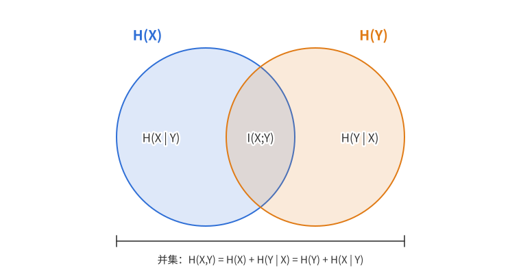
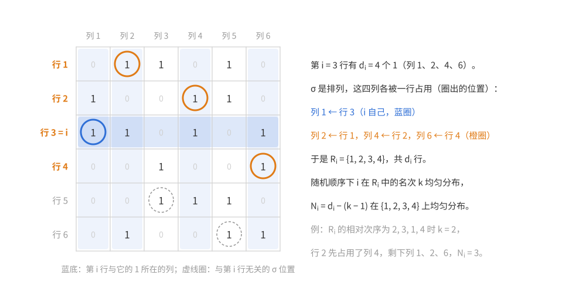
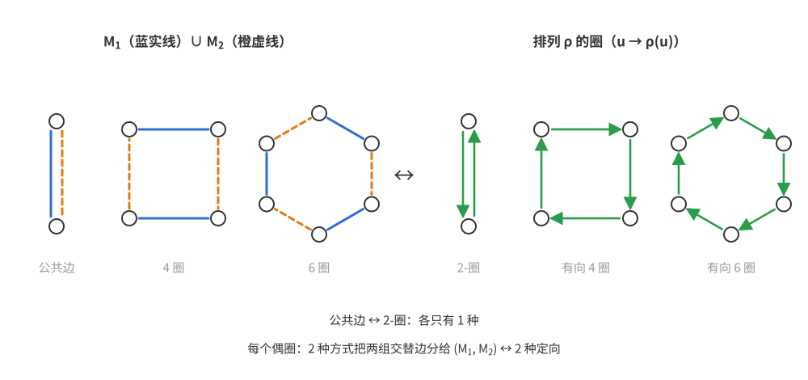
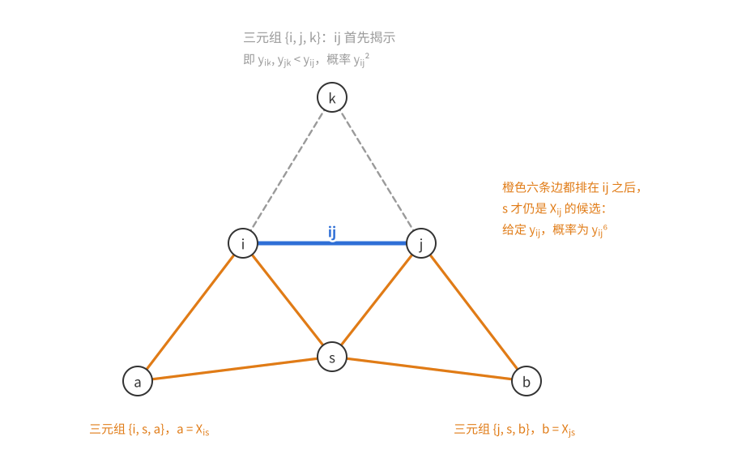
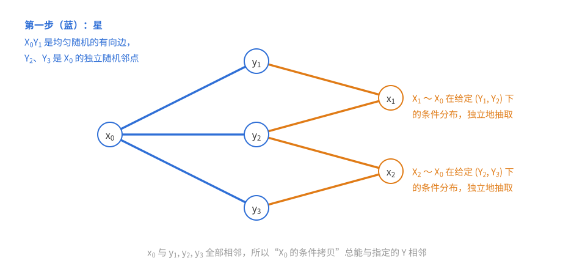
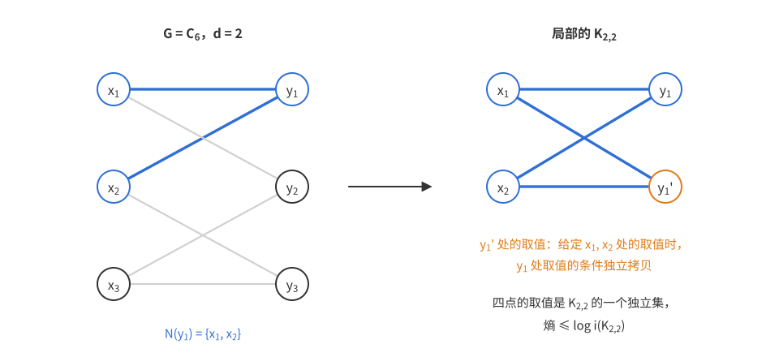
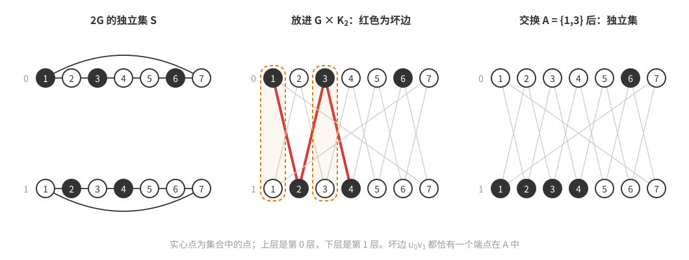
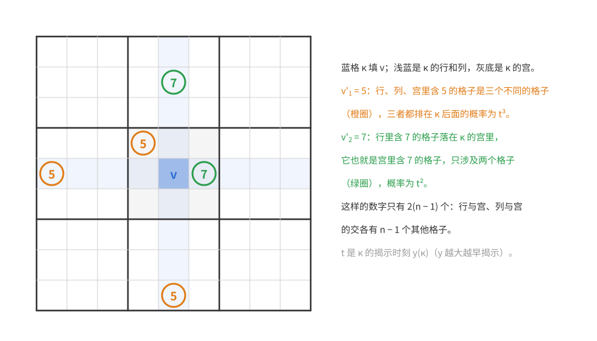
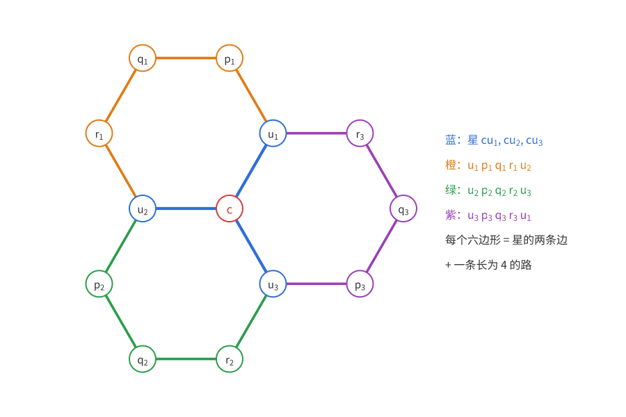

# 概率方法（十）：熵方法

上一篇：[第 9 章 测度集中](概率方法09——测度集中.md)　下一篇：[第 11 章 容器方法](概率方法11——容器方法.md)

前面各章的概率论证大多是这样的：设计一个随机对象，证明它以正概率是“好的”。本章换一个用法：**在要计数的集合上放均匀分布**，于是“集合有多大”变成了“这个随机变量有多少不确定性”，即它的**熵** $\log_2\lvert S\rvert$（10.1 节给出定义）。熵有一套很顺手的运算规则：链式法则把一个复杂对象的熵拆成逐步揭示时每一步的熵；次可加性说整体的不确定性不超过各部分之和；丢掉条件只会增加熵。每一条规则翻译回计数，都是一个不平凡的不等式。

用这种方式，本章证明四类结果。第一，二项系数之和的经典上界，作为热身。第二，**Brégman 定理**：若 0-1 矩阵的第 $i$ 行有 $d_i$ 个 1，则它的积和式（二部图的完美匹配数）至多是 $\prod_i(d_i!)^{1/d_i}$；它的熵证明把“逐行选择”的顺序随机化，是本章最漂亮的论证。同样的思路给出 **Steiner 三元系**个数的上界。第三，**Sidorenko 不等式**：在这里熵是反过来用的——构造一个熵很大的随机同态，从而证明同态**至少**有那么多。第四，**Shearer 引理**：一个集合的“投影”能控制它的大小，它推出 Loomis–Whitney 不等式、相交图族的上界，以及正则图中独立集个数的上界（Kahn、Zhao）。

和前几章相比，这里没有“小概率事件”，也没有集中不等式；全部论证都是精确的不等式链，常数往往是最优的。

**约定**　本章中 $\log$ 一律以 2 为底，自然对数写 $\ln$。随机变量都是离散的、取有限多个值。

**本章读法。**

- 首读主线：[10.1 节](#101-基本性质)的基本性质与定理 10.6 的熵证明；[Brégman 定理](#brégman-定理)的随机顺序证明；Sidorenko 不等式的[证明思路](#用熵证明下界思路)与定理 10.16–10.18；Shearer 引理（定理 10.20、10.23）与[定理 10.27 的二部情形](#二部的情形kahn)。
- 可以二读：上面以外的内容，其中 [Steiner 三元系](#steiner-三元系)（定理 10.14）是随机顺序论证的连续版本，计算较长，习题 4 沿用它的方法；标明“研究背景”的评注首读可以跳过。
- 与其他章的联系：[第 11 章 11.2 节](概率方法11——容器方法.md#迭代与超饱和正则图的独立集)用容器方法重新数正则图的独立集，得到定理 10.27 的一个较弱、但方法更有弹性的版本，可与本章的熵证明对照。

## 10.1 基本性质

### 熵的定义

**定义（熵）**　设离散随机变量 $X$ 取值于集合 $S$，$p_s=\mathbb P(X=s)$。$X$ 的**熵**（以 2 为底时，熵的单位是比特）是
$$H(X)=\sum_{s\in S}p_s\log\frac1{p_s},$$
约定 $p_s=0$ 的项为 0（这与 $\lim_{p\to0^+}p\log\frac1p=0$ 一致）。

注意 $H(X)$ 只依赖于 $X$ 的**分布**，与 $X$ 取什么值无关：把 $X$ 的值一一地换个名字，熵不变。

**例。** $X$ 在 $2^k$ 个值上均匀分布时，$H(X)=k$：要确定 $X$，恰好需要 $k$ 个二进制位。一枚公平硬币的熵是 1；一枚以概率 $0.9$ 出正面的硬币，熵约 $0.47$，不确定性小得多。$X$ 是常数时 $H(X)=0$。

**对数的底。** 换用别的底（比如自然对数）也可以，只要始终如一：换底只把所有熵乘上同一个常数，本章的所有不等式都是齐次的，不受影响。组合中偏爱以 2 为底，因为这时熵的单位是“比特”。（也有少数结果对底数敏感，例如本章不讲的 Pinsker 不等式。）

**信息论的解释。** 直观上，$H(X)$ 度量 $X$ 的随机性中含有多少“意外”，也可以理解为看到 $X$ 的值时获得的信息量。严格的版本是 Shannon 的信源编码定理：对 $X$ 的 $n$ 个独立同分布副本编码，最优无损前缀码（没有一个码字是另一个码字的前缀的编码，见习题 3）的期望长度介于 $nH(X)$ 与 $nH(X)+1$ 比特之间，即平均每个副本约需 $H(X)$ 比特。本章不用这个定理，但下面每条性质都有对应的信息论读法，记住读法比记住证明更有用——在组合问题里，我们往往是先按信息的直觉猜出一个不等式链，再逐条用这些性质验证。

### 均匀分布的熵最大

**引理 10.1（均匀上界）**　$H(X)\le\log\lvert\operatorname{supp}X\rvert$，等号当且仅当 $X$ 在其支撑上均匀分布。

*证明*　$f(x)=x\log\frac1x$ 在 $[0,1]$ 上严格凹（$f''(x)=-\frac1{x\ln2}<0$）。记 $S=\operatorname{supp}X$，由 Jensen 不等式
$$H(X)=\sum_{s\in S}f(p_s)=\lvert S\rvert\cdot\frac1{\lvert S\rvert}\sum_{s\in S}f(p_s)\le\lvert S\rvert\,f\Big(\frac1{\lvert S\rvert}\sum_{s\in S}p_s\Big)=\lvert S\rvert f\Big(\frac1{\lvert S\rvert}\Big)=\log\lvert S\rvert.$$
由严格凹性，等号当且仅当所有 $p_s$ 相等。$\square$

这条引理是本章计数论证的**出发点**：若 $X$ 在有限集 $S$ 上均匀分布，则 $\log\lvert S\rvert=H(X)$。于是要证 $\lvert S\rvert\le N$，只需证 $H(X)\le\log N$；要证 $\lvert S\rvert\ge N$，只需在 $S$ 上找**某个**分布（未必均匀）使其熵至少 $\log N$，因为任何支撑在 $S$ 上的分布熵都不超过 $\log\lvert S\rvert$。

### 联合熵与独立性

$(X,Y)$ 本身是一个随机变量，它的熵记作 $H(X,Y)$，称为**联合熵**：
$$H(X,Y)=\sum_{(x,y)}\mathbb P(X=x,Y=y)\log\frac1{\mathbb P(X=x,Y=y)}.$$
类似地有 $H(X_1,\dots,X_n)$。

**引理 10.2（独立性）**　若 $X,Y$ 独立，则 $H(X,Y)=H(X)+H(Y)$。

*证明*　记 $p_x=\mathbb P(X=x)$，$p_y=\mathbb P(Y=y)$，独立性给出联合概率 $p_xp_y$，于是
$$H(X,Y)=\sum_{x,y}p_xp_y\Big(\log\frac1{p_x}+\log\frac1{p_y}\Big)=\sum_xp_x\log\frac1{p_x}+\sum_yp_y\log\frac1{p_y}=H(X)+H(Y).\qquad\square$$

读法：两个毫无关联的变量，信息量相加。

### 条件熵

**定义（条件熵）**　对联合分布的 $X,Y$，
$$H(X\mid Y)=\mathbb E_y\big[H(X\mid Y=y)\big]=\sum_y\mathbb P(Y=y)\sum_x\mathbb P(X=x\mid Y=y)\log\frac1{\mathbb P(X=x\mid Y=y)},$$
其中 $H(X\mid Y=y)$ 是 $X$ 在条件分布 $\mathbb P(\cdot\mid Y=y)$ 下的熵，$x,y$ 分别取遍 $X,Y$ 的支撑。

读法：已经知道 $Y$ 之后，$X$ 还剩多少不确定性。注意它是**对 $y$ 取平均**的结果：对个别的 $y$，$H(X\mid Y=y)$ 可以比 $H(X)$ 大（例如 $Y=0$ 的概率很小，但一旦 $Y=0$，$X$ 就变得非常随机），只是平均起来不会（引理 10.5）。

几个特殊情形，都直接从定义得出：

- **$X=f(Y)$**（包括 $X=Y$）时 $H(X\mid Y)=0$：给定 $Y=y$，$X$ 的条件分布集中在一点 $f(y)$ 上，熵为 0。
- **$X,Y$ 独立**时 $H(X\mid Y)=H(X)$：每个条件分布 $\mathbb P(X=\cdot\mid Y=y)$ 都等于 $X$ 的分布。
- **$X,Y$ 在给定 $Z$ 时条件独立**（即对每个 $z$，在条件分布 $\mathbb P(\cdot\mid Z=z)$ 下 $X,Y$ 独立）时，
$$H(X,Y\mid Z)=H(X\mid Z)+H(Y\mid Z),\qquad H(X\mid Y,Z)=H(X\mid Z).$$
前者：对每个 $z$，在条件分布 $\mathbb P(\cdot\mid Z=z)$ 下 $X,Y$ 独立，由引理 10.2 得 $H(X,Y\mid Z=z)=H(X\mid Z=z)+H(Y\mid Z=z)$，再对 $z$ 取平均。后者：$X$ 在给定 $Y=y,Z=z$ 下的条件分布就是给定 $Z=z$ 下的条件分布，所以 $H(X\mid Y=y,Z=z)=H(X\mid Z=z)$，再对 $(y,z)$ 取平均。

还有一个本章反复使用的推论：若给定 $Y=y$ 时 $X$ 至多有 $N(y)$ 个可能取值，则由引理 10.1，对每个 $y$ 有 $H(X\mid Y=y)\le\log N(y)$，再对 $y$ 取平均，
$$H(X\mid Y)\le\mathbb E_y\big[\log N(y)\big].\tag{10.1}$$

### 链式法则

**引理 10.3（链式法则）**　$H(X,Y)=H(X)+H(Y\mid X)$。

*证明*　记 $p(x,y)=\mathbb P(X=x,Y=y)$，$p(x)$、$p(y\mid x)$ 类似。由 $p(x,y)=p(x)\,p(y\mid x)$，
$$H(Y\mid X)=\sum_xp(x)\sum_yp(y\mid x)\log\frac1{p(y\mid x)}=\sum_{x,y}p(x,y)\log\frac{p(x)}{p(x,y)}=H(X,Y)-H(X).\qquad\square$$

读法：先看到 $X$，再看到 $Y$；总的信息量等于 $X$ 的信息量加上 $Y$ 中**新**的信息量。

反复使用（并在每一步对前面的变量取条件），得到一般形式
$$H(X_1,\dots,X_n)=H(X_1)+H(X_2\mid X_1)+\cdots+H(X_n\mid X_1,\dots,X_{n-1}).\tag{10.2}$$
所有式子都可以整体加上条件：$H(X,Y\mid Z)=H(X\mid Z)+H(Y\mid X,Z)$，证明相同（对每个 $Z=z$ 应用引理 10.3 再取平均）。

(10.2) 是本章最重要的工具。它对应着计数中“逐步选择”的乘法原理：若一个对象可以分 $n$ 步确定，第 $i$ 步在前面已定的情况下有 $N_i$ 种选择，则对象至多有 $\prod N_i$ 个。熵的版本更强：它允许第 $i$ 步的选择数 $N_i$ **依赖于前面的选择**，并且只需要控制 $\log N_i$ 的**平均值**——这正是 Brégman 定理证明的关键。

### 次可加性与互信息

**引理 10.4（次可加性）**　$H(X,Y)\le H(X)+H(Y)$；更一般地，$H(X_1,\dots,X_n)\le H(X_1)+\cdots+H(X_n)$。

*证明*　$f(t)=\log\frac1t$ 在 $(0,\infty)$ 上严格凸。只对 $p(x,y)>0$ 的 $(x,y)$ 求和，
$$H(X)+H(Y)-H(X,Y)=\sum_{x,y}p(x,y)\log\frac{p(x,y)}{p(x)p(y)}=\sum_{x,y}p(x,y)\,f\Big(\frac{p(x)p(y)}{p(x,y)}\Big)\ge f\Big(\sum_{x,y}p(x)p(y)\Big)\ge f(1)=0.$$
第一个不等号是 Jensen（权重 $p(x,y)$ 之和为 1）；第二个是因为 $\sum_{p(x,y)>0}p(x)p(y)\le1$，而 $f$ 递减。$n$ 个变量时反复使用两个变量的情形：
$$H(X_1,\dots,X_n)\le H(X_1,\dots,X_{n-1})+H(X_n)\le\cdots\le H(X_1)+\cdots+H(X_n).\qquad\square$$

从证明中还能读出等号条件：两处等号同时成立，当且仅当 $p(x,y)=p(x)p(y)$ 处处成立，即 $X,Y$ 独立。

**评注（互信息）**　非负的量
$$I(X;Y)=H(X)+H(Y)-H(X,Y)$$
称为 $X$ 与 $Y$ 的**互信息**，度量两者共有的信息。由链式法则，$I(X;Y)=H(X)-H(X\mid Y)=H(Y)-H(Y\mid X)$。下图把这几个量画成“信息的面积”：两个圆分别是 $H(X)$、$H(Y)$，并集是 $H(X,Y)$，交集是 $I(X;Y)$，各自独有的部分是条件熵。（三个及以上变量时，这种图里的“面积”可以是负的，只能当作记忆辅助。）

### 丢掉条件

**引理 10.5（丢掉条件不减熵）**　$H(X\mid Y)\le H(X)$；更一般地，$H(X\mid Y,Z)\le H(X\mid Z)$。

*证明*　由链式法则和次可加性，$H(X\mid Y)=H(X,Y)-H(Y)\le H(X)$。

对第二个不等式，固定 $z$，在条件概率 $\mathbb P(\cdot\mid Z=z)$ 下应用刚证的结论：
$$H(X\mid Y,Z=z)\le H(X\mid Z=z),$$
这里左边是在条件分布 $\mathbb P(\cdot\mid Z=z)$ 下 $X$ 关于 $Y$ 的条件熵。按定义 $H(X\mid Y,Z)=\sum_z\mathbb P(Z=z)H(X\mid Y,Z=z)$，对 $z$ 取平均即得 $H(X\mid Y,Z)\le H(X\mid Z)$。$\square$

读法：多知道一些东西，平均而言只会让剩下的不确定性变少。结合 (10.2)，可以把链式法则中的每一项 $H(X_i\mid X_1,\dots,X_{i-1})$ 换成 $H(X_i\mid\text{其中一部分变量})$，得到一个**上界**——Shearer 引理就是这样来的。

**评注（数据处理不等式）**　对任何函数 $f$，$H(X\mid f(Y))\ge H(X\mid Y)$：把 $Y$ 加工成 $f(Y)$ 只会丢失信息。证明：$f(Y)$ 是 $Y$ 的函数，$(Y,f(Y))$ 与 $Y$ 互相确定，条件化在两者上是一回事，所以由引理 10.5，
$$H(X\mid f(Y))\ge H(X\mid Y,f(Y))=H(X\mid Y).$$
更一般地，$f$ 可以是随机的：若 $X\to Y\to Z$ 构成 Markov 链（即给定 $Y$ 时 $X,Z$ 条件独立），则 $H(X\mid Z)\ge H(X\mid Y)$。证明：由引理 10.5 和条件独立时的特殊情形，
$$H(X\mid Z)\ge H(X\mid Y,Z)=H(X\mid Y).$$

### 热身：二项系数之和

记 Bernoulli 变量的熵为
$$h(p)=H(\mathrm{Bernoulli}(p))=p\log\frac1p+(1-p)\log\frac1{1-p}.$$
（用小写的 $h$，以免与随机变量的熵 $H(X)$ 混淆。）$h(p)$ 在 $[0,1]$ 上凹，关于 $\frac12$ 对称，在 $[0,\frac12]$ 上从 0 递增到 $h(\frac12)=1$。

**定理 10.6**　若 $0<k\le n/2$，则
$$\sum_{0\le i\le k}\binom ni\le2^{h(k/n)\,n}=\Big(\frac nk\Big)^k\Big(\frac n{n-k}\Big)^{n-k}.$$

右边的等式只是展开：$2^{nh(k/n)}=2^{k\log\frac nk+(n-k)\log\frac n{n-k}}$。

**先看 Chernoff 式的证明。** 第 5 章（[Chernoff 界的证明](<概率方法05——Chernoff 界.md#定理与证明>)）的套路是对矩母函数用 Markov 不等式。这里的对应物是：对 $x\in(0,1]$，
$$\sum_{i\le k}\binom ni\le\sum_{i\le k}\binom ni x^{i-k}\le\sum_{i=0}^n\binom nix^{i-k}=\frac{(1+x)^n}{x^k},$$
第一步因为 $i\le k$ 时 $x^{i-k}\ge1$。再对 $x$ 优化：$\frac{d}{dx}\big[n\ln(1+x)-k\ln x\big]=\frac n{1+x}-\frac kx=0$ 给出 $x=\frac k{n-k}$，它在 $(0,1]$ 内正是因为 $k\le n/2$。代入，
$$\frac{(1+x)^n}{x^k}=\Big(\frac n{n-k}\Big)^n\Big(\frac{n-k}k\Big)^k=\Big(\frac nk\Big)^k\Big(\frac n{n-k}\Big)^{n-k}.$$
这就证明了定理。下面用熵再证一次，作为本节工具的练习。

**熵的证明是怎样想到的。** 要给一个集合的大小定上界，按引理 10.1 之后说的出发点，在集合上放均匀分布，再把它的熵拆开。集合是 $\{x\in\{0,1\}^n:\lvert x\rvert\le k\}$（$\lvert x\rvert$ 是 1 的个数），它的元素是 $n$ 个坐标，最朴素的拆法是次可加性：整体熵不超过每个坐标的熵之和。每个坐标是一个 Bernoulli 变量，熵为 $h(\mathbb P(X_i=1))$；而“1 的个数不超过 $k$”使每个坐标取 1 的概率不超过 $k/n$。$h$ 在 $[0,\frac12]$ 上递增，于是每项至多 $h(k/n)$。

*证明*　设 $(X_1,\dots,X_n)$ 在 $\{x\in\{0,1\}^n:\lvert x\rvert\le k\}$ 上均匀分布。由引理 10.1 和 10.4，
$$\log\sum_{i\le k}\binom ni=H(X_1,\dots,X_n)\le H(X_1)+\cdots+H(X_n).$$
集合在坐标置换下不变，所以各 $X_i$ 同分布，记 $q=\mathbb P(X_i=1)$。由对称性
$$q=\frac1n\sum_{j=1}^n\mathbb P(X_j=1)=\frac1n\,\mathbb E\big[X_1+\cdots+X_n\big]\le\frac kn\le\frac12.$$
$h$ 在 $[0,\frac12]$ 上递增，所以 $H(X_i)=h(q)\le h(k/n)$，相加即得。$\square$

**评注（相对熵与二项分布的尾）**　这一段到本节末是进阶内容，首读可跳过，本章后面不再用到。上面的证明可以推广到任意 $p$ 的二项分布。记 Bernoulli 分布之间的**相对熵**（Kullback–Leibler 散度）
$$D(q\,\|\,p)=q\ln\frac qp+(1-q)\ln\frac{1-q}{1-p}\qquad(\text{这里用自然对数}).$$
对 $X\sim\mathrm{Bin}(n,p)$，
$$\frac1n\ln\mathbb P(X\le nq)\le-D(q\,\|\,p)\quad(0\le q\le p),\qquad\frac1n\ln\mathbb P(X\ge nq)\le-D(q\,\|\,p)\quad(p\le q\le1).$$
定理 10.6 是 $p=\frac12$ 的下尾：此时 $\mathbb P(X\le k)=2^{-n}\sum_{i\le k}\binom ni$，而 $D(q\,\|\,\frac12)=\ln2\cdot(1-h(q))$。

Chernoff 式的证明与上面 $p=\frac12$ 的情形完全相同（第 5 章的套路）：对 $s\in(0,1]$，$\mathbb P(X\le nq)\le\mathbb E[s^{X-nq}]=\big((1-p+ps)s^{-q}\big)^n$，取 $s=\frac{q(1-p)}{p(1-q)}$（$q\le p$ 保证 $s\le1$），化简即得 $e^{-nD(q\|p)}$；上尾对 $n-X$ 用下尾的结论。下面给出熵的证明，它才是本节的主题。

*熵的证明*（推广上面定理 10.6 的熵证明）。设 $\mu$ 是 $\{0,1\}^n$ 上的乘积 Bernoulli$(p)$ 分布，$A=\{x:\lvert x\rvert\le nq\}$，$X=(X_1,\dots,X_n)$ 服从 $\mu$ 在 $A$ 上的条件分布 $\nu=\mu(\cdot\mid A)$。证明的思路是：先把 $\ln\frac1{\mu(A)}$ 精确地写成熵的表达式，再用次可加性把它拆成 $n$ 个坐标上的相对熵，最后用凸性合并。

一方面，对 $x\in A$ 有 $\nu(x)=\mu(x)/\mu(A)$，即 $\frac{\nu(x)}{\mu(x)}$ 在 $A$ 上恒等于 $\frac1{\mu(A)}$，所以（自然对数的熵记作 $H_e$）
$$\ln\frac1{\mu(A)}=\mathbb E\Big[\ln\frac{\nu(X)}{\mu(X)}\Big]=-H_e(X)+\sum_{i=1}^n\mathbb E\Big[\ln\frac1{\mu_i(X_i)}\Big],$$
其中 $\mu_i$ 是 Bernoulli$(p)$，用到了 $\mu(x)=\prod\mu_i(x_i)$。另一方面由次可加性 $H_e(X)\le\sum_iH_e(X_i)$。设 $X_i\sim$ Bernoulli$(q_i)$，则
$$-H_e(X_i)+\mathbb E\Big[\ln\frac1{\mu_i(X_i)}\Big]=q_i\ln\frac{q_i}p+(1-q_i)\ln\frac{1-q_i}{1-p}=D(q_i\,\|\,p).$$
所以 $\ln\frac1{\mu(A)}\ge\sum_iD(q_i\,\|\,p)$。最后，$\frac1n\sum q_i=\frac1n\mathbb E\lvert X\rvert\le q$，而 $D(\cdot\,\|\,p)$ 是凸函数（二阶导数 $\frac1t+\frac1{1-t}>0$），在 $[0,p]$ 上递减（导数 $\ln\frac{t(1-p)}{p(1-t)}\le0$），由 Jensen
$$\sum_iD(q_i\,\|\,p)\ge nD\Big(\frac1n\sum q_i\,\Big\|\,p\Big)\ge nD(q\,\|\,p).$$
即 $\mathbb P(X\le nq)=\mu(A)\le e^{-nD(q\|p)}$。$p=\frac12$ 时 $\mu$ 是均匀分布，第一步就是 $\log\lvert A\rvert=H(X)$，这正是定理 10.6 的证明。$\square$

这个界在指数上是最优的：由 Stirling 公式，$\mathbb P(X=\lfloor nq\rfloor)=e^{-nD(q\|p)+O(\log n)}$。与第 5 章的 $e^{-a^2/(2n)}$ 型界相比，相对熵形式在 $q$ 远离 $p$ 时精确得多；在 $q$ 接近 $p$ 时，$D(q\,\|\,p)\approx\frac{(q-p)^2}{2p(1-p)}$，回到高斯型的界。

## 10.2 积和式、完美匹配与 Steiner 三元系

### 积和式

$n\times n$ 矩阵 $A=(a_{ij})$ 的**积和式**是
$$\operatorname{per}A=\sum_{\sigma\in S_n}\prod_{i=1}^na_{i\sigma(i)},$$
也就是行列式 $\det A=\sum_\sigma\operatorname{sgn}(\sigma)\prod_ia_{i\sigma(i)}$ 去掉符号。行列式有消元法，可以快速计算；积和式没有，计算 0-1 矩阵的积和式是 #P 完全问题（Valiant 1979；粗略地说，它和数出任何一个 NP 问题的解的个数一样难，一般认为没有多项式时间算法）。所以“积和式至多多大”这类不等式就格外有价值。

我们只考虑 0-1 矩阵。若 $A$ 是二部图 $G$（左右各 $n$ 个点）的**二部邻接矩阵**（$a_{ij}=1$ 当且仅当左边第 $i$ 点与右边第 $j$ 点相邻），则 $\prod_ia_{i\sigma(i)}=1$ 恰好说明 $\{i\,\sigma(i)\}$ 是一个完美匹配，于是
$$\operatorname{per}A=G\text{ 的完美匹配个数}.$$

### Brégman 定理

**问题。** 已知每一行有多少个 1，积和式最大能有多大？等价地，左侧各点度数给定的二部图，最多有多少个完美匹配？

最朴素的估计：逐行选列，第 $i$ 行至多 $d_i$ 种选法，所以 $\operatorname{per}A\le\prod_id_i$。这个界很弱。看最大的例子：$A=J_d$（全 1 的 $d\times d$ 矩阵），$\operatorname{per}J_d=d!$，而朴素界是 $d^d$，差了约 $e^d$ 倍。原因很清楚：第一行确实有 $d$ 种选择，但第二行只剩 $d-1$ 种，……，最后一行只剩 1 种。

Minc（1963）猜想、Brégman（1973）证明了正确的答案：

**定理 10.7（Brégman–Minc 不等式）**　设 $A\in\{0,1\}^{n\times n}$ 的第 $i$ 行有 $d_i\ge1$ 个 1，则
$$\operatorname{per}A\le\prod_{i=1}^n(d_i!)^{1/d_i}.$$

（若某行全为 0，则 $\operatorname{per}A=0$，没有什么可证的；右边的 $(0!)^{1/0}$ 也没有意义，所以定理只对各行非零的矩阵陈述。）

等号在 $A$ 是若干全 1 方块沿对角排列时成立（对应二部图 $K_{d_1,d_1}\sqcup\cdots\sqcup K_{d_t,d_t}$）：一个 $d\times d$ 的全 1 块贡献 $d$ 行，每行因子 $(d!)^{1/d}$，合起来恰为 $d!=\operatorname{per}J_d$。由 Stirling 公式 $(d!)^{1/d}\sim d/e$，所以 Brégman 界比朴素界大约每行少了一个因子 $e$。

#### 证明是怎样想到的

按 10.1 节的出发点：设 $\sigma$ 在所有满足 $a_{i\sigma(i)}=1$（$\forall i$）的排列中均匀随机，则 $\log\operatorname{per}A=H(\sigma)=H(\sigma(1),\dots,\sigma(n))$。按行的顺序用链式法则 (10.2)：
$$H(\sigma)=H(\sigma(1))+H(\sigma(2)\mid\sigma(1))+\cdots+H(\sigma(n)\mid\sigma(1),\dots,\sigma(n-1)).$$
若把每一项都放大成 $H(\sigma(i))\le\log d_i$，就回到了朴素界——这一步扔掉了“前面的行已经占用了一些列”这个信息。

不扔掉它。在 (10.1) 的意义下，$H(\sigma(i)\mid\sigma(1),\dots,\sigma(i-1))\le\mathbb E\log N_i$，其中 $N_i$ 是第 $i$ 行中**还没有被前面的行占用的列**里 1 的个数。问题变成：怎样让 $\mathbb E\log N_i$ 恰好是 $\frac{\log(d_i!)}{d_i}$？

**目标的形状给出了答案。** $\frac{\log(d_i!)}{d_i}=\frac1{d_i}(\log1+\log2+\cdots+\log d_i)$，这正是 $N_i$ 在 $\{1,\dots,d_i\}$ 上均匀分布时 $\mathbb E\log N_i$ 的值；换句话说，$(d!)^{1/d}$ 是 $1,2,\dots,d$ 的**几何平均**。在 $J_d$ 上按顺序揭示，第 $1,2,\dots,d$ 行看到的 $N_i$ 依次是 $d,d-1,\dots,1$，每个值各出现一次，所以没有损失。于是希望：对一般的矩阵，每一行看到的 $N_i$ 也“均匀地”取遍 $1,\dots,d_i$。

**$N_i$ 由什么决定？** 第 $i$ 行的 $d_i$ 个 1 所在的列，各被 $\sigma$ 中的某一行占用；这 $d_i$ 行（含 $i$ 自己）是 $i$ 的“竞争者”，而
$$N_i=d_i-(\text{排在 }i\text{ 前面的竞争者个数}).$$
按固定的行顺序，$i$ 在竞争者中排第几取决于 $\sigma$ 和矩阵的其余部分，无法控制。但要让 $N_i$ 均匀，只需 $i$ 在竞争者中的**名次**均匀；对固定的 $\sigma$，只要揭示各行的顺序是均匀随机的，这就自动成立。而链式法则对每种顺序都成立，对顺序取平均不付任何代价。这就是 Radhakrishnan（1997）的随机顺序论证，下面的第三步是这段话的严格化。

#### 证明

**定理 10.7 的证明**　若 $\operatorname{per}A=0$，右边为正，结论平凡。下设 $\operatorname{per}A>0$，这样满足条件的排列存在，均匀随机的 $\sigma$ 才有定义。设 $\sigma$ 如上。再取 $[n]$ 的一个排列 $\tau$，把它看作揭示各行的顺序：$\tau(j)<\tau(i)$ 时说“$j$ 排在 $i$ 前面”。定义
$$N_i=N_i(\sigma,\tau)=\#\{c:\ a_{ic}=1,\ \text{且 }c\ne\sigma(j)\text{ 对所有排在 }i\text{ 前面的 }j\}.$$
直观上，$N_i$ 是揭示 $\sigma(i)$ 之前它“贪心地看来”还有几种选择。

*第一步：固定顺序 $\tau$。* 按 $\tau$ 的顺序用链式法则，
$$H(\sigma)=\sum_{i=1}^nH\big(\sigma(i)\,\big|\,\sigma(j):j\text{ 排在 }i\text{ 前面}\big).$$
给定排在前面的那些 $\sigma(j)$，$\sigma(i)$ 只能是第 $i$ 行中未被占用的列之一，至多 $N_i$ 种可能，而 $N_i$ 由这些 $\sigma(j)$ 决定。由 (10.1)，
$$H\big(\sigma(i)\,\big|\,\sigma(j):j\text{ 排在 }i\text{ 前面}\big)\le\mathbb E_\sigma\log N_i(\sigma,\tau).$$

*第二步：对顺序取平均。* 上面对每个 $\tau$ 都成立。让 $\tau$ 在 $S_n$ 上均匀随机（与 $\sigma$ 独立），取平均：
$$H(\sigma)\le\sum_{i=1}^n\mathbb E_{\sigma,\tau}\log N_i.$$

*第三步：对固定的 $\sigma$，$N_i$ 在 $\{1,\dots,d_i\}$ 上均匀分布。* 设第 $i$ 行的 1 位于列 $c_1,\dots,c_{d_i}$。$\sigma$ 是排列，每一列恰被一行占用：列 $c_r$ 被第 $\sigma^{-1}(c_r)$ 行占用。这样得到 $d_i$ 个互不相同的行
$$R_i=\{\sigma^{-1}(c_1),\dots,\sigma^{-1}(c_{d_i})\},$$
其中一个是 $i$ 自己（因为 $\sigma(i)$ 是某个 $c_r$）。列 $c_r$ 在揭示第 $i$ 行时已被占用，当且仅当它的占用者 $\sigma^{-1}(c_r)\ne i$ 排在 $i$ 前面。所以
$$N_i=d_i-\#\{j\in R_i\setminus\{i\}:\ j\text{ 排在 }i\text{ 前面}\}.$$
$\tau$ 均匀随机时，$R_i$ 这 $d_i$ 行之间的相对顺序在 $d_i!$ 种中均匀分布，$i$ 在其中排第 $k$ 位的概率都是 $\frac1{d_i}$（$k=1,\dots,d_i$），此时 $N_i=d_i-(k-1)$。于是 $N_i$ 在 $\{1,\dots,d_i\}$ 上均匀分布，
$$\mathbb E_\tau\log N_i=\frac{\log1+\log2+\cdots+\log d_i}{d_i}=\frac{\log(d_i!)}{d_i}.$$

*第四步：合起来。* 这对每个 $\sigma$ 都成立，再对 $\sigma$ 取平均、对 $i$ 求和，
$$\log\operatorname{per}A=H(\sigma)\le\sum_{i=1}^n\frac{\log(d_i!)}{d_i}.\qquad\square$$

下图是第三步的一个例子：$d_i=4$，第 $i$ 行的四个 1 所在的列分别被 $R_i$ 中的四行占用（圈出的是 $\sigma$ 选中的位置）；在随机顺序下，$i$ 在这四行中排第几，$N_i$ 就是 4、3、2、1 中的哪一个。

**说明。** 第三步之所以成立，是因为 $\sigma$ 是**双射**：第 $i$ 行的每个 1 所在的列恰好对应一个竞争者行，竞争者互不重复。在随机顺序下，第 $i$ 行“平均”只有 $(d_i!)^{1/d_i}\approx d_i/e$ 种选择。

### 一般图的完美匹配

**推论 10.8（Kahn–Lovász）**　设图 $G$ 中顶点 $v$ 的度数为 $d_v$，$\operatorname{pm}(G)$ 是 $G$ 的完美匹配数，则
$$\operatorname{pm}(G)\le\prod_{v\in V(G)}(d_v!)^{1/(2d_v)}=\prod_{v\in V(G)}\operatorname{pm}(K_{d_v,d_v})^{1/(2d_v)}.$$

（若有度数为 0 的点，则 $\operatorname{pm}(G)=0$，不等式平凡，所以设各 $d_v\ge1$。）右边的写法说明：等号在 $G$ 是若干 $K_{d,d}$ 的不交并时成立。

**二部图的情形。** 设 $G$ 是二部图，两侧 $L,R$（若 $\lvert L\rvert\ne\lvert R\rvert$，$\operatorname{pm}(G)=0$）。以 $L$ 为行用定理 10.7，得 $\operatorname{pm}(G)\le\prod_{v\in L}(d_v!)^{1/d_v}$；以 $R$ 为行（即对转置矩阵）用定理 10.7，得 $\operatorname{pm}(G)\le\prod_{v\in R}(d_v!)^{1/d_v}$。两式相乘再开方即得。

**一般图的情形**（Alon–Friedland 2008）。思路是把 $G$ 变成二部图：$G$ 的**二部双覆盖** $G\times K_2$ 的顶点是 $(v,0),(v,1)$（$v\in V(G)$），$G$ 中每条边 $uv$ 对应 $G\times K_2$ 中的两条边 $(u,0)(v,1)$ 和 $(v,0)(u,1)$。它是二部图，每个 $(v,\epsilon)$ 的度数都是 $d_v$。若能证明 $\operatorname{pm}(G)^2\le\operatorname{pm}(G\times K_2)$，则由二部情形
$$\operatorname{pm}(G)^2\le\operatorname{pm}(G\times K_2)\le\prod_{v}\big((d_v!)^{1/(2d_v)}\big)^2,$$
开方即得。下面证明这个不等式。

**引理 10.9**　对任何图 $G$，$\operatorname{pm}(G)^2\le\operatorname{pm}(G\times K_2)$。

*证明*　思路是把两边都化成排列 $\rho$ 的计数。左边数的是完美匹配的有序对 $(M_1,M_2)$。右边：$G\times K_2$ 的完美匹配把每个 $(u,0)$ 配给某个 $(\rho(u),1)$，$\rho$ 是 $V$ 的排列，且 $u\rho(u)\in E(G)$；反之每个这样的排列给出一个完美匹配。把 $\rho$ 画成 $G$ 上的有向图（$u\to\rho(u)$），它是若干**不交的有向圈**，覆盖所有顶点，每个圈长度至少 2（$G$ 无自环），长度为 2 的圈 $u\to v\to u$ 表示 $u,v$ 互配。

给定 $(M_1,M_2)$，$M_1\cup M_2$（作为多重集）中每个顶点度数为 2，所以它分解为若干条**重边**（$M_1,M_2$ 的公共边）和若干个长度 $\ge4$ 的**偶圈**（边在 $M_1,M_2$ 之间交替）。设偶圈有 $c$ 个；给定这个“并”的结构，恰有 $2^c$ 个有序对 $(M_1,M_2)$ 产生它（每个偶圈有两种方式把交替的两组边分给 $M_1$、$M_2$）。另一方面，把每条重边看成 2-圈、把每个偶圈定一个方向，就得到一个上述的排列 $\rho$，每个偶圈有两个方向，恰好也是 $2^c$ 个。于是
$$\operatorname{pm}(G)^2=\#\{\rho:\ \rho\text{ 的所有圈长都是偶数}\}\le\#\{\rho\}=\operatorname{pm}(G\times K_2).\qquad\square$$

下图左边是 $M_1\cup M_2$ 的三种成分（一条公共边、一个 4 圈、一个 6 圈），右边是对应的排列 $\rho$ 的圈。公共边只对应一个 2-圈；每个偶圈有 2 种分给 $(M_1,M_2)$ 的方式，也恰有 2 种定向，这就是证明中的两个 $2^c$。

### 锦标赛中的哈密顿路

**问题**　$n$ 个顶点的锦标赛最多能有多少条有向哈密顿路？

[第 2 章 2.1 节](概率方法02——期望的线性性.md#21-锦标赛中的哈密顿路)用随机锦标赛证明了 Szele 的下界：存在锦标赛有至少 $n!/2^{n-1}$ 条哈密顿路，这是概率方法最早的应用。Alon 用 Brégman 定理证明了只差多项式因子的上界：

**定理 10.10（Alon 1990）**　每个 $n$ 个顶点的锦标赛至多有 $O\big(n^{3/2}\cdot n!/2^n\big)$ 条哈密顿路。

**评注**　这一段是研究背景，首读可跳过。上界已被改进到 $O(n^{3/2-\gamma}\,n!/2^n)$，$\gamma>0$ 是一个小常数（Friedgut–Kahn 2005）；下界 $n!/2^{n-1}$ 被改进了一个常数因子（Adler–Alon–Ross 2001，Wormald 2004）。截至 2024 年，两者之间 $n^{O(1)}$ 的差距仍未解决。2026 年 10 月，Divoux 和 Wang 的预印本《The maximum number of Hamiltonian cycles in tournaments》声称确定了渐近值：最大值为 $\big(\frac{\cosh1}{\cos1}+o(1)\big)\frac{n!}{2^{n-1}}\approx2.856\cdot\frac{n!}{2^{n-1}}$，即只比 Szele 下界大一个常数因子（该文的主结果其实是哈密顿圈：最大个数为 $\big(\frac{\cosh1}{\cos1}+o(1)\big)\frac{(n-1)!}{2^n}$，与 Wormald 猜想的常数一致；哈密顿路的渐近式由它推出）。该文称证明最初由 AI 模型找到，尚未正式发表，也未经独立核实。

**怎样想到用积和式。** 哈密顿路不好直接对应到积和式，哈密顿**圈**却可以：设 $A$ 是锦标赛的邻接矩阵（$a_{ij}=1$ 当且仅当 $i\to j$），则 $\operatorname{per}A$ 数的是满足 $i\to\sigma(i)$（$\forall i$）的排列 $\sigma$，即用不交的有向圈覆盖全部顶点的方式（称为 **1-因子**）。每个哈密顿圈是一个 1-因子，所以哈密顿圈数 $\le\operatorname{per}A$，而 Brégman 定理只需要知道出度。于是先数圈，再把路变成圈。

**定理 10.11（Alon 1990）**　每个 $n$ 个顶点的锦标赛至多有 $O\big(\sqrt n\cdot n!/2^n\big)$ 个哈密顿圈。

*证明*　证明分三步：用 Brégman 定理把哈密顿圈数化成出度的函数；用磨光求这个函数在约束下的最大值；用 Stirling 公式估计最大值。

设 $d_i$ 是顶点 $i$ 的出度。若某个 $d_i=0$，没有哈密顿圈；下设 $d_i\ge1$。由定理 10.7，
$$\text{哈密顿圈数}\le\operatorname{per}A\le\prod_{i=1}^ng(d_i),\qquad g(x)=(x!)^{1/x}.$$
约束只有 $\sum_id_i=\binom n2$（每条边贡献一个出度）。下面的引理 10.12 说 $\log g$ 是凹的，于是**磨光**：若有 $d_i\ge d_j+2$，把它们换成 $d_i-1,d_j+1$，乘积不减。这等价于
$$\log g(d_j+1)-\log g(d_j)\ge\log g(d_i)-\log g(d_i-1),$$
左边是 $\log g$ 在较小位置 $d_j$ 处的一步增量，右边是在较大位置 $d_i-1$（$\ge d_j+1$）处的一步增量，而凹函数的增量递减。反复磨光，最大值在所有 $d_i$ 两两相差至多 1 时取到，此时每个 $d_i\in\{\lfloor\frac{n-1}2\rfloor,\lceil\frac{n-1}2\rceil\}$。

以 $n$ 为奇数为例，所有 $d_i=d=\frac{n-1}2$，由 Stirling 公式 $\ln d!=d\ln d-d+\frac12\ln(2\pi d)+O(\frac1d)$，
$$\ln\prod_ig(d_i)=\frac nd\ln d!=n\ln d-n+\frac n{2d}\ln(2\pi d)+O\Big(\frac1n\Big)=n\ln\frac{n-1}{2e}+\ln(\pi n)+o(1),$$
这里用了 $\frac n{2d}=1+\frac1{n-1}$。又 $n\ln\frac{n-1}{n}\to-1$，所以 $\prod_ig(d_i)\sim\frac{\pi n}e\big(\frac n{2e}\big)^n$。与 $\frac{n!}{2^n}\sim\sqrt{2\pi n}\big(\frac n{2e}\big)^n$ 相比，比值 $\sim\frac1e\sqrt{\frac{\pi n}2}=O(\sqrt n)$。$n$ 为偶数时（一半的 $d_i$ 为 $\frac n2-1$，一半为 $\frac n2$）同样计算，得到同样的渐近式。$\square$

（数值上，$n=11,51,201,1001,4001$ 时，$\prod_ig(d_i)\big/\big(\sqrt n\,n!/2^n\big)$ 依次约为 $0.580,0.498,0.473,0.464,0.462$，趋于 $\sqrt{\pi/2}/e\approx0.461$。）

**引理 10.12**　$g(x)=(x!)^{1/x}$ 在正整数上是对数凹的：$g(n)g(n+2)\le g(n+1)^2$（$n\ge1$）。

注意不等号的方向：对数凹是 $\le$。例如 $g(1)g(3)=6^{1/3}\approx1.817<2=g(2)^2$。磨光需要的正是对数凹。

*证明*　$\ln g(n)=\frac1n\sum_{k=1}^n\ln k$ 是数列 $a_k=\ln k$ 的前 $n$ 项平均，记为 $A_n$。记 $\delta_j=a_{j+1}-a_j$，它关于 $j$ 递减（$\ln$ 是凹函数）。计算相邻平均之差：
$$A_{n+1}-A_n=\frac{a_{n+1}-A_n}{n+1}=\frac1{n(n+1)}\sum_{k=1}^n(a_{n+1}-a_k)=\frac1{n(n+1)}\sum_{k=1}^n\sum_{j=k}^n\delta_j=\frac1{n(n+1)}\sum_{j=1}^nj\,\delta_j.$$
因为 $\sum_{j=1}^nj=\frac{n(n+1)}2$，这说明 $A_{n+1}-A_n=\frac12\,\overline\delta_n$，其中 $\overline\delta_n$ 是 $\delta_1,\dots,\delta_n$ 以权重 $1,2,\dots,n$ 的加权平均。$\overline\delta_{n+1}$ 是在 $\overline\delta_n$ 的基础上再加入一项 $\delta_{n+1}$（权重 $n+1$），而 $\delta_{n+1}$ 不超过 $\delta_1,\dots,\delta_n$ 中的每一个，从而不超过它们的加权平均 $\overline\delta_n$，加入它只会把平均拉低：$\overline\delta_{n+1}\le\overline\delta_n$。所以 $A_{n+2}-A_{n+1}\le A_{n+1}-A_n$，即 $\ln g$ 凹。$\square$

**引理 10.13**　设 $n\ge2$。若 $n$ 个顶点的锦标赛有 $P$ 条哈密顿路，则可以加入一个新顶点，得到 $n+1$ 个顶点、至少有 $P/4$ 个哈密顿圈的锦标赛。

*证明*　加入新顶点 $v_0$，它与原有各点之间的边独立地随机定向。对原锦标赛的每条哈密顿路 $u_1\to\cdots\to u_n$，以概率 $\frac14$ 有 $u_n\to v_0$ 且 $v_0\to u_1$，此时得到哈密顿圈 $u_1\to\cdots\to u_n\to v_0\to u_1$。不同的路给出不同的圈（从圈中删去 $v_0$ 就还原出路）。由期望的线性性，哈密顿圈个数的期望至少 $P/4$，所以某种定向使它至少为 $P/4$。$\square$

**定理 10.10 的证明**　由引理 10.13 和定理 10.11，
$$\frac P4\le O\Big(\sqrt{n+1}\cdot\frac{(n+1)!}{2^{n+1}}\Big)=O\Big(n^{3/2}\cdot\frac{n!}{2^n}\Big).\qquad\square$$

这里损失的 $n$ 倍来自“由路到圈”：每个哈密顿圈可以从 $n$ 个位置断开成路。

### Steiner 三元系

**定义（Steiner 三元系）**　$n$ 阶 **Steiner 三元系**（STS）是 $n$ 个顶点上的 3 一致超图，使每对顶点恰好包含在一条边（三元组）中。等价地，它是把完全图 $K_n$ 分解成边不交的三角形的一种方式。

例：Fano 平面（[第 1 章 1.3 节](概率方法01——引论.md#13-超图的二染色)）是 7 阶 STS。

经典结果（Kirkman 1847）：$n$ 阶 STS 存在当且仅当 $n\equiv1$ 或 $3\pmod 6$。必要性不难：每个顶点 $v$ 所在的三元组把其余 $n-1$ 个点两两配对，所以 $n-1$ 是偶数；三角形分解要求边数 $\binom n2$ 被 3 整除，即 $n\equiv0,1\pmod3$；两者合起来是 $n\equiv1,3\pmod6$。充分性需要构造。Keevash（2014 年起）证明了更一般的**设计**（每 $t$ 个点恰好落在一个 $k$ 元块中的结构，STS 是 $t=2$、$k=3$ 的情形）的存在性，是一个重大突破。

**问题**　$n$ 个带标号的顶点上有多少个 STS？

**定理 10.14（Linial–Luria 2013）**　$n$ 个带标号顶点上的 Steiner 三元系个数至多为
$$\Big(\frac n{e^2+o(1)}\Big)^{n^2/6}.$$

**评注**　Keevash（2018）对 $n\equiv1,3\pmod 6$ 证明了匹配的下界，所以这个界在 $o(1)$ 意义下是准确的。

#### 怎样猜到这个公式

**启发一：假装各边独立。** 在 $K_n$ 中独立地随机选 $m=\frac13\binom n2$ 个三角形。每条边平均被 1 个三角形覆盖。由 Poisson 近似（覆盖一条固定边的三角形个数近似服从均值为 1 的 Poisson 分布，它取 1 的概率是 $e^{-1}$），一条固定的边恰被覆盖一次的概率约为 $1/e$。**假装**各边的这些事件独立（这当然不对），所有边都恰被覆盖一次的概率就是 $(1/e+o(1))^{\binom n2}$。选法共有 $\binom n3^m$ 种（有序），每个 STS 对应 $m!$ 种有序选法，于是猜测 STS 个数约为
$$\frac{\binom n3^m}{m!}e^{-\binom n2}=\Big(\frac{e\binom n3}m\Big)^m e^{-3m}\cdot e^{O(\log m)}=\big(e(n-2)\big)^me^{-3m}\,e^{O(\log n)}=\Big(\frac{n}{e^2+o(1)}\Big)^{n^2/6},$$
这里用了 $m!=(m/e)^me^{O(\log m)}$、$\binom n3/m=n-2$，以及 $m=\frac{n^2}6-\frac n6$ 中的 $-\frac n6$ 只贡献 $2^{O(n\log n)}=2^{o(n^2)}$。

**启发二：逐个删除三角形。** 从 $K_n$ 中一个一个地删去三角形。删去 $k$ 个之后，剩下 $\binom n2-3k$ 条边。**假装**剩下的边是随机分布的，边密度为 $1-3k/\binom n2$，则剩下的三角形约有
$$\binom n3\Big(1-\frac{3k}{\binom n2}\Big)^3\sim\frac{36}{n^3}\Big(\frac13\binom n2-k\Big)^3$$
个（$\binom n3\cdot\frac{27}{\binom n2^3}\approx\frac{n^3}6\cdot\frac{216}{n^6}$）。把它对 $0\le k<m$ 连乘（每一步可选的三角形数），再除以 $m!$（删除的顺序无关紧要），得到
$$\frac{(36/n^3)^m(m!)^3}{m!}=\Big(\frac{36}{n^3}\Big)^m(m!)^2\approx\Big(\frac{36}{n^3}\cdot\frac{m^2}{e^2}\Big)^m\approx\Big(\frac n{e^2}\Big)^{n^2/6}.$$
这个启发式可以变成真正的下界证明——随机删三角形的过程确实几乎能走到底，但要做大量工作（Keevash 2018）。

两个启发式都在说同一件事：熵上界之所以是准确的，是因为一个“典型”的 STS 看起来就像是随机挑出的三角形，各处的约束近似独立。

#### 证明是怎样想到的

目标是上面两个启发式猜出的 $(n/e^2)^{n^2/6}$：共有 $\frac{n^2}6$ 个三元组（主项），每个贡献一个约 $n/e^2$ 的因子。照 Brégman 定理的思路：把 STS 编码成一串“选择”，按**随机顺序**揭示，每一步用 (10.1) 控制可选的数目。

*编码。* 设 $X$ 是均匀随机的 STS（若 $n$ 阶 STS 不存在，上界平凡，下面设它存在）。对每条边 $ij$（$i\ne j$ 的无序对，即 $K_n$ 的边），记 $X_{ij}$ 为与 $i,j$ 同在一个三元组中的那个顶点。STS 由 $(X_{ij})_{ij}\in[n]^{\binom n2}$ 确定，$\log(\text{STS 个数})=H(X)=H\big((X_{ij})_{ij}\big)$。

*每个三元组被揭示了三次。* 三元组 $\{i,j,k\}$ 中，$X_{ij}=k$、$X_{ik}=j$、$X_{jk}=i$ 三个值互相决定。所以按任何顺序揭示时，每个三元组只有它**第一个**被揭示的边带来信息，后两条边的熵为 0。这正是“三元组个数 $\frac13\binom n2$”在证明中出现的方式。

*随机顺序取连续的形式。* 揭示顺序由独立均匀的 $y_{ij}\in[0,1]$ 决定：$y$ 越大越早揭示，即 $kl\prec ij$ 当且仅当 $y_{kl}>y_{ij}$。这与均匀随机排列等价，但好处是：给定 $y_{ij}$ 的值后，其余各边是否排在 $ij$ 后面是**独立**的事件，每个概率都是 $y_{ij}$（排在后面即 $y_{kl}<y_{ij}$；排在前面的概率是 $1-y_{ij}$）。这让后面的计算变成简单的乘积。把“$y$ 大”取作“早”，与直觉中的时间方向相反，正是为了让“排在 $ij$ 后面”的概率恰为 $y_{ij}$，这样下面的被积函数都是 $y_{ij}$ 的幂。

#### 证明

**定理 10.14 的证明**　对固定的 $y$（各分量互不相同，这以概率 1 成立），按 $\prec$ 的顺序用链式法则：
$$H(X)=\sum_{ij}H\big(X_{ij}\,\big|\,X_{kl}:kl\prec ij\big).$$
称一个三元组在揭示 $ij$ 时**已揭示**，若它的某条边 $kl\prec ij$。定义 $N_{ij}=N_{ij}(X,y)$ 如下：若 $ij$ 所在的三元组已揭示，令 $N_{ij}=1$（此时 $X_{ij}$ 已经确定）；否则令 $N_{ij}$ 为满足“边 $is$ 和 $js$ 都不在任何已揭示的三元组中”的 $s\in[n]\setminus\{i,j\}$ 的个数（$X_{ij}=s$ 要求 $is,js$ 与 $ij$ 同属一个尚未揭示的三元组）。两种情形下，$X_{ij}$ 在揭示前的可能取值都至多 $N_{ij}$ 个，而 $N_{ij}$ 由已揭示的值决定。由 (10.1)，
$$H(X)\le\sum_{ij}\mathbb E_X\log N_{ij}.$$
这对每个 $y$ 都成立，所以让 $y$ 均匀随机并取平均，
$$H(X)\le\sum_{ij}\mathbb E_X\mathbb E_y\log N_{ij}.$$

下面固定 $X$ 和一条边 $ij$，设 $k=X_{ij}$，估计 $\mathbb E_y\log N_{ij}$。分四步：(i) 把 $ij$ 不是首个揭示的情形去掉，并用 Jensen 把 $\log$ 移到期望外面；(ii) 用独立性估计 $N_{ij}$ 的条件期望；(iii) 对 $y_{ij}$ 积分；(iv) 对所有边求和。先固定 $y_{ij}$，对其余的 $y_{-ij}$ 取期望；给定 $y_{ij}$，其余各边“排在 $ij$ 后面”是独立事件，各有概率 $y_{ij}$。

*(i) $ij$ 是否是它所在三元组中第一个揭示的边。* 称 $ij$ **首先揭示**，若 $ij\prec ik$ 且 $ij\prec jk$，即 $y_{ik},y_{jk}<y_{ij}$，
$$\mathbb P_{y_{-ij}}(ij\text{ 首先揭示})=y_{ij}^2.$$
若 $ij$ 不是首先揭示，则三元组 $\{i,j,k\}$ 已揭示，按定义 $N_{ij}=1$，于是 $\log N_{ij}=0$，
$$\mathbb E_{y_{-ij}}\log N_{ij}=y_{ij}^2\,\mathbb E_{y_{-ij}}\big[\log N_{ij}\,\big|\,ij\text{ 首先揭示}\big]\le y_{ij}^2\log\mathbb E_{y_{-ij}}\big[N_{ij}\,\big|\,ij\text{ 首先揭示}\big],$$
最后一步是 Jensen（$\log$ 凹）。

*(ii) 估计条件期望。* 在 $ij$ 首先揭示时，$s=k$ 总是计入 $N_{ij}$（$ik,jk$ 所在的三元组 $\{i,j,k\}$ 尚未揭示）。对 $s\notin\{i,j,k\}$，设 $a=X_{is}$，$b=X_{js}$，即 $is$ 在三元组 $\{i,s,a\}$ 中、$js$ 在三元组 $\{j,s,b\}$ 中。$s$ 计入 $N_{ij}$，当且仅当这两个三元组都未揭示，即六条边
$$is,\ ia,\ sa,\quad js,\ jb,\ sb$$
都不排在 $ij$ 前面。这六条边两两不同：两个三角形若有公共边，它们就是同一个三元组，而 $\{i,s,a\}=\{j,s,b\}$ 迫使 $a=j$，即 $X_{is}=j$，$s=X_{ij}=k$，与 $s\ne k$ 矛盾。同理它们都不是 $ij$、$ik$、$jk$（例如 $ia=ik$ 意味着 $a=k$，三元组 $\{i,s,k\}$ 与 $\{i,j,k\}$ 共用边 $ik$，于是 $s=j$，矛盾）。所以在给定 $y_{ij}$ 时，“这六条边都不排在前面”与“$ik,jk$ 不排在前面”涉及不相交的边集，相互独立，条件概率仍是 $y_{ij}^6$。由期望的线性性，
$$\mathbb E_{y_{-ij}}\big[N_{ij}\,\big|\,ij\text{ 首先揭示}\big]\le1+(n-3)\,y_{ij}^6.$$

*(iii) 对 $y_{ij}$ 积分。* 由 (i)(ii)，令 $t=y^3$（$dt=3y^2dy$），
$$\mathbb E_y\log N_{ij}\le\int_0^1y^2\log\big(1+(n-3)y^6\big)\,dy=\frac13\int_0^1\log\big(1+(n-3)t^2\big)\,dt.$$
这个积分有初等原函数：对 $a>0$，
$$\int_0^1\ln(1+at^2)\,dt=\ln(1+a)-2+\frac{2\arctan\sqrt a}{\sqrt a}$$
（分部积分：$\int_0^1\ln(1+at^2)dt=\ln(1+a)-\int_0^1\frac{2at^2}{1+at^2}dt$，而 $\int_0^1\frac{at^2}{1+at^2}dt=1-\frac{\arctan\sqrt a}{\sqrt a}$）。取 $a=n-3$，$\arctan\sqrt a\le\frac\pi2$，所以
$$\mathbb E_y\log N_{ij}\le\frac13\Big(\log(n-2)-2\log e+\frac{\pi\log e}{\sqrt{n-3}}\Big)=\frac{\log(n/e^2)+o(1)}3.$$
只要渐近式的话，也可以不求原函数：$\int_0^1\log(1+(n-3)t^2)dt=\log(n-3)+\int_0^1\log\big(\frac1{n-3}+t^2\big)dt$，后一个积分的被积函数随 $n$ 单调递减地趋于 $\log t^2$，由单调收敛定理（被积函数单调收敛、且序列中第一个函数可积时，积分收敛到极限函数的积分）趋于 $\int_0^1\log t^2\,dt=-2\log e$。

*(iv) 求和。* 对 $\binom n2$ 条边求和：
$$H(X)\le\binom n2\cdot\frac{\log(n/e^2)+o(1)}3=\frac{n^2}6\Big(1-\frac1n\Big)\big(\log(n/e^2)+o(1)\big)=\frac{n^2}6\big(\log(n/e^2)+o(1)\big),$$
最后一步因为 $\frac{\log n}n\to0$。而 $\log(n/e^2)+o(1)=\log\frac n{e^2+o(1)}$。$\square$

**对照启发式。** 证明中 $y_{ij}^2$ 是“$ij$ 在它的三元组里首先揭示”的概率，$y_{ij}^6$ 是“候选 $s$ 的两个三元组都未揭示”的概率。换元 $t=y^3$ 后，主项是 $\frac13\int_0^1\log(nt^2)\,dt=\frac13(\log n-2\log e)$，其中的 $-2\log e$ 来自 $t^2$，也就是候选点要同时躲开**两个**三元组。每个三元组有三条边，合起来每个三元组贡献 $\log n-2\log e$，与启发式中每个三元组的因子 $n/e^2$ 吻合。

下图是 (ii) 中的情形：$ij$ 首先揭示（$ik,jk$ 排在后面），$s$ 要成为 $X_{ij}$ 的候选，它所在的两个三元组 $\{i,s,a\}$、$\{j,s,b\}$ 的六条边都必须排在 $ij$ 后面。

**小 $n$ 时的数值。** 证明给出的界不含 $o(1)$ 的版本是 $\log(\text{STS 个数})\le\frac13\binom n2\Big(\log(n-2)-2\log e+\frac{2\arctan\sqrt{n-3}}{\sqrt{n-3}}\log e\Big)$。$n=7$ 时右边约为 $7.237$，即个数至多约 $2^{7.237}\approx151$，实际有 $7!/168=30$ 个（Fano 平面的自同构群阶为 168）；$n=9$ 时右边约为 $15.789$，即个数至多约 $5.7\times10^4$，实际有 $9!/432=840$ 个。小 $n$ 时界并不紧，它的价值在渐近。

## 10.3 Sidorenko 不等式

### 同态密度

图 $F$ 到图 $G$ 的**同态**是映射 $\phi:V(F)\to V(G)$，把边映成边：对 $F$ 的每条边 $uv$，$\phi(u)\phi(v)\in E(G)$。它不要求单射，不同的顶点可以映到同一点（但相邻的顶点不行，$G$ 没有自环）。记
$$\hom(F,G)=F\text{ 到 }G\text{ 的同态个数},$$
**同态密度**（$G$ 中的 $F$ 密度）是
$$t(F,G)=\frac{\hom(F,G)}{v(G)^{v(F)}}=\mathbb P\big(\text{均匀随机的映射 }V(F)\to V(G)\text{ 是同态}\big).$$
例如 $t(K_2,G)=\frac{2e(G)}{v(G)^2}$，就是 $G$ 的边密度（有序点对中相邻的比例）。

本节关心 $F$ 固定、$G$ 很大的情形。这时几乎所有映射都是单射，同态密度与子图密度只差 $O_F(1/v(G))$（下标 $F$ 表示隐含的常数依赖于 $F$）：单射同态恰好是 $F$ 在 $G$ 中的拷贝数乘以 $F$ 的自同构数 $\operatorname{aut}(F)$，非单射的映射至多 $\binom{v(F)}2v(G)^{v(F)-1}$ 个（选两个顶点映到同一点），所以
$$\hom(F,G)=\operatorname{aut}(F)\cdot(F\text{ 在 }G\text{ 中作为子图的拷贝数})+O_F\big(v(G)^{v(F)-1}\big).$$
注意这是绝对误差。若 $F$ 的拷贝本身很少，两种计数的比值仍可能相差很大：例如 $G$ 是 $n/2$ 条不交的边，它不含 $C_4$，却有 $\hom(C_4,G)=n$（把 $C_4$ 的顶点交替映到一条边的两端）。

图同态密度之间的不等式是极值图论的中心课题之一（参见 Zhao 的书 *Graph Theory and Additive Combinatorics* 第 5 章，本章后面的内容大多改编自该书 5.5 节）。

**问题**　给定图 $F$ 和常数 $p\in[0,1]$，边密度至少为 $p$ 的图中，$F$ 密度最小可以是多少？

随机图 $G(n,p)$（$p$ 固定，$n\to\infty$）的 $F$ 密度是 $p^{e(F)}+o(1)$：每条边独立出现。能不能更小？

- 若 $F$ **不是**二部图，可以小得多：完全二部图 $K_{n/2,n/2}$ 的边密度为 $\frac12$，但 $F$ 无法同态地映进二部图（否则把 $F$ 的每个顶点按它的像在哪一侧染色，就得到 $F$ 的正常二染色），$F$ 密度为 0。对非二部的 $F$，最小化 $F$ 密度仍是有趣而困难的问题，对团已经解决（三角形是 Razborov 2008，一般的团是 Reiher 2016）。
- 若 $F$ 是二部图，Sidorenko（1993）猜想随机图就是最优的（Erdős 和 Simonovits 在 1983 年也提出过等价的猜想）。这是极值图论中一个著名的重要猜想。

**猜想 10.15（Sidorenko）**　对每个二部图 $F$ 和每个图 $G$，
$$t(F,G)\ge t(K_2,G)^{e(F)}.$$

**评注（2026 年的进展）**　这一段是研究背景，首读可跳过。截至 2024 年，这个猜想仍未解决。2026 年 OpenAI 发布的手稿《A counterexample to Sidorenko's conjecture》声称给出了反例：一个有 35 个顶点、66 条边的连通二部图（13 个点上 22 个三元组的点–三元组关联图），并附有 Lean 形式化，截至 2026 年 10 月尚未经同行评审。若这一反例成立，猜想 10.15 对一般的二部图不成立；下面证明的各类特殊情形不受影响。

已知猜想 10.15 对很大一类 $F$ 成立。用熵处理 Sidorenko 猜想的方法由 Li 和 Szegedy（2011）首先提出，后来得到进一步发展。下面用几个例子说明这个方法。

### 用熵证明下界：思路

此前的应用都是**上界**：取均匀分布，熵自动等于 $\log(\text{个数})$，再把熵往上放。现在要证明的是 $\hom(F,G)$ 的**下界**，方向反过来：在同态集合 $\operatorname{Hom}(F,G)$ 上**精心构造**一个分布 $\mu$，然后用
$$H(\mu)\le\log\lvert\operatorname{supp}\mu\rvert\le\log\hom(F,G),$$
这里 $H(\mu)$ 指服从 $\mu$ 的随机变量的熵。所以只要构造的分布熵足够大。Sidorenko 不等式写开是
$$\frac{\hom(F,G)}{v(G)^{v(F)}}\ge\Big(\frac{2e(G)}{v(G)^2}\Big)^{e(F)},$$
取对数后可知，只需找到 $\operatorname{Hom}(F,G)$ 上的分布 $\mu$，使
$$H(\mu)\ge e(F)\log\big(2e(G)\big)-\big(2e(F)-v(F)\big)\log v(G).\tag{10.3}$$

**右边的形式提示了怎样构造。** 在随机图里，一个随机同态的每条边“看起来像”$G$ 的一条均匀随机的边。设想 $\mu$ 的每条边都是**均匀随机的有向边**——它的熵恰是 $\log(2e(G))$，这解释了 $e(F)\log(2e(G))$。但边与边共享顶点，信息有重复，每个顶点被重复计了“度数减 1”次，需要扣除：$\sum_v(\deg_Fv-1)=2e(F)-v(F)$，每次扣除至多 $\log v(G)$（一个顶点的熵至多这么多）。所以目标是：构造一个分布，使每条边都是均匀随机的边，并且整个分布的熵能**精确地**按“边的熵减去重复的顶点熵”来计算，中间不损失。

为此需要两个基本操作。

- **随机游走。** 取 $(X,Y)$ 为均匀随机的有向边（设 $G$ 至少有一条边）：先均匀地取 $G$ 的一条边，再均匀地取一个端点作 $X$，另一个作 $Y$。于是 $\mathbb P(X=a,Y=b)=\frac1{2e(G)}$（$ab\in E$），$X$ 的分布是 $\nu(a)=\frac{d(a)}{2e(G)}$。再取 $Z$ 为 $Y$ 的均匀随机邻点，则 $\mathbb P(Y=b,Z=c)=\nu(b)\cdot\frac1{d(b)}=\frac1{2e(G)}$：$(Y,Z)$ 也是均匀随机的有向边。即 $\nu$ 是随机游走的**平稳分布**，从平稳分布出发走一步，经过的边总是均匀分布的。而且给定 $Y$ 时，$X$ 和 $Z$ 都是 $Y$ 的均匀随机邻点，相互独立。
- **条件独立的拷贝。** 若已经有一组随机变量 $(X,Y)$，可以生成 $X'$，使 $(X',Y)$ 与 $(X,Y)$ 同分布，且给定 $Y$ 时 $X'$ 与 $X$ 条件独立：给定 $Y=y$，按条件分布 $\mathbb P(X=\cdot\mid Y=y)$ 独立地再抽一次。这时 $H(X,X'\mid Y)=2H(X\mid Y)$，熵可以精确计算。

### 三条边的路

**定理 10.16（Blakley–Roy 1965）**　$F$ 是三条边的路 $P_4$ 时，Sidorenko 猜想成立。

*证明*　按如下方式在 $G$ 中随机取一条游走 $XYZW$：$XY$ 是均匀随机的有向边；$Z$ 是 $Y$ 的均匀随机邻点；$W$ 是 $Z$ 的均匀随机邻点。

由上面的“随机游走”观察，$XY$、$YZ$、$ZW$ 都是均匀随机的有向边，所以 $H(Y\mid X)=H(Z\mid Y)=H(W\mid Z)$（三者都等于 $H(X,Y)-H(X)$，因为 $X,Y,Z$ 都服从分布 $\nu$）。另外按构造，$Z$ 只依赖于 $Y$ 和新的随机性，$W$ 只依赖于 $Z$ 和新的随机性，所以
$$H(Z\mid X,Y)=H(Z\mid Y),\qquad H(W\mid X,Y,Z)=H(W\mid Z).$$
于是
$$\begin{aligned}H(X,Y,Z,W)&=H(X)+H(Y\mid X)+H(Z\mid X,Y)+H(W\mid X,Y,Z)&&\text{[链式法则]}\\&=H(X)+H(Y\mid X)+H(Z\mid Y)+H(W\mid Z)&&\text{[条件独立]}\\&=H(X)+3H(Y\mid X)=3H(X,Y)-2H(X)&&\text{[链式法则]}\\&\ge3\log\big(2e(G)\big)-2\log v(G).\end{aligned}$$
最后一步用了 $H(X,Y)=\log(2e(G))$（均匀分布在 $2e(G)$ 条有向边上）和 $H(X)\le\log v(G)$。$(X,Y,Z,W)$ 总是 $P_4$ 到 $G$ 的同态，这就验证了 (10.3)（$e(F)=3$，$2e(F)-v(F)=2$）。$\square$

证明中唯一的不等号是最后的 $H(X)\le\log v(G)$；其余每一步都是等式。经验法则：只要最终表达式有“正确的形式”，并且每一步都不损失，证明就能成功。（Blakley–Roy 定理对任意长的路都成立，原始形式是关于对称非负矩阵的不等式；它的历史和其他证明可见 MathOverflow 上的相关讨论。）

**对照：$P_3$ 与 Cauchy–Schwarz。** 两条边的路 $P_3$ 的情形就是 Cauchy–Schwarz：$\hom(P_3,G)=\sum_vd(v)^2\ge\frac{(2e)^2}{v(G)}$。三条边的路已经不是一次 Cauchy–Schwarz 能直接得到的（$\hom(P_4,G)=\sum_{uv\in E}2d(u)d(v)$，需要用到边两端度数的关联），熵的证明却毫不费力。

### 树

上面的证明可以推广到所有的树。

**定理 10.17**　$F$ 是树时，Sidorenko 猜想成立。

*证明*　设树 $F$ 有 $v=v(F)\ge2$ 个顶点（单点时平凡），$e(F)=v-1$。取一条边 $r_1r_2$，以 $r_1$ 为根，把其余顶点按到 $r_1$ 的距离从近到远排列 $r_3,\dots,r_v$，每个 $r_k$（$k\ge2$）有唯一的父顶点 $p(r_k)$，排在它前面。随机同态 $\phi$ 这样生成：$(\phi(r_1),\phi(r_2))$ 是均匀随机的有向边；然后对 $k=3,\dots,v$ 依次令 $\phi(r_k)$ 为 $\phi(p(r_k))$ 的均匀随机邻点（每次用新的随机性）。

*每个 $\phi(r_k)$ 都服从 $\nu$，每条边 $(\phi(p(r_k)),\phi(r_k))$ 都是均匀随机的有向边。* 对 $k$ 归纳：$\phi(r_1),\phi(r_2)$ 服从 $\nu$；若父顶点的像服从 $\nu$，由“随机游走”观察，父子两点的像构成均匀随机的有向边，子顶点的像也服从 $\nu$。

于是 $H(\phi(r_k)\mid\phi(p(r_k)))=H(X,Y)-H(X)=\log(2e(G))-H(X)$，这里 $(X,Y)$ 是均匀随机的有向边。按构造，$\phi(r_k)$ 在给定前面所有像时只依赖于父顶点的像，所以由链式法则
$$H(\phi)=H(\phi(r_1))+\sum_{k=2}^vH\big(\phi(r_k)\,\big|\,\phi(p(r_k))\big)=H(X)+(v-1)\big(\log(2e(G))-H(X)\big).$$
即 $H(\phi)=(v-1)\log(2e(G))-(v-2)H(X)\ge e(F)\log(2e(G))-(v-2)\log v(G)$。而 $2e(F)-v(F)=v-2$，这正是 (10.3)。$\square$

### 完全二部图

**定理 10.18**　$F$ 是完全二部图 $K_{s,t}$ 时，Sidorenko 猜想成立。

先看 $K_{2,2}$（即 4 圈 $C_4$），两侧顶点为 $x_1,x_2$ 和 $y_1,y_2$。按上面的经验，先生成一棵生成树（两条边的路 $y_1x_1y_2$），剩下的顶点 $x_2$ 需要同时与 $y_1,y_2$ 相邻。

所以要定的只是一个规则：看到 $(Y_1,Y_2)=(y_1,y_2)$ 后，按什么分布 $Q(\cdot\mid y_1,y_2)$ 选 $X_2$。它要满足两点：(a) $Q$ 只放在 $y_1,y_2$ 的公共邻点上，这样才得到同态；(b) 加入 $X_2$ 后的熵能用**已经算过的量**精确写出，不留新的未知项。

满足这两点的选择就在手边：前两步已经给出了一个“看到 $(y_1,y_2)$ 后的点”的分布，即 $X_1$ 的条件分布。令
$$Q(x\mid y_1,y_2)=\mathbb P(X_1=x\mid Y_1=y_1,Y_2=y_2),$$
并让 $X_2$ 在给定 $(Y_1,Y_2)$ 时用独立的新随机性按 $Q$ 抽取，即 $X_2$ 是 $X_1$ 的**条件独立拷贝**。(a) 成立，因为 $X_1$ 总是 $Y_1,Y_2$ 的公共邻点，它的条件分布只落在公共邻点上。(b) 成立，因为 $(X_2,Y_1,Y_2)$ 与 $(X_1,Y_1,Y_2)$ 同分布，且 $X_1,X_2$ 给定 $(Y_1,Y_2)$ 条件独立，于是
$$H(X_1,X_2,Y_1,Y_2)=H(Y_1,Y_2)+2H(X_1\mid Y_1,Y_2)=2H(X_1,Y_1,Y_2)-H(Y_1,Y_2),$$
右边只涉及已经生成的那棵树的分布。

也可以让 $X_2$ 取 $Y_1,Y_2$ 的**均匀随机**公共邻点，这同样给出同态；但它带来一个新的量 $\mathbb E\log\operatorname{codeg}(Y_1,Y_2)$，而且 $(X_2,Y_1)$ 不再是均匀随机的有向边。条件拷贝没有这两个问题，这一点在下面的一般证明和定理 10.19 中会反复用到。

*证明*　一般的 $K_{s,t}$，两侧顶点为 $x_1,\dots,x_s$ 和 $y_1,\dots,y_t$。

*第一步：星。* $X_1Y_1$ 是均匀随机的有向边，$Y_2,\dots,Y_t$ 是 $X_1$ 的独立均匀随机邻点。给定 $X_1$ 时 $Y_1,\dots,Y_t$ 是独立的均匀随机邻点，每个 $H(Y_j\mid X_1)=\log(2e(G))-H(X_1)$，所以记 $\mathbf Y=(Y_1,\dots,Y_t)$，
$$H(X_1,\mathbf Y)=H(X_1)+t\big(\log(2e(G))-H(X_1)\big)=t\log(2e(G))-(t-1)H(X_1)\ge t\log(2e(G))-(t-1)\log v(G).$$
（这是星 $K_{1,t}$ 的情形，也是定理 10.17 的特例。）

*第二步：条件拷贝。* 给定 $\mathbf Y$，独立地生成 $X_2,\dots,X_s$，每个都服从 $X_1$ 在给定 $\mathbf Y$ 下的条件分布。于是 $X_1,\dots,X_s$ 在给定 $\mathbf Y$ 时条件独立、条件同分布，都与每个 $Y_j$ 相邻。由链式法则和条件独立，
$$H(X_1,\dots,X_s,\mathbf Y)=H(\mathbf Y)+sH(X_1\mid\mathbf Y)=sH(X_1,\mathbf Y)-(s-1)H(\mathbf Y).$$
用第一步和 $H(\mathbf Y)\le t\log v(G)$：
$$H\ge s\big(t\log(2e(G))-(t-1)\log v(G)\big)-(s-1)t\log v(G)=st\log(2e(G))-(2st-s-t)\log v(G).$$
而 $e(F)=st$，$2e(F)-v(F)=2st-s-t$，这就是 (10.3)。$\square$

$s=t=2$ 时，右边是 $4\log(2e(G))-4\log v(G)$。作为对照，$K_{2,2}$ 的情形也有初等证明：记 $\operatorname{codeg}(y,y')$ 为公共邻点数，两次 Cauchy–Schwarz 给出
$$\hom(C_4,G)=\sum_{y,y'}\operatorname{codeg}(y,y')^2\ge\frac{\big(\sum_xd(x)^2\big)^2}{v(G)^2}\ge\frac{\big((2e(G))^2/v(G)\big)^2}{v(G)^2}=\frac{(2e(G))^4}{v(G)^4}.$$

### 有一个顶点与另一侧全部相邻

**定理 10.19（Conlon–Fox–Sudakov 2010）**　若二部图 $F$ 有一个顶点与另一侧的所有顶点都相邻，则 Sidorenko 猜想对 $F$ 成立。

下面先看一个例子的构造，再给出一般的证明。

**例子。** $F$ 的一侧是 $x_0,x_1,x_2$，另一侧是 $y_1,y_2,y_3$；$x_0$ 与 $y_1,y_2,y_3$ 都相邻，$x_1$ 与 $y_1,y_2$ 相邻，$x_2$ 与 $y_2,y_3$ 相邻。$e(F)=7$，$v(F)=6$，目标是 $H\ge7\log(2e(G))-8\log v(G)$。

构造：$(X_0,Y_1,Y_2,Y_3)$ 按星的方式生成（$X_0Y_1$ 是均匀随机的有向边，$Y_2,Y_3$ 是 $X_0$ 的独立均匀随机邻点）；$X_1$ 是 $X_0$ 在给定 $(Y_1,Y_2)$ 下的条件独立拷贝；$X_2$ 是 $X_0$ 在给定 $(Y_2,Y_3)$ 下的条件独立拷贝。下图中蓝色的星先生成；橙色的 $x_1,x_2$ 后生成，各自只“看”自己在 $F$ 中的邻点。

*一般情形的证明*　设 $F$ 的一侧是 $x_0,x_1,\dots,x_s$，另一侧是 $y_1,\dots,y_t$，$x_0$ 与所有 $y_j$ 相邻，$x_i$（$i\ge1$）的邻点集为 $\{y_j:j\in N_i\}$。不妨设 $F$ 没有孤立点（孤立点使 $\hom$ 乘以 $v(G)$，$t(F,G)$ 不变），于是 $N_i\ne\varnothing$。对 $S\subseteq[t]$ 记 $\mathbf Y_S=(Y_j)_{j\in S}$。

构造：$(X_0,\mathbf Y)$ 按星的方式生成；然后对每个 $i=1,\dots,s$，用独立的新随机性，按 $X_0$ 在给定 $\mathbf Y_{N_i}$ 下的条件分布生成 $X_i$：
$$\mathbb P\big(X_i=x\,\big|\,X_0,\mathbf Y,X_1,\dots,X_{i-1}\big)=\mathbb P\big(X_0=x\,\big|\,\mathbf Y_{N_i}\big).$$

它有三条性质：

1. **是同态。** $X_0$ 与每个 $Y_j$ 相邻，所以按 $X_0$ 在给定 $\mathbf Y_{N_i}$ 下的条件分布生成的 $X_i$ 与每个 $Y_j$（$j\in N_i$）相邻。
2. **条件独立。** 给定 $\mathbf Y$，$X_0,X_1,\dots,X_s$ 条件独立；而且 $X_i$ 只依赖于 $\mathbf Y_{N_i}$，故 $H(X_i\mid\mathbf Y)=H(X_i\mid\mathbf Y_{N_i})$。
3. **局部同分布。** $(X_i,\mathbf Y_{N_i})$ 与 $(X_0,\mathbf Y_{N_i})$ 同分布，所以 $H(X_i\mid\mathbf Y_{N_i})=H(X_0,\mathbf Y_{N_i})-H(\mathbf Y_{N_i})$。

于是
$$\begin{aligned}H(X_0,\dots,X_s,\mathbf Y)&=H(\mathbf Y)+H(X_0\mid\mathbf Y)+\sum_{i=1}^sH(X_i\mid\mathbf Y)&&\text{[链式法则，条件独立]}\\&=H(X_0,\mathbf Y)+\sum_{i=1}^s\big(H(X_0,\mathbf Y_{N_i})-H(\mathbf Y_{N_i})\big)&&\text{[性质 2、3]}.\end{aligned}$$
现在逐项估计。对任意非空 $S\subseteq[t]$，给定 $X_0$ 时 $Y_j$（$j\in S$）是独立的均匀随机邻点，所以 $(X_0,\mathbf Y_S)$ 就是星 $K_{1,\lvert S\rvert}$ 的分布，由定理 10.18 第一步，
$$H(X_0,\mathbf Y_S)\ge\lvert S\rvert\log(2e(G))-(\lvert S\rvert-1)\log v(G).$$
对 $S=[t]$ 和各个 $N_i$ 用它，再用 $H(\mathbf Y_{N_i})\le\lvert N_i\rvert\log v(G)$：
$$H\ge\Big(t+\sum_i\lvert N_i\rvert\Big)\log(2e(G))-\Big(t-1+\sum_i\big(2\lvert N_i\rvert-1\big)\Big)\log v(G).$$
而 $e(F)=t+\sum_i\lvert N_i\rvert$，$v(F)=1+s+t$，$2e(F)-v(F)=t-1+\sum_i(2\lvert N_i\rvert-1)$，这就是 (10.3)。$\square$

在例子中，$t=3$，$\lvert N_1\rvert=\lvert N_2\rvert=2$，得到 $7\log(2e(G))-8\log v(G)$，与目标一致。

**$x_0$ 与另一侧全部相邻这个条件用在了哪里？** 用在两处，其实是同一件事：每个 $x_i$ 的邻域 $N_i$ 都包含在 $x_0$ 的邻域中。第一，$X_i$ 被生成为 $X_0$ 关于 $\mathbf Y_{N_i}$ 的条件拷贝，只有 $x_0$ 本身与 $N_i$ 中的顶点都相邻，拷贝出来的 $X_i$ 才与它们相邻；第二，$(X_0,\mathbf Y_{N_i})$ 必须是一个星，熵才能精确地算出来。若 $F$ 没有这样的顶点，就找不到一个“母本”供所有 $x_i$ 拷贝。用这一方法的各种推广，还能证明许多别的图满足猜想。

**评注（Möbius 图）**　这一段是研究背景，首读可跳过。Sidorenko 猜想一个重要的未解决情形（在某种意义下是最小的一个）是 **Möbius 图**：$K_{5,5}$ 去掉一个 10 圈（哈密顿圈）。名字的来由：把 5 个三角形粘成一条带子再扭转半圈接起来，得到 Möbius 带的一个单纯剖分，它有 5 个顶点、5 个三角形；顶点与三角形之间的“关联图”就是 Möbius 图。（每个三角形含 3 个顶点、缺 2 个，所以关联图是 $K_{5,5}$ 去掉一个 2 正则二部图，可以验证它是一个 10 圈；边数 $15=25-10$。）2026 年声称的反例不是这个图，也推不出关于它的结论；截至 2026 年 10 月，Möbius 图是否满足 Sidorenko 不等式仍不知道。

## 10.4 Shearer 引理

Shearer 引理是次可加性的推广。次可加性说整体的熵不超过**单个坐标**的熵之和；Shearer 引理允许用**坐标的子集**去覆盖，只要每个坐标被覆盖足够多次。先看最简单的情形。

### 最简单的情形

**定理 10.20（Shearer 引理，特殊情形）**
$$2H(X,Y,Z)\le H(X,Y)+H(X,Z)+H(Y,Z).$$

**怎样想到证明。** 左边按链式法则是 $2\big(H(X)+H(Y\mid X)+H(Z\mid X,Y)\big)$，所以只要从右边三项中“凑出”$H(X)$、$H(Y\mid X)$、$H(Z\mid X,Y)$ 各两次。每一项都按变量的固定顺序 $X,Y,Z$ 用链式法则展开，展开中出现的条件熵，条件里缺了某些前面的变量；由引理 10.5，把缺的变量补进条件里只会让它变小。

*证明*　按顺序 $X,Y,Z$ 展开每一项，再用引理 10.5 补全条件：
$$\begin{aligned}H(X,Y)&=H(X)+H(Y\mid X),\\H(X,Z)&=H(X)+H(Z\mid X)\ge H(X)+H(Z\mid X,Y),\\H(Y,Z)&=H(Y)+H(Z\mid Y)\ge H(Y\mid X)+H(Z\mid X,Y).\end{aligned}$$
三式相加，右边是 $2H(X)+2H(Y\mid X)+2H(Z\mid X,Y)=2H(X,Y,Z)$。$\square$

### 投影与体积

**问题**　$\mathbb R^3$ 中的一个立体，向三个坐标平面的投影面积都不超过 1，体积最大是多少？

单位立方体 $[0,1]^3$ 满足条件，体积为 1。事实上这就是最大值。先证明离散版本。

**定理 10.21**　设 $S\subseteq\mathbb R^3$ 是有限集，$\pi_{xy}(S)$ 是它在 $xy$ 平面上的投影，其余类似。则
$$\lvert S\rvert^2\le\lvert\pi_{xy}(S)\rvert\,\lvert\pi_{xz}(S)\rvert\,\lvert\pi_{yz}(S)\rvert.$$

*证明*　设 $(X,Y,Z)$ 是 $S$ 中均匀随机的点。$(X,Y)$ 取值于 $\pi_{xy}(S)$，由引理 10.1，$H(X,Y)\le\log\lvert\pi_{xy}(S)\rvert$，其余类似。由定理 10.20，
$$2\log\lvert S\rvert=2H(X,Y,Z)\le H(X,Y)+H(X,Z)+H(Y,Z)\le\log\lvert\pi_{xy}(S)\rvert+\log\lvert\pi_{xz}(S)\rvert+\log\lvert\pi_{yz}(S)\rvert.\qquad\square$$

用小立方体逼近，得到连续版本。

**推论 10.22**　设 $S\subseteq\mathbb R^3$ 是紧集，则
$$\operatorname{vol}(S)^2\le\operatorname{area}(\pi_{xy}(S))\,\operatorname{area}(\pi_{xz}(S))\,\operatorname{area}(\pi_{yz}(S)).$$

*证明*　**先设 $S$ 是边长 $1/m$ 的网格立方体之并。** 设 $T\subseteq\mathbb Z^3$ 是这些立方体的编号（立方体 $\prod_l[\frac{t_l}m,\frac{t_l+1}m]$ 对应 $t\in T$），则 $\operatorname{vol}(S)=\lvert T\rvert/m^3$。$S$ 在 $xy$ 平面上的投影是以 $\pi_{xy}(T)$ 为编号的小正方形之并，面积为 $\lvert\pi_{xy}(T)\rvert/m^2$（不同正方形只在边界上相交）；其余类似。对 $T$ 用定理 10.21，
$$\operatorname{vol}(S)^2=\frac{\lvert T\rvert^2}{m^6}\le\frac{\lvert\pi_{xy}(T)\rvert\,\lvert\pi_{xz}(T)\rvert\,\lvert\pi_{yz}(T)\rvert}{m^6}=\prod\operatorname{area}(\pi(S)).$$

**一般的紧集 $S$。** 这一段是测度论的逼近细节，首读可跳过。令 $S_m$ 为所有与 $S$ 相交的边长 $1/m$ 的闭网格立方体之并。$S\subseteq S_m$，所以 $\operatorname{vol}(S)\le\operatorname{vol}(S_m)$。$S_m$ 的每个点到 $S$ 的距离至多 $\sqrt3/m$，所以 $\pi_{xy}(S_m)$ 包含在紧集 $\pi_{xy}(S)$ 的 $\frac{\sqrt3}m$ 邻域 $U_m$ 中。闭邻域 $\overline{U_m}$ 随 $m$ 递减，交集是 $\pi_{xy}(S)$（紧集是闭集），由测度的连续性 $\operatorname{area}(\overline{U_m})\to\operatorname{area}(\pi_{xy}(S))$。于是
$$\operatorname{vol}(S)^2\le\operatorname{vol}(S_m)^2\le\prod\operatorname{area}(\pi(S_m))\le\prod\operatorname{area}(\overline{U_m})\to\prod\operatorname{area}(\pi(S)).\qquad\square$$

所以投影面积都不超过 1 的紧集，体积至多 1，立方体是最优的。

### 一般形式

**定理 10.23（Shearer 引理；Chung–Graham–Frankl–Shearer 1986）**　设 $A_1,\dots,A_s\subseteq[n]$，每个 $i\in[n]$ 至少属于其中 $k$ 个集合。记 $X_A=(X_i)_{i\in A}$，则
$$k\,H(X_1,\dots,X_n)\le\sum_{j=1}^sH(X_{A_j}).$$

$A_j=\{j\}$、$k=1$ 就是次可加性；$n=3$，$A_j$ 取三个二元子集、$k=2$，就是定理 10.20。

*证明*　与特殊情形的证明相同。对每个 $A=A_j$，把它的元素从小到大排列，用链式法则，再用引理 10.5 把条件补全为“所有更小的下标”：
$$H(X_A)=\sum_{i\in A}H\big(X_i\,\big|\,X_l:l\in A,\ l<i\big)\ge\sum_{i\in A}H\big(X_i\,\big|\,X_1,\dots,X_{i-1}\big).$$
对 $j$ 求和，右边每一项 $H(X_i\mid X_1,\dots,X_{i-1})$ 出现的次数等于包含 $i$ 的 $A_j$ 的个数，至少为 $k$；而条件熵非负，所以
$$\sum_jH(X_{A_j})\ge k\sum_{i=1}^nH(X_i\mid X_1,\dots,X_{i-1})=kH(X_1,\dots,X_n).\qquad\square$$

和定理 10.21 一样，Shearer 引理立即给出投影大小之间的不等式。

**推论 10.24（Loomis–Whitney 不等式，1949）**　记 $\pi_i$ 为 $\mathbb R^n$ 到超平面 $x_i=0$ 的投影。对每个有限集 $S\subseteq\mathbb R^n$，
$$\lvert S\rvert^{n-1}\le\prod_{i=1}^n\lvert\pi_i(S)\rvert.$$

*证明*　取 $A_i=[n]\setminus\{i\}$，每个坐标恰属于 $n-1$ 个 $A_i$。设 $X$ 是 $S$ 中均匀随机的点，由定理 10.23 和引理 10.1，$(n-1)\log\lvert S\rvert\le\sum_iH(X_{A_i})\le\sum_i\log\lvert\pi_i(S)\rvert$。$\square$

（对紧集，同推论 10.22 一样逼近，得到 $\operatorname{vol}_n(S)^{n-1}\le\prod_i\operatorname{vol}_{n-1}(\pi_i(S))$，这是 Loomis 和 Whitney 原来的形式。）

**推论 10.25**　设 $A_1,\dots,A_s\subseteq\Omega$，每个 $i\in\Omega$ 至少属于其中 $k$ 个集合。则对 $\Omega$ 的子集构成的每个集族 $\mathcal F$，
$$\lvert\mathcal F\rvert^k\le\prod_{j=1}^s\big\lvert\mathcal F|_{A_j}\big\rvert,\qquad\text{其中 }\mathcal F|_A=\{F\cap A:F\in\mathcal F\}.$$

*证明*　设 $\Omega=[n]$。$\Omega$ 的子集对应于示性向量 $(X_1,\dots,X_n)\in\{0,1\}^n$，取 $\mathcal F$ 中均匀随机的成员的示性向量，则 $X_{A_j}$ 是 $F\cap A_j$ 的示性向量，取值于 $\mathcal F|_{A_j}$。由定理 10.23，
$$k\log\lvert\mathcal F\rvert=kH(X_1,\dots,X_n)\le\sum_jH(X_{A_j})\le\sum_j\log\big\lvert\mathcal F|_{A_j}\big\rvert.\qquad\square$$

推论 10.25 的用法是：若知道 $\mathcal F$ 在每个“局部窗口” $A_j$ 上的限制都不大，就能控制 $\mathcal F$ 本身。下面是 Shearer 引理诞生的那篇论文中的应用。

### 三角形相交的图族

同一顶点集上带标号的一族图 $\mathcal G$ 称为**三角形相交**的，若对任意 $G,G'\in\mathcal G$，$G\cap G'$（公共边构成的图）含有三角形。

**问题**　$n$ 个带标号顶点上，三角形相交的图族最大能有多大？

- **构造：** 含有某个固定三角形的所有图，构成三角形相交的族，占全部 $2^{\binom n2}$ 个图的 $\frac18$。
- **简单上界：** 把图看作 $K_n$ 边集的子集，三角形相交的族当然是**相交族**（任两个成员有公共元素）。相交族至多占一半：一个集合和它的补集不能同时在族中。所以 $\lvert\mathcal G\rvert\le2^{\binom n2-1}$。

下面的定理把 $\frac12$ 改进为严格小于 $\frac14$。

**怎样想到。** 简单上界只用到了“有公共边”，没有用到“公共边里有三角形”。三角形的特点是：无论怎样把顶点分成两组，三角形的三个顶点中总有两个在同一组，所以它总有一条边**在组内**。于是取 $A$ 为某个二分的组内边集，则 $\mathcal G$ 限制在 $A$ 上仍是相交族，$\lvert\mathcal G|_A\rvert\le2^{\lvert A\rvert-1}$——在每个窗口 $A$ 上都省下了一个因子 2。组内边大约只占一半的边，所以这样的窗口要用大约两层才能覆盖所有边；推论 10.25 把每个窗口上省下的因子 2 合起来，大约是两个因子 2。

**定理 10.26（Chung–Graham–Frankl–Shearer 1986）**　$n$ 个带标号顶点上的三角形相交图族，大小严格小于 $2^{\binom n2-2}$。

*证明*　设 $\mathcal G$ 是 $[n]$ 上三角形相交的图族，看作 $K_n$ 边集的子集族。对每个 $S\subseteq[n]$，$\lvert S\rvert=\lfloor n/2\rfloor$，令
$$A_S=\binom S2\cup\binom{[n]\setminus S}2$$
（$S$ 上的团与补集上的团的边集之并），它的大小
$$r=\lvert A_S\rvert=\binom{\lfloor n/2\rfloor}2+\binom{\lceil n/2\rceil}2.$$

*$r<\frac12\binom n2$。* 记 $a=\lfloor n/2\rfloor$，$b=\lceil n/2\rceil$，则 $\binom n2=r+ab$，而
$$ab-r=\frac{2ab-a^2-b^2+a+b}2=\frac{n-(a-b)^2}2>0,$$
因为 $\lvert a-b\rvert\le1<n$。所以 $r<ab$，即 $r<\frac12\binom n2$。

*每个窗口上是相交族。* 每个三角形有两个顶点同在 $S$ 或同在补集中，所以有一条边属于 $A_S$。对 $G,G'\in\mathcal G$，$G\cap G'$ 中的三角形有一条边在 $A_S$ 中，所以 $G\cap A_S$ 与 $G'\cap A_S$ 相交。于是 $\mathcal G|_{A_S}$ 是 $A_S$ 的子集构成的相交族，$\big\lvert\mathcal G|_{A_S}\big\rvert\le2^{r-1}$。

*每条边被覆盖的次数。* 所有 $A_S$ 大小相同，且对称群作用下每条边的地位相同，所以每条边属于同样多个 $A_S$，记为 $k$。双重计数 $\sum_S\lvert A_S\rvert$ 得 $k\binom n2=r\binom n{\lfloor n/2\rfloor}$。

由推论 10.25，
$$\lvert\mathcal G\rvert^k\le\big(2^{r-1}\big)^{\binom n{\lfloor n/2\rfloor}},\qquad\log\lvert\mathcal G\rvert\le\frac{(r-1)\binom n{\lfloor n/2\rfloor}}k=\frac{(r-1)\binom n2}r=\binom n2-\frac{\binom n2}r<\binom n2-2.\qquad\square$$

**评注**　Simonovits 和 Sós（1976）猜想准确的上界是 $2^{\binom n2-3}$，与“含固定三角形”的构造一致。这由 Ellis、Filmus、Friedgut（2012）用 Fourier 分析方法证明。Berger 和 Zhao（2023）对 $K_4$ 相交的族给出了准确的答案；一般的 $K_r$ 相交族仍是公开问题。

### 正则二部图中的独立集个数

**问题**　固定 $d$。顶点数给定的 $d$ 正则图中，哪一个的独立集最多？或者说，哪个图使 $i(G)^{1/v(G)}$ 最大？这里 $i(G)$ 是 $G$ 的独立集个数（含空集）。

独立集个数是**可乘的**：$i(G_1\sqcup G_2)=i(G_1)\,i(G_2)$，所以 $i(G)^{1/v(G)}$ 是自然的比较对象。Alon 和 Kahn 猜想：$n$ 是 $2d$ 的倍数时，$n$ 个顶点的 $d$ 正则图中，若干个 $K_{d,d}$ 的不交并的独立集最多。Alon（1991）证明了近似的版本，Kahn（2001）对二部图证明了它，Zhao（2010）证明了一般情形。

**定理 10.27（Kahn，Zhao）**　设 $G$ 是 $n$ 个顶点的 $d$ 正则图，$d\ge1$，则
$$i(G)\le i(K_{d,d})^{n/(2d)}=\big(2^{d+1}-1\big)^{n/(2d)}.$$

（$K_{d,d}$ 的独立集要么含于左侧、要么含于右侧，共 $2^d+2^d-1$ 个。$d=0$ 时右边的指数没有意义，那时 $G$ 无边，$i(G)=2^n$；本节关于 $d$ 正则图的定理都只对 $d\ge1$ 陈述。）

（例如 $C_6$ 有 18 个独立集，界为 $7^{3/2}\approx18.5$；Petersen 图有 76 个，界约为 $91.2$；$K_{3,3}$ 取到等号 15。）

#### 二部的情形（Kahn）

**怎样想到。** 设 $G$ 是二部图，两侧为 $A,B$（$d$ 正则保证 $\lvert A\rvert=\lvert B\rvert=n/2$：两侧之间的边数既是 $d\lvert A\rvert$ 又是 $d\lvert B\rvert$）。在 $G$ 的独立集中均匀随机取一个，记它的示性向量为 $X=(X_v)_{v\in V}$，$X_S=(X_v)_{v\in S}$。按“先 $A$ 后 $B$”用链式法则：$H(X)=H(X_A)+H(X_B\mid X_A)$。

目标的右边是 $\frac n{2d}\log i(K_{d,d})=\frac1d\sum_{b\in B}\log i(K_{d,d})$：每个 $b\in B$ 分到一份 $\frac1d\log i(K_{d,d})$。所以要把 $dH(X)$ 拆成 $\lvert B\rvert$ 份，每份与 $b$ 相关、且不超过 $\log i(K_{d,d})$。

- $X_A$ 这部分，自然的“局部窗口”是各个 $b$ 的邻域 $N(b)\subseteq A$。$d$ 正则使每个 $a\in A$ 恰属于 $d$ 个 $N(b)$，由 Shearer 引理 $dH(X_A)\le\sum_bH(X_{N(b)})$。
- $X_B$ 这部分，给定 $X_A$ 后各个 $X_b$ 只受自己的邻域约束，$H(X_B\mid X_A)\le\sum_bH(X_b\mid X_{N(b)})$。

于是每个 $b$ 分到 $H(X_{N(b)})+dH(X_b\mid X_{N(b)})$。这像是一个 $K_{d,d}$：一侧是 $N(b)$ 的 $d$ 个点，另一侧是 $b$ 的 $d$ 个“分身”——正好可以用 10.3 节的**条件独立拷贝**把 $d$ 倍的条件熵变成 $d$ 个分身的联合熵。

先看例子 $G=C_6$（$d=2$）：$A=\{x_1,x_2,x_3\}$，$B=\{y_1,y_2,y_3\}$，$N(y_1)=\{x_1,x_2\}$，$N(y_2)=\{x_1,x_3\}$，$N(y_3)=\{x_2,x_3\}$。这时上面的推导是
$$\begin{aligned}2\log i(G)&=2H(X_{x_1},X_{x_2},X_{x_3})+2H(X_{y_1},X_{y_2},X_{y_3}\mid X_A)\\&\le\big[H(X_{x_1},X_{x_2})+H(X_{x_1},X_{x_3})+H(X_{x_2},X_{x_3})\big]+2\big[H(X_{y_1}\mid X_{x_1},X_{x_2})+H(X_{y_2}\mid X_{x_1},X_{x_3})+H(X_{y_3}\mid X_{x_2},X_{x_3})\big],\end{aligned}$$
第一个方括号用了定理 10.20。然后对 $y_1$：取 $X_{y_1}'$ 为 $X_{y_1}$ 在给定 $(X_{x_1},X_{x_2})$ 下的条件独立拷贝，则 $(X_{x_1},X_{x_2},X_{y_1},X_{y_1}')$ 是 $K_{2,2}$ 的某个独立集的示性向量（不一定均匀），所以
$$H(X_{x_1},X_{x_2})+2H(X_{y_1}\mid X_{x_1},X_{x_2})=H(X_{x_1},X_{x_2},X_{y_1},X_{y_1}')\le\log i(K_{2,2}).$$
三项相加即得 $2\log i(C_6)\le3\log i(K_{2,2})$，即 $18\le7^{3/2}\approx18.5$。

上面用到了两个条件独立的事实，它们都是下面引理的特例。

**引理 10.28**　设 $X$ 是图 $G$ 的均匀随机独立集的示性向量，$S\subseteq V(G)$。给定 $X_S$，$X$ 在 $G-S$ 的各个连通分支上的限制条件独立；并且 $X$ 在分支 $C$ 上的限制只依赖于 $X_{N(C)\cap S}$。这里 $N(C)$ 是与 $C$ 中某个点相邻的顶点的集合。

*证明*　固定 $X_S=\sigma$（$\sigma$ 是 $S$ 上的独立集）。$X$ 在 $V\setminus S$ 上的限制 $\rho$ 合法，当且仅当对每个分支 $C$，$\rho|_C$ 是 $C$ 的独立集，且 $\rho|_C$ 中的点与 $\sigma$ 中的点不相邻；不同分支之间没有边，没有别的约束。所以合法的 $\rho$ 构成一个乘积集合 $\prod_CR_C(\sigma)$，其中 $R_C(\sigma)$ 只依赖于 $\sigma$ 在 $N(C)\cap S$ 上的部分。$X$ 在给定 $X_S=\sigma$ 时在这个乘积集合上均匀分布，而乘积集合上的均匀分布就是各因子上均匀分布的乘积。$\square$

在二部图中取 $S=A$，$G-A$ 的分支就是 $B$ 的单点 $\{b\}$，于是：给定 $X_A$，各 $X_b$ 条件独立，且 $X_b$ 只依赖于 $X_{N(b)}$。

**定理 10.27 在二部情形的证明**　沿用上面的记号。
$$\begin{aligned}d\log i(G)=dH(X)&=dH(X_A)+dH(X_B\mid X_A)&&\text{[链式法则]}\\&\le\sum_{b\in B}H(X_{N(b)})+d\sum_{b\in B}H(X_b\mid X_A)&&\text{[Shearer 引理；次可加性]}\\&=\sum_{b\in B}\Big(H(X_{N(b)})+dH(X_b\mid X_{N(b)})\Big)&&\text{[引理 10.28]}.\end{aligned}$$
第二行：每个 $a\in A$ 恰有 $d$ 个邻点，即恰属于 $d$ 个集合 $N(b)$，用定理 10.23；$H(X_B\mid X_A)\le\sum_bH(X_b\mid X_A)$ 是条件形式的次可加性（对每个 $X_A=x$ 用引理 10.4 再取平均；由引理 10.28 这里其实是等号）。第三行也可以只用引理 10.5（丢掉条件）得到 $\le$。

对每个 $b\in B$，给定 $X_{N(b)}$，独立地生成 $X_b$ 的 $d$ 个条件拷贝 $X_b^{(1)},\dots,X_b^{(d)}$。由链式法则和条件独立，
$$H(X_{N(b)})+dH(X_b\mid X_{N(b)})=H(X_{N(b)})+H\big(X_b^{(1)},\dots,X_b^{(d)}\,\big|\,X_{N(b)}\big)=H\big(X_{N(b)},X_b^{(1)},\dots,X_b^{(d)}\big).$$
这个 $2d$ 维向量总是 $K_{d,d}$（一侧是 $N(b)$，另一侧是 $d$ 个拷贝）的一个独立集的示性向量：若某个拷贝取 1，则 $\mathbb P(X_b=1\mid X_{N(b)})>0$，而 $X_b=1$ 时 $b$ 的邻点都不在独立集中，所以此时 $X_{N(b)}$ 全为 0。由引理 10.1，它的熵至多 $\log i(K_{d,d})$。对 $b$ 求和，$\lvert B\rvert=n/2$，
$$d\log i(G)\le\frac n2\log i(K_{d,d}).\qquad\square$$

#### 一般情形：二部交换技巧（Zhao）

对非二部的 $G$，熵的论证不能直接用（没有 $A,B$ 两侧）。Zhao 用一个纯组合的论证把它化归为二部的情形。

$G$ 的**二部双覆盖** $G\times K_2$ 在引理 10.9 中已经出现过：顶点为 $v_i$（$v\in V(G)$，$i\in\{0,1\}$，即引理 10.9 中的 $(v,i)$），边为 $u_0v_1$（$uv\in E(G)$，两个方向都取）。它总是二部图；若 $G$ 是 $d$ 正则的，$G\times K_2$ 是 $2n$ 个顶点的 $d$ 正则二部图。

**引理 10.29**　对任何图 $G$（不必正则），$i(G)^2\le i(G\times K_2)$。

有了引理，定理 10.27 的一般情形立即化为二部情形：
$$i(G)^2\le i(G\times K_2)\le i(K_{d,d})^{2n/(2d)}=i(K_{d,d})^{n/d}.$$

**怎样想到。** 左边 $i(G)^2=i(2G)$，$2G$ 是 $G$ 的两个不交拷贝，顶点也记作 $v_i$，边为 $u_iv_i$（同层）。$2G$ 与 $G\times K_2$ 的顶点集相同，只是边不同：一个是同层的边，一个是跨层的边。所以要构造一个单射，把 $2G$ 的独立集 $S$ 变成 $G\times K_2$ 的独立集。$S$ 在 $G\times K_2$ 中可能不独立，“坏边”是跨层的 $u_0v_1$（$u_0,v_1\in S$）。

修补的办法是**交换**某些顶点的两层：把 $v_0,v_1$ 的成员身份对调。交换一条坏边的恰好一个端点，它就变成了同层的边 $u_1v_1$ 或 $u_0v_0$——而这在 $G\times K_2$ 中不是边。这就要求找一个顶点集 $A$，使每条坏边恰有一个端点在 $A$ 中，即坏边构成二部图。幸运的是，这总是成立的。

*证明*　记 $I(\cdot)$ 为独立集的集合。在 $V(G)$ 的所有子集上任意固定一个顺序。对 $S\in I(2G)$，令
$$E_{\text{bad}}(S)=\{uv\in E(G):\ u_0,v_1\in S\}.$$

*$E_{\text{bad}}(S)$ 是二部图。* 令 $P=\{v:v_0\in S\}$。对坏边 $uv$（$u_0,v_1\in S$），$u\in P$；若 $v$ 也在 $P$ 中，则 $u_0,v_0\in S$，而 $u_0v_0$ 是 $2G$ 的边，与 $S$ 独立矛盾。所以每条坏边恰有一个端点在 $P$ 中。

于是可以令 $A$ 为（按固定顺序）第一个满足“每条坏边恰有一个端点在 $A$ 中”的子集。定义 $\phi(S)$ 为交换 $A$ 中各点的两层所得的集合：对 $v\in A$，$v_i\in\phi(S)\iff v_{1-i}\in S$；对 $v\notin A$，$v_i\in\phi(S)\iff v_i\in S$。

*$\phi(S)$ 是 $G\times K_2$ 的独立集。* 设 $uv\in E(G)$ 且 $u_0,v_1\in\phi(S)$，分四种情形：
- $u,v\notin A$：$u_0,v_1\in S$，$uv$ 是坏边，却没有端点在 $A$ 中，矛盾。
- $u,v\in A$：$u_1,v_0\in S$，$vu$ 是坏边，却两个端点都在 $A$ 中，矛盾。
- $u\in A$，$v\notin A$：$u_1,v_1\in S$，与 $S$ 在 $2G$ 中独立矛盾。
- $u\notin A$，$v\in A$：$u_0,v_0\in S$，同样矛盾。

*$\phi$ 是单射。* 由 $T=\phi(S)$ 可以还原 $S$。令
$$E'_{\text{bad}}(T)=\{uv\in E(G):\ u_i,v_i\in T\text{ 对某个 }i\in\{0,1\}\}.$$
断言 $E'_{\text{bad}}(T)=E_{\text{bad}}(S)$。若 $uv$ 是坏边（$u_0,v_1\in S$），恰有一个端点在 $A$ 中：$u\in A$ 时 $u_1,v_1\in T$，$v\in A$ 时 $u_0,v_0\in T$，总之 $uv\in E'_{\text{bad}}(T)$。反之若 $u_i,v_i\in T$：若 $u,v$ 都在或都不在 $A$ 中，则 $u_j,v_j\in S$ 对某个 $j$ 成立，与 $S$ 独立矛盾；所以恰有一个被交换，比如 $u\in A$，则 $u_{1-i},v_i\in S$，$uv$ 是坏边。于是由 $T$ 得到 $E_{\text{bad}}(S)$，进而按同样的规则得到 $A$，再把 $A$ 中各点交换回去，就还原出 $S$。

所以 $i(G)^2=i(2G)\le i(G\times K_2)$。$\square$

（附带可知：$T\in I(G\times K_2)$ 在 $\phi$ 的像中，当且仅当 $E'_{\text{bad}}(T)$ 是二部图。例如 $G=C_5$ 时 $i(G)^2=121$，而 $i(G\times K_2)=i(C_{10})=123$。）

下图是 $G=C_7$ 的一个例子。左：$2G$ 的独立集 $S$（实心点），上层是拷贝 0，下层是拷贝 1；中：同一个点集放在 $G\times K_2$ 中，红色粗线是坏边，虚线圈是交换的顶点 $A=\{1,3\}$；右：交换后得到 $G\times K_2$ 的独立集。

### 推广：图同态

Kahn 的熵证明可以原样推广到图同态。

**定理 10.30（Galvin–Tetali 2004）**　设 $G$ 是 $n$ 个顶点的 $d$ 正则二部图，$d\ge1$，$\Gamma$ 是任意图（允许自环；为避免与熵 $H$ 混淆，目标图记作 $\Gamma$）。则
$$\hom(G,\Gamma)\le\hom(K_{d,d},\Gamma)^{n/(2d)}.$$

*证明*　与定理 10.27 的二部情形逐字相同，只需把“独立集的示性向量”换成“均匀随机的同态 $\phi:V(G)\to V(\Gamma)$”。需要的两个事实：(a) 给定 $\phi_A$，各 $\phi(b)$ 条件独立且只依赖于 $\phi_{N(b)}$——同态的约束只在相邻的点之间，所以引理 10.28 的证明照搬；(b) $(\phi_{N(b)},\phi(b)^{(1)},\dots,\phi(b)^{(d)})$（$d$ 个条件拷贝）是 $K_{d,d}$ 到 $\Gamma$ 的同态——每个拷贝取的值 $c$ 满足 $\mathbb P(\phi(b)=c\mid\phi_{N(b)})>0$，所以 $c$ 在 $\Gamma$ 中与 $\phi_{N(b)}$ 的每个值相邻。于是
$$d\log\hom(G,\Gamma)\le\sum_{b\in B}H\big(\phi_{N(b)},\phi(b)^{(1)},\dots,\phi(b)^{(d)}\big)\le\frac n2\log\hom(K_{d,d},\Gamma).\qquad\square$$

几个重要的特殊情形：

- $\Gamma$ 是两个顶点、一条边，其中一个顶点带自环：同态就是把一些顶点映到无自环的点（这些点两两不相邻，即构成独立集），其余映到带自环的点。所以 $\hom(G,\Gamma)=i(G)$，回到定理 10.27 的二部情形。
- $\Gamma=K_q$：$\hom(G,K_q)$ 是 $G$ 的正常 $q$ 染色数。

**二部的条件不能总是去掉。** 例如 $\Gamma$ 是两个带自环的孤立点，则每个连通分支整体映到其中一点，$\hom(G,\Gamma)=2^{c(G)}$，$c(G)$ 是连通分支数。$d$ 正则图的每个分支至少 $d+1$ 个顶点，所以 $\log\hom(G,\Gamma)/v(G)=c(G)/n$ 在 $G$ 为若干 $K_{d+1}$ 之并时最大，等于 $\frac1{d+1}$；而 $K_{d,d}$ 之并只有 $\frac1{2d}$，$d\ge2$ 时更小。

对 $\Gamma=K_q$（正常染色），二部的条件最近被去掉了：

**定理 10.31（Sah–Sawhney–Stoner–Zhao 2020）**　设 $G$ 是 $n$ 个顶点的 $d$ 正则图，$d\ge1$，$c_q(G)$ 是 $G$ 的正常 $q$ 染色数。则
$$c_q(G)\le c_q(K_{d,d})^{n/(2d)}.$$

同一篇论文还证明了：定理 10.30 中“$G$ 是二部图”可以减弱为“$G$ 不含三角形”，而且这是使结论对所有 $\Gamma$ 都成立的最弱的条件。更多讨论和公开问题见 Zhao（2017）的综述。

## 本章小结

| 技巧 | 本章中的例子 |
|---|---|
| 在要计数的集合上放均匀分布，$\log\lvert S\rvert=H(X)$，再把熵往上放 | 二项系数之和、Brégman 定理、STS 计数、Loomis–Whitney、独立集计数 |
| 链式法则 + 每步可选数目（式 (10.1)） | Brégman 定理、STS 计数 |
| 用**随机顺序**揭示，再对顺序取平均 | Brégman 定理（$N_i$ 在 $[d_i]$ 上均匀）、STS（连续时间 $y_{ij}$） |
| 次可加性与相对熵 | 二项分布的尾（定理 10.6 及其推广） |
| 构造熵大的分布，证明**下界** $\log\lvert S\rvert\ge H(\mu)$ | Sidorenko 不等式：路、树、$K_{s,t}$、Conlon–Fox–Sudakov |
| 随机游走的平稳性（每条边都是均匀随机边） | Blakley–Roy、树 |
| 条件独立拷贝（熵可以精确计算） | $K_{s,t}$、CFS、Kahn 的独立集证明 |
| Shearer 引理：用覆盖 $k$ 次的子集族控制整体 | Loomis–Whitney、三角形相交族、Kahn 的证明 |
| 组合单射把一般情形化为二部情形 | Kahn–Lovász（引理 10.9）、Zhao 的交换技巧（引理 10.29） |
| 积和式与 1-因子 | 锦标赛中的哈密顿圈与哈密顿路（Alon） |

## 习题与解答

下面的记号约定见[目录与记号](概率方法讲义——目录与记号.md)；$\log$ 以 2 为底，$\ln$ 是自然对数。这些题都用熵或由熵推出的结果来做。

### 习题 1　熵的次模性

**题意**　证明 $H(X,Y,Z)+H(X)\le H(X,Y)+H(X,Z)$。

**思路**　两边都含 $H(X)$ 的信息。用链式法则把两边都按“先 $X$”展开，消去公共部分，剩下的就是一个比较条件熵的不等式。

*证明*　由链式法则，$H(X,Y,Z)=H(X,Y)+H(Z\mid X,Y)$，$H(X,Z)=H(X)+H(Z\mid X)$。代入后，原不等式等价于
$$H(Z\mid X,Y)\le H(Z\mid X),$$
这正是引理 10.5（多一个条件不增熵）。$\square$

**评注**　读法：已知 $X$ 时，$Y$ 与 $Z$ 的信息有重叠，所以联合起来的新增信息不超过各自新增信息之和。换成 $f(S)=H(X_S)$（$S$ 是变量下标集），这就是 $f(S\cup T)+f(S\cap T)\le f(S)+f(T)$，即**熵作为集合函数是次模的**。Shearer 引理（定理 10.23）可以看作反复使用次模性的结果。

### 习题 2　集族大小与各元素的出现频率

**题意**　$\mathcal F$ 是 $[n]$ 的一族子集，$p_i$ 是 $\mathcal F$ 中含有 $i$ 的成员所占的比例。证明
$$\lvert\mathcal F\rvert\le\prod_{i=1}^np_i^{-p_i}(1-p_i)^{-(1-p_i)}.$$

**思路**　右边取对数是 $\sum_ih(p_i)$，其中 $h(p)=-p\log p-(1-p)\log(1-p)$ 是一枚以概率 $p$ 出正面的硬币的熵。这提示：在 $\mathcal F$ 上取均匀随机的成员，看它的示性向量；第 $i$ 个坐标就是这样一枚硬币。整体的熵不超过坐标熵之和。

*证明*　取 $F\in\mathcal F$ 均匀随机，$X=(X_1,\dots,X_n)$ 为其示性向量。$X$ 与 $F$ 互相确定，所以 $H(X)=\log\lvert\mathcal F\rvert$。$X_i$ 是取值 $\{0,1\}$ 的随机变量，$\mathbb P(X_i=1)=p_i$，所以 $H(X_i)=h(p_i)$（约定 $0\log0=0$，$p_i\in\{0,1\}$ 时 $h(p_i)=0$，右边对应因子为 1）。由次可加性（引理 10.4），
$$\log\lvert\mathcal F\rvert=H(X)\le\sum_iH(X_i)=\sum_ih(p_i)=\log\prod_ip_i^{-p_i}(1-p_i)^{-(1-p_i)}.\qquad\square$$

**评注**　定理 10.6 的熵证明就是这个不等式的特例：$\mathcal F$ 取所有大小至多 $k$ 的子集，由对称性每个 $p_i$ 都等于平均大小除以 $n$，至多 $k/n$，再用 $h$ 在 $[0,\frac12]$ 上递增。等号成立当且仅当各坐标独立，例如 $\mathcal F=2^{[n]}$。

### 习题 3★　唯一可译码的 Kraft–McMillan 不等式

**题意**　$[r]^*$ 是字母表 $[r]$ 上全体有限字符串的集合。$A\subseteq[r]^*$ 是有限集，并且 $A$ 中字符串的两种不同的拼接方式（不同的有限序列 $a_1a_2\cdots a_k$ 与 $a'_1\cdots a'_l$，$a_i,a'_j\in A$）不会拼出同一个字符串。记 $\lvert a\rvert$ 为 $a$ 的长度。证明
$$\sum_{a\in A}r^{-\lvert a\rvert}\le1.$$

**思路**　**目标的形状提示了分布。** 设 $S=\sum_ar^{-\lvert a\rvert}$。若在 $A$ 上取分布 $q_a=r^{-\lvert a\rvert}/S$，则它的熵恰好是
$$H=\sum_aq_a\log\big(S\,r^{\lvert a\rvert}\big)=\log S+\mathbb E\lvert a\rvert\cdot\log r.$$
另一方面，一个长度为 $\ell$ 的 $r$ 元字符串的熵至多 $\ell\log r$。如果“把码字写成字符串”不丢信息（这正是唯一可译的含义），就该有 $H\le\mathbb E\lvert a\rvert\log r$，从而 $\log S\le0$。

**障碍。** 单个码字 $a$ 写成字符串时，它的**长度**不是从字符串的信息里白来的：长度为 $\ell$ 的字符串最多 $r^\ell$ 个，但不同长度的字符串放在一起，熵上界要多付出“长度本身”的熵 $H(\lvert a\rvert)$。这个代价是常数级的，不能直接忽略。

**修补：拼接很多个码字。** 独立取 $k$ 个码字拼起来。唯一可译性保证拼出的字符串仍然确定这 $k$ 个码字，熵是 $kH$；而总长度的熵至多 $\log(k\ell_{\max})$，只是 $k$ 的对数。除以 $k$ 后，这个代价趋于 0。

*证明*　先注意空串不在 $A$ 中：否则对任何 $a\in A$，序列 $(a)$ 与 $(a,\text{空串})$ 是不同的拼接方式，却拼出同一个字符串。所以每个 $\lvert a\rvert\ge1$。记 $\ell_{\max}=\max_a\lvert a\rvert$。

设 $S=\sum_{a\in A}r^{-\lvert a\rvert}$，在 $A$ 上取分布 $q_a=r^{-\lvert a\rvert}/S$。取 $a_1,\dots,a_k$ 独立同分布于 $q$，令 $W=a_1a_2\cdots a_k$（拼接），$L=\lvert W\rvert=\sum_j\lvert a_j\rvert$。

- *下界。* 由唯一可译性，$W$ 确定 $(a_1,\dots,a_k)$，所以由引理 10.2，
$$H(W)=H(a_1,\dots,a_k)=kH(a_1)=k\big(\log S+\mathbb E\lvert a_1\rvert\log r\big).$$
- *上界。* $L$ 是 $W$ 的函数，取值于 $\{k,\dots,k\ell_{\max}\}$。由链式法则、引理 10.1 和 (10.1)：给定 $L=\ell$，$W\in[r]^\ell$ 至多 $r^\ell$ 种，于是
$$H(W)=H(W,L)=H(L)+H(W\mid L)\le\log(k\ell_{\max})+\mathbb E[L]\log r=\log(k\ell_{\max})+k\,\mathbb E\lvert a_1\rvert\log r.$$

比较两式，$k\log S\le\log(k\ell_{\max})$，即 $\log S\le\frac{\log(k\ell_{\max})}k$。令 $k\to\infty$ 得 $\log S\le0$，即 $S\le1$。$\square$

**评注**　

- $r=1$ 时证明同样成立（$\log r=0$）。这时唯一可译性迫使 $\lvert A\rvert\le1$：$1^a1^b=1^b1^a$。
- 这是 McMillan（1956）的定理。前缀码（没有码字是另一个码字的前缀）的情形是 Kraft（1949）的不等式，可以用“随机无穷字符串至多以一个码字开头”直接证明。经典的计数证明是展开 $S^k=\sum_\ell N_k(\ell)r^{-\ell}$，其中 $N_k(\ell)\le r^\ell$ 是拼成长度 $\ell$ 的方式数，得 $S^k\le k\ell_{\max}$——与上面的熵证明本质相同：$\log(k\ell_{\max})$ 都来自“总长度只有 $k\ell_{\max}$ 种可能”。
- 反过来，对满足 $\sum_ar^{-\ell_a}\le1$ 的任何长度 $(\ell_a)$，都存在以它们为长度的前缀码。所以唯一可译码在长度上并不比前缀码有优势。

### 习题 4　数独的个数

**题意**　一个 $n^2\times n^2$ **数独方阵**（通常的数独是 $n=3$）是一个填入 $[n^2]$ 中数字的 $n^2\times n^2$ 方阵，使每行、每列，以及把方阵分成 $n^2$ 个 $n\times n$ **宫**之后的每个宫，都恰好是 $[n^2]$ 的一个排列。证明 $n^2\times n^2$ 数独方阵的个数至多为
$$\Big(\frac{n^2}{e^3+o(1)}\Big)^{n^4}.$$

**思路**　**先看熟悉的情形。** 拉丁方（只要求行、列是排列）用 Brégman 定理逐行计数，得到 $\big(\frac N{e^2+o(1)}\big)^{N^2}$（$N$ 阶）；也可以像 Steiner 三元系（定理 10.14）那样，按**随机顺序**逐格揭示。后一种做法对三种约束一视同仁，更适合数独：宫的约束不是“行与列之间的匹配”，没法直接塞进 Brégman 的逐行框架。

**常数 $e^3$ 从哪里来。** 按随机顺序揭示到格子 $\kappa$ 时，一个数字 $v'$ 还能填进 $\kappa$，需要它在 $\kappa$ 所在的行、列、宫里**都还没出现**，也就是那里含 $v'$ 的三个格子都排在 $\kappa$ 后面。若 $\kappa$ 在时刻 $t$ 揭示，三个格子都在后面的概率是 $t^3$，所以可选数目约为 $N t^3$，对 $t$ 平均后 $\mathbb E\ln N_\kappa\approx\ln N+\int_0^1\ln t^3\,dt=\ln N-3$。拉丁方只有两个约束，得到 $-2$，即 $e^2$；Steiner 三元系得到 $e^2$ 的原因类似。

**要小心的地方。** 三个格子可能重合：若行里含 $v'$ 的格子恰好也在 $\kappa$ 的宫里，它就是宫里含 $v'$ 的格子，这时只需要**两个**格子排在后面。好在这样的 $v'$ 只有 $O(n)$ 个，相对于 $N=n^2$ 可以忽略。

下图（$n=3$）中，$\kappa$ 是蓝格，填 $v$。数字 $v'_1=5$ 在 $\kappa$ 的行、列、宫里的格子（橙圈）是三个不同的格子；数字 $v'_2=7$ 在 $\kappa$ 的行里的格子恰好落在 $\kappa$ 的宫里，与宫里含 7 的格子是同一个，所以只涉及两个格子（绿圈）。

*证明*　记 $N=n^2$，用自然对数。设 $X$ 是均匀随机的 $N\times N$ 数独方阵，$X_\kappa$ 是格子 $\kappa$ 中的数，则 $\ln(\text{数独个数})=H(X)$（本题中熵也用自然对数）。

*随机顺序。* 对每个格子 $\kappa$ 独立地取 $y_\kappa$ 在 $[0,1]$ 上均匀分布，$y$ 越大越早揭示：$\lambda\prec\kappa$ 当且仅当 $y_\lambda>y_\kappa$。对固定的 $y$（分量互不相同），由链式法则
$$H(X)=\sum_\kappa H\big(X_\kappa\,\big|\,X_\lambda:\lambda\prec\kappa\big).$$
令 $N_\kappa=N_\kappa(X,y)$ 为不出现在 $\kappa$ 的行、列、宫中已揭示格子里的数字个数。$N_\kappa$ 由已揭示的值决定，而 $X_\kappa$ 本身必在这 $N_\kappa$ 个数字之中（每个数字在一行、一列、一宫里各只出现一次）。由 (10.1)，$H(X)\le\sum_\kappa\mathbb E_X\ln N_\kappa$；对随机的 $y$ 取平均，
$$H(X)\le\sum_\kappa\mathbb E_X\mathbb E_y\ln N_\kappa.$$

*固定 $X$ 和 $\kappa$，计算 $\mathbb E[N_\kappa\mid y_\kappa=t]$。* 设 $X_\kappa=v$。$v$ 本身总计入 $N_\kappa$。对数字 $v'\ne v$，记 $\rho,\gamma,\beta$ 分别为 $\kappa$ 的行、列、宫中填 $v'$ 的格子，它们都不是 $\kappa$。$v'$ 计入 $N_\kappa$ 当且仅当 $\rho,\gamma,\beta$ 都排在 $\kappa$ 之后。

- $\rho\ne\gamma$：行与列只在 $\kappa$ 处相交。
- $\beta=\rho$ 当且仅当 $\rho$ 在 $\kappa$ 的宫里；$\beta=\gamma$ 当且仅当 $\gamma$ 在 $\kappa$ 的宫里。两者不能同时发生，否则 $\rho=\beta=\gamma$。
- $\kappa$ 的行与宫的交是 $n$ 个格子，除去 $\kappa$ 后的 $n-1$ 个格子填着 $n-1$ 个不同的、不等于 $v$ 的数字；对这些 $v'$ 恰有 $\rho=\beta$。同理恰有 $n-1$ 个 $v'$ 满足 $\gamma=\beta$。由上一条，这两组数字不交。

所以 $N-1$ 个 $v'$ 中，$2(n-1)$ 个只涉及两个不同的格子，其余 $N-1-2(n-1)=(n-1)^2$ 个涉及三个不同的格子。给定 $y_\kappa=t$，其余格子是否排在 $\kappa$ 之后是独立事件，概率各为 $t$。由期望的线性性，记 $m=n-1$，
$$\mathbb E\big[N_\kappa\,\big|\,y_\kappa=t\big]=1+2m\,t^2+m^2t^3.$$

*Jensen 与积分。* $\ln$ 是凹函数，所以 $\mathbb E[\ln N_\kappa\mid y_\kappa=t]\le\ln(1+2mt^2+m^2t^3)$。由 $t^2\le t^{3/2}$（$0\le t\le1$），
$$1+2mt^2+m^2t^3\le1+2mt^{3/2}+m^2t^3=\big(1+mt^{3/2}\big)^2.$$
于是（$n\ge2$，$m\ge1$）
$$\mathbb E_y\ln N_\kappa\le2\int_0^1\ln\big(1+mt^{3/2}\big)dt=2\int_0^1\Big(\ln m+\tfrac32\ln t+\ln\big(1+\tfrac1{m\,t^{3/2}}\big)\Big)dt.$$
其中 $\int_0^1\frac32\ln t\,dt=-\frac32$。对最后一项用 $\ln(1+x)\le\sqrt x$（$x\ge0$；函数 $\sqrt x-\ln(1+x)$ 在 0 处为 0，导数 $\frac{(1-\sqrt x)^2}{2\sqrt x(1+x)}\ge0$）：
$$\int_0^1\ln\Big(1+\frac1{mt^{3/2}}\Big)dt\le\frac1{\sqrt m}\int_0^1t^{-3/4}dt=\frac4{\sqrt m}.$$
合起来，$\mathbb E_y\ln N_\kappa\le2\ln(n-1)-3+\frac8{\sqrt{n-1}}$。

*求和。* 共 $N^2=n^4$ 个格子，
$$\ln(\text{数独个数})=H(X)\le n^4\Big(2\ln(n-1)-3+\frac8{\sqrt{n-1}}\Big)\le n^4\big(\ln(n^2/e^3)+o(1)\big),$$
即个数至多 $\big(n^2e^{-3+o(1)}\big)^{n^4}=\big(\frac{n^2}{e^3+o(1)}\big)^{n^4}$。$\square$

**评注**　

- **小 $n$ 时的数值。** 证明中的积分 $I_n=\int_0^1\ln(1+2mt^2+m^2t^3)dt$ 给出不含 $o(1)$ 的界 $e^{n^4I_n}$。$n=2$ 时界约为 $6.9\times10^3$，实际的 $4\times4$ 数独有 288 个；$n=3$ 时界约为 $5.5\times10^{33}$，实际的 $9\times9$ 数独约有 $6.67\times10^{21}$ 个。和 Steiner 三元系一样，小 $n$ 时界不紧，价值在渐近。
- 同样的论证把 $e^3$ 换成 $e^2$，就给出拉丁方个数的上界 $\big(\frac N{e^2+o(1)}\big)^{N^2}$（此时 $\rho\ne\gamma$ 总是两个格子）。
- 这个上界在 $o(1)$ 意义下是否准确，取决于数独个数的匹配下界，这里不讨论。

### 习题 5　三个六边形围成的图

**题意**　证明下图中的图 $F$ 满足 Sidorenko 不等式 $t(F,G)\ge t(K_2,G)^{e(F)}$（对一切图 $G$）：三个六边形围着一个公共顶点 $c$，两两共用一条以 $c$ 为端点的边（这是六边形网格中围绕一个顶点的三个格子）。$F$ 有 13 个顶点、15 条边。

记 $c$ 的三个邻点为 $u_1,u_2,u_3$，则 $F$ 由星 $cu_1,cu_2,cu_3$ 和三条长为 4 的路
$$u_1p_1q_1r_1u_2,\qquad u_2p_2q_2r_2u_3,\qquad u_3p_3q_3r_3u_1$$
组成。$F$ 是二部图，两侧是 $\{c,p_i,r_i\}$（7 个点）和 $\{u_i,q_i\}$（6 个点）。图中蓝色是星，三种颜色是三条长为 4 的路；每个六边形由星的两条边和一条路组成。

**目标。** 记 $G$ 有 $n$ 个顶点、平均度 $\bar d=2e(G)/n$。Sidorenko 不等式 $t(F,G)\ge t(K_2,G)^{15}$ 即
$$\hom(F,G)\ge n^{13}\Big(\frac{\bar d}n\Big)^{15}=\frac{\bar d^{15}}{n^2}.$$

**思路**　**现成的工具为什么不够。** 正文中的 Conlon–Fox–Sudakov 定理（定理 10.19）需要一个顶点与另一侧全部相邻；这里 $c$ 只与 $u_1,u_2,u_3$ 相邻，不与 $q_i$ 相邻，其他顶点的度数至多 3，所以不适用。另一个自然的想法是把三个六边形（偶圈 $C_6$ 满足 Sidorenko 猜想）用条件独立拷贝粘起来。假设每个六边形上都有一个熵达到 (10.3)、且每条边都是均匀随机有向边的分布，那么前两个六边形沿边 $cu_2$ 粘合时，只需减去这条边的熵 $\log(2e(G))$，结果恰好仍达到目标。但第三个六边形与前两个共用的是两条边的路 $u_3cu_1$，粘合时要减去这条路的熵，需要它的**上界**；而平稳随机游走走两步的熵是 $2\log(2e(G))-H(\text{中点})\ge2\log(2e(G))-\log n$，方向正好相反，除非 $G$ 正则，否则会损失。

**换一个角度：先固定 $c$ 的像。** 设 $c\mapsto x$。$u_1,u_2,u_3$ 必须映到 $x$ 的邻点 $y_1,y_2,y_3$；每条长为 4 的路贡献 $y_i$ 到 $y_{i+1}$ 的 4 步游走数 $W(y_i,y_{i+1})$，$W=A^4$（$A$ 是 $G$ 的邻接矩阵）。于是 $\hom(F,G)$ 是对每个 $x$，在“$x$ 的邻域上以 $W$ 为边权的带权图”里数三角形。

**三角形数什么时候能被控制住？** 一般的带权图里三角形可以很少（比如二部图）。但 $W=A^4=(A^2)^2$ 是两段 2 步游走在中点 $q$ 处拼起来的，是**半正定**矩阵（这里要用到线性代数中的谱定理：实对称矩阵可以正交对角化）；半正定矩阵的“三角形数” $\operatorname{tr}K^3$ 至少是最大特征值的立方，而最大特征值至少是平均行和。

这一步把问题化成了对每个 $x$ 的“闭 6 步游走数”。剩下的是一个对 $x$ 求平均的问题：$x$ 的度数出现在分母上，需要用 Hölder 不等式把它“吸收”掉；Hölder 的指数要选得使度数的幂次 $\le1$，这样才能用凹性把度数之和往**上**放——这是唯一允许的方向。最后剩下的是 3 步游走的总数，由 Blakley–Roy（定理 10.16）控制。

*证明*　若 $G$ 没有边，则 $\bar d=0$，目标的右边为 0，结论平凡；下设 $G$ 有边（第 4 步要用 $\bar d>0$）。设 $A$ 是 $G$ 的邻接矩阵，$d_x$ 是 $x$ 的度数，$N(x)$ 是 $x$ 的邻域。

*第 1 步：公式。* 按 $c,u_1,u_2,u_3$ 的像 $x,y_1,y_2,y_3$ 分类，路 $u_ip_iq_ir_iu_{i+1}$ 的像是 $G$ 中从 $y_i$ 到 $y_{i+1}$ 的 4 步游走，共 $(A^4)_{y_iy_{i+1}}$ 种（下标模 3）。所以
$$\hom(F,G)=\sum_x\sum_{y_1,y_2,y_3\in N(x)}(A^4)_{y_1y_2}(A^4)_{y_2y_3}(A^4)_{y_3y_1}=\sum_x\operatorname{tr}\big(K_x^3\big),$$
其中 $K_x$ 是 $A^4$ 限制在 $N(x)\times N(x)$ 上的 $d_x\times d_x$ 子矩阵（$d_x=0$ 时该项为 0）。

*第 2 步：$K_x$ 半正定，三角形数至少是平均值的立方。* 设 $M$ 是 $A^2$ 中由 $N(x)$ 对应的列组成的 $n\times d_x$ 矩阵，则 $K_x=M^{\mathsf T}M$（$A^2$ 对称）。下面用到的线性代数事实如下。$K_x$ 是实对称矩阵，由谱定理，存在单位正交基 $v_1,\dots,v_{d_x}$ 使 $K_xv_j=\mu_jv_j$，于是 $K_x^3v_j=\mu_j^3v_j$，$\operatorname{tr}(K_x^3)=\sum_j\mu_j^3$。又 $\mu_j=v_j^{\mathsf T}K_xv_j=\lvert Mv_j\rvert^2\ge0$（即 $K_x$ 半正定）。对任意向量 $z$，在这组基下展开 $z=\sum_ja_jv_j$，得 $z^{\mathsf T}K_xz=\sum_j\mu_ja_j^2\le\mu_{\max}\lvert z\rvert^2$。取 $z=\mathbf 1$（$\lvert\mathbf 1\rvert^2=d_x$），于是
$$\operatorname{tr}(K_x^3)=\sum_j\mu_j^3\ge\mu_{\max}^3\ge\Big(\frac{\mathbf 1^{\mathsf T}K_x\mathbf 1}{d_x}\Big)^3.$$

*第 3 步：闭游走与 3 步游走。* $\mathbf 1^{\mathsf T}K_x\mathbf 1=\sum_{y,y'\in N(x)}(A^4)_{yy'}=(A^6)_{xx}$。记 $s(x)=\sum_z(A^3)_{xz}$ 为从 $x$ 出发的 3 步游走数。由 Cauchy–Schwarz，
$$(A^6)_{xx}=\sum_z\big((A^3)_{xz}\big)^2\ge\frac1n\Big(\sum_z(A^3)_{xz}\Big)^2=\frac{s(x)^2}n.$$
综合第 1–3 步，
$$\hom(F,G)\ge\frac1{n^3}\sum_{x:\,d_x>0}\frac{s(x)^6}{d_x^3}.$$

*第 4 步：Hölder 吸收度数。* 孤立点的 $s(x)=0$。对 $d_x>0$ 的 $x$ 用指数 $6$ 和 $\frac65$ 的 Hölder 不等式：
$$\sum_xs(x)=\sum_x\frac{s(x)}{d_x^{1/2}}\cdot d_x^{1/2}\le\Big(\sum_x\frac{s(x)^6}{d_x^3}\Big)^{1/6}\Big(\sum_xd_x^{3/5}\Big)^{5/6}.$$
$t\mapsto t^{3/5}$ 是凹函数，由 Jensen，$\sum_xd_x^{3/5}\le n\bar d^{3/5}$。而 $\sum_xs(x)=\hom(P_4,G)\ge n^4(\bar d/n)^3=n\bar d^3$（定理 10.16）。所以
$$\sum_x\frac{s(x)^6}{d_x^3}\ge\frac{\big(\sum_xs(x)\big)^6}{\big(\sum_xd_x^{3/5}\big)^5}\ge\frac{n^6\bar d^{18}}{n^5\bar d^3}=n\bar d^{15}.$$

*第 5 步。* $\hom(F,G)\ge\frac1{n^3}\cdot n\bar d^{15}=\frac{\bar d^{15}}{n^2}$，这正是目标。$\square$

**评注**　

- **各步在哪里可能取等。** $G$ 是 $d$ 正则且“伪随机”时，$K_x$ 近似于秩 1 矩阵，第 2 步几乎无损；第 3 步需要 3 步游走在终点上分布均匀；第 4 步需要度数相等。这与 Sidorenko 猜想中“随机图是极值”的直觉一致。
- **推广。** 同样的论证适用于：中心 $c$ 连向 $u_1,\dots,u_k$（$k\ge2$），相邻的 $u_i,u_{i+1}$（循环地）之间连一条长为 $2l$ 的路。此时 $K_x$ 取 $A^{2l}=(A^l)^2$ 的子矩阵，第 3 步用 $(l+1)$ 步游走数，第 4 步用指数 $2k$ 和 $\frac{2k}{2k-1}$ 的 Hölder（度数的幂次 $\frac k{2k-1}\le1$），游走总数的下界用树的 Sidorenko 不等式（定理 10.17，路是树）。指数核对：得到 $\hom\ge n^{1-k}\bar d^{\,k(2l+1)}$，而这个图有 $1+2kl$ 个顶点、$k(2l+1)$ 条边，恰好是目标。
- **关于方法。** 题目的本意是用熵方法证明。上面第 2 步用的是特征值（等价地说，是把“$x$ 的邻域到 $V(G)$ 的带权二部图里的 6 圈”用偶圈的 Sidorenko 不等式下界），只有第 4 步用到了熵方法的结果（Blakley–Roy）。这里不给纯熵证明。

### 习题 6★　有向图中的三角形与“叉”

**题意**　$V$ 是有限集，$E\subseteq V\times V$（有向边，允许 $(x,x)$）。记
$$\triangle=\big\lvert\{(x,y,z)\in V^3:(x,y),(y,z),(z,x)\in E\}\big\rvert$$
为有向三角形（注意方向是循环的）的个数，
$$\wedge=\big\lvert\{(x,y,z)\in V^3:(x,y),(x,z)\in E\}\big\rvert$$
为从同一点出发的两条边（“叉”）的个数。证明 $\triangle\le\wedge$。

**思路**　**目标是上界 $\log\triangle\le\log\wedge$**，所以在三角形上取均匀分布，而在叉上**构造**一个分布，证明后者的熵不小于前者（再用 $H\le\log\lvert\text{支撑}\rvert$）。

**叉上的分布怎么取。** 叉是“一个点 $x$ 加上它的两个出邻点”，熵最自然的写法是 $H(X)+2H(Y\mid X)$：先取 $x$，再条件独立地取两个出邻点。这需要一个有向边 $(X,Y)$ 的分布，自然的候选是均匀随机三角形 $(X,Y,Z)$ 的第一条边。

**三角形的熵怎么往上放。** 链式法则 $H(X,Y,Z)=H(X)+H(Y\mid X)+H(Z\mid X,Y)$，丢掉条件得 $H(Z\mid X,Y)\le H(Z\mid Y)$。关键是三角形的**循环对称性**：$(X,Y,Z)$、$(Y,Z,X)$、$(Z,X,Y)$ 同分布，所以边 $(Y,Z)$ 与边 $(X,Y)$ 同分布，$H(Z\mid Y)=H(Y\mid X)$。这正好凑成 $H(X)+2H(Y\mid X)$。循环方向在这里是必需的：它保证三条边都是“同一种”有向边。

*证明*　若 $\triangle=0$，结论平凡。否则设 $(X,Y,Z)$ 在有向三角形集合上均匀分布，$H(X,Y,Z)=\log\triangle$。若 $(x,y,z)$ 是有向三角形，则 $(y,z,x)$ 也是，所以 $(Y,Z,X)$ 与 $(X,Y,Z)$ 同分布，特别地 $(Y,Z)$ 与 $(X,Y)$ 同分布，$H(Z\mid Y)=H(Y\mid X)$。由链式法则和引理 10.5，
$$\log\triangle=H(X)+H(Y\mid X)+H(Z\mid X,Y)\le H(X)+H(Y\mid X)+H(Z\mid Y)=H(X)+2H(Y\mid X).$$
现在构造 $(X',Y',Y'')$：$X'$ 与 $X$ 同分布；给定 $X'=x$，$Y',Y''$ 独立地服从 $\mathbb P(Y=\cdot\mid X=x)$。由于 $(X,Y)\in E$ 总成立，$(X',Y'),(X',Y'')\in E$，即 $(X',Y',Y'')$ 总是一个叉。$Y',Y''$ 给定 $X'$ 条件独立，所以
$$H(X',Y',Y'')=H(X')+H(Y'\mid X')+H(Y''\mid X')=H(X)+2H(Y\mid X).$$
由引理 10.1，$\log\wedge\ge H(X',Y',Y'')\ge\log\triangle$。$\square$

**评注**　本题指定的是循环方向。若换成传递三角形 $\{(x,y,z):(x,y),(y,z),(x,z)\in E\}$，结论由集合包含立即成立：传递三角形 $(x,y,z)$ 满足 $(x,y),(x,z)\in E$，本身就是一个叉，根本不需要熵。反过来，上面的论证用到了循环对称性带来的“$(Y,Z)$ 与 $(X,Y)$ 同分布”，对传递三角形不再适用；循环情形的难处恰在于三角形不是叉的子集。$\triangle\le\wedge$ 的等号在 $E=V\times V$ 时成立（两边都是 $\lvert V\rvert^3$）。

### 习题 7★　盒子定理

**题意**　（Bollobás–Thomason 1995）证明：对每个紧集 $A\subseteq\mathbb R^d$，存在各边平行于坐标轴的长方体（盒子）$B\subseteq\mathbb R^d$，使
$$\operatorname{vol}A=\operatorname{vol}B,\qquad\operatorname{vol}\pi_I(A)\ge\operatorname{vol}\pi_I(B)\quad\text{对所有 }I\subseteq[d],$$
其中 $\pi_I$ 是到坐标子空间 $\mathbb R^I$ 的正交投影，$\operatorname{vol}$ 指 $\lvert I\rvert$ 维体积（约定 $I=\varnothing$ 时两边都是 1）。（$A$ 是网格立方体之并的情形已包含主要想法；下面也给出紧集的逼近论证。）

**思路**　**要找的是什么。** 盒子 $B=\prod_i[0,b_i]$ 由 $d$ 个边长决定，$\operatorname{vol}\pi_I(B)=\prod_{i\in I}b_i$。取对数 $a_i=\log b_i$，要求的是
$$\sum_{i\in[d]}a_i=\log\operatorname{vol}A,\qquad\sum_{i\in I}a_i\le\log\operatorname{vol}\pi_I(A)\quad\text{对所有 }I.$$
也就是：把总量 $\log\operatorname{vol}A$ **分配**到各个坐标上，使任何一组坐标分到的总量不超过它的投影所能“容纳”的量。

**熵给出现成的分配。** 离散化后取 $A$ 中的均匀随机点 $X$。链式法则 $H(X)=\sum_iH(X_i\mid X_1,\dots,X_{i-1})$ 把总熵 $\log\lvert A\rvert$ 分配给了各个坐标。对一组坐标 $I$，它们分到的量是 $\sum_{i\in I}H(X_i\mid X_1,\dots,X_{i-1})$；与 Shearer 引理的证明（定理 10.23）一样，把条件**减少**到只剩 $I$ 中更小的下标只会让每项变大，而那正是 $H(X_I)$ 的链式展开。所以 $I$ 分到的量 $\le H(X_I)\le\log\lvert\pi_I(A)\rvert$。

*证明*　**情形一：$A$ 是网格立方体之并。** 缩放后不妨设网格边长为 1。设 $A=\bigcup_{t\in T}\big(t+[0,1]^d\big)$，$T\subseteq\mathbb Z^d$ 有限非空。则 $\operatorname{vol}A=\lvert T\rvert$。对 $I\subseteq[d]$，$\pi_I(A)$ 是以 $\pi_I(T)$ 为编号的 $\lvert I\rvert$ 维单位立方体之并，不同立方体只在边界相交，所以 $\operatorname{vol}\pi_I(A)=\lvert\pi_I(T)\rvert$。

设 $X=(X_1,\dots,X_d)$ 在 $T$ 上均匀分布，令
$$a_i=H(X_i\mid X_1,\dots,X_{i-1})\ge0,\qquad b_i=2^{a_i},\qquad B=\prod_{i=1}^d[0,b_i].$$
由链式法则 $\sum_ia_i=H(X)=\log\lvert T\rvert$，所以 $\operatorname{vol}B=\prod_ib_i=\lvert T\rvert=\operatorname{vol}A$。对 $I=\{i_1<\dots<i_r\}$，由引理 10.5（去掉不在 $I$ 中的条件变量，熵不减）和链式法则，
$$\sum_{i\in I}a_i=\sum_{j=1}^rH\big(X_{i_j}\,\big|\,X_1,\dots,X_{i_j-1}\big)\le\sum_{j=1}^rH\big(X_{i_j}\,\big|\,X_{i_1},\dots,X_{i_{j-1}}\big)=H(X_I)\le\log\lvert\pi_I(T)\rvert,$$
最后一步是引理 10.1（$X_I$ 取值于 $\pi_I(T)$）。于是 $\operatorname{vol}\pi_I(B)=\prod_{i\in I}b_i\le\lvert\pi_I(T)\rvert=\operatorname{vol}\pi_I(A)$。

**情形二：一般紧集。** 若 $A=\varnothing$，取 $B=\{0\}$（边长全为 0 的退化盒子）即可，下设 $A\ne\varnothing$。对 $k\ge1$，令 $A_k$ 为所有与 $A$ 相交的边长 $2^{-k}$ 的闭网格立方体之并。

- $A_k$ 随 $k$ 递减：边长 $2^{-(k+1)}$ 的立方体包含在唯一一个边长 $2^{-k}$ 的立方体中，前者与 $A$ 相交则后者也相交。
- $\bigcap_kA_k=A$：$A_k$ 的点到 $A$ 的距离至多 $\sqrt d\,2^{-k}$，而 $A$ 是闭集。由测度的连续性（$A_1$ 有界，体积有限），$\operatorname{vol}A_k\downarrow\operatorname{vol}A$。
- 对每个 $I$，$\pi_I(A_k)$ 是 $\mathbb R^I$ 中一些边长 $2^{-k}$ 的网格立方体之并，其中每个立方体都与 $\pi_I(A)$ 相交（立方体 $Q$ 含 $A$ 的点 $a$，则 $\pi_I(Q)$ 含 $\pi_I(a)$）。所以 $\pi_I(A_k)\subseteq(\pi_IA)_k$，后者是 $\mathbb R^I$ 中与紧集 $\pi_I(A)$ 相交的网格立方体之并。同理 $\operatorname{vol}(\pi_IA)_k\downarrow\operatorname{vol}\pi_I(A)$。

由情形一，对每个 $k$ 有边长 $b^{(k)}=(b^{(k)}_1,\dots,b^{(k)}_d)$ 满足 $\prod_ib^{(k)}_i=\operatorname{vol}A_k$，且 $\prod_{i\in I}b^{(k)}_i\le\operatorname{vol}\pi_I(A_k)\le\operatorname{vol}(\pi_IA)_k$。取 $I=\{i\}$ 知 $b^{(k)}_i\le\operatorname{vol}(\pi_{\{i\}}A)_1$ 有界，所以有收敛子列 $b^{(k)}\to b\in[0,\infty)^d$。取极限（乘积连续）：
$$\prod_ib_i=\operatorname{vol}A,\qquad\prod_{i\in I}b_i\le\operatorname{vol}\pi_I(A).$$
$B=\prod_i[0,b_i]$ 即为所求（$\operatorname{vol}A=0$ 时它可能是退化的盒子）。$\square$

**评注**　

- 盒子定理一次性推出所有“投影型”不等式。例如，若 $A_1,\dots,A_s\subseteq[d]$ 恰好覆盖每个坐标 $k$ 次，则
$$\prod_j\operatorname{vol}\pi_{A_j}(A)\ge\prod_j\prod_{i\in A_j}b_i=\Big(\prod_ib_i\Big)^k=(\operatorname{vol}A)^k.$$
这就是 Shearer 引理的几何形式，包括 Loomis–Whitney（推论 10.24）的连续版本。Bollobás 和 Thomason 证明盒子定理时用的正是这类“一致覆盖不等式”。

### 习题 8　两两交含完美匹配的图族

**题意**　$\mathcal G$ 是顶点集 $[2n]$ 上的一族（带标号的）图，其中任意两个图（可以相同）的公共边构成的图含有完美匹配。证明 $\lvert\mathcal G\rvert\le2^{\binom{2n}2-n}$。

**思路**　照搬三角形相交族（定理 10.26）的方法：找一族“窗口”边集 $K$，使每个完美匹配都与每个窗口相交；于是 $\mathcal G$ 限制在每个窗口上都是相交族，在每个窗口上省下一个因子 2。再由推论 10.25，省下的总量是“窗口个数 ÷ 每条边被覆盖的次数”。

**窗口怎么选。** 要省下 $n$ 个因子 2，需要窗口个数与覆盖次数之比为 $n$，即每条边只落在 $\frac1n$ 比例的窗口里。另一方面，窗口要与**每个**完美匹配相交。最省的选择是**星**：顶点 $v$ 的所有关联边。每个完美匹配都有一条边盖住 $v$；而 $2n$ 个星中，每条边恰好属于两个（它的两个端点的星），比例正好是 $\frac2{2n}=\frac1n$。

（对比：若取“$n+1$ 个顶点上的团”作窗口，每个完美匹配也与之相交——$n+1$ 个顶点里至多 $n-1$ 个能匹配到外面——但每条边落在约 $\frac14$ 比例的窗口里，只省下约 4 个因子 2。）

*证明*　把图看作 $K_{2n}$ 边集的子集。对顶点 $v$，令 $S_v$ 为 $v$ 的 $2n-1$ 条关联边。

*每个窗口上是相交族。* 对 $G,G'\in\mathcal G$（允许 $G=G'$），$G\cap G'$ 含一个完美匹配 $M$，$M$ 中有一条边盖住 $v$，它属于 $G\cap G'\cap S_v$。所以 $\mathcal G|_{S_v}=\{G\cap S_v\}$ 中任两个成员（包括同一个成员与自身）相交。一个集合与它的补集（在 $S_v$ 中）不交，不能同时在其中，所以 $\big\lvert\mathcal G|_{S_v}\big\rvert\le2^{2n-2}$。

*覆盖次数。* 每条边 $uw$ 恰好属于 $S_u$ 和 $S_w$，被覆盖 2 次。

由推论 10.25（$k=2$），
$$\lvert\mathcal G\rvert^2\le\prod_{v\in[2n]}\big\lvert\mathcal G|_{S_v}\big\rvert\le2^{2n(2n-2)},\qquad\log\lvert\mathcal G\rvert\le n(2n-2)=2n(2n-1)/2-n=\binom{2n}2-n.\qquad\square$$

**评注**　这个界是准确的：固定一个完美匹配 $M$，所有包含 $M$ 的图构成的族满足条件，大小恰为 $2^{\binom{2n}2-n}$。与三角形相交族（定理 10.26 只证明了 $<\frac14$，准确值 $\frac18$ 需要 Fourier 分析）相比，这里星形窗口的覆盖是“紧”的。

### 习题 9　和集的 Loomis–Whitney 不等式

**题意**　$A,B,C$ 是某个阿贝尔群的有限子集，$A+B=\{a+b:a\in A,b\in B\}$，其余类似。证明
$$\lvert A+B+C\rvert^2\le\lvert A+B\rvert\,\lvert A+C\rvert\,\lvert B+C\rvert.$$

**思路**　形式与三维的离散 Loomis–Whitney 不等式（定理 10.21）$\lvert S\rvert^2\le\lvert\pi_{12}S\rvert\lvert\pi_{13}S\rvert\lvert\pi_{23}S\rvert$ 一模一样，只是“投影”换成了“两两求和”。所以想法是：给 $A+B+C$ 的每个元素 $s$ 选一个表示 $s=a+b+c$，得到 $A\times B\times C$ 中的一个集合 $T$，$\lvert T\rvert=\lvert A+B+C\rvert$；对 $T$ 用 Loomis–Whitney，只要每个投影 $\pi_{12}(T)$ 能**单射**到 $A+B$ 里（通过 $(a,b)\mapsto a+b$）。

**表示怎么选。** 随便选不行：两个不同的 $s,s'$ 的表示可能有 $a+b=a'+b'$ 而 $(a,b)\ne(a',b')$。但这时可以**交换**：$s=(a'+b')+c$ 也是 $s$ 的表示，$s'=(a+b)+c'$ 也是 $s'$ 的表示。如果总选“最小”的表示，交换后的表示就不能都比原来的大——矛盾。所以选**字典序最小**的表示。

*证明*　在 $A,B,C$ 上各取一个全序，在 $A\times B\times C$ 上取字典序。对每个 $s\in A+B+C$，令 $\tau(s)=(a_s,b_s,c_s)$ 为满足 $a+b+c=s$ 的字典序最小的三元组，$T=\{\tau(s)\}$。$\tau$ 是单射（$s$ 由三元组之和确定），所以 $\lvert T\rvert=\lvert A+B+C\rvert$。

*断言：对任意两个坐标，比如第 1、2 个，映射 $\pi_{12}(T)\to A+B$，$(a,b)\mapsto a+b$ 是单射。* 设 $(a,b,c),(a',b',c')\in T$，$a+b=a'+b'$。则 $(a',b',c)$ 也是 $s=a+b+c$ 的表示，由最小性 $(a,b,c)\le(a',b',c)$，即 $(a,b)\le(a',b')$（第三个坐标相同）；对称地 $(a',b')\le(a,b)$。所以 $(a,b)=(a',b')$。

对坐标 1、3：设 $a+c=a'+c'$，则 $(a',b,c')$ 是 $s$ 的表示，$(a,b',c)$ 是 $s'$ 的表示，所以 $(a,b,c)\le(a',b,c')$ 且 $(a',b',c')\le(a,b',c)$。若 $a\ne a'$，两式分别给出 $a<a'$ 和 $a'<a$，矛盾；故 $a=a'$，从而 $c=c'$。对坐标 2、3 的论证与坐标 1、2 相同（交换后第一个坐标不变，比较后两个坐标）。

于是 $\lvert\pi_{12}(T)\rvert\le\lvert A+B\rvert$，$\lvert\pi_{13}(T)\rvert\le\lvert A+C\rvert$，$\lvert\pi_{23}(T)\rvert\le\lvert B+C\rvert$。$T$ 是乘积集合 $A\times B\times C$ 的有限子集，定理 10.21 的证明（取 $T$ 上的均匀随机点，用定理 10.20）对它一字不改地成立：
$$\lvert A+B+C\rvert^2=\lvert T\rvert^2\le\lvert\pi_{12}(T)\rvert\,\lvert\pi_{13}(T)\rvert\,\lvert\pi_{23}(T)\rvert\le\lvert A+B\rvert\,\lvert A+C\rvert\,\lvert B+C\rvert.\qquad\square$$

**评注**　

- 证明不需要群上的序，只用到 $A,B,C$ 上任意取定的全序，所以对有 2 阶元的群（如 $\mathbb F_2^k$）同样成立。
- 同样的论证对 $k$ 个集合和任意覆盖都成立：若 $S_1,\dots,S_s\subseteq[k]$ 覆盖每个下标至少 $r$ 次，则 $\lvert A_1+\dots+A_k\rvert^r\le\prod_j\big\lvert\sum_{i\in S_j}A_i\big\rvert$（字典序最小表示的投影仍是单射，再用 Shearer 引理）。这类不等式见 Gyarmati、Matolcsi、Ruzsa（2010）以及 Balister、Bollobás（2012）。

### 习题 10★　和的 Shearer 不等式

**题意**　$X,Y,Z$ 是相互独立的取整数值的随机变量。证明
$$2H(X+Y+Z)\le H(X+Y)+H(X+Z)+H(Y+Z).$$

**思路**　这是习题 9 的熵版本，但证明的方式不同：习题 9 中三个“坐标”由和**确定**，这里 $X,Y,Z$ 独立，$X+Y+Z$ 远不能确定它们。

**先找一个两项的不等式。** 要证的不等式左边有两份 $H(X+Y+Z)$，自然想分两次各用掉右边的一部分。容易的一半是
$$H(X+Y+Z)\le H(X+Y,Z)=H(X+Y)+H(Z)$$
（独立性）。这用掉了 $H(X+Y)$，却多出一个 $H(Z)$。所以另一半需要
$$H(X+Y+Z)+H(Z)\le H(X+Z)+H(Y+Z),$$
即“$Z$ 加上 $X$ 再加上 $Y$”的熵增长，不超过“$Z$ 分别加上 $X$、加上 $Y$”的熵增长之和——这是加法版本的**次模性**（对照习题 1）。

**次模性怎么证。** 把它改写成 $H(X+Y+Z)-H(Y+Z)\le H(X+Z)-H(Z)$。两边都是“和对 $X$ 透露了多少信息”：右边是 $I(X;X+Z)$，左边是 $I(X;X+Y+Z)$。而 $X+Y+Z$ 是由 $X+Z$ 再加上一个独立的噪声 $Y$ 得到的，加工只会丢失关于 $X$ 的信息——数据处理不等式。

*证明*　若右边为 $+\infty$，结论平凡。否则由 $H(X+Y)\ge H(X+Y\mid Y)=H(X)$（给定 $Y$，$X+Y$ 与 $X$ 一一对应，且 $X$ 与 $Y$ 独立）等，$H(X),H(Y),H(Z)$ 都有限，于是 $H(X+Y+Z)\le H(X)+H(Y)+H(Z)$ 也有限，下面的运算都在有限数之间进行。

*第一步。* $X+Y+Z$ 是 $(X+Y,Z)$ 的函数，而 $X+Y$ 与 $Z$ 独立，所以
$$H(X+Y+Z)\le H(X+Y,Z)=H(X+Y)+H(Z).\tag{1}$$

*第二步：$H(X\mid X+Y+Z)\ge H(X\mid X+Z)$。* 记 $U=X+Z$，$W=X+Y+Z=U+Y$。$(U,W)$ 与 $(U,Y)$ 互相确定，而 $Y$ 与 $(X,U)$ 独立，所以
$$H(X\mid W)\ge H(X\mid U,W)=H(X\mid U,Y)=H(X\mid U),$$
其中不等号是引理 10.5，最后一个等号是条件独立（给定 $U$ 时 $X$ 与 $Y$ 独立；事实上 $Y$ 与 $(X,U)$ 整体独立）。

*第三步：化成和的熵。* 由链式法则，$H(X\mid W)=H(X,W)-H(W)$。$(X,W)$ 与 $(X,Y+Z)$ 互相确定，$X$ 与 $Y+Z$ 独立，所以 $H(X,W)=H(X)+H(Y+Z)$。同理 $H(X\mid U)=H(X)+H(Z)-H(X+Z)$。代入第二步：
$$H(X)+H(Y+Z)-H(X+Y+Z)\ge H(X)+H(Z)-H(X+Z),$$
即
$$H(X+Y+Z)+H(Z)\le H(X+Z)+H(Y+Z).\tag{2}$$

(1) 与 (2) 相加，消去 $H(Z)$，即得 $2H(X+Y+Z)\le H(X+Y)+H(X+Z)+H(Y+Z)$。$\square$

**评注**　

- (2) 说的是：对独立的 $X_1,\dots,X_k$，集合函数 $S\mapsto H\big(\sum_{i\in S}X_i\big)$ 是次模的（这里用的是 $S=\{1,3\},\{2,3\}$ 的情形）。由次模性可以像 Shearer 引理一样推出一般的分数覆盖版本：若 $S_1,\dots,S_s$ 覆盖每个下标至少 $r$ 次，则 $rH(X_1+\dots+X_k)\le\sum_jH\big(\sum_{i\in S_j}X_i\big)$。这是 Madiman（2008）的结果。
- 证明没有用到“整数”，只用到加法群结构：取值于任何阿贝尔群（只要是离散随机变量）都成立。
- 与习题 9 的关系：若存在独立的 $X\in A$，$Y\in B$，$Z\in C$ 使 $X+Y+Z$ 在 $A+B+C$ 上均匀分布，本题立即给出习题 9；但一般不存在这样的分布，所以习题 9 需要用字典序表示另行处理。
