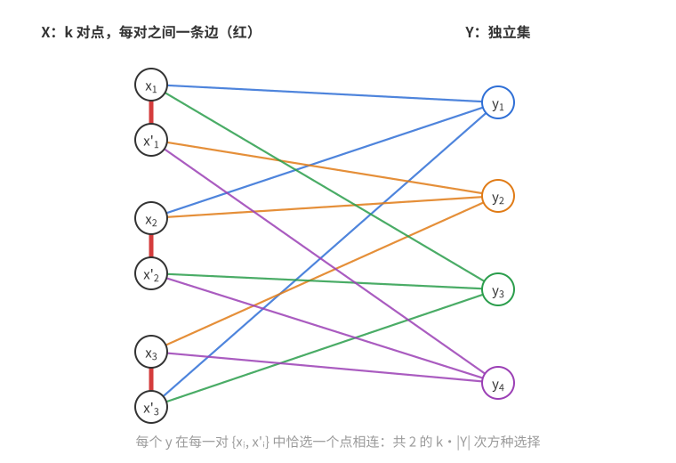
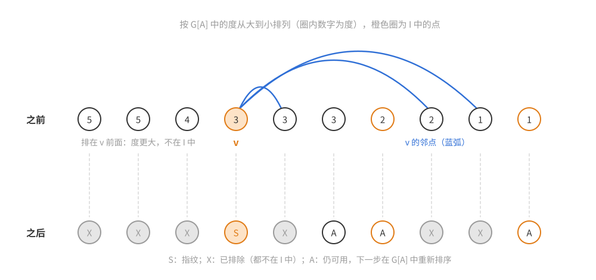
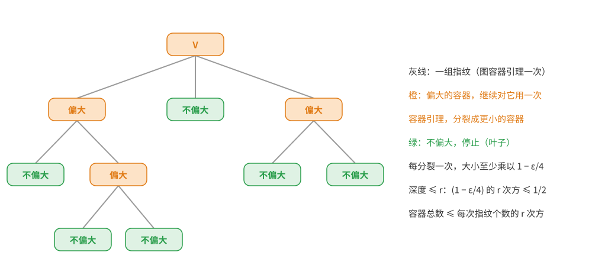
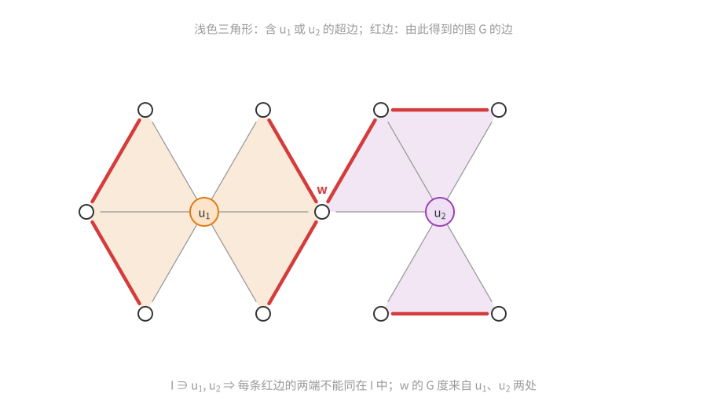

# 概率方法（十一）：容器方法

上一篇：[第 10 章 熵方法](概率方法10——熵方法.md)　下一篇：无（[目录与记号](概率方法讲义——目录与记号.md)）

前面大多数章节都在做同一件事：**构造**一个随机对象，证明它以正概率满足要求。本章反过来，要**数**一类对象有多少个，或者证明随机结构里**不存在**某种大的子结构。这两类问题都会遇到同一个障碍：需要对一个极其庞大的族做并集上界，而直接取并集损失太大。容器方法的想法是先把这些对象**打包**：找一小批“容器”，使每个对象都装在某个容器里，而每个容器都不太大；然后只对容器取并集上界。容器的个数少，并集上界就几乎不损失。

怎样找到这样的容器？本章给出的回答是一个**编码算法**：对每个对象，用它自身的一小部分（“指纹”）就能确定一个装得下它的容器。容器的个数不超过指纹的个数，而指纹很短，所以容器很少。这是一种和前面各章都不同的论证方式：概率只在最后一步（对容器取并集上界、用 Chernoff 界）出现，核心是一个确定性的、只看指纹就能重放的贪心过程。

上一章也在计数。熵方法把计数化成一串不等式，常数往往是精确的，但依赖于对称性或正则性（例如[第 10 章定理 10.27](概率方法10——熵方法.md#正则二部图中的独立集个数)，正则图独立集个数的精确上界）。容器方法粗糙得多，通常只能得到指数的主项，但几乎不需要结构假设，能处理不含固定子图的图、不含等差数列的集合、随机图中的极值问题等熵方法够不着的场合。11.2 节会用容器方法重新数正则图的独立集，可以与第 10 章的结果直接比较两种方法的强弱。

本章把图容器引理、3 一致超图容器定理、由它推出无三角形图计数以及随机图中的 Mantel 定理的论证都完整写出；更一般的 $k$ 一致超图容器定理只叙述不证明，在 11.3 节末尾注明出处。

**本章读法。**

- 首读主线：11.0 节的[为什么直接取并集不行](#为什么直接取并集不行)和[容器的想法](#容器的想法)；11.1 节由定理 11.3 推出定理 11.1 的并集上界，以及定理 11.7 在 $p\gg n^{-1/2}\log n$ 下的证明；11.2 节的[图上的指纹想法](#先在图上把问题想清楚)、图容器引理（定理 11.8、11.9）的证明和推论 11.10 的迭代，这是全章思想最清楚的地方。
- 可以二读：11.3 节首读看[怎样想到证明](#怎样想到证明)和引理 11.13 即可；定理 11.11 的算法与证明是图情形的超图版本，常数繁琐，可以二读；[指纹的威力](#指纹的威力去掉-log-n)是进阶证明。研究背景、首读可跳过的有：11.0 节的“历史”、11.1 节的[H-free 图的计数](#h-free-图的计数)（定理 11.4、11.5 与猜想 11.6 都不证）、定理 11.7 后的注 1、11.3 节末尾的[一般的超图容器定理](#一般的超图容器定理不证)。
- 与其他章的联系：本章是最后一章，后面没有章节再用到它的结果；本章用到的前文工具主要是[第 1 章定理 1.0](概率方法01——引论.md#10-第一个例子大的二部子图)和[第 5 章的乘法形式 Chernoff 界](<概率方法05——Chernoff 界.md#均值较小时乘法形式>)，并与[第 10 章定理 10.27](概率方法10——熵方法.md#正则二部图中的独立集个数)作对比。章末的[结语](#结语全书回顾)把全书各章的工具按问题类型串了起来。

## 11.0 问题：数无三角形图

### 第一个问题

**问题**　$n$ 个顶点（带标号）的无三角形图有多少个？

先找下界。完全二部图 $K_{\lfloor n/2\rfloor,\lceil n/2\rceil}$ 不含三角形，它的每个子图也不含三角形，所以至少有 $2^{\lfloor n^2/4\rfloor}$ 个无三角形图。下面的定理说，这个简单的下界在指数的主项上已经是对的。

**定理 11.1（Erdős–Kleitman–Rothschild）**　$n$ 个顶点的无三角形图共有 $2^{n^2/4+o(n^2)}$ 个。

（这一结果 1973 年在罗马会议上报告，论文集 1976 年出版。）

**注 1**　顶点带不带标号无关紧要：同构类的个数与带标号图的个数至多相差因子 $n!=2^{O(n\log n)}$，被 $2^{o(n^2)}$ 吸收。

**注 2**　Erdős、Kleitman、Rothschild 实际上证明了更强的结论：$n$ 个顶点的无三角形图中，$1-o(1)$ 的比例是二部图。有了这一点，再数完全二部图的子图就可以得到定理 11.1。本章只用容器的个数和大小，得不到这种结构性的结论，只能得到指数主项。（把容器方法与稳定性定理结合，可以证明这类典型结构的结论，但超出本章范围。）

小情形可以直接计算（逐点加入：新点的邻域必须是旧图的独立集，所以 $T(n)=\sum_G i(G)$，其中 $G$ 取遍 $n-1$ 个点的无三角形图，$i(G)$ 是 $G$ 的独立集个数）：

| $n$ | 5 | 6 | 7 | 8 | 9 |
|---|---|---|---|---|---|
| 无三角形图个数 $T(n)$ | 388 | 5789 | 133501 | 4682270 | 246348115 |
| 其中二部图的个数 | 376 | 5177 | 103237 | 2922446 | 116011231 |
| $\log_2T(n)\big/(n^2/4)$ | 1.38 | 1.39 | 1.39 | 1.38 | 1.38 |

这个比值离 1 还很远，二部图的比例也还在下降，说明 $o(n^2)$ 项在小 $n$ 时相当大。原因之一是二部图的个数本身就带有一个“选择二分方式”的因子：$\sum_k\binom nk2^{k(n-k)}\approx2^{n^2/4+n+O(\log n)}$，多出的 $2^n$ 在 $n=9$ 时相当于把比值抬高 $4/n\approx0.44$。定理 11.1 只断言比值趋于 1，渐近行为要在大得多的 $n$ 上才显现出来。

### 翻译成超图的独立集

把问题换一种说法。造一个 3 一致超图 $H$（每条超边恰由 3 个顶点组成）：

- 顶点集 $V(H)=\binom{[n]}2$，即 $K_n$ 的 $\binom n2$ 条边；
- 超边是形如 $\{xy,xz,yz\}$ 的三元组，即 $K_n$ 中三角形的三条边。

超图的**独立集**是不含任何超边的顶点子集。于是

- $V(H)$ 的子集 $\leftrightarrow$ 顶点集 $[n]$ 上的图；
- $H$ 的独立集 $\leftrightarrow$ 无三角形图。

问题变成：数 $H$ 的独立集。这个超图很“均匀”：每个顶点（$K_n$ 的一条边）恰在 $n-2$ 条超边（三角形）里，任两个顶点至多同在 1 条超边里。许多组合问题都能这样翻译：数不含 $K_4$ 的图、数 $[n]$ 中不含 $k$ 项等差数列的子集，都是数某个一致超图的独立集。

### 为什么直接取并集不行

上界要证明：独立集**很少**。最直接的思路是找一些“极大”的对象，把每个独立集装进去，再对它们取并集上界。

由 Mantel 定理，无三角形图至多有 $\lfloor n^2/4\rfloor$ 条边（11.3 节引理 11.13 之后会顺带证明）。一个固定的无三角形图 $G$ 有 $2^{e(G)}\le2^{n^2/4}$ 个子图，都无三角形。每个无三角形图都包含在某个**极大**无三角形图里，所以
$$T(n)\le(\text{极大无三角形图的个数})\cdot2^{n^2/4}.$$
如果极大无三角形图只有 $2^{o(n^2)}$ 个，这就证完了。可惜它们很多：

**命题 11.2**　当 $n$ 是 4 的倍数且充分大时，$n$ 个顶点的极大无三角形图至少有 $2^{n^2/8-1}$ 个。

先看怎样想到构造。从 $K_{X,Y}$ 出发：它是极大无三角形图，但只有一个。要得到很多个，就让每个 $y\in Y$ 只连 $X$ 的一部分，这样就有了选择的自由。问题是，删掉的边 $yx$ 成了非边，必须有公共邻点，否则还能把它加回去。办法是把 $X$ 两两配对并连上匹配边 $x_ix_i'$，让 $y$ 在每一对中恰连一个：若 $y$ 连 $x_i$，删掉的 $yx_i'$ 就以 $x_i$ 为公共邻点。“恰连一个”同时保证 $y$ 不和匹配边构成三角形。剩下 $y$ 与 $y'$、不同对中的两点（如 $x_i$ 与 $x_j'$）这两类非边，在随机选择下绝大多数情形也都有公共邻点，这就是下面的概率估计。

*构造与证明*　设 $n=4k$。顶点分成 $X=\{x_1,x_1',\dots,x_k,x_k'\}$（$2k$ 个点）和 $Y$（$2k$ 个点）。在 $X$ 内只连 $k$ 条边 $x_ix_i'$；$Y$ 内不连边；对每个 $y\in Y$ 和每个 $i$，让 $y$ 恰好与 $x_i,x_i'$ 中的一个相邻。这样的选择共有 $2^{k\cdot2k}=2^{n^2/8}$ 种，不同的选择给出不同的（带标号的）图。下图是 $k=3$、$|Y|=4$ 的小例子：红边是 $X$ 中的匹配，同一个 $y$ 的连线用同一种颜色。

*无三角形*：$Y$ 是独立集，$X$ 内只有匹配边，所以三角形必须用一条匹配边 $x_ix_i'$ 和一个与两端都相邻的 $y$，而这样的 $y$ 不存在。

*何时极大*：逐类检查非边。

- $x_i'$ 与一个选了 $x_i$ 的 $y$：$x_i$ 是公共邻点。
- $y$ 与 $y'$：若它们在某一对 $i$ 上选择相同，那个点就是公共邻点；只有当 $y'$ 的选择处处与 $y$ 相反时才没有公共邻点。
- 不同对中的两点，例如 $x_i$ 与 $x_j'$（$i\ne j$）：公共邻点只能在 $Y$ 中，需要某个 $y$ 在第 $i$ 对选 $x_i$、在第 $j$ 对选 $x_j'$。

现在把选择看成随机的（每个选择独立均匀）。“某两个 $y$ 处处相反”的概率至多 $\binom{2k}2 2^{-k}$；“某一对 $(i,j)$ 及某种组合没有 $y$ 实现”的概率至多 $4\binom k2(3/4)^{2k}$。两者都趋于 0，所以 $k$ 充分大时，至少一半的选择给出极大无三角形图，个数至少 $\frac12\cdot2^{n^2/8}$。$\square$

（随机抽样显示，$k=10,12,14$、$|Y|=2k$ 时，极大的比例分别约为 $0.52,0.74,0.88$。）

Balogh 和 Petříčková（2014）证明了这个下界在指数主项上是对的：极大无三角形图共有 $2^{n^2/8+o(n^2)}$ 个。于是上面的并集上界只给出 $T(n)\le2^{3n^2/8+o(n^2)}$，指数差了一半。

问题出在哪里？不同的极大无三角形图彼此**非常接近**：命题 11.2 中的图只在 $X$–$Y$ 之间的选择上不同，它们的子图大量重复，而并集上界把这些重复的子图数了一遍又一遍。独立集在超图的顶点集中是**成簇**分布的。

### 容器的想法

既然独立集成簇，就让每一簇共用一个“容器”。容器不必是独立集，只要求：

- 每个容器是超图顶点集的一个子集；
- 每个独立集都包含在某个容器里；
- 容器的总数相对较少；
- 每个容器都不太大——不比最大独立集大多少。

然后对容器取并集上界：独立集个数 $\le\sum_C2^{|C|}\le(\text{容器个数})\cdot2^{\max|C|}$。只要容器个数是 $2^{o(n^2)}$、每个容器至多 $(\frac14+\varepsilon)n^2$ 个元素，就得到定理 11.1。对无三角形图，容器就是“边数只比 $n^2/4$ 略多、但可能含三角形的图”。命题 11.2 构造出的图就是一个例子：它们都是同一个图 $K_{X,Y}\cup\{x_ix_i':i\le k\}$ 的子图，这个图只有 $\frac{n^2}4+\frac n4$ 条边，可以充当一个容器，把这一整簇极大无三角形图一次装下。

**注**　容器定理只控制边数，不保证容器接近二部图。例如把 $C_5$ 的每个点换成 $n/5$ 个点的独立集、相邻两类之间全连，得到的无三角形图有 $n^2/5$ 条边，至少删去 $n^2/25$ 条才能变成二部图；装它的容器也就不可能是“完全二部图加 $o(n^2)$ 条边”。所以只看“每个容器有多大”，推不出“几乎所有无三角形图接近二部图”，这就是 11.0 节注 2 所说的局限。注意这个例子只说明不能要求**每个**容器都接近二部图；它并不排除**几乎所有**无三角形图具有这种结构，后者要另加稳定性一类的论证。

容器定理的条件是超图的度“受控”：最大度不比平均度大太多，两个顶点的公共度（同时含这两个顶点的超边数）也不太大。这类定理的典型应用有：

- **渐近计数**：数 $n$ 个点、不含某个固定子图的图；数 $n$ 个点、$m$ 条边、不含该子图的图；数 $[n]$ 中大小为 $m$、不含 $k$ 项等差数列的子集。
- **随机结构中的极值与拉姆塞型结果**：$G(n,p)$ 中不含某个固定子图的子图最多有多少条边；$[n]$ 的 $p$-随机子集中的 Szemerédi 定理。
- **图与超图的列表染色**（见[第 1 章 1.4 节](概率方法01——引论.md#下界)末尾提到的 Saxton–Thomason 定理）。

### 历史

- **图容器方法**由 Kleitman 和 Winston（1982）提出，用来数不含 $C_4$ 的图；Sapozhenko（2001）用它估计正则图中独立集的个数，得到了 Kahn–Zhao 定理（见[第 10 章定理 10.27](概率方法10——熵方法.md#正则二部图中的独立集个数)，用 Shearer 引理证明）的一个较早的、较弱的版本。
- **超图容器定理**由 Balogh、Morris、Samotij（2015）和 Saxton、Thomason（2015）独立证明。这是过去十多年组合学最令人兴奋的进展之一。
- 入门材料：Balogh、Morris、Samotij 在 2018 年国际数学家大会上的综述；Samotij（2015）关于图容器方法的综述；Morris（2016）的讲义对超图容器的证明和应用有平易的介绍。

本章的路线：11.1 节假设一个“无三角形图的容器定理”，推出计数和随机图中的 Mantel 定理；11.2 节证明图容器引理，并用它数正则图的独立集，作为迭代方法的热身；11.3 节证明 3 一致超图的容器定理，由它推出 11.1 节假设的容器定理，并用“指纹”把随机图结果改进到最优范围。

## 11.1 无三角形图的容器

### 容器定理与计数

**定理 11.3（无三角形图的容器）**　对每个 $\varepsilon>0$，存在 $C_\varepsilon>0$，使对每个 $n$，存在 $n$ 个顶点上的一族图 $\mathcal C$，满足 $|\mathcal C|\le n^{C_\varepsilon n^{3/2}}$，并且

(a) 每个 $G\in\mathcal C$ 至多有 $(\frac14+\varepsilon)n^2$ 条边；

(b) 每个无三角形图都是某个 $G\in\mathcal C$ 的子图。

证明放在 11.3 节（定理 11.11 之后的[超饱和与定理 11.3 的证明](#超饱和与定理-113-的证明)）。先看它怎样推出定理 11.1。

*定理 11.1 的证明*　下界已经由 $K_{\lfloor n/2\rfloor,\lceil n/2\rceil}$ 的子图给出。上界：任给 $\varepsilon>0$，取定理 11.3 的 $\mathcal C$。每个无三角形图都是某个 $G\in\mathcal C$ 的子图，而每个 $G$ 至多有 $2^{e(G)}\le2^{(1/4+\varepsilon)n^2}$ 个子图，所以
$$T(n)\le|\mathcal C|\cdot2^{(\frac14+\varepsilon)n^2}\le2^{(\frac14+\varepsilon)n^2+C_\varepsilon n^{3/2}\log_2n}.$$
$n^{3/2}\log n=o(n^2)$，所以 $n$ 充分大时 $T(n)\le2^{(\frac14+2\varepsilon)n^2}$。$\varepsilon$ 任意，故 $T(n)=2^{(\frac14+o(1))n^2}$。$\square$

注意这里没有用到任何概率：容器方法的计数应用就是一次对容器的并集上界。两个数量级对比一下就知道它为什么有效：容器个数 $2^{O(n^{3/2}\log n)}$，相比之下，极大无三角形图有 $2^{n^2/8+o(n^2)}$ 个。

### $H$-free 图的计数

这一小节是研究背景，叙述的结果都不证明，首读可跳过。

同样的论证，配合适当的容器定理，可以数不含任意固定子图 $H$ 的图（本小节中 $H$ 指被禁止的固定图，与 11.0 节的三角形超图无关）。记 $\operatorname{ex}(n,H)$ 为 $n$ 个顶点、不含 $H$（作为子图）的图的最大边数。

**定理 11.4（Erdős–Stone–Simonovits）**　设 $H$ 是固定的非二部图，则
$$\operatorname{ex}(n,H)=\Big(1-\frac1{\chi(H)-1}+o(1)\Big)\binom n2.$$

本讲义不证明这个定理（它是极值图论的基本定理，证明见任何一本极值图论教材）。$H=K_3$ 时它就是 Mantel 定理的渐近形式。对二部图 $H$，定理只说 $\operatorname{ex}(n,H)=o(n^2)$；更精确的估计只对部分二部图已知，例如 $H=K_{4,4}$ 和 $H=C_8$ 时，$\operatorname{ex}(n,H)$ 的渐近阶至今未知。

**定理 11.5（Erdős–Frankl–Rödl，1986）**　设 $H$ 是固定的非二部图，则 $n$ 个顶点的 $H$-free 图共有 $2^{(1+o(1))\operatorname{ex}(n,H)}$ 个。

这个定理本章也不证明。用容器方法证明它的思路与 $H=K_3$ 完全相同：把 $H$-free 图看成一个 $e(H)$ 一致超图（顶点是 $K_n$ 的边，超边是 $H$ 的拷贝）的独立集，用 11.3 节末尾叙述的一般超图容器定理，配合 Erdős–Simonovits 的“超饱和”定理（边数超过 $\operatorname{ex}(n,H)+\varepsilon n^2$ 的图含有 $\Omega(n^{v(H)})$ 个 $H$ 的拷贝）迭代即可。

对二部图 $H$，类似的结论 $2^{(1+o(1))\operatorname{ex}(n,H)}$ 一般不成立：Morris 和 Saxton（2016）证明，对无穷多个 $n$，不含 $C_6$ 的图至少有 $2^{(1+c)\operatorname{ex}(n,C_6)}$ 个（$c>0$ 是常数）。较弱的形式仍是重要的公开问题：

**猜想 11.6**　设 $H$ 是含圈的固定二部图，则 $n$ 个顶点的 $H$-free 图共有 $2^{O(\operatorname{ex}(n,H))}$ 个。

对某些 $H$ 这个猜想已被证明，例如 $H=C_4$：Kleitman 和 Winston（1982）证明不含 $C_4$ 的图有 $2^{O(n^{3/2})}$ 个，而 $\operatorname{ex}(n,C_4)=\Theta(n^{3/2})$。这正是图容器方法诞生的地方。（“含圈”的条件不能去掉。例如 $H$ 是两条边的路 $P_3$ 时，$H$-free 图就是匹配（外加孤立点），$\operatorname{ex}(n,P_3)=\lfloor n/2\rfloor$，但匹配的个数至少是 $K_{2\lfloor n/2\rfloor}$ 的完美匹配数 $(2\lfloor n/2\rfloor-1)!!=2^{\Theta(n\log n)}$。）

### 随机图中的 Mantel 定理

Mantel 定理说 $K_n$ 的无三角形子图至多有 $\frac14n^2$ 条边，约是 $K_n$ 全部边的一半。把 $K_n$ 换成随机图 $G(n,p)$，会怎样？

一方面，任何图都有一个包含至少一半边的二部子图（[第 1 章定理 1.0](概率方法01——引论.md#10-第一个例子大的二部子图)），而 $G(n,p)$ 大约有 $\frac12pn^2$ 条边，所以它总有一个至少约 $\frac14pn^2$ 条边的无三角形子图。问题是能否更多。

**定理 11.7**　若 $p\gg n^{-1/2}$，则以 $1-o(1)$ 的概率，$G(n,p)$ 的每个无三角形子图至多有 $(\frac14+o(1))pn^2$ 条边。

也就是说，在 $p\gg n^{-1/2}$ 的范围内，$G(n,p)$ 继承了 Mantel 定理：随机地删去大部分边之后，“无三角形子图至多占一半的边”依然成立。

**注 1**　（研究背景，首读可跳过。）事实上还有强得多的结论：存在常数 $C$，当 $p>C\sqrt{\log n/n}$ 时，$G(n,p)$ 的最大无三角形子图以高概率是二部图（DeMarco–Kahn，2015）。这个条件比定理 11.7 多一个 $\sqrt{\log n}$ 因子，而且除常数外不能放宽：$p=0.1\sqrt{\log n/n}$ 时，$G(n,p)$ 以高概率含一个五边形，它的边都不在 $G(n,p)$ 的任何三角形里。这样的边加进任何无三角形子图都不会产生三角形，所以最大无三角形子图必含这个奇圈，不是二部图。

**注 2**　$p\ll n^{-1/2}$ 时结论不成立。设 $n^{-2}\ll p\ll n^{-1/2}$。三角形个数的期望 $\binom n3p^3\le\frac16n^3p^3$，边数的期望 $\binom n2p\approx\frac12n^2p$，二者之比约 $\frac13np^2\to0$。由 Markov 不等式，以高概率三角形个数是 $o(n^2p)$；由 Chebyshev 不等式（$n^2p\to\infty$），边数以高概率是 $(\frac12+o(1))n^2p$。从每个三角形里删一条边，就得到 $(\frac12-o(1))pn^2$ 条边的无三角形子图，远多于 $\frac14pn^2$。临界的 $p=n^{-1/2}$ 正是“三角形数 $n^3p^3$ 与边数 $n^2p$ 同阶”的地方：此时三角形多到每条边平均落在常数个三角形里，删边才不再便宜。

下面先证明一个稍弱的版本：$p\gg n^{-1/2}\log n$ 时结论成立。去掉 $\log n$ 需要容器定理的“指纹”形式，放在 11.3 节的[指纹的威力：去掉 $\log n$](#指纹的威力去掉-log-n)。

*证明（$p\gg n^{-1/2}\log n$）*　任给 $\varepsilon\in(0,\frac14]$，取定理 11.3 的容器族 $\mathcal C$，对每个 $G\in\mathcal C$，$e(G)\le(\frac14+\varepsilon)n^2$。记 $G_p=G(n,p)$。

*单个容器*　$e(G\cap G_p)\sim\operatorname{Bin}(e(G),p)$，它被 $Y\sim\operatorname{Bin}(m_0,p)$ 随机控制（即对每个 $t$，$\mathbb P(e(G\cap G_p)>t)\le\mathbb P(Y>t)$），其中 $m_0=\lfloor(\frac14+\varepsilon)n^2\rfloor$（把 $G$ 补上若干条虚设的边凑满 $m_0$ 条，边数只增不减）。$\mathbb EY=m_0p\le(\frac14+\varepsilon)n^2p$，令 $\varepsilon'=\frac{\varepsilon}{1/4+\varepsilon}\in(0,1]$，则 $(\frac14+2\varepsilon)n^2p\ge(1+\varepsilon')\,\mathbb EY$。由[第 5 章的乘法形式 Chernoff 界](<概率方法05——Chernoff 界.md#均值较小时乘法形式>)，
$$\mathbb P\Big(e(G\cap G_p)>\big(\tfrac14+2\varepsilon\big)n^2p\Big)\le\mathbb P\big(Y\ge(1+\varepsilon')\mathbb EY\big)\le e^{-\varepsilon'^2\mathbb EY/3}=e^{-\Omega_\varepsilon(n^2p)}.$$
（$\mathbb EY=m_0p\ge\frac14n^2p-p$，与 $n^2p$ 同阶。）

*对容器取并集*　若 $G_p$ 有一个边数超过 $(\frac14+2\varepsilon)n^2p$ 的无三角形子图 $F$，则 $F$ 装在某个容器 $G\in\mathcal C$ 里，而 $F\subseteq G\cap G_p$，于是 $e(G\cap G_p)>(\frac14+2\varepsilon)n^2p$。所以
$$\mathbb P\big(G_p\text{ 有边数}>(\tfrac14+2\varepsilon)n^2p\text{ 的无三角形子图}\big)\le|\mathcal C|\,e^{-\Omega_\varepsilon(n^2p)}\le e^{O_\varepsilon(n^{3/2}\log n)-\Omega_\varepsilon(n^2p)}=o(1),$$
最后一步用到 $n^2p\gg n^{3/2}\log n$，即 $p\gg n^{-1/2}\log n$。

*由 $\varepsilon$ 到 $o(1)$*　上面对每个固定的 $\varepsilon$ 证明了：以 $1-o(1)$ 的概率，所有无三角形子图至多 $(\frac14+2\varepsilon)pn^2$ 条边。取 $\varepsilon=1/k$，对每个 $k$ 有 $N_k$ 使 $n\ge N_k$ 时失败概率 $<1/k$；令 $\varepsilon_n=1/k$（当 $N_k\le n<N_{k+1}$，$N_k$ 取成严格递增），则 $\varepsilon_n\to0$，且失败概率 $\to0$。$\square$

这个证明的结构值得记住：**容器个数**是 $e^{O(n^{3/2}\log n)}$，**单个容器失败的概率**是 $e^{-\Omega(n^2p)}$，后者压倒前者，结论就成立。$\log n$ 的损失来自容器个数的估计：$n^{C_\varepsilon n^{3/2}}$ 中的 $\log n$。11.3 节会看到，把“容器”换成“指纹加容器”之后，每个指纹 $S$ 还自带一个因子 $p^{|S|}$（指纹本身必须出现在 $G_p$ 中），这个因子把 $\log n$ 换成了小得多的 $\log(\sqrt n\,p)$。

## 11.2 图容器

### 先在图上把问题想清楚

超图太复杂，先看最简单的情形：图的独立集。设 $G=(V,E)$ 有 $n$ 个顶点。我们想找一小批容器 $C\subseteq V$，每个独立集都装在某个容器里，每个容器比 $V$ 小一个常数比例。

**指纹的想法。** 独立集 $I$ 中的一个点 $v$ 告诉我们：$v$ 的所有邻点都**不在** $I$ 里。如果图的度大约是 $d$，那么只要知道 $I$ 中大约 $\delta n/d$ 个“邻域不太重叠”的点，就能排除大约 $\delta n$ 个顶点，剩下的 $(1-\delta)n$ 个顶点就是一个装得下 $I$ 的容器。这样的容器由 $I$ 的一个小子集 $S$（**指纹**）决定，所以容器个数不超过指纹个数
$$\sum_{s\le\delta n/d}\binom ns=2^{O(\frac nd\log(ed))},$$
当 $d$ 很大时，与独立集可能的个数 $2^{\Theta(n)}$ 相比微不足道。

这个想法要成立，指纹必须满足两个要求：

1. **每个指纹点都要排除很多新顶点**。随便取 $I$ 中的点不行，$I$ 可能整个躲在低度顶点里，或者各点的邻域大量重叠。
2. **容器只能依赖指纹 $S$，不能依赖 $I$ 的其余部分**。否则容器个数就不再受指纹个数控制。

**第一次尝试：每次取 $I$ 中度最大的点。** 在剩余顶点集 $A$ 诱导的子图 $G[A]$ 中，取 $I\cap A$ 里度最大的点 $v$，把它的邻点排除，再重复。这已经满足了要求 2：解码时，$S$ 中尚未处理的点都还在 $A$ 里，而且度都不超过 $v$ 的度，所以“$S\cap A$ 中度最大的点”就是 $v$，只看 $S$ 就能重放整个过程。

但要求 1 仍然可能失败：$I\cap A$ 中度最大的点，度也可能很小。

**关键的修补：顺带排除度更大的点。** 如果 $v$ 是 $I\cap A$ 中度最大的点，那么 $G[A]$ 中**度比 $v$ 大的点一定都不在 $I$ 里**——否则就会选它而不是 $v$。所以把这些点也一并排除！这给出一个“两头都赢”的局面：

- 若 $v$ 在 $G[A]$ 中的度大，它的邻点就很多，排除了很多点；
- 若 $v$ 的度小，而 $G[A]$ 的边又不少，那么度比 $v$ 大的点一定很多（边总要落在某些点上），它们全被排除。

而且解码者同样知道“度比 $v$ 大的点”是哪些，要求 2 不受影响。

**最大度的条件为什么必要。** 上面“$G[A]$ 的边不少”要靠最大度不太大：每排除一个点，至多损失 $\Delta(G)$ 条边。若只假设平均度，结论可以失败。例如 $G=K_{s,n-s}$，$s$ 很小：平均度约 $2s$，大的一侧本身是独立集，必须装在某个容器里，这个容器至少有 $n-s$ 个点，不可能缩小到 $(1-\delta)n$（当 $s<\delta n$ 时）。这里最大度 $n-s$ 远大于平均度。

### 图容器引理

**定理 11.8（图容器引理）**　设 $c\ge1$，$0<\delta\le\frac1{8c}$。设图 $G=(V,E)$ 有 $n$ 个顶点，平均度 $d>0$，最大度至多 $cd$。则存在 $V$ 的一族子集 $\mathcal C$，满足
$$|\mathcal C|\le\sum_{s=0}^{\lceil4\delta n/d\rceil}\binom ns,$$
并且

1. $G$ 的每个独立集都包含在某个 $C\in\mathcal C$ 中；
2. 每个 $C\in\mathcal C$ 满足 $|C|\le(1-\delta)n$。

$\mathcal C$ 中的集合称为**容器**。（最大度总不小于平均度，所以 $c\ge1$ 不是额外的限制。）

**定理 11.9（带指纹的图容器引理）**　在定理 11.8 的条件下，记 $\mathcal I$ 为 $G$ 的独立集全体，存在函数
$$S:\mathcal I\to2^V,\qquad A:2^V\to2^V$$
（$A(\cdot)$ 只需在 $S$ 的像上有定义），使对每个 $I\in\mathcal I$：

- $S(I)\subseteq I\subseteq S(I)\cup A(S(I))$；
- $|S(I)|\le\lceil4\delta n/d\rceil$；
- $|S(I)\cup A(S(I))|\le(1-\delta)n$。

定理 11.9 推出定理 11.8：令 $\mathcal C=\{S\cup A(S):S\text{ 是某个 }S(I)\}$，容器个数不超过大小至多 $\lceil4\delta n/d\rceil$ 的子集个数。指纹形式多给出的信息是：容器由 $I$ 的一个**子集**决定。11.3 节会看到，这一点在随机图的应用中能省下一个 $\log n$ 因子。

**为什么要上取整。** 若 $G=K_n$（$d=n-1$，$c=1$），每个单点都是独立集。当 $4\delta n/d<1$ 时，没有上取整的界 $\sum_{s\le4\delta n/d}\binom ns$ 只允许一个容器（指纹为空），它必须包含所有单点，从而包含整个 $V$，与 $|C|\le(1-\delta)n$ 矛盾。所以稠密图上至少要允许一个点的指纹。

### 容器算法

固定 $G$ 和 $V$ 上的一个线性序（用来打破平局）。对 $A\subseteq V$，$G[A]$ 的**最大度序**是把 $A$ 中的点按 $G[A]$ 中的度从大到小排列，度相同的按固定线性序排列。

**算法**　输入：独立集 $I$。全程维持 $V$ 的划分 $V=A\sqcup S\sqcup X$：

- $A$：“可用”的点，初始 $A=V$；
- $S$：指纹，初始 $S=\varnothing$；
- $X$：已排除的点，初始 $X=\varnothing$。

当 $|X|<\delta n$ 且 $I\cap A\ne\varnothing$ 时，重复：

1. 设 $v$ 是 $I\cap A$ 中在 $G[A]$ 的最大度序里最靠前的点，$P$ 是序中排在 $v$ 前面的点；
2. 把 $v$ 放进 $S$；
3. 把 $P$ 和 $v$ 在 $A$ 中的邻点 $N_A(v)$ 放进 $X$；
4. 从 $A$ 中删去 $v$ 以及 $P\cup N_A(v)$。

输出 $S(I)=S$。若结束时 $|X|\ge\delta n$，令 $A(S)=A$；否则令 $A(S)=\varnothing$。

下图是一步的示意：上排把 $A$ 中的点按 $G[A]$ 中的度排好，橙色圈是 $I$ 中的点，$v$ 是其中第一个；蓝弧连向 $v$ 在 $A$ 中的邻点。下排是这一步之后各点的去向。

### 证明

证明分六步：第一、二步说明容器装得下 $I$，并且只依赖指纹；第三至五步说明每一步都排除很多点，从而指纹很短；第六步估计容器的大小。

*第一步：$X$ 中没有 $I$ 的点，所以 $I\subseteq S\cup A$ 始终成立。* 第 3 步放进 $X$ 的点有两类。$N_A(v)$ 中的点与 $v\in I$ 相邻，而 $I$ 是独立集，所以它们不在 $I$ 中。$P$ 中的点在 $A$ 里且排在 $v$ 前面，而 $v$ 是 $I\cap A$ 中最靠前的，所以它们不在 $I$ 中。

*第二步：只看 $S(I)$ 就能重放算法（解码）。* 把算法的输入换成 $S=S(I)$（它是 $I$ 的子集，也是独立集），对步数归纳，证明两次运行每一步的状态 $(A,S,X)$ 都相同。算法与输入的交互只有两处：判断“输入 $\cap A$ 是否为空”和取“输入 $\cap A$ 中最靠前的点”。在原运行的任一步，$S\cap A$ 恰好是本步及以后要选的点：以前选过的点已离开 $A$；以后要选的点在被选时属于 $A$，而 $A$ 只会缩小，所以现在也属于 $A$。因此

- 若原运行在这一步选 $v$，则 $v\in S\cap A\subseteq I\cap A$，而 $v$ 是 $I\cap A$ 中最靠前的，自然也是 $S\cap A$ 中最靠前的，重放选的也是 $v$；
- 若原运行因为 $I\cap A=\varnothing$ 而停止，则 $S\cap A\subseteq I\cap A=\varnothing$，重放也停止；因 $|X|\ge\delta n$ 而停止的情形，两者状态相同，同时停止。

所以最终的 $A$、$X$ 只依赖于 $S(I)$，$A(S(I))$ 定义合理。注意 $S(I)$ 只需作为**集合**给出，选点的顺序由重放自动恢复。

*第三步：每一步要么排除很多邻点，要么排除很多前面的点。* 设某一步开始时 $|S|\le|X|<\delta n$。$G$ 共有 $nd/2$ 条边，不在 $G[A]$ 中的边至少有一个端点在 $X\cup S$ 中，这样的边至多 $(|X|+|S|)\cdot cd<2\delta n\cdot cd\le\frac{nd}4$ 条（用到 $\delta\le\frac1{8c}$）。所以 $e(G[A])>\frac{nd}4$，$G[A]$ 的度数和大于 $\frac{nd}2$。

现在设 $\deg_A(v)<\frac d4$。排在 $v$ 前面的 $|P|$ 个点，度都至多 $cd$；$v$ 及排在它后面的点，度都不超过 $\deg_A(v)<\frac d4$，至多 $n$ 个。于是
$$\frac{nd}2<|P|\cdot cd+n\cdot\frac d4,\qquad\text{即}\qquad|P|>\frac n{4c}\ge2\delta n.$$
这一步把 $P$ 全部放进 $X$，之后 $|X|\ge\delta n$，算法停止。

结论：**若一步之后 $|X|<\delta n$，那么这一步的 $\deg_A(v)\ge\frac d4$，$X$ 至少增加 $\frac d4$ 个点**（$N_A(v)\subseteq A$ 与原来的 $X$ 不相交）。

*第四步：$|S|\le|X|$ 始终成立，从而第三步的前提总满足。* 初始时两边都是 0。由第三步，每一步要么 $|P|>0$，要么 $\deg_A(v)\ge\frac d4>0$，总之 $X$ 至少增加 1 个点，而 $S$ 恰增加 1 个点。对步数归纳即得。

*第五步：指纹的大小。* 设算法共进行 $s\ge1$ 步。前 $s-1$ 步之后算法都没有停止，所以每一步之后 $|X|<\delta n$，由第三步每步至少给 $X$ 增加 $\frac d4$ 个点。于是 $(s-1)\frac d4\le|X|<\delta n$，即 $s-1<\frac{4\delta n}d$，所以 $|S|=s\le\lceil4\delta n/d\rceil$。

*第六步：容器的大小。* 若结束时 $|X|\ge\delta n$，则 $|S\cup A|=n-|X|\le(1-\delta)n$。否则算法因 $I\cap A=\varnothing$ 停止，此时 $I\subseteq S$，而 $A(S)=\varnothing$，容器就是 $S$ 本身，$|S|\le|X|<\delta n\le(1-\delta)n$。两种情形都有 $S(I)\subseteq I\subseteq S(I)\cup A(S(I))$。$\square$

回头看各条假设的作用：**最大度 $\le cd$** 保证排除少量点不会毁掉 $G[A]$ 的边（第三步的第一段）；**最大度序** 保证两头都赢（第三步的第二段）；**$X\cap I=\varnothing$** 保证容器装得下 $I$；**可重放性** 保证容器个数受指纹个数控制。$\delta$ 越小，指纹越短，但容器也越接近整个 $V$：这是一个可以按需调节的折中。

### 迭代与超饱和：正则图的独立集

定理 11.8 只把容器缩小一个常数比例 $1-\delta$，而 11.1 节的定理 11.3 要求容器几乎和最大独立集一样小。这两者之间的桥梁是**迭代**：对每个仍然偏大的容器 $C$，再对诱导子图 $G[C]$ 用一次容器引理，得到更小的容器，如此反复，直到容器的大小接近独立数为止。每一轮只把容器个数乘上一个指纹个数，轮数是常数，所以总个数仍然很少。

迭代要能进行下去，需要每个偏大的容器 $C$ 仍满足容器引理的条件，特别是 $G[C]$ 要有**足够多的边**。这就是**超饱和**性质：比独立数略大的顶点集，必然诱导出很多边。所有标准的容器方法应用都具备这个性质。下面在正则图上把这套流程完整走一遍。

**推论 11.10**　设 $0<\varepsilon\le\frac12$，$r=\lceil4\ln2/\varepsilon\rceil$。$n$ 个顶点的 $d$ 正则图（$d\ge1$）的独立集个数满足
$$i(G)\le2^{(\frac12+\varepsilon)n}\cdot(2ed)^{\frac{3rn}{2d}}.$$
特别地，当 $d\to\infty$ 时 $i(G)\le2^{(\frac12+o(1))n}$，$o(1)$ 关于 $n$ 一致。

（$r$ 是迭代的轮数，取得使 $(1-\frac\varepsilon4)^r\le\frac12$：每轮容器至少缩小为原来的 $1-\frac\varepsilon4$ 倍，$r$ 轮之后必定不再偏大，见下面的“迭代”。）

$n/(2d)$ 个不相交的 $K_{d,d}$ 有 $(2^{d+1}-1)^{n/(2d)}\ge2^{n/2}$ 个独立集，所以指数 $\frac12$ 是最优的。Kahn 和 Zhao 证明了这个例子恰好是最大值（[第 10 章定理 10.27](概率方法10——熵方法.md#正则二部图中的独立集个数)），推论 11.10 是它的一个较弱、但证明方法更有弹性的版本，类似于 Sapozhenko 的结果。

*超饱和*　设 $C\subseteq V$，$|C|>(\frac12+\varepsilon)n$。$C$ 中各点的度之和 $d|C|$ 等于 $2e(G[C])$ 加上 $C$ 与 $V\setminus C$ 之间的边数，后者至多 $d(n-|C|)$。所以
$$2e(G[C])\ge d(2|C|-n)>2\varepsilon nd.$$
这就是正则图的超饱和：比 $\frac n2$ 大一点的点集诱导出 $\Omega(nd)$ 条边。

*对 $G[C]$ 用一次容器引理*　$G[C]$ 有 $|C|$ 个顶点，平均度 $d_C=2e(G[C])/|C|>2\varepsilon nd/|C|\ge2\varepsilon d$，最大度至多 $d\le d_C/(2\varepsilon)$。取 $c=\frac1{2\varepsilon}\ge1$，$\delta=\frac1{8c}=\frac\varepsilon4$，由定理 11.8，$G[C]$ 的独立集装在一族容器中，每个容器至多 $(1-\frac\varepsilon4)|C|$ 个点，容器个数至多 $\sum_{s\le m_C}\binom{|C|}s$，其中
$$m_C=\Big\lceil\frac{\varepsilon|C|}{d_C}\Big\rceil\le\Big\lceil\frac{|C|^2}{2nd}\Big\rceil\le\Big\lceil\frac n{2d}\Big\rceil=:m.$$
因为 $1\le m\le n$，$\sum_{s\le m}\binom{|C|}s\le\sum_{s\le m}\binom ns\le(en/m)^m$；又 $m\ge\frac n{2d}$，$m\le\frac n{2d}+1\le\frac{3n}{2d}$（用到 $d\le n$），所以容器个数至多 $(2ed)^{3n/(2d)}$。

*迭代*　从 $\mathcal C_0=\{V\}$ 开始。第 $j$ 轮：把 $\mathcal C_{j-1}$ 中每个大小超过 $(\frac12+\varepsilon)n$ 的容器 $C$ 换成 $G[C]$ 的容器族，其余容器保留。$G$ 的独立集 $I\subseteq C$ 也是 $G[C]$ 的独立集，所以每一轮之后，每个独立集仍装在某个容器里。每被替换一次，容器大小至少乘以 $1-\frac\varepsilon4$；经过 $r$ 次替换，大小至多 $(1-\frac\varepsilon4)^rn\le e^{-\varepsilon r/4}n\le\frac n2$。所以每个容器至多被替换 $r$ 次就不再偏大，$r$ 轮之后所有容器大小都至多 $(\frac12+\varepsilon)n$，个数至多 $(2ed)^{3rn/(2d)}$。

下图示意迭代的过程。11.3 节对无三角形图的迭代（定理 11.3 的证明）结构完全相同，只是“偏大”指边数超过 $(\frac14+\varepsilon)n^2$。

*计数*　每个独立集都是某个最终容器的子集，所以
$$i(G)\le\sum_{C}2^{|C|}\le(2ed)^{\frac{3rn}{2d}}\cdot2^{(\frac12+\varepsilon)n}.$$
最后，$\frac{3r}{2d}\log_2(2ed)\to0$（$d\to\infty$，$\varepsilon$ 固定），再让 $\varepsilon\to0$ 即得 $i(G)\le2^{(\frac12+o(1))n}$。$\square$

这个证明展示了容器方法的完整流程，11.3 节对无三角形图的论证与它一一对应：

| 正则图的独立集 | 无三角形图 |
|---|---|
| 图 $G$ 的独立集 | 三角形超图 $H$ 的独立集 |
| 图容器引理（定理 11.8） | 超图容器定理（定理 11.11） |
| 超饱和：$\lvert C\rvert>(\frac12+\varepsilon)n\Rightarrow e(G[C])\ge\varepsilon nd$ | 超饱和：$e(C)>(\frac14+\varepsilon)n^2\Rightarrow C$ 含 $\Omega(\varepsilon n^3)$ 个三角形 |
| 迭代到 $\lvert C\rvert\le(\frac12+\varepsilon)n$ | 迭代到 $e(C)\le(\frac14+\varepsilon)n^2$ |
| $i(G)\le2^{(\frac12+o(1))n}$ | $T(n)\le2^{(\frac14+o(1))n^2}$ |

## 11.3 超图容器定理

### 定义与定理

超图的**独立集**是不含任何超边的顶点子集。对 $k$ 一致超图 $H$ 和 $1\le\ell<k$，记
$$\Delta_\ell(H)=\max_{A\subseteq V(H),\ |A|=\ell}\#\{e\in E(H):e\supseteq A\},$$
即任意 $\ell$ 个顶点同时所在的超边数的最大值。$\Delta_1$ 是最大度，$\Delta_2$ 是最大**公共度**。

**定理 11.11（3 一致超图的容器定理）**　设 $c\ge1$，$\delta=\frac1{1536c^3}$。设 $H$ 是 $n$ 个顶点的 3 一致超图，平均度 $d\ge1$，并且
$$\Delta_1(H)\le cd,\qquad\Delta_2(H)\le c\sqrt d.$$
则存在 $V(H)$ 的一族子集 $\mathcal C$，满足
$$|\mathcal C|\le\Big(\sum_{s=0}^{\lceil n/\sqrt d\rceil}\binom ns\Big)^2,$$
并且 $H$ 的每个独立集都包含在某个 $C\in\mathcal C$ 中，每个 $C\in\mathcal C$ 满足 $|C|\le(1-\delta)n$。

**定理 11.12（指纹形式）**　在定理 11.11 的条件下，记 $\mathcal I$ 为 $H$ 的独立集全体，存在函数 $S_1,S_2:\mathcal I\to2^{V(H)}$ 和 $f:2^{V(H)}\times2^{V(H)}\to2^{V(H)}$，使对每个 $I\in\mathcal I$，
$$S_1(I),S_2(I)\subseteq I\subseteq f\big(S_1(I),S_2(I)\big),\qquad|S_1(I)|,|S_2(I)|\le\lceil n/\sqrt d\rceil,\qquad\big|f\big(S_1(I),S_2(I)\big)\big|\le(1-\delta)n.$$

定理 11.12 推出定理 11.11：容器取 $f(S_1,S_2)$，个数不超过指纹对 $(S_1,S_2)$ 的个数。

**注**　这里的 $\delta$ 是显式的，没有优化。应用中只用到容器个数的对数量级：由于 $d\le\binom{n-1}2<\frac{n^2}2$，$n/\sqrt d>\sqrt2$，所以 $m=\lceil n/\sqrt d\rceil$ 介于 $n/\sqrt d$ 与 $2n/\sqrt d$ 之间，
$$\log|\mathcal C|\le2m\log\frac{en}m\le\frac{4n}{\sqrt d}\log(e\sqrt d)=O\Big(\frac n{\sqrt d}\log(ed)\Big).$$

### 怎样想到证明

照搬图的证明，会在第一步就卡住：在图中，$v\in I$ 排除了 $v$ 的所有邻点；在 3 一致超图中，$u\in I$ **不排除任何一个点**。它排除的是**点对**：对每条超边 $\{u,x,y\}$，$x$ 与 $y$ 不能同时在 $I$ 中。

把这些点对收集成一个图。记 $u$ 的**连接图**（link）为 $L(u)=\{xy:\{u,x,y\}\in E(H)\}$，它有 $\deg(u)$ 条边。若 $S\subseteq I$，则 $I$ 是图
$$G=\bigcup_{u\in S}L(u)$$
的独立集。于是问题化归为图的容器问题：先从 $I$ 中取一批点 $S_1$ 造出 $G$，再对 $G$ 用图容器引理，得到第二批指纹 $S_2$ 和容器。

**两批指纹各取多大？** 若 $|S_1|=s$，每个点贡献约 $d$ 条连接边，$G$ 约有 $sd$ 条边，平均度 $d_G\approx sd/n$。图容器引理要求的指纹大小约为 $n/d_G\approx n^2/(sd)$。两批指纹的总长 $s+n^2/(sd)$ 在 $s=n/\sqrt d$ 时最小，两者都约为 $n/\sqrt d$。这就是定理中 $\sqrt d$ 的来源：$G$ 应有约 $n\sqrt d$ 条边，平均度约 $\sqrt d$。

**$G$ 要满足图容器引理的条件**，即最大度不超过平均度的常数倍，也就是 $O(\sqrt d)$。一个点 $x$ 在 $G$ 中的度，每选一个 $u$ 就增加 $x$ 与 $u$ 的公共度。只选一个 $u$，$x$ 的度就可能达到 $\Delta_2(H)$；所以 $\Delta_2(H)\lesssim\sqrt d$ 是必需的条件。选很多个 $u$ 之后，个别点的度仍可能累积得过大，但 $G$ 的总边数有限，度过大的点很少，把它们从后续考虑中删去即可。

**每个 $u$ 要贡献很多条新边。** 这里有两个隐患，各用一个办法解决：

- $u$ 在当前结构中的度可能很小。办法同图的情形：按最大度序取 $I$ 中第一个点，排在它前面的点确知不在 $I$ 中，把它们排除。两头都赢：要么 $u$ 的度大，要么排除了很多点。
- $u$ 的连接边可能早已在 $G$ 中，$G$ 不长大。办法：一旦 $xy$ 进入 $G$，就从当前超图中删去所有包含点对 $xy$ 的超边。这些超边不会再提供新信息：$I$ 本来就不能同时含 $x,y$。删去之后，当前超图中每条含 $u$ 的超边都给出一条新的 $G$ 边。

**代价是删掉了超图的一部分边**：排除的点、选中的点、度过大的点上的超边，以及包含 $G$ 中点对的超边。只要第一批指纹的大小是 $\eta n/\sqrt d$、$\eta$ 足够小，这些损失加起来不超过 $e(H)$ 的一个小比例，当前超图仍然足够稠密，两头都赢的论证就能继续。这里 $\Delta_2\le c\sqrt d$ 再次发挥作用：$G$ 的每条边至多毁掉 $c\sqrt d$ 条超边，$G$ 约有 $\eta n\sqrt d$ 条边，总共毁掉约 $\eta cnd$ 条，是 $e(H)=nd/3$ 的小比例。

下图示意第一阶段：选中的 $u$（橙色）所在的超边（浅色三角形）把对边 $xy$ 变成 $G$ 的边（红色）。

### 算法

下面的算法与证明把上一小节的想法逐条落实，结构与 11.2 节的图容器算法对应，多出的主要是常数的核对。首读可以只看算法的两个阶段和证明末尾“各条假设的作用”，二读再核对常数。

固定 $V=V(H)$ 上的一个线性序。参数取
$$\eta=\frac1{48c^2},\qquad s_0=\Big\lceil\frac{\eta n}{\sqrt d}\Big\rceil,\qquad\delta_1=\frac1{12c}.$$
这些常数是倒推出来的，没有优化：$\delta_1c=\frac1{12}$ 与 $4\eta c^2=\frac1{12}$ 让下面第三步的超边损失不超过 $\frac{nd}6$；$\delta_1<\frac1{4c}$ 是第四步所需；第二阶段 (b) 中的 $c_G=\frac{4c}\eta=192c^3$ 是第六步 (b) 中 $G$ 的最大度与平均度之比的上界，而 $\delta=\frac1{8c_G}$ 是对 $G$ 用图容器引理时允许的 $\delta$。

**第一阶段**　输入：独立集 $I$。全程维持 $V$ 的划分 $V=A\sqcup S\sqcup X\sqcup R$ 和 $V$ 上的一个图 $G$：

- $A$：可用的点，初始 $A=V$；
- $S$：第一批指纹，初始为空；
- $X$：确知不在 $I$ 中的点，初始为空；
- $R$：因为在 $G$ 中度过大而删去的点，初始为空；
- $G$：禁止点对组成的图，初始无边。

**当前超图** $H_A$ 由 $H$ 中满足“三个顶点都在 $A$ 中、且不包含 $G$ 的任何一条边”的超边组成。

当 $|X|<\delta_1n$、$|S|<s_0$ 且 $I\cap A\ne\varnothing$ 时，重复：

1. 设 $u$ 是 $I\cap A$ 中在 $H_A$ 的最大度序（按 $H_A$ 中的度从大到小，平局按线性序）里最靠前的点，$P$ 是排在 $u$ 前面的点；
2. 对 $H_A$ 中每条含 $u$ 的超边 $\{u,x,y\}$，把 $xy$ 加进 $G$；
3. 把 $u$ 放进 $S$，把 $P$ 放进 $X$，从 $A$ 中删去 $\{u\}\cup P$；
4. 把 $A$ 中所有在 $G$ 中的度大于 $c\sqrt d$ 的点移进 $R$。

令 $S_1(I)=S$。

**第二阶段**　根据第一阶段结束时的状态分三种情形：

- (a) 若 $|X|\ge\delta_1n$：令 $S_2(I)=\varnothing$，容器为 $V\setminus X$。
- (b) 若 $|X|<\delta_1n$ 且 $|S|=s_0$：对图 $G$ 用定理 11.9（常数 $c_G=192c^3$，$\delta_G=\frac1{8c_G}$），令 $S_2(I)$ 为 $I$ 在 $G$ 中的指纹，容器为 $G$ 的相应容器。
- (c) 其余情形（此时 $I\cap A=\varnothing$）：令 $S_2(I)=\varnothing$，容器为 $S\cup R$。

（把 $X$ 与 $R$ 分开是必要的：$R$ 中的点可能属于 $I$，不能从容器中去掉。）

### 证明

证明分六步：第一、二步是基本性质与解码；第三至五步控制第一阶段（当前超图始终稠密、两头都赢、$G$ 的最大度受控）；第六步逐一检查第二阶段三种情形的容器。

*第一步：基本性质。*

- $X\cap I=\varnothing$：$P$ 中的点在 $A$ 中且排在 $u$ 前面，而 $u$ 是 $I\cap A$ 中最靠前的。
- $I$ 是 $G$ 的独立集：$G$ 的每条边 $xy$ 来自一条超边 $\{u,x,y\}$，其中 $u\in S\subseteq I$；若 $x,y\in I$，$I$ 就包含这条超边。
- 第 2 步加入的边都是新的，而且两两不同：$H_A$ 中的超边不包含 $G$ 的边，不同的超边 $\{u,x,y\}$ 给出不同的点对 $xy$。所以这一步 $G$ 恰好增加 $\deg_{H_A}(u)\le\Delta_1(H)\le cd$ 条边。

*第二步：解码。* 与定理 11.9 的第二步完全相同：算法与 $I$ 的交互只有“$I\cap A$ 是否为空”和“$I\cap A$ 中最靠前的点”；在任一步，$S_1(I)\cap A$ 恰是本步及以后要选的点（被选的点在被选之前一直在 $A$ 中，$A$ 只缩小；被移进 $R$ 的点永远不会被选，所以不在 $S_1(I)$ 中）。所以把输入换成 $S_1(I)$ 重放，第一阶段的每一步都相同。于是 $A,X,R,G$ 以及属于哪种情形，都只依赖于 $S_1(I)$。情形 (b) 中，$G$ 由 $S_1(I)$ 决定，而图容器由 $G$ 和 $S_2(I)$ 决定，所以三种情形的容器都是 $(S_1(I),S_2(I))$ 的函数 $f$。

*第三步：当前超图始终稠密。* 考虑第一阶段某一步开始时的状态，设此前已进行 $j$ 步，则 $j=|S|\le s_0-1<\frac{\eta n}{\sqrt d}$，并且 $|X|<\delta_1n$。

- 由第一步，$e(G)\le j\cdot cd$。
- $G$ 中的度只增不减，所以 $R$ 中每个点现在的度都大于 $c\sqrt d$，$|R|\le\frac{2e(G)}{c\sqrt d}\le2j\sqrt d<2\eta n$。
- $H$ 中不在 $H_A$ 里的超边，要么含 $X\cup S\cup R$ 中的点，要么包含 $G$ 的某条边。前者至多 $(|X|+|S|+|R|)\cdot cd$ 条，后者至多 $e(G)\cdot\Delta_2(H)\le e(G)\cdot c\sqrt d$ 条。

合起来（用 $d\ge1$ 和 $c\ge1$），损失的超边数小于
$$\Big(\delta_1n+\frac{\eta n}{\sqrt d}+2\eta n\Big)cd+\frac{\eta n}{\sqrt d}\cdot cd\cdot c\sqrt d\le nd\big(\delta_1c+3\eta c+\eta c^2\big)\le nd\Big(\frac1{12}+4\eta c^2\Big)=\frac{nd}6.$$
而 $e(H)=\frac{nd}3$，所以 $e(H_A)>\frac{nd}6$，$H_A$ 的度数和 $3e(H_A)>\frac{nd}2$。

*第四步：两头都赢。* 在这一步中，若 $\deg_{H_A}(u)<\frac d4$，则排在 $u$ 前面的 $|P|$ 个点的度都至多 $cd$，其余至多 $n$ 个点的度都小于 $\frac d4$，于是 $\frac{nd}2<|P|cd+\frac{nd}4$，$|P|>\frac n{4c}>\delta_1n$，这一步之后 $|X|\ge\delta_1n$。所以：**若一步之后 $|X|<\delta_1n$，则这一步 $G$ 至少增加 $\frac d4$ 条边。**

*第五步：$G$ 的最大度至多 $2c\sqrt d$。* 第 2 步加入的边两端都在 $A$ 中，所以不在 $A$ 中的点的度不再增加。$A$ 中的点在每一步开始时度至多 $c\sqrt d$（否则上一步结束时已被移进 $R$；初始时度为 0），这一步至多增加它与 $u$ 在 $H_A$ 中的公共度，不超过 $\Delta_2(H)\le c\sqrt d$。

*第六步：三种情形的容器。*

- (a) 容器 $V\setminus X$ 包含 $I$（因为 $X\cap I=\varnothing$），大小至多 $(1-\delta_1)n$。
- (c) 此时 $I\cap A=\varnothing$，又 $I\cap X=\varnothing$，所以 $I\subseteq S\cup R$。设共进行了 $j<s_0$ 步，同第三步，$|S\cup R|\le j+2j\sqrt d\le3j\sqrt d<3\eta n=\frac n{16c^2}\le(1-\delta)n$。
- (b) 共进行了 $s_0$ 步，且结束时 $|X|<\delta_1n$；$X$ 只增不减，所以每一步之后都有 $|X|<\delta_1n$，由第四步每步至少给 $G$ 增加 $\frac d4$ 条边。于是
$$e(G)\ge\frac{s_0d}4\ge\frac{\eta n\sqrt d}4,\qquad d_G=\frac{2e(G)}n\ge\frac{\eta\sqrt d}2>0.$$
由第五步，$G$ 的最大度至多 $2c\sqrt d\le\frac{4c}\eta d_G=192c^3d_G$。对 $G$ 用定理 11.9（$c_G=192c^3$，$\delta_G=\frac1{8c_G}=\delta$）：$I$ 是 $G$ 的独立集，得到指纹 $S_2(I)\subseteq I$ 和容器，容器包含 $I$，大小至多 $(1-\delta)n$，且
$$|S_2(I)|\le\Big\lceil\frac{4\delta_Gn}{d_G}\Big\rceil\le\Big\lceil\frac{8\delta_G}{\eta}\cdot\frac n{\sqrt d}\Big\rceil=\Big\lceil\frac n{4c\sqrt d}\Big\rceil\le\Big\lceil\frac n{\sqrt d}\Big\rceil.$$

最后，$|S_1(I)|\le s_0\le\lceil n/\sqrt d\rceil$；$\delta_1=\frac1{12c}\ge\delta$。三种情形的容器都包含 $I$、大小至多 $(1-\delta)n$。$\square$

各条假设的作用：**$\Delta_1\le cd$** 让排除少量点只损失少量超边，也限制了 $G$ 每步的增量；**$\Delta_2\le c\sqrt d$** 既控制 $G$ 的最大度（第五步），又控制“包含 $G$ 的边”的超边数（第三步）；**第一批指纹取 $\eta n/\sqrt d$ 且 $\eta$ 小**，是为了让第三步的损失不超过 $\frac{nd}6$；**删去包含 $G$ 边的超边**，保证 $G$ 每步都真正长大；**$R$ 与 $X$ 分开**，保证容器装得下 $I$。

### 超饱和与定理 11.3 的证明

要像推论 11.10 那样迭代，需要三角形版本的超饱和：边数比 $n^2/4$ 多一点的图必然含有很多三角形。

**引理 11.13**　$n$ 个顶点、$e$ 条边的图至少含有 $\dfrac{e(4e-n^2)}{3n}$ 个三角形。特别地，若 $e\ge(\frac14+\varepsilon)n^2$，则至少有 $\frac\varepsilon3n^3$ 个三角形。

*证明*　对每条边 $xy$，$x$ 与 $y$ 的公共邻点数
$$|N(x)\cap N(y)|\ge|N(x)|+|N(y)|-n=\deg x+\deg y-n.$$
每个三角形恰被它的三条边各数一次，所以三角形个数 $t$ 满足
$$3t=\sum_{xy\in E}|N(x)\cap N(y)|\ge\sum_{xy\in E}(\deg x+\deg y)-en=\sum_x(\deg x)^2-en\ge\frac{(2e)^2}n-en,$$
最后一步是 Cauchy–Schwarz 不等式（$\sum_x\deg x=2e$）。整理即得 $t\ge\frac{e(4e-n^2)}{3n}$。若 $e\ge(\frac14+\varepsilon)n^2$，则 $4e-n^2\ge4\varepsilon n^2$，$t\ge\frac{(1/4)n^2\cdot4\varepsilon n^2}{3n}=\frac\varepsilon3n^3$。$\square$

取 $e>\frac{n^2}4$ 就得到 **Mantel 定理**：无三角形图至多 $\lfloor n^2/4\rfloor$ 条边。由证明可知，引理 11.13 的三角形下界取等号当且仅当图是正则的，且每条边两端的邻域合起来覆盖全部顶点；例如 $K_n$（$e=\binom n2$，$t=\binom n3$）和各部大小相同的完全多部图。

*定理 11.3 的证明*　不妨设 $\varepsilon\le\frac14$。取 $c=\frac1{4\varepsilon}\ge1$，$\delta=\frac1{1536c^3}$，$r=\lceil\ln2/\delta\rceil$。

*单次应用。* 设 $C$ 是 $n\ge\max(2,\frac1{4\varepsilon})$ 个顶点上的图，$m=e(C)>(\frac14+\varepsilon)n^2$。考虑三角形超图在 $C$ 上的诱导子超图 $H[C]$：顶点是 $C$ 的 $m$ 条边，超边是 $C$ 中的三角形。它的独立集就是 $C$ 的无三角形子图。由引理 11.13，$C$ 中至少有 $\frac{4\varepsilon mn}3$ 个三角形（用 $e(4e-n^2)/(3n)$ 的形式，$4m-n^2\ge4\varepsilon n^2$），所以 $H[C]$ 的平均度
$$d_C=\frac{3t}m\ge4\varepsilon n\ge1.$$
又 $\Delta_1(H[C])\le n-2<n\le\frac{d_C}{4\varepsilon}=c\,d_C$，$\Delta_2(H[C])\le1\le\sqrt{d_C}$（两条边至多同在一个三角形中）。由定理 11.11，$C$ 的所有无三角形子图装在一族容器中，每个容器至多 $(1-\delta)m$ 条边，个数至多 $\big(\sum_{s\le M}\binom ms\big)^2$，其中
$$M=\Big\lceil\frac{n^{3/2}}{4\sqrt\varepsilon}\Big\rceil\ge\Big\lceil\frac{n^2/2}{\sqrt{4\varepsilon n}}\Big\rceil\ge\Big\lceil\frac m{\sqrt{d_C}}\Big\rceil.$$
由于 $\frac{n^{3/2}}{4\sqrt\varepsilon}\ge\frac{n^{3/2}}2\ge1$，$M\le\frac{n^{3/2}}{2\sqrt\varepsilon}$；又 $\sum_{s\le M}\binom ms\le(m+1)^M\le n^{2M}$。所以容器个数至多 $n^{4M}\le n^{2n^{3/2}/\sqrt\varepsilon}$。

*迭代。* 从 $\{K_n\}$ 开始，每一轮把每个边数超过 $(\frac14+\varepsilon)n^2$ 的容器 $C$ 换成 $H[C]$ 的容器族。$C$ 的无三角形子图都是 $H[C]$ 的独立集，所以每个无三角形图始终装在某个容器里。被替换 $r$ 次的容器至多有 $(1-\delta)^r\binom n2\le\frac12\cdot\frac{n^2}2=\frac{n^2}4$ 条边，不再偏大，所以 $r$ 轮之后所有容器的边数都至多 $(\frac14+\varepsilon)n^2$，个数至多
$$n^{2rn^{3/2}/\sqrt\varepsilon}.$$

*小 $n$。* 当 $n<\max(2,\frac1{4\varepsilon})$ 时，直接取 $\mathcal C$ 为全体无三角形图：由 Mantel 定理每个至多 $\frac{n^2}4$ 条边，个数至多 $2^{n^2/2}$。这样的 $n$ 只有有限个，对每个 $2\le n<\max(2,\frac1{4\varepsilon})$，只要 $C_\varepsilon\ge\frac{\sqrt n\ln2}{2\ln n}$ 就有 $2^{n^2/2}\le n^{Cn^{3/2}}$；$n=1$ 时只有 1 个图。

综上，取 $C_\varepsilon$ 为 $\frac{2r}{\sqrt\varepsilon}$ 与这有限个下界中的最大者即可。$\square$

于是定理 11.1（无三角形图的计数）的证明全部完成：容器定理（11.11）+ 超饱和（11.13）+ 迭代 = 定理 11.3，再对容器取并集上界。

### 指纹的威力：去掉 $\log n$

这一小节是进阶证明：把定理 11.7 的条件从 $p\gg n^{-1/2}\log n$ 改进到最优的 $p\gg n^{-1/2}$。首读可以只看推论 11.14 的陈述和定理 11.7 完整证明开头的“先说路线”。

迭代过程中每一轮都记录指纹对 $(S_1,S_2)$，就得到定理 11.3 的指纹形式。

**推论 11.14**　对每个 $\varepsilon\in(0,\frac14]$，存在 $r$ 和 $K$，使对充分大的 $n$ 成立：存在映射 $F\mapsto\mathbf S(F)=(S_1(F),\dots,S_{2r}(F))$ 与函数 $f$（二者都只依赖于 $n$ 和 $\varepsilon$），使对 $n$ 个顶点上的每个无三角形图 $F$，

- 每个 $S_k(F)\subseteq F$，且 $\sum_k|S_k(F)|\le Kn^{3/2}$；
- $F\subseteq f(\mathbf S(F))$，且 $f(\mathbf S(F))$ 至多有 $(\frac14+\varepsilon)n^2$ 条边。

要点在量词的顺序：$f$ 对所有 $F$ 是**同一个**函数，所以 $\{f(\mathbf S(F))\}$ 至多有“指纹组的个数”那么多个不同的容器。

*证明*　沿用上面的迭代，$r$ 同上。第 $i$ 轮若当前容器 $C$ 仍偏大，就由定理 11.12 对 $H[C]$ 取 $F$ 的指纹对，记为 $(S_{2i-1}(F),S_{2i}(F))$，下一个容器由 $C$ 和这对指纹决定；一旦容器不再偏大，后面的 $S_k(F)$ 都记为空集。由归纳，每一轮的 $C$ 都只依赖于此前记录的指纹，所以最终容器是 $\mathbf S(F)$ 的函数 $f$，而 $f$ 由迭代规则决定，与 $F$ 无关。每个 $S_k(F)\subseteq F$，大小至多 $M\le\frac{n^{3/2}}{2\sqrt\varepsilon}$，总数至多 $2rM\le Kn^{3/2}$，$K=\frac r{\sqrt\varepsilon}$。$\square$

**定理 11.7 的完整证明（$p\gg n^{-1/2}$）**　先说路线。只用容器时，要对 $e^{O(n^{3/2}\log n)}$ 个容器求和，$\log n$ 的损失就来自这里。现在把每个坏事件挂在一个指纹 $U$ 上，而 $U$ 必须整个出现在 $G_p$ 中，多出一个因子 $p^{|U|}$；对大小 $O(n^{3/2})$ 的指纹求和，约为
$$\sum_{u\lesssim n^{3/2}}\binom{n^2}up^u\approx\Big(\frac{n^2p}{n^{3/2}}\Big)^{O(n^{3/2})}=e^{O(n^{3/2}\log(\sqrt n\,p))}.$$
$\log n$ 换成了 $\log(\sqrt n\,p)$，后者相对于 $\sqrt n\,p$ 可以忽略，所以只需 $\sqrt n\,p\to\infty$。下面把这个估计做严格。

任给 $\varepsilon\in(0,\frac14]$，取推论 11.14 的 $r,K$，记 $L=Kn^{3/2}$，$N=\binom n2$，$G_p=G(n,p)$。

*把坏事件挂在指纹上。* 设 $G_p$ 有一个无三角形子图 $F$，$e(F)>(\frac14+2\varepsilon)n^2p$。令 $\mathbf S=\mathbf S(F)$，$U=S_1(F)\cup\dots\cup S_{2r}(F)$，$C=f(\mathbf S)$。则 $U\subseteq F\subseteq G_p$，$|U|\le L$，$F\subseteq C$，所以
$$e\big(G_p\cap(C\setminus U)\big)\ge e(F)-|U|>\Big(\frac14+2\varepsilon\Big)n^2p-L\ge\Big(\frac14+\frac{3\varepsilon}2\Big)n^2p,$$
最后一步对充分大的 $n$ 成立，因为 $L/(n^2p)=K/(\sqrt n\,p)\to0$。于是坏事件被下面的事件之并覆盖：对某个组 $\mathbf S=(S_1,\dots,S_{2r})$（$U$ 为其并），
$$U\subseteq G_p\quad\text{且}\quad e\big(G_p\cap(f(\mathbf S)\setminus U)\big)>\Big(\frac14+\frac{3\varepsilon}2\Big)n^2p.$$

*单个组的概率。* 两个事件涉及不相交的边集，相互独立。前者概率为 $p^{|U|}$。后者同 11.1 节的 Chernoff 估计（令 $\varepsilon''=\frac{\varepsilon/2}{1/4+\varepsilon}$），概率至多 $e^{-\gamma n^2p}$，$\gamma=\gamma(\varepsilon)>0$。

*对组求和。* 并集为 $U$ 的组至多 $(2^{|U|})^{2r}$ 个（每个 $S_k\subseteq U$），所以
$$\sum_{\mathbf S}p^{|U|}\le\sum_{u=0}^{L}\binom Nu(4^rp)^u\le1+\sum_{u=1}^{L}\Big(\frac{eN4^rp}u\Big)^u.$$
函数 $u\mapsto(a/u)^u$ 在 $(0,a/e]$ 上递增，这里 $a=eN4^rp$，$a/e=N4^rp\ge\frac{n^2p}4\ge L$（$n$ 充分大时）。所以每一项至多 $(a/L)^L$，而
$$\frac aL\le\frac{e\cdot\frac{n^2}2\cdot4^rp}{Kn^{3/2}}=B\sqrt n\,p,\qquad B=\frac{e4^r}{2K}.$$

*合起来。* 记 $x=\sqrt n\,p\to\infty$，$\ln^+y=\max(\ln y,0)$。坏事件的概率至多
$$(L+1)\exp\Big(L\ln^+(Bx)-\gamma n^2p\Big)=(L+1)\exp\Big(-n^2p\Big(\gamma-\frac{K\ln^+(Bx)}x\Big)\Big)\to0,$$
因为 $\frac{\ln^+(Bx)}x\to0$，而 $\ln(L+1)=O(\log n)=o(n^2p)$。由 $\varepsilon$ 到 $o(1)$ 的过渡同 11.1 节。$\square$

总之，指纹把“对容器求和”换成了“对带权 $p^{|U|}$ 的指纹求和”，从而达到定理 11.7 后注 2 所说的最优范围 $p\gg n^{-1/2}$。

### 一般的超图容器定理（不证）

这一小节是研究背景，首读可跳过。

定理 11.11 是更一般结果的特例。下面的陈述（Balogh–Morris–Samotij 2015；Saxton–Thomason 2015 有等价的另一种形式）本讲义**不证明**，具体的常数与条件请以原论文和 Balogh–Morris–Samotij 的 ICM 综述为准：

> 对每个 $k\ge2$ 和 $c>0$，存在 $\delta>0$ 和 $K$，使下述成立。设 $H$ 是非空（$e(H)\ge1$）的 $k$ 一致超图，$\tau\in(0,1)$ 满足：对每个 $\ell\in[k]$，
> $$\Delta_\ell(H)\le c\,\tau^{\ell-1}\frac{e(H)}{v(H)}.$$
> 则每个独立集 $I$ 都含有一个至多 $K\tau\,v(H)$ 个元素的子集 $T$（指纹），使 $I$ 包含在只由 $T$ 决定的容器 $f(T)$ 中，且每个容器至多 $(1-\delta)v(H)$ 个元素。

$k=2$、$\tau=1/d$ 时它就是图容器引理；$k=3$、$\tau=1/\sqrt d$ 时，条件 $\Delta_2\lesssim\tau\cdot d=\sqrt d$、$\Delta_3=1\lesssim\tau^2d=1$ 正是定理 11.11 的条件。一般地，$\tau$ 由“最大 $\ell$ 度不超过平均情形”这组条件中最紧的一个决定。它的证明沿用本节的思路：对 $k$ 一致超图选一个指纹点，就把问题降到 $(k-1)$ 一致超图，逐层递归，直到降为图。用它和 Erdős–Simonovits 的超饱和定理迭代，就得到定理 11.5；用它的指纹形式，就得到 $G(n,p)$ 中的一般 Turán 型定理（不含固定子图的子图的最大边数），以及 $[n]$ 的随机子集中的 Szemerédi 定理。

## 本章小结

| 技巧 | 本章中的例子 |
|---|---|
| 把计数问题翻译成数超图的独立集 | 无三角形图 = 三角形超图的独立集 |
| 并集上界要对“簇”取，而不是对极大对象取 | 极大无三角形图有 $2^{n^2/8+o(n^2)}$ 个，直接取并集只得 $2^{3n^2/8}$ |
| 指纹：用对象的一小部分确定一个装得下它的容器 | 图容器引理，指纹 $O(n/d)$，超图容器定理，指纹 $O(n/\sqrt d)$ |
| 最大度序：两头都赢 | 选中点的度大则排除其邻点；度小则排除排在前面的点 |
| 可重放的贪心算法：容器只依赖指纹 | 定理 11.9、11.12 的解码步骤 |
| 降维：超图的指纹点给出图的禁止边 | 连接图 $G=\bigcup_{u\in S}L(u)$，再用图容器引理 |
| 删去包含已禁止点对的超边，保证每步都有新信息 | 当前超图 $H_A$：$G$ 每步恰好增加 $\deg_{H_A}(u)$ 条新边 |
| 超饱和 + 迭代：把容器缩小到接近极值 | 正则图独立集 $2^{(1/2+o(1))n}$；无三角形图 $2^{(1/4+o(1))n^2}$ |
| 容器个数 vs. 单个容器的尾概率 | 随机图的 Mantel 定理，$p\gg n^{-1/2}\log n$ |
| 指纹自带因子 $p^{\lvert S\rvert}$ | 把随机图的 Mantel 定理改进到最优的 $p\gg n^{-1/2}$ |

## 结语：全书回顾

十一章用的是同一个想法：把确定性的问题放进随机的框架里。但各章回答的问题不同，按问题类型可以这样把工具串起来。要证明**某种对象存在**，最直接的是证明随机对象以正概率合格（第 1 章），或者期望达到要求（第 2 章）；差一点时先随机再修补（第 3 章）；需要“几乎必然”时用二阶矩说明随机变量几乎不为 0（第 4 章）；坏事件很多、但彼此只有稀疏依赖时，局部引理给出正概率（第 6 章）。要说明随机量**集中**在均值附近，独立和用 Chernoff 界（第 5 章），“一个也不出现”及其下尾用 Janson 不等式（第 8 章），一般的 Lipschitz 函数用鞅和 Talagrand 不等式（第 9 章）。要判断事件之间的**相关性**，单调事件之间用 Harris–FKG 不等式（第 7 章）。要**计数**，熵方法给出常数精确的界（第 10 章），容器方法处理结构较少、只求指数主项的问题（本章）。

| 问题类型 | 它回答的问题 | 工具与章节 |
|---|---|---|
| 存在性 | 有没有满足要求的对象？ | [正概率与并集上界（第 1 章）](概率方法01——引论.md)、[期望的线性性（第 2 章）](概率方法02——期望的线性性.md)、[删除法（第 3 章）](概率方法03——删除法.md)、[二阶矩（第 4 章）](概率方法04——二阶矩方法.md)、[局部引理（第 6 章）](<概率方法06——Lovász 局部引理.md>) |
| 集中 | 随机量偏离均值的概率有多小？ | [Chernoff 界（第 5 章）](<概率方法05——Chernoff 界.md>)、[Janson 不等式（第 8 章）](<概率方法08——Janson 不等式.md>)、[测度集中（第 9 章）](概率方法09——测度集中.md) |
| 相关性 | 两个事件互相促进还是互相妨碍？ | [相关不等式（第 7 章）](概率方法07——相关不等式.md) |
| 计数 | 一类对象有多少个？ | [熵方法（第 10 章）](概率方法10——熵方法.md)、容器方法（本章） |

## 进一步阅读

下面这些结果与本章密切相关，但本讲义没有展开。

- **一般的超图容器定理**：Balogh、Morris、Samotij，*Independent sets in hypergraphs*（J. Amer. Math. Soc., 2015）；Saxton、Thomason，*Hypergraph containers*（Invent. Math., 2015）。11.3 节末尾只叙述了它的形式。
- **综述与讲义**：Balogh、Morris、Samotij，*The method of hypergraph containers*（ICM 2018 报告）；Samotij，*Counting independent sets in graphs*（European J. Combin., 2015），图容器方法的入门；Morris 2016 年的容器方法讲义。
- **图容器方法的起源**：Kleitman、Winston，*On the number of graphs without 4-cycles*（Discrete Math., 1982）；Sapozhenko 关于正则图独立集个数的工作（2001）。精确的上界见[第 10 章定理 10.27](概率方法10——熵方法.md#正则二部图中的独立集个数)（Kahn–Zhao 定理）。
- **$H$-free 图的计数**：Erdős、Kleitman、Rothschild（1976，罗马会议文集）给出定理 11.1 及几乎所有无三角形图都是二部图；Erdős、Frankl、Rödl，*The asymptotic number of graphs not containing a fixed subgraph and a problem for hypergraphs having no exponent*（Graphs Combin., 1986）给出定理 11.5；二部图的情形见 Balogh、Samotij 关于 $K_{s,t}$-free 图个数的工作（2011），以及 Morris、Saxton，*The number of $C_{2\ell}$-free graphs*（Adv. Math., 2016）。
- **极大无三角形图的个数**：Balogh、Petříčková（2014）证明了 $2^{n^2/8+o(n^2)}$ 的上界。
- **给定边数的 $H$-free 图、不含 $k$ 项等差数列的给定大小子集的计数**：Balogh–Morris–Samotij 2015 年的论文中给出了用容器方法的处理。
- **随机结构中的极值结果**：Conlon、Gowers，*Combinatorial theorems in sparse random sets*（Ann. of Math., 2016）与 Schacht，*Extremal results for random discrete structures*（Ann. of Math., 2016）证明了 $G(n,p)$ 中的 Turán 型定理和随机集中的 Szemerédi 定理；容器方法给出了这些结果的新证明。DeMarco、Kahn，*Mantel's theorem for random graphs*（Random Structures Algorithms, 2015）给出定理 11.7 后注 1 中的结构性结论。
- **列表染色**：Saxton、Thomason 用容器方法证明平均度为 $d$ 的图的列表染色数至少 $(1+o(1))\log_2d$，见[第 1 章 1.4 节](概率方法01——引论.md#下界)。
