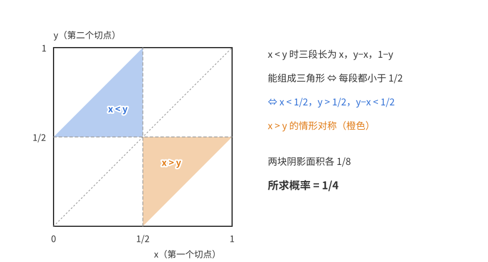
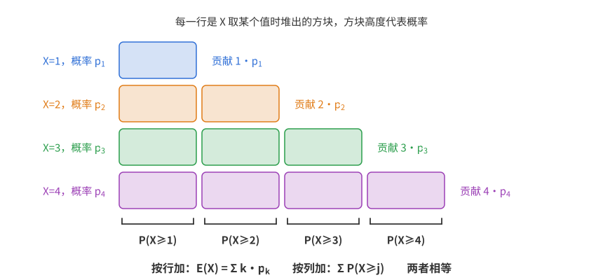
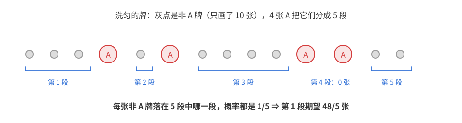
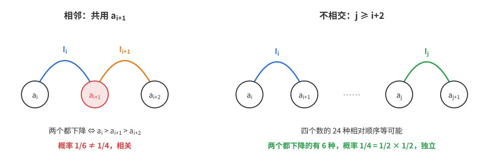
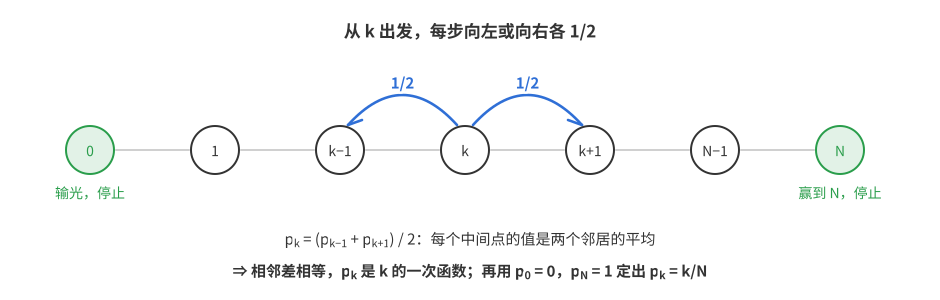
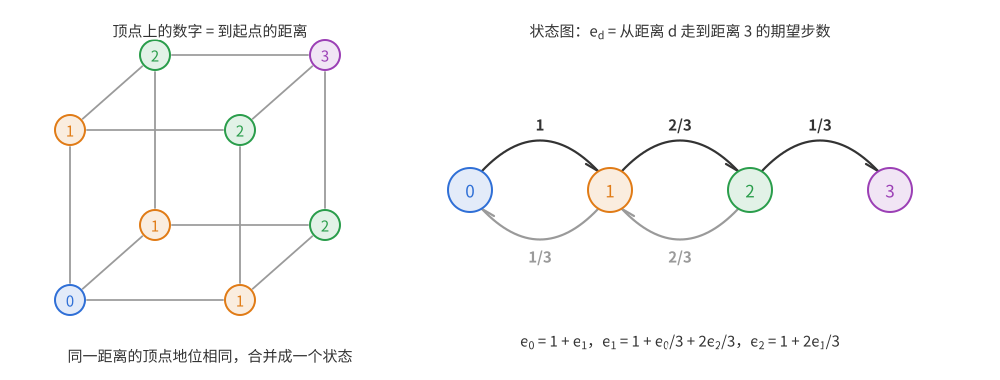

# 竞赛概率（一）：基础与一试

本篇从零讲起，覆盖联赛一试概率题需要的全部知识：古典概型与对称性、条件概率与全概率公式、随机变量的期望与方差、常见分布，以及一试最常用的两件武器：**示性变量 + 期望的线性性**，和**设状态列方程**。读完本篇，也就具备了阅读 [竞赛概率2——期望计数与二试](竞赛概率2——期望计数与二试.md)、[竞赛概率3——概率方法](竞赛概率3——概率方法.md) 的基础。

阅读本篇需要排列组合（$\binom nk$、乘法原理、容斥）、等比数列求和与一阶线性递推的知识，不需要概率基础。第 1、2 章讲样本空间、古典概型、条件概率与独立性；第 3、4 章讲随机变量、期望、方差和常见分布；第 5、6 章讲示性变量与方差的计算，这是一试和二试中最常用的技巧；第 7 章讲用状态和递推处理逐步进行的随机过程；第 8 章是常见错误与习题，习题答案都经过程序核对。

本篇记号：$P(A)$ 表示事件 $A$ 的概率，$\bar A$ 表示 $A$ 的对立事件，$E(X)$、$D(X)$ 表示随机变量 $X$ 的期望和方差。方差在大学教材中多记作 $\mathrm{Var}(X)$。

## 第 1 章　样本空间与古典概型

### 1.1 等可能性

同时掷两枚硬币，“一正一反”的概率是多少？18 世纪的数学家达朗贝尔给出的答案是 $\frac13$，理由是结果只有三种：“两正”“两反”“一正一反”。

这个答案是错的，正确答案是 $\frac12$。把两枚硬币**编号**（或者想成先后掷两次），结果有四种：正正、正反、反正、反反，每种可能性相同，其中“一正一反”占两种。达朗贝尔的三种结果并不等可能，“一正一反”实际上包含了两种情况。

这个例子说明了古典概型唯一的要求，也是最容易出错的地方：

用“有利结果数 ÷ 总结果数”计算概率，**前提是每个结果等可能**。

### 1.2 基本概念

- **样本空间** $\Omega$：一次试验所有可能结果组成的集合。
- **事件**：$\Omega$ 的子集。事件 $A$ 发生，指试验结果落在 $A$ 中。
- **古典概型**：$\Omega$ 有限，且每个结果等可能，这时
$$P(A)=\frac{|A|}{|\Omega|}.$$

由定义直接得到几条性质：

1. $P(\bar A)=1-P(A)$。“至少一个”类的问题，先求对立事件“一个都没有”，往往简单得多。
2. $A,B$ 互斥（不能同时发生）时，$P(A\cup B)=P(A)+P(B)$。
3. 一般情形用容斥：$P(A\cup B)=P(A)+P(B)-P(A\cap B)$。

下文把 $A\cap B$ 简写成 $AB$。

### 1.3 怎样选样本空间

同一道题，样本空间可以有不同选法，只要**等可能**、且**分子分母用同一个空间**，答案就一样。

**例 1.1**　袋中有 3 个红球、2 个白球，不放回地取 2 个，求两个都是红球的概率。

- **无序选法**：把 5 个球编号，取出的是一个 2 元子集，共 $\binom52=10$ 种，等可能。两个都红有 $\binom32=3$ 种，概率 $\frac3{10}$。
- **有序选法**：第一次、第二次取出的球组成有序对，共 $5\times4=20$ 种，等可能。两个都红有 $3\times2=6$ 种，概率 $\frac{6}{20}=\frac3{10}$。

两种算法一致。**错误的算法**是把样本空间取成“红红、红白、白白”三种结果，它们不等可能。

经验规则：相同的东西也要编号，把球、人、硬币都看成可区分的。编号之后，每个具体结果才是等可能的。

### 1.4 对称性

很多概率不需要计数，只需要看出几个结果“地位相同”。

**例 1.2（抽签的公平性）**　袋中 $a$ 个白球、$b$ 个黑球，依次不放回地全部取出。第 $k$ 次取到白球的概率是多少？

直接算要对前 $k-1$ 次的结果分类，很麻烦。换个角度：把 $a+b$ 个球编号，所有取法就是这 $a+b$ 个球的全排列，等可能。第 $k$ 个位置上是哪个球？按对称性，每个球出现在第 $k$ 位的可能性都一样，都是 $\frac{1}{a+b}$。白球有 $a$ 个，所以概率是
$$\frac{a}{a+b},$$
和 $k$ 无关。这就是“抽签先抽后抽都一样公平”的道理。

**例 1.3**　$1,2,\dots,n$ 随机排成一列（$n\ge3$），求 $1$ 排在 $2$ 前面、$2$ 排在 $3$ 前面的概率。

只关心 $1,2,3$ 三个数的**相对顺序**，其余数怎么放无关。三个数的相对顺序有 $3!=6$ 种，按对称性等可能，所以概率是 $\frac16$。

这里用到一个反复出现的事实：

**命题 1.1**　随机排列中，任意取定的 $m$ 个位置（或 $m$ 个数），它们的 $m!$ 种相对大小顺序等可能。

第 5 章、第 6 章会大量使用它。

### 1.5 例题

**例 1.4**　从 $1,2,\dots,20$ 中任取 3 个不同的数，求它们能排成等差数列的概率。

样本空间是 3 元子集，共 $\binom{20}3=1140$ 个，等可能。数等差数列：设公差为 $d\ge1$，首项 $a$ 满足 $a+2d\le20$，有 $20-2d$ 种。$d$ 从 1 到 9：
$$\sum_{d=1}^{9}(20-2d)=18+16+\dots+2=90.$$
（每个等差数列作为集合只数了一次，因为规定了 $d>0$。）概率为 $\frac{90}{1140}=\frac{3}{38}$。

也可以换一种数法：等差数列由首末两项确定，首末两项奇偶性相同即可，中间项自动是整数。从 10 个奇数中取 2 个、或从 10 个偶数中取 2 个：$2\binom{10}{2}=90$。这种“找到决定对象的那几个量”的思路，比按公差分类更快。

### 1.6 几何概型

样本空间是一个区域，概率正比于面积（或长度、体积）。一试偶尔出现，关键是**把随机量设成坐标，把条件翻译成不等式**。

**例 1.5（折棍问题）**　在长为 1 的木棍上独立地随机取两点，把木棍折成三段。求三段能组成三角形的概率。

设两个切点为 $x,y$，$(x,y)$ 在单位正方形中均匀分布。$x<y$ 时三段长为 $x,\ y-x,\ 1-y$。三段能组成三角形，等价于任意两段之和大于第三段；三段总长为 1，所以等价于**每段都小于 $\frac12$**：
$$x<\tfrac12,\qquad y-x<\tfrac12,\qquad y>\tfrac12.$$
这是正方形中一个直角边为 $\frac12$ 的三角形，面积 $\frac18$。$x>y$ 的情形对称，也是 $\frac18$。所以概率是 $\frac14$。

## 第 2 章　条件概率、全概率与独立性

### 2.1 条件的作用

一个家庭有两个孩子，每个孩子是男孩、女孩的可能性各一半，且相互独立。

- 已知**老大**是男孩，两个都是男孩的概率是 $\frac12$；
- 已知**至少有一个**是男孩，两个都是男孩的概率是多少？

很多人答 $\frac12$。按 1.3 节的规则编号：结果有男男、男女、女男、女女四种，等可能。“至少一个男孩”排除了女女，剩下三种仍然等可能，其中男男占一种，所以答案是 $\frac13$。

这里的做法是：**已知 $A$ 发生，就把样本空间缩小到 $A$，再在 $A$ 里面算比例**。这就是条件概率。

### 2.2 条件概率与乘法公式

$$P(B\mid A)=\frac{P(AB)}{P(A)}\qquad(P(A)>0).$$

古典概型下，它就是 $\dfrac{|AB|}{|A|}$，与 2.1 节的直观一致。把式子反过来用，就是**乘法公式**：
$$P(AB)=P(A)\,P(B\mid A),\qquad P(A_1A_2\cdots A_n)=P(A_1)P(A_2\mid A_1)\cdots P(A_n\mid A_1\cdots A_{n-1}).$$
乘法公式适合“一步一步发生”的过程，每一步的条件概率往往一眼可见。

### 2.3 全概率公式

如果 $B_1,\dots,B_m$ 互斥，且合起来是整个样本空间（称为一个**划分**），那么
$$P(A)=\sum_{i=1}^m P(B_i)\,P(A\mid B_i).$$

它就是“分类讨论”的概率版本：按某个中间结果分类，每类内部的条件概率好算。分类的依据，最常见的是**过程的第一步**或**最后一步**，第 7 章的递推方法全都来自这里。

**例 2.1**　甲袋有 2 白 1 黑，乙袋有 1 白 2 黑。从甲袋随机取一球放入乙袋，再从乙袋随机取一球。求取到白球的概率。

直接看不出来，因为乙袋的组成取决于第一步。就按第一步分类：
- 放入的是白球（概率 $\frac23$）：乙袋变成 2 白 2 黑，取白概率 $\frac12$；
- 放入的是黑球（概率 $\frac13$）：乙袋变成 1 白 3 黑，取白概率 $\frac14$。

$$P=\frac23\cdot\frac12+\frac13\cdot\frac14=\frac{5}{12}.$$

### 2.4 贝叶斯公式

$$P(B_i\mid A)=\frac{P(B_i)P(A\mid B_i)}{\sum_j P(B_j)P(A\mid B_j)}.$$

分子是“原因 $B_i$ 导致结果 $A$”这一路的概率，分母是所有路的总和（全概率公式）。

**例 2.2**　某病的患病率为 $1\%$。检测时，患者呈阳性的概率为 $99\%$，健康人呈阳性的概率为 $5\%$。某人检测呈阳性，他真正患病的概率是多少？

$$P(\text{病}\mid\text{阳})=\frac{0.01\times0.99}{0.01\times0.99+0.99\times0.05}=\frac{0.0099}{0.0594}=\frac16.$$

只有 $\frac16$，远低于直觉。原因是健康人太多：虽然每个健康人误报的概率小，但健康人基数是患者的 99 倍，误报的总数反而超过了真阳性。

### 2.5 独立性

$A,B$ **独立**，是指 $P(AB)=P(A)P(B)$，等价于（$P(A)>0$ 时）$P(B\mid A)=P(B)$：知道 $A$ 发生，不改变 $B$ 的概率。

两个常见误区：

1. **互斥和独立是两回事**。$A,B$ 互斥且概率都为正时，$P(AB)=0\ne P(A)P(B)$，它们一定**不**独立：知道 $A$ 发生，就知道 $B$ 没发生。
2. **两两独立不能推出相互独立**。多个事件**相互独立**，要求其中任意几个的交的概率都等于概率之积。

**例 2.3（两两独立但不相互独立）**　掷两枚硬币，$A$ 为“第一枚正面”，$B$ 为“第二枚正面”，$C$ 为“两枚相同”。$P(A)=P(B)=P(C)=\frac12$，且
$$P(AB)=P(AC)=P(BC)=\frac14,$$
所以两两独立。但 $A,B$ 都发生时 $C$ 一定发生，$P(ABC)=\frac14\ne\frac18$，不相互独立。

题目说“各次试验相互独立”时，就可以把各次的概率直接相乘，这是第 4 章二项分布和几何分布的基础。

## 第 3 章　随机变量、期望与方差

### 3.1 随机变量

“掷两个骰子”的结果是一个有序对，“点数之和”是一个数。很多问题只关心这样一个数：赢了多少钱、取到几个红球、要等多少步。把每个试验结果对应到一个数，就是**随机变量**。变成数以后，才能谈“平均是多少”“波动有多大”。

### 3.2 分布列

离散型随机变量 $X$ 取值 $x_1,x_2,\dots$，概率分别为 $p_1,p_2,\dots$，列成表就是**分布列**，要求 $p_i\ge0$，$\sum p_i=1$。解答题第一问常常就是“求分布列”：列出所有取值，逐个算概率，最后**检验概率之和为 1**。这一步检验能查出大部分漏情况的错误。

### 3.3 期望

$$E(X)=\sum_i x_ip_i.$$

直观上，它是大量重复试验时 $X$ 的平均值，也是分布列的“重心”。

期望还有另一种写法，第 5 章要靠它。在古典概型（或一般的有限样本空间）里，把每个结果 $\omega$ 的值 $X(\omega)$ 按概率加权：
$$E(X)=\sum_{\omega\in\Omega}X(\omega)P(\omega).$$
两种写法相等：把取值相同的 $\omega$ 归到一起，就得到第一种。

**期望的性质**

1. $E(aX+b)=aE(X)+b$。
2. **线性性**：$E(X+Y)=E(X)+E(Y)$，**不需要 $X,Y$ 独立**。

性质 2 的证明用第二种写法，一行就够：
$$E(X+Y)=\sum_\omega\big(X(\omega)+Y(\omega)\big)P(\omega)=\sum_\omega X(\omega)P(\omega)+\sum_\omega Y(\omega)P(\omega).$$
证明中完全没用到 $X,Y$ 之间的关系。这一点是第 5 章整套方法的基础，请记住。

### 3.4 方差

期望只说明“平均在哪”，不说明“偏离平均有多远”。比如 $X$ 恒等于 0，和 $X$ 等可能地取 $\pm100$，期望都是 0，但后者波动大得多。衡量波动，要看偏差 $X-\mu$（$\mu=E(X)$）。偏差直接平均是 0，正负抵消了，所以先平方再平均：
$$D(X)=E\big[(X-\mu)^2\big]=\sum_i p_i(x_i-\mu)^2.$$

**标准差**是 $\sqrt{D(X)}$，与 $X$ 同单位。**方差不开根号**，两者不要混淆。

实际计算时，展开平方，用线性性（$\mu$ 是常数）：
$$D(X)=E(X^2)-2\mu E(X)+\mu^2=E(X^2)-E(X)^2.$$
算方差几乎都用这个公式：先算 $E(X^2)$，再减去期望的平方。由 $D(X)\ge0$ 还得到一个不等式：$E(X^2)\ge E(X)^2$。

另外，$D(aX+b)=a^2D(X)$：加常数不改变波动；放大 $a$ 倍，偏差放大 $a$ 倍，平方后放大 $a^2$ 倍。

**例 3.1**　掷一个骰子，点数 $X$。$E(X)=\frac72$，$E(X^2)=\frac{1+4+9+16+25+36}{6}=\frac{91}{6}$，
$$D(X)=\frac{91}{6}-\frac{49}{4}=\frac{35}{12}.$$

### 3.5 独立时的乘积与和

若 $X,Y$ 独立，则 $E(XY)=E(X)E(Y)$，从而
$$D(X+Y)=E\big[(X+Y)^2\big]-\big(E(X)+E(Y)\big)^2=D(X)+D(Y)+2\big[E(XY)-E(X)E(Y)\big]=D(X)+D(Y).$$

**不独立时**，最后多出来的那一项 $E(XY)-E(X)E(Y)$ 不为零，它叫**协方差**，第 6 章专门讲。

### 3.6 尾和公式

对只取非负整数值的 $X$，
$$E(X)=\sum_{j\ge1}P(X\ge j).$$

为什么成立？$X=k$ 时，它对期望的贡献是 $k\cdot p_k$。把 $k$ 拆成 $k$ 个 1，分别记在第 $1,2,\dots,k$ 层。按层收集：第 $j$ 层收到的是所有 $k\ge j$ 的 $p_k$，总和正是 $P(X\ge j)$。同一堆方块，按行加和按列加结果相同。

这个公式适用于 $P(X=k)$ 不好求、但 $P(X\ge k)$ 好求的情形。最大值、最小值、等待时间都是这样。

**例 3.2**　掷骰子 3 次，求最大点数 $M$ 的期望。

直接求 $P(M=k)$ 要算“最大值恰好是 $k$”，需要做差。但“最大值至少是 $k$”的反面是“三次都小于 $k$”：
$$P(M\ge k)=1-\Big(\frac{k-1}{6}\Big)^3.$$
于是
$$E(M)=\sum_{k=1}^{6}\Big[1-\Big(\frac{k-1}6\Big)^3\Big]=6-\frac{0+1+8+27+64+125}{216}=6-\frac{25}{24}=\frac{119}{24}.$$

## 第 4 章　常见分布

本章的分布都要会推导期望和方差，不只记结论。第 5、6 章会给出更快的推导方法，到时回头对照。

### 4.1 两点分布

$X$ 取 1 的概率为 $p$，取 0 的概率为 $1-p$。$E(X)=p$；因为 $X^2=X$，$E(X^2)=p$，所以
$$D(X)=p-p^2=p(1-p).$$
两点分布就是“某件事发生没有”的数值化，第 5 章叫它**示性变量**。

### 4.2 二项分布 $B(n,p)$

一件事每次发生的概率为 $p$，**独立重复** $n$ 次，发生的次数 $X$ 服从二项分布：
$$P(X=k)=\binom nk p^k(1-p)^{n-k},\qquad k=0,1,\dots,n.$$
$\binom nk$ 是选出哪 $k$ 次发生，$p^k(1-p)^{n-k}$ 是这样一种具体结果的概率（独立，所以相乘）。

它的期望是 $np$，方差是 $np(1-p)$。直接用分布列求和来推，要化简组合数；更好的办法是把 $X$ 拆开：$X=I_1+\cdots+I_n$，$I_k$ 表示第 $k$ 次是否发生，每个 $I_k$ 都是两点分布。由线性性 $E(X)=np$；$I_k$ 相互独立，由 3.5 节，方差直接相加：$D(X)=np(1-p)$。

### 4.3 超几何分布

$N$ 件产品中有 $M$ 件次品，**不放回**地取 $n$ 件，次品数 $X$：
$$P(X=k)=\frac{\binom Mk\binom{N-M}{n-k}}{\binom Nn}.$$

期望是 $n\cdot\frac MN$。推导仍然是拆开：$I_i$ 表示第 $i$ 次取到次品。由例 1.2 的抽签公平性，$P(I_i=1)=\frac MN$，与 $i$ 无关，相加得 $\frac{nM}{N}$。和有放回（二项分布）的期望相同。

方差是 $n\cdot\frac MN\cdot\Big(1-\frac MN\Big)\cdot\frac{N-n}{N-1}$。这次各 $I_i$ **不独立**：前一次取到次品，后一次取到次品的可能就变小了。所以方差比二项分布小一个因子 $\frac{N-n}{N-1}$。推导见 6.5 节。

### 4.4 几何分布

每次成功的概率为 $p$，独立重复，直到第一次成功为止，所用的次数 $X$：
$$P(X=k)=(1-p)^{k-1}p,\qquad k=1,2,\dots$$

先求期望。$P(X\ge k)$ 就是前 $k-1$ 次都失败的概率 $(1-p)^{k-1}$，用尾和公式：
$$E(X)=\sum_{k\ge1}(1-p)^{k-1}=\frac1p.$$

期望还可以按第一步分类来推，这是第 7 章的核心手法。第一次成功，则 $X=1$；第一次失败，则已经用了 1 次，之后的过程和从头开始一模一样（独立重复，没有记忆），还需要的次数期望仍是 $E(X)$：
$$E(X)=p\cdot1+(1-p)\big(1+E(X)\big)\quad\Longrightarrow\quad E(X)=\frac1p.$$

方差同样可以按第一步分类，先求 $E(X^2)$。第一次失败时，总次数是 $1+X'$，$X'$ 与 $X$ 同分布：
$$E(X^2)=p+(1-p)E\big[(1+X')^2\big]=p+(1-p)\big(1+2E(X)+E(X^2)\big).$$
解得 $E(X^2)=\frac{2-p}{p^2}$，于是 $D(X)=\frac{2-p}{p^2}-\frac1{p^2}=\frac{1-p}{p^2}$。

几何分布有**无记忆性**：已经失败了 $m$ 次，再要等的次数仍服从同一个几何分布。上面“和从头开始一模一样”说的就是这件事。

### 4.5 正态分布

正态分布是连续分布，高考考查 $3\sigma$ 原则等，联赛一试基本不考，本教程不展开。

### 4.6 收集问题

**例 4.1**　反复掷骰子，直到 6 个点数都出现过，求所需次数的期望。

总次数的分布很复杂。把过程按“已经集到几种点数”分成阶段：已集到 $i$ 种时，每掷一次得到新点数的概率是 $\frac{6-i}{6}$，所以这一阶段的次数服从几何分布，期望 $\frac{6}{6-i}$。总次数是各阶段次数之和，用线性性：
$$E=\sum_{i=0}^{5}\frac{6}{6-i}=6\Big(1+\frac12+\frac13+\frac14+\frac15+\frac16\Big)=\frac{147}{10}=14.7.$$
一般地，集齐 $n$ 种的期望是 $n\big(1+\frac12+\cdots+\frac1n\big)$。

这道题已经用到了“把一个复杂的量拆成几个简单量之和”的思路，下一章把它变成系统的方法。

## 第 5 章　示性变量与期望的线性性

### 5.1 不动点个数的期望

$1,2,\dots,n$ 随机排成一列 $a_1,\dots,a_n$。若 $a_i=i$，称 $i$ 为一个**不动点**。不动点个数 $X$ 的期望是多少？

先试着直接求分布。$X=k$ 时，要选出哪 $k$ 个是不动点（$\binom nk$ 种），其余 $n-k$ 个都不能是不动点，这是错排数 $D_{n-k}$。于是
$$P(X=k)=\frac{\binom nk D_{n-k}}{n!},\qquad E(X)=\sum_k k\cdot\frac{\binom nk D_{n-k}}{n!}.$$
错排数本身就是个容斥求和，这个式子很难化简。

算不动的原因在于：$X$ 是一个“总数”，要知道它取每个值的概率，就得知道所有位置的情况怎样**组合在一起**，而各位置之间互相牵制（一个位置放了某个数，其他位置就不能放）。

换个角度看，$X$ 是 $n$ 个位置各自贡献之和，每个位置要么贡献 1（是不动点），要么贡献 0。3.3 节说过，期望的线性性**不需要独立**。所以根本不用管各位置怎样互相牵制，只要知道每个位置单独是不动点的概率：$a_i=i$ 的概率是 $\frac1n$（$a_i$ 等可能地是 $n$ 个数中的任何一个）。于是
$$E(X)=n\cdot\frac1n=1.$$
不论 $n$ 多大，不动点的平均个数都是 1。

### 5.2 示性变量

事件 $A$ 的**示性变量** $I_A$：$A$ 发生时取 1，否则取 0。它有三条性质，全都直接来自定义：

1. $E(I_A)=P(A)$；
2. $I_A^2=I_A$（0 和 1 的平方不变）；
3. $I_AI_B=I_{AB}$（两个都是 1，当且仅当 $A,B$ 同时发生）。

所以方法是：

1. 把要求的计数量写成示性变量之和：$X=\sum_i I_{A_i}$，“$X$ 数的是满足条件的对象，每个对象一个示性变量”；
2. 对每个 $i$ 求 $P(A_i)$，通常用对称性；
3. $E(X)=\sum_i P(A_i)$。

难点只在第 1 步：**看出 $X$ 在数什么**，选对“每个对象”。下面的例题都是在练这一步。

### 5.3 例题

**例 5.1（下降位，模拟卷 01 第 9 题第 1 问）**　$1,\dots,n$ 随机排列，$a_i>a_{i+1}$ 称 $i$ 为下降位。求下降位个数 $X$ 的期望。

**解法一（示性变量）**：$X=\sum_{i=1}^{n-1}I_i$，$I_i$ 表示 $a_i>a_{i+1}$。由命题 1.1，$a_i,a_{i+1}$ 的两种相对顺序等可能，$P=\frac12$，所以 $E(X)=\frac{n-1}{2}$。

**解法二（配对）**：把排列倒过来，原来的下降位变成上升位，所以一个排列与它的倒序的下降位个数之和为 $n-1$；排列与倒序一一对应，平均就是 $\frac{n-1}{2}$。

解法二很巧，但它只说明了 $X$ 和 $n-1-X$ 同分布，**推不出方差**；解法一可以接着算方差（第 6 章）。

**例 5.2（游程）**　长为 $n$ 的随机 0-1 串（每位独立，各 $\frac12$），连续相同的一段称为一个**游程**，例如 $0011101$ 有 4 个游程。求游程个数的期望。

“游程个数”看上去要数一段一段，不好拆。换个说法：每个游程有唯一的**起点**。第 1 位总是起点；第 $i$ 位（$i\ge2$）是起点，当且仅当它和前一位不同，概率 $\frac12$。所以
$$E=1+\frac{n-1}{2}.$$
这里的关键动作是：**把“数段”变成“数段的起点”**，每段恰好对应一个起点，起点是单个位置的事件。

**例 5.3（记录）**　$1,\dots,n$ 随机排列，若 $a_k$ 比它前面的所有数都大，称 $a_k$ 是一个**记录**（$a_1$ 总是记录）。求记录个数的期望。

$a_k$ 是记录，等价于 $a_k$ 是前 $k$ 个数中最大的。前 $k$ 个数的相对顺序等可能，最大的那个在第 $k$ 位的概率为 $\frac1k$。所以
$$E=1+\frac12+\frac13+\cdots+\frac1n.$$
这个数约为 $\ln n$，增长得很慢。

**例 5.4（第一张 A 之前）**　一副 52 张的扑克牌洗匀，求第一张 A 之前平均有几张牌。

设 $X$ 为第一张 A 之前的牌数。$X$ 数的是“排在所有 A 之前的非 A 牌”，所以对 48 张非 A 牌各设一个示性变量：牌 $c$ 排在 4 张 A 之前的概率是多少？只看 $c$ 和 4 张 A 这 5 张牌的相对顺序，等可能，$c$ 排第一的概率为 $\frac15$。于是
$$E(X)=48\times\frac15=\frac{48}{5}.$$

还可以这样看：4 张 A 把 48 张非 A 牌分成 5 段，每张非 A 牌落入哪一段的概率都是 $\frac15$，所以 5 段的平均长度相同，都是 $\frac{48}5$，第一段就是 $X$。这个“隔板 + 对称”的图像在 [竞赛概率2——期望计数与二试](竞赛概率2——期望计数与二试.md) 中还会用到。

**例 5.5（生日问题的期望版）**　$n$ 个人，生日在 365 天中独立均匀分布。求：(1) 同一天生日的人对数的期望；(2) 至少有一人过生日的天数的期望。

(1) 对每一对人设示性变量，同生日概率为 $\frac1{365}$，共 $\binom n2$ 对，期望 $\dfrac{\binom n2}{365}$。$n=28$ 时已超过 1。

(2) 对每一天设示性变量。某一天没人过生日的概率为 $\big(\frac{364}{365}\big)^n$，所以期望为
$$365\Big[1-\Big(\frac{364}{365}\Big)^n\Big].$$

这道题里，(1) 是对“人对”设变量，(2) 是对“天”设变量。同一个场景，数什么就对什么设变量。

### 5.4 常见的拆法

上面几道题的拆法列在一起：

| 要数的量 | 对什么设示性变量 | 单个概率 |
|---|---|---|
| 不动点 | 每个位置 | $\frac1n$ |
| 下降位 | 每对相邻位置 | $\frac12$ |
| 游程 | 每个位置（是否是游程起点） | $\frac12$ |
| 记录 | 每个位置（是否是前缀最大） | $\frac1k$ |
| 第一张 A 之前的牌 | 每张非 A 牌 | $\frac15$ |
| 同生日的对 | 每对人 | $\frac1{365}$ |

以后看到“求某种结构个数的期望”，而直接求分布又算不动，就对每个可能的结构设一个示性变量。最难的往往是看出该数什么：段数不清时，改数段的起点。

## 第 6 章　方差的计算：相关结构

### 6.1 方差与两两关系

第 5 章用线性性求期望，完全不用管各示性变量之间的关系。求方差就不行了。$X=\sum_i I_i$，由 $D(X)=E(X^2)-E(X)^2$，要算
$$X^2=\sum_iI_i^2+2\sum_{i<j}I_iI_j=\sum_iI_i+2\sum_{i<j}I_{A_iA_j}.$$
所以
$$E(X^2)=\sum_iP(A_i)+2\sum_{i<j}P(A_iA_j).$$

**新的要求**出现了：要知道**每两个事件同时发生的概率**。各事件之间的关系，第 5 章可以不管，现在必须面对。

### 6.2 协方差

两个事件同时发生的概率，如果和独立时一样，即 $P(A_iA_j)=P(A_i)P(A_j)$，那么这一对对方差没有“额外贡献”。把这个差值单独拿出来，就是**协方差**：
$$\mathrm{Cov}(X,Y)=E\big[(X-EX)(Y-EY)\big]=E(XY)-E(X)E(Y).$$
对示性变量，$\mathrm{Cov}(I_A,I_B)=P(AB)-P(A)P(B)$：**同时发生的概率，减去假如独立时的概率**。

- 协方差 $>0$：一个发生，另一个更容易发生；
- 协方差 $<0$：一个发生，另一个更难发生；
- 独立时协方差为 0（反过来不一定成立）。

用协方差写，方差公式变成
$$D\Big(\sum_iI_i\Big)=\sum_iD(I_i)+2\sum_{i<j}\mathrm{Cov}(I_i,I_j).$$

推导：$D(X+Y)=E\big[(a+b)^2\big]$，其中 $a=X-EX$，$b=Y-EY$，展开得 $E(a^2)+E(b^2)+2E(ab)$。多个变量同理，每一对贡献一个交叉项。

两种写法（直接算 $E(X^2)$，或用协方差）结果相同，一试中写哪种都行。协方差写法的好处是：**独立的对贡献为 0，可以整类划掉**。

所以方差计算的核心问题是：**哪些对是相关的？** 这叫作示性变量的**相关结构**。

### 6.3 三种相关结构

| 结构 | 例子 | 哪些对相关 | 计算量 |
|---|---|---|---|
| 全部独立 | 二项分布 | 没有 | 只剩 $\sum D(I_i)$ |
| 局部相关 | 下降位、游程 | 只有“挨着”的对 | 只需单独算少数几类对 |
| 全部相关 | 超几何 | 每一对都相关 | 每对的协方差相同，乘以对数 |

下面每类各举一例。

### 6.4 局部相关：下降位个数的方差

接例 5.1，$X=\sum_{i=1}^{n-1}I_i$，$D(I_i)=\frac14$。对 $i<j$，看两对位置 $\{i,i+1\}$ 和 $\{j,j+1\}$ 的关系：

- **不相交**（$j\ge i+2$）：这四个位置上的数，相对顺序 $24$ 种等可能。两对都下降，相当于两对内部的顺序都定了，有 $24/4=6$ 种，概率 $\frac14=\frac12\cdot\frac12$，协方差为 0。
- **相邻**（$j=i+1$）：两个都下降当且仅当 $a_i>a_{i+1}>a_{i+2}$，概率 $\frac16$，协方差 $\frac16-\frac14=-\frac1{12}$。这样的对有 $n-2$ 个。

为什么相邻时是负相关？前一位下降，说明 $a_{i+1}$ 偏小，那么后一位 $a_{i+1}>a_{i+2}$ 就更难成立。

$$D(X)=\frac{n-1}{4}+2(n-2)\Big(-\frac1{12}\Big)=\frac{n+1}{12}.$$

**验算** $n=3$：$X$ 取 $0,1,2$ 的概率为 $\frac16,\frac46,\frac16$，$E(X^2)=\frac{0+4+4}{6}=\frac43$，$D(X)=\frac43-1=\frac13=\frac{4}{12}$。一致。

也可以不用协方差，直接算 $E(X^2)$：
$$E(X^2)=\frac{n-1}{2}+2\Big[(n-2)\cdot\frac16+\frac{(n-2)(n-3)}{2}\cdot\frac14\Big],$$
其中 $\frac{(n-2)(n-3)}{2}=\binom{n-1}2-(n-2)$ 是不相交的对数。再减去 $\frac{(n-1)^2}{4}$，化简得同样的 $\frac{n+1}{12}$。

### 6.5 全部相关：超几何分布的方差

接 4.3 节，$X=\sum_{i=1}^nI_i$，$I_i$ 表示第 $i$ 次取到次品，$P(I_i=1)=\frac MN$。

任意两次 $i\ne j$：由对称性，第 $i$、$j$ 次取到的是“随机两件不同的产品”，都是次品的概率为 $\frac{M(M-1)}{N(N-1)}$。所以
$$\mathrm{Cov}(I_i,I_j)=\frac{M(M-1)}{N(N-1)}-\frac{M^2}{N^2}=-\frac{M(N-M)}{N^2(N-1)}.$$
每一对都相关（负相关：前面取走了次品，后面就少了），且协方差都一样，共 $\binom n2$ 对：
$$D(X)=n\cdot\frac MN\Big(1-\frac MN\Big)-n(n-1)\frac{M(N-M)}{N^2(N-1)}=n\cdot\frac MN\Big(1-\frac MN\Big)\cdot\frac{N-n}{N-1}.$$

检验一下：$n=N$（全部取出）时方差为 0。这时次品数一定是 $M$，确实没有波动。

### 6.6 记录个数的方差

接例 5.3，$I_k$ 表示 $a_k$ 是记录，$P(I_k=1)=\frac1k$。$j<k$ 时，$I_j$ 和 $I_k$ 相关吗？

直觉上似乎相关，但计算表明它们**独立**。$a_k$ 是前 $k$ 个数中最大的，概率 $\frac1k$；**在这个条件下**，前 $k-1$ 个数的相对顺序仍然等可能（知道“最大的在第 $k$ 位”，对前 $k-1$ 个数怎么排没有任何信息），所以 $a_j$ 是前 $j$ 个中最大的，条件概率仍为 $\frac1j$。于是
$$P(I_jI_k=1)=\frac1k\cdot\frac1j=P(I_j=1)P(I_k=1).$$
所有协方差为 0：
$$D(X)=\sum_{k=1}^n\frac1k\Big(1-\frac1k\Big)=\sum_{k=1}^n\frac1k-\sum_{k=1}^n\frac1{k^2}.$$

所以相关不相关要**算出来**，不能凭感觉。判断的标准始终是 $P(AB)$ 是否等于 $P(A)P(B)$。

回头看这一章，求计数量的方差，步骤始终一样：拆成示性变量，按两个事件之间的关系把所有的对分类，只计算相关的那几类。随机排列的题里，最常用的事实是：不相交的几组位置上的相对顺序互相独立。习题 8.2 第 8 题（不动点的方差）请自己做。

## 第 7 章　递推与状态

### 7.1 传球问题

4 个人互相传球，每次持球者等可能地传给另外 3 人中的一个。球从甲开始，求传 $n$ 次后球回到甲手中的概率 $p_n$。

如果直接数路径，每次有 3 种选择，共 $3^n$ 条路径，要数其中终点是甲的。可以数，但 $n$ 一般时很难直接写出来。

换个办法，按最后一步分类。传了 $n$ 次后，球要么在甲手里（概率 $p_n$），要么不在（$1-p_n$）。第 $n+1$ 次：
- 球在甲手里，传给别人，不可能回到甲；
- 球不在甲手里，有 $\frac13$ 的概率传给甲。

由全概率公式：
$$p_{n+1}=\frac13(1-p_n),\qquad p_0=1.$$
这是一阶线性递推。找不动点 $p=\frac13(1-p)$，$p=\frac14$，于是 $p_{n+1}-\frac14=-\frac13\big(p_n-\frac14\big)$，
$$p_n=\frac14+\frac34\Big(-\frac13\Big)^n.$$

检验一下：$p_1=0$（第一次一定传给别人），$p_2=\frac13$（第二次回到甲的概率），都对。$n\to\infty$ 时 $p_n\to\frac14$，四人地位趋于平等，也合理。

这个方法的要点是：不追踪整条路径，只追踪“现在处在什么**状态**”（球在不在甲手里）。只要下一步怎么走只依赖当前状态，就能列出递推。

### 7.2 状态与方程

7.1 节的做法可以概括为四步，本章其余各节都按这四步进行：

1. **设状态**：找出决定“以后怎么发展”的最少信息。地位相同的情况合并成一个状态。
2. **列方程**：求概率时，常按**最后一步**列递推（7.1 节）；求“到达某处的概率”或“期望步数”时，常按**第一步**列方程（下面几节）。
3. **解方程**：一阶线性递推找不动点；几个状态时解线性方程组。
4. **检验**：小情形代入，或看极限是否合理。

### 7.3 随机游走与赌徒破产

**例 7.1**　赌徒有 $k$ 元，每局输赢 1 元，概率各半，到 0 元（输光）或 $N$ 元时停止。求他赢到 $N$ 元的概率 $p_k$，以及停止前期望进行的局数 $e_k$。

状态就是当前的钱数。从 $k$ 出发（$0<k<N$），**按第一局分类**：
$$p_k=\frac12p_{k-1}+\frac12p_{k+1},\qquad p_0=0,\ p_N=1.$$

这个方程说 $p_k$ 是两个邻居的平均，即 $p_{k+1}-p_k=p_k-p_{k-1}$：相邻差相等，$p_k$ 是等差数列。由两端的值得
$$p_k=\frac kN.$$

期望局数同样按第一局分类，只是多了“这一局本身”的 1：
$$e_k=1+\frac12e_{k-1}+\frac12e_{k+1},\qquad e_0=e_N=0.$$
改写成 $(e_{k+1}-e_k)-(e_k-e_{k-1})=-2$：二阶差分为常数，$e_k$ 是 $k$ 的二次函数。由两端为零，设 $e_k=ck(N-k)$，代入得 $c=1$：
$$e_k=k(N-k).$$

### 7.4 正方体上的随机游走

**例 7.2**　蚂蚁在正方体的顶点上爬，每步沿一条棱等可能地走到 3 个相邻顶点之一。求从一个顶点出发，第一次到达对角顶点的期望步数。

8 个顶点设 8 个未知数可以做，但太多。注意到决定以后发展的只是**到目标的距离**：用坐标表示，起点为 $(0,0,0)$，目标为 $(1,1,1)$，到起点的距离（坐标之和）$d\in\{0,1,2,3\}$。同一距离的顶点地位相同，合并成一个状态。

设 $e_d$ 为从距离 $d$ 出发到达距离 3 的期望步数，$e_3=0$。在距离 $d$ 的顶点上，3 条棱中有 $3-d$ 条使距离加 1，$d$ 条使距离减 1。按第一步分类：
$$e_0=1+e_1,\qquad e_1=1+\frac13e_0+\frac23e_2,\qquad e_2=1+\frac23e_1+\frac13\cdot0.$$
解得 $e_2=7$，$e_1=9$，$e_0=10$。

### 7.5 等待一个图案

**例 7.3**　反复掷硬币，直到连续出现“正正”为止，求期望次数。

状态是“当前已经凑出图案的前几位”：
- $S_0$：还没开始凑（刚开始，或刚掷出反面）；
- $S_1$：上一次是正面；
- $S_2$：已经出现正正（结束）。

从 $S_0$ 掷一次：正面到 $S_1$，反面留在 $S_0$；从 $S_1$ 掷一次：正面结束，反面回到 $S_0$。设期望剩余次数为 $x_0,x_1$：
$$x_0=1+\frac12x_1+\frac12x_0,\qquad x_1=1+\frac12\cdot0+\frac12x_0.$$
解得 $x_1=4$，$x_0=6$。

再看“正反”。从 $S_1$（上次正面）掷出正面，还是“上次正面”，留在 $S_1$；掷出反面就结束。
$$x_0=1+\frac12x_1+\frac12x_0,\qquad x_1=1+\frac12x_1\quad\Longrightarrow\quad x_1=2,\ x_0=4.$$

同样是两位的图案，期望一个是 6、一个是 4。差别在于失败时退回到哪里：“正正”失败（掷出反面）要从头来，“正反”失败（又掷出正面）还保留着进度。

有一个一般规律可以用来检验答案（考试中仍要写出方程）：公平硬币下，等待图案 $W$ 的期望次数等于所有满足“$W$ 的长为 $k$ 的前缀等于长为 $k$ 的后缀”的 $k$（包括 $k=|W|$）对应的 $2^k$ 之和。例如“正正”：$k=1,2$，$2+4=6$；“正反”：只有 $k=2$，$4$；“正反正”：$k=1,3$，$2+8=10$。

**例 7.4（谁先出现）**　甲押“正正”，乙押“反正”，反复掷硬币，先出现谁押的图案谁赢。求乙赢的概率。

可以设状态列方程，但这里有一个更快的观察：**只要前两次不是“正正”，乙就必赢。**

- 前两次不是“正正”，那么前两次里一定出现了反面（第一次是反面，或者“正反”）。到这个反面为止，最多只出现过一个正面，“正正”还没出现。
- 从这个反面往后看，**第一个正面**的前一次一定是反面，在这一刻“反正”出现了。
- 在这一刻之前，反面之后全是反面，不可能出现“正正”。

所以甲赢只有一种情况：前两次都是正面，概率 $\frac14$。乙赢的概率是 $\frac34$。

单独等待时，两个图案的期望次数是 6 和 4，相差不大；比赛起来，乙的胜率却是甲的 3 倍。“谁先出现”和“各自要等多久”是两个不同的问题。

### 7.6 常见错误

过程一步一步进行、下一步只依赖现在的状况时，就设状态列方程。最常见的错误是状态没设全，尤其是失败后“退回到哪里”想当然地写成退回起点（对照例 7.3 的“正反”）。另外两点：地位相同的状态要合并，否则方程太多；吸收态的值是边界条件，别忘了写。

## 第 8 章　常见错误与习题

### 8.1 常见错误

| 错误 | 典型表现 | 对策 |
|---|---|---|
| 样本空间不等可能 | 把“两正、两反、一正一反”当三个等可能结果 | 相同的东西也编号 |
| 分子分母不在同一空间 | 分子按有序数、分母按无序数 | 写出样本空间是什么 |
| 漏情况 | 分布列概率之和不为 1 | 求完分布列一定检验和为 1 |
| 互斥当独立 | 互斥事件的概率直接相乘 | 记住：互斥的正概率事件一定不独立 |
| 条件概率的条件弄错 | “至少一个男孩”当成“老大是男孩” | 把条件下的样本空间列出来 |
| 方差和标准差混淆 | 方差多开了根号 | 方差 $=E(X^2)-E(X)^2$，不开根号 |
| 方差用了独立性 | 不独立的变量方差直接相加 | 先判断相关结构 |
| 递推状态没设全 | 等待图案时，失败一律退回起点 | 列出“失败后还保留多少进度” |
| 忽略边界 | 递推的初值、吸收态的值没写 | 用 $n=0,1$ 检验 |

### 8.2 习题

做完全部题目再看答案。前 5 题是一试填空难度，后 5 题是解答题或拔高难度。

1. 从 $1,2,\dots,10$ 中任取 3 个不同的数，求它们的和是 3 的倍数的概率。
2. 甲、乙比赛，每局甲胜的概率为 $\frac23$，各局独立，先胜 3 局者获胜。求甲获胜的概率。
3. $1,\dots,n$（$n\ge3$）随机排列，若 $a_{i-1}>a_i<a_{i+1}$（$2\le i\le n-1$），称 $i$ 为一个“谷”。求谷的个数的期望。
4. 4 个球独立地随机放入 4 个盒子，求空盒个数的期望。
5. 3 人互相传球，每次等可能地传给另外两人之一，从甲开始。求传 $n$ 次后球在甲手中的概率。
6. 反复掷硬币，直到出现“正反正”，求期望次数（写出状态和方程）。
7. 盒中 5 个红球、5 个白球，不放回地取 4 个，求红球个数的方差。
8. $1,\dots,n$（$n\ge2$）随机排列，求不动点个数的方差。先判断：哪些示性变量对是相关的？
9. 掷骰子 3 次，求最小点数的期望。
10. （挑战）反复掷骰子直到掷出 6 为止。已知掷出的所有点数都是偶数，求掷的次数的期望。（提示：答案不是 3。）

### 8.3 答案与提示

1. $\frac{7}{20}$。按模 3 余数分类：余 0 的有 $\{3,6,9\}$，余 1 的有 $\{1,4,7,10\}$，余 2 的有 $\{2,5,8\}$。三个同余：$1+4+1=6$ 种；三类各一个：$3\times4\times3=36$ 种。共 42 种，$\frac{42}{120}$。
2. $\frac{64}{81}$。甲在第 $3+k$ 局获胜（乙胜 $k$ 局，$k=0,1,2$），最后一局必须是甲胜：$\sum_{k=0}^2\binom{2+k}{k}\big(\frac23\big)^3\big(\frac13\big)^k=\frac{8}{27}\big(1+1+\frac23\big)$。
3. $\frac{n-2}{3}$。每个内部位置是谷，当且仅当它是三个数中最小的，概率 $\frac13$。
4. $\frac{81}{64}$。每个盒子空的概率为 $\big(\frac34\big)^4$，乘以 4。
5. $p_n=\frac13+\frac23\big(-\frac12\big)^n$。递推 $p_{n+1}=\frac12(1-p_n)$。
6. $10$。状态：$S_0$（无进度）、$S_1$（“正”）、$S_2$（“正反”）。从 $S_1$ 掷正面仍在 $S_1$；从 $S_2$ 掷反面回到 $S_0$（“正反反”没有可用的后缀）。方程 $x_0=1+\frac12x_1+\frac12x_0$，$x_1=1+\frac12x_1+\frac12x_2$，$x_2=1+\frac12x_0$，解得 $x_0=10$。
7. $\frac23$。超几何分布方差公式，$n=4$，$\frac MN=\frac12$，$\frac{N-n}{N-1}=\frac69$：$4\cdot\frac14\cdot\frac23$。
8. $1$。**全部相关**：$i\ne j$ 时 $P(a_i=i,\ a_j=j)=\frac{1}{n(n-1)}$，协方差 $\frac1{n(n-1)}-\frac1{n^2}=\frac{1}{n^2(n-1)}>0$（正相关：一个位置“占对了”，剩下的数里正确的那个数还在，另一个位置更容易占对）。$D=n\cdot\frac1n\big(1-\frac1n\big)+n(n-1)\cdot\frac{1}{n^2(n-1)}=1-\frac1n+\frac1n=1$。
9. $\frac{49}{24}$。尾和公式：$P(\min\ge k)=\big(\frac{7-k}{6}\big)^3$，$E=\frac{1+8+27+64+125+216}{216}=\frac{441}{216}$。也可由对称性：$7-\min$ 与 $\max$ 同分布，$E(\min)=7-\frac{119}{24}$。
10. $\frac32$。条件“全是偶数且以 6 结束”，等价于“第一次掷出 $\{1,3,5,6\}$ 中的数时，掷出的是 6”。第一次掷出这四个数之一所需的次数 $T$ 服从几何分布，$p=\frac23$；掷出的是这四个数中的哪一个，与 $T$ 独立且等可能。所以在条件下 $T$ 的分布不变，$E=\frac{1}{2/3}=\frac32$。直觉上的“3”错在：条件不是“每次只能掷 2、4、6”，而是“排除了中途掷出奇数的那些试验”，而次数越多的试验越容易被排除。

下一篇 [竞赛概率2——期望计数与二试](竞赛概率2——期望计数与二试.md) 把示性变量和对称性用到二试的组合计数与存在性证明中。
