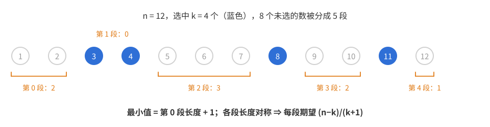
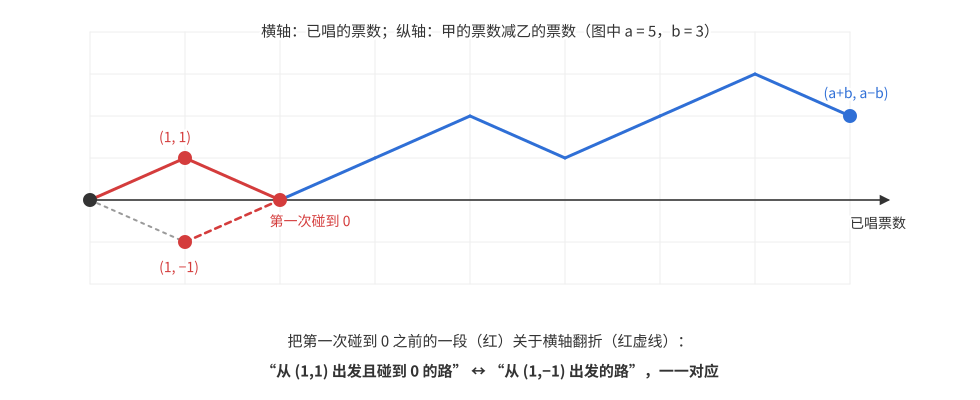
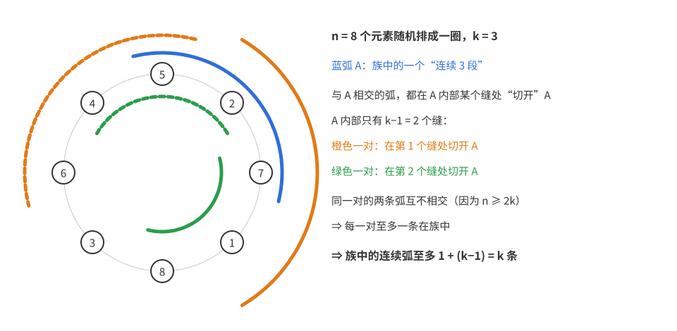

# 竞赛概率（二）：期望计数与二试

二试很少直接考“求概率”，但概率的语言是组合题的强力工具：一个求和可以改写成期望，从而用线性性拆开；一个对称的随机过程可以给出漂亮的双射；“随机对象的期望值为 $\mu$”可以推出“存在一个对象不小于 $\mu$”。本篇讲这三种用法，以及“方差非负”给出的不等式。前置知识是 [竞赛概率1——基础与一试](竞赛概率1——基础与一试.md) 的第 3、5、6 章。

第 1 章把和式改写成期望；第 2 章讲反射原理；第 3 章讲平均值原理，它是 [竞赛概率3——概率方法](竞赛概率3——概率方法.md) 的起点；第 4 章用随机排列做双重计数，证明 Sperner 定理和 Erdős–Ko–Rado 定理；第 5 章用方差非负证明不等式。例题中注明出处的是竞赛原题或经典定理，其余是为讲解设计的题。

## 第 1 章　和式与期望

### 1.1 逆序数之和

求 $1,2,\dots,n$ 的全部 $n!$ 个排列的逆序数之和。（$i<j$ 且 $a_i>a_j$ 称为一个逆序。）

直接做的话，要按逆序数分类，要知道逆序数为 $k$ 的排列有多少个。这是一个有名的难算的数（它的生成函数是 $\prod_{i=1}^{n}(1+x+\cdots+x^{i-1})$），没有简单的闭式。

换个思路，把和写成期望：
$$\sum_{\text{所有排列}}\mathrm{inv}(\sigma)=n!\cdot E\big(\mathrm{inv}(\sigma)\big),$$
其中 $\sigma$ 是随机排列。要求的和，就是“总数 × 平均值”。平均值可以用线性性：逆序数是 $\binom n2$ 对位置各自是否构成逆序的示性变量之和，每对的概率为 $\frac12$，所以
$$\sum_{\sigma}\mathrm{inv}(\sigma)=n!\cdot\frac12\binom n2=\frac{n!\,n(n-1)}{4}.$$

这其实就是双重计数：“先按排列求和，再在每个排列里按位置对求和”交换成“先按位置对求和，再数有多少排列在这一对上构成逆序”。概率语言的好处是不用写双重求和的下标，“每对的概率是 $\frac12$”比“这一对构成逆序的排列有 $\frac{n!}2$ 个”更直接。

所以，遇到对一族对象（所有子集、所有排列、所有染色）求某个量的和，可以先改写成“个数 × 随机对象的期望”，再用示性变量拆开。

### 1.2 对子集求和

**例 1.1**　求 $\displaystyle\sum_{A,B\subseteq\{1,\dots,n\}}|A\cup B|$，求和对所有有序子集对 $(A,B)$ 进行。

共 $4^n$ 对。随机取 $A,B$：每个元素独立地以 $\frac12$ 的概率属于 $A$，以 $\frac12$ 的概率属于 $B$。$|A\cup B|$ 是 $n$ 个元素各自“是否属于 $A\cup B$”的示性变量之和，每个元素不属于 $A\cup B$ 的概率为 $\frac14$，所以
$$\sum|A\cup B|=4^n\cdot n\cdot\frac34=3n\cdot4^{n-1}.$$
同理 $\sum|A\cap B|=4^n\cdot n\cdot\frac14=n\cdot4^{n-1}$。

### 1.3 最小元的平均值

**例 1.2**（IMO 1981 第 2 题）　设 $1\le k\le n$。考虑 $\{1,2,\dots,n\}$ 的全部 $k$ 元子集，每个子集取其最小元。证明这些最小元的平均值为 $\dfrac{n+1}{k+1}$。

平均值就是随机 $k$ 元子集 $S$ 的最小元 $\min S$ 的期望。

先试直接算。最小元为 $m$ 的子集，要在 $m+1,\dots,n$ 中再选 $k-1$ 个，有 $\binom{n-m}{k-1}$ 个，于是要算 $\sum_m m\binom{n-m}{k-1}$。这能用组合恒等式算出来（见下面的证明二），但看不出答案为什么这么简洁。

换一个图像：把 $1,\dots,n$ 排成一行，选中的 $k$ 个数把其余 $n-k$ 个数分成 $k+1$ 段（第 0 段在最小元之前，第 $k$ 段在最大元之后，有的段可以为空）。最小元等于第 0 段的长度加 1。

如果 $k+1$ 段的长度地位相同，那么每段的期望长度都是 $\frac{n-k}{k+1}$，于是
$$E(\min S)=\frac{n-k}{k+1}+1=\frac{n+1}{k+1}.$$
剩下要说明的就是：**各段长度确实地位相同**。

**证明一（空隙对称）**　$k$ 元子集与段长序列 $(g_0,g_1,\dots,g_k)$（非负整数，和为 $n-k$）一一对应：由子集可以读出段长；反过来，由段长可以唯一还原出子集。对段长序列的任何一个重排，例如交换 $g_0$ 和 $g_j$，也是这些序列之间的一个双射。所以随机 $k$ 元子集对应的随机段长序列，交换任意两个分量后分布不变，从而 $E(g_0)=E(g_1)=\cdots=E(g_k)$。它们的和恒为 $n-k$，所以每个都是 $\frac{n-k}{k+1}$，而 $\min S=g_0+1$。$\blacksquare$

**证明二（组合恒等式）**　把 $m$ 写成 $\sum_{j=1}^{m}1$，交换求和次序：
$$\sum_{m}m\binom{n-m}{k-1}=\sum_{j\ge1}\sum_{m\ge j}\binom{n-m}{k-1}=\sum_{j\ge1}\binom{n-j+1}{k}=\binom{n+1}{k+1},$$
两次都用了“曲棍球棒恒等式” $\sum_{i\le N}\binom{i}{r}=\binom{N+1}{r+1}$。除以 $\binom nk$ 即得 $\frac{n+1}{k+1}$。$\blacksquare$

证明二中“把 $m$ 写成 $m$ 个 1 再交换求和”，就是[第一篇](竞赛概率1——基础与一试.md)的尾和公式。两种证明的计算量差不多，但证明一解释了**为什么**是 $\frac{n+1}{k+1}$，还能立刻推出最大元的平均值是 $n-\frac{n-k}{k+1}=\frac{k(n+1)}{k+1}$。

## 第 2 章　反射原理

### 2.1 选票问题

选举中甲得 $a$ 票，乙得 $b$ 票，$a>b$。选票随机排序后逐张唱出。求唱票过程中甲的票数**始终严格多于**乙的概率。

把唱票过程画成折线：横轴是已唱的票数，纵轴是“甲的票数减乙的票数”，唱到甲的票往上走一步，唱到乙的票往下走一步。折线从 $(0,0)$ 走到 $(a+b,\ a-b)$，共 $\binom{a+b}{a}$ 条，等可能。“始终严格领先”就是折线除起点外**不碰到横轴**。

直接数“好路”很难，因为不碰横轴的条件涉及每一个前缀。不如数“坏路”。好路的第一步必须向上，所以坏路分两类：

1. 第一步向下：这样的路有 $\binom{a+b-1}{b-1}$ 条（剩下 $a$ 个上、$b-1$ 个下）。
2. 第一步向上，但后来碰到了横轴。这一类不好直接数。

### 2.2 反射

第 2 类的路可以这样处理：对它，把**第一次碰到横轴之前**的那一段关于横轴翻折，得到一条从 $(0,0)$ 出发、第一步向下的路。

这个操作是双射：
- 翻折后的路第一步向下，从 $(1,-1)$ 出发，最后到达 $(a+b,a-b)$，在横轴上方，所以中途一定会碰到横轴；
- 对任意一条第一步向下的路，同样把第一次碰到横轴之前的部分翻回去，就得到一条第 2 类的路，两个操作互逆。

所以第 2 类的路也有 $\binom{a+b-1}{b-1}$ 条。

$$P(\text{始终领先})=1-\frac{2\binom{a+b-1}{b-1}}{\binom{a+b}{a}}=1-\frac{2b}{a+b}=\frac{a-b}{a+b}.$$

其中用到 $\binom{a+b-1}{b-1}\Big/\binom{a+b}{a}=\frac{b}{a+b}$（这就是“第一张票是乙的”概率，对称性一眼可见）。

为什么会想到翻折？碰到横轴之后，路的“前一段”是什么已经无关紧要，只关心它碰到了横轴。翻折恰好不改变“从碰到横轴到终点”的那一段，只把起点从 $(1,1)$ 变成 $(1,-1)$，后者的路没有任何限制，可以直接数。

### 2.3 卡特兰数

**例 2.1**　$2n$ 人排队买 5 元的票，其中 $n$ 人只有 5 元，$n$ 人只有 10 元，售票员开始时没有零钱。随机排队，求售票员每次都能找零的概率。

5 元往上走，10 元往下走，能找零当且仅当折线**始终不低于横轴**（可以碰到）。坏路是碰到 $y=-1$ 的路。这次翻折**第一次碰到 $y=-1$ 之后**的部分（关于直线 $y=-1$），终点从 $(2n,0)$ 变成 $(2n,-2)$；反过来，任何走到 $(2n,-2)$ 的路都必然碰到 $y=-1$，把那之后的部分翻回去就还原了。所以坏路与“走到 $(2n,-2)$ 的路”一一对应，后者有 $n-1$ 步向上、$n+1$ 步向下，共 $\binom{2n}{n+1}$ 条。
$$P=1-\frac{\binom{2n}{n+1}}{\binom{2n}{n}}=1-\frac{n}{n+1}=\frac1{n+1}.$$
好路的条数 $\frac1{n+1}\binom{2n}n$ 就是**卡特兰数**。

## 第 3 章　平均值原理

### 3.1 大割

**例 3.1**　证明：任何有 $m$ 条边的图，都可以把顶点分成两组，使得至少有 $\frac m2$ 条边的两个端点在不同组。

要证明的是“存在一种分法”，而且要达到 $\frac m2$ 这个数量。可以用调整法（若某点同组的邻点多于异组的邻点，就把它移到另一组，跨组边数增加，直到不能再调整），这个方法也能做。

还有一个几乎不用想的做法：随机分组。每个顶点独立地抛硬币决定去哪一组。对每条边，两端点落在不同组的概率是 $\frac12$。跨组边数 $X$ 是 $m$ 个示性变量之和，
$$E(X)=\frac m2.$$
一个随机变量**不可能总是小于它的期望**。所以至少有一种分法使 $X\ge\frac m2$。$\blacksquare$

这里用到的事实叫**平均值原理**：若随机对象的某个量期望为 $\mu$，则存在一个对象使这个量 $\ge\mu$，也存在一个对象使它 $\le\mu$。这就是抽屉原理的连续版本：$N$ 个数的平均值为 $\mu$，其中最大的不小于 $\mu$。用概率写的好处在于，“平均值”可以用线性性计算，而不用真的把所有对象列出来。

如果不想用概率的语言，可以这样写：对全部 $2^n$ 种分法，把跨组边数加起来。每条边在恰好一半的分法中跨组，总和为 $m\cdot2^{n-1}$，平均值为 $\frac m2$，所以最大值不小于 $\frac m2$。考场上两种写法都可以，概率写法更短。

### 3.2 竞赛图中的哈密顿路

**竞赛图**：$n$ 个点，每两点之间恰有一条有向边。**哈密顿路**：沿边的方向，经过每个点恰好一次的路。

**例 3.2**（Szele，1943）　证明：存在一个 $n$ 点竞赛图，它至少有 $\dfrac{n!}{2^{n-1}}$ 条哈密顿路。

要构造一个“很好”的竞赛图，但不知道怎样的竞赛图哈密顿路多。用随机：每条边的方向独立地抛硬币决定。

哈密顿路由顶点的一个排列 $v_1,v_2,\dots,v_n$ 决定，它是哈密顿路当且仅当 $n-1$ 条边 $v_1\to v_2,\dots,v_{n-1}\to v_n$ 的方向都对，概率 $2^{-(n-1)}$。对 $n!$ 个排列各设一个示性变量：
$$E(\text{哈密顿路条数})=\frac{n!}{2^{n-1}}.$$
由平均值原理，存在一个竞赛图达到这个数。$\blacksquare$

注意这个证明**完全没有告诉我们这个竞赛图长什么样**。这是概率方法的特点：证明存在，不给构造。

### 3.3 圆周上的距离和

**例 3.3**　单位圆上给定 $n$ 个点 $A_1,\dots,A_n$。证明：圆上存在一点 $P$，使 $\sum|PA_i|\ge\frac{4n}{\pi}$；也存在一点 $Q$，使 $\sum|QA_i|\le\frac{4n}{\pi}$。

$\frac{4n}{\pi}$ 这个数很像“$n$ 乘以某个平均值”。取 $P$ 为圆上均匀随机的一点，它到一个固定点 $A$ 的距离：设 $\angle POA=\theta$ 在 $[0,2\pi)$ 上均匀，弦长 $2\sin\frac\theta2$，平均值为
$$\frac1{2\pi}\int_0^{2\pi}2\sin\frac\theta2\,d\theta=\frac1{2\pi}\Big[-4\cos\frac\theta2\Big]_0^{2\pi}=\frac{8}{2\pi}=\frac4\pi.$$
它与 $A$ 的位置无关。由线性性，$E\big(\sum|PA_i|\big)=\frac{4n}\pi$，由平均值原理得证。$\blacksquare$

这里用的是平均值原理的连续版本：期望是对圆周求平均，“存在 $\ge$ 平均的点”成立，因为 $\sum|PA_i|$ 是 $P$ 的连续函数，若处处小于平均值，积分也就小于平均值。

## 第 4 章　随机排列做双重计数

### 4.1 Sperner 定理

$\{1,2,\dots,n\}$ 的一族子集，如果其中任何一个都不包含另一个，称为**反链**。最大的反链有多大？

所有 $\lfloor n/2\rfloor$ 元子集构成一个反链，大小 $\binom{n}{\lfloor n/2\rfloor}$。**Sperner 定理**说这就是最大的。

难在反链中的集合大小各不相同，不同大小的集合之间关系复杂，不好直接比较。一个办法是找一族“检测器”，每个检测器至多碰到反链中的一个集合，再算每个集合被检测器碰到的概率。

用作检测器的是**链**。随机排列 $x_1,x_2,\dots,x_n$ 给出一条**极大链**
$$\varnothing\subset\{x_1\}\subset\{x_1,x_2\}\subset\cdots\subset\{x_1,\dots,x_n\}.$$
链上任两个集合有包含关系，所以链上**至多有反链的一个成员**。

### 4.2 LYM 不等式

**定理（LYM 不等式）**　若 $\mathcal F$ 是反链，则
$$\sum_{A\in\mathcal F}\frac{1}{\binom{n}{|A|}}\le1.$$

**证明**　取随机排列给出的极大链。固定一个集合 $A$，$|A|=a$。$A$ 在链上，当且仅当排列的前 $a$ 个元素恰好组成 $A$，概率为
$$\frac{a!\,(n-a)!}{n!}=\frac1{\binom na}.$$
设 $X$ 为链上 $\mathcal F$ 的成员个数。由于 $X\le1$，
$$1\ge E(X)=\sum_{A\in\mathcal F}P(A\text{ 在链上})=\sum_{A\in\mathcal F}\frac1{\binom n{|A|}}.\qquad\blacksquare$$

由 LYM 不等式马上推出 Sperner 定理：每个 $\binom{n}{|A|}\le\binom n{\lfloor n/2\rfloor}$，所以 $\sum\frac1{\binom n{|A|}}\ge\frac{|\mathcal F|}{\binom n{\lfloor n/2\rfloor}}$，结合 LYM 即得 $|\mathcal F|\le\binom n{\lfloor n/2\rfloor}$。

回头看这个证明，它做了三件事：找一种随机的“小结构”（这里是链），它与目标族的交很小（至多 1 个）；算目标族中每个成员落在小结构里的概率；最后用“期望 = 概率之和 ≤ 交的上界”。下一节的 EKR 定理也是这个思路。

### 4.3 Erdős–Ko–Rado 定理（Katona 的证明）

**定理**　设 $n\ge2k$，$\mathcal F$ 是 $\{1,\dots,n\}$ 的一族 $k$ 元子集，其中任意两个都相交。则 $|\mathcal F|\le\binom{n-1}{k-1}$。

所有含元素 1 的 $k$ 元子集两两相交，正好 $\binom{n-1}{k-1}$ 个，所以界是精确的。

照 4.2 节的思路，需要一种“小结构”，使它和相交族的交很小，而且每个 $k$ 元集落在其中的概率相同。

这里用的小结构是圆排列中的弧。把 $1,\dots,n$ 随机排成一圈，圈上连续的 $k$ 个元素称为一段**弧**，共 $n$ 段弧。

先算概率。$n$ 段弧中的每一段都是一个随机 $k$ 元集，由对称性，固定的 $k$ 元集 $A$ 是某段弧的概率为 $\dfrac{n}{\binom nk}$。

再看交有多大。关键是这个引理：$\mathcal F$ 中至多有 $k$ 段弧。

证明如下。设 $\mathcal F$ 含有弧 $A$，占据圈上连续的位置 $1,2,\dots,k$。其他与 $A$ 相交的弧，必然在 $A$ 内部的某个“缝”处把 $A$ 切开：它或者从 $A$ 内部的位置 $i+1$ 开始向后延伸，或者在位置 $i$ 结束、从前面延伸过来，其中 $1\le i\le k-1$。对每个缝 $i$，“在 $i$ 结束的弧”与“从 $i+1$ 开始的弧”合起来占据连续的 $2k$ 个位置；因为 $n\ge2k$，这两段弧互不相交，**不能同时属于 $\mathcal F$**。$A$ 内部只有 $k-1$ 个缝，所以除 $A$ 外 $\mathcal F$ 至多再含 $k-1$ 段弧。

有了引理，证明就完成了。设 $X$ 为 $\mathcal F$ 中是弧的成员个数，则 $X\le k$，
$$k\ge E(X)=|\mathcal F|\cdot\frac{n}{\binom nk}\quad\Longrightarrow\quad|\mathcal F|\le\frac kn\binom nk=\binom{n-1}{k-1}.\qquad\blacksquare$$

条件 $n\ge2k$ 只用在“同一缝两侧的两段弧不相交”。$n<2k$ 时任意两个 $k$ 元集都相交，定理当然不成立。

## 第 5 章　方差与不等式

### 5.1 方差非负

$D(X)=E(X^2)-E(X)^2\ge0$。取 $X$ 在 $x_1,\dots,x_n$ 中等可能取值，它就是
$$\frac{x_1^2+\cdots+x_n^2}{n}\ge\Big(\frac{x_1+\cdots+x_n}{n}\Big)^2,$$
即幂平均不等式（柯西不等式的特例）。用概率的语言写，好处是“对谁取平均”可以灵活选择：随机顶点、随机边、随机点对，都可以。

### 5.2 度数平方和

**例 5.1**　$n$ 点 $e$ 条边的图，顶点度数为 $d_1,\dots,d_n$。则 $\sum d_v^2\ge\dfrac{4e^2}{n}$。

随机取一个顶点，度数 $X$ 的期望为 $\frac{\sum d_v}{n}=\frac{2e}{n}$。由 $E(X^2)\ge E(X)^2$，$\frac1n\sum d_v^2\ge\frac{4e^2}{n^2}$。$\blacksquare$

这个不等式本身平凡，用处在于**和“禁止某种子图”的条件结合**，给出边数上界。

### 5.3 不含四边形的图

**例 5.2**　$n$ 点图不含长为 4 的圈（四边形），证明它的边数
$$e\le\frac n4\big(1+\sqrt{4n-3}\big).$$

要求边数的上界，条件是没有四边形。先把条件翻译成可以计数的形式：任意两个顶点至多有一个公共邻点（若有两个公共邻点 $w_1,w_2$，则 $u,w_1,v,w_2$ 构成四边形）。

于是想到数“樱桃”：一个顶点 $w$ 和它的两个邻点 $\{u,v\}$ 组成的结构，称为以 $w$ 为中心的樱桃。
- 按中心数：$\sum_w\binom{d_w}{2}$；
- 按两端 $\{u,v\}$ 数：每一对 $\{u,v\}$ 至多是一个樱桃的两端（至多一个公共邻点），所以总数 $\le\binom n2$。

于是 $\sum_w\binom{d_w}2\le\binom n2$。左边要用边数 $e$ 来估计**下界**，这正是例 5.1：
$$\sum_w\binom{d_w}{2}=\frac12\Big(\sum d_w^2-\sum d_w\Big)\ge\frac12\Big(\frac{4e^2}{n}-2e\Big).$$
记平均度 $d=\frac{2e}{n}$，上式化为 $\frac n2d(d-1)\le\frac{n(n-1)}2$，即 $d^2-d-(n-1)\le0$，
$$d\le\frac{1+\sqrt{4n-3}}{2},\qquad e=\frac{nd}{2}\le\frac n4\big(1+\sqrt{4n-3}\big).\qquad\blacksquare$$

这个证明的套路可以用在很多禁止子图的问题上：禁止的子图让某种小结构的个数有上界（按某一端数）；同一种小结构按另一端数，是度数的二次式，用方差非负（或柯西不等式）化成边数的下界；两边比较，就得到边数的上界。

习题 6 用同样的方法证明 Mantel 定理（不含三角形的图至多 $\frac{n^2}4$ 条边）。

## 第 6 章　习题

1. 求 $1,\dots,n$ 的全部排列中，“记录”个数（见[第一篇](竞赛概率1——基础与一试.md)例 5.3）的总和。
2. 证明：$\{1,\dots,n\}$ 的全部 $k$ 元子集的最大元的平均值为 $\frac{k(n+1)}{k+1}$。
3. 证明：任何 $2m$ 个顶点、$e$ 条边的图，都可以把顶点分成两组，每组 $m$ 个点，使得至少有 $\frac{em}{2m-1}$ 条边跨组。
4. 求 $\displaystyle\sum_{A,B,C\subseteq\{1,\dots,n\}}|A\cap B\cap C|$。
5. 在 $n\times n$ 方格表中，从左下角走到右上角，每步向右或向上一格。求路径始终不越过对角线（可以碰到）的概率。
6. 证明 Mantel 定理：$n$ 点图不含三角形，则边数 $e\le\frac{n^2}4$。（提示：对每条边 $uv$，$d_u+d_v\le n$。）
7. （挑战）$1,\dots,n$ 随机排列，求逆序数的方差。
8. （挑战）$\mathcal F$ 是 $\{1,\dots,n\}$ 的一族子集，其中不存在三个集合 $A\subsetneq B\subsetneq C$。证明 $|\mathcal F|$ 不超过最大的两个二项式系数之和，即 $\binom{n}{\lfloor n/2\rfloor}+\binom{n}{\lfloor n/2\rfloor+1}$。

### 答案与提示

1. $n!\big(1+\frac12+\cdots+\frac1n\big)$。
2. 由空隙对称，最后一段（最大元之后）的期望长度为 $\frac{n-k}{k+1}$，最大元 $=n-g_k$。
3. 随机取一个均衡分组（$\binom{2m}{m}$ 种等可能）。一条边跨组的概率为 $\frac{m\cdot m}{\binom{2m}{2}}=\frac{m}{2m-1}$。
4. $n\cdot8^{n-1}$：共 $8^n$ 组，每个元素属于三者之交的概率为 $\frac18$。
5. $\frac1{n+1}$：与例 2.1 相同（向右为“5 元”，向上为“10 元”）。
6. $u,v$ 没有公共邻点，所以 $d_u+d_v\le n$。对所有边求和：$\sum_{uv}(d_u+d_v)=\sum_vd_v^2$（每个顶点 $v$ 在 $d_v$ 条边中出现），所以 $\sum d_v^2\le ne$。结合 $\sum d_v^2\ge\frac{4e^2}n$，得 $e\le\frac{n^2}4$。
7. $\frac{n(n-1)(2n+5)}{72}$。示性变量 $I_{ij}$（$i<j$）。两对位置 $\{i,j\},\{k,l\}$ 不相交时独立；共用一个位置时，按三个位置上数的相对顺序（6 种）直接数“两对都是逆序”的情况：共用的是两对的同一端（如 $\{i,j\},\{i,l\}$，都在左端）时概率 $\frac13$，协方差 $\frac1{12}$；共用的位置在一对中是右端、在另一对中是左端时，概率 $\frac16$，协方差 $-\frac1{12}$。数清每类有多少对，再求和。答案已对 $n\le6$ 穷举核对。
8. 随机极大链上至多有 $\mathcal F$ 的 2 个成员（3 个就构成被禁止的链），同 LYM 的证明得 $\sum_{A\in\mathcal F}\frac1{\binom n{|A|}}\le2$。记 $x_a$ 为 $\mathcal F$ 中 $a$ 元集个数占 $\binom na$ 的比例，则 $0\le x_a\le1$，$\sum_ax_a\le2$，而 $|\mathcal F|=\sum_ax_a\binom na$。在这些限制下，把“总量 2”分给二项式系数最大的两个 $a$ 最划算，所以 $|\mathcal F|$ 不超过最大的两个二项式系数之和。所有大小为 $\lfloor n/2\rfloor$ 和 $\lfloor n/2\rfloor+1$ 的集合组成的族说明这个界可以达到。

下一篇 [竞赛概率3——概率方法](竞赛概率3——概率方法.md) 把第 3 章的平均值原理发展成系统的方法：删除法、二阶矩方法、Lovász 局部引理。
