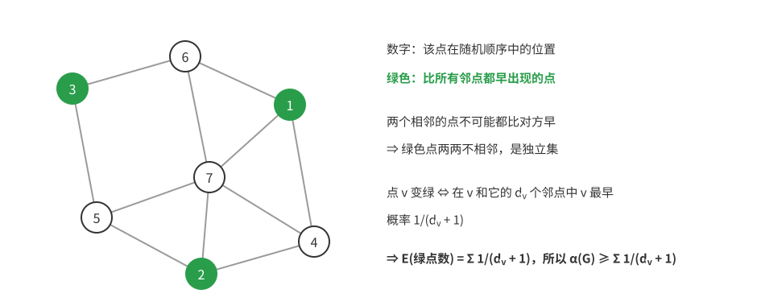

# 竞赛概率（三）：概率方法

概率方法用来证明“存在”：构造一个随机对象，证明它以正概率具有想要的性质，于是这样的对象存在。本篇讲四种工具，由浅入深：一阶矩方法（期望）、删除法、二阶矩方法（方差与切比雪夫不等式）、Lovász 局部引理。每种工具都先说明上一种工具在哪里失效，再引入它。前置知识是 [竞赛概率1——基础与一试](竞赛概率1——基础与一试.md) 第 3～6 章和 [竞赛概率2——期望计数与二试](竞赛概率2——期望计数与二试.md) 第 3 章。

第 1、2 章是一阶矩方法，第 3 章是二阶矩方法，第 4 章是局部引理。联赛二试偶尔出现可以用概率方法的组合题，通常也有初等解法；在 CMO 和集训队的组合题中，它是标准工具之一。局部引理在国内正赛中很少用到。进一步阅读可参考 Yufei Zhao 的讲义 [作者课程主页](https://yufeizhao.com/pm/) 及其中文学习教材 [概率方法讲义](../概率方法讲义/概率方法讲义——目录与记号.md)，其第 1～4 章与本篇对应。

用概率方法写证明，要写清三件事：随机对象是怎样取的，每个坏事件的概率是多少，以及由期望或概率推出存在性的那一步。

## 第 1 章　一阶矩方法

### 1.1 拉姆塞数的下界

把完全图 $K_n$ 的每条边染成红色或蓝色。拉姆塞定理说：$n$ 足够大时，一定有单色的 $K_k$（$k$ 个点之间的边全同色）。使这件事必然发生的最小的 $n$ 记为 $R(k,k)$。已知 $R(k,k)\le\binom{2k-2}{k-1}<4^k$。

我们想证明 $R(k,k)$ 也是指数级的，即对某个指数级的 $n$，存在一种染色**没有**单色 $K_k$。

明确的构造很难。比如把点分成 $k-1$ 组，每组 $k-1$ 个点，组内连红边、组间连蓝边：红色团最多 $k-1$ 个点，蓝色团每组最多取一个点，也最多 $k-1$ 个点。这样只得到 $n=(k-1)^2$，是多项式级的。几十年来，没有人找到指数级的明确构造。

那就随机染色：每条边独立地以 $\frac12$ 的概率染红或蓝。坏事件是“某 $k$ 个点构成单色 $K_k$”，对每个 $k$ 元点集，它的 $\binom k2$ 条边全红或全蓝，概率为 $2\cdot2^{-\binom k2}$。设 $X$ 为单色 $K_k$ 的个数，
$$E(X)=\binom nk2^{1-\binom k2}.$$

接下来是关键的一步。$X$ 只取非负整数，若 $E(X)<1$，则 $X$ 不能总是 $\ge1$（否则期望 $\ge1$），所以 $P(X=0)>0$，存在没有单色 $K_k$ 的染色。

剩下的是估计。取 $n=\lfloor2^{k/2}\rfloor$，$k\ge3$。用 $\binom nk<\frac{n^k}{k!}\le\frac{2^{k^2/2}}{k!}$，
$$E(X)<\frac{2^{k^2/2}}{k!}\cdot2^{1-\frac{k(k-1)}2}=\frac{2^{1+k/2}}{k!}<1,$$
最后一步：$k=3$ 时为 $\frac{2^{2.5}}{6}\approx0.94$，$k$ 每增加 1，左边乘以 $\frac{\sqrt2}{k+1}<1$。所以
$$R(k,k)>2^{k/2}.$$

这是 Erdős 1947 年的证明，也是概率方法的起点。

### 1.2 一阶矩方法

**命题 1.1**　设 $X$ 是坏事件的个数（非负整数）。若 $E(X)<1$，则存在没有坏事件的结果。等价地，若坏事件 $A_1,\dots,A_m$ 满足 $\sum P(A_i)<1$，则 $P(\text{一个都不发生})\ge1-\sum P(A_i)>0$。

**命题 1.2（平均值原理）**　对任意随机变量 $X$，存在结果使 $X\ge E(X)$，也存在结果使 $X\le E(X)$。

命题 1.1 要求坏事件的概率总和小于 1，命题 1.2 要求能算出期望。[竞赛概率2——期望计数与二试](竞赛概率2——期望计数与二试.md) 第 3 章的大割、哈密顿路都属于命题 1.2 的应用。

### 1.3 集族的二染色

**例 1.1**　$\mathcal F$ 是一族 $k$ 元集合，共 $m$ 个，$m<2^{k-1}$。证明：可以把所有元素染成红、蓝两色，使 $\mathcal F$ 中没有单色的集合。

**证明**　每个元素独立地等可能染红或蓝。一个 $k$ 元集单色的概率为 $2\cdot2^{-k}=2^{1-k}$，单色集合个数的期望为 $m\cdot2^{1-k}<1$，由命题 1.1 得证。$\blacksquare$

注意，这里没有用到集合之间怎样相交。如果集合之间的相交很少，第 4 章的局部引理可以允许 $m$ 远大于 $2^{k-1}$。

### 1.4 Caro–Wei 定理

**独立集**：两两不相邻的顶点集。图 $G$ 的最大独立集大小记为 $\alpha(G)$。

**定理（Caro–Wei）**　$\alpha(G)\ge\displaystyle\sum_{v}\frac1{d_v+1}$，其中 $d_v$ 是 $v$ 的度数。

要找一个大独立集，自然的尝试是贪心：按某种顺序考察顶点，一个顶点如果和已选的点都不相邻就选上。贪心的结果依赖顺序，坏的顺序可能很差。那就随机取顺序，然后算选上的点数的期望。

但“贪心选上”这件事依赖前面的选择，概率不好算。换一个更简单、只依赖局部的规则：**把 $v$ 选上，当且仅当 $v$ 在随机顺序中比它的所有邻点都靠前。**

- **合法性**：两个相邻的点不可能都比对方靠前，所以选出的点两两不相邻，是独立集。
- **概率**：只看 $v$ 和它的 $d_v$ 个邻点这 $d_v+1$ 个点，它们的相对顺序等可能，$v$ 排第一的概率是 $\frac1{d_v+1}$。

由线性性，选出的点数期望为 $\sum_v\frac1{d_v+1}$，由平均值原理得证。$\blacksquare$

**推论（平均度形式）**　设平均度为 $d$，则 $\alpha(G)\ge\dfrac{n}{d+1}$。由柯西不等式 $\sum\frac1{d_v+1}\cdot\sum(d_v+1)\ge n^2$，而 $\sum(d_v+1)=n(d+1)$。

**推论（图兰定理）**　$n$ 点图不含 $K_{r+1}$，则边数 $e\le\Big(1-\frac1r\Big)\frac{n^2}{2}$。

证明：对补图用 Caro–Wei。补图中 $v$ 的度数为 $n-1-d_v$，补图的独立集就是原图的团，所以原图最大团的大小
$$r\ge\omega(G)\ge\sum_v\frac1{n-d_v}\ge\frac{n^2}{\sum_v(n-d_v)}=\frac{n^2}{n^2-2e}.$$
整理即得 $e\le\big(1-\frac1r\big)\frac{n^2}2$。$\blacksquare$

一个关于“随机顺序中谁最靠前”的简单观察，推出了极值图论的基本定理。

### 1.5 无和子集

**定义**：集合 $S$ 称为**无和**的，如果不存在 $a,b,c\in S$（$a,b$ 可以相同）使 $a+b=c$。

**例 1.2**（Erdős）　证明：任意 $n$ 个非零整数中，可以选出多于 $\frac n3$ 个组成无和子集。

先找一个“标准”的无和集。在模 $p$ 的剩余中，取“中间三分之一”：$p=3k+2$ 时，$C=\{k+1,k+2,\dots,2k+1\}$。$C$ 中两数之和在 $2k+2$ 到 $4k+2$ 之间，模 $p$ 后落在 $\{2k+2,\dots,3k+1\}\cup\{0,1,\dots,k\}$，都不在 $C$ 中。所以 $C$ 是模 $p$ 无和的，大小 $k+1$，占非零剩余的 $\frac{k+1}{3k+1}>\frac13$。

怎样把给定的数“搬进” $C$？乘以一个随机的数。取素数 $p=3k+2$，大于所有给定数的绝对值（这样的素数存在：模 3 余 2 的素数有无穷多个）。在 $1,\dots,p-1$ 中随机取 $x$。对每个给定的数 $a$，$a\not\equiv0\pmod p$，所以 $xa\bmod p$ 随 $x$ 遍历全部非零剩余，在 $C$ 中的概率为 $\frac{k+1}{3k+1}>\frac13$。

设 $X$ 为 $xa\bmod p\in C$ 的给定数的个数，$E(X)>\frac n3$，所以存在 $x$ 使 $X>\frac n3$。这些数组成的子集是无和的：若 $a+b=c$，则 $xa+xb\equiv xc\pmod p$，与 $C$ 模 $p$ 无和矛盾。$\blacksquare$

这道题的结构是：先在一个“好”的环境里找到满足条件的大集合（模 $p$ 的中间三分之一），再用随机变换把问题搬进去，每个元素以相同的概率落进好集合。

### 1.6 一类竞赛图的存在性

**例 1.3**　若 $\binom nk\big(1-2^{-k}\big)^{n-k}<1$，则存在 $n$ 个选手的循环赛结果（竞赛图），使得任意 $k$ 个选手都被另外某个选手全部击败。

**证明**　每场比赛的胜负独立地抛硬币决定。对一组 $k$ 个选手 $K$，另外每个选手全胜 $K$ 的概率为 $2^{-k}$，各选手之间独立，所以没有人全胜 $K$ 的概率为 $(1-2^{-k})^{n-k}$。坏事件的期望个数 $\binom nk(1-2^{-k})^{n-k}<1$。$\blacksquare$

$k=2$ 时，$n=21$ 满足条件。这个界不是最优的（实际上 7 个人就够），概率方法给出的常常是“数量级正确、常数不最优”的结果。

## 第 2 章　删除法

### 2.1 独立集

在一个平均度为 $d$ 的 $n$ 点图中找大独立集（暂时忘掉 Caro–Wei）。

先用一阶矩试试：每个点独立地以概率 $p$ 选入集合 $S$。要 $S$ 是独立集，坏事件是“某条边两端都被选”，概率 $p^2$，共 $e=\frac{nd}2$ 条边，期望 $\frac{nd}2p^2$。要它小于 1，$p$ 必须小于 $\sqrt{2/(nd)}$，这时 $S$ 本身的期望大小 $pn$ 只有 $\sqrt{2n/d}$ 左右，太小了。

问题在于，要求坏事件**一个都没有**太苛刻。坏事件虽然有一些，但如果它们比选中的点少得多，可以**把坏事件修补掉**。

删除法就是这样修补：选出 $S$ 后，$S$ 内部每有一条边，就删掉它的一个端点。剩下的点两两不相邻，个数至少是 $|S|-(\text{S 内部的边数})$：
$$E\big(|S|-e(S)\big)=pn-p^2\cdot\frac{nd}{2}.$$
取 $p=\frac1d$（使这个二次函数最大），得 $\frac{n}{2d}$。所以 $\alpha(G)\ge\frac n{2d}$。

和 Caro–Wei 的 $\frac n{d+1}$ 相比差一个常数因子，但删除法的思路适用面广得多。

### 2.2 拉姆塞数下界的改进

**例 2.1**　对任意 $n$，$R(k,k)>n-\binom nk2^{1-\binom k2}$。

**证明**　随机染色 $K_n$。对每个单色 $K_k$，删去它的一个顶点。剩下的点上没有单色 $K_k$，期望至少剩 $n-\binom nk2^{1-\binom k2}$ 个点。所以存在一种染色和删法，剩下这么多点而没有单色 $K_k$。$\blacksquare$

优化 $n$ 可以得到 $R(k,k)>\frac1e(1+o(1))\,k\,2^{k/2}$。1.1 节的一阶矩方法若同样仔细优化 $n$（不只取 $n=\lfloor2^{k/2}\rfloor$），得到的是 $\frac{1}{e\sqrt2}(1+o(1))\,k\,2^{k/2}$，所以删除法在这里只把常数提高了 $\sqrt2$ 倍。这个改进很小，但删除法的思路在别的问题中常常带来实质性的改进，例如 2.1 节。

### 2.3 一般步骤

两个例子的做法相同：随机取对象时**允许**有少量坏结构，只要坏结构的期望个数比对象“好的部分”小一个数量级；每个坏结构花一个单位的代价修补（删一个点或一条边）；最后选随机参数（如 $p$），使“好的部分减去坏结构”的期望最大。

## 第 3 章　二阶矩方法

### 3.1 为什么需要方差

一阶矩方法只能说“存在一个 $\ge E(X)$ 的取值”，或在 $E(X)<1$ 时说“存在 $X=0$”。有两类问题它回答不了：

1. 想证明 $X>0$（某种结构**存在**），但 $E(X)$ 很大并不能保证：$X$ 可能大部分时候为 0，偶尔取极大的值，把期望撑起来。
2. 想证明 $X$ 的取值**集中**在某个范围内，而不只是平均值在那里。

两者都需要控制 $X$ 偏离期望的程度，也就是方差。

### 3.2 马尔可夫不等式与切比雪夫不等式

**马尔可夫不等式**　若 $Y\ge0$，$a>0$，则 $P(Y\ge a)\le\dfrac{E(Y)}{a}$。

证明：$Y\ge a\cdot I_{\{Y\ge a\}}$（$Y\ge a$ 时右边为 $a$，否则为 0，而 $Y\ge0$），两边取期望。$\blacksquare$

它说的是：非负变量不可能经常远大于自己的期望。命题 1.1 就是 $a=1$ 的情形：$P(X\ge1)\le E(X)$。

**切比雪夫不等式**　$P\big(|X-\mu|\ge t\big)\le\dfrac{D(X)}{t^2}$。

证明：对 $Y=(X-\mu)^2\ge0$ 用马尔可夫不等式，$a=t^2$。$\blacksquare$

**推论**　$P(X=0)\le\dfrac{D(X)}{E(X)^2}$。（$X=0$ 时 $|X-\mu|=\mu$，取 $t=\mu$。）所以若 $D(X)$ 远小于 $E(X)^2$，$X$ 几乎总是正的。

### 3.3 下降位个数的集中

[第一篇](竞赛概率1——基础与一试.md)第 6 章算出，随机排列下降位个数 $X$ 满足 $E(X)=\frac{n-1}2$，$D(X)=\frac{n+1}{12}$。由切比雪夫不等式，
$$P\Big(\Big|X-\frac{n-1}{2}\Big|\ge n^{0.75}\Big)\le\frac{(n+1)/12}{n^{1.5}}\to0.$$
即几乎所有排列的下降位个数都在 $\frac n2\pm n^{0.75}$ 之内。偏差的量级由标准差 $\sqrt{D(X)}\approx\sqrt{n/12}$ 决定，比 $n$ 小得多。

一般地，方差远小于期望的平方时，随机变量集中在期望附近，偏差的量级是标准差。

### 3.4 子集和互不相同的集合

**例 3.1**（Erdős–Moser）　正整数 $x_1<x_2<\cdots<x_k\le N$ 的全部 $2^k$ 个子集和互不相同。证明 $N\ge c\cdot\dfrac{2^k}{\sqrt k}$，$c$ 为某个正常数。

先看平凡的界。$2^k$ 个子集和是互不相同的非负整数，都不超过 $kN$，所以 $kN+1\ge2^k$，$N\ge\frac{2^k-1}{k}$。

能不能改进？平凡界假设子集和散布在整个 $[0,kN]$ 上。但随机子集和**集中**在中间一个窄得多的区间里，如果在那个窄区间里也要容纳大部分互不相同的子集和，就能得到更好的界。

具体计算：随机取子集，每个 $x_i$ 独立地以 $\frac12$ 的概率选入，子集和 $S=\sum\varepsilon_ix_i$，$\varepsilon_i$ 独立地取 0、1。
$$\mu=E(S)=\frac12\sum x_i,\qquad D(S)=\sum x_i^2D(\varepsilon_i)=\frac14\sum x_i^2\le\frac{kN^2}4.$$
（$\varepsilon_i$ 独立，方差可以相加。）由切比雪夫不等式，取 $t=N\sqrt k$：
$$P\big(|S-\mu|\ge N\sqrt k\big)\le\frac{kN^2/4}{kN^2}=\frac14.$$
所以至少 $\frac34\cdot2^k$ 个子集的和落在开区间 $(\mu-N\sqrt k,\ \mu+N\sqrt k)$ 内。这些和是互不相同的整数，而区间内至多有 $2N\sqrt k+1$ 个整数：
$$\frac34\cdot2^k\le2N\sqrt k+1\quad\Longrightarrow\quad N\ge\frac{\frac34\cdot2^k-1}{2\sqrt k}.$$
比平凡界多了一个因子 $\sqrt k$。$\blacksquare$

方差在这里的作用，是把“子集和散布的范围”从 $kN$ 缩小到 $N\sqrt k$。这是二阶矩方法最典型的用法：用标准差代替最大可能范围。

## 第 4 章　Lovász 局部引理

### 4.1 动机

一阶矩方法要求 $\sum P(A_i)<1$。坏事件个数一多，这个条件就不成立了，即使每个坏事件的概率都很小。

另一个极端：如果坏事件**相互独立**，那么
$$P(\text{一个都不发生})=\prod_i\big(1-P(A_i)\big)>0,$$
只要每个 $P(A_i)<1$，个数再多也没关系。

实际问题介于两者之间：坏事件很多，但每个只和少数几个“有关系”。局部引理说的就是：只要相关的个数和单个概率的乘积够小，结论仍然成立。

### 4.2 对称形式

设 $A_1,\dots,A_m$ 是事件，每个 $A_i$ 与除了至多 $d$ 个事件之外的其余事件**相互独立**（即 $A_i$ 与由其余事件经交、并、补组成的任何事件都独立）。若每个 $P(A_i)\le p$，且
$$e\,p\,(d+1)\le1,$$
则 $P\big(\bar A_1\bar A_2\cdots\bar A_m\big)>0$。

怎样判断相关：事件由若干独立的随机选择决定，两个事件只要**不依赖于共同的选择**，就相互独立。所以通常让 $A_i$ 的“相关集”为所有和它共用随机选择的事件。

### 4.3 集族的二染色（续）

**例 4.1**　$\mathcal F$ 是一族 $k$ 元集，每个集合至多与其他 $d$ 个集合相交。若 $e(d+1)\le2^{k-1}$，则可以把元素二染色，使 $\mathcal F$ 中没有单色集。

**证明**　随机染色，$A_F$ 为“$F$ 单色”，$P(A_F)=2^{1-k}$。$A_F$ 只依赖 $F$ 中元素的颜色，所以与所有和 $F$ 不相交的集合对应的事件相互独立，相关集至多 $d$ 个。$e\cdot2^{1-k}(d+1)\le1$，由局部引理得证。$\blacksquare$

由此推出：若每个元素至多属于 $k$ 个集合，则每个集合至多与 $k(k-1)$ 个其他集合相交。$k\ge9$ 时 $e\big(k(k-1)+1\big)\le2^{k-1}$，所以这样的集族可以二染色。和 1.3 节相比，集合的个数没有任何限制。

### 4.4 圆周上的选点问题

**例 4.2**　圆周上有 $11n$ 个点，用 $n$ 种颜色染色，每种颜色恰好 11 个点。证明：可以每种颜色选一个点，使得选出的点两两不相邻。

每种颜色独立地在它的 11 个点中均匀随机选一个。坏事件是：圆周上相邻的两点 $u,v$ 都被选中。同色的相邻点不可能都选中，所以只需考虑异色相邻对，$P(A_{uv})=\frac1{11}\cdot\frac1{11}=\frac1{121}$。

坏事件的个数约为 $11n$，随 $n$ 增长，一阶矩方法不行。但每个坏事件只和少数几个相关。$A_{uv}$ 只依赖于 $u$ 的颜色和 $v$ 的颜色这两种颜色的选择。与它不独立的，只有同样涉及这两种颜色之一的事件。每种颜色有 11 个点，每个点在 2 个相邻对中，所以涉及某种颜色的相邻对至多 22 个。两种颜色合起来至多 44 个，其中包括 $A_{uv}$ 本身（被数了两次），所以 $d\le42$。

$$e\cdot\frac1{121}\cdot43\approx0.966\le1.$$
由局部引理，以正概率没有坏事件发生。$\blacksquare$

### 4.5 局部引理的证明

记 $\Gamma(i)$ 为 $A_i$ 的相关集（$|\Gamma(i)|\le d$）。对任意集合 $T$，记 $B_T=\bigcap_{j\in T}\bar A_j$。

先证明一个断言：对任意 $i$ 和任意不含 $i$ 的 $T$（$P(B_T)>0$），有 $P(A_i\mid B_T)\le\frac1{d+1}$。

对 $|T|$ 归纳。把 $T$ 分成 $T_1=T\cap\Gamma(i)$ 和 $T_2=T\setminus\Gamma(i)$。

- 若 $T_1$ 为空，$A_i$ 与 $B_{T}$ 独立，$P(A_i\mid B_T)=P(A_i)\le p\le\frac1{e(d+1)}<\frac1{d+1}$。
- 否则
$$P(A_i\mid B_T)=\frac{P(A_iB_{T_1}\mid B_{T_2})}{P(B_{T_1}\mid B_{T_2})}.$$
分子 $\le P(A_i\mid B_{T_2})=P(A_i)\le p$（$A_i$ 与 $B_{T_2}$ 独立）。分母：设 $T_1=\{j_1,\dots,j_r\}$，$r\le d$，逐个用乘法公式，每个因子都是 $1-P(A_{j_s}\mid\cdots)$，其中的条件是 $T$ 中一个比 $T$ 小的集合的 $B$，由归纳假设每个 $\ge1-\frac1{d+1}$：
$$P(B_{T_1}\mid B_{T_2})\ge\Big(1-\frac1{d+1}\Big)^d\ge\frac1e.$$
（最后一步：$\big(1+\frac1d\big)^d\le e$。）所以 $P(A_i\mid B_T)\le ep\le\frac1{d+1}$。

由断言推出定理：
$$P\big(\bar A_1\cdots\bar A_m\big)=\prod_{i=1}^mP\big(\bar A_i\mid\bar A_1\cdots\bar A_{i-1}\big)\ge\Big(1-\frac1{d+1}\Big)^m>0.\qquad\blacksquare$$

## 第 5 章　习题

1. （一阶矩）证明：只要 $n^2<(k-1)2^k$，就可以把 $1,2,\dots,n$ 染成两色，使得没有单色的 $k$ 项等差数列。（先证明 $\{1,\dots,n\}$ 中 $k$ 项等差数列的个数不超过 $\frac{n^2}{2(k-1)}$。）
2. （一阶矩）证明：$n$ 点图若有 $e$ 条边，则它有一个顶点数为 $\lfloor n/2\rfloor$ 的导出子图，边数至少为 $e\cdot\dfrac{\binom{\lfloor n/2\rfloor}{2}}{\binom n2}$。
3. （Caro–Wei）证明：在 $n$ 点图中，若每个顶点的度数都不超过 $\Delta$，则存在至少 $\frac{n}{\Delta+1}$ 个点的独立集。再举出使这个界取等的图。
4. （删除法）证明：任何 $n$ 点、$e$ 条边的图（$e\ge n$），存在一个至少有 $\dfrac{n^{3/2}}{2e^{3/4}}$ 个点的导出子图，其中没有三角形。可以直接使用结论：$e$ 条边的图中三角形个数不超过 $\frac{(2e)^{3/2}}{6}$。
5. （二阶矩）掷 $n$ 次公平硬币，正面次数为 $X$。用切比雪夫不等式证明：$P\big(|X-\frac n2|\ge n^{2/3}\big)\to0$。
6. （局部引理）改进第 1 题：设 $k\ge2$，若 $e\,(2kn+1)\le2^{k-1}$，则可以把 $1,2,\dots,n$ 染成两色，使得没有单色的 $k$ 项等差数列。（先证明：包含某个固定的数的 $k$ 项等差数列不超过 $2n$ 个。）比较两题允许的 $n$ 的量级。

### 答案与提示

1. 等差数列由首项 $a$ 和公差 $d\ge1$ 决定，$a+(k-1)d\le n$，个数为 $\sum_{d\ge1}\big(n-(k-1)d\big)^+$。把它看成关于 $d$ 的递减一次函数的正部求和，不超过对应三角形的面积 $\frac{n^2}{2(k-1)}$。每个数列单色的概率为 $2^{1-k}$，期望 $\le\frac{n^2}{(k-1)2^k}<1$。
2. 随机取一个 $\lfloor n/2\rfloor$ 元顶点子集，每条边两端都在其中的概率为 $\binom{\lfloor n/2\rfloor}2\big/\binom n2$，用平均值原理。
3. 由 Caro–Wei，$\sum\frac1{d_v+1}\ge\frac n{\Delta+1}$。若干个互不相连的 $K_{\Delta+1}$ 取等。
4. 每点以概率 $p$ 选入，再删掉每个选中三角形的一个点。记 $T=\frac{(2e)^{3/2}}6$，期望剩下至少 $pn-p^3T$ 个点。取 $p=\sqrt{\frac{n}{3T}}$（使它最大），得 $\frac23pn=\frac{2^{3/4}}{3}\cdot\frac{n^{3/2}}{e^{3/4}}\approx0.56\,\frac{n^{3/2}}{e^{3/4}}$，大于所要的界。还要检验 $p\le1$，即 $(2e)^{3/2}\ge2n$，由 $e\ge n$ 保证。
5. $D(X)=\frac n4$，所以概率 $\le\frac{n/4}{n^{4/3}}\to0$。
6. 固定 $x$，它作为数列的第 $j$ 项（$1\le j\le k$）时，数列由公差决定，而公差不超过 $\frac{n-1}{k-1}$，所以包含 $x$ 的数列不超过 $\frac{k(n-1)}{k-1}\le2n$ 个。一个数列有 $k$ 个数，与它有公共元素的其他数列不超过 $2kn$ 个，即 $d\le2kn$。每个数列单色的概率 $p=2^{1-k}$，条件 $ep(d+1)\le1$ 就是 $e(2kn+1)\le2^{k-1}$。第 1 题允许 $n$ 约为 $\sqrt k\,2^{k/2}$，这里允许 $n$ 约为 $\frac{2^k}{4ek}$，指数从 $\frac k2$ 提高到 $k$。数列很多，但每个只和少数几个相关，这正是局部引理比一阶矩强的情形。

回到第一篇：[竞赛概率1——基础与一试](竞赛概率1——基础与一试.md)。二试计数技巧见 [竞赛概率2——期望计数与二试](竞赛概率2——期望计数与二试.md)。
